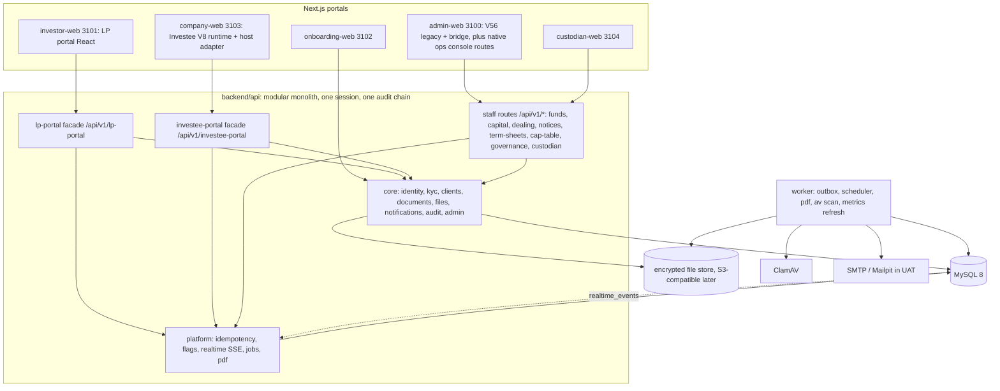
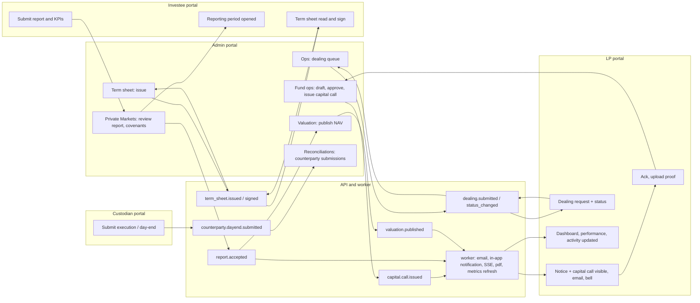
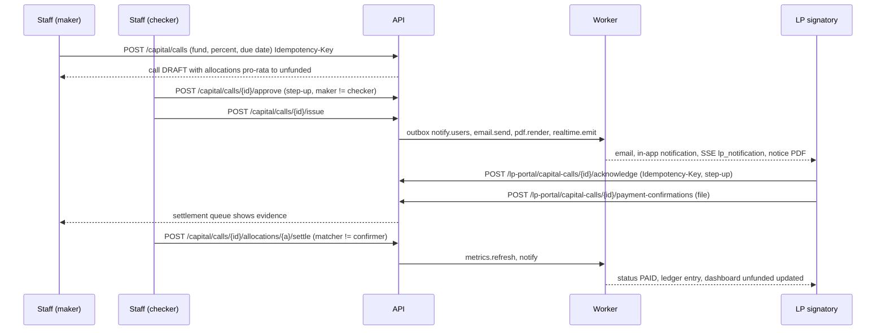
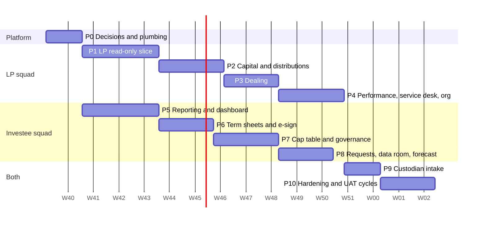

# Build plan: bringing the LP and Investee portals live on the Nexus core

> Produced 1 Oct 2026 as input to SRD v2 (docs/SRD.md). Section 12 is the one-day plan to UAT; the actionable version for the dev branch is docs/DEV-PLAN-1DAY.md. Estimates are planning figures, not commitments. Evidence labels: [O] observed, [I] inferred, [P] proposed.

| Field | Value |
| --- | --- |
| Prepared | 1 Oct 2026, read-only analysis of the Nexus repo, the NVCCZ/"Arcus" frontend (`nvccz-new`) and the NVCCZ backend (`nvccz`) |
| Question answered | "Explore these portals and how they fit in with our core platform, then figure out how we will build this system." |
| Inputs | `docs/SRD.md`, `ARCHITECTURE.md`, `PORTALS.md`, `DOMAIN-ENTITIES.md`, `backend/api/**`, `deploy/**`, `backend-audit.md`, admin UI research (`ui-admin-1/3.md`, `parts/*.md`), NVCCZ design-refs (LP backend SRD, UI SRD, gap analysis, investee asks, multi-portal docs, handbook), NVCCZ backend source |
| Constraint added during the work | One day of development, then UAT starts the next day. Section 12 states what "fully functional A to Z" can honestly mean under that constraint. |

**Evidence labels.** [O] observed in code or documents (path or count given). [I] inferred from observation. [P] proposed by this plan. Open questions are written `Q-NEW: ... — default: ...`.

**Effort unit.** 1 pw (person-week) = one senior full-stack engineer working with an AI coding assistant for 5 days, including unit and contract tests, excluding UAT cycles and product decisions. Ranges, not points. Team sizes and calendar weeks are given where useful. All sizing is [I] (estimates), all code counts are [O] (measured with a script that follows relative imports in `nvccz/src`; the script is `closure.mjs` in this scratchpad; model counts are token matches of `.<model>.<prisma method>(` and are approximate).

**Measurement caveats.** "Own code" means the files that belong to the slice (services, controller, routes, middleware). "Import closure" means every file reachable by relative imports; it is an upper bound on what a naive lift drags along, because most NVCCZ services import a shared Prisma wrapper that itself pulls the accounting layer.

---

## 1. What the new portals are, in domain terms

### 1.1 The product shift

| Dimension | Matanho Nexus today (SRD v1.0, V56) | What the imported portals assume (NVCCZ/"Arcus") |
| --- | --- | --- |
| Business | Asset manager running discretionary mandates, collective schemes and some private-markets holdings on ZSE/VFEX, USD/ZWG/ZAR. [O] SRD 2 | PE/VC fund manager and fund ERP: raises funds, calls capital from LPs, invests in portfolio companies, reports to LPs, distributes proceeds. [O] `design-refs/lp-portal-backend-srd.md` section 1 |
| External "investor" | A *client* with mandates, cash accounts and a published portfolio snapshot (`clients`, `client_users`, `investor_snapshots`). [O] schema | A *limited partner organisation* with *fund commitments*, capital accounts, units (open-ended) or paid-in/unfunded (closed-end). [O] `LpUserRelation`, `InvestmentCommitment`, `LpHoldingPosition` |
| External "company" | Portfolio company submitting a monthly pack of 5 files and KPIs, answering questions, tracking covenants. [O] `modules/company` | Applicant then investee: gets term sheets, signs them, files structured financial reports and KPIs, requests drawdowns, sees cap table and governance. [O] `ApplicantPortalService`, `TermSheetService`, `capTable/*` |
| Core ledger | Immutable cash sub-ledger, IBOR/ABOR/PBOR (SRD, mostly not built). [O] audit H9 | Full accounting engine (GL, chart of accounts, VAT, payroll, 565 Prisma models). LP and cap-table services post journals into it. [O] `CapitalCallService`, `CapTableGlPostingService` |
| Fund concept | None in the schema. Funds appear only as strings (`investmentName`) and as `fund_portfolio_id` in the proposed NAV table. [O] `schema.prisma`, SRD 10.3 | First-class `Fund` with 63 fields, operating model, fees, waterfall, vintage. [O] `Fund` |
| Authority for numbers | Published snapshot imported by staff (maker/checker) stands in for IBOR/PBOR. [O] audit 2.7 | Portal "consumes approved snapshots" produced by fund accounting and valuation engines; it never computes NAV or IRR itself. [O] `lp-portal-backend-srd.md` rule 3 and section 28 |

Reading: the imported UIs are not a reskin of the V56 investor and company portals. They add a *fund-ops* layer (funds, commitments, calls, distributions, dealing, term sheets, cap table) that the SRD never specified. Nexus already owns an identity/KYC/documents/audit spine and a thin version of capital events and company reporting, so the work is to add the fund-ops layer *on* that spine, not to adopt the NVCCZ backend wholesale.

### 1.2 New capabilities the UIs add (not covered by SRD v1.0)

Status columns say what exists upstream in NVCCZ, because several screens are fixtures even there.

| # | Capability | Portal / page | NVCCZ backend status | Nexus SRD status |
| --- | --- | --- | --- | --- |
| N1 | Fund registry with two operating models (`PRIVATE_CAPITAL`, `OPEN_ENDED`), share classes, valuation status (`ESTIMATED / PROVISIONAL / FINAL / RESTATED`), as-of dates | LP: all pages (fund switcher, as-of chip) | Live. `LpFundPortalContext`, `LpHoldingPosition`, `Fund` [O] | None |
| N2 | LP commitments and fund-level capital account: commitment, called, paid-in, unfunded (= commitment minus called), distributions, NAV, DPI/RVPI/TVPI/net IRR | LP: dashboard, performance | Live, computed by `LpFundMetricsService` (202 LOC) over `PortfolioDashboardService` (2,184 LOC) [O] | Partial: snapshot investments carry the same fields as published numbers only (`snapshot_investments`) |
| N3 | Capital calls at fund level with call number, per-LP allocation, wire instructions, issue/acknowledge/pay lifecycle, notice PDF | LP: capital activity | Live. `CapitalCallService` 997 LOC, GL posting, allocations [O] | Partial: `capital_events` per client, free-text `investmentName`, no allocation engine except `POST /capital-events/allocate` over snapshots |
| N4 | Acknowledge vs pay separation (acknowledgement is not payment); payment confirmation with proof upload | LP: capital activity | Live (`LpCapitalCallPortalState`, `LpCapitalCallPaymentConfirmation`) [O] | Partial: funding evidence exists; acknowledgement does not |
| N5 | Distributions at fund level: gross, adjustments, net, type (return of capital, realisation, dividend, interest, income), statement download | LP: capital activity | Live. `DistributionService` 782 LOC, `LpFeesAndDistributionsController` [O] | Partial: a `capital_events` row of type Distribution |
| N6 | Account activity ledger in transaction, fund and presentation currencies with immutable historic FX, export csv/xlsx/pdf | LP: account activity | Live (`LpPortalLedgerService` 256 LOC) [O] | Partial: `snapshot_transactions` |
| N7 | Subscriptions and redemptions (dealing): rules (notice days, minimum balance, dealing calendar, fees), estimates, compliance gate, request lifecycle, bank accounts | LP: subscriptions and redemptions | Live (`LpPortalDealingService` 667 LOC, 8 states, 6 hard-validation codes) [O] | None |
| N8 | Notices (announcements) with targeting (all / fund / class / organisation / user) and delivery receipts (published, delivered, opened, acknowledged) | LP: notices | Live (`LpNotice`, `LpNoticeReceipt`) [O] | None (notifications are per user, not targeted publications) |
| N9 | Organisation, colleague administration with 3 LP roles and per-fund entitlements, bank-instruction change requests | LP: organisation | Live (`LpPortalColleagueService`, `LpBankInstructionChange`) [O] | Partial: `client_users` with 4 investor roles and 4 account scopes; no bank-change endpoint (bank instruction is seed-only) |
| N10 | Performance reports and statements as async jobs (PDF), benchmarks, by-fund view | LP: performance, reports | Live (`LpPortalReportsService`, `LpPortalJob`, `pdfkit`) [O] | None |
| N11 | Record-linked secure messaging and service requests with attachments and assignee | LP: requests and messages | Live (`LpPortalServiceDeskService` 633 LOC) [O] | Partial: `service_requests`, `message_threads` exist; no attachments on replies, no record links |
| N12 | Realtime updates (notice, request, thread, notification events) | LP: all | Live over Socket.IO (`RealtimeSocketService`, `LpPortalRealtimeService`) [O] | None (no realtime, SRD non-goal) |
| N13 | Term sheets: staff issue, applicant views and signs, versions, status through to fully signed | Investee: terms, signatures | Live: `TermSheetService` 852 LOC; signature is an uploaded image stored in Firebase Storage, not an evidence-grade e-signature [O] | None |
| N14 | E-signature requests and signature studio (21 controls) | Investee: signatures | Not wired upstream (21 controls inert) [O] `portfolio-investee-gap-analysis-and-plan.md` | Partial: `signature_requests`/`signatures` for investor documents with hash and MFA time |
| N15 | Structured financial reporting: income statement, balance sheet, cash flow and operational-KPI drafts, file upload per report, period KPI submission, templates | Investee: reports, KPI centre | Live but stored in raw-SQL tables outside the Prisma schema (`financial_reports`, 18 raw-SQL sites in `FinancialReportService` 2,319 LOC) [O] | Partial: 5-item pack + free KPI map |
| N16 | Cap table and waterfall: registry, share classes, stakeholders, convertibles, issuance/transfer with maker/checker, dilution simulator, waterfall, certificates | Investee: cap table | Staff-side services live (`capTable/*`, 23 routes, 8 models, 1,386+444 LOC); the investee page is a fixture [O] | None |
| N17 | Governance: board approvals, reserved matters, decisions | Investee: governance | Fixture upstream; staff `BoardReviewService` (1,654 LOC) is an IC voting tool, a different concept [O] | None |
| N18 | Forecast model / workbook (sheets, scenarios, close-day lock) | Investee: forecasts | Fixture; state in browser `localStorage`; no API [O] | None |
| N19 | Capital and procurement (drawdown) requests against an approved investment, with goods-received notes | Investee: requests | Partial: `InvesteeDrawdownProcurementService` 160 LOC over a 5,807-LOC `ProcurementService` [O] | None |
| N20 | Document vault for the company (folders, versions, access profile) | Investee: data room | **Absent upstream** (backend ask T3.7) [O] `investee-portal-v8-backend-asks.md` | Partial: company library (read-only download) |
| N21 | Messages between company and the fund team | Investee: messages | **Absent upstream** (product decision A/B/C open) [O] same doc | Partial: reporting question threads |
| N22 | Team and access with 5 workspace roles (report contributor, KPI owner, executive approver, read only, workspace administrator) | Investee: team | Fixture upstream [O] | Partial: `company_users` with no roles |
| N23 | Custodian portal: trade executions and day-end packages feeding reconciliation | Custodian (3104) | Not in NVCCZ; static prototype in Nexus [O] | Described as an integration only |

**Where the upstream software is weaker than the UI suggests.** Of the 13 Investee pages, upstream only wires dashboard, term sheet read and sign, KPI and financial-report submission, settings and (partially) capital requests. Cap table, governance, forecast, data room, messages and team are fixtures. [O] gap analysis, Track B. For the LP portal the opposite holds: the backend was built to the UI contract and is almost complete (83 routes, 71 of them investor-facing, against the 69 methods the UI calls; see 1.3).

### 1.3 Contract facts that shape the plan

| Fact | Evidence |
| --- | --- |
| The LP UI calls 69 methods in 12 domains. Domain counts: session 2, dashboard 3, capital 10, activity 4, dealing 9, performance 7, documents 8, notices 4, requests 9, organisation 7, settings 4, reports 2. | `portals/investor-web/src/lib/api/lp-portal-api.ts` `LP_METHOD_DOMAIN` [O] |
| The NVCCZ backend exposes 83 LP routes: 71 investor-facing plus 12 GP-admin (`/admin/requests`, `/admin/notices`, `/admin/memberships`, `/admin/documents`, `/admin/mfa-policy`), plus one cron (`/cron/lp-portal/snapshot-refresh`). | `src/routes/lpPortalRoutes.ts`, `lpPortalCronRoutes.ts` [O] |
| The Nexus LP UI already has per-domain live switches (`LP_LIVE_DOMAINS`, 12 booleans, all false) and a Proxy that routes each method to mock or live by domain. The network client is a stub that rejects. | `lib/lp-portal/config.ts`, `lib/api/api-client.ts` [O] |
| Envelope: `{success, message, data, timestamp, meta}`; errors `{success:false, message, error:{code, message, fieldErrors, details, retryable}}`; 17 `LP_*` codes; `Idempotency-Key` required on 9 write routes (call acknowledge, payment confirmation, subscription, redemption, service request, notice acknowledge, colleague invite, bank-instruction change, performance-report job; `lpPortalRoutes.ts`); money as decimal strings. Nexus's native envelope is `{error:{code,message,details}}` with raw JSON bodies. | `lp-portal-backend-srd.md` 4.2-4.6, 22; `backend-audit.md` 1.1 [O] |
| The Investee runtime ships with `liveOnly` branches that read `livePayload.{profile, application, company, termSheets, dashboard, reportingRequests, financialReports, drawdown}`; the host adapter that fed them upstream (`lib/investee-portal-v8/actions.ts` 532 LOC, `live-loaders.ts` 59 LOC, `lib/api/application-portal-api.ts` 824 LOC, 30 methods) was **not** brought into Nexus. It can be reused. | `company-web/.../matanho-investee-portal-runtime.js` (200 KB), `nvccz-new/lib/investee-portal-v8/*` [O] |
| NVCCZ's own UAT assets exist: seven HTTP UAT scripts for the LP portal (`uat:lp-portal:phase1..4`, `srd-acceptance`, `fe-gaps`, `realtime`), a seed (`db:seed:lp-portal-srd`), and small unit-test files (cap-table dilution, waterfall and transfer validation: 73 lines in `tests/`; LP metrics and RBAC: 55 lines in `src/tests/`). They are usable as black-box oracles, but they are thin. | `nvccz/package.json`, `nvccz/scripts/*`, `nvccz/src/tests/*` [O] |

---

## 2. Fit with the Nexus core

### 2.1 Conflicts of concept

| # | Concept | Nexus | NVCCZ / imported UI | Resolution [P] |
| --- | --- | --- | --- | --- |
| C1 | Investor | `clients` (`CL-#####`), mandate-oriented, `kycStatus`, `portalEnabled`, `accountsCount` | `Client` (`investorId` such as `INV-ACP-001`) plus `InvestmentCommitment` per fund | Keep `clients` as the legal-entity master (LP organisation = client). Add `fund_commitments` as the LP-in-fund relation. Display `investorId` as `clients.ref` or a new `investor_ref` column. |
| C2 | Fund | Absent. Closest: SRD `portfolios` with type fund/CIS and `private_investments` | `Fund` plus `LpFundPortalContext` (operating model, default share class, valuation status) | New `funds` table (vehicle). Optional `portfolio_id` link later (Q-NEW-01). Do **not** overload `private_investments`: that is something a fund *owns*. |
| C3 | Portfolio company | `portfolio_companies` (`PC-###`), many-to-many `company_users`, no create endpoint | `PortfolioCompany` (one `userId`), created from an `Application` at due-diligence completion; `Application` carries the deal pipeline (41 fields) | Keep Nexus `portfolio_companies`. Add `status` (Prospect, Active, Exited) so a term sheet can be issued to a prospect. Do not port `Application` (deal pipeline, 1,885-LOC service, DD, IC, board) in this scope. |
| C4 | Company user | `company_users`, no roles | `PortfolioCompany.userId` unique; UI team page has 5 roles | Add `role` to `company_users` (5 values), keep many-to-many. |
| C5 | Investor roles | 4 investor roles `admin / investment / finance / auditor`, scope = `all / managed / private / documents` | 3 LP roles `VIEWER / SIGNATORY / MANAGER` plus per-fund `fundIds`; 34 `lp.*` permission codes | Add the 3 LP roles and `lp.*` codes to the investor portal catalogue; migrate existing `client_users.investor_role`; add `fund_ids` JSON to `client_users`. (Q-NEW-02) |
| C6 | Staff roles | 10 admin roles (`investment_director`, `compliance`, `operations`, `client_services`, ...) | `admin`, `fund_manager`, `cfo`, plus a 248-field `User` with dozens of ad-hoc role fields | Keep Nexus RBAC. New staff permissions for fund ops (list in 5.3) added to the catalogue; do not import NVCCZ role codes. |
| C7 | Identity | Opaque session cookie, SHA-256 stored, portal roles, TOTP, invitations | JWT with `tokenVersion`, `aud` per portal (`staff`/`lp`/`investee`), Socket.IO handshake JWT with a hard-coded fallback secret | Nexus session stays the only identity. Nothing from NVCCZ auth is ported. |
| C8 | API conventions | `/api/v1`, `{error:{code,message}}`, `If-Match`, 400 `bad_request` for validation | `/api/lp-portal`, `/api/applicant`, `{success,data}`, `LP_*` codes (422 for validation) | Keep the NVCCZ envelope **only inside** the two portal facades (`/api/v1/lp-portal`, `/api/v1/investee-portal`) so the UIs stay unchanged. Everything staff-side stays Nexus-native. |
| C9 | References | `CL-`, `CAP-`, `REQ-`, `DOC-`, `Q-`, `PC-`, from `sequences` | `FND-AGFV`, `DIST-008`, `RDM-016`, `callNo` integers per fund, `INV-...` | Add sequence kinds (`fund`, `call` per fund, `distribution`, `subscription`, `redemption`, `notice`, `termSheet`, `envelope`, `capRequest`). UIs only display `reference` strings. |
| C10 | Currency | USD, ZWG, ZAR | `ZIG` label, `UsdZwgRateResolver`, `presentationCurrency` USD or ZIG | Use ISO `ZWG` in the API, map `ZIG` at the facade edge; add ZAR; FX from an `fx_rates` table (SRD 10.3) with immutable stamping on ledger rows. (Q-NEW-11) |
| C11 | Status vocabularies | Capital event: Draft, Approved, Expected, Due, Processing, Funded, Paid | Call: DRAFT, ISSUED, ACKNOWLEDGED, PARTIALLY_PAID, PAID, OVERDUE, CANCELLED; dealing 8 states; notice 4 states | Store the NVCCZ vocabularies natively for new tables; map the existing Nexus capital-event vocabulary at read time during the transition. |
| C12 | Maker/checker | Policy-driven (`cash_approval`, `document_approval`, ...), `sod_violation` 403 or 409 inconsistently | GP side maker/checker described, enforced in `CapitalCallService`; portal shows only issued items | Reuse Nexus policies and `sod_violation`; unify to 403 for new modules. |
| C13 | Money and units | `DECIMAL(20,4)`; snapshot values often strings | Decimal strings; units and NAV with more precision | `DECIMAL(24,8)` for units, `DECIMAL(20,8)` for NAV per unit (SRD AD-08). |
| C14 | Documents | `documents` + versions + publications, classification `Public/Client/Internal/Restricted`, status Draft to Published | `LpPortalDocument` with 11 categories and 5 statuses (`PUBLISHED, REQUIRES_SIGNATURE, SUPERSEDED, RESTATED, WITHDRAWN`) | Keep `documents`; add `category`, `fund_id`, `period`; map statuses (`Superseded`, `Withdrawn`) via publication state. |

### 2.2 Capability matrix: LP portal

Legend for "Gap": **E** exists and only needs an adapter, **X** extend an existing table/module, **N** new.

| LP capability (domain, methods) | Nexus concept it attaches to | Exists today (API / schema) | Gap | Staff surface needed (section 6) |
| --- | --- | --- | --- | --- |
| Session and fund context (`session`, 2) | `client_users` membership, `clients`, `funds` | `GET /investor/bootstrap` returns client, role, scope, snapshot, permissions; no funds | N `funds`, `fund_commitments`; X `client_users.fund_ids` | Fund master, commitments register |
| Dashboard KPIs and action items (`dashboard`, 3) | Fund commitments + published valuation | Snapshot `metrics`, `investments`, `activity` (published) | X: compute from commitments + valuation, or serve published snapshot as interim | Valuation publish |
| Capital calls (`capital`, list/detail/summary/documents, 4) | `capital_calls` (new) over existing `capital_events` | `capital_events` per client with approve/publish/settle, SoD, step-up, funding evidence | N `capital_calls`, `capital_call_allocations`; X statuses, call number, wire details | Call run, approve, publish, settle |
| Acknowledge call, upload payment confirmation, notice download (3) | Same | Funding evidence upload exists (`/investor/capital-events/:ref/funding-evidence`) | X `acknowledged_at/by`; N notice PDF renderer | Settlement queue |
| Distributions (`capital`, 4) | `distributions`, allocations | `capital_events` type Distribution, `settle` → Paid | N `distributions`, allocations with gross/adjustment/net | Distribution run |
| Account activity and ledger (`activity`, 4) | `fund_ledger_entries` or snapshot transactions | `snapshot_transactions`, `capital_events` | N ledger table (immutable FX) or X snapshot reuse for first slice | Ledger import/derive |
| Dealing: overview, rules, requests, bank accounts (`dealing`, 5 reads) | `lp_dealing_rules`, `lp_holdings`, `fund_valuations`, `bank_instructions` | Nothing; `bank_instructions` seed-only | N 4 tables | Dealing queue, rules, NAV/unit publish |
| Dealing estimate and submit (4 writes) | `lp_dealing_requests` | Nothing | N, plus 6 hard validations | Queue, approve, allocate |
| Performance, history, benchmarks, by-fund (`performance`, 5) | `fund_metric_snapshots`, `benchmark_series` | `snapshot_performance_points`, `snapshot_allocation` | X read adapter; N benchmark table | Metrics publish |
| Performance report job and download, reports centre (`performance` 2, `reports` 2) | `jobs`, PDF renderer | `outbox` worker exists; no jobs table, no PDF lib | N `jobs`, worker handler, `pdfkit` | None (system) |
| Documents list/detail/download/preview/summary, vault verify (`documents`, 8) | `documents`, `publications`, `document_versions` | Publication and signed download exist; hash on versions; sign flow exists | X category/fund/period; E download; N preview (inline stream) and per-download audit already exists | Vault publish (extend) |
| Notices list/detail/ack, notification feed (`notices`, 4) | `lp_notices`, receipts, `notifications` | `notifications` per user only | N `lp_notices`, receipts | Notice publish |
| Requests: list/detail/create/attach/reply (`requests`, 5) | `service_requests` + events | Exists; priority collapsed to Normal/Time sensitive; no attachment on reply | X `service_request_messages`, attachments, assignee, fund | Service desk (exists in admin-30) |
| Messages: threads/detail/reply/read (`requests`, 4) | `message_threads`, `messages` | Exists; no attachments, no record link | X attachments, `linked_type/id` | Service desk |
| Organisation, colleagues invite/update/revoke (`organisation`, 5) | `client_users`, `invitations` | Invite exists (`/investor/users/invite`); no update/revoke by the investor; staff revoke exists | X endpoints, role and fund scope update, session revocation on revoke | Portal access (admin-30) |
| Bank instruction changes (`organisation`, 2) | `bank_instruction_changes` | Table `bank_instructions` seed-only | N, dual approval and out-of-band verification (BR-006) | Cash/Investor Services approval |
| Settings: notifications, display, MFA info (`settings`, 4) | `notification_preferences`, `settings`, MFA endpoints | Preferences table exists, **unused**; MFA endpoints exist | X wire the table; display settings in `settings` | None |
| Realtime (`getRealtime`, events) | SSE hub | None | N (phase 1) | None |

### 2.3 Capability matrix: Investee portal

| Investee page | Nexus concept | Exists today | Gap | Staff surface |
| --- | --- | --- | --- | --- |
| Overview (dashboard) | `portfolio_companies` + current period + covenants | `GET /company/workspace` (company, periods, kpiDefs, covenants, cashRunway, threads, activity, deadlines, library) | E adapter to the V8 payload shape | Private Markets company hub (admin-50) |
| KPI centre | `company_kpis`, `reporting_periods.kpi_values` | KPI definitions with series; period KPI map | X unit/benchmark; N derived KPIs | KPI definitions per company |
| Reporting centre: schedule, history, submit, report builder (income statement, balance sheet, cash flow, operational KPIs, templates) | `reporting_periods`, `reporting_items`, new `financial_reports` | 5-item pack with files; no structured statements | N structured report store (rewrite, not port), X templates | Review structured reports; open periods (endpoint exists, UI unused) |
| Forecast model / workbook | `forecast_workbooks` | None | N (JSON sheets, scenario, close-day lock) | Read-only view of submitted forecast |
| Term sheet | `term_sheets`, `signatures` | None | N | Term sheet builder and issue |
| Cap table | `cap_table_*` | None | N (7 tables, engines 227 LOC pure) | Cap table admin (maker/checker) |
| Governance | `governance_items` | None | N (thin: approvals, reserved matters) | Governance register |
| Signatures | `signature_requests`, `signatures` | Investor document signing with hash, MFA time, IP | X generalise `subject_type/id`, evidence pack | Envelope tracker |
| Capital and procurement requests | `capital_requests` | None | N thin version (header, lines, attachments, approval) | Request review queue |
| Document vault (data room) | `documents` with `company_id` + folders | Company library download only | X upload by company, folders, versions | Vault (admin-40) extend |
| Messages | `company_threads` (or reporting questions) | `reporting_questions` + messages (company can reply, cannot start) | X start thread; N or reuse | Private Markets Q&A (exists) |
| Team and access | `company_users`, `invitations` | Staff can invite a company user | X role, status, self-service invite, revoke | Company hub |
| Settings (profile, company, letterhead) | `portfolio_companies` | Read-only fields | X editable profile, letterhead JSON | Company master |

### 2.4 Summary of the fit

* Spine that can be reused as-is: identity/MFA/invitations, sessions and cookies across sub-domains, hash-chained audit, outbox and worker, encrypted file store with signed URLs, documents with publications and signatures, notifications, KYC and client activation, RBAC admin. [O] audit sections 1-4.
* Spine that must be generalised: `capital_events` (client-level, free-text fund), `service_requests` and `message_threads` (no attachments or record links), `signature_requests` (document-only), `company_users` (no role), `client_users` (no fund scope), `bank_instructions` (seed-only).
* Net new domains: funds and commitments, capital-call allocation, distributions, dealing, notices, valuation/NAV-per-unit publication, notice/statement PDFs, jobs, idempotency, SSE; term sheets, cap table, structured reports, forecast, governance, capital requests, company threads and data-room folders; custodian submissions.
* Estimated new tables: about 42 (range 38 to 48) against Nexus's 55 existing and NVCCZ's 565 (about 7.5 percent of the NVCCZ schema). [I]

---

## 3. Integration architecture options

### 3.1 What was measured in NVCCZ

All numbers [O], produced by following relative imports in `C:\Users\lysp\Downloads\nvccz\src` (565 Prisma models, 47 migration folders).

| Slice | Own code (files, LOC) | Routes | Models touched by own code | Import closure (files / LOC / model tokens) | Notes |
| --- | --- | --- | --- | --- | --- |
| **LP portal** services + controller + routes + middleware + realtime | 26 + realtime: 5,770 + 1,994 + 164 = **7.9k LOC** | 83 LP routes (71 investor, 12 GP-admin) + 1 cron | 39: 25 `Lp*` models plus 13 upstream (`user`, `client`, `fund`, `investmentCommitment`, `capitalCallAllocation`, `capitalCallAllocationPayment`, `distributionAllocation`, `fundReportRecipientJob`, `portfolioCompany`, `role`, `userMfaTotp`, `authMfaPending`, `passwordResetToken`) | 65 / 16.6k / 55 | 20 of 21 services and every controller/route file start with `// @ts-nocheck`. Depends on `LpFundMetricsService` (202 LOC) which depends on `PortfolioDashboardService` (2,184 LOC). |
| **Fund-ops upstream** that produces LP data (capital calls, distributions, fees, fund master) | `CapitalCallService` 997, `DistributionService` 782, `ManagementFeeService` 718, `FundService` 569, `FundFeePolicyService` 119, controllers 442, routes 494, `LpFundMetricsService` 202 = **4.2k LOC** | 32 (`fundRoutes` 20, fees and distributions 12) | `Fund` (63 fields), `CapitalCall*`, `Distribution*`, `InvestmentCommitment`, journal entries | `CapitalCallService`: 78 / 34.9k / 64; `DistributionService`: 31 / 13.9k / 32 | Every capital call and distribution posts a journal entry (`assignNextAuditIdAndCreateJournal`), so it needs the chart of accounts and currencies. |
| **Investee: applicant portal** | `ApplicantPortalService` 785, `ApplicantPortalController` 1,764, routes, `portalAuth` = **4.2k LOC** | 39 | 20 for the service | Service alone: 14 / 2.2k / 20. Controller: **133 / 53.9k / 95** | The controller pulls procurement, p2p, invoices, VAT, journals because the same routes also serve requisitions and financial reports. |
| Investee: financial reports and KPIs | `FinancialReportService` 2,319, `FinancialReportProcessingService` 825, `ReportingPeriodKpiService` 236, schemas and KPI helpers = **4.2k LOC** | 17 (inside the applicant router) | tables created by raw SQL and **absent from `schema.prisma`** (`financial_reports`, `reporting_notification_logs`; 18 raw-SQL sites in one service) | 56 / 23.1k / 37 | NVCCZ itself had to repair missing tables on dev (`investee-portal-v8-backend-asks.md`). Treat as a specification, not as code to lift. |
| Investee: capital/procurement requests | `InvesteeDrawdownProcurementService` 160 over `ProcurementService` **5,807** | 6 in applicant router | 13 | 14 / 1.5k (drawdown only); procurement graph is the large one | Only the thin drawdown ledger is needed; the 5.8k-LOC procurement suite is out of scope. |
| **Term sheets** | `TermSheetService` 852 + controller + routes = **1.9k LOC** | 7 | 35 | 53 / 20.6k / 39 (pulls deal-execution packs, investment memo, board review, user service) | Signature = uploaded image to Firebase Storage; immutable once uploaded; stage moves when both signatures exist. |
| **Cap table** | 15 services 1,386 + controller/routes/auth 444 = **1.8k LOC** (engines: dilution 103 + waterfall 69 = 172 LOC pure) | 23 | 8 own (`CapTable*`) | 72 / 16.7k / 54 | `CapTableGlPostingService` posts to the journal; `CapTableLpPortalHook` recomputes LP snapshots. Three unit-test files already exist for the engines. |
| Shared infrastructure baseline | `utils/database.ts` alone drags **13 files / 1.4k LOC** (Prisma middleware, period locks, accounting snapshots); `middleware/authenticate.ts` 17 files / 3.3k; `EmailNotificationService` 24 files / 10.2k | | | | Lifting any slice by imports drags this. |
| **Sum of own code in scope** | **about 24k LOC** (7.9 + 4.2 + 8.6 + 1.9 + 1.8) | | about 55 own models plus about 11 upstream | | For scale: the whole Nexus API is **6.7k LOC in 52 files** and 55 tables. The in-scope NVCCZ own code is 3.6 times that. |

Other facts that bear on the options [O]: schema changes there are applied by `prisma db push` and ad-hoc SQL scripts (`design-refs/vps-pending-migrations.md`, 56 KB of manual steps); the Socket.IO server falls back to a literal placeholder `JWT_SECRET` and allows any CORS origin (`RealtimeSocketService.ts`); the staff `User` model has 248 fields; INVESTEE accounts once reached the staff portal because of a default-allow branch (`utils/portalAuth.ts` comment). The NVCCZ team documents a wiped-patch regression when a generated runtime was re-extracted (`CLAUDE.md`, "Never hand-regenerate a runtime").

### 3.2 Option A: run the NVCCZ backend as a separate service behind a gateway

| Aspect | Description |
| --- | --- |
| Topology [P] | `nvccz-api` container plus its own MySQL schema and upload sidecar. A Nexus module `modules/gateway` mounts `/api/v1/lp-portal/*` and `/api/v1/investee-portal/*`, checks the Nexus session, maps the user, and reverse-proxies to `/api/lp-portal/*` and `/api/applicant/*`. Because the NVCCZ envelope **is** the UI's envelope, no response mapping is needed. |
| Auth / SSO | Nexus session is authoritative. Gateway performs token exchange: finds or creates the NVCCZ `User` by email, mints a 5-minute JWT (`aud` lp or investee, `tokenVersion`), proxies. Requires a shared signing secret and a `User`/`Client`/`LpUserRelation` projection per Nexus user. Revocation: bump `tokenVersion` on Nexus revoke. |
| Data ownership | **Split.** Nexus: users, KYC, clients, documents, audit, notifications. NVCCZ: funds, commitments, calls, distributions, LP documents (`lp_portal_documents`), notices, dealing, requests, messages, term sheets, applicant reports. Duplicated: the client/LP organisation, users, documents (two vaults), audit (two chains), notification state. Needs sync on activation, invite, revoke and on document publish. |
| Staff side | Either (i) deploy the NVCCZ staff build (`nvccz-new`, Next 14, `NEXT_PUBLIC_PORTAL=staff`) as a second admin app for fund ops, or (ii) build Nexus screens that call a gateway `/staff/*` surface (more mapping: Nexus staff to NVCCZ `fund_manager`/`cfo`). |
| Effort [I] | Deploy and seed NVCCZ (565-model `db push`, chart of accounts, currencies, `db:seed:lp-portal-srd`, storage sidecar, SMTP): 1.5 to 2.5 pw. Gateway, token exchange, user/client/membership sync, file streaming, CORS: 2 to 3 pw. Investee host adapter (reuse `actions.ts`, `live-loaders.ts`, `application-portal-api.ts`, about 1.4k LOC): 2 to 3 pw. Staff: (i) 1 pw to deploy, or (ii) 6 to 8 pw. Sync, monitoring, backup of the second DB, hardening: 2 pw. **Total 8 to 12 pw with (i), 13 to 19 pw with (ii).** Calendar: LP read slice in 3 to 5 days, full LP and investee surface in 3 to 5 weeks. |
| Risks | Two sources of truth for the same LP (reconciliation burden permanently). Staff do fund ops in a different product with a different audit trail (breaks SRD principle "evidence first, one audit chain"). Security debt inherited (placeholder JWT secret fallback, permissive socket CORS, 248-field user, `@ts-nocheck` throughout). Schema drift and raw-SQL tables make upgrades fragile. Capital-call creation needs a populated chart of accounts or it fails. Licence and ownership of the sibling product (Q-NEW-04). Investee cap table, governance, forecast, data room, messages, team are fixtures upstream, so A does **not** deliver them either. |
| Operational cost | +1 Node service (1 to 2 GB RAM assumed), +1 MySQL schema (or instance), +storage sidecar or Firebase, +cron secrets, +second backup/restore and monitoring path, +second set of migrations. Estimated +25 to 30 percent run and maintenance load. |
| Reversibility | High at the edge (remove gateway, flip flags); data in the NVCCZ schema must be exported to leave. The UIs are unchanged, so the contract survives. |

### 3.3 Option B: port the needed services and models into `backend/api`, keep the portal contracts

"Port" here means *contract-preserving re-implementation with selective code reuse*, not a copy of NVCCZ files.

| Aspect | Description |
| --- | --- |
| Topology [P] | New modules in `backend/api/src/modules/*` (section 4). `/api/v1/lp-portal/*` and `/api/v1/investee-portal/*` keep the NVCCZ paths, envelopes, error codes and idempotency semantics; everything behind them is Nexus services and Nexus tables. UIs unchanged except the network client and the flags. |
| What is reused from NVCCZ | Contracts and types (1,400-line `lp-portal-api.ts`, 824-line `application-portal-api.ts`), business rules (dealing estimates and 6 hard validations, call visibility, unfunded formula, notice targeting, status machines), pure engines (cap-table dilution and waterfall 172 LOC, transfer validation), seed data and UAT scripts as test oracles, host adapter for the Investee runtime (about 1.4k LOC). |
| What is dropped | GL posting and journals, Firebase and `RemoteUploadService`, Socket.IO and JWT, `Application`/DD/IC/board pipeline, procurement suite, `PortfolioDashboardService`, 248-field `User`, `@ts-nocheck`. |
| Auth / SSO | Nexus session only. A `lpContext` middleware replaces `LpPortalAccessService` (membership, role bundle, `fund_ids`). Cookie domain `.matanho.com` already gives SSO across portals. |
| Data ownership | Single MySQL schema, single audit chain, single document store, single notification pipeline. Fund-ops data owned by new modules; identity, KYC and clients stay where they are. |
| Effort [I] | Phased in section 7: **44 to 62 pw** (about 4 engineers for 11 to 16 calendar weeks, plus QA). First LP slice (session, dashboard, documents, notices, organisation read) at about 8 to 11 pw (3 to 4 weeks). Breakdown: platform plumbing 2-3, LP read slice 6-8, capital and distributions 5-7, dealing 4-5, performance/reports/service desk/bank changes 6-8, Investee reporting 5-7, term sheet and e-sign 3-4, cap table and governance 4-6, requests/data room/messages/forecast 4-6, custodian intake 2-3, hardening and UAT cycles 3-5. |
| Risks | Largest build. Behavioural drift from upstream rules (mitigated by oracle tests). Staff screens are the long pole (section 6). Team capacity. The generated Investee runtime must be patched, not regenerated. |
| Operational cost | None beyond the current stack: no second DB or service. Optional additions: ClamAV container, Mailpit in UAT, Redis later (SRD AD-04). |
| Reversibility | Medium. Schema is additive (expand/contract). Because the contract equals Option A's, any domain can be served temporarily by a gateway to NVCCZ (strangler), and any domain can be flipped back to mock by flag. |

### 3.4 Option C: rebuild from the SRD on existing Nexus modules and adapt the UIs

| Aspect | Description |
| --- | --- |
| Topology [P] | Extend `/api/v1/investor/*` and `/api/v1/company/*` in Nexus conventions (`{error:{code,message}}`, raw bodies, cursor pagination, `If-Match`). Rewrite the LP data layer (`lp-portal-api.ts`, `mappers.ts`, hooks) and touch the screens where shapes differ; patch the Investee runtime's data bindings. |
| Size of the UI change [O] | LP UI: 17.3k LOC TS in `investor-web/src`, of which 9.7k in 10 screens; assume 20 to 30 percent touched. Investee runtime: 200 KB generated single file with 12 lines longer than 2,000 characters; edits must go through a patch script. |
| Auth / SSO, data | Same as B. |
| Effort [I] | B's 44 to 62 pw plus net UI adaptation and re-QA of 12 domains and 13 pages (6 to 8 pw): **50 to 70 pw**. |
| Risks | Permanent merge tax: the NVCCZ team keeps shipping UI versions (V8, V9, ...); every refresh needs re-adaptation. Loses the executable spec (the mock-api) as the contract. The Nexus-native envelope forces changes in hundreds of call sites. |
| Operational cost | Same as B. |
| Reversibility | Low: the UIs fork from their upstream. |

### 3.5 Comparison

| Criterion | A: gateway to NVCCZ | B: port by contract (recommended) | C: rebuild, adapt UIs |
| --- | --- | --- | --- |
| Single source of truth | No | Yes | Yes |
| One audit chain, one vault, one RBAC | No | Yes | Yes |
| UIs unchanged | Yes | Yes | No |
| Effort (pw) | 8-12 (staff via NVCCZ app) or 13-19 | 44-62 | 50-70 |
| Time to first LP demo on real data | 3-5 days | 3-4 weeks (native slice); 1 day possible as thin facade (section 12) | 4-5 weeks |
| Run cost | +25-30 percent | baseline | baseline |
| Security posture | Inherits NVCCZ debt | Nexus controls | Nexus controls |
| Delivers fixtures-upstream pages (cap table view, governance, forecast, data room, messages, team) | No | Yes (designed natively) | Yes |
| Upgrade path from NVCCZ UI refreshes | Easy | Easy (same contract) | Hard |
| Reversibility | High | Medium | Low |

### 3.6 Recommendation

**Choose Option B, executed as a strangler with a contract-first method**: Nexus owns `/api/v1/lp-portal/*` and `/api/v1/investee-portal/*` from day one; each domain is served by a thin native implementation behind a runtime flag; the mock store is the executable spec; NVCCZ is used as a reference implementation and as an oracle, not as a runtime dependency.

Reasons:

1. The only way to meet the SRD's own principles (one audit chain, maker/checker, published-data boundary, evidence first) is a single data and audit spine. Option A splits it permanently. [I]
2. The contract is already fixed and portable: 69 LP methods, 30 applicant methods, typed. Keeping it makes B cheaper than C and keeps UI upgrades possible. [O]
3. The reusable value in NVCCZ is rules and contracts, not code: 24k LOC of own code is `@ts-nocheck`, GL-coupled, with tables outside Prisma. Porting verbatim would import the debt that Option A imports at runtime. [O]
4. The Nexus spine already covers 40 to 60 percent of the *semantics* (documents, publications, signatures, requests, threads, invitations, KYC, audit), so the native build is mostly additive tables and adapters. [I]
5. For six Investee pages upstream has nothing to port, so a native design is required regardless of option. [O]

What would change the recommendation:

* If Matanho will actually run NVCCZ as a product (same funds, same LP records, NVCCZ staff app in daily use), choose A with a proper identity bridge and accept the split. (Q-NEW-04)
* If the deliverable is a demonstration for under six weeks with no real investor data, use A as a throw-away bridge and defer B.
* If fewer than two backend engineers are available for at least three months, use A for the Investee reporting/term-sheet domains and B only for the LP read slice.
* If Matanho's capital calls and distributions must post to the NVCCZ general ledger, keep that domain on A until Nexus ABOR exists.
* If NVCCZ stops evolving its UIs and Nexus wants its own design language, C becomes acceptable.

---

## 4. Target architecture (Option B)

### 4.1 Module boundaries in `backend/api/src/modules/*`

Existing modules (`admin`, `clients`, `company`, `documents`, `files`, `identity`, `investor`, `kyc`, `notifications`) stay. New and changed modules:

| Module | Responsibility | Public interface (TypeScript service) | Depends on | NVCCZ reference | Dropped |
| --- | --- | --- | --- | --- | --- |
| `funds` | Fund master, share classes, valuation publication (NAV per unit, valuation status, as-of), dealing rules, commitments register, LP register for staff | `FundsService`: `getFund`, `listEntitled(clientId, fundScope)`, `commitmentsFor(clientId)`, `publishValuation(fundId, input, maker)` (maker/checker), `rules(fundId)` | `clients`, `audit`, `outbox` | `Fund`, `LpFundPortalContext`, `LpDealingRules`, `InvestmentCommitment` | Fees, waterfall config, 40 unrelated `Fund` columns |
| `capital` | Capital calls, per-LP allocations, distributions, notice generation, acknowledgement, payment confirmation (reusing funding evidence), settlement matching, overdue marking | `CapitalService`: `draftCall`, `allocate`, `approve`, `issue`, `acknowledge(allocationId, user)`, `confirmPayment(allocationId, file, user)`, `settle`, `draftDistribution`, `payDistribution` | `funds`, `files`, `documents`, `signing` (optional), `outbox`, existing `capital_events` (migrated) | `CapitalCallService`, `DistributionService`, `LpPortalCapitalActivityService` | GL posting; replaced by outbox event `capital.call.issued` / `capital.payment.settled` for a future ABOR consumer |
| `dealing` | Subscription and redemption estimates and requests, compliance gate, ops lifecycle | `DealingService`: `overview`, `estimateSub`, `estimateRed`, `submit` (idempotent), `transition(requestId, to, actor)` | `funds`, `kyc` (status), `capital` (unsettled calls), `clients` | `LpPortalDealingService` | `LpDealingEstimateSnapshot` table (kept as a JSON column) |
| `notices` | Targeted publications to LPs with receipts | `NoticesService`: `publish(target, content)`, `list(ctx)`, `acknowledge(ctx, id)` | `clients`, `funds`, `notifications`, `realtime` | `LpNotice`, `LpNoticeReceipt`, `LpPortalNoticeAdminService` | none |
| `service-desk` | Requests and record-linked threads with attachments and assignees (generalises `service_requests` and `message_threads` from `investor`) for LP and company | `ServiceDesk`: `createRequest`, `reply`, `assign`, `thread`, `markRead` | `files`, `notifications`, `realtime` | `LpPortalServiceDeskService` (633 LOC) | none |
| `lp-portal` | **Contract facade** `/api/v1/lp-portal/*` (69 methods + GP admin passthrough). No business logic. Provides `lpContext` (membership, role bundle, fund scope), envelope, error codes, idempotency, `lp.*` permission guard | `registerLpPortal(router)`; `LpContext` | `funds`, `capital`, `dealing`, `notices`, `service-desk`, `documents`, `statements`, `organisation`, `identity` | `LpPortalController` (1,091 LOC), `lpPortalFoundation` | JWT, Socket.IO, GP impersonation by query param (replace with audited "view as" for staff) |
| `organisation` | LP colleagues, roles, fund entitlements, bank-instruction changes (dual approval) | `OrganisationService`: `members`, `invite`, `updateRole`, `revoke` (kills sessions), `requestBankChange`, `approveBankChange` | `identity` (invitations), `clients`, `funds` | `LpPortalColleagueService`, `LpBankInstructionChange` | none |
| `statements` | Async jobs and PDF rendering: performance reports, account statements, notices, capital-call letters, signature certificates | `Jobs.enqueue(type, params)`, `Pdf.render(template, data)` | worker, `files`, `settings` (letterhead) | `LpPortalReportsService`, `LpPortalJob`, `pdfkit` utils (about 230 LOC) | Firebase upload |
| `realtime` | SSE hub and event log | `emit(channel, type, payload, tx?)`, `GET /api/v1/realtime/stream` | `lib/outbox` | `RealtimeSocketService`, `LpPortalRealtimeService` | Socket.IO |
| `signing` | Generalised e-signature (requests and signatures with `subject_type/subject_id`, evidence pack, certificate) | `Signing`: `request(subject, signers)`, `sign(request, user, input)`, `verify(request)` | `documents`, `files`, `identity` (step-up), `audit` | Nexus `signature_requests` plus NVCCZ `TermSheet` signature fields | Firebase image upload (kept as optional attachment) |
| `term-sheets` | Draft, issue, version, track status to fully signed | `TermSheets`: `draft`, `issue`, `view`, `sign` via `signing`, `status` | `signing`, `company`, `documents`, `notifications` | `TermSheetService` (852 LOC) | DD pack, IC, deal pipeline coupling |
| `company` (extend) / `reporting` | Reporting periods, items, structured statements (income statement, balance sheet, cash flow, operational KPIs), KPI definitions and values, covenants, review | `Reporting`: `openPeriod`, `saveStatement`, `submit`, `accept/return`, `kpiSeries` | `documents`, `files`, `service-desk` | `FinancialReportService` (as specification) | Raw-SQL tables |
| `investee-portal` | **Contract facade** `/api/v1/investee-portal/*` (30 applicant methods + new page endpoints) | `registerInvesteePortal(router)` | `company`, `term-sheets`, `signing`, `cap-table`, `governance`, `capital-requests`, `data-room`, `forecast` | `ApplicantPortalController` | Application/DD coupling |
| `cap-table` | Registry, share classes, stakeholders, convertibles, transactions (maker/checker), dilution and waterfall, certificates, investee read model | `CapTable`: `register(companyId, asOf)`, `simulate`, `waterfall`, `postTransaction` | `company`, `documents`, `audit`, `statements` | `capTable/*` (1,386 LOC), engines 172 LOC | `CapTableGlPostingService`, `CapTableLpPortalHook` (replaced by `valuation.published` event) |
| `governance` | Board resolutions, reserved matters, approval requests for a company (thin) | `Governance`: `list`, `raise`, `decide` | `company`, `signing` | none upstream (fixture) | n/a |
| `capital-requests` | Investee requests for funds (drawdown) with lines and attachments, staff review and approval | `CapitalRequests`: `create`, `submit`, `review` | `company`, `funds`, `files` | `InvesteeDrawdownProcurementService` (160 LOC) | Procurement suite (RFQ, PO, GRN, vendors) |
| `data-room` | Company folders and versioned documents, access profiles | extends `documents` with `company_id`, `folder`, `access_profile` | `documents`, `files` | ask T3.7 (no upstream code) | n/a |
| `forecast` | Persist forecast workbooks (JSON sheets, scenarios, close-day lock) | `Forecast`: `get`, `save`, `lock` | `company` | none upstream (localStorage) | n/a |
| `custodian` | Counterparties, custodian users, executions, day-end packages, intake into reconciliation | `Custodian`: `submitExecution`, `submitDayEnd`, `list`, `status` | `identity`, `files`, `audit`, (later) `recon` | none (static prototype) | n/a |
| `platform` (in `lib/` and `middleware/`) | Idempotency, pagination helper, per-user rate limiter, runtime portal flags, scheduler, AV scan hook, structured logging | `idempotent(scope)`, `paginate`, `flags`, `scheduler` | | `requireLpIdempotencyKey` | none |

### 4.2 New Prisma models (high level)

About 42 tables. "Source" is the NVCCZ model adapted; "Drop" says what is not carried. All ids `CHAR(36)`, money `DECIMAL(20,4)`, units `DECIMAL(24,8)`, NAV `DECIMAL(20,8)`, statuses `VARCHAR` with service-enforced vocabularies (current Nexus convention), every write inside a transaction with `writeAudit`.

| Group | Tables | Source and notes | Drop |
| --- | --- | --- | --- |
| Funds | `funds` (ref, name, short_name, operating_model, currency, vintage, status, portal_visible); `fund_share_classes`; `fund_valuations` (fund, class, as_of, nav_per_unit, total_nav, status, maker/checker, published_at); `lp_dealing_rules` (min balance amount/units, notice days, frequency, settlement lag, fees, suspended) | `Fund` (16 of 63 fields), `LpFundPortalContext`, `LpDealingRules` | fees, waterfall, listed-equity, fundraising relations |
| Commitments and holdings | `fund_commitments` (client, fund, commitment, status, effective_date); `lp_holdings` (client, fund, class, units, nav_per_unit, account_value, as_of, status); `fund_metric_snapshots` (client, fund, as_of, metrics JSON, source valuation id); `benchmark_series` | `InvestmentCommitment`, `LpHoldingPosition`, `LpPortalMetricSnapshot`, `LpBenchmarkSeriesPoint` | none |
| Capital | `capital_calls` (fund, call_no, issue/due dates, percent or amount, status, wire JSON, notice_document_id, maker/checker); `capital_call_allocations` (call, client, commitment snapshot, amount, paid, status, acknowledged_at/by, confirmation file ids); `distributions`; `distribution_allocations` (gross, adjustments, net, status, document id) | `CapitalCall`, `CapitalCallAllocation(+Payment)`, `LpCapitalCallPortalState`, `LpCapitalCallPaymentConfirmation`, `Distribution*` | `journalEntryId`, currency FK, fee periods; existing `capital_events` kept for non-fund events and migrated rows |
| Ledger | `fund_ledger_entries` (client, fund, effective/posted date, type, reference, original and reporting amounts, fx rate, fx date, status, document ids) immutable | derived in `LpPortalLedgerService` | none |
| Dealing | `lp_dealing_requests` (ref, client, fund, class, type, mode, amount, units, dealing date, status, estimate JSON, payload_hash, bank_account_id, submitted_by); `bank_instruction_changes` | `LpDealingRequest`, `LpDealingEstimateSnapshot` (JSON column), `LpBankInstructionChange`, `LpBankAccount` (reuse existing `bank_instructions` extended with fund scope) | none |
| Notices | `lp_notices` (title, body, category, target_type, fund, client, user, class, status, published_at); `lp_notice_receipts` | `LpNotice`, `LpNoticeReceipt` | none |
| Service desk | `service_request_messages`, `request_attachments`; changes to `service_requests` (fund, assignee, priority vocabulary) and `message_threads` (linked_type/id, participants) | `LpServiceRequestMessage`, `LpPortalAttachment` | duplicate `Lp*` request/thread tables |
| Platform | `idempotency_keys`; `jobs`; `realtime_events`; implement existing `notification_preferences` | `LpPortalIdempotencyKey`, `LpPortalJob` | `LpPortalMfaPolicy` (use `policies`) |
| Investee core | changes to `portfolio_companies` (status, fund_id, registration, industry, stage, website, letterhead JSON) and `company_users` (role, status, invited_by, last_active) | `PortfolioCompany` (39 fields, 12 kept) | one-user-per-company rule |
| Term sheets and signing | `term_sheets` (company, version, title, amount, valuation, equity percent, key terms JSON, conditions, timeline, status, document id, issued_by); changes to `signature_requests` (`subject_type`, `subject_id`, `signers` JSON); `signatures` gains evidence columns (consent hash, user agent, session id, certificate document id) | `TermSheet` (33 fields, 18 kept) | per-party signature URL/filename columns |
| Cap table | `cap_table_registries`; `cap_table_share_classes`; `cap_table_stakeholders`; `cap_table_convertibles`; `cap_table_transactions`; `cap_table_transaction_lines`; `cap_table_option_grants` | the 8 `CapTable*` models | `CapTableGlMapping` |
| Reporting | `financial_reports` (company, period, type, data JSON, status, version); `financial_report_files`; `reporting_kpi_values`; `kpi_definitions` extended | `FinancialReportService` as specification | raw SQL, `reporting_notification_logs` |
| Other investee | `capital_requests` (+ `capital_request_lines`); `company_threads` and `company_messages` (or reuse `reporting_questions`, Q-NEW-08); `data_room_folders`; `forecast_workbooks`; `governance_items` | none upstream except drawdown | procurement tables |
| Custodian | `counterparties`; `counterparty_users`; `counterparty_executions`; `counterparty_day_end_packages`; `recon_sources` (SRD 10.3) | none (design from the prototype) | n/a |

### 4.3 How the new modules attach to the spine

| Existing module | Attachment |
| --- | --- |
| `identity` | LP and investee roles in the role catalogue (`role_catalog_applied` mechanism); invitations carry `fund_ids` and company `role`; step-up before signing, acknowledging a call, submitting dealing and bank changes; revocation deletes sessions (fixes audit finding that investor removal does not revoke sessions). |
| `documents` + `files` | LP documents are `documents` with `category`, `fund_id`, `period`; publication = LP visibility; notices PDFs and statements are generated documents; data room is `documents` with `company_id` and `folder`; signed URLs gain a user binding and AV scan gate. |
| `notifications` + outbox + worker | Every cross-portal event writes an outbox row in the business transaction (`notify.users`, `email.send`, plus new `realtime.emit`, `pdf.render`, `metrics.refresh`). Worker gains row locking (`SKIP LOCKED`) so more than one can run. |
| `audit` | Every action in 4.11 appends a chained event with `portal` set to `investor`, `company` or `custodian`. |
| `kyc` and `clients` | Dealing compliance gate reads `clients.kyc_status`, `risk_rating`, holds; activation creates the client and (new) an optional first commitment; `portalEnabled` and `client_users` already drive invites. |
| `cash accounts` | Settlement of capital calls and distributions references a client cash account (`cash_accounts`) and later a cash journal (SRD 10.3); until the ledger exists, settlement stores a bank reference and evidence only. |
| `admin` (RBAC, policy) | New policies: `capital_call_approval`, `distribution_approval`, `valuation_approval`, `dealing_approval`, `term_sheet_approval`, `bank_change_dual`; SoD scan extended. |
| `company` | Becomes the Reporting module; `private-markets` staff routes extend with term sheets, cap table, governance, requests, data room, threads. |

### 4.4 Architecture diagram

### 4.5 Cross-portal event flows

Events are rows in `outbox_events` (side effects) and `realtime_events` (live UI), written inside the business transaction. Names reuse the NVCCZ realtime vocabulary where it exists (`lp_notice_updated`, `lp_request_created`, `lp_request_updated`, `lp_request_message`, `lp_thread_message`, `lp_thread_read`, `lp_thread_updated`, `lp_notification`) and add Nexus domain events (`capital.call.issued`, `capital.payment.confirmed`, `capital.payment.settled`, `distribution.paid`, `valuation.published`, `dealing.submitted`, `dealing.status_changed`, `term_sheet.issued`, `term_sheet.signed`, `report.submitted`, `report.accepted`, `report.returned`, `counterparty.dayend.submitted`).

Capital call, step by step:

### 4.6 Realtime

* SSE, not Socket.IO. `GET /api/v1/realtime/stream` authenticated by the session cookie, channels `user:<id>`, `client:<id>`, `company:<id>`; `Last-Event-ID` replay from `realtime_events`; 25 s heartbeat; nginx `proxy_buffering off` on that location. [P]
* Each API instance polls `realtime_events` (`id > last`) every second and fans out in memory. This avoids Redis and works with the worker running in a separate process. Retention 24 hours. [P]
* The LP UI's `realtime.ts` (8 event names, join/leave room functions) is re-implemented on `EventSource`; join/leave become no-ops because channel membership is derived server-side. [P]
* Until phase 1 ships, the UI falls back to 30 to 60 second polling in `useLpQuery`. [P]

### 4.7 Background jobs (replace NVCCZ cron endpoints)

| Job | NVCCZ origin | Nexus [P] |
| --- | --- | --- |
| `metrics.refresh` | `POST /cron/lp-portal/snapshot-refresh` (shared secret) | Scheduler in the worker, nightly 01:00 CAT and on `valuation.published`, `capital.payment.settled`, `distribution.paid` |
| `capital_call.mark_overdue` | computed on read | Daily job sets OVERDUE and emits notices |
| `reporting.remind` | email logs table | 3 days before and on due date; escalation to relationship owner |
| `report.generate`, `pdf.render` | `LpPortalReportsService` | `jobs` rows, handler in worker, `GET /jobs/{id}` polling as the UI expects |
| `file.scan` | none | ClamAV INSTREAM; downloads blocked until clean |
| `kyc.review_due`, `signature.expire` | none | Daily |
| `outbox` | n/a | Existing; add `FOR UPDATE SKIP LOCKED` and idempotent consumers |

### 4.8 File storage and signed downloads

Keep the AES-256-GCM store (`lib/storage.ts`) behind a `FileStore` interface (local volume now, S3-compatible later). Signed URLs keep the HMAC scheme but gain a `uid` claim checked against the session so a leaked URL is not a bearer token (current behaviour, audit 4.4). Per-download audit event for every download path (capital evidence and own-company downloads are unaudited today, audit 4.1). PDFs for notices, statements and signature certificates are produced by `pdfkit` in the worker (about 230 LOC upstream to adapt). The `POST /uploads` endpoint whose ids no domain consumes (audit H7) is either wired to `request_attachments`/`capital_call_allocations` or removed.

### 4.9 E-signature evidence

Signature record (extends `signatures`): signer user id and typed name, authority, consent text version and hash, document version SHA-256, UTC time, IP, user agent, session id, `mfa_verified_at` (must be within 5 minutes; for users without a factor the policy `mfa_required` should be on for signatories, because today step-up is skipped for them, audit H6), optional uploaded signature image (NVCCZ habit), and a generated *certificate of signature* PDF stored as a document version. A verify endpoint recomputes the hash and checks the audit chain link. Term sheets: Draft, Issued, Viewed, Signed by company, Countersigned, Executed; immutable after the first signature, matching the NVCCZ rule. Legal standard is Q-NEW-07.

### 4.10 Idempotency

`idempotency_keys(key, user_id, route, request_hash, status, response_status, response_body, created_at, expires_at)`; middleware `idempotent(scope)` applied to the 9 LP writes that require it (acknowledge call, payment confirmation, subscription, redemption, create request, acknowledge notice, invite colleague, bank-instruction change, performance-report job) and to every Nexus POST that creates a financial record (SRD 11.1). Same key and same hash returns the stored response; same key and different hash returns 409 `LP_IDEMPOTENCY_KEY_REUSED`; keys expire after 24 hours. This also closes audit H8 (header allowed by CORS but never read).

### 4.11 Audit

Events (all chained, `portal` set): `lp.fund.entitled_view` (not audited, read), `capital.call.acknowledged`, `capital.payment.uploaded` (file hash), `dealing.submitted` (payload hash and estimate id), `dealing.transitioned`, `document.viewed|previewed|downloaded` (user, IP), `request.created`, `message.sent`, `notice.acknowledged`, `colleague.invited|updated|revoked`, `bank_change.requested|approved`, `term_sheet.issued|viewed|signed`, `cap_table.transaction.*`, `report.submitted|accepted|returned`, `counterparty.execution|dayend.submitted`. Closes the unaudited paths listed in audit 4.1 (investor thread message, capital evidence download, company own-file download). Retention at least 7 years (SRD NFR-CMP-001).

---

## 5. Identity, roles and access model

### 5.1 Principles

1. One identity: the Nexus `users` row and the `nexus_session` cookie (httpOnly, SameSite=Lax, Secure, `COOKIE_DOMAIN` on the parent of all portal hosts, currently `*.nexus.matanho.com`). No NVCCZ JWT, `tokenVersion` or per-portal `aud`. [O] audit 1.2
2. Default deny. Every router starts with `requireAuth` plus `requirePortalAccess(<portal>)`; the NVCCZ failure mode (a default-allow branch let INVESTEE accounts into the staff portal, documented in `utils/portalAuth.ts`) must not recur. Test: matrix of account types (staff, LP, investee, custodian, applicant) by portal by endpoint family, expected 403 everywhere except the owning portal. [P]
3. Scope is derived server-side from the membership, never from request input. `?client=` and `?company=` select *among the caller's memberships*, never beyond them. [O] existing INV context already works this way.
4. Out-of-scope identifiers answer 404, not 403 (`LP_NOT_FOUND`, "missing or not entitled"). [O] LP SRD 22

### 5.2 Role reconciliation

| Population | NVCCZ | Nexus today | Target [P] |
| --- | --- | --- | --- |
| LP organisation users | `LpUserRelation.lpRole` `VIEWER`, `SIGNATORY`, `MANAGER` (aliases `LP_VIEWER`, `LP_MANAGER`, `ADMIN`), `fundIds` JSON, `isActive`, `revokedAt` | `client_users.investor_role` `admin / investment / finance / auditor`, `account_scope` | Roles `viewer`, `signatory`, `manager` in the `investor` portal catalogue; `client_users.fund_ids` JSON (null = all commitments); keep `account_scope` for the old endpoints until retired. Migration of existing rows: `admin` to `manager`, `finance` to `signatory`, `investment` and `auditor` to `viewer`. (Q-NEW-02) |
| LP permissions | 34 `lp.*` codes. VIEWER 25, SIGNATORY 33 (adds acknowledge call, upload payment confirmation, subscribe, redeem, acknowledge notice, create request, reply message, manage MFA), MANAGER 34 (adds `lp.organisation.manage_colleagues`) [O] `lpPortalFoundation.ts` | Investor codes `overview.view`, `investments.view`, `capital.view`, `documents.view`, `requests.view`, `messages.view`, `profile.view`, `users.invite` | Seed the 34 `lp.*` codes into the three roles through the existing `role_catalog_applied` mechanism (adds new codes once, preserves manual edits). The facade guard `lpPermission(code)` reads `req.user.permissions`, so the existing RBAC screen governs it. |
| Investee users | `PortfolioCompany.userId` (one user), role `APPLICANT`/`INVESTEE` | `company_users` link only, no roles, `companyContext` takes the first link by `createdAt` | Portal `company` roles: `contributor` (report contributor), `kpi_owner`, `approver` (executive approver, may submit and sign), `viewer` (read only), `admin` (workspace administrator). Mirror in `company_users.role`. Explicit company selection when a user has several links (fixes first-link behaviour, audit 1.11). |
| Staff (fund ops) | `admin`, `fund_manager`, `cfo` (`GP_ROLE_CODES`), many others in a 248-field `User` | 10 admin roles, 30 permission codes, `system_admin` locked, no monetary authority | Keep the 10 roles. New staff permission codes are *proposed* (below) and need approval (SRD C-03, Q-04); until then, reuse existing codes plus maker/checker. |
| Custodian users | none | none (`custodian` is not in `PORTAL_IDS`) | Portal `custodian` with roles `submitter`, `approver` (day-end sign-off at the custodian); bound to a `counterparty` and an explicit account list. |
| Applicants (pre-onboarding) | `Application` and an applicant user | Draft token, no account | Unchanged: onboarding stays token-based. Term sheets are issued to a `portfolio_companies` row in status Prospect, not to an onboarding applicant. (Q-NEW-06) |

Staff permission codes for the new modules (3 columns: default reuse for UAT, proposed new code, maker/checker rule):

| Workflow | Reuse today [P] | Proposed code (needs approval) | Rule |
| --- | --- | --- | --- |
| Fund master, commitments register | `clients.edit` | `funds.edit` | audited |
| Publish valuation / NAV per unit | `reports.create` | `valuation.publish` | maker `reports.create`, checker `valuation.view` holder, different user, step-up |
| Capital call draft / approve / issue | `clients.edit` / `cash.approve` / `cash.approve` | `capital.call.create` / `.approve` / `.issue` | maker not checker, step-up (existing pattern in `staff.routes.ts`) |
| Settle payment / pay distribution | `cash.journal.approve` | `capital.settle` | matcher not evidence confirmer (existing rule) |
| Dealing process / approve | `clients.edit` / `cash.approve` | `dealing.process` / `dealing.approve` | different users; compliance hold override needs `compliance` role |
| Publish notice | `documents.edit` | `notices.publish` | approval per `document_approval` policy |
| Term sheet draft / issue | `research.edit` | `term_sheets.edit` / `.issue` | maker not checker, step-up |
| Cap table edit / approve | `research.edit` | `captable.edit` / `.approve` | maker not checker (NVCCZ transaction workflow) |
| Governance register | `research.edit` | `governance.manage` | audited |
| Capital request review | `research.edit` | `capital_requests.review` | not the requester's own company contact |
| Bank-instruction change approval | `cash.approve` | `bank_change.approve` | dual approval plus out-of-band verification (BR-006) |
| Custodian submissions view | `operations.view` | `counterparty.view` | read-only in recon |
| Support "view as" | none | `portal.view_as` | read-only, audited, banner, time-boxed; replaces `?clientId=` impersonation in NVCCZ |

### 5.3 Scoping rules

| Portal | Resolution | Filter applied to every query | Failure |
| --- | --- | --- | --- |
| LP | session user, then active `client_users` rows; first by `created_at` unless `?client=<ref>` names one of them; role bundle from the investor role; `fund_ids` | `client_id = membership.client_id` and (`fund_ids` null or fund in `fund_ids`); presentation currency is display only | 403 `no_client_access` (no membership), 404 for foreign ids, 403 `LP_FORBIDDEN` for missing permission |
| Investee | session user, `company_users` rows, explicit `?company=<ref>` when more than one; role bundle from `company_users.role` | `company_id = membership.company_id`; periods and documents of other companies are 404; staff-only fields stripped | 403 `no_company_access`, 404 |
| Custodian | session user, `counterparty_users`; allowed accounts list | `counterparty_id` and `account in allowed`; execution reference unique per counterparty | 403, 404 |
| Staff | portal `admin` role plus permission code | none (cross-client) but every write audited | 403 `permission_denied` |

### 5.4 MFA and step-up

Today `requireStepUp` is skipped for any user without an enrolled factor while the policy `mfa_required` is false, and failures return 401 not 403 (audit H6). For the new money-adjacent actions that is not acceptable.

| Action | Portal | Step-up (5 minutes) | Also |
| --- | --- | --- | --- |
| Acknowledge capital call, confirm payment, submit dealing request, request bank change, invite or change colleague, sign document or term sheet | LP | Yes | Idempotency-Key, audit with payload hash |
| Sign term sheet, submit report pack, submit capital request, change team | Investee | Yes (approver and admin roles) | role check |
| Approve call, issue call, publish valuation, approve dealing, approve bank change, execute cap-table transaction, issue term sheet | Staff | Yes | maker not checker |
| Counterparty day-end submission | Custodian | Yes for the approver role | file hash |

Policy: turn `mfa_required` on for the LP (`signatory`, `manager`), investee (`approver`, `admin`), custodian and all staff roles before UAT sign-off; for no-factor users the response is 401 `mfa_enrolment_required` and the portal-kit `MfaStep` handles it. (Q-NEW-17)

### 5.5 Sessions across portals

* One cookie for all hosts under `COOKIE_DOMAIN`; a person who is staff and an LP investor is one user with two portal roles and sees both portals, never one role inside the other. [O]
* Idle timeout from policy `session_idle_minutes` (30), absolute 12 h, rotation on login. Revocation deletes sessions: add to colleague revoke and company-user revoke (audit: investor removal does not delete sessions). [O/P]
* SSE endpoint authenticated by the same cookie; `Origin` allow-list and `SameSite=Lax` cover CSRF; no tokens in URLs.
* Custodian host (`custodian.nexus.matanho.com`) must be added to `CORS_ORIGINS`, `PORTAL_IDS`, `portals.ts` and the auth proxy. [O] audit H4

---

## 6. Staff-side (admin portal) work required

### 6.1 Current admin state [O]

The admin portal is the V56 prototype: 28 pages rendered from extracted markup and about 1.5 MB of layered scripts, with a hand-written data bridge of 8 files and 1,793 LOC (`admin-00-common`, `-10-kyc`, `-20-clients`, `-30-investor-services`, `-40-documents`, `-50-company-reporting`, `-60-access`, `-99-boot`). Live through the bridge: KYC and onboarding, clients and cash accounts, investor services (requests, capital events, documents, threads), vault/documents, the company-reporting hub inside Private Markets, RBAC/policy/settings/audit. Prototype-only: Command Centre, portfolios, construction, orders, research, risk, performance, IBOR, cash ledger, operations, reconciliations, valuation/NAV, accounting, financing, corporate actions, regulatory, data fabric, model governance, copilot. The bridge style is `prompt()` dialogs and unescaped HTML toasts (`ui-admin-1.md` 4.12), and the DOM is patched by 35 layers on timers.

### 6.2 Screens and workflows needed so that the portals have real data

"Build" column uses: **N** native React screen in the new ops console, **B** bridge shim in the legacy page, **N+B** native screen plus a bridge entry point.

| # | Staff workflow | Existing admin page | New / extend | Build | API (staff) | Phase |
| --- | --- | --- | --- | --- | --- | --- |
| S1 | Fund master: create fund, operating model, share classes, dealing rules, portal visibility | Private Markets (investments inventory) or Whole Portfolio | **New** | N | `/funds`, `/funds/{id}/classes`, `/funds/{id}/rules` | 1 |
| S2 | LP commitments register and LP 360 (holdings, calls, requests) | Clients (client 360 drawer) | **Extend** (tab "Fund holdings") | N+B | `/funds/{id}/commitments`, `/clients/{id}/360` | 1 |
| S3 | Import funds, commitments, valuations, benchmark from CSV with dry-run preview | none | **New** | N | `/imports/funds|commitments|valuations` | 1 |
| S4 | Valuation publication (NAV per unit, total NAV, status ESTIMATED to FINAL, restatement) with maker/checker | Valuation (NAV runs, prototype-only) | **New** (interim, until NAV module) | N | `/funds/{id}/valuations`, `/approve`, `/publish` | 1 |
| S5 | Notice composer and publisher with targeting and receipts view | Investor Services (publication queue) | **Extend** | N+B | `/notices` | 1 |
| S6 | LP document publication with category, fund, period, signature requirement | Document Vault | **Extend** (existing `publish`) | B | `/documents`, `/publish` | 1 |
| S7 | Capital call run: pick fund, percent or amount, due date, pro-rata allocation preview and overrides, wiring details, notice generation, approve, issue | Investor Services (create capital event drawer, `allocate`) | **Extend** the single-event dialog into a run | N+B | `/capital/calls`, `/allocate`, `/approve`, `/issue` | 2 |
| S8 | Payment settlement queue (evidence viewer, match, partial payment, mark paid, overdue list) | Investor Services capital queue; Cash statement imports (prototype) | **Extend** | N+B | `/capital/allocations/{id}/settle` | 2 |
| S9 | Distribution run (gross, adjustments, net per LP, statement, pay) | Investor Services | **New** | N | `/capital/distributions` | 2 |
| S10 | Ledger/account activity corrections and FX stamping view | none | **New** (read mostly) | N | `/ledger` | 2 |
| S11 | Dealing queue: compliance gate view, approve or reject, mark funds received, allocate units at dealing NAV, settle | Investor Services (My work queue) | **Extend** | N+B | `/dealing/requests`, `/transition` | 3 |
| S12 | Benchmarks and performance publication | Performance & Attribution (prototype-only) | **New** (thin) | N | `/funds/{id}/performance` | 4 |
| S13 | Statements and report jobs monitor, regenerate | Reports & BI (prototype-only) | **New** (thin) | N | `/jobs` | 4 |
| S14 | Service desk: requests and threads with attachments, assignment, SLA | Investor Services (exists, bridged) | **Extend** | B | `/service-requests`, `/message-threads` | 4 |
| S15 | Portal access admin: LP and investee users, roles, fund scope, revoke, MFA reset | Investor Services portal access; RBAC | **Extend** | B+N | `/investor-users`, `/company-users` | 4 |
| S16 | Bank-instruction change approval (dual) | Cash accounts (Clients page) | **New** | N | `/bank-changes` | 4 |
| S17 | Company master (profile, fund link, status Prospect/Active/Exited), reporting calendar and KPI definitions | Private Markets company hub (exists; "open period" endpoint unused) | **Extend** | N+B | `/private-markets/companies`, `/periods`, `/kpi-defs` | 5 |
| S18 | Structured report review (statements, KPIs, covenants calculation, accept/return) | Private Markets pack modal (exists, `prompt()`-based) | **Extend** | N | `/reporting-packs`, `/covenants` | 5 |
| S19 | Term sheet builder, versions, issue, signature tracker | Private Markets "Diligence" tab (hidden) | **New** | N | `/term-sheets` | 6 |
| S20 | Cap table administration: register, share classes, stakeholders, transactions (maker/checker), simulator, waterfall, certificates | none | **New** | N | `/cap-table/*` | 7 |
| S21 | Governance register: reserved matters, approvals | none | **New** (thin) | N | `/governance` | 7 |
| S22 | Capital request review queue | none | **New** | N | `/capital-requests` | 8 |
| S23 | Data room administration, document requests to companies | Document Vault | **Extend** | B | `/documents?company=` | 8 |
| S24 | Company message desk | Private Markets Q&A (exists) | **Extend** | B | `/questions`, `/company-threads` | 8 |
| S25 | Counterparty registry, custodian users, submissions list, match to recon sources | Reconciliations (prototype-only) | **New** panel | N+B | `/custodian/*` | 9 |
| S26 | Portal flags and demo-mode switches | Settings | **New** panel | N | `/admin/portal-flags` | 0 |
| S27 | Audit view of LP/investee/custodian events with filters | Audit Trail (endpoints exist) | **Extend** filters (`portal`, `objectType`) | B | `/admin/audit-events` | 1 |

### 6.3 Recommendation: native React ops console plus thin bridge shims

* **Why not only bridge hooks.** The existing bridge pages use `prompt()` and are patched by 35 timer-driven layers (`ui-admin-1.md` 1.1, 4.12). A capital-call run (fund, allocation table with overrides, wire details, preview) or a cap-table transaction cannot be built reliably in that style, cannot be driven by Playwright with confidence, and every change risks the pixel-identical guarantee that justified the bridge (`ARCHITECTURE.md`). [I]
* **What to build.** A route group `portals/admin-web/src/app/(ops)/ops/*` with its own root layout (so no legacy CSS collisions), using `@matanho/shared`'s API client and `@matanho/portal-kit` session and proxy, a small table/drawer/form kit (reuse the shadcn primitives already in `investor-web/src/components/ui`), and V56 colour and type tokens so it feels like part of the workspace. The same `proxy.ts` gate applies. [P]
* **How it is reached.** One bridge file `admin-70-ops-links.js` (about 60 lines) adds a "Fund operations" sidebar item, queue badges from `/api/v1/ops/counts`, and deep links from Investor Services, Clients and Private Markets drawers to `/ops/...`. [P]
* **Where bridge extension is still right.** Small additions on already-live pages: document categories and publish dialogs (S6), service-desk fields (S14), portal-access rows (S15), audit filters (S27), the Q&A and company hub (S24). [P]
* **Cost.** About 15 to 20 native screens (S1 to S4, S7 to S13, S16 to S22, S25, S26). Estimated 10 to 14 pw, included in the phase estimates in section 7. The look differs from V56 pages until a design pass (Q-NEW-18).

---

## 7. Phased build plan

### 7.1 Contract-first technique (applies to every phase)

1. **Types become the contract.** Move the 1,400-line `lp-portal-api.ts` types and the 824-line `application-portal-api.ts` types into `packages/shared/src/lp.ts` and `investee.ts` with zod schemas. The server validates its own responses against them in dev and test (`assertContract`); the UIs import the same types. [P]
2. **The mock store is the executable spec.** `lib/lp-portal/mock-api.ts` (876 LOC) and `mock-store.ts` (2,288 LOC) already answer all 69 methods. A harness `backend/api/scripts/contract-lp.ts` calls each method on the mock (in-process import) and on the live API (seeded persona) and compares *shape* (keys, nullability, enum membership, numeric-string fields, list envelope) and selected *values* (KPIs, counts, statuses). It reports per domain; domains with the flag on must be green in CI. [P]
3. **Seed parity.** `tools/export-mock-seed.ts` converts the mock store into `prisma/seed/lp-demo.json` and an Investee equivalent, so live data equals demo data and any visual difference is a logic bug. [P]
4. **Runtime per-domain flags.** `LP_LIVE_DOMAINS=session,dashboard,...` and `INVESTEE_LIVE_ACTIONS=...` are read from the portal container's environment at request time by the root layout and injected as `window.__MX_FLAGS__`; `isLpDomainLive` reads it. Rollback is an env edit plus container restart (seconds), no rebuild. The existing 12-key `LP_LIVE_DOMAINS` object and the NVCCZ `API_ACTIONS` allowlist pattern are the models. [P]
5. **Flip groups.** Domains that show the same numbers must flip together or the UI contradicts itself: G1 `session + organisation + settings`; G2 `dashboard + capital + activity + performance`; G3 `documents + notices + requests`; G4 `dealing`; G5 `reports`. A domain left in mock inside a live portal shows a "Demo data" ribbon. [P]
6. **Oracles beyond the mock.** NVCCZ's seven HTTP UAT scripts and three cap-table unit tests become black-box regression for business rules; their credentials and base URL are parameterised. [P]
7. **Investee.** Reuse `lib/investee-portal-v8/{actions,live-loaders}.ts` and `application-portal-api.ts` (about 1.4k LOC) as the host adapter; the Nexus endpoints under `/api/v1/investee-portal/*` emit the same payload shapes; the runtime is patched through a script, never regenerated. [P]

### 7.2 Phases

When a phase meets its definition of done, start the next phase in this table. Do not wait for a review or a new instruction between phases. Record what passed in `docs/HANDOVER-STATUS.md` and continue. Skip only the phase item that needs a decision with no default, a schema change while the schema is frozen, an external vendor that has not been selected, or a host deploy that was forbidden, then take the next item that can be built and tested locally.

Effort ranges are pw; total 44 to 62. Calendar assumes two squads (LP, Investee) of two engineers after Phase 0, with QA and a product owner available.

| Phase | Goal | Deliverables | Depends on | Definition of done | Test approach | Effort | Main risks |
| --- | --- | --- | --- | --- | --- | --- | --- |
| **P0 Decisions and plumbing** | Unblock parallel work | Decisions on Q-NEW-01 to 08; baseline migration conventions; `idempotency_keys`, `jobs`, `realtime_events`; LP envelope, error mapper, `lpContext`, `lpPermission`, `idempotent()`; stub `/lp-portal` and `/investee-portal` routers returning contract-valid empty shapes; shared types and zod; runtime flags in both portals; real `api-client.ts` for investor-web (credentialed fetch, errors carry `.response`); contract harness; CI (typecheck, build, smoke, contract); Mailpit; worker `SKIP LOCKED`; per-user rate limit; role catalogue for LP, investee and custodian; mock-seed exporter | none | CI green; harness runs 69 methods on stubs; flag flip verified without rebuild; deploy script repeatable | Unit (idempotency semantics), harness | 2-3 | Decision latency |
| **P1 LP read-only slice** (session, dashboard, documents, notices) | Real LP login, real numbers, no money movement | Tables `funds`, `fund_share_classes`, `fund_valuations`, `fund_commitments`, `lp_holdings`, `fund_metric_snapshots`, `lp_notices`, receipts, `notification_preferences` wired; `client_users.fund_ids`; endpoints: session, dashboard, dashboard/actions, activity/recent, documents (list, detail, summary, download, preview), vault verify, notices (list, detail, acknowledge), notifications, organisation and colleagues read, settings read and notification PATCH, SSE basic; staff S1 to S6, S27; UI wiring for G1 and G3 (read) | P0 | LP persona shows mock-equal numbers; IDOR matrix green (LP A cannot read LP B's anything); staff publishes notice and document, LP sees it within 30 s; audit events written; G1 flag on in UAT | Harness green for session, dashboard, documents, notices, settings; Playwright journey; IDOR tests | 6-8 | Metrics formulas (NAV, DPI, TVPI, IRR) need a defined source (publication, not computation) |
| **P2 Capital calls, distributions, activity** | Money-adjacent journey with maker/checker | `capital_calls`, allocations, `distributions`, allocations, `fund_ledger_entries`; migration from `capital_events`; endpoints: capital (10), activity (4); notice PDF; acknowledge; payment confirmation (reuse funding evidence); settle; overdue and metrics jobs; S7 to S10; step-up on write paths; SSE events | P1 | Unfunded equals commitment minus called (unit test); acknowledge never marks paid; maker not checker; historic FX immutable; NVCCZ phase-1 UAT script passes against Nexus | Harness (capital, activity), NVCCZ UAT script, SoD tests, Playwright journey J-B | 5-7 | Ledger semantics (what posts to `fund_ledger_entries`), notice PDF fidelity |
| **P3 Dealing** | Open-ended subscriptions and redemptions | `lp_dealing_rules`, `lp_dealing_requests`, `bank_instructions` fund scope; endpoints: overview, rules, requests, export, bank-accounts, 2 estimates, 2 submits; compliance gate; transitions; units allocation at dealing NAV; S11 | P1 (valuation, holdings), P2 (unsettled calls check) | 6 hard validations return the documented codes; estimates always `isEstimate:true` and never commit units; min-balance rule; notice period; compliance hold | Harness (dealing), unit tests for estimator, NVCCZ phase-2 UAT | 4-5 | NAV per unit source (Q-NEW-05) |
| **P4 Performance, reports, service desk, organisation, bank change, settings** | Complete the LP surface | `benchmark_series`; performance (5), reports and jobs (4), PDF renderer; `service_request_messages`, `request_attachments`, record links; colleague invite/update/revoke with session kill; `bank_instruction_changes`; display and MFA settings; S12 to S16 | P1, P2 | All 12 LP domains live; report job completes and downloads; revoked colleague loses access immediately | Harness all domains; Playwright full LP regression | 6-8 | PDF quality, benchmark data |
| **P5 Investee reporting, dashboard, KPIs, settings, team** | Replace fixtures for the highest-value Investee pages | Host adapter from NVCCZ; `/investee-portal` dashboard, profile, company, reports, KPIs, templates; structured statements (`financial_reports` proper); company roles; S17, S18; reminders job | P0 | Staff opens period, investee submits structured report and KPIs, staff accepts or returns, investee sees outcome; KPI series updates | Payload schema tests, Playwright journey J-C | 5-7 | Structured statement design (rewrite of raw-SQL logic) |
| **P6 Term sheets and e-signature** | Issue and sign | `term_sheets`, generalised `signing`, evidence pack and certificate; terms and signatures pages live; S19 | P5, `signing` | Issue, view, sign (step-up), countersign, immutable after signature; verify endpoint recomputes hash | Unit (state machine), Playwright J-E | 3-4 | Legal standard (Q-NEW-07) |
| **P7 Cap table and governance** | Register, simulator, waterfall, read-only investee view | 7 cap-table tables, engines ported with their tests, maker/checker transactions, certificates, investee read model; `governance_items`; S20, S21 | P5, `signing` | Dilution and waterfall unit tests pass unchanged from NVCCZ; transaction approval needs a second user | NVCCZ engine tests, Playwright | 4-6 | Who maintains the register (Q-NEW-10) |
| **P8 Requests, data room, messages, forecast** | Close the remaining pages | `capital_requests`, `company_threads` (or reuse), `data_room_folders`, `forecast_workbooks`; S22 to S24 | P5 | Each page's primary action persists and is visible to staff | Playwright | 4-6 | Product decisions Q-NEW-08, 09 |
| **P9 Custodian and reconciliation intake** | Real custodian portal | `counterparties`, users, executions, day-end packages; custodian bridge; auth and proxy; S25 | P0 | Authenticated submission with server-side SHA-256; staff sees submissions in Reconciliations | Playwright J-G | 2-3 | Matching logic is not in scope until recon exists |
| **P10 Hardening, UAT cycles, go-live** | Production readiness | Pen-test fixes, load test, backup restore drill, monitoring and alerts, runbooks, data import, cut-over rehearsal | all | Section 9 checklist green; UAT sign-off | k6 on dashboard and lists, restore test, OWASP ASVS L2 checklist | 3-5 | Late findings |

**Order rationale.** The LP read-only slice comes first because it exercises identity, scoping, documents and notices with no money movement, needs the fewest staff screens, and unlocks the investor-facing demo. Capital movement follows because it has the strongest maker/checker and audit value and re-uses existing evidence flows. Investee reporting runs in parallel from P5 because the existing `company` module is already live and only the host adapter and structured reports are new. Cap table, governance and forecast are last because upstream has no working backend for the investee views.

---

## 8. Data migration and seed

### 8.1 Demo data to real data

| Demo source | Target | Method |
| --- | --- | --- |
| `investor-web` `mock-store.ts` (2,288 LOC): organisation Horizon Pension Fund LP, funds `growth-fund-i` (PRIVATE_CAPITAL) and `equity-opportunities` (OPEN_ENDED), calls, distributions, activity, dealing, documents, notices, requests, threads, colleagues | `funds`, `fund_share_classes`, `fund_commitments`, `lp_holdings`, `capital_calls` (+allocations), `distributions`, `fund_ledger_entries`, `lp_dealing_requests`, `documents` (+publications), `lp_notices`, `service_requests`, `message_threads`, `client_users`, `invitations` | `tools/export-mock-seed.ts` emits `prisma/seed/lp-demo.json`; `seed-demo.ts` loads it under `SEED_DEMO=1`, attaching to the existing demo client `CL-00418` (Horizon Pension Fund) |
| `company-web` runtime demo data (Zambezi Pay, Matanho Venture Fund I): periods, KPIs, reports, term sheet, cap table, governance, requests, team, messages | `portfolio_companies` (new `PC-101`), `reporting_*`, `financial_reports`, `term_sheets`, `cap_table_*`, `governance_items`, `capital_requests`, `company_users`, `company_threads` | Extract the runtime's data constants with a script; existing demo company `PC-100` (Africa Payments Holdings) is retained or renamed (Q-NEW-19) |
| Existing Nexus demo (`demo-investor.json`, `demo-company.json`) | stays | Re-seeded idempotently |

### 8.2 Users and roles

* `SEED_USERS_FILE` gains `memberships` (client or company ref, role, fund ids) so a single JSON creates staff, LP users (viewer, signatory, manager), a second LP client for IDOR tests, investee users in 5 roles across two companies, and one custodian user. Passwords are never in the repository; the file is delivered out of band (existing practice). [O/P]
* The role catalogue (`prisma/seed/role-catalog.json`) gains the investor `viewer/signatory/manager`, company 5 roles and custodian 2 roles with their permission bundles; the `role_catalog_applied` ledger adds them once and preserves later RBAC edits. [O/P]

### 8.3 Keeping a public demo mode beside live mode

| Mode | How | Where |
| --- | --- | --- |
| Public demo | Second container from the same image with `LP_LIVE_DOMAINS=` (empty), `INVESTEE_LIVE_ACTIONS=` (empty), auth proxy off, `Demo data` ribbon on | `demo.investor...`, `demo.company...` hosts (extra nginx server blocks, DNS, certs) |
| Live | `LP_LIVE_DOMAINS` per environment; auth proxy on | UAT and production |
| Mixed (transition) | Domains not yet live stay mock with the ribbon | UAT during phases 1 to 8 |

No demo data is ever written to the live database except by `SEED_DEMO=1` in non-production environments. [P]

### 8.4 Migrating existing Nexus data

| Existing | Becomes | Note |
| --- | --- | --- |
| `capital_events` (client-level, free-text `investmentName`) | `capital_calls` + allocations, or `distributions` + allocations, matched to a `funds` row by name | Unmatched rows stay in `capital_events` and are shown through a compatibility reader until cleared |
| `snapshot_investments` and published `investor_snapshots` | Seed for `funds` + `fund_commitments` + `fund_metric_snapshots`; snapshots stay as the source of published performance and activity until the valuation module is used | `/investor/*` endpoints remain read-only for one release, then are removed (Q-NEW-16) |
| `client_users.investor_role` | LP roles (5.2) | One migration script, reversible |
| `service_requests`, `message_threads` | Same tables, extended | No data movement |
| `documents` | `category` inferred from `type`, `fund_id` null | Backfill script |
| `reporting_periods`, `reporting_items`, `reporting_questions` | Unchanged; `financial_reports` is additive | Questions become threads if Q-NEW-08 chooses reuse |

### 8.5 Real data and NVCCZ data

* Q-NEW-04 asks whether any real LP or fund data lives in NVCCZ production today (`nvccz_prod` on `31.220.82.129`, per the multi-portal deployment report). Default: none; Matanho data is entered fresh.
* If data must move: CSV importers (funds, commitments, calls, distributions, documents index) with dry-run preview, per-row validation, batch id and rollback by batch; never a direct database copy from NVCCZ (schema drift, raw-SQL tables). [P]
* UAT uses synthetic data only; no personal data from production. [P]

---

## 9. Non-functional requirements and operations

### 9.1 Performance

| Target [P] | Basis |
| --- | --- |
| LP session + dashboard p95 below 500 ms at 200 concurrent LP users; every list server-paginated (50 default, 200 max) | NVCCZ SRD NFR `lp-portal-backend-srd.md` 23; SRD NFR-PERF-001 |
| No request-time recomputation of NAV, IRR or multi-fund aggregates: serve `fund_metric_snapshots` refreshed by the worker on events and nightly | NVCCZ rule 3 and 28; avoids the 2,184-LOC `PortfolioDashboardService` path |
| N+1 control: batch loaders for allocations and documents; add composite indexes `(client_id, fund_id, status)`, `(client_id, status, due_date)`, `(company_id, period)`; EXPLAIN-checked | Nexus lists today cap with `take` and have no pagination (audit 1.1) |
| Uploads up to 25 MB, streamed to the store; 30 uploads per minute per user | audit 1.1 "no upload limit" |
| Report and statement PDFs asynchronous through `jobs`; UI polls | LP SRD 20 |
| SSE: 1 connection per open tab, 25 s heartbeat; 1 s fan-out poll per API instance | 4.6 |

### 9.2 Security

| Area | Requirement [P] |
| --- | --- |
| Uploads | MIME allow-list (drop `application/octet-stream`, audit 4.4), size limits, content sniffing, ClamAV scan (`scan_status` pending, clean, infected), stored outside web root, served by user-bound signed URL; filenames sanitised; file hash recorded in audit for payment proofs and day-end files |
| Signed URLs | Add `uid` claim and session check; 300 s TTL; single-purpose; revoke on logout optional |
| Rate limits | Per user: general 600/min, uploads 30/min, writes to money endpoints 20/min; per IP on auth (existing 20 per 15 min) |
| CSRF | Existing origin allow-list plus `SameSite=Lax`; custodian origin added; SSE is GET-only |
| Idempotency | Required on the 9 LP writes and on every financial-record POST (4.10) |
| Headers | CSP, `frame-ancestors none`, referrer and permissions policy on **portal** responses (today none, audit 4.6); nginx HSTS |
| Secrets | No placeholder fallbacks; production refuses to start without `FILE_ENCRYPTION_KEY`, `DOWNLOAD_SIGNING_SECRET` (already true); console mail transport disabled outside dev because it prints tokens (audit 4.2); rotation runbook |
| IDOR | Automated matrix test: for each id-bearing endpoint, a second LP client and a second company must receive 404; run in CI |
| Output safety | Server-side escaping of user text in emails; the admin bridge's unescaped HTML toasts (ui-admin-1 4.12) fixed in any bridge file touched |
| PII | Account identifiers encrypted and masked; bank-instruction reveal audited with step-up; logs contain no tokens or personal data (NFR-OPS-001) |
| Third-party | Dependency scan in CI; pen test before production (SRD NFR-SEC-011) |

### 9.3 Observability

Structured JSON request logs (request id, user id, portal, route, status, latency, no bodies), per-route RED metrics at `/api/metrics` (internal only), queue depth and oldest outbox age, job failure counts, SSE connection count, 5xx alert to email, deep health (`/api/health?deep=1`) extended with storage write test, outbox lag and migration version. Error tracking (Sentry or equivalent) in the API and the five portals. Today the stack has `console.log` only (audit 4.7). [P]

### 9.4 Backups and recovery

Nightly `mysqldump --single-transaction` plus binary logging for point-in-time recovery, copy of the `file-storage` volume (the AES key is backed up separately), 35-day retention, quarterly restore drill, restore verified by `GET /admin/audit-events/verify` (chain intact) and by the contract harness. Today there is no backup job (audit section 5). [P]

### 9.5 Environments and CI/CD

Today the stack is `deploy/docker-compose.prod.yml` (mysql, migrate, api, worker, five portals) behind host nginx on one server, released by a manual tarball; there is no CI, and the legacy Traefik compose and a Pages workflow still exist beside it (audit section 5). [O]

```mermaid
flowchart LR
  pr["PR"] --> ci["CI: install, typecheck, lint, unit, build, prisma migrate on empty DB and on seeded copy"]
  ci --> contract["contract harness: mock vs live, IDOR matrix"]
  contract --> e2e["Playwright journeys on ephemeral compose"]
  e2e --> img["build images tagged by git SHA, push to registry"]
  img --> uat["deploy UAT: DB dump, migrate, seed, set flags, smoke"]
  uat --> gate["manual approval"]
  gate --> prod["deploy production: same tag, expand migrations only"]
  prod --> rb["rollback = previous tag + flags off; schema additive"]
```

* Environments: local, ci (ephemeral), uat (this plan's target), production. The existing server is treated as UAT until go-live (Q-NEW-21).
* `deploy/deploy.sh`: dump DB, pull tag, `docker compose up -d`, `migrate`, smoke, tag the release; `rollback.sh` reverses the tag.
* Migrations are expand-contract only; the `migrate` container already runs `prisma migrate deploy` and the seed on every deploy (audit 4.10).
* Retire the Traefik compose and Pages workflow (Q-19 in the SRD). [P]

### 9.6 Testing strategy

| Layer | What | Tool |
| --- | --- | --- |
| Unit | Engines and rules: unfunded, call visibility, dealing estimator and 6 validations, notice targeting, idempotency, cap-table dilution and waterfall (reuse the three NVCCZ test files), signature hash verify | `vitest` (none exists today, audit section 6) |
| Contract | Mock-api vs live for 69 LP methods; Investee payload schemas for 30 methods | harness in 7.1 |
| Black-box regression | NVCCZ `uat:lp-portal:*` scripts parameterised against Nexus | scripts |
| Security | IDOR and portal-access matrix; SoD cases; step-up cases | API tests |
| End-to-end | One Playwright journey per section 12 journey; per portal responsive checks at 390, 820, 1440 px | Playwright |
| Load | Dashboard, list pages, SSE connections | k6 |
| Restore and migration | Restore drill; migration on a copy of UAT data | script |

### 9.7 Compliance

Audit chain for every action in 4.11 with at least 7 years retention (SRD NFR-CMP-001); KYC records at least 5 years after relationship end (NFR-CMP-002); Zimbabwe Cyber and Data Protection Act obligations: consent for notifications, data-subject export of an LP's own records, breach register (Q-16 in the SRD); document classification enforced on every portal download; investor-facing figures always carry valuation status and as-of date (LP SRD rule 12); e-signature legal assessment (Q-NEW-07); data residency decision for object storage (Q-NEW-14). [P]

---

## 10. Risks, open questions and decisions needed from the product owner

### 10.1 Risks (prioritised)

| ID | Risk | Likelihood | Impact | Mitigation | Decision owner |
| --- | --- | --- | --- | --- | --- |
| R1 | Scope: the in-scope NVCCZ own code (about 24k LOC) is 3.6 times the whole existing Nexus API (6.7k LOC); plan estimate 44 to 62 pw | High | High | Phase by value; two squads; weekly burn-down; cut Investee pages 7 and 8 first | Product owner |
| R2 | Fund-ops semantics (what is a fund, where do NAV and metrics come from) undecided; Nexus has no IBOR/NAV | High | High | Decide Q-NEW-01, 05; publication model (maker/checker) as interim; no computation in the portal | Product owner, fund accounting |
| R3 | Porting by copy imports NVCCZ debt: `@ts-nocheck` everywhere, GL coupling, raw-SQL tables, schema drift | Medium | High | Port rules and contracts, not files; typecheck on; oracle tests | Tech lead |
| R4 | The 200 KB generated Investee runtime is fragile; regeneration wipes patches (NVCCZ lost 20 wirings) | Medium | High | Patch script, never regenerate; action allowlist; Playwright per page | Frontend lead |
| R5 | Money-adjacent actions without step-up when users have no factor | High | High | `mfa_required` on for signatories and staff approvers; 401 handling in LP UI | Security |
| R6 | IDOR across LP clients and companies | Medium | Critical | Server-derived scope, 404 for foreign ids, CI matrix | Security |
| R7 | Legacy admin bridge brittleness (35 timer layers, `prompt()`) | High | Medium | Native ops console; bridge only for small shims | Frontend lead |
| R8 | UI drift: LP types have 148 numeric-string fields; wrong types already caused visible bugs upstream | Medium | Medium | Contract harness; shared zod types | QA |
| R9 | Operating two products if Option A is used (split truth and audit) | Medium (if chosen) | High | Recommendation B; if A, time-box and add sync tests | Product owner |
| R10 | Worker is not idempotent and cannot be scaled (audit 4.2); realtime needs it | Medium | Medium | `SKIP LOCKED`, idempotent consumers in P0 | Backend lead |
| R11 | No CI, no tests, manual deploys; regressions undetected | High | High | P0 pipeline; harness gates | DevOps |
| R12 | Legal standing of e-signature and term-sheet execution | Medium | High | Evidence pack and certificate; legal review before go-live; external provider hook | Legal |
| R13 | Data protection and residency of investor data and files | Medium | High | Decide Q-NEW-14; encryption at rest exists; S3-compatible abstraction | Compliance |
| R14 | Upstream UI refreshes (NVCCZ continues shipping) diverge from Nexus | Medium | Medium | Same-contract policy (B); vendoring procedure with patch script | Product owner |

### 10.2 Open questions and decisions

| ID | Priority | Question | Default used in this plan |
| --- | --- | --- | --- |
| Q-NEW-01 | High | Is a *fund* a first-class vehicle in Nexus (new `funds` table) or a kind of portfolio/mandate? | New `funds` table, optional `portfolio_id` later |
| Q-NEW-02 | High | Replace the 4 investor roles with the 3 LP roles, or keep both? | Add `viewer/signatory/manager`, migrate existing rows (admin to manager, finance to signatory, investment and auditor to viewer) |
| Q-NEW-03 | High | Must capital calls and distributions post to a general ledger? | No GL; emit outbox events for a future ABOR consumer; store bank reference and evidence only |
| Q-NEW-04 | High | What is NVCCZ's relationship to Matanho: reference product only, or running software with real data? Licence to reuse its code? | Reference and contract source only; no real data to migrate |
| Q-NEW-05 | High | Source of NAV per unit for dealing and of fund metrics (NAV module, manual publication, import)? | Manual publication with maker/checker; metrics stored, not computed |
| Q-NEW-06 | High | Who can receive a term sheet: onboarding applicant, prospect company, existing portfolio company? | `portfolio_companies` row with status Prospect; users invited by staff |
| Q-NEW-07 | High | Legal standard for e-signatures and term-sheet execution in Zimbabwe; external provider needed? | In-house typed signature plus step-up MFA plus SHA-256 evidence plus certificate PDF |
| Q-NEW-08 | Medium | Investee Messages: reuse reporting questions, new threads, or drop (NVCCZ options A, B, C)? | New `company_threads` modelled on `message_threads` |
| Q-NEW-09 | Medium | Investee data room: read-only library or company uploads reviewed by staff? | Company uploads, visible to staff, versioned |
| Q-NEW-10 | Medium | Who maintains the cap table: staff (maker/checker) or the company? | Staff maintain; company reads and comments |
| Q-NEW-11 | Medium | Currency set and FX source: USD, ZWG, ZAR; NVCCZ uses `ZIG` and its own rate resolver | ISO `ZWG` at the API, `ZIG` mapped at the facade; `fx_rates` table |
| Q-NEW-12 | Medium | Is the custodian portal in scope for UAT and for the first release? | UAT stretch; release in P9 |
| Q-NEW-13 | Low | Is realtime required for UAT? | No; polling; SSE in P1 |
| Q-NEW-14 | High | Data residency and object storage target? | Encrypted local volume now, S3-compatible later |
| Q-NEW-15 | Low | Branded statement and notice templates (letterhead) required? | Single Matanho template |
| Q-NEW-16 | Medium | Fate of `/investor/*` endpoints and snapshot import after the LP facade? | Keep read-only for one release, then remove |
| Q-NEW-17 | High | Enforce MFA for LP signatories, investee approvers, custodian and all staff? | Yes before UAT sign-off |
| Q-NEW-18 | Low | Accept a different visual treatment for ops console screens until a design pass? | Yes for UAT |
| Q-NEW-19 | Low | Keep demo companies `PC-100` Africa Payments Holdings and add `PC-101` Zambezi Pay (Investee mock) or rename? | Add `PC-101` |
| Q-NEW-20 | High | One-day UAT: acceptance criteria and sign-off authority for the slice defined in section 12? | Journeys J0 to J3 and J5 pass; others are labelled |
| Q-NEW-21 | Medium | Is the server 207.180.234.151 (`/opt/matanho-nexus`) UAT or production? | UAT until go-live |
| Q-NEW-22 | Medium | Approve the proposed staff permission codes (5.2) or keep reuse of existing codes? (extends SRD Q-04) | Reuse for UAT |
| Q-NEW-23 | Low | What does "governance" mean for investees (resolutions, reserved matters, approvals) and who owns the data? | Thin register maintained by staff, read-only for the company |
| Q-NEW-24 | Low | Is the forecast workbook owned by the company (self-service) or by the fund team? | Company-owned, staff read-only |

---

## 11. Impact on the existing SRD

| SRD section | Change |
| --- | --- |
| 1.4 Baseline | Replace: 140 route handlers, 55 tables, five portals; investor and company UIs replaced by the LP portal (10 screens) and the Investee portal V8 (13 pages) running on demo data; custodian portal static. |
| 2 System overview | Add stakeholders: limited partners (distinct from mandate clients), investee companies and applicants, custodians/counterparties. Add the fund-ops domain to the scope list. |
| 3 Portals and ports | Registry: add `custodian` (3104, `custodian.nexus.matanho.com`); production hosts are `*.nexus.matanho.com`, not `*.matanho.com`; 3.2 services matrix: add funds, capital, dealing, notices, signing, cap table, custodian; 3.3 note that LP and investee SSO relies on `COOKIE_DOMAIN`; 3.4 data flow: replace with the flows in 4.5. |
| 4 Roles and permissions | 4.3 replaced by LP roles `viewer/signatory/manager` and the 34 `lp.*` codes; 4.4 replaced by investee roles (5) and custodian roles (2); 4.2 add the proposed staff codes (Q-NEW-22); 4.5 add SoD rules: capital call maker not checker, settle matcher not confirmer, dealing, valuation publish, cap-table transactions, bank-instruction dual approval. |
| 5.B Investor portal | Rewrite as "LP portal": 10 screens (dashboard, performance, account activity, capital calls and distributions, subscriptions and redemptions, documents, requests and messages, notices, organisation, settings), fund switcher, operating models, valuation status, 6 hard validations. Remove V53 simplified-skin material and Q-08 and Q-09. |
| 5.C Onboarding | Note V65 form mismatch with the API and the 11 evidence slots; unchanged otherwise. |
| 5.D Company portal | Rewrite as "Investee portal V8": 13 pages with live/fixture status per page (section 1.2), roles, term sheet signing, cap table, forecast, governance, requests, data room, messages, team. |
| 5.E (new) Custodian portal | Execution and day-end submission screens, auth, hand-off to Reconciliations. |
| 5.A staff | Add the ops console screens S1 to S27 (section 6) mapped to pages 5.A.3, 5.A.9, 5.A.10, 5.A.13, 5.A.15, 5.A.17, 5.A.18. |
| 6 Functional requirements | New areas: `FR-FUND`, `FR-CAP` (calls, distributions), `FR-DLG` (dealing), `FR-NTC` (notices), `FR-SGN` (signing), `FR-TRM` (term sheets), `FR-CTB` (cap table), `FR-GOV`, `FR-FCT`, `FR-CRQ` (capital requests), `FR-CUS` (custodian), `FR-RT` (realtime). Amend FR-INV and FR-CMP to point to the new facades. |
| 7 Workflows | Replace 7.3 capital call; add dealing, distribution, notice publication, term sheet and signing, cap-table transaction, valuation publication, reporting period, custodian day-end. |
| 8 NFR | Add idempotency, SSE, AV scan, per-user rate limits, IDOR test requirement, valuation-status labelling, e-signature evidence. |
| 9 Architecture | 9.1 update; 9.2 target adds modules in 4.1, SSE, jobs; 9.3 add AD-09 contract facades with NVCCZ envelope, AD-10 flags per domain, AD-11 native ops console, AD-12 SSE not Socket.IO, AD-13 publication model for NAV, AD-14 no GL in this scope; 9.5 deployment as in 9.5 above. |
| 10 Database | Add the 42 tables in 4.2, extend `client_users`, `company_users`, `documents`, `service_requests`, `message_threads`, `signature_requests`; ER diagram for funds, commitments, calls, allocations, dealing. |
| 11 API | Add `/api/v1/lp-portal/*` (83 routes incl. GP admin), `/api/v1/investee-portal/*`, `/api/v1/custodian/*`, staff routes for funds, capital, dealing, notices, term sheets, cap table, governance, capital requests, `/api/v1/realtime/stream`; envelope exception for the two facades; idempotency conventions. |
| 12 Integrations | Add: SSE, ClamAV, PDF rendering, SMTP in UAT (Mailpit), FX source; remove `LLM` from LP scope (rule-based assistant not in the LP UI). |
| 13 Assumptions, questions | Add A-08 NVCCZ is a reference and contract source, not a runtime; A-09 contract-first facades; add Q-NEW-01 to Q-NEW-24 (renumber as Q-26 onward). |
| 14 Glossary | Add: LP, commitment, called, paid-in, unfunded, DPI/RVPI/TVPI, operating model, share class, dealing, NAV per unit, valuation status, capital call, distribution, notice, term sheet, cap table, waterfall, reserved matter, drawdown, counterparty, day-end package. |
| Appendices | A: traceability rows for the new pages; B: status vocabularies (call, allocation, dealing, notice, term sheet, signature, cap-table transaction, capital request, counterparty submission); C: remove the investor and company in-memory arrays now superseded (mock stores become oracles); **D (new)**: contract oracle (mock-api and NVCCZ UAT scripts). |
| **15 (new) Build plan** | Sections 3 to 7 and 12 of this document in condensed form: options and decision, target modules, phases, one-day UAT slice. |

---

## 12. One-day execution plan to UAT

### 12.0 What "fully functional from A to Z" can honestly mean in one day

**Definition used here.** For UAT, "A to Z" means: *each journey in the cut line (12.1) works from the first click in the portal that starts it to the last visible result in the portal that ends it, on real persistence (MySQL, encrypted files), with the staff action in the admin portal, an audit event, and the e-mail or in-app notification, for the seeded personas, in a deployed UAT environment.* Everything outside the cut line is either hidden or shown with a persistent "Demo data" ribbon; nothing outside the cut line pretends to be live.

**What it cannot mean.** All 12 LP domains and all 13 Investee pages live; the whole SRD; production hardening (pen test, load test, SSE, ClamAV, S3); legally reviewed e-signatures; cap table, governance, forecast, data-room upload, procurement. The plan below is the largest coherent slice that is credible, not the whole product.

**Why the day is not limited by typing speed.** The slice needs roughly 16 to 20k lines across backend (about 6 to 9k incl. one migration), portal wiring (about 2k, of which about 1.4k is reuse of the NVCCZ host adapter), the ops console (3 to 4k) and seeds and tests (about 2k) [I]. Spread over 10 parallel workstreams (WS0 to WS8, with WS7 split in two) that is about 2k lines each, which is within reach. The binding constraints are: (1) schema agreed early, (2) a running stack per workstream to verify against, (3) image build and deploy cycle time (15 to 25 minutes), (4) unknown behaviour of the 200 KB Investee runtime, (5) integration debugging, (6) product decisions (defaults in section 10 are assumed so nobody waits).

### 12.1 UAT-ready scope cut

Value 5 = business-critical for the story. P(live) is the plan's estimate that the journey passes its UAT script at code freeze.

| ID | Journey (portals touched) | Steps | Value | P(live) | Depends on | If it slips |
| --- | --- | --- | --- | --- | --- | --- |
| **J0** | Access and security baseline (all) | Log in per persona on each portal; wrong-portal login refused; invitation accept; password reset; MFA enrol and step-up on a money action; idle timeout; IDOR spot checks | 5 | 90% | existing identity; LP and investee proxies already gate | Keep going; this is verification, not new build |
| **J1A** | Staff-assisted onboarding to LP first login (admin, mail, LP) | Staff creates case; screening worker runs; compliance decision (dual control, step-up); activation creates client, mandate, cash account, invitation; accept in Mailpit; LP signs in and sees own client | 5 | 85% | existing KYC and invitations; LP `session` facade; worker running | Seed an activated client and invitation and start UAT from the invite |
| **J1B** | Public onboarding form to KYC case (onboarding, admin) | Applicant fills V65 form, uploads 11 evidence slots, submits; case appears in admin | 4 | 45% | onboarding bridge rewrite (V65 keys vs API `FIELD_MAP`; 11 slots vs `doc1..doc8`) | Keep the public page in demo mode with ribbon; start J1A in admin |
| **J2** | LP read journey (admin, LP) | LP dashboard shows seeded fund KPIs; staff publishes a document in the Vault; LP lists, previews, downloads (signed URL); signs if required (step-up); staff publishes a notice; LP sees it and acknowledges; LP raises a request and a message; staff replies in Investor Services; LP sees the reply | 5 | 80% | `lp-portal` facade for session, dashboard, documents, notices, requests, messages, settings | Drop notices (ribbon) before dropping documents |
| **J3** | Capital call to paid, plus distribution (admin, LP) | Staff drafts a call for a fund with pro-rata allocation; second staff approves (step-up) and issues; LP sees the call and notice PDF, acknowledges, uploads proof; staff settles (matcher is not the confirmer); LP sees Paid, ledger entry and updated unfunded; staff records a distribution paid and LP sees it | 5 | 65% (call to paid 75%, distribution 55%) | `capital` module, 6 tables, ops console S7 to S9 | Ship call to paid; distribution as read-only seeded data |
| **J4** | Dealing (LP, admin) | LP gets rules and estimate, submits a subscription and a redemption (min-balance and notice-period rejections shown); staff queue; approve or reject; LP sees status | 4 | 45% | `dealing` tables, estimator, ops console S11 | Mock plus ribbon; estimator unit-tested but not exposed |
| **J5** | Investee reporting loop (admin, investee) | Staff opens a period; investee uploads the 5 items and KPIs; submits; staff (a different person than the submitter) accepts or returns with a note; investee sees outcome; dashboard and KPI centre read real data | 5 | 60% | existing `company` module (live), investee host adapter, runtime `liveOnly` path | Reduce to dashboard + reports page; leave KPI centre in demo |
| **J6** | Term sheet issue to signature (admin, investee) | Staff issues a term sheet to a prospect company; investee reads and signs (typed name, authority, consent, step-up); staff sees it signed | 4 | 50% | `term_sheets`, `signing` generalisation, ops console S19 | Staff issue and investee read only; signing flagged demo |
| **J7** | Custodian day-end to reconciliation (custodian, admin) | Custodian logs in; submits an execution and a day-end package with a file; server hash; staff sees both in a Reconciliations panel | 3 | 30% | 4 tables, custodian auth/proxy/CORS, bridge for the static page, panel S25 | Cut entirely; page stays static with ribbon |
| **J8** | Investee capital request (investee, admin) | Create, submit; staff approves | 2 | 20% | `capital_requests` | Cut |
| **J9** | Investee messages and data-room read (investee, admin) | Messages map to reporting question threads (company can start a thread: 20-line endpoint); data room lists the published company library | 2 | 35% | existing `reporting_questions`, `library` | Cut; ribbon |

**Cut order if behind** (drop first): J8, J7, J9, J1B, J6, J4, then reduce J3 to call-to-paid, then J5 to reports only. J0, J1A and J2 are protected.

**Deferred past UAT and why**

| Deferred | Why |
| --- | --- |
| Cap table, governance, forecast workbook | No upstream backend to adapt (fixtures); needs product decisions Q-NEW-10, 23, 24 |
| Data-room upload, company document requests | No upstream API (backend ask T3.7); decision Q-NEW-09 |
| Structured income statement, balance sheet and cash-flow forms | Upstream used raw-SQL tables; rewrite is 3 to 4 pw; UAT uses the 5-item pack plus KPI map |
| Performance report jobs, reports centre, benchmarks, by-fund view | Needs `jobs` and PDF pipeline (P4); the performance page runs on stored metrics or mock with ribbon |
| Account activity export (csv, xlsx, pdf) | Needs export jobs |
| Bank-instruction change workflow and colleague role admin | Needs dual-approval workflow and session revocation (P4); read-only in UAT |
| Realtime (SSE) | Polling every 30 s is enough for UAT |
| Procurement and goods-received notes | 5.8k-LOC upstream suite; out of scope |
| NVCCZ general-ledger posting, ABOR | Q-NEW-03: not in scope |
| ClamAV scanning, S3 storage, pen test, load test, observability stack | Production hardening (P10) |
| Legal sign-off on e-signature | Q-NEW-07 |

### 12.2 Parallel workstreams

**Operating rules.** Finishing a workstream task is not a stop: start the next task in this section, then the next phase in section 7. Checkpoints record status; they are not permission to wait. One integration branch `uat/d1`; each workstream works in its own git worktree and branch `ws/<id>` with its own MySQL schema and port range (no shared dev DB); merges to `uat/d1` only at checkpoints or when green; a workstream edits only the directories it owns. Hot-spot files are owned by one workstream: Prisma schema and migrations, `routes/v1.ts`, `packages/shared/**`, role catalogue and seed (WS0); `deploy/**` (WS8). Others request changes from the owner in chat with the exact diff; the owner applies within 20 minutes. Migrations are **serialised**: one migration file for the day, authored by WS0 before 09:30, additive only; after 12:00 only column additions through WS0, no new tables.

**Day-one migration content (WS0), about 18 tables.** `funds`, `fund_commitments`, `lp_holdings`, `capital_calls`, `capital_call_allocations`, `distributions`, `distribution_allocations`, `lp_notices`, `lp_notice_receipts`, `lp_dealing_requests`, `idempotency_keys`, `term_sheets`, `counterparties`, `counterparty_users`, `counterparty_executions`, `counterparty_day_end_packages`, `capital_requests` (stretch), `company_threads` (stretch). Column additions: `client_users.fund_ids`, `company_users.role` and `status`, `documents.category`, `fund_id`, `period`, `service_requests.fund_id`, `message_threads.linked_type`, `linked_id`, `signature_requests.subject_type`, `subject_id`, evidence columns on `signatures`. Day-one shortcuts, each recorded in the debt register: valuation and NAV per unit live on `funds`; dealing rules are a JSON column on `funds`; account activity is a read-time union over allocations, distributions, dealing and `snapshot_transactions` (no `fund_ledger_entries`); metrics (DPI, TVPI, IRR) are stored JSON on `fund_commitments`, not computed; request replies reuse `service_request_events`.

| WS | Owns (directories) | Tasks | Inputs | Outputs | Definition of done |
| --- | --- | --- | --- | --- | --- |
| **WS0 Schema, contracts, plumbing** | `backend/api/prisma/**`, `backend/api/src/routes/v1.ts`, `backend/api/src/lib/**`, `backend/api/src/config/**`, `packages/shared/**`, `prisma/seed/role-catalog.json`, `prisma/seed.ts` | 1. Day-one migration. 2. Shared types and zod for LP and investee from `lp-portal-api.ts` and `application-portal-api.ts`. 3. Facade helpers: envelope, `lpContext`, `lpPermission`, `idempotent()`. 4. Stub routers for every module returning contract-valid shapes. 5. Role catalogue: LP, investee, custodian roles and `lp.*` bundles. 6. Runtime flags config. 7. Add `pdfkit` and any dependency up front. 8. `PORTAL_IDS` plus custodian; CORS | Section 4.2, mock-store, `lpPortalFoundation.ts` | Migration applied on empty and on a copy of the UAT DB; typecheck green; stubs live; published to `uat/d1` | By 09:30: `npm run typecheck` and `npm run build -w @matanho/api` pass; stub `GET /api/v1/lp-portal/session` returns the contract shape |
| **WS1 LP facade core** | `backend/api/src/modules/lp-portal/**` (except capital and dealing route files) | Session, dashboard (+actions, recent activity), account activity union, documents (list, detail, summary, download, preview, vault verify), notices (list, detail, acknowledge), notifications, requests and messages (map to `service_requests` and `message_threads`), organisation and colleagues read, settings (preferences table, MFA status) | Mock-api responses, `investor.service.ts` | Endpoints for domains session, dashboard, activity, documents, notices, requests, organisation(read), settings | Harness green on those domains for persona A; persona B gets 404 on A's ids |
| **WS2 Capital and dealing** | `backend/api/src/modules/capital/**`, `modules/dealing/**`, `modules/lp-portal/routes.capital.ts`, `routes.dealing.ts` | Call and distribution lifecycle (draft, allocate pro-rata to unfunded, approve with step-up, issue, acknowledge, confirm payment, settle), notice PDF (one page), dealing rules and estimator, 6 hard validations, request lifecycle, staff routes; audit and outbox events; idempotency | Section 4.1, NVCCZ rules (`LpPortalDealingService` lines 80 to 380, `LpPortalCapitalActivityService`), existing `staff.routes.ts` patterns | LP capital and dealing endpoints, staff endpoints | Unit tests: unfunded, ack not paid, min balance, notice period; harness green for capital (and dealing if time) |
| **WS3 Investee backend and term sheets** | `backend/api/src/modules/investee-portal/**`, `modules/term-sheets/**`, `modules/company/**`, `modules/documents/signatures` additions agreed with WS0 | `/investee-portal` dashboard, profile, company, reports (schedule, history, submit via existing pack), KPIs, terms (`getMyTermSheets`, `signTermSheet`), settings; term sheet issue and sign with evidence; company role bundles; thread-start endpoint | `application-portal-api.ts` shapes, `company.service.ts`, `loadInvesteePortalLiveData` | Endpoints returning `InvesteePortalLivePayload` shapes; term sheet endpoints | Payload schema tests green; period open, submit, accept proven by script |
| **WS4 Custodian and onboarding** | `backend/api/src/modules/custodian/**`, `modules/kyc/public.routes.ts`, `portals/custodian-web/**`, `portals/onboarding-web/**` | Counterparty auth and endpoints; custodian bridge replacing localStorage with POST and server hash; onboarding V65 to API key mapping (server-side map plus bridge), 11 evidence slots; both gated by flags | `ui-onboarding-custodian.md`, `public.routes.ts` `FIELD_MAP` | Custodian live path; onboarding path | J7 script passes or is cut at 15:00; J1B passes or is cut |
| **WS5 LP frontend wiring** | `portals/investor-web/**` | Real `api-client.ts` (credentialed fetch to `/api/v1`, envelope errors with `.response`, `Idempotency-Key`), runtime flags and "Demo data" ribbon, step-up modal on 401 `step_up_required` (the LP UI has none), polling, numeric-string fixes, per-domain flip, Playwright smoke | `config.ts`, `use-lp-api.ts`, `LP_METHOD_DOMAIN` | Live LP UI behind flags | Each flipped domain renders with live data and no console errors |
| **WS6 Investee frontend wiring** | `portals/company-web/**` | Port `actions.ts`, `live-loaders.ts`, `application-portal-api.ts` from `nvccz-new`; retarget to `/api/v1/investee-portal`; allowlist of live actions; ribbon on fixture pages; role-aware hiding; Playwright smoke | `InvesteePortal.tsx`, runtime | Live Investee pages for J5, J6 | Dashboard, reports, terms, signatures, settings read live; actions persist |
| **WS7a Ops console: funds, capital, notices** | `portals/admin-web/src/app/(ops)/_kit/**`, `(ops)/ops/funds/**`, `/capital/**`, `/notices/**` | Console shell, kit (table, drawer, form, toast), proxy gate; fund and commitment admin (seed-assisted), call run and settle, distribution record, notice publish | Section 6 S1, S5, S7 to S9 | Native screens | A staff user completes J3 staff steps through the console |
| **WS7b Ops console: dealing, term sheet, custodian panel, links** | `(ops)/ops/dealing/**`, `/term-sheets/**`, `/counterparty/**`, `src/legacy/bridge/admin-70-ops-links.js` | Dealing queue and detail; term sheet issue; counterparty submissions panel; sidebar link and badges via bridge | S11, S19, S25 | Native screens, bridge link | Staff completes J4 and J6 staff steps |
| **WS8 Deploy, seed, QA** | `deploy/**`, `.github/**`, `backend/api/scripts/**`, `backend/api/prisma/seed/lp-demo.json` and `seed-demo.ts`, `tools/**`, `docs/**` | Mailpit and SMTP env; nginx hosts for any new names; `deploy.sh` and `rollback.sh` with DB dump; seed exporter from mock stores; personas; contract harness; Playwright journeys; smoke suite; UAT scripts and handover docs; uptime and error alert script; staging rehearsal of the migration on a UAT copy | Section 9 and 12.6 | Deploy kit, seeds, tests, docs | Rehearsal deploy to a scratch stack at 15:00 succeeds; smoke suite automated |

### 12.3 Schedule (Africa/Harare, development day D, UAT on D+1)

| Time | Activity | Checkpoint |
| --- | --- | --- |
| 07:30 | Kickoff: confirm scope cut, defaults for open questions, branch and worktree setup, per-agent DB and ports, baseline typecheck on the dirty working tree (the repo has many uncommitted changes; commit them to `uat/d1` first) | Scope frozen |
| 08:00 to 09:30 | Block 1. WS0 migration, shared types, stubs. Others scaffold on mocks: WS5 client and flags, WS6 adapter port, WS7a kit, WS8 compose, Mailpit, seed exporter | |
| **09:30** | **Checkpoint 1**: schema v1 and stub routers merged; Prisma client published; typecheck green; harness shows stubs shape-valid. If slipped beyond 10:00, auto-cut J4, J6, J7 | Go/no-go on the full cut |
| 09:30 to 12:30 | Block 2. WS1 session, dashboard, documents, notices; WS2 capital; WS3 reporting adapter; WS4 onboarding map; WS5, WS6 wiring; WS7a funds and call run | |
| 12:00 | Schema freeze (columns only through WS0) | |
| **12:30** | **Checkpoint 2 (integration 1)**: merge all to `uat/d1`, rebuild, run harness; flip G1 and G3 on the dev stack; J0, J1A, J2 smoke by hand | Fix blockers |
| 12:30 to 13:15 | Rolling lunch; agents continue | |
| 13:15 to 16:00 | Block 3. J3 end-to-end, J5 end-to-end, J4, J6; staff screens; E2E scripts; seeds final | |
| **15:00** | **Checkpoint 3 (integration 2)**: J3 and J5 happy paths green on dev stack; scratch-stack rehearsal deploy; decision per journey: stay, ribbon, or cut | Cut decisions logged |
| **16:00** | **Feature freeze**: no new endpoints or screens; fixes only | |
| 16:00 to 17:00 | Block 4: bug fixing, all-journey E2E, flag configuration, tester docs | |
| **17:00** | **Code freeze**: tag `uat-d1-rc1` | |
| 17:00 to 18:00 | Build images (API, worker, 5 portals); start builds at 16:30 from `uat/d1` to surface build errors early; DB dump of UAT; stage artifacts | |
| **18:00** | **Deploy to UAT**: `migrate deploy`, seed, restart, set flags, verify hosts and certificates | |
| 18:30 to 19:30 | Smoke suite S1 to S12 (12.6), blocker-only fix-forward | |
| **19:30** | Go/no-go for UAT start; publish known-issues list | |
| 19:30 to 20:30 | Handover: personas, scripts, channels | |
| to 23:00 | Overnight on-call (backend, frontend, deploy): blocker fixes only | |
| D+1 08:00 | UAT starts | |

### 12.4 Cheapest way to get each domain live safely

Principles: the mock store is the oracle (harness and seed parity); every live domain behind a runtime flag with rollback by env and restart; additive migration only; **no silent fallback to mock on error** (explicit error toasts, otherwise UAT hides defects); a domain left in mock shows the "Demo data" ribbon; NVCCZ code is ported only where the measured cost is low and the logic is pure.

**LP domains** (flip groups from 7.1)

| Domain (flag) | Day-one implementation | NVCCZ port? (measured cost) | Group | P(live) |
| --- | --- | --- | --- | --- |
| `session`, `settings`, `organisation` (read) | Facade over `client_users`, `clients`, `funds`, `fund_commitments`; preferences table; invite via the existing `/investor/users/invite` behind the facade | No | G1 | 90% |
| `dashboard` | Computed on read from commitments, allocations, holdings; stored metrics JSON | No: `PortfolioDashboardService` is 2,184 LOC with 24 files / 6.4k LOC closure | G2 | 80% |
| `capital` | New 4 tables; reuse approve, publish, settle and funding-evidence patterns from `investor/staff.routes.ts` (605 LOC); one-page PDF via `pdfkit` | Rules only (call visibility, unfunded formula); not `CapitalCallService` (997 LOC, 78 files / 34.9k LOC closure, GL) | G2 | 65% |
| `activity` | Read-time union view | No | G2 | 70% |
| `performance` | Stored metrics and existing snapshot performance points; no jobs | No | G2 | 50% else mock |
| `documents` | Facade over `documents` and publications; preview = inline stream | No | G3 | 85% |
| `notices` | 2 tables, publish in console | Rules (targeting, receipts) | G3 | 80% |
| `requests` | Map `service_requests`, `message_threads`, events; one attachment | No | G3 | 80% |
| `dealing` | Port estimator and 6 validations (about 300 of 667 LOC) natively; rules JSON on `funds` | Pure logic only | G4 | 45% |
| `reports` | Mock plus ribbon | n/a | G5 | n/a |

**Investee**

| Page | Day-one | Reuse | P(live) |
| --- | --- | --- | --- |
| Overview, Settings, Reports (schedule, history, submit), KPI centre | Adapter from `/company/workspace`, periods and packs to the `livePayload` shapes; file upload per item | `loadInvesteePortalLiveData`, `actions.ts` (about 600 LOC reuse) | 60% |
| Terms, Signatures | `term_sheets`, `signing` | Rules from `TermSheetService` (7 methods) | 50% |
| Requests | `capital_requests` | none | 20% |
| Messages | thread start on `reporting_questions` | existing | 35% |
| Data room | read the published library | existing | 35% |
| Cap table, Governance, Forecasts, Team | Ribbon, write controls disabled | none | 0% |

**Safety rules.** (1) Take a DB dump and a file-store snapshot before deploy. (2) Run the migration on a copy of the UAT database at Checkpoint 3. (3) Keep the previous image tags for API, worker and portals. (4) Rollback = flags off for the affected domain plus previous tags; the schema is additive so no down-migration is needed. (5) Keep the worker to one instance (audit 4.2). (6) Set `mfa_required` on for approver and signatory roles in UAT so step-up is real.

### 12.5 Realistic risk assessment: what will probably not be finished

| Item | Chance it is NOT complete at freeze | Consequence for UAT |
| --- | --- | --- |
| J7 custodian | 70% | Custodian page stays static with ribbon; no data reaches Reconciliations |
| J8 capital requests | 80% | Page in demo |
| J4 dealing end to end | 55% | Dealing page in demo; estimator unit-tested only |
| J6 term sheet signing | 50% | Issue and read only, or ribbon |
| J1B public onboarding to KYC | 55% | Start from staff-assisted onboarding |
| J3 distribution | 45% | Seeded read-only distributions |
| J5 KPI centre and structured report builder | 40% / 90% | Pack upload and submit only |
| Performance page live | 50% | Stored metrics or ribbon |
| Reports centre, benchmarks, exports | 85% | Demo |
| SSE, ClamAV, S3, observability stack | 95% | Polling; unscanned uploads (accepted for UAT with synthetic data) |
| Cap table, governance, forecast, data-room upload, team admin | 100% | Ribbon |

**Technical risks specific to the day**

| Risk | Probability | Effect | Mitigation |
| --- | --- | --- | --- |
| Investee runtime `liveOnly` branches expect fields we do not supply; 200 KB generated file is hard to debug | 40% lose more than 4 hours | J5 and J6 shrink | Start from the NVCCZ payload types; WS6 starts at 08:00 on the adapter; fall back to read-only pages |
| First-run migration fails on existing UAT data | 20% | Deploy blocked | Rehearse on a copy at 15:00; single additive migration |
| Merge conflicts in `schema.prisma`, `v1.ts`, `package.json` | 40% | Lost hour | Single owner (WS0); stubs register all routers up front |
| No step-up UI in the LP portal (the React LP UI has none) | 100% unless built | Money actions fail for enrolled users | WS5 builds the 401 handler and modal in Block 1 |
| Build and deploy time (Next 16 images, 5 portals) | 30% overrun | Late deploy | Start builds at 16:30; deploy API and portals independently |
| Email not delivered (SMTP unset; console transport prints tokens) | 50% | Invitation and notification journeys blocked | Mailpit container in WS8 first hour; disable console transport |
| Seed and mock disagree, so UI numbers look wrong | 50% | Perceived bugs | Seed exporter in WS8; parity checks in harness |
| Legacy admin bridge conflicts with new native routes | 20% | Staff navigation issues | Ops console in a separate route group; one 60-line link shim |
| Uncommitted working tree contains half-finished work | 30% | Unstable baseline | Commit and tag baseline at 07:30; typecheck before branching |
| Decisions arrive mid-day | 50% | Rework | Defaults in section 10 are binding for the day |

**Expectation to set with testers.** UAT on D+1 tests the cut-line journeys J0 to J3 and J5 (plus whichever of J1B, J4, J6, J7 survive the 15:00 decision). It is a test of the integrated platform slice and its controls (access, scoping, maker/checker, audit), not of the full SRD and not of production readiness.

### 12.6 UAT readiness checklist

**Accounts (credentials delivered out of band through `SEED_USERS_FILE`; never in the repository)**

| Persona | Portal and role | Purpose |
| --- | --- | --- |
| `sysadmin` | admin, `system_admin` | RBAC, policy, flags, audit |
| `cs.maker` | admin, `client_services` | onboarding, clients, capital call maker, notices |
| `compliance` | admin, `compliance` (holds `admin:compliance`) | KYC decision |
| `director` | admin, `investment_director` | capital call approve and issue, dealing approve, term sheet issue, company review |
| `ops` | admin, `operations` | settlement (`cash.journal.approve`) |
| `analyst` | admin, `analyst` | company review (`research.edit`), second reviewer |
| `lp.manager.a`, `lp.signatory.a`, `lp.viewer.a` | investor, `manager/signatory/viewer` on client A (Horizon Pension Fund, private-capital and open-ended funds) | all LP journeys and role checks |
| `lp.signatory.b` | investor on client B | IDOR negative tests |
| `inv.approver.1`, `inv.contributor.1`, `inv.viewer.1` | company, roles on PC-101 | reporting and term sheet |
| `inv.admin.2` | company on PC-102 | IDOR negative tests |
| `cust.submitter`, `cust.approver` | custodian | J7 if live |

Seed content: client `CL-00418` with 2 funds (private-capital with 3 calls and 2 distributions, open-ended with units, NAV per unit and rules), 14 published documents, 6 notices, requests and threads; PC-101 with 4 periods (one open) and covenants; one prospect company with a draft term sheet; one counterparty.

**Test scripts (each maps to a journey and has expected results and screenshots)**

| Script | Content |
| --- | --- |
| UAT-01 | Access matrix: every persona by portal; refused combinations |
| UAT-02 | Onboarding to activation to LP invitation to first login (J1A; J1B if live) |
| UAT-03 | LP dashboard parity with seeded values, fund switcher, as-of and valuation status |
| UAT-04 | Documents: publish, list, preview, download, sign with step-up |
| UAT-05 | Notices: publish with targeting, receipt states, acknowledge |
| UAT-06 | Requests and messages round trip with staff reply and notification |
| UAT-07 | Capital call: draft, approve (maker not checker), issue, acknowledge, upload proof, settle (matcher not confirmer), Paid, unfunded updated |
| UAT-08 | Distribution paid and visible |
| UAT-09 | Subscription: estimate flagged provisional, submit, approve, status |
| UAT-10 | Redemption: minimum-balance and notice-period rejections, valid redemption |
| UAT-11 | Investee period open, upload, submit, return with note, resubmit, accept; reviewer is not the submitter |
| UAT-12 | Term sheet issue, view, sign, immutability after signature |
| UAT-13 | Custodian execution and day-end submission with hash; staff view |
| UAT-14 | RBAC and SoD negatives (self-approval refused, missing permission refused) |
| UAT-15 | IDOR negatives for LP client B, company PC-102 and foreign document ids |
| UAT-16 | Audit search, CSV export, chain verify intact |
| UAT-17 | Flags: a mock domain shows the ribbon; flipping a flag changes behaviour after restart only |
| UAT-18 | Session idle timeout, logout invalidation, MFA enrol and step-up on money actions |

**Environment**

* Hosts (existing): `nexus`, `investor.nexus`, `onboarding.nexus`, `company.nexus`, `custodian.nexus`, `api.nexus` under `matanho.com`, with the single SAN certificate; no new names needed except an optional `mail.nexus` (Mailpit, behind basic auth). [O] audit section 5
* Env: `COOKIE_DOMAIN` on the portal parent, `CORS_ORIGINS` including custodian, `REQUIRE_AUTH_PORTALS=admin,investor,company,custodian`, `LP_LIVE_DOMAINS`, `INVESTEE_LIVE_ACTIONS`, `SMTP_*` pointing to Mailpit, `FILE_ENCRYPTION_KEY` and `DOWNLOAD_SIGNING_SECRET` set (production already refuses to start without them), `SEED_DEMO=1`, `MAX_UPLOAD_MB=25`.
* One worker instance running; outbox drains; deep health green.
* Legacy `docker-compose.yml` (Traefik) and Pages workflow not active on the same hostname.

**Monitoring and support**

* Health check every minute from outside (`/api/health?deep=1`), alert to email on failure; API and worker log tail captured with request ids; 5xx counter script; outbox age check.
* Issue log with severity definitions (S1 blocker, S2 major, S3 minor), triage twice daily, fix-forward only for S1 and S2 during UAT week.
* Known-issues and limitations sheet (the deferred list in 12.1) handed to testers.

**Rollback and reset**

* Before deploy: `mysqldump --single-transaction` and file-store snapshot, image tags recorded.
* Rollback: flags off for a domain, or redeploy previous tags; DB unchanged (additive).
* Data reset: idempotent re-seed (`SEED_DEMO=1`) or restore the pre-UAT dump; script `reset-uat.sh` for nightly reset if testers want a clean start.

**Smoke suite at deploy (S1 to S12, automated where possible)**

S1 health and migration version; S2 login for each persona type; S3 `lp-portal/session` for A and 404 for B's ids; S4 LP dashboard values equal seed; S5 documents list and signed download; S6 notice publish and LP receipt; S7 capital call issue and LP visibility; S8 acknowledge and upload; S9 settle and Paid; S10 investee period submit and staff accept; S11 audit chain verify; S12 mail arrives in Mailpit.

**Why the day does not start by running NVCCZ (Option A as a shortcut).** It would give breadth quickly (83 LP routes and 39 applicant routes already exist), but within one day it needs: a 565-model `db push` plus chart of accounts and currency seeds so capital calls do not fail; a token-exchange gateway and a Nexus-to-NVCCZ user, client and membership sync so J1A still ends in an LP login; a second staff UI (or a second set of staff mappings) for capital calls; a second database and storage sidecar; and acceptance of two audit chains. The plan's estimate is that this is no more likely to finish than the native thin slice (about 50%), leaves a split source of truth that the SRD principles forbid, and the work is thrown away. It stays a contingency only for J4 (dealing) if the native estimator fails, and only if the product owner accepts the split for UAT.
