# Matanho Nexus — Software Requirements Document (SRD)

| Field | Value |
| --- | --- |
| Product | Matanho Nexus — institutional investment and fund-operations platform |
| Document version | **2.0** |
| Supersedes | 1.0 (29 Sep 2026, derived from UI prototype V56) |
| Date | **1 Oct 2026** |
| Status | **Draft for business sign-off and UAT planning** |
| Repository state described | Branch `docs/srd-v2`, base commit `0adef6f` plus the uncommitted working tree of 1 Oct 2026 (five portals, `deploy/`, Phase 1 API) |
| Business owner | To be named at sign-off |

## What changed since v1.0

- **Backend.** v1.0 described an API with auth routes only. A Phase 1 backend is built: about 140 route handlers under `/api/auth` and `/api/v1`, 55 tables in two migrations, an outbox worker, a hash-chained audit trail, encrypted file storage and a seeded role catalogue (14 roles).
- **Portals replaced (30 Sep).** The investor portal is now the **LP portal** (native React, 10 screens) and the portfolio-company portal is now the **Investee portal** (13 pages). Both were imported from a sibling PE/VC fund-ERP product (NVCCZ / "Arcus") and run on demo data. Sections 5.B and 5.D are rewritten.
- **New portals and prototypes.** A **custodian / counterparty portal** (3104) and the V65 onboarding prototype (six steps) were added. Section 5.C is rewritten and 5.E is new.
- **Scope widened.** Fund-operations capabilities are now in scope (LP capital calls, distributions, dealing, notices, term sheets, cap table, structured investee reporting, forecast, governance, capital requests, data room). See 1.2 and 2.2.
- **Deployment.** One server runs Docker Compose behind host nginx with certbot and six hostnames under `*.nexus.matanho.com` (v1.0 proposed `*.matanho.com`). See 1.4 and 3.1.
- **Roles and SoD corrected.** The admin permission matrix is reconciled to the seed and to runtime. BR-004 and BR-005 are recorded as **contradicted** by the code. Seven enforced rules are added. LP, Investee, onboarding and custodian access models are defined (4.3, 4.4).
- **Authentication.** Step-up failures return 401 (not 403). MFA is off by default. The Investee proxy turns investor-role accounts away. See 3.3.
- **Structure.** Section 5 is split into five per-portal files. Companion blocks (API contracts, domain models, state machines, business rules, role analyses, gap analyses, staff-side counterparts, backend sections) live under `docs/srd/appendix/`. New requirement, rule, question and defect IDs are numbered once in `docs/srd/REGISTER.md` (377 FR, 7 NFR, 256 BR, 176 Q, 532 DEF).
- **Method.** Every statement carries an evidence label and, where useful, a **Build status** (see "How to read this document").

## Source-of-truth statement

1. For statements labelled **[O]**, the repository at the state above is the source of truth. Where this SRD and the code disagree, the disagreement is recorded as a defect (`DEF-nnn`) or a **Contradicted** build status, and the code is not changed by this document.
2. For **[P]** and **[Q]** statements, nothing is an approved business rule until the business owner signs it off. Decisions are taken through the `Q-nn` register.
3. This SRD supersedes `docs/SRD.md` v1.0 in full and supersedes `docs/DOMAIN-ENTITIES.md` where they differ. `docs/ARCHITECTURE.md` and `docs/PORTALS.md` describe the current build and must be kept in step with section 1.4. `docs/BUILD-PLAN.md` is a plan (proposals, estimates), not a specification.
4. NVCCZ (the sibling product) is a **reference implementation and contract source**, not a dependency or a runtime (BUILD-PLAN Q-NEW-04, A-08).

## File map

| Path | Content |
| --- | --- |
| `docs/SRD.md` | Core text: sections 1–4 (this part), 6–15 and appendices A–D |
| `docs/srd/5A-admin.md` | 5.A Admin / Investment OS (port 3100) |
| `docs/srd/5B-lp-portal.md` | 5.B LP portal (3101) with its companion blocks |
| `docs/srd/5C-onboarding-portal.md` | 5.C Public onboarding (3102) |
| `docs/srd/5D-investee-portal.md` | 5.D Investee portal (3103) with its companion blocks |
| `docs/srd/5E-custodian-portal.md` | 5.E Custodian / counterparty portal (3104) |
| `docs/srd/appendix/` | API contracts, domain models, state machines, business rules, role analyses, gap analyses, staff-side counterparts, backend sections, and the `corrections-to-other-srd-sections` block of each draft |
| `docs/srd/REGISTER.md` | Register of all new FR, NFR, BR, Q and DEF IDs with source drafts |
| `docs/BUILD-PLAN.md` | Fit with the core, option analysis, target architecture, phased plan |
| `docs/DEV-PLAN-1DAY.md` | Actionable one-day plan to UAT (derived from BUILD-PLAN section 12) |
| `docs/PORTALS.md` | How the five portals are structured, built and deployed |
| `docs/ARCHITECTURE.md` | Current-state architecture (API, auth, data bridge, seed, tests) |

---

## How to read this document

### Evidence labels

Every requirement, rule and design decision carries one label.

| Label | Meaning |
| --- | --- |
| **[O] Observed** | Visible in a running UI or implemented in the current code or deployment configuration. |
| **[I] Inferred** | Implied by a UI, a design document or a reference backend (labels, disabled states, sample data, NVCCZ contract) but not implemented in Nexus. |
| **[P] Proposed** | A design decision made by this SRD or BUILD-PLAN to fill a gap. Changeable without contradicting the UI. |
| **[Q] Open question** | Cannot be decided from the evidence. Listed in section 13 as `Q-nn`. |
| **[V61]** | Documented only in the V61 prototype notes; not visible in the running UI. |

Where a prototype holds two implementations of one feature (35 patch layers, v33–v56), the one visible in the running UI is canonical.

### Identifier schemes

| Scheme | Meaning |
| --- | --- |
| `FR-<AREA>-nnn` | Functional requirement. Areas include AUTH, RBAC, AUD, CLI, CASH, DOC, INV, LP, CMP, ONB, OPS, REC, PLAT. |
| `NFR-<AREA>-nnn` | Non-functional requirement. |
| `BR-nnn` | Business rule (calculation, validation, segregation of duties). |
| `DEF-nnn` | Defect found in a prototype or in current code. Defects are recorded, not fixed, by this document. |
| `Q-nn` | Open question with a proposed default. |
| `Q-NEW: … — default: …` | A question raised in a draft and not yet numbered. The editor numbers it in `REGISTER.md`. |
| `BUILD-PLAN Q-NEW-nn` | A question in `docs/BUILD-PLAN.md` 10.2, pending renumbering. |

Priorities: **M** = must (first release), **S** = should, **C** = could (later).

### Build status

Used in tables to say what exists today. It is independent of the evidence label.

| Build status | Meaning |
| --- | --- |
| **Built** | Implemented in code and reachable (server behaviour, or a UI wired to it). |
| **Partial** | Some of the behaviour exists; the gap is stated. |
| **Mock** | The UI exists and runs on fixture data or browser storage; no server behaviour. |
| **Not started** | No code for it. |
| **Contradicted** | The code or UI does the opposite of what the earlier text or rule requires. The difference is stated and, where one exists, the DEF is cited. |

---

## Table of contents (v2)

1. Introduction
2. System overview
3. Portals and port assignments
4. User roles and permissions
5. Page-by-page UI breakdown (index of the five per-portal files)
6. Functional requirements
7. User workflows and state diagrams
8. Non-functional requirements
9. System architecture and diagrams
10. Database schema
11. API specification
12. Integrations and third-party services
13. Assumptions, constraints, open questions and defects
14. Glossary
15. Build plan (condensed from `docs/BUILD-PLAN.md`)
- Appendix A — Traceability matrix (page, requirements, API, entities)
- Appendix B — Status vocabularies
- Appendix C — Prototype persistence to be replaced
- Appendix D — Contract oracle (LP mock API and NVCCZ UAT scripts)

**Section 5 index.** Section 5.0 (global UI rules) stays in `docs/SRD.md` and is amended by each per-portal draft. Page numbering is fixed:

| Part | File | Portal and port | Numbering |
| --- | --- | --- | --- |
| 5.A | `docs/srd/5A-admin.md` | Admin, 3100 | 5.A.0.1–5.A.0.5 shell, topbar, palette, overlays, second-layer pages; 5.A.1–5.A.28 the 28 workspaces; 5.A.29 record detail; 5.A.30 shared overlays |
| 5.B | `docs/srd/5B-lp-portal.md` | LP, 3101 | 5.B.0 shell; 5.B.1 Dashboard, 5.B.2 Performance, 5.B.3 Account Activity, 5.B.4 Capital Activity, 5.B.5 Subscriptions & Redemptions, 5.B.6 Documents, 5.B.7 Requests & Messages, 5.B.8 Notices, 5.B.9 Organisation, 5.B.10 Settings; companion blocks (API contract of 70 methods, domain model, state machines, business rules, roles and permissions, gap vs Nexus API, staff-side counterparts) |
| 5.C | `docs/srd/5C-onboarding-portal.md` | Onboarding, 3102 | 5.C.0 shell; 5.C.1–5.C.6 the six wizard steps; 5.C.7 submission result and resume |
| 5.D | `docs/srd/5D-investee-portal.md` | Investee, 3103 | 5.D.0 shell; 5.D.1 Overview, 5.D.2 KPI Centre, 5.D.3 Reporting Centre, 5.D.4 Actuals & Forecast, 5.D.5 Term Sheet, 5.D.6 Cap Table, 5.D.7 Governance, 5.D.8 Signatures, 5.D.9 Capital & Procurement Requests, 5.D.10 Document Vault, 5.D.11 Messages, 5.D.12 Team & Access, 5.D.13 Settings |
| 5.E | `docs/srd/5E-custodian-portal.md` | Custodian, 3104 | 5.E.0 shell; 5.E.1 Trade execution; 5.E.2 Day-end package; 5.E.3 Submission status; 5.E.4 hand-off to admin reconciliation (a process, not a page) |

---

## 1. Introduction

### 1.1 Purpose

Define, completely and testably, the system that the Matanho Nexus portals and the Phase 1 backend represent, and state for every part what is already built and what is still required, so that a development team can finish the platform (frontends, shared API, database, integrations, operations) and a business team can plan UAT without further discovery.

### 1.2 Scope

**In scope**

- **Five web portals:** Admin / Investment OS, LP portal, Public Onboarding, Investee portal and Custodian / Counterparty portal. **[O]**
- One shared backend API, one relational database, one identity and session system, background workers and integrations. **[O]**
- **Asset-manager core** (family A, 2.2): an institutional asset manager operating in Zimbabwe (ZSE, VFEX) with USD, ZWG and ZAR: onboarding and KYC, client and mandate master, portfolios, research, portfolio construction, order management, risk and compliance, IBOR, cash sub-ledger, reconciliations, corporate actions, valuation and NAV, accounting and close, financing and collateral, performance, reporting, document vault, investor servicing, regulatory reporting, data fabric, model governance, an advisory copilot, RBAC, settings and audit. **[O]** (UI) / see 1.4 for what is server-backed.
- **Fund operations** (family B, 2.2), now in scope **[I]/[P]** (the UIs exist; the services are specified in 5.B, 5.D and `docs/BUILD-PLAN.md`):
  - fund registry, share classes, valuation status and as-of publication, LP commitments;
  - capital calls with per-LP allocation, acknowledgement, payment confirmation and settlement matching; distributions; the LP account ledger;
  - dealing: subscription and redemption estimates, rules, compliance gate and request lifecycle;
  - notices with targeting and receipts; performance snapshots, benchmarks and report jobs; LP organisation, colleague administration and bank-instruction changes;
  - investee workspace: term sheets and signing, structured financial reports, KPI centre, forecast workbook, cap table and waterfall (staff-maintained), governance register, capital (drawdown) requests, document vault, messages, team and access;
  - custodian / counterparty submission of executions and day-end control totals for reconciliation.

**Out of scope** (explicitly excluded by the UIs or by decision)

- Moving money. **[O]** Capital calls and dealing are funded out-of-band and matched by operations; no portal initiates a payment.
- General-ledger posting of capital calls, distributions and cap-table transactions. **[P]** The platform emits outbox events for a future ABOR consumer and stores bank references and evidence only (BUILD-PLAN Q-NEW-03).
- Direct exchange connectivity for execution. **[O]** Orders are routed to brokers by approved email or FIX drop-copy.
- NVCCZ deal pipeline, due diligence, investment-committee and board tooling, and its procurement suite (RFQ, purchase orders, vendors) **[P]** (Q-192).
- Running the NVCCZ backend or its accounting engine as part of Nexus **[P]**.
- Retail self-directed trading, native mobile apps, a public marketing site.
- A third-party e-signature provider is optional **[P]**: the baseline is an in-house typed signature with step-up MFA, document SHA-256 and a certificate (BUILD-PLAN Q-NEW-07).

### 1.3 Audience

Product owner, business analysts, solution architects, backend and frontend engineers, QA and UAT leads, security, compliance, operations and DevOps.

### 1.4 Current implementation baseline as of 1 Oct 2026 **[O]**

#### 1.4.1 Portals

| Portal | UI source | Wiring state | Auth gate | Build status |
| --- | --- | --- | --- | --- |
| **Admin** (3100) | V56 prototype (28 workspaces, single route `/`) rendered unchanged by `legacy-runtime` | **Data bridge active.** Server-backed: onboarding/KYC queue, client and cash-account master, investor services, document vault, Private Markets company review hub, RBAC, policy, settings, audit. Everything else uses prototype arrays and `localStorage`. | `proxy.ts`, `requirePortalRole: true`; inert unless `admin` is in `REQUIRE_AUTH_PORTALS` | **Partial** |
| **LP** (3101) | Native React + Tailwind v4 + shadcn/Radix, 10 screens under `/lp-portal` (14 navigation entries) | **Mock.** A typed client of 70 methods is answered from an in-memory store; the HTTP client is a stub that rejects. Real: sign-in, `GET /api/auth/me`, sign-out. The LP session (role, funds) is a hard-coded demo session, not derived from the signed-in user. | `proxy.ts`, `requirePortalRole: true` (any investor-portal role) | **Mock** |
| **Onboarding** (3102) | V65 `public-onboarding.html`, six-step wizard with a client-side "AI ATS" triage panel | **Mock.** Bridge disabled; draft in `localStorage`; the public applications API is built and tested but not called by this UI. | Public by design; `proxy.ts` with `requirePortalRole: false`, no-op unless listed | **Mock** (UI), **Built** (API) |
| **Investee** (3103) | Investee Portal V8 vanilla runtime hosted by `InvesteePortal.tsx` (13 pages), `liveOnly: false` | **Mock.** All figures are fixtures of a fictional company. Only name, e-mail, role text and sign-out come from the session. `/api/v1/company/*` exists but no screen calls it. | `proxy.ts`, `requirePortalRole: false`, `turnAwayPortals: ['investor']` | **Mock** |
| **Custodian** (3104) | V65 `custodian-portal.html` (execution and day-end forms) | **Mock.** `localStorage` only; no API, no model. | **None.** No `proxy.ts`, no login routes; not in `PORTAL_IDS`, `PORTALS`, `.env.example` or the default CORS allow-list (DEF-485, DEF-486, DEF-528) | **Mock** |

#### 1.4.2 Platform

| Area | State today | Build status |
| --- | --- | --- |
| API | Express 5 + TypeScript on 4100: `/api/health`, `/api/auth/*` (login, logout, me, register, MFA, step-up, password reset, invitations) and `/api/v1`: public applications, KYC, clients and cash accounts, documents and publications, capital events and investor services (staff and investor), company reporting, private-markets review, admin (RBAC, policy, settings, audit), notifications, files. About 140 route handlers. Hash-chained audit on every audited write; optimistic concurrency with `version` and `If-Match`; human references from a `sequences` table. | **Built** |
| Fund-ops and ledger services | No `/lp-portal`, `/investee-portal`, `/custodian` or `/recon` routes; no funds, commitments, calls, dealing, notices, term sheets, cap table, performance, IBOR, reconciliation, NAV or accounting tables. | **Not started** |
| Database | MySQL 8 via Prisma. Migrations `init` (29 Sep) and `phase1_core` (30 Sep) create 55 tables: identity, platform (policies, settings, notifications, audit, outbox, sequences, files), documents, parties, onboarding/KYC, investor services, published investor snapshots, company reporting. | **Built** |
| Seed | `role-catalog.json`: 14 roles (10 admin, 4 investor). Users from `SEED_USERS_FILE`. `SEED_DEMO=1` loads client `CL-00418` (Horizon Pension Fund) and company `PC-100` (Africa Payments Holdings). Run by the `migrate` container on every deploy. | **Built** |
| Worker | `worker.js` polls the transactional outbox every 2 s: in-app notifications, e-mail (SMTP, or console when unset), KYC screening (provider is a stub). Own container in production; **not** started by `npm run dev` (DEF-518). | **Partial** |
| File storage | Local volume, AES-256-GCM at rest, HMAC-signed download URLs valid 5 minutes. No malware scanning: every file is marked clean (DEF-514). | **Partial** |
| Deployment | One server, **207.180.234.151**, application root `/opt/matanho-nexus`. `deploy/docker-compose.prod.yml` runs `mysql`, `migrate` (migrate deploy plus seed), `api`, `worker` and five portal containers, all bound to `127.0.0.1`. **Host nginx** (`deploy/nginx/matanho-nexus.conf`) has six server blocks and **certbot** issues Let's Encrypt certificates (`deploy/issue-certs.sh`). Hostnames: `nexus`, `investor.nexus`, `onboarding.nexus`, `company.nexus`, `custodian.nexus`, `api.nexus` under `matanho.com`. Production env example: `REQUIRE_AUTH_PORTALS=admin,investor,company`, `COOKIE_DOMAIN=.nexus.matanho.com`; `CORS_ORIGINS` lists four portals and omits the custodian. Whether this server is UAT or production is BUILD-PLAN Q-NEW-21 (default: UAT until go-live). | **Built** |
| Legacy hosting | The Traefik `docker-compose.yml`, root `Dockerfile`/`nginx.conf` and the GitHub Pages workflow for the static prototype are still in the repository. | **Built** (obsolete) |
| Tests | `npm run smoke` (auth, portal access, CORS/CSRF) and `E2E_CONFIRM=throwaway-db npm run e2e` (cross-portal Phase 1 journey, disposable database only). No unit tests, no test runner, no CI pipeline (DEF-516). | **Partial** |
| Business data (admin) | **Server-backed:** onboarding/KYC, clients, mandates, cash-account master (balances are display values), documents and publications, e-signatures, capital notices, service requests, secure messages, investor portfolio snapshots (a stand-in for IBOR/PBOR), company reporting, RBAC/policy/settings, audit. **Prototype-only (no routes, no tables):** portfolios, performance, IBOR, orders, research, risk, cash ledger, reconciliations, NAV, accounting, financing, corporate actions, regulatory, data fabric, models, copilot. | **Partial** |

#### 1.4.3 SRD v1.0 statements now contradicted

| v1.0 statement | v2 position |
| --- | --- |
| "Four web portals"; "admin, investor and onboarding render the original prototype through a legacy bridge; company is native React" | Five portals. Only admin has the bridge. Investor (LP) and company (Investee) are React and runtime portals on demo data; onboarding and custodian are legacy pages without a bridge. |
| "Backend: `/api/health` and `/api/auth/{register,login,logout,me}` only"; "5 tables" | About 140 routes, 55 tables, worker, audit chain (1.4.2). |
| "Existing Docker/nginx/Pages config serves only the archived static prototype" | `deploy/` stack with six hostnames (1.4.2). The legacy stack remains but is obsolete. |
| Production hosts `app.`, `investor.`, `onboard.`, `companies.`, `api.matanho.com`; `COOKIE_DOMAIN=.matanho.com` | `*.nexus.matanho.com`; `COOKIE_DOMAIN=.nexus.matanho.com` (3.1, 3.3; Q-NEW below in 3.1). |
| BR-004 "at least two `admin.rbac` holders"; BR-005 "relaxing any policy toggle is flagged" | **Contradicted** by the server (4.5). |
| Step-up failure is 403 `step_up_required` (FR-AUTH-011) | 401 `step_up_required` / `mfa_enrolment_required` (DEF-509, DEF-523). |
| Onboarding hands over to admin through `localStorage["matanho-onboarding-v10"]` | The API owns the hand-off; the browser bridge cannot cross origins and the V65 UI no longer calls the API (3.4). |

### 1.5 References

`docs/ARCHITECTURE.md`, `docs/PORTALS.md`, `docs/DOMAIN-ENTITIES.md`, `docs/CLEANUP-NOTES.md`, `docs/BUILD-PLAN.md`, `docs/srd/REGISTER.md`, `docs/srd/appendix/*`, `backend/api/prisma/schema.prisma`, `backend/api/prisma/seed/role-catalog.json`, `packages/shared/src/{auth,portals,client}.ts`, `packages/portal-kit/src/proxy.ts`, `deploy/*`, portal sources under `portals/*`. NVCCZ design references used for 5.B and 5.D (LP backend SRD, LP UI requirements, investee-portal-v8 handoff, backend asks, gap analysis) and the NVCCZ backend as the reference implementation (`C:\Users\lysp\Downloads\nvccz`).

---

## 2. System overview

Matanho Nexus is an **investment operating system** for an institutional asset manager and its stakeholders, extended with the **fund-operations** services that a PE/VC-style fund needs to serve its limited partners, its investee companies and its custodians.

### 2.1 Stakeholders

| Stakeholder | What they do in the platform | Portal |
| --- | --- | --- |
| Investment team (directors, PMs, dealers, analysts) | Research issuers, build target portfolios, create, approve and route orders, monitor risk and performance. | Admin |
| Control functions (compliance, operations, fund accounting, auditors) | KYC decisions, limits and breaches, cash sub-ledger, reconciliations, NAV release, period close, regulatory filings, audit evidence. | Admin |
| Client services and fund operations staff | Client master, cash accounts, investor servicing, publications, portal access. Fund operations (calls, dealing queue, notices, valuation publication, term sheets, cap table) is performed by existing admin roles until new staff codes are approved (4.2). | Admin |
| Platform administrators | Users, roles, policies, settings, integrations, **without monetary authority**. **[O]** | Admin |
| **Limited partners (LP users)** | Users of an LP organisation with a role of viewer, authorised signatory or administrator: see published fund data, performance, capital activity and documents; acknowledge calls and notices; upload payment confirmations; request subscriptions and redemptions; raise requests; manage colleagues and bank-instruction changes. | LP |
| Prospective investors | Complete the six-step digital KYC application with evidence upload. No account. | Onboarding |
| **Investee users** | Finance, executive and company-secretary users of a portfolio company: file structured reports and KPIs, maintain the forecast, read and sign the term sheet, view the cap table, raise capital requests, use the vault and messages, manage their team. | Investee |
| **Custodian users** | Counterparty operations users who submit trade executions and day-end packages for reconciliation (target: invite-only, counterparty-scoped, MFA). | Custodian |

### 2.2 Platform scope: two product families

| | Family A: asset-manager core | Family B: fund-operations extension |
| --- | --- | --- |
| Business | Discretionary mandates, collective schemes and some private holdings on ZSE/VFEX in USD, ZWG, ZAR **[O]** | Raising and running funds: LP commitments, capital calls, distributions, dealing, investee reporting, term sheets, cap table **[I]** |
| External party | **Client** (`clients`, `CL-#####`) with mandates and cash accounts | **LP organisation** (the same `clients` row) with fund commitments; **investee** (`portfolio_companies`, `PC-###`) |
| Books of record | IBOR, ABOR, PBOR, cash sub-ledger (prototype; mostly not built) | Published fund snapshots and valuations; no GL (BUILD-PLAN Q-NEW-03) |
| Staff surface | The 28 admin workspaces | Extensions of 5.A.3, 5.A.9, 5.A.10, 5.A.13, 5.A.15, 5.A.17, 5.A.18 and new fund-ops screens (BUILD-PLAN section 6) |
| External surface | Investor snapshot API (`/api/v1/investor/*`, retained for legacy routes) | LP portal, Investee portal, Custodian portal |
| Build status | **Partial** (server-backed slice in 1.4.2) | **Mock** (UIs) / **Not started** (services) |

How they relate:

- **One spine.** Both families share identity, sessions and MFA, RBAC, KYC and client activation, documents and signed downloads, notifications and the outbox, files and the hash-chained audit trail. **[O]**
- **One party master.** An LP organisation is a `clients` row. A new `funds` table (the vehicle) and `fund_commitments` (the LP-in-fund relation) are added; `funds` is not overloaded onto portfolios or `private_investments` (BUILD-PLAN C1, C2, Q-NEW-01). **[P]**
- **One boundary.** External portals read only data that staff have published through a maker/checker step (principle 3).
- **Authority for numbers.** The LP portal never computes NAV, IRR or TVPI; it shows approved snapshots published by staff (NVCCZ LP backend SRD, rule 3). **[I]**
- **Contract facades.** The LP and Investee UIs keep their NVCCZ-style contracts through two facades (`/api/v1/lp-portal`, `/api/v1/investee-portal`); everything staff-side stays Nexus-native (BUILD-PLAN C8). **[P]**

### 2.3 Design principles

1. **Books of record.** IBOR (positions), ABOR (accounting), PBOR (performance) and an immutable cash sub-ledger; balances are derived, never edited. **[O]** (UI) — **Mock**.
2. **Maker/checker** on every financially material state change (orders, cash journals, cash accounts, statement imports, NAV release, bank details, elections, reconciliation sign-off, capital calls, dealing allocation). **[O]** (UI) — enforcement is **Partial** (4.5).
3. **Published-data boundary.** External portals show only data that has passed an internal publish or approval step. **[O]**
4. **Evidence first.** Every exception resolution, approval and import stores source evidence and an audit event. **[O]**
5. **Advisory automation.** AI and automation (KYC pre-screen, copilot) support and never replace human decisions. **[O]**
6. **One identity, default deny.** The Nexus user and the `nexus_session` cookie are the only identity. Every router starts with `requireAuth` and a portal or scope check. **[O]** for admin and investor modules; **[P]** for the rest (3.3).
7. **Server-derived scope.** Client, fund and company scope come from the caller's memberships, never from request input; `?client=` and `?company=` select among the caller's memberships only; out-of-scope identifiers answer 404. **[I]/[P]** (BR-137).
8. **Acknowledgement is not payment.** Acknowledging a capital call never changes the paid amount (BR-154). **[I]**

---

## 3. Portals and port assignments

### 3.1 Portal registry

| Portal | ID | Target users | Dev port | Production host **[O]** | Access model | What it renders now | Build status |
| --- | --- | --- | --- | --- | --- | --- | --- |
| Admin / Investment OS | `admin` | Internal staff (10 roles) | **3100** | `nexus.matanho.com` | Authenticated; admin-portal role required | V56 prototype through the legacy bridge (28 workspaces) | Partial |
| LP portal | `investor` | Limited partners and their colleagues (3 LP roles, 4.3) | **3101** | `investor.nexus.matanho.com` | Authenticated; investor-portal role **and** an LP membership with fund entitlements **[P]** | Native React, 10 screens under `/lp-portal`, demo data | Mock |
| Public onboarding | `onboarding` | Prospective investors | **3102** | `onboarding.nexus.matanho.com` | Public; the draft belongs to the holder of its draft token | V65 six-step wizard, browser-local draft | Mock |
| Investee portal | `company` | Portfolio-company (investee) finance, executive and company-secretary users | **3103** | `company.nexus.matanho.com` | Authenticated; investor-role accounts are turned away; company scope required **[P]** | Investee V8 runtime, 13 pages, fixtures | Mock |
| Custodian / counterparty portal | `custodian` **[P]** (not yet registered) | Custodian and counterparty operations users | **3104** | `custodian.nexus.matanho.com` | Today public, no gate **[O]**; target invite-only, counterparty-scoped, MFA **[P]** | V65 execution and day-end forms, browser-local | Mock |
| Shared API | n/a | All portals | **4100** | `api.nexus.matanho.com` | Session cookie + allow-listed `Origin` guard | — | Built |
| Background worker | n/a | Internal | none (no HTTP) | private (container `worker`) | Outbox consumer | — | Partial |
| Database (MySQL 8) | n/a | API, worker | 3306 | private (container `mysql`, not published) | Never reachable from browsers | — | Built |

- **[O]** Ports 3100–3103 and 4100 are fixed in `packages/shared/src/portals.ts`, `.env.example` and each portal's `package.json`. Port 3104 appears only in `portals/custodian-web/package.json`, `deploy/docker-compose.prod.yml` and the nginx config (the root `npm run dev` also starts it); `custodian` is not in `PORTAL_IDS`, `PORTALS`, `CUSTODIAN_PORTAL_URL` or the default CORS allow-list (DEF-486). **FR-PLAT-003** registers it (**M**, before any custodian user exists).
- **[O]** Each portal is an independent Next.js 16 process and container, bound to `127.0.0.1:310x`, and can be deployed, scaled and rolled back independently. Host nginx proxies one hostname per portal; certbot renews certificates in place.
- **[O]** `npm run dev` starts the API and the five portals, not the worker (DEF-518).
- **[O]** Portal names in the registry: *Nexus Admin Workspace*, *LP Portal*, *Public Onboarding*, *Investee Portal*. The browser titles are "Matanho LP Portal" and "Matanho Investee Portal".
- **[O]** Legacy-bridge status: only `admin` has the bridge enabled. `onboarding` and `custodian` are in the `DISABLED` set of `tools/legacy-bridge.mjs`; LP and Investee do not use `legacy-runtime`.
- **[O]** v1.0 proposed `app.`, `investor.`, `onboard.`, `companies.` and `api.matanho.com`. The deployed names above replace them.

`Q-NEW: Confirm the deployed hostnames (*.nexus.matanho.com) as the production hostnames, or record the intended names — default: keep the deployed names and update `COOKIE_DOMAIN`, `CORS_ORIGINS`, `*_PORTAL_URL`, nginx and certificates only if the names change.`
Server status (UAT or production) is BUILD-PLAN Q-NEW-21.

### 3.2 Shared versus portal-specific services

Cell values: *full* / *edit* (staff write), *review*, *publish*, *read* (published data only), *self* (self-service within scope), *submit*, *—* (none). The last column is the build status of the **shared service**, not of the portal screen.

| Service | Shared | Admin | LP | Onboarding | Investee | Custodian | Build status of service |
| --- | :-: | --- | --- | --- | --- | --- | --- |
| Identity, sessions, MFA, RBAC | ✓ | RBAC admin | sign-in, own MFA | draft token only | sign-in | sign-in (target) | Built (custodian not wired) |
| Audit event store (hash chain) | ✓ | search, verify, export | — | — | — | — | Built |
| Documents, files, signed downloads | ✓ | vault, approve, publish | read published, sign | upload evidence | company vault (target) | day-end file (target) | Built for admin and legacy investor; Not started for LP and Investee facades |
| Notifications (e-mail, in-app); realtime | ✓ | service | read | — | read | — | Built (notifications); Not started (realtime, SSE) |
| Client / party master | ✓ | edit | read own organisation | create (application) | — | — | Built |
| Portfolio, IBOR, performance | | full | published snapshot read | — | — | — | Mock (admin); snapshots Built |
| OMS, research, risk, cash, reconciliation, NAV, accounting | | full | — | — | — | counterpart submit (reconciliation) | Mock |
| Funds, share classes, valuation publication, commitments | ✓ | edit, publish (maker/checker) | read | — | read (fund name) | — | Not started |
| Capital calls, distributions, LP ledger | ✓ | create, approve, issue, settle | view, acknowledge, confirm payment | — | — | — | Partial (`capital_events` per client) |
| Dealing (subscription, redemption) | ✓ | queue, rules, allocate | estimate, submit | — | — | — | Not started |
| Notices and acknowledgements | ✓ | publish | read, acknowledge | — | — | — | Not started |
| Service requests and secure messages | ✓ | service desk | self | — | company threads | — | Partial (no attachments or record links) |
| KYC case management | ✓ | review, decide, activate | status read (target) | submit | — | — | Built (API); UI Mock |
| Colleague admin; bank-instruction change | ✓ | verify, approve | MANAGER self; SIGNATORY submit | — | — | — | Partial (invite only; bank instructions seed-only) |
| Reporting packs, structured reports, KPIs | ✓ | review, accept, return | — | — | submit | — | Partial (5-item pack and KPI map) |
| Term sheets and signatures | ✓ | issue, countersign | — | — | read, sign | — | Partial (document signing only) |
| Cap table, governance | ✓ | maintain (maker/checker) | — | — | read | — | Not started |
| Forecast, capital requests, data room, company threads, team | ✓ | review, publish | — | — | self | — | Not started (team: invite only) |
| Counterparty submissions and reconciliation intake | ✓ | review in reconciliation | — | — | — | submit | Not started |
| Platform: idempotency, jobs and PDF, per-user rate limits, AV scan | ✓ | — | — | — | — | — | Not started (DEF-513, DEF-514) |

### 3.3 Authentication and single sign-on

**Identity and sessions**

- **[O]** One user store and one session cookie `nexus_session` (httpOnly, SameSite=Lax, Secure in production). Only the SHA-256 of the 256-bit token is stored. Login rotates the session. The absolute lifetime is `SESSION_TTL_HOURS` (default 12). The idle timeout is the policy `session_idle_minutes` (default 30), capped by `SESSION_IDLE_MINUTES` (240 in the production example).
- **[O]** One person may hold roles on several portals and sees each, never one role inside another. `POST /api/auth/login` with a `portal` parameter returns 403 `portal_access_denied` (no cookie, no session row) unless the user holds a role for that portal. The onboarding and Investee login forms omit `portal` (`enforcePortalAccess={false}`) because those portals have no role catalogue.
- **[O]** Production single sign-on: all portals are sibling hosts of `nexus.matanho.com` with `COOKIE_DOMAIN=.nexus.matanho.com`. In development cookies ignore ports, so one login covers `localhost:3100–3104`. Logout deletes the session row, so the cookie fails on every portal (FR-AUTH-006).
- **[O]** CSRF: state-changing requests must carry an allow-listed `Origin`; CORS is a credentialed allow-list (`CORS_ORIGINS`). The custodian origin is missing from it (DEF-486).
- **[O]** The API enforces authorisation on every request; the Next.js proxy only decides where to send the browser. Admin and investor modules mount `requireAuth` plus `requirePortalAccess('admin'|'investor')`; staff modules require the admin portal and then a permission code; the company module requires a `company_users` link and no permission code; public onboarding is anonymous with a draft token.
- **[P]** Disabling a user or revoking a membership deletes that user's sessions. Today this is true for staff disable; investor-user removal does not revoke sessions (BUILD-PLAN 5.5).

**The proxy gate per portal** (`packages/portal-kit/src/proxy.ts`, `portals/*/src/proxy.ts`). The gate does nothing unless the portal id is listed in `REQUIRE_AUTH_PORTALS` (empty in `.env.example`; `admin,investor,company` in the production example). With the gate on, a missing or invalid session, or an unreachable API, redirects to `/login?next=<path+query>` (FR-AUTH-009).

| Portal | Requires a role on the portal | Turn-away | Un-gated paths | Production gate | Build status |
| --- | --- | --- | --- | --- | --- |
| Admin | Yes | — | `_next/`, `legacy/`, `assets/`, `login`, `invite`, `reset-password` | on | Built |
| LP (`investor`) | Yes (any investor-portal role). The LP role (viewer, signatory, manager) is **not** read by the proxy. | — | `_next/`, `assets/`, auth routes, `new_logo.png` | on | Built |
| Onboarding | No | — | everything (public by design) | off | Built (no-op) |
| Investee (`company`) | No (company users hold no roles) | accounts holding an **investor** role go to `/access-denied` | `_next/`, `assets/`, `investee-portal-v8/`, auth routes, `access-denied` | on | Partial |
| Custodian | n/a | n/a | everything: no proxy exists | not applicable | Not started |

- **[O] Investee rule.** An investor-role account is turned away (`turnAwayPortals: ['investor']`). **Staff accounts and any other signed-in account are allowed**, and no company-scope check exists on the page path, so any signed-in non-investor sees the fixtures (DEF-495). **[P]** Once the portal is live, the API requires a `company_users` link for every data call and answers 403 `no_company_access` without one; a user linked to several companies selects one explicitly (`?company=<ref>`, Q-169, DEF-527).
- `Q-NEW: A person who holds both an investor role and a company link is turned away from the Investee portal by turnAwayPortals — default: replace the role-based turn-away by the API company-scope check once the Investee portal is live.`

**MFA and step-up**

| Aspect | Today **[O]** | Target **[P]** |
| --- | --- | --- |
| Policy `mfa_required` | Default **false** (DEF-519). When true, a user without a verified factor is forced to enrol at sign-in on the admin and investor portals and on logins that send no `portal` (onboarding, Investee). | `true` in production for all staff, LP signatories and managers, Investee approvers and administrators, and custodian users (Q-88, BUILD-PLAN Q-NEW-17). |
| Enrolled users | Always challenged (`mfa='verify'`); the session stays MFA-pending until a TOTP or backup code is verified. | Unchanged. |
| Step-up window | 5 minutes after `POST /api/auth/mfa/step-up {code}` (FR-AUTH-019). Required on every RBAC, policy, user and role mutation and on the sensitive staff approvals that mount `requireStepUp`; a gap list is DEF-524. | Required for: acknowledge call, confirm payment, submit dealing, request bank change, invite or change colleague, sign (LP); sign term sheet, submit pack or request, change team (Investee approver and admin); approve or issue call, publish valuation, approve dealing or bank change, execute cap-table transaction, issue term sheet (staff); day-end approval (custodian approver). |
| Failure response | **401** `step_up_required`; **401** `mfa_enrolment_required` when `mfa_required` is on and no factor exists (DEF-509, DEF-523). The admin bridge prompts for a code on `step_up_required`. | One status used by API, bridge and SRD. |
| Users without a factor | Skip step-up while the policy is off (DEF-519). | `mfa_required` on removes the bypass. |
| Invitation acceptance | Creates a fully verified session, bypassing MFA (DEF-520). | Leaves the session MFA-pending with `mfa='enroll'` when MFA is required. |
| LP policy | The reference backend has a separate flag `requireMfaForLp` that blocks bank-instruction submission only. | Merged into `mfa_required` plus step-up (BR-186, Q-151). |

`Q-NEW: Which HTTP status is canonical for a failed step-up or missing enrolment — default: 401, as implemented and as handled by the admin bridge; FR-AUTH-011 and section 9.6 are amended.`

**Onboarding applicants** have no account. **[O]** The API issues a draft token (`X-Draft-Token`, SHA-256 stored, 30-day expiry) on `POST /api/v1/public/applications` and e-mails a resume link; an evidence request issues a 14-day link `<onboarding portal>/?resume=<applicationId>.<token>` and moves the case to Client action. The V65 UI does not call these endpoints (bridge disabled), so today's draft is browser-local. After activation the applicant is invited to the LP portal (Q-02, default: invitation after approval). Applicant-facing risk badges are never shown (BR-190).

**Custodian users** do not exist today (DEF-485). **[P]** FR-AUTH-018: a `custodian` portal id, counterparty-scoped users invited by operations, MFA, `/login`, `/invite`, `/reset-password`; an unauthenticated request to `/` redirects to `/login?next=/` and a user of counterparty A cannot see or submit for counterparty B.

### 3.4 Data flow between portals

**Integration rule [O]/[P].** External portals (LP, Investee, Custodian, Onboarding) see only data that has passed an internal publish or approval step, and only within the caller's scope (4.3, 4.4). Testable form: for every external read endpoint, an item in Draft, In review or Withdrawn state returns 404 to the external caller and is absent from list results; a staff-only field never appears in an external payload; an identifier outside the caller's membership returns 404, not 403 (BR-079, BR-137). Hand-offs through browser storage (`matanho-onboarding-v10`, `matanho-v61-custodian-submissions`) never cross ports 3100, 3102 and 3104, so the API must own every flow below.

| Flow | Diagram | Build status today |
| --- | --- | --- |
| A. Onboarding to KYC to activation to LP | 3.4.1 | API **Built**; onboarding UI **Mock**; LP sign-in **Built**, LP data **Mock** |
| B. Staff publish to LP | 3.4.2 | Documents, signatures, capital notices and snapshots **Built** on legacy routes; fund-ops publication **Not started** |
| C. LP requests and dealing to staff | 3.4.3 | Legacy investor requests and funding evidence **Built**; LP facade **Not started** |
| D. Investee reporting and term sheet with staff | 3.4.4 | Pack submit and review **Built** (legacy routes, no UI calls them); term sheet **Not started** |
| E. Custodian to reconciliation | 3.4.5 | **Not started** |

#### 3.4.1 Onboarding to KYC to activation to LP

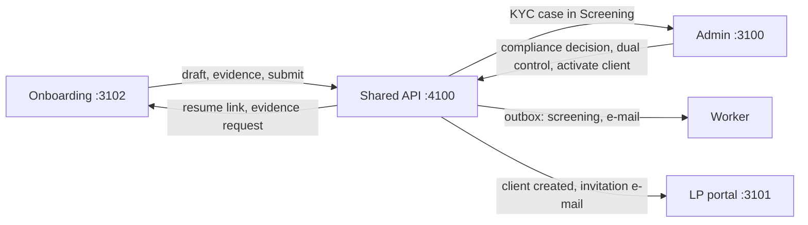

#### 3.4.2 Staff publish to LP

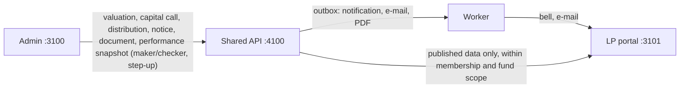

#### 3.4.3 LP requests and dealing to staff

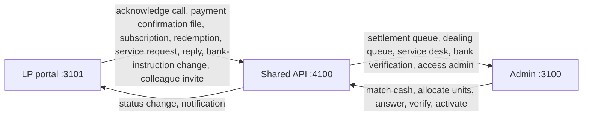

#### 3.4.4 Investee reporting and term sheet with staff

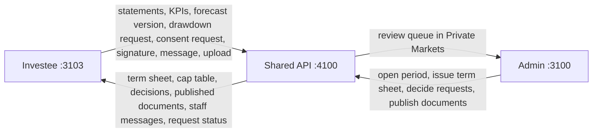

#### 3.4.5 Custodian to reconciliation

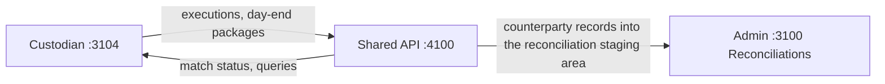

Notes **[P]**:

- Every flow writes an `outbox_events` row inside the business transaction; the worker delivers e-mail, notifications, PDFs and (target) SSE events. The target event names are in BUILD-PLAN 4.5 and section 11.4.
- A staff user who is also an LP is one user with two portal roles; each portal evaluates only its own role (3.3).
- The custodian hand-off today is `localStorage["matanho-v61-custodian-submissions"]`, which no admin code reads (5.E.4).

---

## 4. User roles and permissions

Five populations use the platform. Staff hold **roles** that bundle **permission codes** (4.1, 4.2). LP users hold an LP role and a fund-scoped membership (4.3). Investee, onboarding and custodian users are controlled by **scope** (4.4). The role catalogue is `backend/api/prisma/seed/role-catalog.json`; `GET /api/auth/me` returns the caller's id, e-mail, name, roles and permissions; `GET /api/v1/admin/access-context` returns the admin role labels and bundles.

### 4.1 Admin portal roles **[O]** (Build status: **Built**)

Sources: the prototype `roleLabels` / `rolePermissions`, the runtime `GET /api/v1/admin/access-context`, and the seed. Live users may hold several admin roles; effective permissions are the union.

| Key | Label | Purpose | Seeded permissions | Locked |
| --- | --- | --- | :-: | :-: |
| `investment_director` | Investment Director | Final investment authority; approves orders and cash-account changes. | 20 | No |
| `portfolio_manager` | Portfolio Manager | Owns portfolios; creates orders and scenarios; reserves cash. | 17 | No |
| `dealer` | Dealer / Trader | Creates orders and routes approved orders to brokers. | 11 | No |
| `analyst` | Investment Analyst | Research, models, reports. No order, client, cash or operations access. | 9 | No |
| `compliance` | Compliance Officer | KYC decisions (`onboarding.manage`), risk cases, client master, cash approval. | 18 | No |
| `operations` | Operations | Cash journals, imports, reservations, period close, reconciliations; owns the daily operations runbook. | 17 | No |
| `fund_accountant` | Fund Accountant | NAV, accounting, journals, statement imports, cash close; co-owns close-related runbook tasks. | 16 | No |
| `client_services` | Client Services | Client master, onboarding cases (`onboarding.manage`), investor servicing. No risk, financing, operations or valuation access. | 11 | No |
| `auditor` | Auditor | Read-only evidence access. **No `dashboard.view`**: cannot open the Command Centre or Copilot and lands on the first permitted page. | 11 | No |
| `system_admin` | System Administrator | Users, roles, policy, settings, audit. No monetary permissions. The bundle cannot be edited: the server returns 403 `role_locked`, and re-seeding forces it back to the catalogue. The matrix UI shows no column for it. | 20 | **Yes** |
| *custom* | user-defined label | Created in the role builder from a template or from `dashboard.view` only. Label 2–120 characters; key = slug of the label, de-duplicated; `custom = true`. `system_admin` cannot be a template. | n/a | No |

- **[O]** Re-seeding adds only catalogue permissions not applied before (`settings.role_catalog_applied`). Permissions an administrator removed stay removed, except on locked roles.
- **[O]** The prototype stores role edits in `localStorage['matanho-rbac-v8']`; this is ignored in live mode. In live mode the role switcher lists only the user's own roles, plus "Preview · {label}".
- **[O]** The auditor description "read-only" is contradicted in the prototype Operations page (the auditor can press *+ Operations task* and *Export runbook*); the prototype is the defect.
- **[O]** No admin roles exist for LP, Investee, onboarding or custodian users. **[P]** None are created for Investee or onboarding (4.4). Custodian roles are proposed in 4.4.3.

### 4.2 Admin permission matrix

Legend: ✓ granted in the **seed**. The seed equals the prototype bundles plus `onboarding.manage` for Director, Compliance and Client Services (Q-03 is resolved in the seed). **UI**: **M** = toggleable in the RBAC matrix, **—** = not shown. Verified against `role-catalog.json` (30 permission codes, 0 differences).

| Permission | UI | Dir | PM | Dealer | Analyst | Compl. | Ops | FundAcc | ClientSvc | Auditor | SysAdmin | Seed vs runtime |
|---|:-:|:-:|:-:|:-:|:-:|:-:|:-:|:-:|:-:|:-:|:-:|---|
| `dashboard.view` | M | ✓ | ✓ | ✓ | ✓ | ✓ | ✓ | ✓ | ✓ | | ✓ | same |
| `portfolio.view` | M | ✓ | ✓ | ✓ | ✓ | ✓ | ✓ | ✓ | ✓ | ✓ | ✓ | same |
| `orders.view` | M | ✓ | ✓ | ✓ | | ✓ | ✓ | ✓ | | ✓ | ✓ | same |
| `orders.create` | M | ✓ | ✓ | ✓ | | | | | | | | same |
| `orders.approve` | M | ✓ | | | | | | | | | | same |
| `orders.route` | M | | | ✓ | | | | | | | | same |
| `research.view` | M | ✓ | ✓ | ✓ | ✓ | | | | | | ✓ | same |
| `research.edit` | M | ✓ | ✓ | | ✓ | | | | | | ✓ | same |
| `risk.view` | M | ✓ | ✓ | ✓ | ✓ | ✓ | ✓ | ✓ | | ✓ | ✓ | same |
| `risk.manage` | M | | | | | ✓ | | | | | ✓ | same |
| `clients.view` | M | ✓ | ✓ | | | ✓ | ✓ | | ✓ | ✓ | ✓ | same |
| `clients.edit` | M | | | | | ✓ | | | ✓ | | ✓ | same |
| `onboarding.view` | M | ✓ | ✓ | | | ✓ | ✓ | | ✓ | ✓ | ✓ | same |
| `onboarding.manage` | M | ✓ | | | | ✓ | | | ✓ | | | Seed: present. Prototype base bundles lack it and inject it at load; the prototype *Reset defaults* drops it until reload (DEF-300) |
| `reports.view` | M | ✓ | ✓ | | ✓ | ✓ | | ✓ | ✓ | ✓ | ✓ | same |
| `reports.create` | M | ✓ | ✓ | | ✓ | ✓ | | ✓ | ✓ | | ✓ | same |
| `documents.view` | M | ✓ | ✓ | ✓ | ✓ | ✓ | ✓ | ✓ | ✓ | ✓ | ✓ | same |
| `documents.edit` | M | ✓ | ✓ | | ✓ | ✓ | ✓ | ✓ | ✓ | | ✓ | same |
| `operations.view` | M | ✓ | ✓ | ✓ | | ✓ | ✓ | ✓ | | ✓ | ✓ | same |
| `valuation.view` | M | ✓ | ✓ | | | ✓ | ✓ | ✓ | | ✓ | ✓ | same |
| `audit.view` | M | ✓ | | | | ✓ | ✓ | ✓ | | ✓ | ✓ | same |
| `cash.view` | M | ✓ | ✓ | ✓ | | ✓ | ✓ | ✓ | ✓ | ✓ | ✓ | same |
| `cash.approve` | — | ✓ | | | | ✓ | | | | | | same; **not in the matrix UI**, so it cannot be granted or revoked there (FR-RBAC-010); the server treats it as monetary |
| `cash.journal.create` | M | | | | | | ✓ | ✓ | | | | same |
| `cash.journal.approve` | M | | | | | | ✓ | ✓ | | | | same |
| `cash.reservation` | M | | ✓ | ✓ | | | ✓ | | | | | same |
| `cash.import` | M | | | | | | ✓ | ✓ | | | | same |
| `cash.close` | M | | | | | | ✓ | ✓ | | | | same |
| `admin.rbac` | — | | | | | | | | | | ✓ | same; not in the matrix UI (locked role) |
| `admin.settings` | — | | | | | | | | | | ✓ | same; not in the matrix UI |

#### 4.2.1 Notes on enforcement **[O]**

- **Defined and seeded but not checked by the admin UI:** `research.edit` (Research), `risk.manage` (Risk), `orders.create`, `orders.approve`, `orders.route` (Orders). The only reachable checks are the legacy broker modal (`orders.route`) and the legacy Order 360 drawer. Enforcement is **[P]**; do not read these cells as enforced rules.
- **Page gates:** `portfolio.view` gates Whole Portfolio, Private Markets, Portfolio Construction and IBOR, with no finer code. `reports.view` gates Performance, Reports and Regulatory (denied to Dealer and Operations on Performance). `clients.view` gates Clients and Investor Services. `operations.view` is the **only** gate for Operations Control, Reconciliations, Corporate Actions and Data; there is no action-level code, so *Submit maker resolution*, *Checker approve & close*, *Register source* and *Run matching* are open to all eight holders including the Auditor. `valuation.view` gates NAV and Accounting. A second-level detail page inherits its parent's gate. Nav hiding is client-side; a refusal shows an "Access restricted" toast and keeps the user on the page. The server enforces real permissions.
- **Company reporting hub:** the bridged hub uses `research.edit` (client) and, on the server, `research.edit` for REVIEW and `portfolio.view` for VIEW.
- **Absences:** the Auditor lacks `dashboard.view` and `research.view`; Client Services lacks `risk.view` and `orders.view`; `valuation.view` is held by seven roles (not Dealer, Analyst, Client Services).
- **`cash.approve`** gates return, approve, suspend, reactivate, close and `reveal-identifier` of a cash account (`submit` needs `clients.edit` or `cash.approve`), and approval of capital notices. `cash.approve` or `cash.journal.approve` gates cash matching of capital notices. `operations` holds `cash.journal.create` and can therefore create capital events through `POST /api/v1/capital-events/allocate` although it lacks `clients.edit`. No onboarding control is hidden by RBAC in the UI; enforcement is server-only.
- **Hard-coded role checks bypass the codes:** cash match confirmation requires the role `operations` or `fund_accountant` itself.
- **Monetary codes differ by layer.** Server `MONETARY` = `orders.create`, `orders.approve`, `orders.route`, `cash.approve`, `cash.journal.create`, `cash.journal.approve`, `cash.close`. The prototype SoD list is the same **without** `cash.approve`.
- **Seed counts per role** (20, 17, 11, 9, 18, 17, 16, 11, 11, 20) differ slightly from the prototype fallback matrix used when not signed in.

`Q-NEW: Operations can create capital events through POST /capital-events/allocate because it holds cash.journal.create but not clients.edit — default: keep, and record it as intended.`

#### 4.2.2 Proposed permission codes (not seeded)

Nothing below exists in the seed. Until the business approves new codes (Q-04, extended by BUILD-PLAN Q-NEW-22) the "reuse today" column applies, with maker/checker.

| Workflow | Reuse today **[P]** | Proposed code | Rule |
| --- | --- | --- | --- |
| Fund master, commitments register | `clients.edit` | `funds.edit` | audited |
| Publish valuation / NAV per unit | `reports.create` | `valuation.publish` (and `valuation.run`, `valuation.maker`, `valuation.release`, Q-80) | maker `reports.create`, checker a different `valuation.view` holder, step-up |
| Capital call draft / approve / issue | `clients.edit` / `cash.approve` / `cash.approve` | `capital.call.create` / `.approve` / `.issue` | maker not checker, step-up |
| Settle payment, pay distribution | `cash.journal.approve` | `capital.settle` | matcher not evidence confirmer |
| Dealing process / approve | `clients.edit` / `cash.approve` | `dealing.process` / `dealing.approve` | different users; compliance-hold override needs the `compliance` role |
| Publish notice | `documents.edit` | `notices.publish` | approval per `document_approval` policy |
| Term sheet draft / issue | `research.edit` | `term_sheets.edit` / `.issue` | maker not checker, step-up |
| Cap table edit / approve | `research.edit` | `captable.edit` / `.approve` | maker not checker |
| Governance register | `research.edit` | `governance.manage` | audited |
| Capital request review | `research.edit` | `capital_requests.review` | not the requester's own company contact |
| Bank-instruction change approval | `cash.approve` | `bank_change.approve` | dual approval plus out-of-band verification (BR-006) |
| Custodian submissions (read) | `operations.view` | `counterparty.view` | read-only in reconciliation |
| Support "view as" | none | `portal.view_as` | read-only, audited, banner, time-boxed |
| Operations, reconciliation, close | `operations.view`, `valuation.view` | `operations.task.manage` (Ops, FundAcc), `recon.resolve`, `recon.signoff`, `recon.sources.manage`, `accounting.close` | maker ≠ checker |
| Other v1.0 candidates | n/a | `corporate_actions.elect`, `regulatory.submit`, `integrations.manage`, `models.approve`, `financing.manage`, `investor_services.publish` | per module |

The 5D draft proposes a different naming for the investee staff codes (`portfolio.terms.issue`, `portfolio.captable.edit`, `portfolio.captable.approve`, `portfolio.requests.review`, `portfolio.requests.approve`, `portfolio.governance.decide`, `portfolio.forecast.review`, `portfolio.vault.publish`).
`Q-NEW: Reconcile the two proposed naming schemes for investee staff permission codes (BUILD-PLAN module-based vs 5D portfolio.*) — default: the BUILD-PLAN names; reuse research.edit (review) and portfolio.view (view) for UAT.`

### 4.3 LP roles and permission codes

**Build status.** The LP UI shows a hard-coded session with `lpRole = "MANAGER"` and enforces two gates client-side (**Mock**). The LP API, the 34 `lp.*` codes and the three LP roles are **Not started** in Nexus. The four legacy investor roles and their routes (`/api/v1/investor/*`) are **Built** and no UI calls them. The NVCCZ reference backend is the specification **[I]**.

#### 4.3.1 LP roles

| LP role | UI label | Rights **[I]** (reference backend) | Typical person |
| --- | --- | --- | --- |
| `VIEWER` | Viewer | Read everything in scope; run estimates; download; mark threads read; edit own settings. | Analyst, auditor, finance reader |
| `SIGNATORY` | Signatory (authorised signatory) | Viewer rights plus acknowledge calls and notices, upload payment confirmations, submit subscriptions and redemptions, create requests, reply to requests and threads, submit bank-instruction changes. | Authorised signatory of the investor |
| `MANAGER` | Investor Admin (administrator) | Signatory rights plus list, invite, change and revoke colleagues (never grant `MANAGER`, never revoke a `MANAGER`). | Institutional investor administrator |

Each role is a superset of the one below. Values are normalised on read (`LP_VIEWER` to VIEWER; `LP_MANAGER`, `ADMIN` to MANAGER; anything else to VIEWER). `MANAGER` is granted by staff (BR-184).

#### 4.3.2 LP permission codes (34, reference `ROLE_PERMS`) **[I]**

| Domain | VIEWER (25 codes in total) | SIGNATORY adds (8) | MANAGER adds (1) |
| --- | --- | --- | --- |
| Shell | `lp.portal.access`, `lp.portal.switch_fund`\*, `lp.portal.view_notifications` | | |
| Dashboard and holdings | `lp.dashboard.view`, `lp.investments.view`\*, `lp.commitment.view`\*, `lp.capital_account.view`\*, `lp.holdings.view`\* | | |
| Capital | `lp.capital_calls.view`, `.download_notice`, `lp.distributions.view`, `.download` | `lp.capital_calls.acknowledge`, `.upload_payment_confirmation` | |
| Dealing | `lp.dealing.view`, `.estimate` | `lp.dealing.subscribe`, `.redeem` | |
| Performance, activity | `lp.performance.view`, `.download_report`, `lp.activity.view`, `.export` | | |
| Documents | `lp.documents.view`, `.download` | | |
| Notices | `lp.notices.view` | `lp.notices.acknowledge` | |
| Requests and messages | `lp.requests.view`, `lp.messages.view` | `lp.requests.create`, `lp.messages.reply` | |
| Organisation | `lp.organisation.view` | | `lp.organisation.manage_colleagues` |
| Settings | `lp.settings.view` | `lp.settings.manage_mfa`\* | |

\* Defined by the reference but used by no route. The matrix of 70 methods by role is the acceptance test (5B ROLES & PERMISSIONS, E.3; FR-LP-106). A missing code returns 403 `LP_FORBIDDEN` "Missing permission <code>"; a failed role gate returns 403 `LP_FORBIDDEN` "Authorised Signatory access required" or "LP Manager access required".

#### 4.3.3 Where the LP role and scope come from

| Item | Reference behaviour **[I]** | Nexus requirement **[P]** |
| --- | --- | --- |
| `lpRole` | Not in the token. Resolved on every request from the first ACTIVE membership; a role change applies immediately. | Stored or derived per `client_users` membership and returned by the LP session with `funds`, counts and the organisation. |
| Resolution chain | user → active membership → organisation → fund entitlement → resource. | Same (BR-137). Identifiers sent by the browser (`fundId`, `clientId`, as-of) are advisory; the server recomputes the allowed set and answers a generic 404 outside it (BR-079). |
| Fund scope | `fund_ids` JSON on the membership; null or empty = all funds; not applied uniformly (ledger detail, vault list, request replies, unread message counts are unscoped). | Explicit list only: an empty list means **no** fund access (BR-138); stored in a join table `client_user_funds` (Q-155); applied to every query. |
| Several organisations | Only the first active membership is used; no switcher. | `?client=<ref>` selects among the caller's memberships (Q-23); no switcher until required. |
| Revocation | Sets inactive and increments a token version. | Deletes the user's sessions at once; the last active MANAGER can be neither demoted nor revoked (BR-184). |
| Staff impersonation | GP staff pass `?clientId=` and receive all MANAGER codes, unaudited. | **Not ported.** Replaced by an audited, read-only, time-boxed "view as" (`portal.view_as`). |
| Inactive client | 404 "LP profile not found" / 403 "LP profile is not active". | Same; `clients.status = ACTIVE` required. |

`Q-NEW: Should support staff be able to "view as" an LP or Investee user — default: yes, read-only, time-boxed, with a banner and audit events, gated by portal.view_as; query-parameter impersonation is not allowed.`

#### 4.3.4 Role gating in the LP UI today **[O]** versus the server **[I]**

| Control | UI gate today | Server gate | Consequence |
| --- | --- | --- | --- |
| Acknowledge call, upload payment confirmation | `canWrite = lpRole !== "VIEWER"`; enabled while `lpRole` is still null | SIGNATORY or MANAGER | A VIEWER cannot start; a click during session load receives 403. |
| Dealing submit, notice acknowledge, create request, reply, message reply | none | SIGNATORY or MANAGER | A VIEWER sees enabled buttons and receives 403. |
| *Add participant* | disabled for VIEWER | SIGNATORY | Partial gate. |
| Invite, edit, revoke colleagues; bank *Request Change* | `canManage = lpRole === "MANAGER"` | colleagues: MANAGER; bank change: SIGNATORY or MANAGER | A SIGNATORY cannot submit a bank change although the server allows it. |
| Navigation, reads, downloads, estimates, settings | none | every role | none |

Requirements: **FR-LP-106** every LP route declares one permission code and one minimum role; **FR-LP-107** the UI disables or hides every control whose server gate the current role fails (a VIEWER session sends no write request); **FR-LP-108** while the session loads, `lpRole = null` means no rights.

#### 4.3.5 Mapping to the Nexus investor roles, and gaps

The four Nexus investor roles are **legacy, retained for the API until the migration decision**. **[O]**

| Permission | `admin` Investor Admin | `investment` Investment Viewer | `finance` Finance/Treasury | `auditor` | Closest LP role |
|---|:-:|:-:|:-:|:-:|---|
| `overview.view`, `investments.view`, `holdings.view`, `documents.view`, `profile.view` | ✓ | ✓ | ✓ | ✓ | |
| `performance.view` | ✓ | ✓ | | ✓ | |
| `capital.view` | ✓ | | ✓ | | |
| `requests.view` | ✓ | | ✓ | | |
| `messages.view` | ✓ | ✓ | ✓ | | |
| `users.invite` | ✓ | | | | |
| **Maps to** | | | | | `admin`→MANAGER, `finance`→SIGNATORY, `investment`→VIEWER, `auditor`→VIEWER (narrower: no capital, requests, messages) |

Per-membership `account_scope` (all, managed, private, documents) filters only investments and holdings; documents, capital events, requests and threads are unfiltered. **[O]** It is replaced by fund entitlements (BR-138) and kept only for the legacy routes.

| LP permission | Nearest Nexus code today | Gap (new code needed) |
| --- | --- | --- |
| `lp.portal.access`, `lp.dashboard.view` | membership + `overview.view` | none |
| `lp.capital_calls.*`, `lp.distributions.*`, `lp.activity.*` | `capital.view` (auditor and investment lack it) | one rule for call/distribution rows; `capital.acknowledge` (no acknowledged state exists) |
| `lp.capital_calls.upload_payment_confirmation` | `capital.view` + role `admin` or `finance` (funding-evidence rule) | none beyond acknowledgement |
| `lp.dealing.*` | none | `dealing.view`, `dealing.estimate`, `dealing.submit` |
| `lp.performance.*` | `performance.view` | report-job concept |
| `lp.documents.*` | `documents.view` | per-document permission list, access audit view |
| `lp.notices.*` | none | `notices.view`, `notices.acknowledge` |
| `lp.requests.*`, `lp.messages.*` | `requests.view`, `messages.view` (also used to create and reply) | `requests.create`, `messages.reply` split from view |
| `lp.organisation.*` | `profile.view`, `users.invite` | per-colleague fund scope, MFA state, last active, status; update and revoke by the investor (`users.manage`) |
| `lp.settings.*` | none | per-user notification and display preferences; MFA via `/api/auth/mfa/*` |

Gaps between the models **[I]**: (1) per-colleague fund scope; (2) no SIGNATORY rung in Nexus ("may sign" is derived from `admin` or `finance`); (3) `lpRole` must be derived and returned by the session; (4) per-colleague MFA, last-active and status do not exist on `client_users`; (5) colleague lifecycle: Nexus `users.invite` can invite any of the four roles including `admin`, removal is staff-only and does not revoke sessions; (6) Nexus has no idempotency, while the reference requires `Idempotency-Key` on nine LP writes (BR-173, DEF-513); (7) staff authorisation uses role names in NVCCZ and permission codes in Nexus; (8) error shape (`LP_*` codes, `fieldErrors`, `retryable`) differs from `{error:{code,message,details}}`.

Decisions:
- **Q-154** Replace the four roles by VIEWER, SIGNATORY and MANAGER (migrate `user_roles` and `client_users.investor_role`), or keep four roles and derive `lpRole`? Default: derive for the first release (no data migration), then converge on three roles. BUILD-PLAN Q-NEW-02 defaults to migrating at once; **the two defaults must be reconciled at sign-off.** Q-94 and Q-147 give the same mapping in both cases.
- **Q-155** `fundIds` in a join table (default) or JSON.
- **Q-151 / BR-186** MFA is mandatory for signatories and managers (default yes).

### 4.4 Investee, onboarding and custodian access models

These populations have **no entries in the role catalogue**. Access is scope-based. **[P]** (section 4.4 of v1.0 said the same for onboarding and company; v2 adds access profiles and the custodian.)

#### 4.4.1 Investee (company) users

| Aspect | Today **[O]** | Target **[P]** |
| --- | --- | --- |
| Identity | A `users` row with no roles on the company portal; `company_users(company_id, user_id)` links; invitations carry `companyId` and `roleKeys: []`. The login form omits `portal`. | Same, plus `company_users.profile`, `status` and `lastActiveAt`. |
| Scope | `companyContext` = the first `company_users` link by `createdAt`; no link gives 403 `no_company_access`; rows of other companies give 404. | One user may belong to several companies; the active company is explicit (`?company=<ref>`, the Company drawer becomes a switcher, Q-169, BR-196). |
| Guard | Session required (MFA-pending refused); no permission codes. | One guard: session + company context + profile capability. |
| Page access | The proxy turns away investor-role accounts; any other signed-in account reaches the pages (DEF-495). | API-level company-scope check on every call. |
| Staff side | Private Markets: VIEW = `portfolio.view`, REVIEW = `research.edit`; **reviewer ≠ submitter is always enforced**. | Fund-ops staff codes (4.2.2); reviewer ≠ submitter retained (BR-253). |

**Access profiles** stored on `company_users.profile` and evaluated by the API (BR-239, Q-198). The Team & Access page (5.D.12) is the UI; today it is a fixture.

| Capability | Workspace admin | Executive approver | Report contributor | KPI owner | Finance editor | Read only |
|---|:-:|:-:|:-:|:-:|:-:|:-:|
| View all pages | ✓ | ✓ | ✓ | ✓ | ✓ | ✓ |
| Edit report drafts, upload evidence | ✓ | ✓ | ✓ | | ✓ | |
| Submit report pack | ✓ | ✓ | | | | |
| Submit period KPIs | ✓ | ✓ | | ✓ | ✓ | |
| Edit forecast cells | ✓ | ✓ | | | ✓ | |
| Submit forecast version | ✓ | ✓ | | | | |
| Create or edit request drafts | ✓ | ✓ | | | ✓ | |
| Submit request, answer drill-down, request governance approval | ✓ | ✓ | | | | |
| Sign documents (named signatory only) | ✓ | ✓ | | | | |
| Upload to vault | ✓ | ✓ | ✓ | | ✓ | |
| Post messages | ✓ | ✓ | ✓ | ✓ | ✓ | |
| Manage team, letterhead, company profile | ✓ | | | | | |

Rules: at least one *Workspace administrator* must remain; invitations are valid 7 days, one pending per e-mail per company; new members enrol MFA before accessing company data when the policy is on (BR-241, BR-276). Gaps: preparer ≠ approver and signing authority are not modelled in NVCCZ or Nexus (BR-240, BR-275 are displayed routes only). Do not port: the NVCCZ letterhead IDOR, the unguarded cap-table registry list, the unfiltered company update, temporary passwords in logs.

`Q-NEW: Reconcile the Investee access model — 5D proposes six access profiles on company_users.profile with no catalogue entries; BUILD-PLAN 5.2 proposes five roles (contributor, kpi_owner, approver, viewer, admin) in the catalogue — default: six profiles on company_users.profile (Q-198).`

#### 4.4.2 Onboarding applicants

- **[O]** No account and no role. A draft belongs to the holder of its draft token (`X-Draft-Token`) or of the emailed resume link (3.3). The API implements this; the V65 UI does not call it.
- **[O]** The portal also exposes `/login`, `/invite`, `/reset-password` with `enforcePortalAccess=false`; they are not linked from the UI (Q-168: remove or keep).
- **[P]** Applicants never see the risk triage badge (BR-190). After activation the applicant's organisation becomes an LP client and is invited to the LP portal.

#### 4.4.3 Custodian users

- **[O]** None. The page is public (DEF-485).
- **[P]** Users belong to one **counterparty** (`counterparty_users`) and an explicit account list; `counterparty_id` and account filter every query; the execution reference is unique per counterparty. Roles: **submitter** and **approver**; a day-end package needs an approver different from the submitter at the counterparty (Q-165). Invite-only, MFA required, step-up for the approver. Staff read custodian submissions through `operations.view` (reuse) or `counterparty.view` (proposed). Build status: **Not started**.

### 4.5 Segregation-of-duties rules

#### 4.5.1 Rules as enforced today (corrected BR-001 to BR-006)

| ID | Rule | Enforcement today | Build status | Label |
| --- | --- | --- | --- | --- |
| BR-001 | A user may not approve an item they created. | **Live API:** cash-account checker (approve, suspend, reactivate, close) and capital events while policy `cash_approval` is on; documents while `document_approval` is on (403 `sod_violation`, with step-up); investor publications while `client_publish_approval` is on; KYC compliance decision under `kyc_dual_control`; Private Markets pack review (reviewer ≠ submitter, always). **Prototype:** order approval blocks the maker's *role*, not the user. Journals, statement commits, NAV, elections, reconciliation sign-off and reports are **not** enforced; the prototype compares against the literal name "T. Moyo" (DEF-145, DEF-222). Report approval has no implementation. | Partial | [O] partial |
| BR-002 | `system_admin` must never hold a monetary permission. | The SoD scan flags any `MONETARY` code (includes `cash.approve`); the server refuses edits to the locked bundle (403 `role_locked`); the UI hides the column. | Built | [O] |
| BR-003 | Order approval and order routing are held by different people. | Seed bundles only (`orders.approve` = Director, `orders.route` = Dealer); not checked by the SoD scan; not enforced on the Orders page. | Partial | [O] seed only |
| BR-004 | ~~At least two active users must hold `admin.rbac`.~~ | **Contradicted.** The server enforces **at least one** active System Administrator (409 `last_admin`) and the SoD scan flags **more than two** ("Privileged account count"). Assigning or removing System Administrator needs a browser confirm only. Target remains two (DEF-522). | Contradicted | [O]; target [P] |
| BR-005 | ~~Relaxing any policy toggle is flagged by the SoD scan.~~ | **Contradicted.** Only relaxed order approval and cash approval (block) and relaxed document approval (warn, server only) are flagged. NAV approval, bank-detail approval, the MFA toggle and the session timeout are never flagged. `orderApproval`, `navApproval` and `bankApproval` are stored but not enforced. | Contradicted | [O] |
| BR-006 | Changes to bank instructions require dual approval and out-of-band verification. | `bankApproval` (dual / independent) is stored in `settings.access_policy_extra` and not enforced by any API; investor bank instructions are seed-only. | Not started | [O] copy |

Seven further rules are enforced by the server and are **unnumbered** in the drafts (row label `BR-NEW`):

| Ref | Rule | Enforcement | Label |
| --- | --- | --- | --- |
| BR-NEW (1) | No user may hold `admin.rbac` together with a monetary permission through combined roles. | SoD scan finding "Access control combined with money movement" (block, "Split roles"); not prevented at assignment time. | [O] |
| BR-NEW (2) | Users holding `admin.rbac` or `cash.approve` must have a verified MFA factor. | SoD scan finding "Privileged user without MFA" (warn, "Enforce MFA"). | [O] |
| BR-NEW (3) | An administrator cannot remove their own access-control permission, directly or through a role they hold. | 409 `self_lockout`. | [O] |
| BR-NEW (4) | An administrator cannot reset their own second factor or disable their own account. | 409 (`self_reset`; "You cannot disable your own account"). | [O] |
| BR-NEW (5) | Every RBAC, policy, user and role mutation needs MFA step-up within 5 minutes. | 401 `step_up_required`; 401 `mfa_enrolment_required` if `mfa_required` is on and no factor exists. | [O] |
| BR-NEW (6) | A relaxed document-approval policy must be surfaced. | SoD scan finding "Document approval relaxed" (warn). | [O] |
| BR-NEW (7) | Every RBAC, policy and settings change and every audit or access-review export writes an audit event (`role.created`, `role.permissions_changed`, `staff_user.invited`, `staff_user.roles_changed`, `staff_user.mfa_reset`, `staff_user.enabled/disabled`, `policy.updated`, `settings.updated`, `access_review.exported`, `audit.exported`). | Server. | [O] |

`Q-NEW: Number the seven BR-NEW rows of 4.5.1 — default: BR-277 to BR-283 in table order.`

**Policy defaults.** Server: `order_approval`, `cash_approval`, `document_approval`, `client_publish_approval`, `kyc_dual_control` = true; **`mfa_required` = false** (DEF-519); `session_idle_minutes` = 30 (capped by configuration). Prototype UI defaults: MFA checked, NAV = independent, bank = dual. Only `cash_approval`, `session_idle_minutes`, `mfa_required`, `document_approval` and `client_publish_approval` are enforced by the API (the last two have no UI). Q-88: should `mfa_required` default to true for the admin portal — default: true in production.

**SoD scan.** The prototype's local rules: (1) order approval ≠ independent; (2) cash approval ≠ independent; (3) more than two System Administrators; (4) `system_admin` holds `orders.create`, `orders.approve`, `orders.route`, `cash.journal.create`, `cash.journal.approve` or `cash.close`. In live mode the server list replaces the local list; the KPI counts every non-ok finding, including warnings.

Extensions of BR-001 owned by other sections: BR-030 (a performance period is locked by a user other than the preparer), BR-035 (the cash-account maker is the signed-in user and the check compares user ids), BR-063 (a control-task creator may not complete it), BR-070 (funding a margin call needs maker ≠ checker), BR-071 (an election is approved by a different user), FR-CASH-013 (journal approval and statement commit compare authenticated user ids; 403 `sod_violation`). **[P]** unless noted. `sod_violation` is 409 in KYC and cash accounts and 403 elsewhere (DEF-510).

#### 4.5.2 Rules for fund operations and the external portals

| Ref | Rule | Build status | Label |
| --- | --- | --- | --- |
| FR-LP-110 / BR-NEW | A capital call or distribution is approved by a user other than its maker before it is ISSUED to LPs; publishing needs the approver permission (`cash.approve`) and step-up. Today publish has no separation and no step-up on the server (DEF-165). | Partial | [P] |
| BR-NEW | A payment is settled by a user other than the one who confirmed the evidence (matcher ≠ confirmer). | Partial | [O] existing rule / [P] for LP calls |
| FR-LP-058 | A dealing request is allocated by a user other than the one who submitted or confirmed funds for it. | Not started | [P] |
| BR-185, FR-LP-096, BR-006 | A bank-instruction change never replaces the active instruction on submission; submission needs SIGNATORY or MANAGER and a fresh TOTP code; it is verified by a user other than the requester and by a callback, then APPROVED and ACTIVATED (old instruction archived). | Not started | [I]/[P] |
| BR-184 | Only a MANAGER (and staff) invites, changes or revokes colleagues; a MANAGER grants VIEWER or SIGNATORY only; granted `fundIds` must be a subset of the actor's scope; revocation invalidates all the user's sessions; invitation e-mails carry a one-time link (7 days), never a password. | Not started | [I]/[P] |
| BR-186 | `requireMfaForLp` makes enrolment mandatory at first sign-in for every LP user and adds a 5-minute step-up for bank and colleague changes. | Not started | [P] |
| BR-NEW | A notice is published only by a holder of the publish permission; documents published to LPs follow `document_approval`. | Partial (documents Built) | [P] |
| BR-079, BR-137, BR-138 | Scope is derived from the membership and fund entitlement; browser-supplied identifiers are advisory; out-of-scope identifiers answer 404 (3.4, 4.3.3). | Not started | [I]/[P] |
| BR-048, BR-101 | A *Restricted* document is downloadable only by an `audit.view` holder or its maker (Built, audited); the full wiring account number is shown only to SIGNATORY and MANAGER and each reveal is audited. | Built / Not started | [O] / [P] |
| BR-253, BR-273 | Investee report review: reviewer ≠ submitter, return or reject needs a comment; resubmission needs a changed content fingerprint and only the requester resubmits. | Built (reviewer ≠ submitter) | [O]/[P] |
| BR-269 | A cap-table transaction moves DRAFT → PENDING_APPROVAL → EXECUTED; creator ≠ approver. | Not started | [P] |
| BR-224, BR-274 | Signing needs step-up MFA within 5 minutes and a verified account; each party signs once; a term sheet is SIGNED only with both signatures. | Not started | [P] |
| BR-240 | Inside the company: report preparer ≠ approver; board submission = Company Secretary + CEO (a displayed route today; Q-NEW whether enforced). | Mock | [I] |
| BR-241, BR-276 | At least one workspace administrator per company; MFA before data access when the policy is on. | Not started | [P] |
| Q-165, BR-193, BR-195 | At a counterparty a day-end package is approved by someone other than its submitter; submissions are immutable and superseded only by a newer version with a reason. | Not started | [P] |

### 4.6 Role-to-portal summary

| Population | Admin 3100 | LP 3101 | Onboarding 3102 | Investee 3103 | Custodian 3104 | Build status |
| --- | --- | --- | --- | --- | --- | --- |
| Admin roles (10 + custom) | **role + permission codes** | no | no (staff do not apply) | allowed by the proxy today; **[P]** only with a company link or `portal.view_as` | no | Built |
| `system_admin` | RBAC, settings, audit; no monetary codes | no | no | as above | no | Built |
| LP roles (viewer, signatory, manager) | no | **investor-portal role + membership + fund entitlements** | no | **turned away** | no | Mock (UI) / Not started (API) |
| Legacy investor roles (`admin`, `investment`, `finance`, `auditor`) | no | accepted by the proxy (any investor role) | no | **turned away** | no | Built (roles); no UI reads them |
| Investee users (6 access profiles) | no | no | no | **session + company link + profile** | no | Mock |
| Onboarding applicants | no | invited after activation | **draft token** | no | no | API Built, UI Mock |
| Custodian users (submitter, approver) | no | no | no | no | **counterparty scope + MFA** | Not started |
| Anonymous | `/login`, `/invite`, `/reset-password` only | same | whole portal | same | whole portal (today) | Built / Contradicted for custodian |

---

---

## 5. Page-by-page UI breakdown

Section 5 is split into one file per portal because the full breakdown is several megabytes. Each file follows the same template per page: purpose, access, which prototype layer renders it, wiring status (Prototype / Bridged / API), layout, elements, tables, inputs and validation, actions, modals and drawers, states, business rules, edge cases, and gaps/defects/open questions. Requirement, rule, question and defect IDs in those files are final and listed in [`srd/REGISTER.md`](srd/REGISTER.md).

| Portal | File | Pages |
| --- | --- | --- |
| Admin / Investment OS (port 3100) | [`srd/5A-admin.md`](srd/5A-admin.md) | 5.A.0 shell and 5.A.1 to 5.A.30 (command centre through audit, record detail, shared overlays) |
| LP portal (port 3101) | [`srd/5B-lp-portal.md`](srd/5B-lp-portal.md) | 5.B.0 shell and 5.B.1 to 5.B.10 (dashboard, performance, account activity, capital activity, subscriptions and redemptions, documents, requests and messages, notices, organisation, settings) |
| Public onboarding (port 3102) | [`srd/5C-onboarding-portal.md`](srd/5C-onboarding-portal.md) | 5.C.0 to 5.C.7 (six-step application, evidence, review, submission and resume) |
| Investee portal (port 3103) | [`srd/5D-investee-portal.md`](srd/5D-investee-portal.md) | 5.D.0 shell and 5.D.1 to 5.D.13 (overview, KPI centre, reporting centre, forecast model, term sheet, cap table, governance, signatures, capital and procurement requests, document vault, messages, team and access, settings) |
| Custodian / counterparty (port 3104) | [`srd/5E-custodian-portal.md`](srd/5E-custodian-portal.md) | 5.E.0 to 5.E.4 (trade execution, day-end package, status, hand-off to reconciliation) |

Supporting material (also final): API contracts, domain models, state machines, business rules, role maps, gap analyses against the Nexus API and staff-side counterparts per portal are in [`srd/appendix/`](srd/appendix/).

### 5.0 Global UI rules (all portals)

- **Loading**: skeletons for tables and KPI tiles; buttons show a busy label and are disabled while a request runs. **[P]**
- **Empty**: every table explains why it is empty and, where the user may, offers the primary create action. **[P]**
- **Error**: API errors render as a toast with the API `error.message`; validation errors inline under the field; 401 redirects to `/login?next=`; 403 shows a permission message. A live domain that errors must show the error and never fall back to demo data. **[P]**
- **Demo data**: any page or domain not yet backed by the API shows a persistent "Demo data" ribbon, so testers can tell live from demo. **[P]**
- **Toasts, drawers, modals**: as in the existing prototypes; each portal's file records its own durations and behaviours. **[O]**
- **Currency and dates**: USD, ZWG and ZAR; dates `dd Mon yyyy`; times in Africa/Harare (CAT). The LP portal also carries a reporting-currency selector and an as-of date. **[O]**
- **Access gate**: the admin, LP and Investee portals redirect to `/login?next=` when signed out. The LP portal needs a role on the investor portal. The Investee portal accepts any signed-in account except one holding an investor role, which is sent to `/access-denied`. Onboarding and custodian are public. **[O]**

---

<!-- SRD v2 core text for sections 6, 7 and 8. Generated for the editor; sources: docs/SRD.md v1.0, docs/srd/REGISTER.md, docs/srd/appendix/*, docs/BUILD-PLAN.md. -->

## 6. Functional Requirements

Each requirement is testable via its acceptance criterion (AC). All state-changing requirements implicitly include **FR-AUD-001** (an audit event is written) and **BR-001** (maker ≠ checker) where an approval exists. Section 6 keeps the 16 subsections and every FR-ID of SRD v1.0 (134 requirements, corrected to the as-built system) and adds 377 new requirements in the area subsections and in four new subsections: 6.17 LP portal, 6.18 Investee portal, 6.19 Custodian / counterparty portal, 6.20 Admin console shell and dashboard. Every new FR in `docs/srd/REGISTER.md` appears exactly once, with its register text and acceptance criterion; the register's source page is shown in the last column.

### 6.0 How to read this section

**Columns.** *Pri*: **M** = must (UAT-critical journeys J0, J1A, J2, J3, J5 of BUILD-PLAN 12.1, and every security or audit control), **S** = should (rest of the core), **C** = could (polish, exports, realtime). *Label*: **[O]** observed in the running system, **[I]** implemented only as prototype/mock behaviour, **[P]** proposed. *Build*: **Built** = working in the API and reachable from its UI or script; **Partial** = part of the behaviour exists (typically API built, UI not wired, or a gap named in the note); **Mock** = a UI exists but only on prototype, fixture or mock-store data, with nothing persisted on the server; **Not started** = no implementation anywhere; **Contradicted** = the code does the opposite or something incompatible with the AC (the note and a DEF item say which). The last column holds the journey tag (**J0** … **J5**) when the row is on a UAT-critical journey, then either the as-built note (v1.0 rows) or the source page in the page sections (new rows).

**Rules used to assign Pri, Label and Build to the 377 new rows** (the register carries only ID, text, AC and source). Pri: M when the row is on J0, J1A, J2, J3 or J5, or is a security or audit control; C for exports, polish, realtime, accessibility and reminders; S otherwise. J1B (public form to case) and J4 (dealing) are S because BUILD-PLAN 12.1 cuts them before J0, J1A, J2, J3 and J5; promote them to M if UAT scope keeps them. Label: [O] for rows that describe behaviour already built (source "backend" and two RBAC rows), [O]/[P] for FR-AUD-003, otherwise [P] (a requirement to build). Build: Built for the backend-sourced rows; Partial where an API exists and the page does not use it (KYC case, client 360, vault, company workspace, notifications); Mock where the page exists on prototype, fixture or mock-store data (all admin prototype pages, the LP portal, the Investee portal); Not started where the server behaviour does not exist (jobs, exports, realtime, scanning, idempotency, custodian, LP access gates, the LP facade contract). Priorities of the 134 v1.0 rows are unchanged except FR-CMP-005 (S to M, J5) and FR-ONB-015 (C, retired in V65).

### 6.0.1 Requirement coverage

By subsection (existing v1.0 rows, new v2 rows, priority and build):

| Subsection | Existing (v1.0) | New (v2) | Total | M | S | C | Built | Partial | Mock | Not started | Contradicted |
| --- | ---: | ---: | ---: | ---: | ---: | ---: | ---: | ---: | ---: | ---: | ---: |
| 6.1 Identity, access and sessions (AUTH) | 17 | 2 | 19 | 17 | 1 | 1 | 11 | 3 | 0 | 2 | 3 |
| 6.2 RBAC administration (RBAC) | 8 | 8 | 16 | 12 | 4 | 0 | 11 | 4 | 0 | 1 | 0 |
| 6.3 Onboarding and KYC (ONB) | 15 | 32 | 47 | 22 | 20 | 5 | 16 | 24 | 2 | 5 | 0 |
| 6.4 Clients, mandates and cash accounts (CLI) | 7 | 15 | 22 | 10 | 9 | 3 | 3 | 15 | 0 | 4 | 0 |
| 6.5 Portfolios, construction, IBOR, private markets (PORT, IBOR, PM) | 8 | 20 | 28 | 4 | 21 | 3 | 0 | 1 | 19 | 8 | 0 |
| 6.6 Orders and trading (OMS) | 12 | 9 | 21 | 10 | 9 | 2 | 0 | 0 | 9 | 12 | 0 |
| 6.7 Research (RES) | 5 | 5 | 10 | 3 | 7 | 0 | 0 | 0 | 5 | 5 | 0 |
| 6.8 Risk and compliance (RSK) | 5 | 8 | 13 | 4 | 7 | 2 | 0 | 0 | 8 | 5 | 0 |
| 6.9 Cash sub-ledger (CASH) | 8 | 11 | 19 | 8 | 10 | 1 | 0 | 0 | 11 | 8 | 0 |
| 6.10 Operations, reconciliations, corporate actions (OPS, REC) | 6 | 19 | 25 | 5 | 16 | 4 | 0 | 0 | 19 | 6 | 0 |
| 6.11 Valuation, accounting, performance (VAL, PERF) | 7 | 19 | 26 | 6 | 15 | 5 | 0 | 0 | 19 | 7 | 0 |
| 6.12 Financing (FIN) | 3 | 2 | 5 | 0 | 3 | 2 | 0 | 0 | 2 | 3 | 0 |
| 6.13 Reports, documents, publications (DOC) | 6 | 19 | 25 | 11 | 7 | 7 | 4 | 10 | 7 | 4 | 0 |
| 6.14 Investor self-service and investor services (INV) | 10 | 13 | 23 | 17 | 5 | 1 | 5 | 12 | 0 | 6 | 0 |
| 6.15 Portfolio-company reporting core (CMP) | 7 | 2 | 9 | 6 | 2 | 1 | 6 | 3 | 0 | 0 | 0 |
| 6.16 Regulatory, data, models, copilot, settings, audit, notifications (PLAT) | 10 | 16 | 26 | 11 | 9 | 6 | 5 | 5 | 5 | 11 | 0 |
| 6.17 LP portal (LP) | 0 | 113 | 113 | 38 | 49 | 26 | 0 | 0 | 81 | 32 | 0 |
| 6.18 Investee portal (CMP) | 0 | 39 | 39 | 5 | 28 | 6 | 0 | 11 | 21 | 7 | 0 |
| 6.19 Custodian / counterparty portal (AUTH, REC, PLAT) | 0 | 9 | 9 | 2 | 6 | 1 | 0 | 0 | 1 | 8 | 0 |
| 6.20 Admin console shell and dashboard (UI, DASH) | 0 | 16 | 16 | 1 | 10 | 5 | 0 | 2 | 5 | 9 | 0 |
| **Total** | **134** | **377** | **511** | **192** | **238** | **81** | **61** | **90** | **214** | **143** | **3** |

Priority by build, all 511 requirements:

| Pri | Built | Partial | Mock | Not started | Contradicted | Total |
| --- | ---: | ---: | ---: | ---: | ---: | ---: |
| M | 50 | 49 | 22 | 68 | 3 | 192 |
| S | 9 | 34 | 148 | 47 | 0 | 238 |
| C | 2 | 7 | 44 | 28 | 0 | 81 |
| **Total** | **61** | **90** | **214** | **143** | **3** | **511** |

New requirements only (377):

| Pri (new FRs only) | Built | Partial | Mock | Not started | Contradicted | Total |
| --- | ---: | ---: | ---: | ---: | ---: | ---: |
| M | 23 | 20 | 22 | 25 | 0 | 90 |
| S | 7 | 30 | 148 | 30 | 0 | 215 |
| C | 0 | 7 | 44 | 21 | 0 | 72 |
| **Total** | **30** | **57** | **214** | **76** | **0** | **377** |

New requirements by source:

| Source of new FR | Count | M | S | C | Built | Partial | Mock | Not started |
| --- | ---: | ---: | ---: | ---: | ---: | ---: | ---: | ---: |
| Admin console (5.A) | 195 | 45 | 114 | 36 | 23 | 39 | 109 | 24 |
| LP portal (5.B) | 113 | 38 | 49 | 26 | 0 | 0 | 81 | 32 |
| Onboarding portal (5.C) | 14 | 0 | 11 | 3 | 0 | 7 | 2 | 5 |
| Investee portal (5.D) | 39 | 5 | 28 | 6 | 0 | 11 | 21 | 7 |
| Custodian / counterparty (5.E) | 9 | 2 | 6 | 1 | 0 | 0 | 1 | 8 |
| Backend-built behaviour | 7 | 0 | 7 | 0 | 7 | 0 | 0 | 0 |
| **Total** | **377** | **90** | **215** | **72** | **30** | **57** | **214** | **76** |

UAT-critical journeys: requirement rows tagged J0, J1A, J2, J3 or J5 (all have Pri M):

| Journey (BUILD-PLAN 12.1) | Tagged FRs | Built | Partial | Mock | Not started | Contradicted |
| --- | ---: | ---: | ---: | ---: | ---: | ---: |
| J0 Access and security baseline | 48 | 25 | 9 | 0 | 11 | 3 |
| J1A Staff-assisted onboarding to LP first login | 28 | 11 | 15 | 2 | 0 | 0 |
| J2 LP read journey (documents, notices, requests, messages) | 34 | 5 | 11 | 14 | 4 | 0 |
| J3 Capital call to paid | 18 | 2 | 3 | 5 | 8 | 0 |
| J5 Investee reporting loop | 11 | 4 | 4 | 1 | 2 | 0 |
| **Total tagged** | **139** | **47** | **42** | **22** | **25** | **3** |

**Reading the coverage.** Of 511 requirements, 61 are Built, 90 Partial, 214 Mock, 143 Not started and 3 Contradicted. The M rows that are Not started and tagged to a journey are the UAT build list: FR-AUTH-018 and FR-PLAT-003 (custodian gate), FR-AUD-004, FR-DOC-016 (malware scan), FR-UI-009, FR-INV-017, FR-CMP-008 and FR-CMP-009 (investee access and no fixtures), and the LP server contract and gates (FR-LP-042 to FR-LP-044, FR-LP-052, FR-LP-054, FR-LP-081, FR-LP-089, FR-LP-096, FR-LP-102, FR-LP-106 to FR-LP-113). Of these, FR-DOC-016, FR-LP-042 (scan part) and FR-AUD-004 are production hardening that BUILD-PLAN 12.1 defers past UAT; they stay M because they are security controls, so the UAT release must carry a documented waiver or a compensating control. M rows not tagged to a journey are v1.0 priorities for modules that are not in the UAT cut (orders, cash ledger, risk, NAV and similar); they stay M as product targets.

**Cross-cutting rules for every row.** Each state-changing requirement writes an audit event (FR-AUD-001) and, where an approval exists, enforces BR-001; step-up MFA applies as stated in 7 and FR-AUTH-011; list endpoints paginate (NFR-PERF-005); POSTs that create records accept `Idempotency-Key` (DEF-513). Section 6.20 explains where the admin pages are covered.


### 6.1 Identity, access and sessions (AUTH)

Sign-in, sessions, TOTP enrolment, step-up, invitations and password reset are built in the API and used by the admin, LP and investee shells. Gaps: MFA is off by default, step-up is incomplete and returns 401, lockout and session list do not exist, token lifetimes differ from the SRD (DEF-519 to DEF-524, Q-201). Custodian sign-in is requirement FR-AUTH-018 in 6.19.

#### 6.1.1 Core requirements (v1.0 IDs, corrected)

| ID | Requirement | Acceptance criterion | Pri | Label | Build | Source / as-built note |
| --- | --- | --- | --- | --- | --- | --- |
| FR-AUTH-001 | Users sign in with email + password on each portal's `/login`. | Valid credentials → 200, session cookie set, redirected to `next` (same-site path only). | M | [O] | Built | **J0** As built: Login sets the session cookie; the portal login form redirects to a same-site `next` path. |
| FR-AUTH-002 | Invalid email or password returns a generic error. | Wrong password and unknown email both → 401 "Invalid email or password"; response time difference < 50 ms. | M | [O] | Built | **J0** As built: Unknown email, wrong password and disabled account all return 401 `invalid_credentials`; a dummy bcrypt compare equalises timing (not measured). |
| FR-AUTH-003 | Portal login is refused without a role on that portal. | Investor-only user on admin → 403 `portal_access_denied`, no cookie, no session row. | M | [O] | Built | **J0** As built: 403 `portal_access_denied` is returned before any session is created; company and onboarding logins skip the portal check because those portals have no roles. |
| FR-AUTH-004 | Passwords are hashed with bcrypt (cost ≥12) and never returned. | DB value starts `$2`; no API response contains `password`/`hash`. | M | [O] | Built | **J0** As built: bcrypt with cost 12 by default (configurable 10–15); password hashes are never selected into responses. |
| FR-AUTH-005 | Password policy: ≥10 chars. | 9-char password → 400. **[P]** also reject top-10k breached passwords. | M | [O]/[P] | Partial | **J0** As built: Minimum 10 characters is enforced; there is no breached-password check. |
| FR-AUTH-006 | Logout deletes the session server-side. | After logout, `/me` with the old cookie → 401 on every portal. | M | [O] | Built | **J0** As built: Logout deletes the session row and clears the cookie. |
| FR-AUTH-007 | `GET /me` returns id, email, name, roles, permissions. | Response matches `AuthUser`; no secrets. | M | [O] | Built | **J0** As built: `/me` returns the `AuthUser` fields only. |
| FR-AUTH-008 | Credential endpoints are rate limited. | >20 attempts / 15 min / IP in production → 429. | M | [O] | Built | **J0** As built: Login and register allow 20 per 15 min per IP in production; the identity endpoints allow 30 per 15 min. |
| FR-AUTH-009 | Protected portals redirect anonymous users to `/login?next=`. | Anonymous `GET /` → 307 to login; after login lands on `next`. | M | [O] | Partial | **J0** As built: redirect works but is opt-in per portal via `REQUIRE_AUTH_PORTALS`; the custodian portal has no gate (FR-AUTH-018, DEF-528). |
| FR-AUTH-010 | MFA (TOTP) enrolment and verification for admin, LP, investee and custodian users; production policy `mfa_required` defaults to true (Q-88, DEF-519). | Login without second factor for an enrolled user (or any user when `mfa_required=true`) → session in `mfa_pending` state, only `/auth/mfa/*` allowed. A step-up-protected action by an unenrolled user returns `mfa_enrolment_required`. | M | [O] TOTP / [P] mandatory by default | Partial | **J0** As built: TOTP enrol and verify are built, and a pending session can call only the MFA routes; MFA is not mandatory by default (`mfa_required=false`). |
| FR-AUTH-011 | Step-up MFA for approvals, signatures, bank-instruction changes. | Approving without MFA in last 5 min → 403 `step_up_required` (as built: 401, DEF-523). Required on cash-account approve/suspend/reactivate/close, document publish, capital publish and KYC activate (DEF-524). Q-NEW: which status code is canonical (SRD 9.6, API, legacy bridge, LP client)? — default: 403 as in this row. | M | [P] | Contradicted | **J0** As built: Step-up exists (5-minute window) but returns 401, not 403; it is missing on cash-account approve, document publish, capital publish and KYC activate, and is skipped for users with no factor. |
| FR-AUTH-012 | Idle timeout per policy (default 30 min) and absolute timeout (12 h). | Idle 31 min → next request 401. | M | [O] policy UI/[P] | Built | **J0** As built: Idle timeout = the policy value (default 30 min) capped by the `SESSION_IDLE_MINUTES` ceiling; absolute timeout is `SESSION_TTL_HOURS` (default 12 h). |
| FR-AUTH-013 | Password reset by emailed single-use token (30 min). | Token reuse → 400; all sessions revoked on reset. | M | [P] | Contradicted | **J0** As built: token valid 60 min and forgot returns 200 (DEF-521). Q-201 default keeps the SRD values (30 min, 202). |
| FR-AUTH-014 | Self-registration disabled in production; users are invited. | `POST /auth/register` in prod → 403 `registration_disabled`. | M | [O] | Built | **J0** As built: Self-registration is off by default in production; `POST /auth/register` returns 403 `registration_disabled`. |
| FR-AUTH-015 | Invitation flow sets password and MFA on first use. | Invite link valid 72 h, single use; acceptance sets the password and, when MFA is required for the portal, leaves the session `mfa_pending` with `mfa=enroll` (DEF-520). | M | [P] | Contradicted | **J0** As built: 7 days and acceptance opens a fully verified session (DEF-520, DEF-521). Q-201 default: SRD values. |
| FR-AUTH-016 | Account lockout after 10 consecutive failures for 15 min. | 11th attempt → 423 even with correct password. | S | [P] | Not started | As built: no lockout; the auth rate limit (FR-AUTH-008) is the only brake. |
| FR-AUTH-017 | Session list and "sign out other devices". | User sees active sessions (UA, IP, created) and can revoke. | C | [P] | Not started | As built: No session list or revoke endpoint. |

#### 6.1.2 Platform identity and step-up (built behaviour)

| ID | Requirement | Acceptance criterion | Pri | Label | Build | Source / as-built note |
| --- | --- | --- | --- | --- | --- | --- |
| FR-AUTH-019 | Step-up confirmation endpoint re-verifies a TOTP code and marks the session step-up valid for 5 minutes; `GET /auth/mfa/status` reports enrolment. | approval call after a code more than 5 minutes old returns `step_up_required`; after `POST /auth/mfa/step-up` with a valid code the same call succeeds. | M | [O] | Built | **J0** Backend (built) |
| FR-AUTH-020 | Invitation preview shows email, portal, expiry and whether an account already exists; an existing account accepts with its current password. | expired, revoked or used token returns 404; wrong password for an existing account returns 401. | M | [O] | Built | **J0** Backend (built) |

### 6.2 RBAC administration (RBAC)

The RBAC console is live (users, roles, matrix, policy, SoD scan, access-review CSV, MFA reset). The admin UI does not yet expose disable/enable, revoke invitation or the `cash.approve`, `admin.rbac`, `admin.settings` matrix rows. BR-004 as written (two `admin.rbac` holders, confirmation flag) is not what the code enforces (DEF-522; see 7.9.2).

#### 6.2.1 Core requirements (v1.0 IDs, corrected)

| ID | Requirement | Acceptance criterion | Pri | Label | Build | Source / as-built note |
| --- | --- | --- | --- | --- | --- | --- |
| FR-RBAC-001 | Every API route declares required permission(s); UI hides/disables controls accordingly. | Calling any route without permission → 403 `permission_denied`. | M | [O] | Partial | **J0** As built: Every route checks portal access plus a permission or scope; read-only `GET /admin/policy`, `GET /admin/settings`, `GET /admin/access-context` and `GET /investor/users` check portal membership only. Exceptions that check portal membership only: `GET /admin/policy`, `/admin/settings`, `/admin/access-context`, `/investor/users`. Research, Risk and Orders permissions (`research.edit`, `risk.manage`, `orders.*`) are seeded but not checked by the admin UI [P]. |
| FR-RBAC-002 | System admin invites staff users (invitation flow) and assigns/removes roles; step-up MFA required. | Role change effective on next request; audit events `staff_user.invited` / `staff_user.roles_changed` written. Invitations show as *Invited* rows. | M | [O] | Built | **J0** As built: Users are created by invitation and roles are replaced via `PUT /admin/users/{id}/roles`; the change takes effect on the next request and is audited. |
| FR-RBAC-003 | Toggle role permissions; `system_admin` bundle is locked. | Toggling or editing the `system_admin` bundle → 403 `role_locked` (SRD v1 said 409; as-built code adopted). `cash.approve`, `admin.rbac` and `admin.settings` are listed in the matrix (FR-RBAC-010). | M | [O] | Built | **J0** As built: The `system_admin` bundle is locked, but the API returns 403 `role_locked`, not 409. AC changed from 409 to 403 `role_locked` per as-built; the UI renders no `system_admin` column. |
| FR-RBAC-004 | Create custom roles from template or blank. | New role key = unique slug of the label (2–120 characters); starts from a template copy or from `dashboard.view` (blank); `system_admin` cannot be a template; appears in the matrix. | S | [O] | Built | As built: Custom roles can be created blank or from a template; the key is a unique slug of the label. |
| FR-RBAC-005 | Policy settings: order, cash, document, client-publish and NAV/bank approvals, KYC dual control, session idle timeout, MFA. | Saved values enforced by FR-AUTH-012 and the approval routes for `cash_approval`, `document_approval`, `client_publish_approval`, `kyc_dual_control`, `session_idle_minutes`, `mfa_required`; NAV and bank approval are stored only until those modules exist; `order_approval` has nothing to enforce yet. | M | [O] | Partial | **J0** As built: All toggles are stored; cash, document, publish, KYC dual control, session and MFA are enforced; NAV and bank approval are stored only; order approval has nothing to enforce yet. |
| FR-RBAC-006 | SoD scan lists violations of BR-002/BR-004/BR-005. | Granting `orders.create` (or `cash.approve`) to `system_admin` produces a finding. (v1 example `cash.view` was wrong: it is not monetary.) Findings: relaxed order/cash/document approval, > 2 system admins, monetary permissions on system_admin, `admin.rbac` combined with money movement, privileged users without MFA. | M | [O] | Built | **J0** As built: The SoD scan flags relaxed order/cash/document approval, more than 2 system admins, monetary permissions on system_admin, admin.rbac combined with money movement, and privileged users without MFA. |
| FR-RBAC-007 | Access review export (users × roles × permissions × last login). | CSV `matanho-access-review-YYYY-MM-DD.csv` (Name, Email, Roles, Permissions, Active, MFA, Last sign-in) downloads with all users including inactive; export audited as `access_review.exported`. | S | [O] | Built | As built: CSV of admin users with roles, permissions, active flag, MFA and last sign-in; the export is audited. |
| FR-RBAC-008 | Effective-permission preview for a user without granting rights. | Preview is read-only and audited. | S | [O] UI / [P] audit | Partial | As built: Preview exists only in the prototype UI; there is no API and it is not audited. Prototype changes the client-side role context only; no API, not audited. |

#### 6.2.2 RBAC & Controls console (5.A.26) and administration controls

| ID | Requirement | Acceptance criterion | Pri | Label | Build | Source / as-built note |
| --- | --- | --- | --- | --- | --- | --- |
| FR-RBAC-009 | *Disable / enable user* and *Revoke invitation* controls on the users table (the API already supports `PATCH /api/v1/admin/users/{id} {isActive}`). | a disabled user's sessions are revoked; you cannot disable yourself (409). | M | [P] | Partial | **J0** 5.A.26 RBAC & Controls |
| FR-RBAC-010 | Matrix rows for `cash.approve` (and read-only rows for `admin.rbac` / `admin.settings`). | `cash.approve` can be granted to Compliance and appears in the access review. | S | [P] | Not started | 5.A.26 RBAC & Controls |
| FR-RBAC-011 | MFA reset by another administrator with a reason (implemented: `POST /api/v1/admin/users/{id}/mfa-reset`). | An administrator resets another user's MFA with a reason of 3–500 characters and step-up: the user's factors and sessions are removed and `staff_user.mfa_reset` is audited; self-reset → 409 `self_reset`. (AC supplied by editor; same behaviour as FR-RBAC-013.) | M | [O] | Built | **J0** 5.A.26 RBAC & Controls (built) Duplicate of FR-RBAC-013; keep one at the next renumbering (Q-NEW: merge? default: keep FR-RBAC-013). |
| FR-RBAC-012 | step-up MFA on all RBAC mutations (implemented). | Each RBAC mutation (invite user, change roles, disable/enable, create role, change permissions, update policy) without a step-up in the last 5 minutes returns `step_up_required`. (AC supplied by editor.) | M | [O] | Built | **J0** 5.A.26 RBAC & Controls (built) |

#### 6.2.3 Administration controls (built behaviour)

| ID | Requirement | Acceptance criterion | Pri | Label | Build | Source / as-built note |
| --- | --- | --- | --- | --- | --- | --- |
| FR-RBAC-013 | Administrator lost-device MFA reset removes the user's factors and sessions, with a reason, step-up and audit; self-reset is refused. | after reset the user's next login returns `mfa='enroll'` (when MFA is required); self-reset returns 409. | M | [O] | Built | **J0** Backend (built) |
| FR-RBAC-014 | Enable/disable user; disabling revokes all sessions; self-disable is refused. | disabled user's next request returns 401. | M | [O] | Built | **J0** Backend (built) |
| FR-RBAC-015 | Guards against self-lockout (removing your own `admin.rbac`) and against removing the last active System Administrator. | 409 `self_lockout` / 409 `last_admin`. | M | [O] | Built | **J0** Backend (built) |
| FR-RBAC-016 | Access context endpoint returns the caller's admin roles, permissions and role labels/bundles, used to drive UI visibility. | matches the caller's `/me` permissions. | M | [O] | Built | **J0** Backend (built) |

### 6.3 Onboarding and KYC (ONB)

The KYC case workflow, evidence review, decisions with dual control and step-up, and activation are built in the API. The admin UI chains approval and activation in one click; the public onboarding UI (V65) is not wired to the API (bridge disabled), drops 21 fields and uses a different evidence set from the API (DEF-529). J1A (staff-assisted case to LP first login) is the protected path; J1B (public form to case) is the first to be cut.

#### 6.3.1 Core requirements (v1.0 IDs, corrected)

| ID | Requirement | Acceptance criterion | Pri | Label | Build | Source / as-built note |
| --- | --- | --- | --- | --- | --- | --- |
| FR-ONB-001 | Public six-step application (fields in 5.C.1–5.C.6), including signatories and the 21 fields the V65 prototype drops. | All fields persisted server-side in typed columns (FR-ONB-029 to FR-ONB-032), tax ID and account number encrypted. | M | [O]/[P] | Partial | As built: The API persists every wizard field (tax ID encrypted); the running onboarding UI does not call it. |
| FR-ONB-002 | Draft auto-save and resume via verified email link. | Reload/resume restores all fields and uploaded files. | M | [O] API save/resume / [P] UI wiring | Partial | As built: The API supports auto-save and a 30-day `?resume=` link that marks the email verified; the running UI does not use it. Draft token and 30-day `?resume=` link exist in the API; the running UI does not use them (FR-ONB-027). |
| FR-ONB-003 | Evidence upload to encrypted storage with scan. | Infected file rejected with message; clean file shows name + size. | M | [P] | Partial | As built: Files are encrypted at rest and checked against a type allow-list; no malware scan. Scan status is hard-coded "clean" and `octet-stream` is accepted (DEF-514). |
| FR-ONB-004 | Required evidence by applicant type enforced at submit. | Required slots per the single evidence catalogue (FR-ONB-033; as built: doc1–doc3 for Individual, doc1–doc4 for other types) and legal name, email, country present; otherwise 400 `incomplete_application` listing missing fields and evidence labels. The UI currently requires 9 slots (mismatch). | M | [P] | Built | As built: Individuals need doc1–doc3, other types doc1–doc4; missing items return 400 `incomplete_application` with the list. |
| FR-ONB-005 | Consent required to submit. | Consent unticked, or signatory name and capacity missing → submit disabled / 400; `consent` must be literally `true`. | M | [O] | Built | As built: `consent` must be literally `true`. |
| FR-ONB-006 | Submission returns reference `ONB-######` and creates a KYC case. | Submission returns reference `ONB-######` (the V65 UI shows `LP-YYYY-NNNNN`, FR-ONB-035) and creates the KYC case in stage Screening with SLA state "Digital submission"; case visible in admin Onboarding within 5 s. | M | [O] | Built | **J1A** As built: Submission creates the ONB- reference and the KYC case in one transaction. |
| FR-ONB-007 | Automated pre-screen (sanctions, PEP, adverse media, document checks) queued on submit. | Result stored as advisory with exceptions (sanctions, PEP, adverse media, document check); case in Screening moves to ComplianceReview when the run completes. Stub rules: watch-list names, PEP answer starting "yes" or any PEP owner, high-risk countries, document check Clear with ≥ 3 files, risk High / Medium (expected investment ≥ 5,000,000) / Low. The client-side triage in V65 is advisory only (BR-190). | M | [O] stub / [P] provider | Partial | **J1A** As built: Pre-screen is queued via the outbox and run by a stub provider; the case starts at Screening and moves to ComplianceReview automatically. |
| FR-ONB-008 | Assisted onboarding by staff (`onboarding.manage`). | Channel = Assisted. | M | API [O] / admin UI [P] | Built | **J1A** As built: Assisted onboarding via `POST /kyc/cases` with channel Assisted. `POST /kyc/cases` exists; the admin "+ New application" opens the public portal instead (FR-ONB-017). |
| FR-ONB-009 | Case stage advance follows the state machine in 7.1. | Invalid transition → 409 `invalid_transition`. Allowed manual advances: Submitted→Screening, Screening→ComplianceReview, ComplianceReview→ClientAction, ClientAction→ComplianceReview, EnhancedReview→ComplianceReview (see 7.1). | M | API [O] / admin UI [P] | Built | **J1A** As built: Manual transitions come from an allow-list; anything else returns 409 `invalid_transition`. |
| FR-ONB-010 | Activation blocked if risk High without enhanced-review approval or funds unapproved. | Approval blocked by: missing required evidence, pre-screen running, waiting for applicant, EDD open, High risk without completed enhanced review, potential sanctions match → 409 `approval_blocked` with the list. Activation additionally requires stage Approved, funds approved (explicit step, DEF-531) and, for High risk, enhanced review done → 409 `activation_blocked`. | M | [O] | Partial | **J1A** As built: High risk without EDD returns 409 `activation_blocked`; the source-of-funds gate is ineffective because approval sets `fundsApproved` automatically. |
| FR-ONB-011 | Request additional evidence from applicant. | Allowed from Screening, ComplianceReview, ClientAction, EnhancedReview; applicant receives an emailed 14-day upload link (subject "Matanho onboarding <ref>: information requested"); case SLA = Client action (120 h). | M | [O] | Built | **J1A** As built: Sends an emailed 14-day upload link; case stage and SLA become Client action. |
| FR-ONB-012 | Decision (approve / reject / enhanced review) by compliance, with rationale. | Decision (approve / reject / enhanced review) requires the `compliance` role, step-up MFA, rationale 5–4000 characters, `If-Match` version; decider ≠ preparer under policy `kyc_dual_control` (a case with no preparer cannot be decided, DEF-530); reject allowed from Screening, ComplianceReview, ClientAction, EnhancedReview; `enhanced_review` from ComplianceReview only; applicant emailed on reject. | M | [O] | Built | **J1A** As built: Decider must hold the compliance role, supply a rationale of at least 5 characters, differ from the preparer (policy `kyc_dual_control`) and pass step-up. |
| FR-ONB-013 | Activation creates client, mandate shell and investor-portal invitation. | Activation creates client `CL-#####` (KYC Current, next review +365 days if High risk else +3 years), mandate shell `MND-####`, DRAFT cash account `CCA-####`, beneficial owners copied, investor-admin invitation; notification to `cash.approve` holders. Step-up on activation (DEF-524). | M | [O] | Built | **J1A** As built: Activation creates CL- (KYC Current), a mandate shell, a DRAFT cash account and an investor-admin invitation. |
| FR-ONB-014 | SLA tracking per stage with escalation. | SLA hours per stage: Screening 4, ComplianceReview 48, ClientAction 120, EnhancedReview 72, Approved 24, Activation 72. Breach flags the case Escalated and notifies the owner. | S | SLA data [O] / escalation and display [P] | Partial | As built: Per-stage SLA due dates are stored; no breach detection, no Escalated state, no notification. |
| FR-ONB-015 | Theme toggle persists per browser. | Reload keeps theme. | C | [O] V56 only (retired in V65) | Built | As built: Theme preference stays in the browser (prototype behaviour). No theme toggle in the V65 onboarding portal. |

#### 6.3.2 Staff onboarding workspace (5.A.11) and intake bridge

| ID | Requirement | Acceptance criterion | Pri | Label | Build | Source / as-built note |
| --- | --- | --- | --- | --- | --- | --- |
| FR-ONB-016 | Hide or disable every mutating control for users without `onboarding.manage`, and hide *Decline* and *Approve & activate* for users without the `compliance` role | a client_services user sees no *Approve & activate*; an auditor sees no mutating control. | M | [P] | Partial | **J1A** 5.A.11 Onboarding & KYC |
| FR-ONB-017 | Provide an assisted (staff-captured) application form from *+ New application* using `POST /api/v1/kyc/cases` (applicant type, legal name, email, phone, country, expected investment) | created case shows channel "Assisted", stage Screening, owner = creator. | M | [P] | Partial | **J1A** 5.A.11 Onboarding & KYC |
| FR-ONB-018 | Route all evidence requests (including Evidence-tab *Request* / *Ask question*) to `POST /api/v1/kyc/cases/{id}/request-evidence` and show the request on the timeline | request creates a timeline event and applicant email; toast only after server success. | M | [P] | Partial | **J1A** 5.A.11 Onboarding & KYC |
| FR-ONB-019 | Preview the original uploaded file via the signed download URL (images, PDF, text) and show Accept / Reject controls using `POST .../evidence/{slot}/review` | reviewer opens the exact uploaded file; reject marks the slot rejected and the case blocker "Missing evidence" returns. | M | [P] | Partial | **J1A** 5.A.11 Onboarding & KYC |
| FR-ONB-020 | Show blocker reasons list, risk, SLA state and due time, channel, and the AI/screening exception list (per check: sanctions, PEP, adverse media, document, with outcome and score) in the case detail | every blocker string returned by the API is visible next to the disabled *Approve & activate*. | M | [P] | Partial | **J1A** 5.A.11 Onboarding & KYC |
| FR-ONB-021 | Add *Open enhanced review*, *Complete enhanced review* (advance EnhancedReview → ComplianceReview), *Return to review* and *Activate* (retry) actions | a High-risk case can reach Approved and Activation entirely from the UI. | M | [P] | Partial | **J1A** 5.A.11 Onboarding & KYC |
| FR-ONB-022 | Persist due date, escalation and message channel and honour them in the applicant email and SLA | stored values appear on the timeline entry. | S | [P] | Partial | 5.A.11 Onboarding & KYC |
| FR-ONB-023 | Persist suitability inputs to the application and drive the *Mandate* donut from mandate state | reload shows saved values. | S | [P] | Partial | 5.A.11 Onboarding & KYC |
| FR-ONB-024 | Warn before an action that makes the user the case preparer when dual control is on | confirm text "You will not be able to record the decision on this case." | S | [P] | Partial | 5.A.11 Onboarding & KYC |
| FR-ONB-025 | Compute evidence % over required slots only, treat uploaded-unreviewed as "Under review", and make screening % case-insensitive | complete 4-required application shows 100 %. | S | [P] | Partial | 5.A.11 Onboarding & KYC |
| FR-ONB-026 | Pre-select the matching case when arriving from Clients or notifications; compute the sidebar badge from open cases; produce a real case-pack export (evidence manifest, hashes, screening references, decision rationale, audit events) | export downloads a file. | C | [P] | Partial | 5.A.11 Onboarding & KYC |
| FR-ONB-027 | Rewrite the onboarding bridge (or native React form) for the V65 DOM so that draft create/save/resume, evidence upload and submit call `/api/v1/public/applications/*` | with the API running, a draft typed in one browser is restored field-for-field (including files) from the emailed resume link in another browser. | S | [P] | Not started | 5.C.0 Onboarding shell |

#### 6.3.3 Applicant portal (5.C) data capture, evidence and resume

| ID | Requirement | Acceptance criterion | Pri | Label | Build | Source / as-built note |
| --- | --- | --- | --- | --- | --- | --- |
| FR-ONB-028 | Forward rail click validates every intervening step and reports the first error | clicking step 6 from step 1 with an empty legal name focuses *Legal name* with its message. | S | [P] | Mock | 5.C.0 Onboarding shell |
| FR-ONB-029 | Persist every step-1 field server-side in typed columns (legal name, registration ref, jurisdiction, incorporation date, regulatory status, regulator, licence ref, website, registered address, relationship, mandate, expected investment, base currency, classification, primary contact name/email/phone, purpose) | resume restores all 19 values; admin case shows all 19. | S | [P] | Partial | 5.C.1 Investor profile |
| FR-ONB-030 | Store signatories (name, role, email) and owner nationality server-side | resume restores all rows; admin case lists signatories. | S | [P] | Partial | 5.C.2 Ownership |
| FR-ONB-031 | Persist all four declarations (with follow-up details) and all funds/activity fields server-side | admin case shows each declaration value and narrative. | S | [P] | Partial | 5.C.3 KYC/AML declarations |
| FR-ONB-032 | Persist tax (residence, TIN encrypted, FATCA, GIIN, CRS, US indicia) and funding-account fields (bank, holder, jurisdiction, account encrypted, SWIFT, currency) server-side; the funding account becomes a DRAFT bank instruction on activation | activation creates a bank instruction requiring maker/checker approval (BR-001). | S | [P] | Partial | 5.C.4 Tax & bank |
| FR-ONB-033 | Single evidence-slot catalogue (key, label, help, accepted types, required-by-investor-type) served by the API and used by UI and submit check | UI stars, readiness count, review count and server `incomplete_application` list agree for every investor type. | S | [P] | Partial | 5.C.5 Evidence |
| FR-ONB-034 | Server-side OCR with candidate suggestions, never auto-applied | candidates shown only after upload succeeds; applying writes via `PATCH`. | C | [P] | Not started | 5.C.5 Evidence |
| FR-ONB-035 | Display only the server-issued `ONB-######` | success panel reference equals the admin case reference. | S | [P] | Not started | 5.C.6 Review & submit |
| FR-ONB-036 | completeness = uploaded required ÷ required | never > 100 %. | C | [P] | Mock | 5.C.6 Review & submit |
| FR-ONB-037 | server runs pre-screen on submit from stored data only | changing PEP after a client triage run changes the case risk. | S | [P] | Partial | 5.C.6 Review & submit |
| FR-ONB-038 | Electronic declaration stores signatory name, capacity, consent text version, timestamp, IP and user agent | admin case shows all six. | S | [P] | Not started | 5.C.6 Review & submit |
| FR-ONB-039 | Resume via emailed link restores all fields and uploaded evidence names on any device and marks the email verified | `email_verified_at` set on first link use; files listed with name and size. | S | [P] | Partial | 5.C.7 Submission & resume |
| FR-ONB-040 | Submission receipt email and success panel show the same `ONB-######` | identical strings. | C | [P] | Not started | 5.C.7 Submission & resume |

#### 6.3.4 Onboarding platform behaviour (built)

| ID | Requirement | Acceptance criterion | Pri | Label | Build | Source / as-built note |
| --- | --- | --- | --- | --- | --- | --- |
| FR-ONB-041 | An onboarding draft is owned by a draft token (header `X-Draft-Token`, SHA-256 stored, 30-day expiry), delivered to the creating browser and in an emailed resume link. Staff evidence requests re-issue a 14-day token. | missing or wrong token returns 404; a submitted draft cannot be edited (409 `already_submitted`) except evidence upload while the case is in Client action. | S | [O] | Built | Backend (built) |
| FR-ONB-042 | Per-slot evidence review (Accepted / Rejected with note); rejected evidence counts as missing for approval. | approval blocked while a required slot is Rejected. | M | [O] | Built | **J1A** Backend (built) |
| FR-ONB-043 | Staff can message the applicant by email from the case, recorded on the case timeline. | timeline event, audit event and queued email. | S | [O] | Built | Backend (built) |
| FR-ONB-044 | Screening re-run on undecided cases. | on Approved, Rejected, Activation or Active returns 409. | S | [O] | Built | Backend (built) |
| FR-ONB-045 | A case in Client action returns automatically to Compliance review when every requested slot has a file, and reviewers are notified. | last requested upload changes the stage. | S | [O] | Built | Backend (built) |
| FR-ONB-046 | Activation completes automatically (Activation → Active) once the client has an ACTIVE cash account and at least one accepted investor user. | whichever of the two events happens second moves the case to Active. | M | [O] | Built | **J1A** Backend (built) |
| FR-ONB-047 | Approval blockers are computed server-side and returned with the case: missing evidence, screening running, waiting on applicant, EDD open, High risk without EDD, potential sanctions match. | approve with any blocker returns 409 `approval_blocked` with the list. | M | [O] | Built | **J1A** Backend (built) |

### 6.4 Clients, mandates and cash accounts (CLI)

Client create/PATCH, 360 view, cash-account lifecycle (maker ≠ checker), identifier masking and reveal are built in the API. The admin pages mostly render constants and do not call `GET /clients/{id}/360`.

#### 6.4.1 Core requirements (v1.0 IDs, corrected)

| ID | Requirement | Acceptance criterion | Pri | Label | Build | Source / as-built note |
| --- | --- | --- | --- | --- | --- | --- |
| FR-CLI-001 | Maintain client master (fields in 5.A.9, plus email, phone, registration, address, notes, logo). | Edit requires `clients.edit`; optimistic `version` and audit event `client.updated` with before/after. Logo is held in the browser only (not sent to the API); KYC state is not directly editable in production (FR-CLI-018). | M | [O] | Partial | **J1A** As built: Create/PATCH with `clients.edit`, version check and audited before/after; no logo, no archive endpoint, no history view. |
| FR-CLI-002 | Search/filter clients by name, id, risk, KYC state. | Filters return correct subset. | M | [O]/[P] | Built | As built: Filters by name/ref/owner (`q`), risk and KYC status. API supports `q`, `risk`, `kyc`; the UI searches name, id, type, owner only (FR-CLI-017). |
| FR-CLI-003 | Client 360 shows mandates, portfolios, cash accounts, documents, KYC, requests. | All linked entities render. | M | [O]/[P] | Partial | **J1A** As built: Client 360 has mandates, cash accounts, KYC cases, documents, requests and portal users; no portfolios. `GET /clients/{id}/360` exists; the UI shows constants (FR-CLI-016). |
| FR-CLI-004 | Cash-account lifecycle DRAFT→PENDING_APPROVAL→ACTIVE→SUSPENDED/CLOSING→CLOSED (7.6). | submit (`clients.edit` or `cash.approve`, DRAFT only) → approve (`cash.approve`, ≠ maker) → ACTIVE; return needs a reason; suspend, reactivate and close need `cash.approve` and ≠ maker; close is two calls (ACTIVE→CLOSING→CLOSED); CLOSING→CLOSED refused with blocker list unless BR-033 holds (as built: no zero-balance check). | M | [O] | Partial | **J1A** As built: Full lifecycle with checker ≠ maker; no zero-balance check on close; no PATCH to complete a DRAFT account. |
| FR-CLI-005 | Account numbers stored encrypted and displayed masked. | API never returns full identifier except to `cash.approve` in an audited reveal. | M | [O]/[P] | Built | **J1A** As built: Identifiers are encrypted and masked; the full value is revealed only to `cash.approve` holders with step-up, and the reveal is audited. [O] storage, masking and audited API reveal; [P] UI reveal control (FR-CLI-019). |
| FR-CLI-006 | Periodic KYC review dates; "Review due" state. | Client moves to Review due at date. | S | [I]/[P] | Partial | As built: `nextReviewDate` is set at activation; no scheduler moves clients to Review due. `nextReviewDate` is stored at activation; no scheduler moves clients to Review due. |
| FR-CLI-007 | Client report generation. | PDF generated from template with client data. | S | [I]/[P] | Not started | As built: No client report generation. Prototype opens the report editor with a static template; no PDF generation. |

#### 6.4.2 Clients & Cash Accounts console (5.A.9)

| ID | Requirement | Acceptance criterion | Pri | Label | Build | Source / as-built note |
| --- | --- | --- | --- | --- | --- | --- |
| FR-CLI-008 | The Relationships KPI shows the real count of non-archived clients, and the *Needs attention* KPI uses the same rule as the *Needs attention* tab | with 6 clients and 2 not Current the tile equals the number of attention items listed in the tab; the count matches the API total. | S | [P] | Not started | 5.A.9 Clients & Cash Accounts |
| FR-CLI-009 | Client creation assigns the reference only on the server (`CL-#####`) and the UI shows the server record once, without a local duplicate | creating two clients in one session yields two distinct references and two rows. | M | [P] | Partial | **J1A** 5.A.9 Clients & Cash Accounts |
| FR-CLI-010 | Cash-account creation assigns the reference only on the server (`CCA-####`) and refuses a second active or draft account with the same provider, identifier and currency | duplicate request returns 409 and the form shows the message. | M | [P] | Partial | **J1A** 5.A.9 Clients & Cash Accounts |
| FR-CLI-011 | The cash-account drawer offers *Reactivate* for SUSPENDED accounts to `cash.approve` holders (≠ maker) and offers *Submit for approval* only for DRAFT | SUSPENDED account shows *Reactivate*; no submit control for SUSPENDED/CLOSED. | S | [P] | Partial | 5.A.9 Clients & Cash Accounts |
| FR-CLI-012 | The client detail account rows and the registry show the account state badge next to the reconciliation text | a DRAFT account shows "DRAFT" and an amber badge. | S | [P] | Partial | 5.A.9 Clients & Cash Accounts |
| FR-CLI-013 | The cash-account list supports state filters for SUSPENDED and CLOSED and the CSV export honours the active search and state filter | exporting with filter ACTIVE yields only ACTIVE rows; the file name carries the export date. | C | [P] | Partial | 5.A.9 Clients & Cash Accounts |
| FR-CLI-014 | The cash-account list refreshes after any lifecycle action and after returning to the page | after *Approve account* the row shows ACTIVE without any further click. | M | [P] | Partial | **J1A** 5.A.9 Clients & Cash Accounts |
| FR-CLI-015 | The relationship documents list reads the client's documents from `GET /api/v1/clients/{id}/360` (Document Vault) and previews the stored document | a document uploaded in the Vault for the client appears with its real date; generated placeholders are not shown. | S | [P] | Partial | 5.A.9 Clients & Cash Accounts |
| FR-CLI-016 | The Client second layer and Client 360 read live data (mandates, KYC cases, requests, portal users, pending invitations) from `GET /api/v1/clients/{id}/360` and drop the hard-coded constants | no constant metric remains; every value traces to a record. | M | [P] | Partial | **J1A** 5.A.9 Clients & Cash Accounts |
| FR-CLI-017 | The relationship list gains a KYC / risk filter and server-side `q` search | filter "Enhanced review" lists only those clients. | S | [P] | Partial | 5.A.9 Clients & Cash Accounts |
| FR-CLI-018 | The client profile editor does not change KYC state; KYC state changes only through the KYC case workflow and relationship owner is chosen from staff users | no KYC select in the editor; owner is a user reference. | S | [P] | Partial | 5.A.9 Clients & Cash Accounts |
| FR-CLI-019 | The cash-account create form includes ownership model (SEGREGATED, OMNIBUS, HYBRID), portfolio list limited to the client's portfolios, and a reveal control for the identifier for `cash.approve` holders with step-up | reveal writes the audit event `cash_account.identifier_revealed`. | S | [P] | Partial | 5.A.9 Clients & Cash Accounts |
| FR-CLI-020 | A "Client portal" action opens the investor portal for the client on the correct host or is removed | the link never opens a not-found page. | C | [P] | Not started | 5.A.9 Clients & Cash Accounts |
| FR-CLI-021 | Sidebar and notification links open the Clients page directly (URL routing, `/#clients`) | following the notification link lands on Clients. | C | [P] | Not started | 5.A.9 Clients & Cash Accounts |

#### 6.4.3 Investor portal access per client (built)

| ID | Requirement | Acceptance criterion | Pri | Label | Build | Source / as-built note |
| --- | --- | --- | --- | --- | --- | --- |
| FR-CLI-022 | Staff management of investor portal access per client: list members and pending invitations, invite with role and scope, remove a member or revoke an invitation. | removed member loses the investor role when they have no other client. | M | [O] | Built | **J1A** Backend (built) |

### 6.5 Portfolios, construction, IBOR, private markets (PORT, IBOR, PM)

Nothing in this subsection has an API. The Whole Portfolio, Private Markets (except the live company-reporting hub), Construction and IBOR pages run on prototype data in the browser.

#### 6.5.1 Core requirements (v1.0 IDs, corrected)

| ID | Requirement | Acceptance criterion | Pri | Label | Build | Source / as-built note |
| --- | --- | --- | --- | --- | --- | --- |
| FR-PORT-001 | Portfolio registry with search and saved views. | Saved view restores filters. | M | [O]/[I] | Not started | As built: No portfolio registry. Saved view stores the search text only and is never restored. |
| FR-PORT-002 | Portfolio 360 (holdings, exposures, performance, orders, cash, limits). | Values reconcile to IBOR as-of. | M | [O] | Not started | As built: No Portfolio 360. |
| FR-PORT-003 | IBOR positions with settled/unsettled, accrued, available-to-trade, as-of snapshots. | Positions list shows settled/unsettled, accrued, available-to-trade; historical as-of returns positions at that time and the page is labelled historical (FR-IBOR-001, FR-IBOR-003). | M | [O] list / [I] as-of | Not started | As built: No IBOR. |
| FR-PORT-004 | Settlement ladder T..T+3. | Sum per day equals pending settlements; each bucket in base currency with a currency breakdown (FR-IBOR-008). | M | [O] display / [P] derivation | Not started | As built: No settlement ladder. |
| FR-PORT-005 | Construction scenarios with targets and constraints; save/list/delete. | Weights must sum to 100 ± 0.01 (BR-024); save, list and delete by owner. Prototype: toast-only save, no list/delete, tolerance < 0.1. | S | [I] | Not started | As built: No construction scenarios. |
| FR-PORT-006 | Optimiser run as async job with result diff vs current. | Job status visible; result persisted. | C | [I] | Not started | As built: No optimiser jobs. No computation and no job exist. |
| FR-PORT-007 | Promote scenario to draft orders (`orders.create`). | Draft orders created per trade line. | S | [I] | Not started | As built: No scenario-to-order promotion. No permission check; no draft orders are created in the final UI. |
| FR-PORT-008 | Private-markets investments, pipeline, cash-flow forecast, valuations. | IRR/TVPI/DPI computed from cash flows (7.x formulas). | S | [I] | Not started | As built: Private-markets metrics are imported into investor snapshots, not computed. Inventory shows hard-coded IRR and Multiple only; no called, TVPI or DPI. |

#### 6.5.2 Whole Portfolio and Portfolio Construction (5.A.2, 5.A.4)

| ID | Requirement | Acceptance criterion | Pri | Label | Build | Source / as-built note |
| --- | --- | --- | --- | --- | --- | --- |
| FR-PORT-009 | portfolios are served by `GET /api/v1/portfolios` with search, strategy, currency, risk and manager filters and saved views per user | strategy and currency selects filter the table; the count equals the number of rows shown; a saved view restores filters for the same user. | S | [P] | Mock | 5.A.2 Whole Portfolio |
| FR-PORT-010 | summary KPIs are computed from the rows | Total AUM equals Σ AUM in the base currency; Weighted TWR equals the AUM-weighted return; Open breaches equals the number of open breaches. | S | [P] | Mock | 5.A.2 Whole Portfolio |
| FR-PORT-011 | portfolio creation requires a named permission and persists the wizard fields | unauthorised users do not see *+ New portfolio*; the evidence file is stored in the vault; a created portfolio survives reload with state *Setup* and creates real activation tasks. | S | [P] | Mock | 5.A.2 Whole Portfolio |
| FR-PORT-012 | constraints are bound to effective limits and used by the optimiser | changing *Single issuer maximum* changes the proposed trades; violating a hard constraint blocks promotion. | S | [P] | Mock | 5.A.4 Portfolio Construction |
| FR-PORT-013 | KPIs and scenario table are produced by the optimiser job | after a run, every KPI equals the job result with its as-of time. | S | [P] | Mock | 5.A.4 Portfolio Construction |
| FR-PORT-014 | *Promote to Orders* requires `orders.create`, creates one Draft order per trade line and is idempotent | promoting twice does not create duplicates; success toast shows the number of drafts; users without `orders.create` see the button disabled with a tooltip. | S | [P] | Mock | 5.A.4 Portfolio Construction |
| FR-PORT-015 | *Save scenario* asks for a name, persists weights and constraints and lists saved scenarios | reload shows the scenario in a list; delete is available to the owner. | S | [P] | Mock | 5.A.4 Portfolio Construction |

#### 6.5.3 IBOR & Positions (5.A.14)

| ID | Requirement | Acceptance criterion | Pri | Label | Build | Source / as-built note |
| --- | --- | --- | --- | --- | --- | --- |
| FR-IBOR-001 | As-of control in the *Historical snapshot* drawer with date and time | choosing a past business timestamp reloads the table, KPIs, ladder and control bar from effective-time records and labels the page "As-was" **[P]**. | S | [P] | Mock | 5.A.14 IBOR & Positions |
| FR-IBOR-002 | Position list from `GET /api/v1/ibor/positions` with server-side search (ticker, name, portfolio, asset class, ISIN), filters, sorting and paging | a 50 000-position book returns the first page in the response-time target of section 8.1; filters AND-combine; the count label shows the total matching rows. | S | [P] | Mock | 5.A.14 IBOR & Positions |
| FR-IBOR-003 | As-of snapshot | choosing a past timestamp returns the positions, cash, unsettled activity and prices at that time, and the page is labelled as a historical view. | S | [P] | Mock | 5.A.14 IBOR & Positions |
| FR-IBOR-004 | *Refresh IBOR* as an asynchronous job with visible status | the button shows queued / running / complete / failed; on completion the table, KPIs, as-of and ladder reload; an operations permission is required. | S | [P] | Mock | 5.A.14 IBOR & Positions |
| FR-IBOR-005 | KPI tiles and chip computed from the position aggregates | Positions, Market value, Available cash, Unsettled buys, Accrued income and Exceptions equal the aggregates of the data in scope. | S | [P] | Mock | 5.A.14 IBOR & Positions |
| FR-IBOR-006 | Position detail with real tax lots, reconciliation difference and event history per position | the Lots tab quantities sum to the position quantity; the Reconciliation tab shows the actual custodian difference; the History tab lists the sequenced events for that position. | S | [P] | Mock | 5.A.14 IBOR & Positions |
| FR-IBOR-007 | Column chooser | selected column groups persist per user and the table shows exactly the chosen groups. | C | [P] | Mock | 5.A.14 IBOR & Positions |
| FR-IBOR-008 | Settlement ladder in base currency with a currency breakdown | each bucket total equals the sum of pending settlements for that date. | S | [P] | Mock | 5.A.14 IBOR & Positions |

#### 6.5.4 Private Markets hub (5.A.3)

| ID | Requirement | Acceptance criterion | Pri | Label | Build | Source / as-built note |
| --- | --- | --- | --- | --- | --- | --- |
| FR-PM-001 | private investments, pipeline, cash flows and valuations are served from the API (`/v1/private/*` do not exist today) | inventory totals equal the KPI tiles; IRR/TVPI/DPI computed from cash flows. | S | [P] | Mock | 5.A.3 Private Markets |
| FR-PM-002 | the *New investment*, *Diligence case* and *Cashflow scenario* drawers persist records and validate (name required, amount > 0, vintage 1990–current, valuation date ≤ today, fair-value level 1–3, currency incl. ZWG) | invalid input shows an inline error; saved record appears in the inventory. | S | [P] | Mock | 5.A.3 Private Markets |
| FR-PM-003 | *Export look-through* downloads a CSV of underlying exposures | file rows equal look-through table rows. | C | [P] | Mock | 5.A.3 Private Markets |
| FR-PM-004 | the hub is wired to the Investee portal: *Open company portal* opens the Investee portal and the hub exposes *open period* (`POST …/companies/{ref}/periods`) and *update covenant* (`PATCH …/companies/{ref}/covenants/{key}`) | a staff user with `research.edit` can open a period and update a covenant; both actions are audited. | S | [P] | Partial | 5.A.3 Private Markets |
| FR-PM-005 | hub review actions use proper dialogs with inline validation instead of `prompt()` | return note required inline; empty reply rejected inline. | S | [P] | Mock | 5.A.3 Private Markets |

### 6.6 Orders and trading (OMS)

No orders module. The Orders page is a prototype; submitted orders are written to localStorage and shown nowhere.

#### 6.6.1 Core requirements (v1.0 IDs, corrected)

| ID | Requirement | Acceptance criterion | Pri | Label | Build | Source / as-built note |
| --- | --- | --- | --- | --- | --- | --- |
| FR-OMS-001 | Create order with ticket fields (5.A.5). | Missing portfolio/qty/price → 400 field errors. | M | [I] | Not started | As built: No orders module. Client toasts only; submitted orders are written to localStorage and shown nowhere. |
| FR-OMS-002 | Save draft. | Draft retrievable by creator; not visible in approvals. | M | [I] | Not started | As built: No orders module. |
| FR-OMS-003 | Pre-trade check (mandate, cash/position, concentration, liquidity). | Returns per-check result and overall Within/Review/Blocked; Blocked cannot be submitted. | M | [I] | Not started | As built: No orders module. Final UI uses per-control Pass/Review/Fail (FR-OMS-017) with hard-coded balances; blocks only a buy that overdraws. |
| FR-OMS-004 | Submit requires passed check and rationale. | Submit without check → 409. | M | [I] | Not started | As built: No orders module. |
| FR-OMS-005 | Cash reservation created on submit for buys. | Available cash reduced by notional + fees estimate. | M | [I] | Not started | As built: No orders module. |
| FR-OMS-006 | Approve/reject by `orders.approve`, not the creator. | Creator approval → 403. | M | [I] | Not started | As built: No orders module. |
| FR-OMS-007 | Route approved order to broker by approved email/FIX with preview. | Only Approved orders; only `orders.route`; instruction stored. | M | [I] | Not started | As built: No orders module. |
| FR-OMS-008 | Record fills (manual or broker feed), partial fills, average price. | Filled qty ≤ order qty; status updates. | M | [I] | Not started | As built: No orders module. |
| FR-OMS-009 | Cancel before full fill with reason. | Reservation released. | M | [I] | Not started | As built: No orders module. |
| FR-OMS-010 | Import orders from CSV/JSON with preview and per-row validation before staging. | Invalid rows reported; nothing staged until confirm. | S | [I] | Not started | As built: No orders module. |
| FR-OMS-011 | Post-trade: allocation, contract-note match, settlement status, slippage. | Slippage = (avg − decision price)/decision price. | S | [I] | Not started | As built: No orders module. |
| FR-OMS-012 | Blotter filters (status, portfolio, security, date) and export. | CSV export matches filter. | M | [I] | Not started | As built: No orders module. |

#### 6.6.2 Orders & Execution (5.A.5)

| ID | Requirement | Acceptance criterion | Pri | Label | Build | Source / as-built note |
| --- | --- | --- | --- | --- | --- | --- |
| FR-OMS-013 | submitted orders are created through `POST /api/v1/orders` (+ `/validate`, `/submit`) and appear in the blotter, Approvals tab and *Working orders* | reload keeps the order; creator, time and snapshot of controls are stored. | S | [P] | Mock | 5.A.5 Orders |
| FR-OMS-014 | `orders.create`, `orders.approve` and `orders.route` are enforced in the UI and API; the approver must differ from the creator | a creator pressing *Approve* gets 403 "Maker-checker conflict"; Compliance cannot create orders. | S | [P] | Mock | 5.A.5 Orders |
| FR-OMS-015 | *Reject* with required reason and *Cancel* with reason | cancel releases the cash reservation; rejected orders show the reason in Order 360. | S | [P] | Mock | 5.A.5 Orders |
| FR-OMS-016 | securities with status *Suspended* or *Delisting review* cannot be ordered | *New order* is disabled with tooltip naming the status. | S | [P] | Mock | 5.A.5 Orders |
| FR-OMS-017 | pre-trade result per control is *Pass* / *Review* / *Fail* with an overall *Within* / *Review* / *Blocked*; Review items require a documented reason before submit | Blocked cannot be submitted; Review needs reason text. | S | [P] | Mock | 5.A.5 Orders |
| FR-OMS-018 | ticket validation — quantity integer and multiple of board lot; price within ±10 % of last unless an override reason is given; stop price required for *Stop limit* | violations show inline field errors. | S | [P] | Mock | 5.A.5 Orders |
| FR-OMS-019 | saved drafts are listed and restorable by their creator | reopening the ticket offers "Resume draft". | C | [P] | Mock | 5.A.5 Orders |
| FR-OMS-020 | the blotter has status, portfolio, security and date filters, sort and CSV export | export matches the filters. | C | [P] | Mock | 5.A.5 Orders |
| FR-OMS-021 | broker routing is reachable from an *Approved* order in the blotter and requires `orders.route` | the preview shows the stored instruction; send changes status to *Routing* and records delivery. | S | [P] | Mock | 5.A.5 Orders |

### 6.7 Research (RES)

No research module; the Research & IC page is in-memory only.

#### 6.7.1 Core requirements (v1.0 IDs, corrected)

| ID | Requirement | Acceptance criterion | Pri | Label | Build | Source / as-built note |
| --- | --- | --- | --- | --- | --- | --- |
| FR-RES-001 | Issuer universe with price history, financials, filings. | Data sourced from market/reference feeds with as-of. | M | [O]/[I] | Not started | As built: No research module. Price history for 2 of 4 issuers only. |
| FR-RES-002 | Valuation model inputs and derived target price saved (`research.edit`). | Version history of models. | M | [I] | Not started | As built: No research module. |
| FR-RES-003 | Analyst notes, catalysts, risks. | Notes are time-stamped and attributed. | M | [I] | Not started | As built: No research module. |
| FR-RES-004 | Import filing document into issuer record. | File stored in vault, linked. | S | [I] | Not started | As built: No research module. |
| FR-RES-005 | Investment case workflow and IC pack export. | IC pack PDF generated. | S | [I] | Not started | As built: No research module. |

#### 6.7.2 Research & IC (5.A.6)

| ID | Requirement | Acceptance criterion | Pri | Label | Build | Source / as-built note |
| --- | --- | --- | --- | --- | --- | --- |
| FR-RES-006 | the issuer universe, prices, financials and filings are served from `/v1/research/issuers*` with an as-of and source on every value | the Orders security master and this page show the same last price for the same security and timestamp. | S | [P] | Mock | 5.A.6 Research & IC |
| FR-RES-007 | saving a model requires `research.edit`, validates ranges (growth −100…500 %, margin −100…100 %, discount 0–50 %, target > 0 in the quote unit), keeps a version history and updates the hero target and upside | a role without `research.edit` sees *Save model assumptions* disabled; each save creates a version with author and time. | S | [P] | Mock | 5.A.6 Research & IC |
| FR-RES-008 | analyst notes are a timestamped, attributed list with catalysts and risks as structured entries | *+ Catalyst* adds a catalyst record with date and trigger; history lists all entries newest first. | S | [P] | Mock | 5.A.6 Research & IC |
| FR-RES-009 | *Import filing* collects issuer, document type and period, stores the file in the vault and lists it in the filings tab | the document appears in the list and in Document Vault with the same version. | S | [P] | Mock | 5.A.6 Research & IC |
| FR-RES-010 | *New investment case* opens a creation form and an IC workflow with vote, dissent and decision lock | a case has quorum, votes and a decision record; the layer title always matches the ticker. | S | [P] | Mock | 5.A.6 Research & IC |

### 6.8 Risk and compliance (RSK)

No risk module; limits, scenarios and cases are in-memory prototype data.

#### 6.8.1 Core requirements (v1.0 IDs, corrected)

| ID | Requirement | Acceptance criterion | Pri | Label | Build | Source / as-built note |
| --- | --- | --- | --- | --- | --- | --- |
| FR-RSK-001 | Stress scenarios with four shocks and presets; persisted results. | Result = deterministic function of positions + shocks (7.9). | M | [O]/[I] | Not started | As built: No risk module. Shocks exist; presets and persistence were removed by V37. |
| FR-RSK-002 | Limit definitions (metric, scope, threshold, unit, action, owner) with approval. | New limit starts Draft; active only after approval. | M | [I] | Not started | As built: No risk module. |
| FR-RSK-003 | Limit monitoring daily and pre-trade; breaches create cases. | Breach → case + notification to owner. | M | [I] | Not started | As built: No risk module. |
| FR-RSK-004 | Risk/compliance cases (`risk.manage`). | Description required; states Open→Investigating→Resolved/Closed. | M | [I] | Not started | As built: No risk module. |
| FR-RSK-005 | Early-warning indicators list. | Rules configurable. | C | [I] | Not started | As built: No risk module. |

#### 6.8.2 Risk & Compliance (5.A.7)

| ID | Requirement | Acceptance criterion | Pri | Label | Build | Source / as-built note |
| --- | --- | --- | --- | --- | --- | --- |
| FR-RSK-006 | limits are served and managed by `/v1/risk/limits` with states *Draft*, *Pending approval*, *Active*, *Retired*, require `risk.manage` to draft and a different user to approve, and are versioned with an effective date | amending a limit creates a new version and keeps the effective rule until the new version is approved. | S | [P] | Mock | 5.A.7 Risk & Compliance |
| FR-RSK-007 | limit evaluation distinguishes maxima and minima | *30d liquidity cover* with current 1.84× and floor 1.25× shows usage ≤ 100 % and headroom 0.59×. | S | [P] | Mock | 5.A.7 Risk & Compliance |
| FR-RSK-008 | the limit form validates metric from a catalogue, scope from existing portfolios, threshold > 0, unit, action, owner and effective date | invalid input shows inline errors; effective date is stored. | S | [P] | Mock | 5.A.7 Risk & Compliance |
| FR-RSK-009 | compliance cases can be created, assigned and tracked (*Open*, *Investigating*, *Resolved*, *Closed*) from the page | *+ Case* modal has *Create case* and *Cancel*; the description is required ("Record the issue before creating a controlled case."); the case appears in the queue and opens its case layer; only `risk.manage` can create. | S | [P] | Mock | 5.A.7 Risk & Compliance |
| FR-RSK-010 | scenario runs are persisted and listed with presets (*liquidity*, *equity*, *fx*) and deterministic results from positions and shocks | *Save scenario* adds a named entry; *Run scenario* returns the same result for the same inputs. | S | [P] | Mock | 5.A.7 Risk & Compliance |
| FR-RSK-011 | the banner, KPIs, budget and signals are computed from the same source as the limit book and scenario lab | banner *Severe stress* equals the latest saved severe scenario result; *Closest limit* equals the highest usage. | S | [P] | Mock | 5.A.7 Risk & Compliance |
| FR-RSK-012 | imports validate columns, reject invalid rows and update the risk numbers | importing a positions file changes the position count and the exposures; duplicates in a limits file are rejected. | S | [P] | Mock | 5.A.7 Risk & Compliance |
| FR-RSK-013 | the compliance report is generated from live data and can be printed or downloaded | report values equal the limit book at the as-of time. | C | [P] | Mock | 5.A.7 Risk & Compliance |

### 6.9 Cash sub-ledger (CASH)

No cash ledger exists. Only the cash-account routes are built; balances are stored display strings. The Cash & Ledgers page is an in-memory prototype with journals, reservations, expectations and statement imports.

#### 6.9.1 Core requirements (v1.0 IDs, corrected)

| ID | Requirement | Acceptance criterion | Pri | Label | Build | Source / as-built note |
| --- | --- | --- | --- | --- | --- | --- |
| FR-CASH-001 | Balances POSTED, RESERVED, BLOCKED, EXPECTED, AVAILABLE, WITHDRAWABLE are derived (7.10). | Explain shows the contributing journals/reservations/holds (formula and rule version in 7.9 BR-010). Tile labels: POSTED_SETTLED, RESERVED, BLOCKED / HOLDS, EXPECTED NET, AVAILABLE TRADING CASH, WITHDRAWABLE CASH. | M | [I] | Not started | As built: Cash-account balances are display strings in account metadata; nothing is derived. Balances are stored display strings (default "0.00"), not derived; the Explain subtotal is a stored field. v1 cross-reference "(7.10)" corrected to 7.9. |
| FR-CASH-002 | Double-entry journals; debits = credits. | Unbalanced → 400. Amount > 0, at most 2 decimals, currency = account currency, two or more lines; compared in integer minor units per currency (BR-011). | M | [O] | Not started | As built: No journals. |
| FR-CASH-003 | Journal approval by different user → POSTED; posted journals immutable. | PATCH on posted → 409. | M | [O]/[P] | Not started | As built: No journals. Immutability is by UI omission only; there is no API. |
| FR-CASH-004 | Reversal creates inverse journal pending approval. | Reversal creates an inverse journal pending approval; one reversal per journal; original linked; corrected-journal step available. | M | [O]/[P] | Not started | As built: No journals. |
| FR-CASH-005 | Reservations ≤ available; consume/release. | Reservations ≤ live available cash (atomic, row-locked); consume/release; over-reservation → 409; *Release remainder* moves ACTIVE/PARTIALLY_CONSUMED → RELEASED. | M | [O]/[P] | Not started | As built: No reservations. |
| FR-CASH-006 | Expectations (inflow/outflow) do not affect POSTED. | Expectations (inflow/outflow) do not affect POSTED; only EXPECTED NET changes; creation gated by `cash.journal.create` (FR-CASH-016). | M | [I]/[P] | Not started | As built: No expectations. |
| FR-CASH-007 | Bank statement import (CAMT.053/CSV): Received→Validated→Pending approval→Committed. | Duplicate file hash → 409. | M | [O]/[P] | Not started | As built: No statement import. Prototype flow RECEIVED→VALIDATED→PENDING_APPROVAL→COMMITTED on demo data; file is not parsed (FR-CASH-017). |
| FR-CASH-008 | Day/period close (`cash.close`) locks value dates. | Journals dated in closed period → 409. | M | [I]/[P] | Not started | As built: No period close. No close control; only an unreachable pre-check handler exists (FR-CASH-018). |

#### 6.9.2 Cash & Ledgers (5.A.15)

| ID | Requirement | Acceptance criterion | Pri | Label | Build | Source / as-built note |
| --- | --- | --- | --- | --- | --- | --- |
| FR-CASH-009 | The context bar filters balances, tiles, proof card and all four tables by client, portfolio, cash account and currency, and the *As of* control reconstructs balances at a past time | changing any selector refreshes every number from `GET /api/v1/cash/balances` within 2 seconds and an as-of in the past reproduces the figures reported at that time. | S | [P] | Mock | 5.A.15 Cash & Ledgers |
| FR-CASH-010 | Each tile's *Explain* shows the exact journals, reservations, holds and policy lines contributing to that state, and the available figure equals the displayed formula | for every state the sum of displayed contributing lines equals the tile value to the minor unit. | S | [P] | Mock | 5.A.15 Cash & Ledgers |
| FR-CASH-011 | Journal entry supports two or more lines, a mandatory reason and evidence reference, value date picker, currency locked to the account currency, amount greater than 0, and records direction from the lines instead of always as an outflow | a three-line journal that balances is accepted; a journal with currency different from the account is rejected with 400. | S | [P] | Mock | 5.A.15 Cash & Ledgers |
| FR-CASH-012 | Journal *Reject* requires a reason and moves the journal to REJECTED with an audit entry | rejecting without a reason returns 400; the rejected journal is read-only and shows the reason. | S | [P] | Mock | 5.A.15 Cash & Ledgers |
| FR-CASH-013 | Maker-checker for journals, reversals, reservations released on behalf of others, account lifecycle and statement commits is enforced on the authenticated user id | the same user approving their own journal or committing their own import receives 403 `sod_violation`. | S | [P] | Mock | 5.A.15 Cash & Ledgers |
| FR-CASH-014 | Reservation creation checks live available cash atomically, saves account, currency, required date and expiry, and updates all tiles | two concurrent reservations that together exceed available cash result in exactly one success and one 409. | S | [P] | Mock | 5.A.15 Cash & Ledgers |
| FR-CASH-015 | Submitting a buy order creates a linked cash reservation and the order ticket reads availability from the same service as the cash page | after submission the cash page RESERVED tile increases by notional plus estimated fees and the ticket shows the same available figure as the cash page for that account. | S | [P] | Mock | 5.A.15 Cash & Ledgers |
| FR-CASH-016 | Expected movements are persisted, gated by `cash.journal.create`, listed in the table and transition EXPECTED → DUE → POSTED when the linked journal posts | creating an expectation adds a row and changes only EXPECTED NET. | S | [P] | Mock | 5.A.15 Cash & Ledgers |
| FR-CASH-017 | Statement import parses CAMT.053 and CSV, maps the account and currency, normalises signs (positive = Matanho cash increased), checks opening + movements = closing within the account's tolerance profile, rejects duplicate file hash, statement and line, and freezes the reviewed staging version before commit | a file whose arithmetic is outside tolerance cannot reach PENDING_APPROVAL; re-uploading the same file returns 409. | S | [P] | Mock | 5.A.15 Cash & Ledgers |
| FR-CASH-018 | A close day / close period control with a blockers pre-check (statement coverage, balance variance, suspense, aged open items, sub-ledger-to-GL, checker approval) available to `cash.close` holders | close is refused with every blocker itemised until all pass; after close a journal dated in the period returns 409. | S | [P] | Mock | 5.A.15 Cash & Ledgers |
| FR-CASH-019 | Table filters, search and column sort on all four tabs, an empty-state message, and keyboard-accessible tabs with `aria-selected` | each tab filters by status and account and shows "No records" when empty. | C | [P] | Mock | 5.A.15 Cash & Ledgers |

### 6.10 Operations, reconciliations, corporate actions (OPS, REC)

No operations or reconciliation module. Operations Control and Reconciliations are prototype pages; the custodian hand-off is in 6.19.

#### 6.10.1 Core requirements (v1.0 IDs, corrected)

| ID | Requirement | Acceptance criterion | Pri | Label | Build | Source / as-built note |
| --- | --- | --- | --- | --- | --- | --- |
| FR-OPS-001 | Daily runbook shows time-ordered tasks (time, area, title, dependency, owner, state) with filters All / Due / Blocked / Scheduled and a detail modal; tasks can be created, assigned, blocked (note), completed (note/evidence), reassigned and audited. | Filters work; every transition is audited; no Done without note/evidence. The prototype has no Done state, note entry or audit (FR-OPS-007 to FR-OPS-013). | M | [I]/[P] | Not started | As built: No operations module. |
| FR-OPS-002 | Reconciliation runs per family matching internal vs counterpart records with tolerances. | Breaks created for unmatched/out-of-tolerance items. Trade match = exact reference, else ticker + side + quantity; quantity exact; execution price ±0.01 (configurable per family, Q-13). | M | [I] | Not started | As built: No reconciliation module. |
| FR-OPS-003 | Break workflow (7.7) with evidence. | Resolve requires cause, rationale and ≥ 1 evidence reference; checker sign-off ≠ maker; actions assign, attach evidence, accept candidate, query source, escalate, return to maker (FR-REC-004 to FR-REC-006). | M | [O]/[I] | Not started | As built: No reconciliation module. |
| FR-OPS-004 | Counterpart source registry, health and manual upload with hash. | Counterpart source registry, health and manual upload with hash; a missing scheduled source is flagged as a source-completeness exception and blocks matching and sign-off for the family; the custodian portal is a counterpart source (FR-REC-016). | M | [O]/[I] | Not started | As built: No reconciliation module. |
| FR-OPS-005 | Daily sign-off per family by checker. | Daily sign-off per family by an independent checker, blocked while any Critical or High break is open or a scheduled source is missing (BR-067). | M | [I] | Not started | As built: No reconciliation module. |
| FR-OPS-006 | Corporate-action event book, entitlement projection, elections with maker/checker. | Projected entitlement = holding on record date × ratio. | S | [O] | Not started | As built: No corporate-actions module. |

#### 6.10.2 Operations Control (5.A.16)

| ID | Requirement | Acceptance criterion | Pri | Label | Build | Source / as-built note |
| --- | --- | --- | --- | --- | --- | --- |
| FR-OPS-007 | Operations task register — create, view, filter, assign, schedule, block, unblock and complete tasks with owner, deadline (CAT), area, dependency and evidence | every transition is an explicit sub-resource call, requires the stated note/evidence, writes an audit event, and the runbook reflects the new state without reload. | S | [P] | Mock | 5.A.16 Operations Control |
| FR-OPS-008 | Runbook filters and search — state (*All / Due / Blocked / Scheduled / Done*), owner, area and free-text search with deadline sort | filters combine with AND; the empty state reads "No tasks match this filter." | S | [P] | Mock | 5.A.16 Operations Control |
| FR-OPS-009 | Live status panel — KPI tiles, dependency percentages, link counts, workload and cash-deadline charts computed from live task, settlement, cash, valuation and accounting data | figures equal the source workspaces' counts at the same as-of time; changing a source updates the panel within one refresh. | S | [P] | Mock | 5.A.16 Operations Control |
| FR-OPS-010 | Task dependency and hand-off — a task may depend on other tasks or controls and hands off to a downstream owner | dependants of an incomplete task cannot be completed; completing a task notifies the next owner and moves cleared dependants from *Blocked* to *Due*. | S | [P] | Mock | 5.A.16 Operations Control |
| FR-OPS-011 | Runbook calendar and export — operating-day, month-end, quarter-end and event-driven deadlines in a calendar view, and CSV/XLSX export of the runbook | the export file contains exactly the rows visible under the active filter and records an audit event. | C | [P] | Mock | 5.A.16 Operations Control |
| FR-OPS-012 | Add an action-level permission `operations.task.manage` (create, assign, block, complete) for `operations` and `fund_accountant`, keeping `auditor` read-only | users without it see tasks read-only and the task endpoints return 403. | S | [P] | Mock | 5.A.16 Operations Control |
| FR-OPS-013 | Chart interactions — tooltips with exact values, click-through from a workload hour or cash event to the filtered tasks | hover shows the value and series name; click filters the runbook. | C | [P] | Mock | 5.A.16 Operations Control |

#### 6.10.3 Reconciliations (5.A.17)

| ID | Requirement | Acceptance criterion | Pri | Label | Build | Source / as-built note |
| --- | --- | --- | --- | --- | --- | --- |
| FR-REC-001 | **[P]** an as-of date picker and a family selector scope every KPI, queue and run | changing the as-of date reloads the break list for that date and the KPI values are recomputed from it. | S | [P] | Mock | 5.A.17 Reconciliations |
| FR-REC-002 | Provide a persisted reconciliation engine (runs, breaks, sources, imports, sign-offs) behind the `/api/v1/recon/*` endpoints | a run for a family and as-of date creates one break per unmatched or out-of-tolerance item, matched items create no queue entry, and a run record stores matched count and break count. | S | [P] | Mock | 5.A.17 Reconciliations |
| FR-REC-003 | Compute every KPI from persisted data, including a match rate = matched items ÷ total items in the run population, expressed as a percentage with two decimals | the value equals the ratio of the run statistics for the selected as-of date and family. | S | [P] | Mock | 5.A.17 Reconciliations |
| FR-REC-004 | Maker resolution must require a cause, a rationale and at least one evidence reference | the *Submit maker resolution* request is rejected with a validation error when any of the three is missing. | S | [P] | Mock | 5.A.17 Reconciliations |
| FR-REC-005 | Checker approval must be refused when the approver equals the maker (BR-001) and must require a distinct permission | the same user receives a "Segregation of duties" error; a user without the checker permission cannot see the button. | S | [P] | Mock | 5.A.17 Reconciliations |
| FR-REC-006 | Add *Assign*, *Attach evidence*, *Accept candidate match*, *Query source*, *Escalate* and *Return to maker* actions with audit events | each action records user, time and reason and appears in the case history. | S | [P] | Mock | 5.A.17 Reconciliations |
| FR-REC-007 | Add a *Daily sign-off* per family and as-of date, blocked while any Critical or High break is open or any scheduled source is missing | the sign-off is recorded with the checker identity and freezes the evidence population. | S | [P] | Mock | 5.A.17 Reconciliations |
| FR-REC-008 | Keep closed and matched cases out of the default queue and provide a status filter | the default list contains no case with status *Closed*. | S | [P] | Mock | 5.A.17 Reconciliations |
| FR-REC-009 | Show a running state for long-running actions (*Run matching*, *Fetch now*) | the button is disabled with a progress indicator until the job completes and an error toast is shown on failure. | C | [P] | Mock | 5.A.17 Reconciliations |
| FR-REC-010 | Close modals on Escape and trap focus; label the search input | Escape closes the modal and focus returns to the opener. | C | [P] | Mock | 5.A.17 Reconciliations |

#### 6.10.4 Corporate Actions (5.A.21)

| ID | Requirement | Acceptance criterion | Pri | Label | Build | Source / as-built note |
| --- | --- | --- | --- | --- | --- | --- |
| FR-OPS-014 | Event book shows ex, record, pay and election-deadline dates as separate columns, with cash/position impact. | CA-26091 shows four dates and the projected cash outflow. | S | [P] | Mock | 5.A.21 Corporate Actions |
| FR-OPS-015 | Corporate action status vocabulary Announced → Entitlement projected → Election required → Election submitted → Instructed → Posted → Reconciled. | each transition is audited. | S | [P] | Mock | 5.A.21 Corporate Actions |

### 6.11 Valuation, accounting, performance (VAL, PERF)

No NAV, accounting or performance module. The pages are prototypes with literal data.

#### 6.11.1 Core requirements (v1.0 IDs, corrected)

| ID | Requirement | Acceptance criterion | Pri | Label | Build | Source / as-built note |
| --- | --- | --- | --- | --- | --- | --- |
| FR-VAL-001 | NAV run through stages (7.8); versioned recalculation. | Each recalc increments version. | M | [O] | Not started | As built: No NAV module. |
| FR-VAL-002 | Price/FX exceptions (stale, missing, tolerance) block maker review when material. | Material exception open → maker 409. | M | [O]/[P] | Not started | As built: No NAV module. Block works only on the Maker button via a toast; no stale/missing/tolerance detection. |
| FR-VAL-003 | Exception resolution with rationale and evidence. | Rationale required (non-blank, minimum length); evidence persisted and linked; material overrides routed to an independent approver (FR-VAL-011). | M | [O] | Not started | As built: No NAV module. |
| FR-VAL-004 | Maker review then independent checker release. | Same user → 403. | M | [I] | Not started | As built: No NAV module. Prototype lets maker and releaser be the same user. |
| FR-VAL-005 | Released NAV immutable; corrections via new version with reason. | Released run PATCH → 409. | M | [I] | Not started | As built: No NAV module. Superseded and correction versions do not exist in the UI. |
| FR-VAL-006 | Accounting close pre-check and close. | Close blocked while checklist items open. | M | [P] | Not started | As built: No accounting module. Close buttons open a read-only workspace; nothing is closed. |
| FR-VAL-007 | Performance returns (TWR) and Brinson attribution; official-return lock. | Returns (TWR) and Brinson attribution displayed; official-return lock is a checker action: refused naming open controls, preparer gets 403, status Provisional → Official (FR-PERF-004). | S | [O] display / [P] lock | Not started | As built: No performance module. |

#### 6.11.2 NAV & Valuation (5.A.18)

| ID | Requirement | Acceptance criterion | Pri | Label | Build | Source / as-built note |
| --- | --- | --- | --- | --- | --- | --- |
| FR-VAL-008 | minimum length and non-blank validation with an inline error | blank or whitespace-only rationale shows an inline error and does not submit | S | [P] | Mock | 5.A.18 NAV & Valuation |
| FR-VAL-009 | Gate *Recalculate* / *Resolve exception* with `valuation.run`, *Submit maker review* with `valuation.maker` and *Release NAV* with `valuation.release` (Q-04), and enforce checker ≠ maker honouring the `navApproval` policy | a same-user release returns 403 and `auditor` sees all action buttons disabled with tooltip "Not permitted for `<Role>`". | S | [P] | Mock | 5.A.18 NAV & Valuation |
| FR-VAL-010 | Compute Draft NAV, NAV/unit (4 dp, rounded) and price coverage from governed positions, cash, prices/FX, fees and units | NAV/unit = Draft NAV ÷ units; bridge components sum exactly to Draft NAV, including an override adjustment line. | S | [P] | Mock | 5.A.18 NAV & Valuation |
| FR-VAL-011 | Persist each exception with rationale, evidence document, resolver and timestamp, and route a material override to an independent approver | resolving without rationale returns validation error "Resolution rationale is required."; evidence upload accepts pdf, csv, xlsx, xls, png, jpg, jpeg and is linked to the exception. | S | [P] | Mock | 5.A.18 NAV & Valuation |
| FR-VAL-012 | Recalculation after maker review or release creates a new calculation version and clears the maker review (released runs are superseded, FR-VAL-005) | after *Recalculate*, *Maker reviewed* returns to *Submit maker review* and *Release NAV* is disabled. | S | [P] | Mock | 5.A.18 NAV & Valuation |
| FR-VAL-013 | Show the release state as *Blocked*, *Ready for maker*, *Ready for checker* or *Released* | a fund with no unresolved exception and no maker review shows *Ready for maker*. | S | [P] | Mock | 5.A.18 NAV & Valuation |
| FR-VAL-014 | Link the exception to its reconciliation break and the Operations runbook task, and add outbound links to Reconciliations and Accounting | resolving the NAV exception updates the break status and the runbook row. | S | [P] | Mock | 5.A.18 NAV & Valuation |
| FR-VAL-015 | Reinstate *NAV history* (prior official NAVs, re-runs, release evidence) and *Valuation policy* (price hierarchy, stale-price thresholds, override governance) | both open from the page head and show data from the API. | C | [P] | Mock | 5.A.18 NAV & Valuation |
| FR-VAL-016 | Replace the preview documents with generated evidence from source snapshots (position snapshot, cash certificate, ZSE/VFEX closes, FX rates with numeric values, fee/unit control, private valuation statement, NAV pack) with source timestamps and version | each *Preview* shows real values and a version-stamped footer. | C | [P] | Mock | 5.A.18 NAV & Valuation |

#### 6.11.3 Accounting & Close (5.A.19)

| ID | Requirement | Acceptance criterion | Pri | Label | Build | Source / as-built note |
| --- | --- | --- | --- | --- | --- | --- |
| FR-VAL-017 | Variance = External NAV − ABOR value, and State = Agree when \|Variance\| ≤ tolerance (Q-13). | a fund with ABOR 9.558M and external 9.552M shows variance US$ 6k and a non-Agree state. | S | [P] | Mock | 5.A.19 Accounting & Close |
| FR-VAL-018 | *Close period* enabled only when every checklist gate passes and the user holds the close permission (Q-04 `accounting.close`). | with one "!" gate the button is disabled, with tooltip naming the blocker. | S | [P] | Mock | 5.A.19 Accounting & Close |
| FR-VAL-019 | Accounting journal control drawer lists pending journals with *Approve* / *Reject (reason)* for a checker ≠ maker. | the maker gets 403 on approve; the audit event is written. | S | [P] | Mock | 5.A.19 Accounting & Close |

#### 6.11.4 Performance & Attribution (5.A.8)

| ID | Requirement | Acceptance criterion | Pri | Label | Build | Source / as-built note |
| --- | --- | --- | --- | --- | --- | --- |
| FR-PERF-001 | Portfolio, period and return-basis selectors on the control bar | changing any selector reloads every tile, chart, table and checklist for the selection and updates the *Period* and *State* values **[P]**. | S | [P] | Mock | 5.A.8 Performance & Attribution |
| FR-PERF-002 | Returns and attribution served from the API (`GET /api/v1/performance/returns`, `/attribution`) with range, portfolio and benchmark parameters | every tile, table row and chart point equals the API response; Active return equals Portfolio − Benchmark; bridge components and Brinson rows sum to the active return within 0.01 percentage points. | S | [P] | Mock | 5.A.8 Performance & Attribution |
| FR-PERF-003 | Governance checklist driven by live validations (IBOR reconciliation, cash reconciliation, valuation sources, composite membership, fees and flows) | the chip count equals the number of controls not done; the checklist and the explorer *Return quality* tab show the same states. | S | [P] | Mock | 5.A.8 Performance & Attribution |
| FR-PERF-004 | *Lock official return* as a checker action | the call returns a refusal naming the open controls while any control is not done; a user who prepared the period receives 403; on success the period status is Official and the control-bar *State* and KPI *Official state* update. | S | [P] | Mock | 5.A.8 Performance & Attribution |
| FR-PERF-005 | Export attribution in CSV and XLSX from the displayed period | file rows equal the table rows for the selected period including weights; an audit event is written. | C | [P] | Mock | 5.A.8 Performance & Attribution |
| FR-PERF-006 | Chart event markers (*Cash flow*, *Rebalance*, *IC decision*) labelled and clickable | hovering shows the label and date; clicking opens the linked record. | C | [P] | Mock | 5.A.8 Performance & Attribution |
| FR-PERF-007 | Keyboard operation of the chart (arrow keys move the crosshair, Enter opens the drill drawer) | all drawers reachable without a mouse. | C | [P] | Mock | 5.A.8 Performance & Attribution |

### 6.12 Financing (FIN)

No financing module (localStorage prototype).

#### 6.12.1 Core requirements (v1.0 IDs, corrected)

| ID | Requirement | Acceptance criterion | Pri | Label | Build | Source / as-built note |
| --- | --- | --- | --- | --- | --- | --- |
| FR-FIN-001 | Facilities register. | Drawn ≤ committed. | S | [O] UI / [P] rule | Not started | As built: No financing module. localStorage only (`matanho-v52-financing`); drawn ≤ committed is not validated. |
| FR-FIN-002 | Margin calls Disputed → Due → Funded. | Funding creates cash expectation/journal and needs reason and independent checker (FR-FIN-004). | S | [O] UI / [P] AC | Not started | As built: No financing module. |
| FR-FIN-003 | Margin statement import. | Parsed rows create/update calls. | C | [O] UI / [P] AC | Not started | As built: No financing module. Import only hashes and stages the file; parsing is FR-FIN-005. |

#### 6.12.2 Collateral & Financing (5.A.20)

| ID | Requirement | Acceptance criterion | Pri | Label | Build | Source / as-built note |
| --- | --- | --- | --- | --- | --- | --- |
| FR-FIN-004 | Margin disposition (resolve dispute / mark funded) requires `financing.manage` (Q-04), a reason, and an independent checker. | the maker cannot fund their own proposed disposition (403); an audit event with before/after state is written. | S | [P] | Mock | 5.A.20 Collateral & Financing |
| FR-FIN-005 | Statement import parses rows into margin calls after schema and control-total validation. | a CSV with a mismatched control total is rejected and no call changes. | C | [P] | Mock | 5.A.20 Collateral & Financing |

### 6.13 Reports, documents, publications (DOC)

The document vault API is built (versions with SHA-256, lifecycle with return/withdraw, publications, signature requests, signed URLs, encrypted storage). The vault, reports and report-editor pages do not render API data; reports have no API.

#### 6.13.1 Core requirements (v1.0 IDs, corrected)

| ID | Requirement | Acceptance criterion | Pri | Label | Build | Source / as-built note |
| --- | --- | --- | --- | --- | --- | --- |
| FR-DOC-001 | Document vault with metadata, classification, versions, retention. | New upload of same doc creates version n+1. | M | [O] | Partial | **J2** As built: Vault has metadata, classification, versions n+1 with sha256 and a `retentionYears` field; retention is not enforced. Retention policies and legal holds are [P] (FR-DOC-017). |
| FR-DOC-002 | Downloads via short-lived signed URLs after entitlement check. | URL expires in 5 min (300 s); audited as `document.downloaded`; Restricted documents only to `audit.view` holders or the maker. | M | [O] | Built | **J2** As built: Signed URLs expire in 5 min and are issued after an entitlement check; the capital-evidence and company-own-file URLs are not audited. |
| FR-DOC-003 | Report authoring from templates with approval route and publish. | Publish only from Approved. | M | [I]/[P] | Partial | **J2** As built: Uploaded documents go Draft → In review → Approved → Published; no templates or report authoring. Publish-only-from-Approved is [O] for documents (classification Client/Public, file attached); report authoring has no persistence or API. |
| FR-DOC-004 | Scheduled reports. | Cron-like schedule produces draft for review. | S | [I] | Not started | As built: No scheduled reports. "Schedules" is a toast only (FR-DOC-010). |
| FR-DOC-005 | Publication to investor portal only after approval. | Unpublished items invisible to the investor API; only Client/Public documents in Approved/Published status with a file can be published (`POST /documents/{id}/publish`). | M | [O] documents / [P] reports | Built | **J2** As built: The investor API returns only Published documents with an active publication for the caller's client. |
| FR-DOC-006 | E-signature with identity, step-up MFA, timestamp, document hash, authority. | Signature record verifiable against hash; a Pending signature request per client is created on publish when `requiresSignature` is set and cancelled on withdraw. | M | [O] copy / [P] | Partial | **J2** As built: Captures signer, authority, consent time, IP, document sha256 and MFA time with step-up; the MFA time can be null for users with no factor; no verify endpoint. |

#### 6.13.2 Reports & BI (5.A.12)

| ID | Requirement | Acceptance criterion | Pri | Label | Build | Source / as-built note |
| --- | --- | --- | --- | --- | --- | --- |
| FR-DOC-007 | *+ Report* opens a definition form requiring title, type, audience, frequency, reporting period and data products, and creates a report in status Draft owned by the current user | submitting with any required field empty shows the field error and creates nothing; a valid submit adds the row to the library with status *Draft* and an audit event. | S | [P] | Mock | 5.A.12 Reports & BI |
| FR-DOC-008 | report editor reachable from a report row (Edit/Open) for Draft reports and from Clients for a client report; Save persists content and increments a version; Submit moves Draft → In review | reopening a saved draft shows the saved content; Submit disabled without `reports.create`. | S | [P] | Mock | 5.A.12 Reports & BI |
| FR-DOC-009 | report approval enforces maker ≠ checker and the approval route (Review · Compliance, Approve · Investment Director, Publish · Client Services) | the maker cannot approve their own report; a published report cannot return to Draft without a new version. | S | [P] | Mock | 5.A.12 Reports & BI |
| FR-DOC-010 | *Schedules* opens a schedule manager (report/template, frequency, run time, reviewer, due offset, recipients) producing a Draft report for review on each run | a schedule due today creates one Draft and no Published output. | C | [P] | Mock | 5.A.12 Reports & BI |
| FR-DOC-011 | report previews render per report type (Investor, Investment committee, Risk, Management, Regulatory) with report-specific data and explicit source lineage | two reports of different types show different sections; every metric shows its source. | S | [P] | Mock | 5.A.12 Reports & BI |
| FR-DOC-012 | *Export register* and *Export PDF package* produce the filtered CSV and an approved PDF with evidence manifest from the API | PDF generated only for an Approved or Published report and audited. | C | [P] | Mock | 5.A.12 Reports & BI |
| FR-DOC-013 | `reports.create` gates +Report, Save draft, Submit; Auditor is view-only | with only `reports.view` these controls are disabled with title "Not permitted for <role>". | S | [P] | Mock | 5.A.12 Reports & BI |

#### 6.13.3 Document Vault (5.A.13)

| ID | Requirement | Acceptance criterion | Pri | Label | Build | Source / as-built note |
| --- | --- | --- | --- | --- | --- | --- |
| FR-DOC-014 | row click opens the document modal (metadata, access, version history, lifecycle) over the live document list | clicking any row loads the document by reference and shows its API metadata and versions. | M | [P] | Partial | **J2** 5.A.13 Document Vault |
| FR-DOC-015 | *Upload document* opens a form capturing name, type, classification (required), client, related record, document date, requires-signature, retention years and file | submit with a missing required field shows the field error and sends nothing; a valid submit creates a Draft with version 1, an audit event and a toast "Document uploaded". | M | [P] | Partial | **J2** 5.A.13 Document Vault |
| FR-DOC-016 | upload validation allows pdf, docx, xlsx, csv, png, jpg up to 25 MB, requires a malware scan result of clean before the file is available for preview or download | an infected or unscanned file is held and cannot be downloaded. | M | [P] | Not started | **J0** 5.A.13 Document Vault |
| FR-DOC-017 | *Retention policy* opens a screen listing retention schedules and legal holds with create/edit and a hold flag that blocks deletion/expiry | a document under hold cannot be purged; schedule changes are audited. | S | [P] | Not started | 5.A.13 Document Vault |
| FR-DOC-018 | wire Updated from, Signature state and a classification filter, add a filter reset and an empty-state message "No documents match the selected filters." | each filter changes the result set; clearing restores all rows. | C | [P] | Partial | 5.A.13 Document Vault |
| FR-DOC-019 | compute KPI tiles from data (documents, needs signature, expiring in 30 days, restricted, evidence packs, retention holds) | tile values equal the corresponding counts of the filtered or total register as specified. | C | [P] | Partial | 5.A.13 Document Vault |
| FR-DOC-020 | preview renders the original file (PDF/image) alongside metadata for uploaded documents and business-specific templates for system-generated records, with access logging | opening a document records an audit event; an uploaded PDF displays its own pages. | C | [P] | Partial | 5.A.13 Document Vault |
| FR-DOC-021 | enforce `documents.edit` on Upload, Create new version, Edit and lifecycle actions in the UI, disabled with title "Not permitted for <role>" | Dealer and Auditor see these controls disabled. | M | [P] | Partial | **J2** 5.A.13 Document Vault |
| FR-DOC-022 | replace `prompt()` dialogs with modal forms (reason min 3 characters; client picker for publish) | submit disabled until the reason has at least 3 characters. | C | [P] | Partial | 5.A.13 Document Vault |

#### 6.13.4 Report editor (5.A.30)

| ID | Requirement | Acceptance criterion | Pri | Label | Build | Source / as-built note |
| --- | --- | --- | --- | --- | --- | --- |
| FR-DOC-023 | Report editor persists versions, binds numeric fields to approved data for the chosen period and currency, and flags manual overrides. | changing *Reporting currency* to USD re-renders the bound values; an edited bound number shows an "override" marker and is audited. | C | [P] | Not started | 5.A.30 Shared overlays |

#### 6.13.5 Document platform behaviour (built)

| ID | Requirement | Acceptance criterion | Pri | Label | Build | Source / as-built note |
| --- | --- | --- | --- | --- | --- | --- |
| FR-DOC-024 | Documents can be returned (with reason) from In review or Approved, and withdrawn per client or globally (cancelling pending signature requests). A new version resets the document to Draft and withdraws its publications. | investor loses access immediately after withdrawal or after a new version. | M | [O] | Built | **J2** Backend (built) |
| FR-DOC-025 | All binaries are stored AES-256-GCM encrypted with a SHA-256 of the plaintext, and downloaded only through HMAC-signed URLs (5 min) issued after an entitlement check. | a tampered or expired signature returns 403 `invalid_signature`. | M | [O] | Built | **J0** Backend (built) |

### 6.14 Investor self-service and investor services (INV)

The investor API (bootstrap, snapshot, capital-event lifecycle, requests, threads, users, documents) is built and used by the end-to-end scripts, but the LP portal UI does not call it (it runs on a mock store; see 6.17). The staff Investor Services page is partly wired.

#### 6.14.1 Core requirements (v1.0 IDs, corrected)

| ID | Requirement | Acceptance criterion | Pri | Label | Build | Source / as-built note |
| --- | --- | --- | --- | --- | --- | --- |
| FR-INV-001 | All LP data scoped to the user's organisation (client) and fund entitlement. | Cross-organisation or non-entitled-fund id → 404 (generic). Account scope applies to documents, capital events, requests and threads (DEF-526). | M | [I] | Partial | **J2** As built: Scoped by client membership (other clients return 404); account scope filters investments, holdings and transactions but not documents, capital, requests or threads; UI not wired. |
| FR-INV-002 | Display in the presentation currency (display only) with the FX as-of disclosed per ledger row. | Each ledger row shows historic `exchangeRate` and `fxDate` or "No FX required" (BR-018, BR-152, BR-170). | M | [P] | Partial | As built: FX map and valuation date come from the imported snapshot, not an approved rate source; no `currency` parameter; UI not wired. |
| FR-INV-003 | Payment-confirmation upload on a capital call (file, claimed amount, idempotent); capital-event funding evidence in the built model. | Evidence stored with SHA-256 and a staff matching notification; confirmation and acknowledgement never change `paid` (BR-154, BR-155); in the built capital-event model status becomes Processing. | M | [O]/[P] | Partial | **J3** As built: API sets Processing and notifies `cash.approve` holders (no ops task); investor UI not wired. |
| FR-INV-004 | Service requests (LP vocabulary SUBMITTED … CLOSED) with type, priority, fund link, attachments, timeline and SLA. | Investor sees status changes; priority High/Urgent stored as "Time sensitive" in the built API; SLA 48 h Normal, 8 h Time sensitive. | M | [O]/[P] | Partial | **J2** As built: API has create, reply, timeline and SLA; staff can set any status; no templates or complaint SLA; UI not wired. |
| FR-INV-005 | Record-linked secure messaging threads with participants, attachments and per-user unread counts. | New staff reply increments the badge for each participant; read state is per user and per message. | M | [O]/[P] | Partial | **J2** As built: API threads with per-user unread counts; investor message posts are not audited; UI not wired. |
| FR-INV-006 | An LP administrator invites, changes and revokes colleagues with role VIEWER, SIGNATORY or MANAGER and a fund subset. | Invitee can only see entitled funds; last-manager guard. | M | [O]/[P] | Partial | As built: API invite with role and scope (`users.invite`); scope enforcement is incomplete; UI not wired. |
| FR-INV-007 | Notification preferences persisted. | Toggle survives reload. | M | [O] UI / [P] behaviour | Not started | As built: The `notification_preferences` table exists but has no API. |
| FR-INV-008 | Bank-instruction change request with MFA, verification (callback) and dual approval; old details stay active until activation. | Request → UNDER_VERIFICATION → APPROVED (checker ≠ verifier) → ACTIVATED; previous instruction archived (7.17, BR-185). | M | [P] | Partial | As built: Profile change creates a service request; no dual approval and no bank-instruction change flow. |
| FR-INV-009 | Exports: account activity (csv, xlsx, pdf), dealing history (csv, xlsx), distribution statement, capital-call notice, performance report (async job). | Files contain only entitled data and open in their native application. | M | [P] | Not started | As built: No export endpoints. |
| FR-INV-010 | Rule-based assistant limited to published data. | Questions outside scope return guidance, never other clients' data. | C | [P] | Not started | As built: The assistant exists only in the prototype. Not present in the LP portal (BUILD-PLAN 11); retained as a possible later feature. |

#### 6.14.2 Investor Services console (5.A.10)

| ID | Requirement | Acceptance criterion | Pri | Label | Build | Source / as-built note |
| --- | --- | --- | --- | --- | --- | --- |
| FR-INV-011 | The page shall provide a portal-access management panel (list members and pending invitations per client; invite with email, name, role admin, investment, finance or auditor, and scope; revoke) for users with `clients.edit` | inviting creates a pending invitation visible in the list; revoking removes access and the user can no longer sign in to that client's data; each action is audited. | S | [P] | Partial | 5.A.10 Investor Services |
| FR-INV-012 | The capital event form shall let the maker choose the vehicle from the private-investment register and show the calculated per-investor allocation before the drafts are created | preview rows sum exactly to the gross amount; the preview shows an error when no investor holds an open commitment. | M | [P] | Partial | **J3** 5.A.10 Investor Services |
| FR-INV-013 | The notice date and an optional notice document shall be stored on every capital event | the investor portal shows the notice date and can download the attached notice. | S | [P] | Not started | 5.A.10 Investor Services |
| FR-INV-014 | The service desk KPI tiles shall be computed from live data | each tile equals the count or amount of the rows it summarises, and the sidebar badge equals the count of open work items for the signed-in role. | S | [P] | Partial | 5.A.10 Investor Services |
| FR-INV-015 | *New secure message* shall create a thread through `POST /api/v1/message-threads` and show "Message sent" | the thread appears in the investor portal messages with an unread badge and in the staff queue after the investor replies. | M | [P] | Partial | **J2** 5.A.10 Investor Services |
| FR-INV-016 | The workspace shall include a capital-event list with status filter and history (including `Funded` and `Paid`) | a settled notice remains listed with approver, matcher and evidence file. | M | [P] | Partial | **J3** 5.A.10 Investor Services |
| FR-INV-017 | Action buttons shall be hidden or disabled when the user lacks the required permission, with a tooltip stating the permission | a user without `clients.edit` does not see *+ Service request*, or sees it disabled with a tooltip. | M | [P] | Not started | **J0** 5.A.10 Investor Services |
| FR-INV-018 | The Investor portal button shall open the investor portal at the configured portal URL | the button opens a working login page in a new tab in every environment. | S | [P] | Not started | 5.A.10 Investor Services |

#### 6.14.3 Investor data and capital notices (built behaviour)

| ID | Requirement | Acceptance criterion | Pri | Label | Build | Source / as-built note |
| --- | --- | --- | --- | --- | --- | --- |
| FR-INV-019 | Investor portfolio data is served from a **published investor snapshot** (valuation-dated import of investments, holdings, transactions, performance, allocation, FX, metrics). A different user (policy `client_publish_approval`) publishes it with step-up; publishing supersedes the previous snapshot. | investors see only the latest Published snapshot; the importer publishing their own snapshot gets 403 `sod_violation`. | M | [O] | Built | **J2** Backend (built) |
| FR-INV-020 | Fund-level capital event allocation creates one Draft notice per investor holding the vehicle, pro-rata to unfunded commitment (calls) or commitment (other types). | allocations sum exactly to the fund amount. | M | [O] | Built | **J3** Backend (built) |
| FR-INV-021 | Capital notice lifecycle: staff create → independent approve (step-up) → publish (email to investors) → settle/match (step-up; matcher ≠ evidence submitter). | A Draft notice cannot reach investors before an independent approval with step-up (approver = creator → 403 `sod_violation`); publish emails the entitled investors; settle by the user who submitted the evidence → 403 `sod_violation`; every step writes an audit event (state machines 7.3 and 7.13). (AC supplied by editor; register said "see 7.3".) | M | [O] | Built | **J3** Backend (built) |
| FR-INV-022 | A single investor bootstrap endpoint returns all entitled portal data in one call, with sections empty where the role lacks the permission. | an auditor role receives no capital or requests data. | M | [O] | Built | **J2** Backend (built) |
| FR-INV-023 | Document read receipts and unread flags per investor user. | after download or mark-read the document is no longer unread. | S | [O] | Built | Backend (built) |

### 6.15 Portfolio-company reporting core (CMP)

The company reporting module (periods, five-item pack, files, questions, covenants, library, staff review) is built and is the basis of journey J5. The Investee portal V8 UI (6.18) does not call it yet.

#### 6.15.1 Core requirements (v1.0 IDs, corrected)

| ID | Requirement | Acceptance criterion | Pri | Label | Build | Source / as-built note |
| --- | --- | --- | --- | --- | --- | --- |
| FR-CMP-001 | Company users see only the active company among their links (several allowed) and the periods open to them. | Other company → 404; a user linked to two companies can switch (DEF-527; Q-01 default: scope + access profile). | M | [P] | Partial | **J5** As built: Scoped by company membership (other companies return 404), but only the user's first company is reachable and every period is visible. |
| FR-CMP-002 | Reporting checklist per period = the mandatory attachments of the open reporting request, with status Due, Complete, Expiring. | Status derived from submissions and expiry dates; "Expiring" requires expiry dates to be captured. | M | [O] | Partial | **J5** As built: Due and Complete are derived from uploads; Expiring and expiry dates are never set. |
| FR-CMP-003 | Upload submissions per checklist item; save server-side report drafts. | Draft survives reload; two editors get 409 `version_conflict` (FR-CMP-016). | M | [O]/[P] | Built | **J5** As built: Per-item uploads and a saved draft (KPIs, notes) that survives reload. |
| FR-CMP-004 | Submit pack (bundle) when mandatory items are present; balance-sheet, variance and numeric validations; confirmation toast. | Missing item → 400; balance difference > 0.02 or unexplained revenue fall > 50 % → blocked (BR-251, BR-252, FR-CMP-019). | M | [O] | Built | **J5** As built: Submit is blocked with 400 when a required item has no file. |
| FR-CMP-005 | Investment team reviews, raises questions and accepts or returns the pack in admin; questions run as company ↔ fund Messages threads. | Company sees open questions count and threads. | M | [O] | Built | **J5** As built: Staff review queue, accept or return (note required), question threads, reviewer ≠ submitter. |
| FR-CMP-006 | Covenant tracking with evidence currency. | "4 / 4" derived from covenant records. | S | [O] | Partial | As built: Covenant records and a staff update; evidence currency is set manually, not derived. No V8 page; placement is a Q-NEW decision (5.D corrections). Evidence currency is set manually, not derived. |
| FR-CMP-007 | Reporting guide document opens from Help & Support. | Opens PDF guide. | C | [O] | Built | As built: Library documents can be downloaded (entitlement-checked and audited). Stub in V8; library documents download today. |

#### 6.15.2 Reporting periods (built behaviour)

| ID | Requirement | Acceptance criterion | Pri | Label | Build | Source / as-built note |
| --- | --- | --- | --- | --- | --- | --- |
| FR-CMP-047 | Staff open a reporting period (YYYY-MM, due date) from the 5-item template, invite company users, update covenants and download submitted files (audited). | duplicate period returns 409 `duplicate`. | M | [O] | Built | **J5** Backend (built) |
| FR-CMP-048 | Company users can remove non-accepted files while a pack is open or returned, and resolve question threads. | removing an Accepted file returns 409. | S | [O] | Built | Backend (built) |

### 6.16 Regulatory, data, models, copilot, settings, audit, notifications (PLAT)

Audit (hash chain, search, CSV, verify), notifications via the outbox and the settings blob are built. The regulatory, data, model, copilot and global-search pages are prototypes.

#### 6.16.1 Core requirements (v1.0 IDs, corrected)

| ID | Requirement | Acceptance criterion | Pri | Label | Build | Source / as-built note |
| --- | --- | --- | --- | --- | --- | --- |
| FR-REG-001 | Regulatory obligations calendar, validation, attestation, submission record. | Submit requires validation pass + attestation. | S | [I] | Not started | As built: No regulatory module. In-memory button disabling only; no attester identity. Visible obligations REG-31 to REG-34. |
| FR-DATA-001 | Integration registry with test connection and health. | Test result stored with timestamp. | M | [O]/[I] | Not started | As built: No integration registry. Registry lives on Settings in localStorage `matanho-v55-integrations`; tests always pass after 650 ms. |
| FR-DATA-002 | Data-quality checks and lineage per data product. | Failed check visible on dashboard. | S | [I] | Not started | As built: No data-quality or lineage. Static tables. |
| FR-MOD-001 | Model registry, versions, validation schedule, approval. | Overdue validation flagged. | C | [I] | Not started | As built: No model registry. Registry and wizard in localStorage; no approval or overdue flag. |
| FR-COP-001 | Copilot answers with citations from entitled data; cannot perform financial actions. | Requests to approve/move cash refused. | C | [I] | Not started | As built: The copilot exists only in the prototype. Keyword-matched canned answers; no entitlement filtering. |
| FR-SET-001 | Platform settings persisted and applied. | Default order type pre-fills ticket. | M | [O]/[I] | Partial | As built: Workspace settings are persisted as a JSON blob but not applied server-side. Live save is rejected by the API (nested `letterhead` payload vs scalar-only schema); 13 settings have no consumer. |
| FR-AUD-001 | Append-only audit event for every state change (who, role, action, object, before, after, reason, IP, request id). | No update/delete path exists (including at the database: the application DB user holds no UPDATE/DELETE on `audit_events`); the hash covers every column including actor role, portal, IP and request id; chain verifies (DEF-525, FR-AUD-005). | M | [O] | Partial | **J0** As built: Hash-chained audit rows are written in the same transaction; some state changes are not audited, append-only is not enforced in the DB, and actor role, portal, IP and request id are outside the hash. |
| FR-AUD-002 | Audit search and export. | Filters (search, user, action prefix, object type, object id, from, to) + CSV (14 columns, ≤ 10 000 rows, per-row hash) + signed hash manifest (FR-AUD-004); the export is itself audited (FR-AUD-006). | M | [O] filters/CSV / [P] manifest | Partial | **J0** As built: Search, CSV (10k rows, per-row hash) and a chain-verify endpoint exist; no signed hash manifest. |
| FR-NOT-001 | Notifications (in-app + email) for approvals awaiting, breaches, capital calls, publications, request updates, KYC actions. | Event → notification within 60 s; KYC events notify `onboarding.manage` holders and cash-account drafts notify `cash.approve` holders; user preferences honoured (FR-INV-007). | M | [I] | Partial | **J2** As built: In-app and email notifications via the outbox for KYC, capital, publication, request, message and reporting events; no preferences. |
| FR-NOT-002 | Global search across entities within entitlement. | Results only include permitted objects. | S | [I] | Not started | As built: No global search. Drawer searches prototype arrays; results are not entitlement-filtered (FR-UI-004). |

#### 6.16.2 Regulatory Reporting (5.A.22)

| ID | Requirement | Acceptance criterion | Pri | Label | Build | Source / as-built note |
| --- | --- | --- | --- | --- | --- | --- |
| FR-REG-002 | Record the regulator acknowledgement reference as stage 05 separately from submission. | *Receipt* stays active until an acknowledgement reference is entered. | S | [P] | Mock | 5.A.22 Regulatory Reporting |

#### 6.16.3 Data Fabric and integrations (5.A.23, 5.A.27)

| ID | Requirement | Acceptance criterion | Pri | Label | Build | Source / as-built note |
| --- | --- | --- | --- | --- | --- | --- |
| FR-DATA-003 | Connection register persisted with test result, timestamp and owner (FR-DATA-001). | after reload the saved connection shows its last test time. | S | [P] | Mock | 5.A.23 Data Fabric |
| FR-DATA-004 | Integration registry persisted server-side with secret references, test history and health (FR-DATA-001). | the secret never appears in any API response; *Test* records a timestamp and outcome. | S | [P] | Mock | 5.A.27 Settings |

#### 6.16.4 Model Governance (5.A.24)

| ID | Requirement | Acceptance criterion | Pri | Label | Build | Source / as-built note |
| --- | --- | --- | --- | --- | --- | --- |
| FR-MOD-002 | Model lifecycle actions *Record validation findings*, *Approve for production* (committee, `models.approve`) and *Retire*. | a model with an open high-severity finding cannot be approved (409). | S | [P] | Mock | 5.A.24 Model Governance |
| FR-MOD-003 | Overdue validation is flagged in the registry and on the Command Centre (FR-MOD-001). | a model with a validation date in the past shows an amber "Validation due" chip. | C | [P] | Mock | 5.A.24 Model Governance |

#### 6.16.5 Copilot (5.A.25)

| ID | Requirement | Acceptance criterion | Pri | Label | Build | Source / as-built note |
| --- | --- | --- | --- | --- | --- | --- |
| FR-COP-002 | Conversations persisted with question, answer, cited object IDs, model version and the user's entitlement snapshot. | reopening history shows the same citations; a citation outside current entitlement renders as "restricted". | C | [P] | Not started | 5.A.25 Copilot |

#### 6.16.6 Settings (5.A.27)

| ID | Requirement | Acceptance criterion | Pri | Label | Build | Source / as-built note |
| --- | --- | --- | --- | --- | --- | --- |
| FR-SET-002 | Letterhead stored as a structured setting with the logo as an uploaded asset reference. | saving a 500 KB logo succeeds and the report editor shows it after reload. | C | [P] | Not started | 5.A.27 Settings |

#### 6.16.7 Audit Trail (5.A.28) and audit integrity

| ID | Requirement | Acceptance criterion | Pri | Label | Build | Source / as-built note |
| --- | --- | --- | --- | --- | --- | --- |
| FR-AUD-003 | Filters for role and approval state, and a *Portal* select. | filtering "Portal = investor" returns only investor-portal events. | M | [O]/[P] | Partial | **J0** 5.A.28 Audit Trail |
| FR-AUD-004 | Export includes a signed hash manifest (FR-AUD-002). | the manifest hash matches the CSV SHA-256 and the chain head. | M | [P] | Not started | **J0** 5.A.28 Audit Trail |
| FR-AUD-005 | Audit chain verification endpoint recomputes the hash chain and returns rows checked and the first broken id. | altering any hashed field of a row makes `brokenAt` equal that row's id. | M | [O] | Built | **J0** Backend (built) |
| FR-AUD-006 | Audit and access-review exports are themselves audited, and CSV cells are escaped against formula injection. | the export creates an `audit.exported` / `access_review.exported` event. | M | [O] | Built | **J0** Backend (built) |

#### 6.16.8 Notifications

| ID | Requirement | Acceptance criterion | Pri | Label | Build | Source / as-built note |
| --- | --- | --- | --- | --- | --- | --- |
| FR-NOT-003 | Mark all notifications read. | unread count becomes 0. | S | [O] | Built | Backend (built) |

#### 6.16.9 Platform behaviour

| ID | Requirement | Acceptance criterion | Pri | Label | Build | Source / as-built note |
| --- | --- | --- | --- | --- | --- | --- |
| FR-PLAT-001 | Second-level pages are addressable URLs (`/{parent}/{type}/{id}`) with a 404 state for unknown IDs. | opening an unknown ID shows "Record not found" with a link back to the parent page. | S | [P] | Not started | 5.A.29 Record detail |
| FR-PLAT-002 | Drawers and modals trap focus, close on Escape, restore focus to the opener, and announce their title to screen readers. | keyboard-only users can open, operate and close every drawer. | C | [P] | Not started | 5.A.30 Shared overlays |
| FR-PLAT-004 | Transactional outbox. Side effects (email, notifications, screening) are enqueued in the business transaction and delivered by a worker with retry (exponential back-off, max 8 attempts, last error kept). | a rolled-back transaction sends nothing; a failed handler is retried. | M | [O] | Built | **J0** Backend (built) |
| FR-PLAT-005 | Human references are allocated atomically per kind from a sequence table (CL-, MND-, CCA-, ONB-, KYC-, DOC-, REQ-, CAP-, Q-). | concurrent creates never duplicate a reference. | M | [O] | Built | **J0** Backend (built) |

### 6.17 LP portal (LP)

The LP portal (10 screens under `/lp-portal`, imported 30 Sep 2026 from the sibling fund ERP) runs entirely on an in-memory mock store and calls only sign-in, `GET /api/auth/me` and logout. The contract to implement is the `lp-portal` facade (70 methods, BUILD-PLAN 1.3). Build = Mock means the screen exists on mock data only; Not started means the server behaviour does not exist anywhere.

#### 6.17.1 5.B.0 Shell, session and entitlement

`/lp-portal/*`, sign-in gate only. Journey J1A (LP first login) and J2.

| ID | Requirement | Acceptance criterion | Pri | Label | Build | Source / as-built note |
| --- | --- | --- | --- | --- | --- | --- |
| FR-LP-001 | the as-of date is limited to dates that have an approved valuation snapshot, no later than the latest approved `asOfDate` | a future or unsnapshotted date shows an inline message and is not sent | S | [P] | Mock | 5.B.0 LP shell |
| FR-LP-002 | the LP session (`GET /lp-portal/session`) is derived from the signed-in Nexus user (`client_users` membership → client, LP role, entitled funds, unread counts), never from a constant | two users of two clients receive disjoint `client` and `funds`; a user with no membership receives 403 `no_client_access` and the shell shows an access-denied page. | M | [P] | Mock | **J1A** 5.B.0 LP shell |
| FR-LP-003 | show a full-width error banner with a *Retry* action when the session load fails, and a skeleton while it loads | with the API stopped the shell shows "Unable to load your portal session" and *Retry* refetches. | M | [P] | Mock | **J1A** 5.B.0 LP shell |
| FR-LP-004 | a user who belongs to several clients (Q-23) gets a client switcher in the identity block; the selected client is sent as `?client=`/header and revalidated on the server | switching client reloads every screen with disjoint data. | S | [P] | Mock | 5.B.0 LP shell |
| FR-LP-005 | persist sidebar collapsed state and last selected fund per user (browser storage or `display` settings) | after reload the same fund is selected. | S | [P] | Mock | 5.B.0 LP shell |
| FR-LP-006 | realtime or polling — the shell refreshes `unreadCounts` and notifications at least every `pollingIntervalMs` (default 30 000 ms) when the tab is visible | a staff reply raises the *Messages* badge within 30 s without reload. | S | [P] | Mock | 5.B.0 LP shell |

#### 6.17.2 5.B.1 Dashboard

`/lp-portal`, `lp.dashboard.view`. Journey J2.

| ID | Requirement | Acceptance criterion | Pri | Label | Build | Source / as-built note |
| --- | --- | --- | --- | --- | --- | --- |
| FR-LP-007 | The dashboard KPI payload is computed from approved, immutable investor snapshots for the investor's entitled funds, with the formulas of Business rules | for a seeded investor with commitment 5 000 000, called 3 900 000, paid-in 3 750 000, distributions 1 820 000 and NAV 4 420 000 the API returns unfunded 1 100 000, outstandingCalled 150 000, DPI 0.49, RVPI 1.18 and TVPI 1.66. | M | [P] | Mock | **J2** 5.B.1 LP Dashboard |
| FR-LP-008 | The consolidated dashboard (*All Funds*) sums the amounts across entitled funds and recomputes the multiples from the sums | with two PRIVATE_CAPITAL funds the tile values equal the sum of the two single-fund dashboards and TVPI equals (Σ distributions + Σ NAV) ÷ Σ paid-in. | S | [P] | Mock | 5.B.1 LP Dashboard |
| FR-LP-009 | The KPI strip and the history subtitle show the as-of date and the valuation status of the figures, with a distinct badge for ESTIMATED, PROVISIONAL and RESTATED | a fund whose latest snapshot is PROVISIONAL shows *PROVISIONAL* next to every value derived from it. | M | [P] | Mock | **J2** 5.B.1 LP Dashboard |
| FR-LP-010 | Each KPI and chart info control opens a popover with the definition and formula of the measure (commitment, paid-in, unfunded, NAV, distributions, DPI, RVPI, TVPI, Net IRR) and the as-of date | activating the control by mouse or keyboard shows the text and Escape closes it. | C | [P] | Mock | 5.B.1 LP Dashboard |
| FR-LP-011 | The dashboard shows the operating-model-specific KPI set (see Business rules) | selecting an OPEN_ENDED fund hides commitment, DPI, RVPI and TVPI and shows Account Value, Units Held, NAV Per Unit and YTD Return. | M | [P] | Mock | **J2** 5.B.1 LP Dashboard |
| FR-LP-012 | Recent-activity rows show the item title, status and a link to the specific record, and omit the amount for non-monetary items | a published document row shows its title, status *PUBLISHED* and no amount, and opens `/lp-portal/documents?document={id}`. | S | [P] | Mock | 5.B.1 LP Dashboard |
| FR-LP-013 | Actions Required is empty-state aware, shows overdue items distinctly from upcoming ones and respects the fund selector when a fund is selected | with no open items the panel shows *No actions required*; with a fund selected only that fund's items and fund-less items show. | M | [P] | Mock | **J2** 5.B.1 LP Dashboard |
| FR-LP-014 | The document download shows a toast on failure and saves the file with its extension | a failed request shows an error toast; a PDF is saved as `{name}.pdf`. | C | [P] | Mock | 5.B.1 LP Dashboard |
| FR-LP-015 | Latest Documents & Notices lists the most recent documents and notices together, newest first | a notice published after the newest document appears at the top with a link to `/lp-portal/notices?id={id}`. | S | [P] | Mock | 5.B.1 LP Dashboard |

#### 6.17.3 5.B.2 Performance

`/lp-portal/performance`, `lp.performance.view`. Report jobs, benchmarks and by-fund view are deferred past UAT (BUILD-PLAN 12.1).

| ID | Requirement | Acceptance criterion | Pri | Label | Build | Source / as-built note |
| --- | --- | --- | --- | --- | --- | --- |
| FR-LP-016 | The Performance page loads the performance, history, by-fund and benchmark data from approved snapshots with period, as-of date and fund filters honoured by the API | changing *Period* from *Since Inception* to *1 Year* changes the KPI values and the history window; changing the as-of date to a prior quarter-end returns the figures of the snapshot at that date. | S | [P] | Mock | 5.B.2 LP Performance |
| FR-LP-017 | The KPI row shows the measure set of the selected fund's operating model, and shows *—* for any measure that is null | selecting an OPEN_ENDED fund shows Account Value, Units Held, NAV Per Unit and YTD Return and no IRR, TVPI, DPI or RVPI; a null Net IRR on a private-capital fund shows *—*. | S | [P] | Mock | 5.B.2 LP Performance |
| FR-LP-018 | Each KPI and chart info popover shows the definition, formula, period and as-of date of the measure | the TVPI popover reads "(Distributions + residual NAV) ÷ Paid-In capital" and the as-of date. | C | [P] | Mock | 5.B.2 LP Performance |
| FR-LP-019 | The trend arrow on a KPI shows the direction of change against the previous approved snapshot (up, down, none) or is removed | a Net IRR lower than the previous snapshot shows a red down arrow; no previous snapshot shows no arrow. | C | [P] | Mock | 5.B.2 LP Performance |
| FR-LP-020 | The valuation status card shows the real status with a colour per status, and the page shows the snapshot's calculation date, version, source module and approver | a PROVISIONAL snapshot shows an amber *PROVISIONAL* card and the approver is displayed for a FINAL snapshot. | S | [P] | Mock | 5.B.2 LP Performance |
| FR-LP-021 | The Benchmark Comparison panel plots the investor's value and the benchmark value of the chosen metric for the as-of date and the series over time, with an axis that follows the metric, and states when no approved series exists | with an approved Cambridge series the fund bar and the benchmark bar for the same date are shown; without a series the message *No approved CAMBRIDGE series is configured for NET_IRR.* is shown and no bars. | S | [P] | Mock | 5.B.2 LP Performance |
| FR-LP-022 | The Benchmark column of the fund table shows the benchmark value per fund for the as-of date, or *—* | two funds with different benchmarks show different values; a fund without an approved series shows *—*. | S | [P] | Mock | 5.B.2 LP Performance |
| FR-LP-023 | The Capital Activity chart shows called capital (capital calls) and paid-in separately, using the called amount as the calls bar | for called 3 900 000 and paid-in 3 750 000 the bars read *($3.90M)* and *($3.75M)*. | S | [P] | Mock | 5.B.2 LP Performance |
| FR-LP-024 | The performance report is generated as an asynchronous job with the selected fund, period, benchmark and as-of date, and one status vocabulary (QUEUED, RUNNING, COMPLETED, FAILED, CANCELLED) | *Download Report* with Period *1 Year* produces a PDF whose period is 1 year; FAILED shows the job's error text in a toast; CANCELLED shows "Report generation was cancelled"; after the timeout a toast states the report is still being prepared. | C | [P] | Not started | 5.B.2 LP Performance |
| FR-LP-025 | The *Download Report* button shows progress while the job runs | label changes to *Preparing report…* and the button is disabled until a terminal state. | C | [P] | Not started | 5.B.2 LP Performance |
| FR-LP-026 | The downloaded file uses the server file name | the saved file is named `fund-performance-{fund}-{as-of date}.pdf`. | C | [P] | Not started | 5.B.2 LP Performance |
| FR-LP-027 | Performance report generation and download write audit events | an audit record exists for each download with the user, client, fund, period and job id. | S | [P] | Not started | 5.B.2 LP Performance |

#### 6.17.4 5.B.3 Account Activity

`/lp-portal/account-activity`, `lp.activity.view`; export `lp.activity.export`. Journey J3 (ledger entry); exports deferred.

| ID | Requirement | Acceptance criterion | Pri | Label | Build | Source / as-built note |
| --- | --- | --- | --- | --- | --- | --- |
| FR-LP-028 | Define one status vocabulary for ledger entries and give every value a badge colour per the design legend (green completed / paid / posted, blue active / issued / allocated, amber pending, red cancelled / rejected, purple under review) and a filter option. | no row renders an unstyled badge; every status returned by the API appears in the Status filter; an unknown status renders a neutral grey badge with its text. | M | [P] | Mock | **J3** 5.B.3 LP Account Activity |
| FR-LP-029 | The activity API returns `entryId`, business `reference`, controlled `entryType`, `transactionDate`, `effectiveDate`, `originalAmount` + `originalCurrency`, `reportingAmount` + `reportingCurrency`, historic `exchangeRate` + `fxDate`, `status`, `postedDate`, `postedBy` (display name or "System"), `notes` and `documents[]`; the UI shows them without derivation. | a multi-currency entry shows distinct original and reporting amounts and its historic rate; changing the display currency never changes the stored rate. | M | [P] | Mock | **J3** 5.B.3 LP Account Activity |
| FR-LP-030 | Entries of type other than the five tile kinds are not counted as contributions; tiles list only the five kinds; an "Other" line is not added to the net. | txn-1000 ("OTHER", 0.00) is excluded from every tile's count. | S | [P] | Mock | 5.B.3 LP Account Activity |
| FR-LP-031 | The KPI tiles, the transactions count and the exports respect the same filters as the table (or the tiles state "All entries in scope"). | after selecting Status "Posted" the tile counts equal the number of Posted rows, or the tile caption reads "{n} in scope"; an export after filtering contains exactly the rows shown. | S | [P] | Mock | 5.B.3 LP Account Activity |
| FR-LP-032 | The activity list is sorted by transaction date descending (then entry id descending) by the API, accepts `sortBy`, `sortDirection`, `type`, `status`, `currency`, `structure`, `search` and `page` / `pageSize`, and the UI pages server side with the real `total`. | with more than 100 entries every entry is reachable; the *Transaction Date ↓* header matches the order. | S | [P] | Mock | 5.B.3 LP Account Activity |
| FR-LP-033 | Export returns real files: CSV (`text/csv`), XLSX (`application/vnd.openxmlformats-officedocument.spreadsheetml.sheet`) and PDF (`application/pdf`) with the columns of the table (Transaction Date, Effective Date, Fund, Type, Reference, Currency, Original Amount, Reporting Amount, Exchange Rate, Status); error body `LP_EXPORT_FAILED`. | each file opens in its native application; the CSV header names match the column titles. (The real NVCCZ endpoint returns a CSV with blank id and type columns and JSON for xlsx / pdf.) | C | [P] | Not started | 5.B.3 LP Account Activity |
| FR-LP-034 | closing the drawer keeps it closed until another row is chosen; `?entry=` selects that entry (loading it by id even when it is outside the current filter) and scrolls it into view. | closing leaves no drawer; a shared link opens with the entry selected. | C | [P] | Mock | 5.B.3 LP Account Activity |
| FR-LP-035 | compact money places the sign before the symbol (`-$666.4K`); min / max compare absolute amounts. | `-666400` -> `-$666.4K`; Min 100 000 shows the 490 000 distribution. | C | [P] | Mock | 5.B.3 LP Account Activity |
| FR-LP-036 | the detail response has a typed shape per entry type (capital call: allocation, payments, notice; payment; distribution: allocation, payments, statement; subscription / redemption: request summary) and the drawer titles the block by type and formats money. | every entry type opens without error; subscription and redemption entries no longer answer 404. | S | [P] | Mock | 5.B.3 LP Account Activity |
| FR-LP-037 | ignore responses for a row that is no longer selected. | rapid row changes always show the last-selected row's detail. | C | [P] | Mock | 5.B.3 LP Account Activity |

#### 6.17.5 5.B.4 Capital Activity

`/lp-portal/capital-activity`, `lp.capital_calls.view`, `lp.distributions.view`. Journey J3 (call to paid; distribution read-only if time is short).

| ID | Requirement | Acceptance criterion | Pri | Label | Build | Source / as-built note |
| --- | --- | --- | --- | --- | --- | --- |
| FR-LP-038 | the call badge supports ISSUED (blue), ACKNOWLEDGED (blue), PARTIALLY_PAID (amber), PAID (green), OVERDUE (red) and CANCELLED (grey), and OVERDUE is evaluated before ACKNOWLEDGED (any unpaid past-due call is OVERDUE). | an acknowledged, unpaid call past its due date shows *Overdue* in red and counts in the *Overdue Calls* tile. | M | [P] | Mock | **J3** 5.B.4 LP Capital Activity |
| FR-LP-039 | the line reads "(in {n} days)" for 2 or more days, "(in 1 day)", "(due today)", "({n} days overdue)" / "(1 day overdue)" for unpaid past-due calls, and nothing for paid calls. | due 20 Jul with today 1 Oct and unpaid -> "(73 days overdue)". | S | [P] | Mock | 5.B.4 LP Capital Activity |
| FR-LP-040 | closing the panel keeps it closed until a row is selected; the first call is auto-selected only on the first load. | clicking X leaves no panel. | C | [P] | Mock | 5.B.4 LP Capital Activity |
| FR-LP-041 | *Submit Payment Confirmation* opens a dialog with the file (required), *Amount claimed* (optional, greater than 0, at most 2 decimals, not above the outstanding amount) and *Notes* (optional), a file summary (name, size), a progress state and the validations "File too large (maximum 25 MB)", "Unsupported file type", "Enter an amount greater than 0 and not above the outstanding amount". | oversized or wrong-type files are rejected before upload; the sent form contains `file`, `amountClaimed`, `notes`. | M | [P] | Mock | **J3** 5.B.4 LP Capital Activity |
| FR-LP-042 | reject oversize with 413 `LP_FILE_TOO_LARGE`, hash the file content into the idempotency check, virus-scan and audit the SHA-256. | a 26 MB file returns 413 with `fieldErrors.file`. | M | [P] | Not started | **J3** 5.B.4 LP Capital Activity |
| FR-LP-043 | The call detail lists previous payment confirmations (file name, amount claimed, uploaded at, SHA-256 prefix) so the investor sees what was sent; a confirmation changes no status. | after an upload the confirmation is listed in the panel and the timeline is unchanged. | M | [P] | Not started | **J3** 5.B.4 LP Capital Activity |
| FR-LP-044 | the notice endpoint streams the published call-notice PDF (`application/pdf`) and the UI names files from the response's `Content-Disposition`. | the saved file opens as a PDF with the correct name. | M | [P] | Not started | **J3** 5.B.4 LP Capital Activity |
| FR-LP-045 | Distribution detail drawer (required by the design: fund, reference, gross, adjustments, net, payment date, currency, masked bank destination, supporting document) opened by clicking a row, backed by `GET /lp-portal/distributions/{id}`. | clicking DIST-008 shows all eight fields and the masked bank "•••• 7719"; account numbers are never shown in full. | S | [P] | Mock | 5.B.4 LP Capital Activity |
| FR-LP-046 | Distribution type and status: show *Return of Capital*, *Realisation Proceeds*, *Dividend*, *Interest*, *Income*, *Other* as sent by the API and a status badge (PENDING amber, PAID green). | an `INTEREST` distribution does not display "Return of Capital". | S | [P] | Mock | 5.B.4 LP Capital Activity |
| FR-LP-047 | compute from `gross`/`netPaid`, currency from the fund, and *Paid Calls* by payment date. | the *Total Distributions* tile equals the sum of the listed net-paid amounts. | S | [P] | Mock | 5.B.4 LP Capital Activity |
| FR-LP-048 | "All Funds" aggregates every entitled fund; empty tables show "No capital calls for the selected scope." and "No distributions for the selected scope." | the tiles equal the sum over the funds in scope. | S | [P] | Mock | 5.B.4 LP Capital Activity |
| FR-LP-049 | Loading and empty states for both tables (skeleton rows) and a visible error for a partial failure ("Could not load distributions" with *Try Again*). | a failed distributions request is visible while calls still display. | S | [P] | Mock | 5.B.4 LP Capital Activity |
| FR-LP-050 | Paging: the UI requests `page` / `pageSize` and the *View all* control loads further pages; `status` filter (Issued, Acknowledged, Partially Paid, Paid, Overdue) on the calls table; default sort by issue date descending, then call number descending; distributions by payment date descending. | more than 50 calls are reachable; the order is stable. | S | [P] | Mock | 5.B.4 LP Capital Activity |
| FR-LP-051 | the line shows the document's real file type and a formatted date. | "PDF · Jul 1, 2026". | C | [P] | Mock | 5.B.4 LP Capital Activity |
| FR-LP-052 | one key per user intent, reused for automatic retries. | a retried acknowledgement never produces a duplicate record. | M | [P] | Not started | **J3** 5.B.4 LP Capital Activity |
| FR-LP-053 | Disabled controls for a VIEWER carry a tooltip "Only authorised signatories can acknowledge capital calls" / "...submit payment confirmations", and write controls stay disabled until the session has loaded. | a VIEWER sees the explanation; no write control is enabled while the role is unknown. | M | [P] | Mock | **J3** 5.B.4 LP Capital Activity |
| FR-LP-054 | the service returns structured wiring fields plus a display text in which the account number is masked, and the unmasked number only on an explicit reveal. | the preview never contains more than the last four digits. | M | [P] | Not started | **J3** 5.B.4 LP Capital Activity |
| FR-LP-055 | Refresh when new capital activity is published (a new call, a status change, a new distribution) — a realtime event or a refresh interval; today nothing refreshes the page. Q-114: Which event name? — default: reuse the notification event and refresh on `lp_notification`. | After staff publish a new call, change a call status or record a distribution, the open Capital Activity page shows the change within 30 s without reload (realtime event or polling). (AC supplied by editor.) Q-114 proposes the event name. | C | [P] | Not started | 5.B.4 LP Capital Activity |
| FR-LP-056 | amounts use the call's or distribution's currency with the currency symbol and 2 decimals. | a EUR call shows "€150,000.00". | S | [P] | Mock | 5.B.4 LP Capital Activity |

#### 6.17.6 5.B.5 Subscriptions & Redemptions

`/lp-portal/subscriptions-redemptions`, `lp.dealing.view`; submit `lp.dealing.subscribe` / `lp.dealing.redeem`. Journey J4 (cut-able).

| ID | Requirement | Acceptance criterion | Pri | Label | Build | Source / as-built note |
| --- | --- | --- | --- | --- | --- | --- |
| FR-LP-057 | The compliance block is computed at request time from the client's accreditation, KYC status, open capital calls past due and legal holds, and the same checks are enforced on estimate and submit. | for a client with an unmet check the estimate and submit calls fail with `LP_COMPLIANCE_HOLD` and the page shows each failed check, the hold reason and disables both submit buttons. | S | [P] | Not started | 5.B.5 LP Subscriptions & Redemptions |
| FR-LP-058 | Staff-side endpoints (not part of the investor portal) move a dealing request through its statuses with a recorded actor, timestamp and reason, enforce maker-checker where the actor who allocates units is not the actor who submitted the request on the investor's behalf, and write the allocated units, final NAV and settlement date back to the request. | an investor-visible status changes only through those endpoints; each change appears in the audit log and raises the investor notification "Redemption {reference} {status}" and, for `AWAITING_FUNDS`, an action on the investor dashboard. | S | [P] | Not started | 5.B.5 LP Subscriptions & Redemptions |
| FR-LP-059 | The export honours all three filters (fund, type, status), quotes and escapes CSV values, returns an `.xlsx` workbook when `format=xlsx`, and is not truncated to the first page. | the file for "Subscriptions + Allocated" contains exactly the rows the table shows with those filters, in the same order, and opens in a spreadsheet without column shifts. | C | [P] | Not started | 5.B.5 LP Subscriptions & Redemptions |
| FR-LP-060 | The page applies the investor's role: for *VIEWER* the two forms stay usable for estimates but both submit buttons and the document upload are disabled with the text "Your role can view and estimate. Submitting requests requires an Authorised Signatory." | a *VIEWER* session cannot trigger a submit call from the UI and a forced call returns 403. | S | [P] | Mock | 5.B.5 LP Subscriptions & Redemptions |
| FR-LP-061 | The page keeps the selected fund in the URL (`?fund=`), honours the topbar fund selector when it holds an open-ended fund, and applies `?type=` also to the history type filter. | opening `?type=redemptions` pre-selects *Redemptions* in the type filter and scrolls the redemption card into view. | C | [P] | Mock | 5.B.5 LP Subscriptions & Redemptions |
| FR-LP-062 | The history is paginated (page size 25, page controls, total count) and sortable by *Submitted On*, *Amount / Units* and *Status*; the status filter is applied on the server and passed to the export. | a client with 120 requests can reach every request; filter and export produce the same rows. | S | [P] | Mock | 5.B.5 LP Subscriptions & Redemptions |
| FR-LP-063 | The request detail shows the request reference, type, fund, share class, requested amount or units and mode, estimate (with the estimate date and "indicative" label), bank account (masked), dealing date, expected funding date, expected settlement date, allocated units and final NAV once known, status history with timestamps, uploaded documents with download links, and the investor notes. | every field is present for a request in each status and read from the request API, not from the list row. | S | [P] | Mock | 5.B.5 LP Subscriptions & Redemptions |
| FR-LP-064 | The page refreshes when a request changes status (real-time event `lp_dealing_updated` or polling every 60 seconds), updating the KPIs, the table and an open dialog. | a status change made by staff is visible within 60 seconds without reloading. | C | [P] | Not started | 5.B.5 LP Subscriptions & Redemptions |
| FR-LP-065 | An investor note field is offered on both forms and sent as `investorNotes` (subscription) / `notes` (redemption). | the note appears in the request detail. | C | [P] | Mock | 5.B.5 LP Subscriptions & Redemptions |
| FR-LP-066 | A human-readable request reference (for example `SUB-000024`, `RDM-000016`) is generated per request and used in the table, the notifications and Account Activity. | the reference in the notification text equals the ID column. | S | [P] | Mock | 5.B.5 LP Subscriptions & Redemptions |

#### 6.17.7 5.B.6 Documents

`/lp-portal/documents`, `lp.documents.view`. Journey J2.

| ID | Requirement | Acceptance criterion | Pri | Label | Build | Source / as-built note |
| --- | --- | --- | --- | --- | --- | --- |
| FR-LP-067 | the register is paged on the server with the same page size for fetch and display, and the range text is built from the response's `page`, `pageSize` and `total` | with 45 documents and pageSize 20, page 2 reads "Showing 21 to 40 of 45 documents"; a search with no hits reads "Showing 0 to 0 of 0 documents". | M | [P] | Mock | **J2** 5.B.6 LP Documents |
| FR-LP-068 | `?document={id}` selects and loads the requested document even when it is not on page 1 | opening `/lp-portal/documents?document=doc-104` highlights doc-104 and shows its checksum; an unknown id shows the toast "Document not found" and selects the first row. | S | [P] | Mock | 5.B.6 LP Documents |
| FR-LP-069 | the close button closes the detail column and keeps it closed until a row is clicked | after *Close details* no row is highlighted and the grid is a single column. | C | [P] | Mock | 5.B.6 LP Documents |
| FR-LP-070 | *Verify checksum* action in the *Details* tab | *Verify integrity* calls `GET /lp-portal/vault/{id}/verify`; on `verified: true` it shows the toast "Checksum verified"; on false it shows "Checksum mismatch — contact Investor Relations"; with no stored hash it shows "No checksum on file". Texts are proposed. **[P]** | S | [P] | Not started | 5.B.6 LP Documents |
| FR-LP-071 | *Sign document* for REQUIRES_SIGNATURE rows, SIGNATORY/MANAGER only, with step-up MFA (FR-DOC-006) | the row leaves *Requires Signature* and the KPI decrements after a successful signature; a VIEWER sees the status but no sign control. | M | [P] | Mock | **J2** 5.B.6 LP Documents |
| FR-LP-072 | `GET /lp-portal/documents` supports `sortBy` (`publishedAt`, `name`, `fundName`), `sortDirection` and the response includes `version`, `period`, `status`, `accessScope`, `mimeType`, `fileSizeBytes`, `pageCount` | sorting by name orders all pages, not only the current one. | S | [P] | Mock | 5.B.6 LP Documents |
| FR-LP-073 | realtime event `lp_document_published` (or the shared `lp_notification`) bumps the `documents` refresh key so a newly published document appears without a reload | a document published by staff appears in the open register within the polling interval. | C | [P] | Not started | 5.B.6 LP Documents |

#### 6.17.8 5.B.7 Requests & Messages

`/lp-portal/requests`, `lp.requests.view` + `lp.messages.view`. Journey J2.

| ID | Requirement | Acceptance criterion | Pri | Label | Build | Source / as-built note |
| --- | --- | --- | --- | --- | --- | --- |
| FR-LP-074 | *Export* downloads the filtered request list as CSV with the visible columns | file contains exactly the filtered rows; *Filters* opens a panel with type, fund, priority and date range | C | [P] | Mock | 5.B.7 LP Requests & Messages |
| FR-LP-075 | enforce the allowed types (PDF, DOC, DOCX, XLS, XLSX, PNG) and the 20 MB limit before upload, support drop, show each file with size and a remove button | a 21 MB file is rejected with a visible message and is never sent. | M | [P] | Mock | **J2** 5.B.7 LP Requests & Messages |
| FR-LP-076 | show subject, description, created date and a chronological timeline of request messages (investor and staff) in *Request Details* | a staff reply posted through the staff API appears in the investor's *Request Details* without opening a thread. | M | [P] | Mock | **J2** 5.B.7 LP Requests & Messages |
| FR-LP-077 | mark a thread read only when it is visible and opened, then update the thread row, KPI and session counter | badge decrements by the number of messages marked. | M | [P] | Mock | **J2** 5.B.7 LP Requests & Messages |
| FR-LP-078 | server-side pagination (`page`, `pageSize` up to 200) with a footer "Showing a to b of total" using the server total | with 120 requests the footer reads "Showing 1 to 50 of 120 requests" and next/previous pages are reachable. | S | [P] | Mock | 5.B.7 LP Requests & Messages |
| FR-LP-079 | disable *Submit Request*, *Send*, the attachment controls and *Add participant* for `VIEWER`, with the hint "Viewers cannot submit requests or send messages" | no 403 can be triggered from the UI by a VIEWER. | M | [P] | Mock | **J2** 5.B.7 LP Requests & Messages |
| FR-LP-080 | show the author's real name and role; label own messages "You" only when `authorId` equals the signed-in user | a colleague's message shows the colleague's name. | S | [P] | Mock | 5.B.7 LP Requests & Messages |
| FR-LP-081 | attachment download is an authenticated, client-scoped endpoint (`GET /lp-portal/attachments/{id}/download`) that works with the portal session | another organisation's attachment id answers 404. | M | [P] | Not started | **J2** 5.B.7 LP Requests & Messages |
| FR-LP-082 | implement the Socket.IO contract above | a staff reply raises the unread pill without reloading. | C | [P] | Not started | 5.B.7 LP Requests & Messages |

#### 6.17.9 5.B.8 Notices

`/lp-portal/notices`, `lp.notices.view`. Journey J2.

| ID | Requirement | Acceptance criterion | Pri | Label | Build | Source / as-built note |
| --- | --- | --- | --- | --- | --- | --- |
| FR-LP-083 | row selection switches the detail pane, records the open of the clicked notice, updates the row badge and sets `?id=` in the URL | clicking notice B shows B within one render, B's row badge becomes *Opened*, and reloading the URL reopens B. | M | [P] | Mock | **J2** 5.B.8 LP Notices |
| FR-LP-084 | *Acknowledge Notice* is shown enabled only to SIGNATORY and MANAGER; a VIEWER sees the notice and a disabled control with the hint "Only authorised signatories can acknowledge notices" (proposed text) | a VIEWER session cannot trigger the request. | M | [P] | Mock | **J2** 5.B.8 LP Notices |
| FR-LP-085 | after acknowledging, the screen refreshes the session counts, the bell and the dashboard actions (`refreshSession`, `bumpRefresh(["notices","notifications","dashboard"])`) without a spinner flash | the sidebar badge decrements immediately. | S | [P] | Mock | 5.B.8 LP Notices |
| FR-LP-086 | paginate notices (`page`, `pageSize` 20, `totalPages`) and send the status, type, fund, date and search filters to the API so counts and filters cover every notice | the *All Notices* tile equals `total` of the list response. | M | [P] | Mock | **J2** 5.B.8 LP Notices |
| FR-LP-087 | `GET /lp-portal/notices` returns `requiresAcknowledgement`, `kind`, `category`, `audience` (a text such as "All investors", "Matanho Growth Fund I investors", "Your organisation"), `openedAt`, `acknowledgedAt`, `shareClass`, `fundName` | the detail line shows the real audience instead of "Fund investors". | M | [P] | Mock | **J2** 5.B.8 LP Notices |
| FR-LP-088 | a notice may link to a document (`documentId`) so *Open in Documents* opens that document (`/lp-portal/documents?document={id}`) | the link opens the exact document, not the generic category. | S | [P] | Mock | 5.B.8 LP Notices |
| FR-LP-089 | notice publication, targeting and receipts exist in Nexus (staff create/list/withdraw endpoints, investor list/get/acknowledge, receipts per organisation and user, delivered/opened/acknowledged counts, `lp_notice_updated` realtime event) | a staff-published FUND notice appears for entitled investors only and the staff counts match the receipts. | M | [P] | Not started | **J2** 5.B.8 LP Notices |

#### 6.17.10 5.B.9 Organisation

`/lp-portal/organisation`, `lp.organisation.view`; colleague and bank changes `lp.organisation.manage_colleagues`. Colleague role admin and bank-change workflow are read-only in UAT.

| ID | Requirement | Acceptance criterion | Pri | Label | Build | Source / as-built note |
| --- | --- | --- | --- | --- | --- | --- |
| FR-LP-090 | map API membership states to *Active*, *Invited*, *Suspended*, *Revoked* and exclude *Suspended* and *Revoked* from "active" | after revoking, the row shows *Revoked* (or *Suspended*) and the active count falls by one. | S | [P] | Mock | 5.B.9 LP Organisation |
| FR-LP-091 | show "All funds" when the restriction is null | Funds column and details aside read "All funds". | S | [P] | Mock | 5.B.9 LP Organisation |
| FR-LP-092 | value = number of distinct funds the organisation is entitled to | with funds A and B and three colleagues the card shows 2. | S | [P] | Mock | 5.B.9 LP Organisation |
| FR-LP-093 | confirm dialog "Revoke access for {name}? They will be signed out immediately." and hide the action for the signed-in user and for Managers | no revoke request is sent before confirmation. | S | [P] | Mock | 5.B.9 LP Organisation |
| FR-LP-094 | invitation dialog with Role (*Viewer*, *Signatory*), Fund access (multi-select within the inviter's scope) and, per colleague, an *Edit access* action calling the update endpoint | an invited Signatory with fund A only can see only fund A. | S | [P] | Mock | 5.B.9 LP Organisation |
| FR-LP-095 | return `activationEmailSent` and offer *Resend invitation* for colleagues who have not signed in | when delivery fails the manager sees a warning toast and a resend action. | S | [P] | Not started | 5.B.9 LP Organisation |
| FR-LP-096 | bank instruction submission requires a fresh TOTP code (step-up, FR-AUTH-011) and creates a staff verification task with maker–checker approval | submission without a valid code is refused; approval by the requester is refused; activation archives the old instruction. | M | [P] | Not started | **J0** 5.B.9 LP Organisation |
| FR-LP-097 | list returns `{id, fundId, fundName, bankName, accountNumberMasked, requestedBy, submittedAt, status}` | table renders without blank cells. | S | [P] | Mock | 5.B.9 LP Organisation |
| FR-LP-098 | add status labels *Draft* and *Activated* | each design status has its own label and colour. | C | [P] | Mock | 5.B.9 LP Organisation |
| FR-LP-099 | bank form adds Currency, SWIFT/BIC or routing number, IBAN where applicable, supporting letter upload, and a confirm-account-number field | mismatching confirmations block submission. Q-145: required bank fields per currency — default: Bank name, Account name, Account number, SWIFT/BIC, Currency. | S | [P] | Mock | 5.B.9 LP Organisation |
| FR-LP-100 | for non-Managers hide the colleague table and show "Only Managers can view colleagues." | no empty-table message for non-Managers. | C | [P] | Mock | 5.B.9 LP Organisation |

#### 6.17.11 5.B.10 Settings

`/lp-portal/settings`, `lp.settings.view`.

| ID | Requirement | Acceptance criterion | Pri | Label | Build | Source / as-built note |
| --- | --- | --- | --- | --- | --- | --- |
| FR-LP-101 | align the contract — `GET /lp-portal/settings` returns `notifications.digest` as `daily`, `weekly` or `off` and an `mfa` object with `manageUrl`, `sessionsUrl`, `passwordUrl` pointing at portal pages | saving digest *Off* and reloading shows *Off*; the three buttons are enabled. | S | [P] | Mock | 5.B.10 LP Settings |
| FR-LP-102 | provide pages (or an in-portal drawer) for MFA enrolment (QR code, code confirmation, backup codes), active sessions with *Sign out other devices* (FR-AUTH-017) and password change | *Manage* opens MFA enrolment and a confirmed factor flips *MFA Status* to *Enabled*. | M | [P] | Not started | **J0** 5.B.10 LP Settings |
| FR-LP-103 | the session returns the saved presentation currency and default as-of date, the portal context reloads after saving, and amounts and the as-of date follow the preference | choosing ZAR and saving shows ZAR amounts on the dashboard without a manual reload. | S | [P] | Not started | 5.B.10 LP Settings |
| FR-LP-104 | *Save Changes* is enabled only when something changed, with a *Discard* action and a leave-page warning | with no edits *Save Changes* is disabled. | C | [P] | Mock | 5.B.10 LP Settings |
| FR-LP-105 | save as one atomic request or report which part failed | a failed display save shows "Display preferences not saved" while notification changes remain saved. | C | [P] | Mock | 5.B.10 LP Settings |

#### 6.17.12 Access control and API contract (cross-cutting)

Server-side role gates (VIEWER < SIGNATORY < MANAGER), the response adapter for `/api/v1/lp-portal/*`, and the Nexus tables the LP screens need.

| ID | Requirement | Acceptance criterion | Pri | Label | Build | Source / as-built note |
| --- | --- | --- | --- | --- | --- | --- |
| FR-LP-106 | every LP route declares one permission code and one minimum role; the matrix in section E of the reference contract is the acceptance test | for every route, a VIEWER session receives 403 on SIGNATORY routes and a SIGNATORY session receives 403 on MANAGER routes, with the same error body as other permission failures. | M | [P] | Not started | **J0** 5.B cross-cutting (access and contract) |
| FR-LP-107 | the LP UI disables or hides every control whose server gate the current role fails, including *Acknowledge* (notices), submit buttons (dealing), reply and new request (requests, messages), and *Request Change* (bank instructions) for roles below SIGNATORY | with a VIEWER session no write request is ever sent. | M | [P] | Not started | **J0** 5.B cross-cutting (access and contract) |
| FR-LP-108 | while the LP session is loading, write controls are disabled (`lpRole` null is treated as no rights) | no write control is enabled before `lpRole` is known. | M | [P] | Not started | **J0** 5.B cross-cutting (access and contract) |
| FR-LP-109 | add a response adapter for `/api/v1/lp-portal/*` | every route returns the envelope. | M | [P] | Not started | **J3** 5.B cross-cutting (access and contract) |
| FR-LP-110 | publishing a call or distribution to LPs requires the approver permission (`cash.approve`) and step-up | a user who is neither approver nor holder of the publish permission receives 403. | M | [P] | Not started | **J3** 5.B cross-cutting (access and contract) |
| FR-LP-111 | introduce `capital_calls` and `capital_call_allocations` and keep `capital_events` as the investor-facing projection (Q-NEW) | two investors of one call see the same call number and different amounts. | M | [P] | Not started | **J3** 5.B cross-cutting (access and contract) |
| FR-LP-112 | store the LP vocabulary and map the Nexus labels for the legacy investor routes | a staff PATCH to `AWAITING_INVESTOR` shows "Awaiting Investor" in the LP table. | M | [P] | Not started | **J2** 5.B cross-cutting (access and contract) |
| FR-LP-113 | add `fund_id`, `category`, `period` to `documents` (or a view) | the LP document list filters by category and fund. | M | [P] | Not started | **J2** 5.B cross-cutting (access and contract) |

### 6.18 Investee portal (CMP)

The Investee portal V8 (13 pages, imported 30 Sep 2026) runs the vendored runtime on fixture data (`liveOnly:false`). Only the company reporting module in 6.15 exists on the server. Priorities follow BUILD-PLAN 12.1: J5 (reporting loop) is protected; J6 (term sheet and signature), J8 (capital requests) and J9 (messages and data room) are cut-able; cap table, governance and forecast are deferred past UAT.

#### 6.18.1 5.D.0 Shell

all routes, company scope. Journey J5.

| ID | Requirement | Acceptance criterion | Pri | Label | Build | Source / as-built note |
| --- | --- | --- | --- | --- | --- | --- |
| FR-CMP-008 | Every investee page loads only data of the active company and returns 403 `no_company_access` otherwise | a user without a `company_users` link sees an access screen, never fixtures. | M | [P] | Not started | **J5** 5.D.0 Investee shell |
| FR-CMP-009 | Remove the mock mode from production builds | `liveOnly:false` cannot be enabled when `NODE_ENV=production`; a visible "Demo data" ribbon is shown whenever any fixture is rendered. | M | [P] | Not started | **J5** 5.D.0 Investee shell |
| FR-CMP-010 | Notifications drawer lists the user's in-app notifications with read state and an unread badge | a staff action that notifies company users (e.g. period opened, report accepted/returned, term sheet issued, request decision) appears within 60 s. | S | [P] | Partial | 5.D.0 Investee shell |
| FR-CMP-011 | Global search is company-scoped and live | results contain only the company's reports, requests, vault documents, term-sheet sections and threads. | S | [P] | Mock | 5.D.0 Investee shell |

#### 6.18.2 5.D.1 Overview

`/` (dashboard). Journey J5.

| ID | Requirement | Acceptance criterion | Pri | Label | Build | Source / as-built note |
| --- | --- | --- | --- | --- | --- | --- |
| FR-CMP-012 | Overview aggregates are served by one company-scoped endpoint | response contains metrics, readiness, upcoming submissions, investment snapshot, action items and the last six activities for the selected period, all derived from stored records. | M | [P] | Partial | **J5** 5.D.1 Investee Overview |

#### 6.18.3 5.D.2 KPI Centre

`/kpis`. KPI centre may stay in demo mode in UAT.

| ID | Requirement | Acceptance criterion | Pri | Label | Build | Source / as-built note |
| --- | --- | --- | --- | --- | --- | --- |
| FR-CMP-013 | KPI register is built from staff-maintained KPI definitions plus accepted period values | each row shows value, target, direction-aware variance, owner, frequency, status (On track / Above target / Watch) and evidence flag; changing a definition is rejected for company users with `permission_denied`. | S | [P] | Partial | 5.D.2 KPI Centre |
| FR-CMP-014 | *Submit period KPIs* stores revenue, net profit and cash flow net for a period that has an open request and recomputes derived KPIs | success toast "Period KPIs submitted"; no open request → 409 with message "No open reporting request found for reportingPeriod {date}. Matanho must open a request before KPI/file submission." | M | [P] | Partial | **J5** 5.D.2 KPI Centre |

#### 6.18.4 5.D.3 Reporting Centre

`/reports`. UAT uses the five-item pack plus KPI map; structured statements are deferred.

| ID | Requirement | Acceptance criterion | Pri | Label | Build | Source / as-built note |
| --- | --- | --- | --- | --- | --- | --- |
| FR-CMP-015 | Typed statement reports (income statement, balance sheet, cash flow, operational KPIs, narrative) belong to a reporting period | each has status Draft → Submitted → Accepted / Returned (+ Needs revision), line items stored as numeric JSON with per-line notes, and the period's pack status is derived from them. | S | [P] | Mock | 5.D.3 Reporting Centre |
| FR-CMP-016 | Report builder saves server-side drafts and restores them | reload shows the saved values, owner and notes; two members editing the same draft see "version conflict" (409 `version_conflict`). | S | [P] | Mock | 5.D.3 Reporting Centre |
| FR-CMP-017 | Evidence files upload through a real file control with extension/size validation before submit | invalid extension or size shows the error inline; accepted files appear in the report drawer after submit. | M | [P] | Mock | **J5** 5.D.3 Reporting Centre |
| FR-CMP-018 | Template downloads serve the correct `.xlsx` file for each report type via a signed URL | the downloaded workbook opens in Excel and carries the template version. | S | [P] | Not started | 5.D.3 Reporting Centre |
| FR-CMP-019 | Submit is blocked client- and server-side for balance-sheet imbalance, missing mandatory attachments and unexplained > 50% revenue falls | error text as in Business rules. | S | [P] | Not started | 5.D.3 Reporting Centre |

#### 6.18.5 5.D.4 Actuals & Forecast Model

`/forecasts`. Deferred past UAT (no upstream backend).

| ID | Requirement | Acceptance criterion | Pri | Label | Build | Source / as-built note |
| --- | --- | --- | --- | --- | --- | --- |
| FR-CMP-020 | Forecast model is persisted per company with versions, scenarios (Base, Upside, Downside, custom), sheets and cells | reload restores the last working version; submitted versions are read-only and visible to staff in Private Markets. | S | [P] | Mock | 5.D.4 Actuals & Forecast |
| FR-CMP-021 | Actuals months are populated only from accepted reports and are locked | editing a locked cell is refused server-side with `locked`. | S | [P] | Not started | 5.D.4 Actuals & Forecast |
| FR-CMP-022 | Export produces an `.xlsx` with all sheets and formulas | file downloads from a signed URL. | C | [P] | Not started | 5.D.4 Actuals & Forecast |

#### 6.18.6 5.D.5 Term Sheet

`/terms`. Journey J6 (cut-able).

| ID | Requirement | Acceptance criterion | Pri | Label | Build | Source / as-built note |
| --- | --- | --- | --- | --- | --- | --- |
| FR-CMP-023 | Term sheet view shows structured terms (security, liquidation preference, participation, conversion, anti-dilution, dividend, vesting, information rights, reserved matters, board rights, ESG) and key dates from stored records | each section renders only the fields the fund published; unpublished sections are hidden. | S | [P] | Mock | 5.D.5 Term Sheet |
| FR-CMP-024 | The company can download the executed term sheet and governing documents via signed URLs | URL expires in 300 s; download is audited. | S | [P] | Partial | 5.D.5 Term Sheet |
| FR-CMP-025 | A clarification question creates a Messages thread to the fund legal team | thread visible to both sides; toast "Question sent". | C | [P] | Mock | 5.D.5 Term Sheet |

#### 6.18.7 5.D.6 Cap Table

`/cap-table`. Deferred past UAT.

| ID | Requirement | Acceptance criterion | Pri | Label | Build | Source / as-built note |
| --- | --- | --- | --- | --- | --- | --- |
| FR-CMP-026 | Cap table page renders the published register | holders, classes, FD %, option pool and "as at" date come from the registry; shares × price reconcile to the register; unpublished registries show an empty state. | S | [P] | Mock | 5.D.6 Cap Table |
| FR-CMP-027 | Dilution simulator uses the server simulator with the company's actual FD count, notes and pool top-up | result equals the NVCCZ formulas above for identical inputs. | S | [P] | Mock | 5.D.6 Cap Table |
| FR-CMP-028 | Cap-table export (xlsx) and stock-certificate download (signed URL) | certificate hash (SHA-256) is verifiable. | C | [P] | Mock | 5.D.6 Cap Table |

#### 6.18.8 5.D.7 Governance

`/governance`. Deferred past UAT.

| ID | Requirement | Acceptance criterion | Pri | Label | Build | Source / as-built note |
| --- | --- | --- | --- | --- | --- | --- |
| FR-CMP-029 | Governance register stores consent requests, decisions, actions and the board calendar | a submitted request is visible to fund staff in Private Markets with the company, matter, memo and papers, and the decision returns to the company page and notifies the requester. | S | [P] | Mock | 5.D.7 Governance |
| FR-CMP-030 | Reserved-matter definitions (name, threshold, basis, notice period) are maintained by fund staff per company | the Approval category list and the guide are generated from them. | S | [P] | Mock | 5.D.7 Governance |

#### 6.18.9 5.D.8 Signatures

`/signatures`. Journey J6 (cut-able).

| ID | Requirement | Acceptance criterion | Pri | Label | Build | Source / as-built note |
| --- | --- | --- | --- | --- | --- | --- |
| FR-CMP-031 | General signature requests (funding documents, written resolutions, acknowledgements) are created by fund staff or company authority holders and signed natively | each signatory signs once; the last signature locks the document and issues a certificate; both sides see the audit trail. | S | [P] | Mock | 5.D.8 Signatures |
| FR-CMP-032 | Decline requires a reason and notifies the requester | status Declined; request can be voided and re-issued. | S | [P] | Mock | 5.D.8 Signatures |
| FR-CMP-033 | Signing authorities per company are configurable by fund staff | a user outside the authority sees the request but no *Review & sign* button. | S | [P] | Mock | 5.D.8 Signatures |

#### 6.18.10 5.D.9 Capital & Procurement Requests

`/requests`. Journey J8 (cut first).

| ID | Requirement | Acceptance criterion | Pri | Label | Build | Source / as-built note |
| --- | --- | --- | --- | --- | --- | --- |
| FR-CMP-034 | Requests persist as Draft, Submitted, Under review, Approved, Fulfilled, Returned/Rejected with reason | refresh shows the same state; rejection reason is visible on the card and drawer; resubmission requires an edit. | S | [P] | Mock | 5.D.9 Capital & Procurement Requests |
| FR-CMP-035 | Tranche panel shows committed, reserved, available and approved-to-date and blocks over-draw | submitting an amount above *available* is refused with "Drawdown Request Exceeds Available Investment Tranche." | S | [P] | Mock | 5.D.9 Capital & Procurement Requests |
| FR-CMP-036 | Drill-down thread — fund staff ask for evidence (quotations, budgets), the company answers with files, each answer audited | card shows "Drill-down requested" while a question is open. | S | [P] | Mock | 5.D.9 Capital & Procurement Requests |
| FR-CMP-037 | Search, type and priority filters work client- or server-side | filtering by *Procurement requests* hides capital cards and updates counts. | C | [P] | Mock | 5.D.9 Capital & Procurement Requests |

#### 6.18.11 5.D.10 Document Vault (data room)

`/data-room`. Journey J9 (read of published library); upload deferred.

| ID | Requirement | Acceptance criterion | Pri | Label | Build | Source / as-built note |
| --- | --- | --- | --- | --- | --- | --- |
| FR-CMP-038 | Company users upload, version, share and download documents with access profiles | uploaded file appears in the folder with version, owner and size; fund staff see it only when the access profile permits; each upload/download/share is an audit event. | S | [P] | Partial | 5.D.10 Document Vault (data room) |
| FR-CMP-039 | Staff-published documents (term sheet, SHA, board packs, guides, templates) appear in the vault read-only | documents published to the company (Nexus `documents.companyId`, status Published) show with Final version and signature state. | S | [P] | Partial | 5.D.10 Document Vault (data room) |
| FR-CMP-040 | Folder search and access filter operate on name, folder, owner, version and access | typing filters rows within 200 ms. | C | [P] | Mock | 5.D.10 Document Vault (data room) |

#### 6.18.12 5.D.11 Messages

`/messages`. Journey J9.

| ID | Requirement | Acceptance criterion | Pri | Label | Build | Source / as-built note |
| --- | --- | --- | --- | --- | --- | --- |
| FR-CMP-041 | Company ↔ fund-team threads persist with participants, read state and notifications | a message posted by staff appears for company members within 60 s with an unread count; reload preserves history. | S | [P] | Partial | 5.D.11 Messages |
| FR-CMP-042 | Search filters threads by subject, participant and text | matching threads only. | C | [P] | Partial | 5.D.11 Messages |

#### 6.18.13 5.D.12 Team & Access

`/team`.

| ID | Requirement | Acceptance criterion | Pri | Label | Build | Source / as-built note |
| --- | --- | --- | --- | --- | --- | --- |
| FR-CMP-043 | Members list, invite, profile change, disable and removal for company administrators | invited user receives a link; accepting adds a `company_users` row with the chosen profile; removal revokes access immediately and invalidates sessions of that company context. | S | [P] | Partial | 5.D.12 Team & Access |
| FR-CMP-044 | External-access log shows fund-side users who viewed or downloaded company data | derived from audit events (`document.downloaded`, `reporting.file.downloaded`). | S | [P] | Partial | 5.D.12 Team & Access |

#### 6.18.14 5.D.13 Settings

`/settings`.

| ID | Requirement | Acceptance criterion | Pri | Label | Build | Source / as-built note |
| --- | --- | --- | --- | --- | --- | --- |
| FR-CMP-045 | Settings load and save the company profile, user profile, letterhead (with logo) and notification preferences | reload shows the saved values; invalid e-mail/URL are rejected with field messages; a non-administrator cannot change company fields (403). | S | [P] | Not started | 5.D.13 Investee Settings |
| FR-CMP-046 | Security card shows the real MFA state and session timeout of the account | values equal the platform policy and the user's factor status. | S | [P] | Mock | 5.D.13 Investee Settings |

### 6.19 Custodian / counterparty portal (AUTH, REC, PLAT)

The custodian portal (port 3104) is a static V65 prototype with no authentication, API, model or registry entry; submissions are written to localStorage that nothing reads (DEF-487, DEF-488, DEF-528). J7 (custodian day-end to reconciliation) is cut first if time is short, but an unauthenticated portal must not stay deployed (FR-AUTH-018, FR-PLAT-003).

#### 6.19.1 Custodian / counterparty portal (5.E) and hand-off to Reconciliations

| ID | Requirement | Acceptance criterion | Pri | Label | Build | Source / as-built note |
| --- | --- | --- | --- | --- | --- | --- |
| FR-PLAT-003 | register `custodian` in `PORTAL_IDS`, `PORTALS`, `CUSTODIAN_PORTAL_URL` and CORS. | `custodian` appears in `PORTAL_IDS` and `PORTALS`; an origin of the custodian host is accepted by the credentialed CORS allow-list; `CUSTODIAN_PORTAL_URL` is documented in `.env.example`; a user with no `custodian` portal role gets 403 `portal_access_denied`. (AC supplied by editor.) | M | [P] | Not started | **J0** 5.E.0 Custodian shell |
| FR-REC-011 | Replace the browser-storage hand-off with a server-side staging channel | a custodian submission made on the custodian portal is visible to the reconciliation staging area of the admin portal after authentication, with the submitting user, timestamp and file hash stored. | S | [P] | Not started | 5.A.17 Reconciliations |
| FR-REC-012 | Counterparty execution submission API with server validation (unique reference per counterparty, account scope, security master, positive qty/price, settlement ≥ trade date) and audit | duplicate reference → 409; out-of-scope account → 403; each accepted record appears in admin Reconciliations as a counterpart Trades record within 5 s. | S | [P] | Not started | 5.E.1 Trade execution |
| FR-REC-013 | Day-end package submission API — store the original file encrypted, compute SHA-256 server-side, validate control totals, register the package as a counterpart source import | returned hash equals `sha256sum` of the uploaded file; package appears in admin Reconciliations source health for that account and date. | S | [P] | Not started | 5.E.2 Day-end package |
| FR-REC-014 | store ISO-8601 UTC and display Africa/Harare | newest first across month boundaries. | C | [P] | Mock | 5.E.3 Submission status |
| FR-REC-015 | Status round-trip — manager match result and queries visible to the counterparty | a break raised on an execution shows "Exception" with the query text in the custodian portal. | S | [P] | Not started | 5.E.3 Submission status |
| FR-REC-016 | Custodian submissions reach admin Reconciliations through the API (steps 1–4 above) | an execution submitted in the custodian portal is visible as a counterpart record in admin Reconciliations within 5 s and is matched on the next run. | S | [P] | Not started | 5.E.4 Hand-off to Reconciliations |
| FR-REC-017 | Manual file import and broker/counterparty API connector routes [V61] share the same `counterpart_imports` pipeline | each import creates a batch with source, account, filename, record count, import time and SHA-256. | S | [P] | Not started | 5.E.4 Hand-off to Reconciliations |
| FR-AUTH-018 | Custodian portal access — `custodian` portal id, counterparty-scoped users invited by operations, MFA, `/login`, `/invite`, `/reset-password` | an unauthenticated request to `/` redirects to `/login?next=/`; a user of counterparty A cannot see or submit for accounts of counterparty B. | M | [P] | Not started | **J0** 5.E.0 Custodian shell |

### 6.20 Admin console shell and dashboard (UI, DASH)

The admin shell and Command Centre render hard-coded badges, health text and KPIs. The area-specific admin requirements live in 6.2 to 6.16; this subsection holds the shell and dashboard requirements.

#### 6.20.1 Command Centre (5.A.1)

| ID | Requirement | Acceptance criterion | Pri | Label | Build | Source / as-built note |
| --- | --- | --- | --- | --- | --- | --- |
| FR-DASH-001 | KPI tiles, scope chips and chart come from `GET /api/v1/dashboard/summary?scope=` and `GET /api/v1/performance/series?range=&scope=` | changing scope changes every scope-dependent number including the sub-text; no scope uses a client-side scale factor. | S | [P] | Mock | 5.A.1 Command Centre |
| FR-DASH-002 | chart ranges 1M/3M/YTD/1Y show period returns | the 1M end value equals the 1-month return, not the YTD level. | S | [P] | Mock | 5.A.1 Command Centre |
| FR-DASH-003 | a KPI tile changes colour when its control is within 15 % of the limit (amber) or breached (red) | liquidity cover below 1.25× turns the tile red. | C | [P] | Mock | 5.A.1 Command Centre |
| FR-DASH-004 | worklist and decision queue are served per user from the work-item API and show "Nothing needs your decision" when empty | items open an existing screen; no item opens a fallback screen. | S | [P] | Mock | 5.A.1 Command Centre |
| FR-DASH-005 | the *Investment pack* button generates and downloads a PDF using the Investment Committee Pack template | file is produced for users with `reports.create`; others see the button disabled with a tooltip. | C | [P] | Mock | 5.A.1 Command Centre |

#### 6.20.2 Shell, search, notifications and overlays (5.A.0)

| ID | Requirement | Acceptance criterion | Pri | Label | Build | Source / as-built note |
| --- | --- | --- | --- | --- | --- | --- |
| FR-UI-001 | nav badges show live counts of the user's open work items per page | each badge equals the count returned by the work-item API for that page and is hidden when 0. | S | [P] | Not started | 5.A.0.1 Admin shell and sidebar |
| FR-UI-002 | collapse state and focused/all workspace mode are stored per user | reload restores both for the same user and not for another user. | S | [P] | Not started | 5.A.0.1 Admin shell and sidebar |
| FR-UI-003 | the health line reflects integration status | shows *Degraded* with the failing integration name when any integration is `degraded` or `failed`; last-sync time equals the latest successful sync. | S | [P] | Not started | 5.A.0.1 Admin shell and sidebar |
| FR-UI-004 | global search queries a server endpoint and returns only entities the user can view, with working *Open →* navigation | a user without `orders.view` never receives order results; clicking a result opens the entity's page or drawer. | S | [P] | Not started | 5.A.0.2 Topbar |
| FR-UI-005 | the bell shows the count and list of the user's unread notifications with links and mark-as-read | badge equals unread count; clicking an item navigates and marks it read; honours the user's notification settings. | S | [P] | Partial | 5.A.0.2 Topbar |
| FR-UI-006 | the profile button shows the signed-in user's name, initials and roles | no static name remains in markup. | S | [P] | Partial | 5.A.0.2 Topbar |
| FR-UI-007 | palette lists only commands the user may run and also searches securities, portfolios and orders | a command for a forbidden page is not offered; typing "DLTA" lists the security and its position. | S | [P] | Not started | 5.A.0.3 Command palette |
| FR-UI-008 | a single accessible dialog/drawer component with focus trap, Esc, `aria-live` toasts and a maximum of 4 visible toasts | keyboard-only user can open, operate and close any dialog; screen reader announces toasts. | C | [P] | Not started | 5.A.0.4 Global overlays |
| FR-UI-009 | toast and drawer content are HTML-escaped | a company name containing `<script>` renders as text. | M | [P] | Not started | **J0** 5.A.0.4 Global overlays |
| FR-UI-010 | second-layer pages have URLs | `/?layer=<type>&id=<id>` restores the layer after reload and respects permissions. | C | [P] | Not started | 5.A.0.5 Second-layer pages |
| FR-UI-011 | unknown layer names are rejected with an error toast | no fallback screen is shown. | C | [P] | Not started | 5.A.0.5 Second-layer pages |


#### 6.20.3 Admin page traceability

The admin console requirements are filed under the area they belong to. This table maps each admin page (5.A.x) to the subsections that hold its requirements.

| Admin page | Requirements in |
| --- | --- |
| 5.A.0 Shell, topbar, palette, overlays, second-layer pages | 6.20, 6.16 (FR-PLAT-001, FR-PLAT-002), 6.14 (FR-NOT-001) |
| 5.A.1 Command Centre | 6.20 |
| 5.A.2 Whole Portfolio, 5.A.4 Portfolio Construction | 6.5 |
| 5.A.3 Private Markets | 6.5 (FR-PM-*), 6.15 (reporting periods) |
| 5.A.5 Orders | 6.6 |
| 5.A.6 Research & IC | 6.7 |
| 5.A.7 Risk & Compliance | 6.8 |
| 5.A.8 Performance & Attribution | 6.11 (FR-PERF-*) |
| 5.A.9 Clients & Cash Accounts | 6.4 |
| 5.A.10 Investor Services | 6.14 |
| 5.A.11 Onboarding & KYC | 6.3 |
| 5.A.12 Reports & BI, 5.A.13 Document Vault, 5.A.30 Shared overlays | 6.13 |
| 5.A.14 IBOR & Positions | 6.5 (FR-IBOR-*) |
| 5.A.15 Cash & Ledgers | 6.9 |
| 5.A.16 Operations Control, 5.A.21 Corporate Actions | 6.10 (FR-OPS-*) |
| 5.A.17 Reconciliations | 6.10 (FR-REC-001 to FR-REC-010), 6.19 (custodian hand-off) |
| 5.A.18 NAV & Valuation, 5.A.19 Accounting & Close | 6.11 (FR-VAL-*) |
| 5.A.20 Collateral & Financing | 6.12 |
| 5.A.22 Regulatory, 5.A.23 Data Fabric, 5.A.24 Model Governance, 5.A.25 Copilot, 5.A.27 Settings, 5.A.28 Audit Trail | 6.16 |
| 5.A.26 RBAC & Controls | 6.2 |

---


## 7. User Workflows & State Diagrams

Labels: **[O]** observed in the running system, **[I]** implemented only as prototype/mock behaviour or in the reference backend, **[P]** proposed. Each machine carries a *Build* statement. State names are the stored values unless a UI vocabulary differs, in which case the mapping is shown. "Step-up" means a TOTP confirmation within the last 5 minutes (FR-AUTH-011, FR-AUTH-019); while `mfa_required` is off, step-up is skipped for users without a factor (DEF-519). Actors: **Staff** = admin-portal user holding the stated permission; **LP** = LP-portal user with the stated minimum role (VIEWER < SIGNATORY < MANAGER); **Company** = investee-portal user; **System** = worker, scheduler or derived on read.

| § | Workflow | Build | Basis |
| --- | --- | --- | --- |
| 7.1 | Onboarding application and KYC case | Built (API); admin UI Partial; public UI not wired | as-built, backend |
| 7.2 | Order lifecycle | Not started (prototype only) | target [P] |
| 7.3 | Capital event (built model) | Built (API); LP UI not wired | as-built |
| 7.4 | Document and publication | Built (API) | as-built |
| 7.5 | Investor service request (built model) | Built (API, any-to-any) | as-built |
| 7.6 | Cash account | Built (API) | as-built |
| 7.7 | Reconciliation break | Not started (prototype) | [I] |
| 7.8 | NAV run | Not started (prototype) | [I]/[P] |
| 7.9 | Calculations and business rules | Mixed (see Build per rule) | register |
| 7.10 | UAT journeys J1A, J2, J3, J5 | Partial | BUILD-PLAN 12.1 |
| 7.11 | Investor snapshot | Built | as-built |
| 7.12 | Invitation, session and MFA | Built (gaps DEF-519 to DEF-521) | as-built |
| 7.13 to 7.19 | LP: capital call, distribution, dealing, notice, service request and thread, bank-instruction change, colleague membership | Not started in Nexus (UI runs on mock) | target [P] |
| 7.20 | Reporting period and pack (company) | Built | as-built |
| 7.21 to 7.25 | Investee: financial report, term sheet and signing, capital/procurement request, signature and consent, forecast and cap-table | Not started (fixtures) | target [P] |
| 7.26 | Custodian execution and day-end package | Not started | target [P] |
| 7.27 | Admin-console prototype machines (cash journal, reservation, statement import, ops task, regulatory filing, margin call, model, integration) | Mock | [I] |

Cross-cutting guards that apply to every transition below unless a row says otherwise: the actor holds the permission at request time (BR-019); maker ≠ checker where an approval exists (BR-001); `If-Match` or `version` is compared on transitions and a mismatch returns 409 `version_conflict` (NFR-SEC-012); an audit event is written in the same transaction (FR-AUD-001); side effects (email, notification, screening) are enqueued in the outbox (FR-PLAT-004).

### 7.1 Onboarding → KYC → activation

**Build:** API Built; admin UI Partial (case list, decision and activation are wired; assisted form, evidence review, enhanced-review and activate-retry controls are not); public UI not wired to the API (FR-ONB-027, DEF-529).

**7.1a Onboarding application (applicant view)**

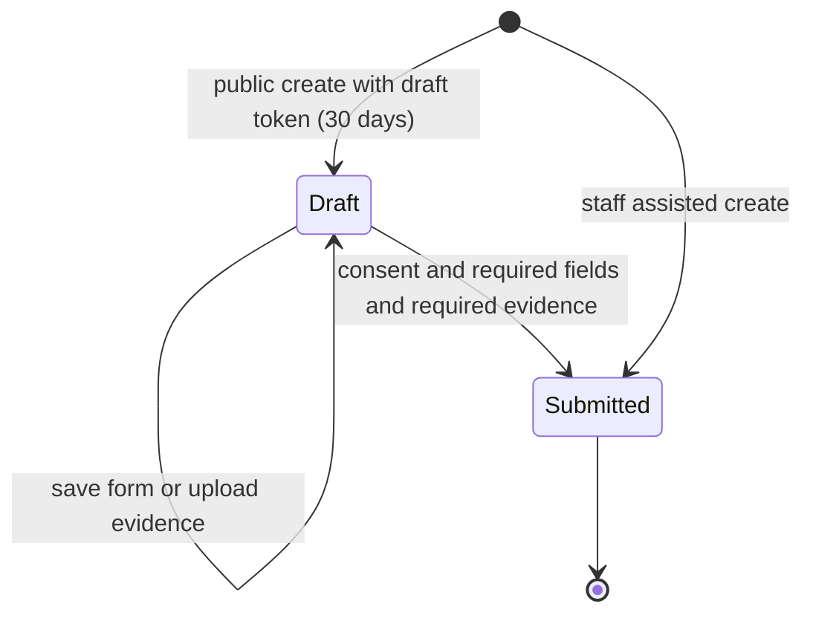

| From | To | Trigger | Guard |
| --- | --- | --- | --- |
| none | Draft | `POST /public/applications` | rate limit 20 per hour per IP in production |
| Draft | Submitted | `POST …/submit` | `consent=true`; legal name, email, country present; required evidence slots have files (FR-ONB-004) |
| none | Submitted | `POST /kyc/cases` (channel Assisted) | `onboarding.manage` |

Differences from SRD v1.0: `Draft` is an application state, not a case stage; there is no separate email-verification step (`emailVerifiedAt` is set when the resume link is opened, FR-ONB-039); applicant uploads after submission are allowed only while the case is in Client action (FR-ONB-041, FR-ONB-045).

**7.1b KYC case (as built)**

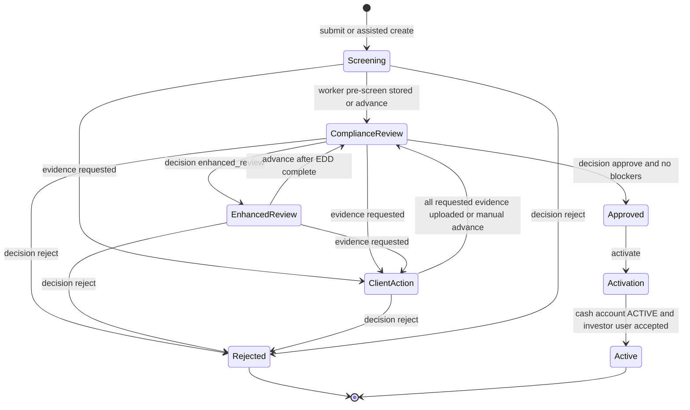

| From | To | Trigger | Actor / guards | Side effects |
| --- | --- | --- | --- | --- |
| none | Screening | submit or assisted create | public applicant or `onboarding.manage` | pre-screen queued via outbox; notification to `onboarding.manage` holders |
| Screening | ComplianceReview | worker result, or `advance` | worker automatic; `advance` needs `onboarding.manage` and `If-Match` | advisory result stored (FR-ONB-007) |
| Screening / ComplianceReview / EnhancedReview | ClientAction | `request-evidence` | `onboarding.manage`; new 14-day draft token emailed | SLA state Client action (120 h); timeline event |
| ClientAction | ComplianceReview | last requested upload (automatic) or `advance` | none | reviewers notified (FR-ONB-045) |
| EnhancedReview | ComplianceReview | `advance` | sets the EDD-complete timestamp | |
| ComplianceReview | Approved | `decision=approve` | `compliance` role; step-up; rationale 5–4000 characters; decider ≠ preparer under policy `kyc_dual_control`; no blockers (FR-ONB-047); `If-Match` | audit; notification |
| ComplianceReview | EnhancedReview | `decision=enhanced_review` | as approve, except blockers | |
| ComplianceReview / EnhancedReview / ClientAction / Screening | Rejected | `decision=reject` | as approve, except blockers | applicant emailed |
| Approved | Activation | `activate` | `onboarding.manage`; not (High risk without EDD); funds approved (DEF-531); **step-up missing today** (DEF-524) | creates client `CL-#####`, mandate shell, DRAFT cash account, investor-admin invitation (FR-ONB-013) |
| Activation | Active | automatic | client has an ACTIVE cash account and at least one accepted investor user | whichever of the two events happens second moves the case (FR-ONB-046) |

SLA hours per stage: Screening 4, ComplianceReview 48, ClientAction 120, EnhancedReview 72, Approved 24, Activation 72. SLA data is stored; escalation, an *Escalated* state and notification are not built (FR-ONB-014).

**Journey.** Applicant (onboarding portal) or staff-assisted create → worker pre-screen (stub provider today) → client services checks evidence (accept/reject per slot, FR-ONB-042) → compliance decides with dual control and step-up → activation creates client, mandate shell and DRAFT cash account → operations/compliance approve the cash account (7.6) → investor-admin invitation accepted (7.12) → case becomes Active → LP administrator invites colleagues (7.19). The admin UI chains approval and activation in one *Approve & activate* click by a Compliance user; if activation fails the case stays Approved with no retry control (FR-ONB-021).

Differences from SRD v1.0 (as built):

- Stage `Submitted` exists but is never entered; the case starts in Screening.
- Reject is allowed from Screening, ClientAction and EnhancedReview as well as ComplianceReview; evidence can be requested from Screening and EnhancedReview.
- Entering EnhancedReview is a manual compliance decision. High risk (including PEP = Yes) blocks approval until enhanced review is complete; it does not move the case automatically. BR-192 (5.C.3) asks for automatic routing of PEP Yes/Unsure and sanctions ≠ No; Q-NEW: should these route automatically to EnhancedReview? — default: block approval and show the blocker (as built), automatic routing deferred.
- The v10 stage names (Identity & Documents, Compliance Review) and the v11 AI stages are not the admin stage set. The final admin UI shows a seven-step display: Application, Ownership, Identity, Financial crime, Suitability, Mandate, Approval (stage index: Submitted 0, ClientAction 2, Screening 3, EnhancedReview 3, ComplianceReview 4, Approved/Rejected/Activation/Active 6). ClientAction is not "Identity & Documents". AI results are advisory; a human decision is always required (FR-ONB-007).
- No SLA escalation; the preparer ≠ decider check is skipped when no staff member has prepared the case (DEF-530).

### 7.2 Order lifecycle

**Build:** Not started. The state machine below is the target [P]. The implemented prototype subset is *Working*, *Awaiting approval*, *Approved*, *Filled* (blotter seed) plus *Routing*, *Partially filled*, *Rejected*, *Cancelled* in the legacy drawer; there is no *Validated* or *Settled* state, no *Reject*/*Cancel* transition on the Orders page, and the only transition is *Awaiting approval → Approved* [I]. The ticket toggles *Draft ↔ Pre-trade checked*, and *Pre-trade checked* corresponds to *Validated* (BR-025).

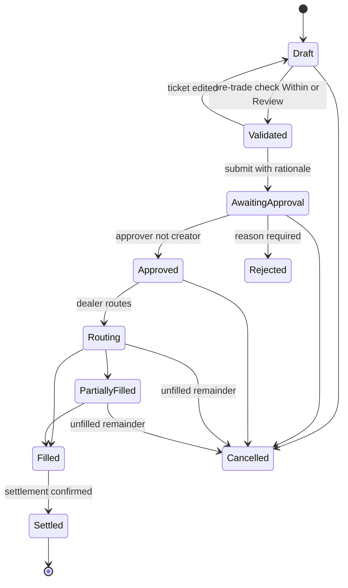

| Transition | Actor / permission | Guard |
| --- | --- | --- |
| Draft → Validated | `orders.create` | pre-trade result per control Pass/Review/Fail, overall Within/Review/Blocked (FR-OMS-017); Blocked cannot proceed |
| Validated → AwaitingApproval | `orders.create` | rationale; Review items need a documented reason; cash reservation created for buys (FR-OMS-005) |
| AwaitingApproval → Approved / Rejected | `orders.approve` | approver ≠ creator (BR-001, FR-OMS-014); reject needs a reason |
| Approved → Routing | `orders.route` | approver ≠ router (BR-003); stored instruction preview (FR-OMS-021) |
| Routing / PartiallyFilled → Filled | `orders.route` or broker feed | filled quantity ≤ order quantity (FR-OMS-008) |
| any → Cancelled | creator or `orders.approve` | reason; reservation released (FR-OMS-015) |

### 7.3 Capital event (built model) and mapping to the LP capital call

**Build:** API Built (`capital_events` per client); the LP UI does not call it. The target fund-level model is 7.13 and 7.14.

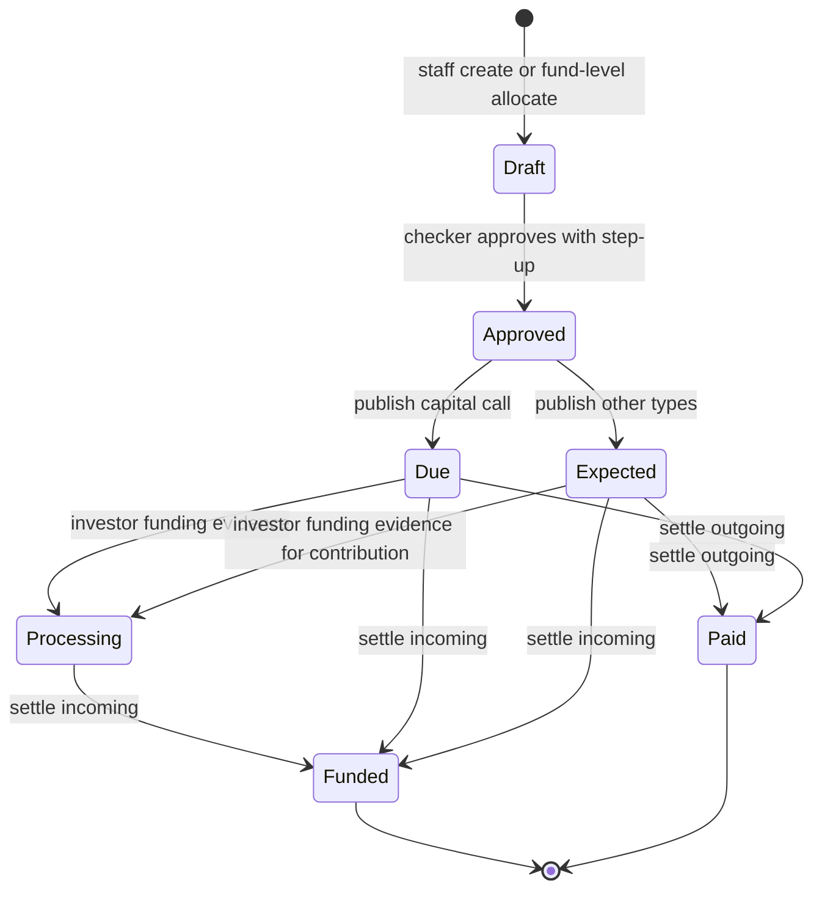

| From | To | Trigger | Actor / guards |
| --- | --- | --- | --- |
| none | Draft | create or `POST /capital-events/allocate` | `clients.edit` or `cash.journal.create`; allocation breakdown sums exactly to the fund amount (FR-INV-020) |
| Draft | Approved | approve | `cash.approve`; step-up; `If-Match`; checker ≠ maker (policy `cash_approval`) |
| Approved | Due / Expected | publish | `clients.edit` or `cash.approve`; investors emailed; **no step-up and no maker/checker check of its own** (DEF-524) |
| Due / Expected / Processing | Processing | investor funding evidence | investor role admin or finance; file plus confirmation (FR-INV-003) |
| Due / Expected / Processing | Funded (call, contribution) / Paid (distribution, withdrawal) | settle | `cash.approve` or `cash.journal.approve`; step-up; matcher ≠ evidence submitter |

Differences from SRD v1.0: Draft and Approved exist before investors see the notice; `settle` replaces the bank-statement match because no cash ledger exists. The built set cannot express acknowledgement or partial payment, so the LP design vocabulary maps as follows (Q-NEW: keep the mapping or migrate the stored values? — default: store the LP vocabulary natively in the new tables and map the old vocabulary at read time during the transition):

| Built status | LP call status (7.13) |
| --- | --- |
| Draft | DRAFT (PENDING_APPROVAL has no equivalent) |
| Approved | APPROVED |
| Due | ISSUED (ACKNOWLEDGED and OVERDUE are flag/derived) |
| Processing | ISSUED with a payment confirmation on file |
| Funded | PAID |
| Expected / Paid | distribution ISSUED / PAID (7.14) |

### 7.4 Report / document publication

**Build:** Documents Built (API); the vault and report pages do not call it. Reports are [P].

**Documents (implemented).**

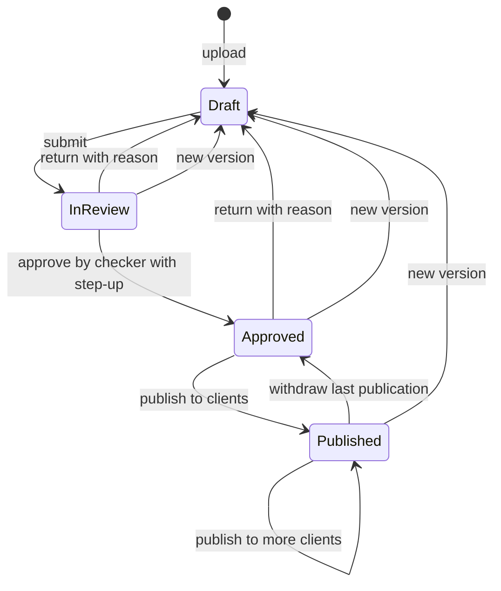

| From | To | Trigger | Guards |
| --- | --- | --- | --- |
| Draft | In review | submit | `documents.edit`; `If-Match` |
| In review | Approved | approve | `documents.edit`; step-up; `If-Match`; checker ≠ maker (policy `document_approval`) |
| In review / Approved | Draft | return | reason 3–1000 characters |
| Approved / Published | Published | publish | classification Client or Public; a file exists; at least one client; creates a Pending signature request per client when `requiresSignature`; **no step-up, no `If-Match`** (DEF-524) |
| Published | Approved | withdraw | reason 3–1000; applies when no active publication remains; cancels pending signature requests |
| any except Superseded | Draft | new version | clears approval; withdraws publications (investor loses access immediately, FR-DOC-024) |

Signature request: Pending → Signed (signatory signs with step-up, FR-DOC-006) or Cancelled (withdrawal). `Superseded` exists in the data model and in the new-version guard but no endpoint sets it. Restricted is a classification, not a status; Restricted documents never publish externally (BR-047).

**Reports (running UI, [I]).** Draft, Review, Published only. Target chain [P]: Draft → In review → Awaiting approval → Approved → Published → (Superseded), with maker ≠ checker and the route Review · Compliance, Approve · Investment Director, Publish · Client Services (FR-DOC-009, BR-045).

**LP document categories and read states (5.B.6).** Categories: Statements, Capital Calls, Distributions, Fund Reports, Tax, Legal, Governance, Other (API enum `QUARTERLY_STATEMENT`, `CALL_NOTICE`, `PERFORMANCE_REPORT`, `TAX`, `LEGAL`, `GOVERNANCE`, `MANUAL`, BR-116). Each view, preview and download is audited with user and IP (BR-174); the SHA-256 is verified on request (FR-LP-070).

### 7.5 Service request (investor) — built model

**Build:** API Built; staff transitions are not restricted to the diagram.

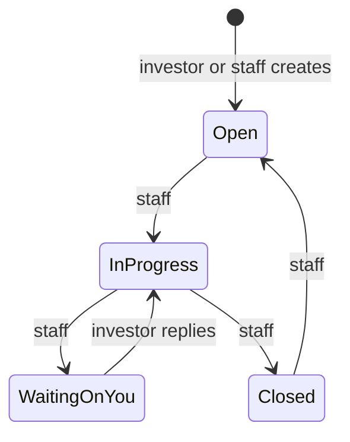

| From | To | Trigger | Guards |
| --- | --- | --- | --- |
| none | Open | investor `POST /investor/requests`, staff `POST /service-requests`, or profile-change request | investor `requests.view` or `profile.view`; staff `clients.edit`; SLA 48 h Normal or 8 h Time sensitive (High and Urgent both stored as Time sensitive) |
| any | Open / In progress / Waiting on you / Closed | staff PATCH | `clients.edit`; `If-Match`; Closed sets progress to 100; Waiting on you and Closed also email the client |
| Waiting on you | In progress | investor reply | none |

Complaints carry a separate SLA and escalation (Q-12, not built). An SLA breach is only a computed flag. The LP vocabulary (SUBMITTED … CLOSED, 8 values) is in 7.17.

### 7.6 Cash account

**Build:** API Built; the admin UI offers *Submit for approval* on SUSPENDED/CLOSED accounts and has no *Reactivate* control (FR-CLI-011); the prototype jumps ACTIVE → CLOSED in one step with client-side blockers.

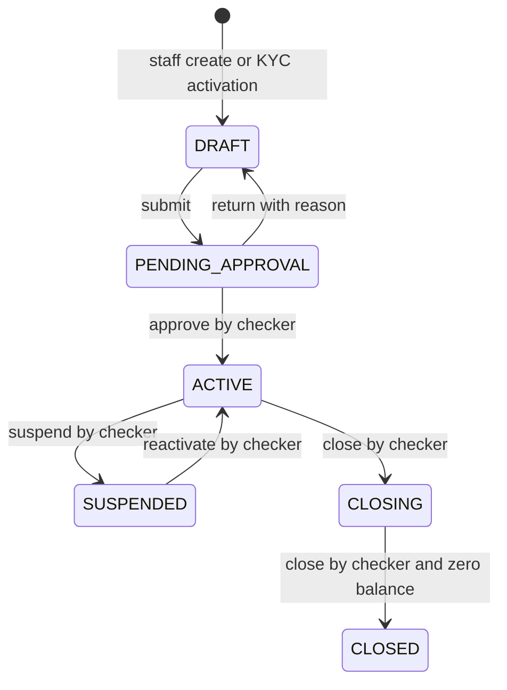

| Action | Permission | Checker ≠ maker (policy `cash_approval`) | Notes |
| --- | --- | --- | --- |
| submit | `clients.edit` or `cash.approve` | no | DRAFT only; a DRAFT account cannot be edited, so the KYC-created draft keeps provider and identifier "Pending" |
| approve | `cash.approve` | yes | step-up missing today (DEF-524) |
| return | `cash.approve` | no | reason required; the UI label "Reject" is the API action `return` |
| suspend / reactivate / close | `cash.approve` | yes | close is two calls (ACTIVE → CLOSING → CLOSED); the zero-balance, no-reservation, no-open-break, no-suspense blockers of BR-033 are not enforced yet |

All actions accept `If-Match`. A cash account in DRAFT or PENDING_APPROVAL cannot post journals, reserve cash or commit imports; SUSPENDED, CLOSING, CLOSED accept no new reservations or manual journals (BR-034, BR-060).

### 7.7 Reconciliation break

**Build:** Not started (prototype). The running prototype groups breaks as **Waiting source → Needs action → Ready checker → Matched (Closed)** with statuses *Waiting source*, *Source received*, *Investigating*, *Pending checker*, *Closed* and severities critical, high, waiting, ready, matched; there is no *New*, *Assigned*, *Awaiting counterparty* or *Overdue* state and no return transition [I]. Target state machine [P]:

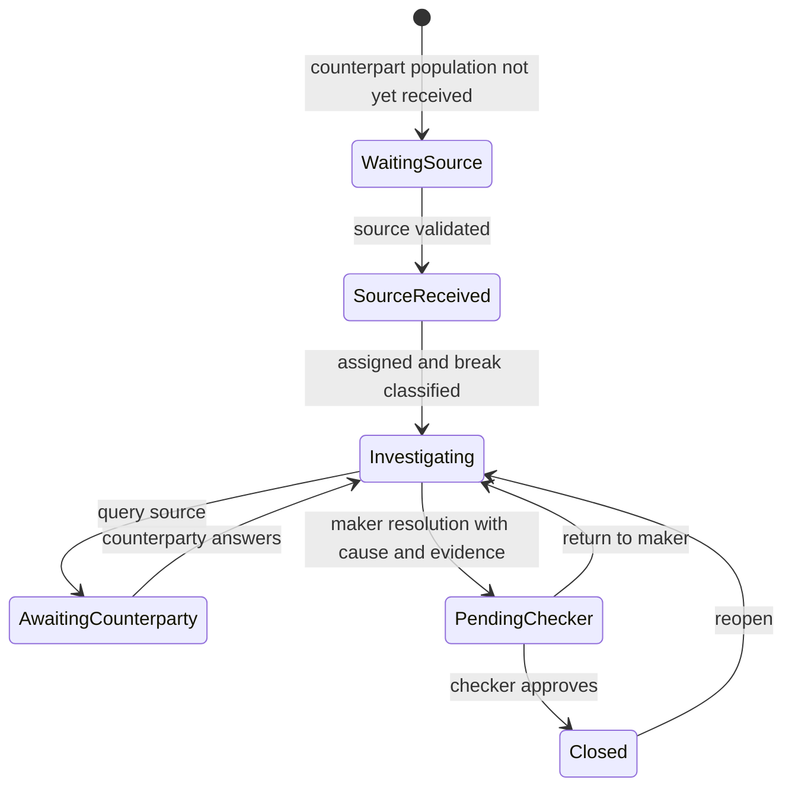

Guards: a case may not be classified as a break until the independent counterparty population has been received and validated (BR-065); maker resolution needs cause, rationale and at least one evidence reference (FR-REC-004); checker ≠ maker and holds a distinct permission (FR-REC-005); Critical breaks and breaks older than the SLA are flagged Overdue; daily sign-off is blocked while a Critical or High break is open or a scheduled source is missing (FR-REC-007, BR-067). Origins of a break: reconciliation run, order post-trade linkage, custodian portal submission (7.26). A settlement-fail break (REC-66091) appears as an Operations runbook task and gates the NAV-close-readiness task.

### 7.8 NAV run

**Build:** Not started. The prototype states are derived, not stored: Blocked (exception open) → Ready for maker (the UI still labels it "Blocked") → Ready for checker → Released; there are no ExceptionsOpen, Draft or Superseded states in the UI; Recalculate is allowed in every state and only increments the version [I]. Target [P]:

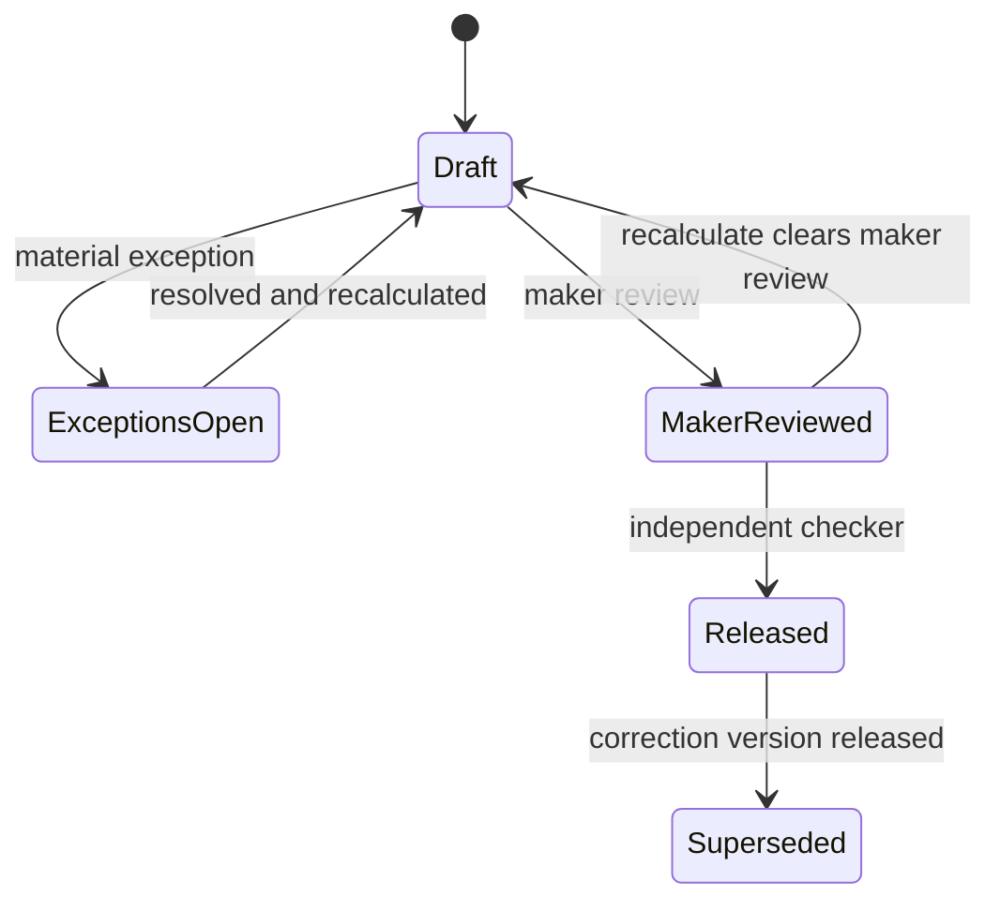

Guards: resolution requires a rationale and evidence (FR-VAL-003, FR-VAL-011); maker review is blocked while a material exception is open (FR-VAL-002); release needs maker review done and checker ≠ maker (FR-VAL-004, FR-VAL-009); recalculation after maker review or release creates a new calculation version and clears the maker review (BR-068, FR-VAL-012); a released run is immutable and corrected only by a superseding version (FR-VAL-005). Release state shown as Blocked, Ready for maker, Ready for checker, Released (FR-VAL-013).

### 7.9 Calculations and business rules

Rules are grouped by the area that owns them. IDs are never reused. The label is as stated in the register row; where a row states none it is a target rule **[P]**. *Build* is given for the v1.0 rules and for the SoD rules defined in 4.5; new rules are built or not as the requirements that reference them (6.x).

#### 7.9.1 Rules from SRD v1.0 (corrected)

| ID | Rule | Label | Build | As-built note / correction |
| --- | --- | --- | --- | --- |
| BR-010 | AVAILABLE = POSTED − RESERVED − BLOCKED; WITHDRAWABLE = AVAILABLE − pending outflows − minimum balance; EXPECTED is shown separately and never added to AVAILABLE. **Cash page formula (5.A.15, default):** AVAILABLE = max(0, POSTED SETTLED + reusable cleared proceeds or approved credit − active reservations − holds − pending withdrawals − minimum buffer); WITHDRAWABLE = POSTED SETTLED − reservations − holds − buffer; rule version tag `AVAIL-<ccy>-vN` (page uses v4). Q-NEW: which AVAILABLE formula is canonical? — default: the Cash page formula. | [O] copy / [P] formula | Not started | No cash ledger. Worked example (CCA-1188): posted 882,114.00 − reserved 0.00 − blocked 25,000.00 = available 857,114.00; withdrawable 832,114.00. WITHDRAWABLE and EXPECTED are stored text in the prototype; seed violates "EXPECTED never added" (CCA-1042); the page KPI *Available cash* sums all USD accounts including omnibus, DRAFT and CLOSING (to fix). |
| BR-011 | Journal: Σ debits = Σ credits per currency, per cash-account currency, compared in integer minor units. | [O] | Not started | The prototype does not compare journal currency with the account currency (FR-CASH-011). |
| BR-012 | NAV = market value of positions + cash + accruals − fees/liabilities; NAV/unit = NAV ÷ units outstanding (4 dp, rounded, not truncated); the bridge (previous + market movement + net subscriptions/redemptions + fees and accruals + override adjustment) sums exactly to Draft NAV. | [I] | Not started | NAV page values are hard-coded; displayed NAV/unit is wrong for *Zimbabwe Opportunities* (4.2281 vs 7.870 ÷ 1.861 = 4.2289) and truncates (FR-VAL-010). |
| BR-013 | Price coverage = valued positions ÷ total positions by market value; material exception if difference > tolerance (default 1 % of position or US$ 50k; Q-13, Q-79). | [I]/[P] | Not started | Hard-coded on the NAV page. |
| BR-014 | Stress loss = Σ exposure × shock by factor (equity, FX, rates duration × Δy); liquidity coverage = liquid assets ÷ (redemption shock × NAV). Status Escalate if a limit is breached, Review if within 10 % of limit, else Within; scenario state thresholds are configurable (BR-029). | [O]/[P] | Not started | |
| BR-015 | Private markets: called ≤ commitment; **unfunded = commitment − called (not paid-in)**; outstanding called = max(0, called − paid-in); DPI = distributions ÷ paid-in; RVPI = NAV ÷ paid-in; TVPI = (distributions + NAV) ÷ paid-in; IRR from dated cash flows. LP formulas in BR-146 to BR-148. | [O] | Not started | Figures are imported into investor snapshots, not computed. Inventory shows hard-coded IRR and Multiple only. |
| BR-016 | Returns: daily TWR chain-linked; Brinson allocation/selection/interaction per sector vs benchmark; active return = portfolio − benchmark; bridge and Brinson rows sum to active return within 0.01 percentage points; Total = allocation + selection + interaction. | [O] copy / [P] calculation | Not started | The series is synthetic (anchors plus a sine wave) and the Brinson table is a literal. |
| BR-017 | Slippage (bp) = (avg fill − decision price) ÷ decision price × 10 000 (sign by side). | [I] | Not started | No orders module. |
| BR-018 | Presentation-currency conversion uses the valuation-date FX rate of the approved rate source; the rate and its date are stored with each ledger row and never restated (BR-152, BR-170, BR-171). | [O] fx map / [P] | Partial | The snapshot carries an FX map but it is not linked to an approved rate source. |
| BR-019 | Every approval requires the approver to hold the permission at approval time and differ from the maker (BR-001). | [O] | Built | Permissions are resolved per request for existing approvals. |
| BR-020 | Onboarding required evidence per type (single catalogue, FR-ONB-033); PEP = Yes rates the case High risk, which blocks approval until enhanced due diligence is complete (see 7.1 and BR-192). | [P] | Built | Individuals need doc1–doc3, other types doc1–doc4 (API); UI needs 9 slots. |

#### 7.9.2 Segregation-of-duties rules defined in 4.5 (build status)

| ID | Rule (4.5) | Build | Note |
| --- | --- | --- | --- |
| BR-001 | A user may not approve an item they created. | Partial | Enforced for KYC decisions, cash accounts, capital approve and settle, snapshot publish, document approve and reporting-pack review; the other listed objects (orders, journals, imports, NAV, elections, recon sign-off, reports) do not exist yet. |
| BR-002 | `system_admin` must never hold a monetary permission. | Built | Bundle locked; SoD scan flags violations. |
| BR-003 | Order approval and routing are held by different people. | Not started | Seeded roles already keep `orders.approve` and `orders.route` apart. |
| BR-004 | At least two active users hold `admin.rbac`; assigning/removing `system_admin` requires confirmation. | **Contradicted** | The code requires at least one active System Administrator and flags more than two; it checks neither two `admin.rbac` holders nor a confirmation flag (DEF-522). AC: removing a role that would leave fewer than two active `admin.rbac` holders returns 409; the SoD scan flags fewer than two. |
| BR-005 | Policy toggles are configurable and relaxing any is flagged by the SoD scan. | Partial | All toggles are stored; the SoD scan flags relaxed order, cash and document approval only. |
| BR-006 | Changes to bank instructions require dual approval and out-of-band verification. | Not started | No bank-instruction change API; `bankApproval` is stored but not enforced. LP path: BR-185, FR-LP-096, FR-INV-008. |

#### 7.9.3 New business rules

The rules below are all rules added in v2 (BR-021 to BR-276), each exactly once, in the order of the area that owns them. Rules marked **[P]** in their text are targets.

##### 7.9.3.1 Admin shell, Command Centre, portfolio, construction, orders, research, risk (5.A.0 to 5.A.7)

Rules from the prototype pages; the page permission and vocabulary rules mostly describe targets. (9 rules, BR-021 to BR-029.)

| ID | Rule | Label | Source |
| --- | --- | --- | --- |
| BR-021 | a page jump is permission-checked once; a refusal produces exactly one "Access restricted" toast. | [P] | 5.A.1 |
| BR-022 | a portfolio cannot receive orders while in state *Setup*. | [P] | 5.A.2 |
| BR-023 | house liquidity floor is a policy parameter, not a constant, and "cover" is defined as liquid assets ÷ stressed outflows over the horizon. | [P] | 5.A.3 |
| BR-024 | a scenario whose weights do not sum to 100 ± 0.01 cannot be saved, optimised or promoted. | [P] | 5.A.4 |
| BR-025 | the displayed order-state vocabulary is the one in Appendix B (*Draft*, *Validated*, *Awaiting approval*, *Approved*, *Rejected*, *Routing*, *Partially filled*, *Filled*, *Settled*, *Cancelled*); *Pre-trade checked* maps to *Validated*. | [P] | 5.A.5 |
| BR-026 | the dealing cost buffer (0.65 %), residual-cash warning (15 %), ADV advisory (25 %) and review thresholds (12 %, 450k/1.2m, 9.5 %) are configurable policy parameters. | [P] | 5.A.5 |
| BR-027 | recommendation list is *Buy*, *Accumulate*, *Hold*, *Reduce*, *Sell*, plus *Review* as an explicit status if kept; conviction scale is defined once (letters or 1–5). | [P] | 5.A.6 |
| BR-028 | usage ≥ 85 % of a maximum limit (or ≤ 115 % of a minimum limit) is *Tight*; a breach creates a case and notifies the limit owner. | [P] | 5.A.7 |
| BR-029 | the scenario state thresholds (liquidity 1.25× / 1.5×, loss −8 % / −5 %) are configurable policy parameters. | [P] | 5.A.7 |

##### 7.9.3.2 Performance, clients, investor services, onboarding, reports, vault, IBOR, cash, operations, reconciliations, NAV (5.A.8 to 5.A.18)

Rules marked **[O]** (server) are enforced by the built API (documents, cash accounts); the rest are targets or prototype behaviour. (40 rules, BR-030 to BR-069.)

| ID | Rule | Label | Source |
| --- | --- | --- | --- |
| BR-030 | A performance period may be locked only when all five controls (IBOR positions reconciled, cash reconciled, valuation sources approved, composite membership review, fees and flows validated) are done, and only by a user other than the preparer; once Official the period is immutable and corrections create a new version with a reason **[P]**. | [P] | 5.A.8 |
| BR-031 | Locking, export and methodology-version changes each write an audit event with user, time, period and result **[P]**. | [P] | 5.A.8 |
| BR-032 | Period, return basis and State shown on the control bar must come from the same record as the KPI *Official state* **[P]**. | [P] | 5.A.8 |
| BR-033 | Cash-account closure requires zero posted balance, no active reservations, no open reconciliation break and no suspense on the account, enforced by the server for the CLOSING → CLOSED step — AC: closing an account with posted 5.00 returns 409 with the blocker list. | [P] | 5.A.9 |
| BR-034 | A cash account in DRAFT or PENDING_APPROVAL cannot post journals, reserve cash or commit statement imports — AC: such calls return 409. | [P] | 5.A.9 |
| BR-035 | The cash-account maker is the signed-in user (not a fixed text) and the SoD check compares user ids — AC: a maker cannot approve, suspend, reactivate or close their own account; the drawer shows the maker's name. | [P] | 5.A.9 |
| BR-036 | A capital notice, once `Funded` or `Paid`, must stay visible to staff in a capital history list with its evidence and approver names. | [P] | 5.A.10 |
| BR-037 | KPI tiles must be calculated from the same queue data the page lists, so that each tile count equals the number of rows it summarises. | [P] | 5.A.10 |
| BR-038 | Cases in Activation and Active must not count as "Ready to approve". | [P] | 5.A.11 |
| BR-039 | The production UI must not store applicant PII in browser storage. | [P] | 5.A.11 |
| BR-040 | KPI tiles, chart counts, the result count and the CSV export are all derived from the same filtered set so they always agree. **[O]** | [O] | 5.A.12 |
| BR-041 | date presets are anchored to the period end (fixed 2026-08-31 in the prototype), not the system clock. **[O]** Production anchor is a decision (see Q-NEW below). | [O] | 5.A.12 |
| BR-042 | a report whose status is *Review* is counted as "Awaiting review" and requires a human sign-off before release; client and regulatory outputs need a human reviewer. **[I]** (text only) | [I] | 5.A.12 |
| BR-043 | the official NAV / performance period must be locked before a report is published; one material data exception blocks a report. **[I]** (text only; ties to 5.A.8 *Lock official return* and 5.A.18) | [I] | 5.A.12 |
| BR-044 | numeric fields in a report are bound to approved source data; manual edits are flagged as overrides; every save creates an audit checkpoint. **[I]** (editor copy only) | [I] | 5.A.12 |
| BR-045 | workflow vocabulary for reports is Draft, In review, Awaiting approval, Approved, Published (Appendix B); the running UI uses Draft, Review, Published only. The target must map *Review* → *In review* (or *Awaiting approval*) and render the full chain. | [P] | 5.A.12 |
| BR-046 | document lifecycle is Draft → In review → Approved → Published; *Return* sends In review or Approved back to Draft with a reason; *Withdraw* removes publications and reverts to Approved; a new version always resets to Draft (and withdraws a Published document from investors until re-approved). **[O]** (server) | [O] | 5.A.13 |
| BR-047 | only documents classified *Client* or *Public* can be published to investors; *Internal* and *Restricted* cannot (error "<classification> documents cannot be published to investors"). **[O]** (server) | [O] | 5.A.13 |
| BR-048 | a *Restricted* document can be downloaded only by a user holding `audit.view` or by its maker; every download is audited. **[O]** (server) | [O] | 5.A.13 |
| BR-049 | download links are short-lived signed URLs (expiry 300 seconds). **[O]** (server) | [O] | 5.A.13 |
| BR-050 | documents are never deleted through the API; retention years per document default to 7 (range 1–50). **[O]**; legal-hold blocking is | [O] | 5.A.13 |
| BR-051 | file storage is encrypted at rest with a recorded SHA-256 per version. **[O]** | [O] | 5.A.13 |
| BR-052 | optimistic locking — a lifecycle call supplying a stale version returns "This record was changed by someone else. Reload and try again." **[O]** | [O] | 5.A.13 |
| BR-053 | publish creates a Pending signature request per client when the document requires a signature. **[O]** | [O] | 5.A.13 |
| BR-054 | allowed upload types pdf, docx, xlsx, csv, png, jpg; ≤ 25 MB; malware scan before availability; classification required. **[P]** (the server accepts a wider MIME list and performs no scan) | [P] | 5.A.13 |
| BR-055 | Position quantity must equal settled + unsettled quantity, and the Position count, Market value and Available cash KPIs must equal the aggregates of the positions in scope **[P]**. | [P] | 5.A.14 |
| BR-056 | A position whose custodian quantity differs from the IBOR quantity is shown as *Review* and appears in the Exceptions count until the break is resolved; the reconciliation tab shows the actual difference **[P]**. | [P] | 5.A.14 |
| BR-057 | Historical snapshots are read-only reconstructions from effective-time records; they never change current positions **[P]**. | [P] | 5.A.14 |
| BR-058 | Order-eligible available cash is a single server-calculated value shared by the cash page, the order ticket, reservations and withdrawals (rule version recorded with every result). | [P] | 5.A.15 |
| BR-059 | Journal posting, reservation creation and statement commit are atomic with row-level locking of the cash account so concurrent requests cannot over-reserve or double-post. | [P] | 5.A.15 |
| BR-060 | A cash account in status SUSPENDED, CLOSING or CLOSED accepts no new reservations or manual journals; reconciliation postings remain allowed. | [P] | 5.A.15 |
| BR-061 | A task is **overdue** when the current CAT time is later than its deadline and its state is not *Done*; overdue tasks show a red *Overdue* flag and count towards *Due today*. | [P] | 5.A.16 |
| BR-062 | A task whose dependency is not *Done* cannot be marked *Done*; completing a task re-evaluates dependants and automatically moves *Blocked* tasks whose blockers have cleared to *Due*. | [P] | 5.A.16 |
| BR-063 | A task creator may not mark their own task *Done* when the task is flagged as a control task (extends BR-001). | [P] | 5.A.16 |
| BR-064 | KPI and dependency values are computed server-side from live data: *Due today* = tasks due today with state ≠ *Done*; *Close blockers* = tasks and controls with state *Blocked* that gate period close; *Settlement* readiness % = settled or matched instructions ÷ total instructions for today; *Cash* % = share of bank feeds received within their schedule; *Valuation* % = priced positions ÷ total positions; *Accounting* % = completed close-checklist items ÷ total items. | [P] | 5.A.16 |
| BR-065 | a reconciliation case may not be classified as a break until the independent counterparty population has been received and validated. | [P] | 5.A.17 |
| BR-066 | the prototype assumes the broker price is always the instruction price plus 0.01, so a trade break is always created at stage 8; production must create a break only when a real difference exists. | [P] | 5.A.17 |
| BR-067 | Quantity and order-reference matching are exact; price tolerance, amount tolerance, as-of tolerance and NAV materiality are effective-dated configuration per family, not constants in code. | [P] | 5.A.17 |
| BR-068 | recalculating a run after maker review or after release invalidates the maker review, and a released run may only be corrected by a new superseding version (FR-VAL-005) **[P]**. | [P] | 5.A.18 |
| BR-069 | the NAV exception list, price coverage and release gates (*Source evidence current*, *Cash reconciled*, *Material exceptions*, *Maker review*) are computed from live source status, reconciliation sign-off and exception state, not static labels **[P]**. | [P] | 5.A.18 |

##### 7.9.3.3 Financing, corporate actions, regulatory, data, models, copilot, settings, audit (5.A.20 to 5.A.28)

Targets for modules that have no API yet, except BR-076 and BR-077 which the server already implements. (8 rules, BR-070 to BR-077.)

| ID | Rule | Label | Source |
| --- | --- | --- | --- |
| BR-070 | A margin dispute resolution records reason, counterparty evidence and the house calculation; funding a call requires maker ≠ checker and creates a cash expectation (FR-FIN-002). | [P] | 5.A.20 |
| BR-071 | An election can be submitted only before the election deadline and only by `corporate_actions.elect` (Q-04). Approval by a different user moves the event to *Instructed*. | [P] | 5.A.21 |
| BR-072 | Attestation must be recorded by two distinct users (Compliance and Finance); the filer must hold `regulatory.submit` (Q-04) and differ from the preparer. | [P] | 5.A.22 |
| BR-073 | A source is authoritative only after connectivity, authentication, schema and quality checks pass and the named owner approves. | [P] | 5.A.23 |
| BR-074 | The validator and the approval committee must be independent of the model owner. Production promotion requires closed high-severity findings and committee approval recorded by `models.approve` (Q-04). | [P] | 5.A.24 |
| BR-075 | Copilot answers may cite only objects the requesting user is entitled to read. A question whose sources are all out of entitlement returns guidance without data. | [P] | 5.A.25 |
| BR-076 | A setting change is audited with before/after values (the server already writes `settings.updated`); settings with no consumer must be removed or wired before release. | [P] | 5.A.27 |
| BR-077 | Exporting audit evidence is itself an audited event (implemented as `audit.exported`). | [P] | 5.A.28 |

##### 7.9.3.4 LP portal: page rules (5.B.0 to 5.B.10)

Rules from the LP screens. The reference backend (NVCCZ) is the oracle for behaviour; where it is known to be wrong the rule states the Nexus behaviour to build. (59 rules, BR-078 to BR-136.)

| ID | Rule | Label | Source |
| --- | --- | --- | --- |
| BR-078 | every monetary figure on every screen carries the as-of date and valuation status of the snapshot it was read from; PROVISIONAL, ESTIMATED and RESTATED must be visually distinct from FINAL (amber, amber, purple) and may never be shown without the label. | [P] | 5.B.0 |
| BR-079 | fund, share class and as-of parameters sent by the browser are advisory; the API recomputes the allowed set from the user's entitlements and returns a generic 404 for anything outside it. | [P] | 5.B.0 |
| BR-080 | a null or unavailable rate (Net IRR on a fund with no cash flows) is shown as *—*, never as 0.0 %; rates are always sent as fractions so the heuristic can be removed. | [P] | 5.B.1 |
| BR-081 | *Total Commitment* = sum of the investor's contractual commitments (status ACTIVE or PENDING) in scope. *Paid-In Capital* = cash contributions received and posted. *Called* = capital formally called and visible to the investor (calls at ISSUED or later). *Unfunded Commitment* = Total Commitment − Called (never − Paid-In). *Outstanding called* = Called − Paid-In (floored at 0). So Paid-In + Outstanding called + Unfunded = Total Commitment. **[I]** | [I] | 5.B.1 |
| BR-082 | the consolidated Net IRR is computed from the merged dated cash flows of all in-scope funds, or shown as *—* when it cannot be computed. **[P]** | [P] | 5.B.1 |
| BR-083 | the Capital Position donut shows a partition of the commitment (Paid-In, Called Not Yet Paid, Unfunded) so the shares sum to 100 %; distributions and residual value are shown as separate figures, not as extra slices of the commitment. **[P]** | [P] | 5.B.1 |
| BR-084 | the toggle windows are time based (YTD = from 1 January of the as-of year; 1Y = 12 months; 3Y = 36 months, each ending at the as-of date), applied to dated points, and the subtitle shows the active window instead of the static *Since Inception*. **[P]** | [P] | 5.B.1 |
| BR-085 | the figures are those of the latest approved snapshot dated on or before the selected as-of date for each fund; the response `asOfDate` and `valuationStatus` are displayed, and for *All Funds* the status shown is the weakest status among the funds (ESTIMATED weaker than PROVISIONAL weaker than RESTATED weaker than FINAL) with the oldest snapshot date. **[P]** The real service currently picks the latest snapshot regardless of the requested as-of date. **[I]** | [P]/[I] | 5.B.1 |
| BR-086 | for a selected OPEN_ENDED fund the KPI strip shows Account Value, Units Held, NAV Per Unit, YTD Return and net contributions and redemptions instead of commitment, called, DPI, RVPI and TVPI; the Capital Position panel is hidden; for a PRIVATE_CAPITAL fund the open-ended panel is absent; for *All Funds* with both models both blocks show. The API returns `openEndedSummary: null` (not zeros) when no OPEN_ENDED fund is in scope. **[P]** (design guardrail: never show commitment, DPI or TVPI for an open-ended fund unless configured). **[I]** | [P]/[I] | 5.B.1 |
| BR-087 | the presentation currency (USD or ZIG) is applied by the API to every amount of the dashboard payload using the exchange rate of the as-of date, and the screen formats with the returned currency; the compact formats use the currency symbol or code, and chart axes show the currency. **[P]** | [P] | 5.B.1 |
| BR-088 | when a single OPEN_ENDED fund is selected the KPI row shows the open-ended measures (Account Value, Units Held, NAV Per Unit, YTD Return, and 1M, 3M, 1Y, SI returns) instead of Net IRR, TVPI, DPI and RVPI; with *All Funds* and both models the private-capital KPIs cover the PRIVATE_CAPITAL funds only and the open-ended panel covers the OPEN_ENDED funds. **[P]** | [P] | 5.B.2 |
| BR-089 | the *Period* select changes the figures: Net IRR, TVPI, DPI, RVPI and NAV change reflect the chosen window from approved period snapshots (or are marked as unavailable for that window), and the helper under each tile names the active period instead of the static *Since Inception*. **[P]** | [P] | 5.B.2 |
| BR-090 | the range buttons are time windows ending at the as-of date and are the single period control of the history chart; selecting *Period* in the filter bar sets the same window. **[P]** | [P] | 5.B.2 |
| BR-091 | a benchmark series exists only when approved points are stored for the pair (benchmark id, metric); the API then returns `configured: true`, `valuationStatus: FINAL`, the points with their date and label, the source and approval date; otherwise `configured: false`, `valuationStatus: UNAVAILABLE`, an empty series and the note *No approved {BENCHMARK} series is configured for {METRIC}.* The platform never generates a benchmark series. **[I]** | [I] | 5.B.2 |
| BR-092 | the column shows the benchmark value for the fund's own benchmark and as-of date, per row. **[P]** | [P] | 5.B.2 |
| BR-093 | the *Benchmark Comparison* panel compares the investor's (or selected fund's) value of the chosen metric with the selected benchmark's value for the same as-of date, in one chart, and the axis scale follows the metric (percent or multiple). **[P]** | [P] | 5.B.2 |
| BR-094 | the card shows the real status of the snapshot (weakest status among the funds for *All Funds*) with a colour per status (green FINAL, amber PROVISIONAL or ESTIMATED, purple RESTATED), and the page shows the snapshot's calculation date, version, source module and approver (for example in the Valuation Notes card or a popover). **[P]** Historic approved figures remain visible and unchanged after later valuations. **[I]** | [P]/[I] | 5.B.2 |
| BR-095 | the chart axis titles and money symbols follow the reporting currency. **[P]** | [P] | 5.B.2 |
| BR-096 | *Download Report* creates a server-side report job that captures the selected fund, period, benchmark and as-of date; job states are QUEUED, RUNNING, COMPLETED, FAILED, CANCELLED; the screen polls until a terminal state or a timeout and treats every terminal state explicitly (COMPLETED downloads; FAILED shows the job error; CANCELLED shows a cancellation message; timeout shows a "still preparing" message and keeps the job id so the file can be fetched later). **[P]** | [P] | 5.B.2 |
| BR-097 | one job vocabulary is used by the API and the screen (QUEUED, RUNNING, COMPLETED, FAILED, CANCELLED), and a COMPLETED performance-report job is downloadable by `GET /lp-portal/jobs/{jobId}/download` (or the `downloadUrl` returned by the job), with `Content-Type: application/pdf` and `Content-Disposition: attachment; filename="fund-performance-{fund or consolidated}-{as-of date}.pdf"`. **[P]** | [P] | 5.B.2 |
| BR-098 | the API returns every ledger amount as a positive magnitude and the kind carries the direction; the demo data returns outflows as negative numbers, which makes the net formula add them. **[O] / [P]** | [O]/[P] | 5.B.3 |
| BR-099 | Ledger amounts are positive magnitudes; the type determines direction; Net Cash Flow = contributions + subscriptions - distributions - redemptions - fees over settled (posted) rows only. — AC: for the demo data the net equals contributions + subscriptions minus the absolute distributions, redemptions and fees. | [P] | 5.B.3 |
| BR-100 | all dates in the register are shown in UTC date form `MMM d, yyyy`. — AC: the step date equals the date stored. | [P] | 5.B.4 |
| BR-101 | The full account number in the wiring dialog is shown only to roles that may pay (SIGNATORY, MANAGER) and each reveal is audited; VIEWER sees only the masked number. Q-113: Is a VIEWER allowed to see the full wiring text? — default: no. | [P] | 5.B.4 |
| BR-102 | a snapshot binds the fund, share class, amount (subscription) or mode/amount/units/earliest dealing date (redemption) and currency; the hash must be computed over a fixed canonical field list that excludes `estimateSnapshotId` and unrelated keys, so that the same request produces the same hash at estimate time and at submit time. The real backend hashes the whole redemption body (including `estimateSnapshotId` at submit time), which can never match; the Nexus implementation must not copy that. | [P] | 5.B.5 |
| BR-103 | a snapshot is single-use: after a successful submit it is marked consumed and cannot back a second request. (The real backend leaves it reusable for 15 minutes.) | [P] | 5.B.5 |
| BR-104 | on submit the server re-checks every rule that the estimate checked (notice period, minimum balance, units available net of pending redemptions, compliance gate), because the position and the rules can change within the 15-minute life of a snapshot. (The real backend re-checks only the compliance gate.) | [P] | 5.B.5 |
| BR-105 | the estimate never allocates units; units are confirmed only after funds are received and the dealing-date NAV is approved; every pre-dealing figure is labelled as an estimate (`isEstimate` true on estimates, and rows created from an estimate stay labelled "(Est.)" until the units are allocated). **[I]** | [I] | 5.B.5 |
| BR-106 | "available to redeem" and the insufficient-units check use units held minus units of redemption requests not yet settled, so that several pending requests cannot together exceed the position. | [P] | 5.B.5 |
| BR-107 | the next eligible dealing date is the first dealing date of the fund's frequency that is on or after (submission date + notice days), computed on the fund's business-day calendar and cut-off time zone; the earliest-dealing-date field accepts only dealing dates on or after it. | [P] | 5.B.5 |
| BR-108 | estimated settlement date = dealing date + `settlementLagDays` business days (seed 2; design example 3; real backend hard-codes 3 calendar days). | [P] | 5.B.5 |
| BR-109 | the `kycStatus` value set and the strings in `blockers` are a closed list with human-readable text (for example "Compliance hold", "Dealing suspended for this fund", "Investor not accredited", "KYC update required", "Unsettled capital call"); the page prints the text, not codes. | [P] | 5.B.5 |
| BR-110 | the UI keeps one idempotency key per submit attempt (reused when the same attempt is retried after a timeout) and discards it after a response; the hash for multipart requests covers the form fields and the file hashes (the real backend hashes an empty body for multipart because its middleware runs before the file parser). | [P] | 5.B.5 |
| BR-111 | transitions allowed: `SUBMITTED` → `COMPLIANCE_REVIEW` \| `REJECTED` \| `CANCELLED`; `COMPLIANCE_REVIEW` → `AWAITING_FUNDS` (subscription) \| `UNDER_REVIEW` (redemption) \| `REJECTED`; `AWAITING_FUNDS` → `FUNDS_RECEIVED` \| `REJECTED` \| `CANCELLED`; `FUNDS_RECEIVED` → `AWAITING_NAV`; `UNDER_REVIEW` → `AWAITING_NAV` \| `REJECTED`; `AWAITING_NAV` → `ALLOCATED`; `ALLOCATED` → `SETTLED`. No transition leaves `REJECTED`, `CANCELLED` or `SETTLED`. | [P] | 5.B.5 |
| BR-112 | the history exposes separate `requestedDealingDate`, `expectedFundingDate` (subscriptions) and `expectedSettlementDate`, and the column *Expected Settlement* shows the settlement date once known and otherwise the estimate. | [P] | 5.B.5 |
| BR-113 | the source bank account must be an ACTIVE account of the same client (and fund scope) or the submit fails with 422 and a field error on `sourceBankAccountId`. | [P] | 5.B.5 |
| BR-114 | Currency of a request is one of the fund's dealing currencies; the estimate converts nothing and the history shows the request's own currency. — AC: a request in GBP is shown in GBP. | [P] | 5.B.5 |
| BR-115 | unpublished (draft) and withdrawn documents are never returned by list, summary, detail, preview or download. The reference list query does not filter `publishedAt` today. **[P]** | [P] | 5.B.6 |
| BR-116 | one canonical category enum is used by the API, the filter and the counts: `STATEMENTS`, `CAPITAL_CALLS`, `DISTRIBUTIONS`, `FUND_REPORTS`, `TAX`, `LEGAL`, `GOVERNANCE`, `FINANCIAL_STATEMENTS`, `NOTICES`, `SUBSCRIPTION`, `REDEMPTION`, `DEALING`, `OTHER` (the first eleven are the reference design list, `FINANCIAL_STATEMENTS` and `DEALING` are present in the seed data); the UI label is a lookup; *Distributions* must not share `MANUAL` with *Other*; every More item maps to a category (`SUBSCRIPTION` for *Subscription Documents*, `NOTICES`, `OTHER`). **[P]** | [P] | 5.B.6 |
| BR-117 | the summary accepts the same `fundId` and (for tab counts) ignores `category` and `q`, so tiles and counts follow the fund selector. **[P]** | [P] | 5.B.6 |
| BR-118 | the count of visible documents that have an open (Pending) signature request for the signed-in user's organisation (Nexus `signature_requests` status Pending); status REQUIRES_SIGNATURE for the same documents; the tile helper "Awaiting your signature" stays. **[P]** | [P] | 5.B.6 |
| BR-119 | only downloads that completed and were audited are counted, and the figure refreshes after a download. **[P]** | [P] | 5.B.6 |
| BR-120 | the history card shows DOWNLOAD events only (heading *Download History*), user shown as display name, and VIEW/PREVIEW remain in the audit log (SRDUI events `DOCUMENT_VIEWED`, `DOCUMENT_DOWNLOADED`); audit rows are append-only with a retention of at least 7 years. **[P]** | [P] | 5.B.6 |
| BR-121 | the download endpoint either streams the bytes or answers a 5-minute HMAC-signed URL, always after the entitlement check and always writing the audit event; failures are not counted in *Secure Downloads YTD*; a download rate limit of N per minute per user returns 429 `rate_limited` (default N = 30). **[P]** | [P] | 5.B.6 |
| BR-122 | the register shows the latest published version; SUPERSEDED versions stay reachable and labelled (SRDUI §19) and RESTATED documents show "Restated". **[P]** | [P] | 5.B.6 |
| BR-123 | allowed values are `INVESTOR_ORGANISATION` and `INVESTOR_ACCOUNT`; the badge text is Title-Cased ("Investor organisation", "Investor account"). **[P]** | [P] | 5.B.6 |
| BR-124 | the topbar search, dashboard panel and Capital/Account Activity links use the same document ids as this screen. **[P]** | [P] | 5.B.6 |
| BR-125 | a thread's `relatedId` for type `REQUEST` is the request `reference`, and the screen matches by reference. | [P] | 5.B.7 |
| BR-126 | an empty description is stored empty and creates no first message. | [P] | 5.B.7 |
| BR-127 | a FUND-targeted notice is visible only to organisations with an active or pending commitment in that fund, and a share-class notice only to holders of that class. **[P]** | [P] | 5.B.8 |
| BR-128 | one category enum (`CAPITAL_CALL`, `DISTRIBUTION`, `REPORT`, `VALUATION`, `NAV`, `AGM`, `POLICY`, `DEALING`, `REDEMPTION_SUSPENSION`, `SYSTEM`, `GENERAL`) with Title-Case labels, and `kind` (INFO / ACTION_REQUIRED) is a separate field that never replaces the category. **[P]** | [P] | 5.B.8 |
| BR-129 | the open is recorded only when the user has the detail visible for at least one selection made by a click or a deep link, not by auto-selection. **[P]** | [P] | 5.B.8 |
| BR-130 | acknowledgement keeps the first `acknowledgedAt`; a repeat answers 200 with the original timestamp; the organisation is *Acknowledged* when any SIGNATORY or MANAGER of the organisation has acknowledged; an `NOTICE_ACKNOWLEDGED` audit event records user, time and IP. **[P]** | [P] | 5.B.8 |
| BR-131 | `requires_acknowledgement` is a stored boolean set by the publisher (default false); capital-call and policy notices default true. **[P]** | [P] | 5.B.8 |
| BR-132 | the session `unreadCounts.notices` equals the number of visible notices with status *Unread* (not opened), and a separate count of notices awaiting acknowledgement drives dashboard actions and the bell. **[P]** | [P] | 5.B.8 |
| BR-133 | add edit-before-open, withdraw and `expires_at`. **[P]** | [P] | 5.B.8 |
| BR-134 | acknowledgement is audited (`NOTICE_ACKNOWLEDGED`) and opens are recorded per user. **[P]** | [P] | 5.B.8 |
| BR-135 | store the account number encrypted, expose only the last four characters, and never return it. | [P] | 5.B.9 |
| BR-136 | valid codes are `LATEST`, `LATEST_ANY`, `PRIOR_MONTH_END`; `LATEST_FINAL` is read as `LATEST`. | [P] | 5.B.10 |

##### 7.9.3.5 LP portal: consolidated normative rules

**[I]** = implemented only in the reference backend or stated by the design documents, not in Nexus; **[P]** = proposed. Entitlement, formulas, capital, dealing, documents, notices, requests, colleagues and realtime. (53 rules, BR-137 to BR-189.)

| ID | Rule | Label | Source |
| --- | --- | --- | --- |
| BR-137 | Every LP request is resolved as user → active membership → organisation (client) → fund entitlement → resource. Client and fund identifiers sent by the browser are advisory; the server recomputes the allowed set and answers a generic 404 for anything outside it (403 `LP_FORBIDDEN` only for an explicit fund filter the user is not entitled to). **[I]** (reference: 403 for explicit `fundId`, silent filtering for lists, no check on ledger detail, vault list, request replies — Nexus must apply it uniformly) | [I] | 5.B consolidated |
| BR-138 | A membership's `fundIds` is an explicit subset of the organisation's fund commitments; an empty or null list means no fund access in Nexus (the reference treats empty as all funds, which lets a scoped manager create an unscoped colleague). **[P]** | [P] | 5.B consolidated |
| BR-139 | The funds in the session are the organisation's commitments in status ACTIVE or PENDING, filtered by the membership scope, one row per fund (the reference returns only the first commitment amount when a fund has several). **[I]** | [I] | 5.B consolidated |
| BR-140 | Each fund carries an operating model, PRIVATE_CAPITAL or OPEN_ENDED. Private-capital funds show commitment, called, paid-in, unfunded, distributions, NAV, net IRR, TVPI, DPI and RVPI; open-ended funds show account value, units held, NAV per unit, YTD return and dealing, and their IRR, TVPI, DPI and RVPI are null (shown "—", never 0). **[I]** The Nexus UI shows the private-capital tiles for open-ended funds as well. DEFECT in 5.B.1. | [I] | 5.B consolidated |
| BR-141 | A consolidated view ("All Funds") sums money across funds and recomputes TVPI, DPI and RVPI from the sums; net IRR is computed from the merged dated cash flows, not taken from one fund or averaged. **[P]** (reference: last fund's IRR) | [P] | 5.B consolidated |
| BR-142 | Every valuation figure is read from an approved, immutable snapshot (client, fund, as-of date, valuation status, calculation date, version, source module, approver). The requested as-of date selects the latest approved snapshot dated on or before it; a published snapshot is never recalculated, and a restatement is a new snapshot that supersedes the original while the original stays visible. **[I]** (reference: performance honours `asOfDate`; dashboard always takes the latest snapshot) | [I] | 5.B consolidated |
| BR-143 | Valuation status vocabulary ESTIMATED, PROVISIONAL, FINAL, RESTATED; a figure is never shown without its status and as-of date; PROVISIONAL and ESTIMATED are visually distinct from FINAL. **[I]** (the reference only ever emits FINAL, plus UNAVAILABLE for benchmarks) | [I] | 5.B consolidated |
| BR-144 | The default status of a mixed set of funds is the least certain status among them (ESTIMATED, then PROVISIONAL, then FINAL), not FINAL. **[P]** (reference: FINAL unless all funds agree) | [P] | 5.B consolidated |
| BR-145 | The default as-of date is the latest approved as-of date among the in-scope funds; the user's `defaultAsOfPreference` (LATEST, LATEST_FINAL, a fixed month-end) is applied when the session is built. **[P]** | [P] | 5.B consolidated |
| BR-146 | Unfunded commitment = total commitment − called capital (never − paid-in). Outstanding called = max(0, called − paid-in). Paid-in = Σ received payments on the investor's allocations. Called counts only calls visible to the investor. **[I]** | [I] | 5.B consolidated |
| BR-147 | DPI = distributions ÷ paid-in; RVPI = NAV ÷ paid-in; TVPI = (distributions + NAV) ÷ paid-in; each is null when paid-in ≤ 0 or the fund is open-ended; ratios are decimal strings to 4 dp. **[I]** | [I] | 5.B consolidated |
| BR-148 | Net IRR is computed from the investor's dated cash flows with the ending NAV as terminal value, stored as a decimal fraction (0.1840 = 18.4 %) to 4 dp; the UI multiplies by 100 only for display. The reference stores a percent number for computed values (16.7) and a fraction for seeded values; Nexus must use one convention. **[P]** | [P] | 5.B consolidated |
| BR-149 | Open-ended account value = Σ over share classes of units × NAV per unit (never summed before pricing); YTD return = NAV per unit now ÷ NAV per unit at the prior 31 December − 1 (1M, 3M, 1Y and since-inception analogously); distributions use the fund-approved total-return method. **[I]** (reference: always 0) | [I] | 5.B consolidated |
| BR-150 | Capital-call allocation is pro-rata by commitment: call amount = min(round2(commitment × call percent ÷ 100), commitment − Σ prior calls), rounded half-up to 2 dp, skipped when ≤ 0; the sum of allocations equals the call total or the remainder goes to the last investor. **[I]** | [I] | 5.B consolidated |
| BR-151 | Distribution split: net to investors = gross − carry (carry = (gross − hurdle) × carry rate); each investor's share is pro-rata by paid-in (by commitment when no paid-in), rounded half-up, last investor takes the remainder. The investor sees gross (their share before adjustments), adjustments (withholding or fees, stored, not derived) and net paid. **[I]**/[P] (reference derives "adjustments" from unpaid remainder) | [I]/[P] | 5.B consolidated |
| BR-152 | The investor ledger is read from posted records (calls, payments, distributions, payouts, subscriptions, redemptions, fees); amounts keep their original currency and amount, the historical conversion rate and its date, and the reporting amount; ledger rows are never restated by later FX. **[I]** (reference: no FX fields) | [I] | 5.B consolidated |
| BR-153 | A call or distribution is visible to investors only after staff approval and issue; drafts and cancelled records never appear in lists, summaries, notifications, activity or the ledger. **[I]** (reference applies this to calls only, and not to the ledger and activity feeds) | [I] | 5.B consolidated |
| BR-154 | Acknowledging a call records who and when; it needs the SIGNATORY or MANAGER role and the call must be issued and not cancelled; it never changes `paid` or the status other than the acknowledged marker; a second acknowledgement returns 409 `LP_CALL_ALREADY_ACKNOWLEDGED` (per allocation, by anyone in the organisation). **[I]** | [I] | 5.B consolidated |
| BR-155 | A payment confirmation is evidence only (file, claimed amount, notes, SHA-256, uploader, time). It does not change `paid`; staff matching does. Accepted file types and size are limited (default 25 MB; PDF, image, CSV, XLSX), the file is scanned before it is available, and a second confirmation for the same call is allowed. **[P]** (reference: no type check, no scan, no staff queue) | [P] | 5.B consolidated |
| BR-156 | Derived call status order (target): CANCELLED, then PAID (paid ≥ amount > 0), then PARTIALLY_PAID (paid > 0), then OVERDUE (due date before today and unpaid), then ACKNOWLEDGED, then ISSUED. Acknowledgement must not hide an overdue call. **[P]** (reference puts ACKNOWLEDGED above OVERDUE) | [P] | 5.B consolidated |
| BR-157 | "Due soon" is a configured window (default 7 days) used identically by the row highlight and by the summary (the UI uses 7, the reference summary 14). **[P]** | [P] | 5.B consolidated |
| BR-158 | A call number is a sequential, per-fund number (CC-013). **[P]** (reference: derived from the date; no column) | [P] | 5.B consolidated |
| BR-159 | Notice and statement downloads are real documents (PDF) generated or attached by staff; the reference returns text stubs. **[P]** | [P] | 5.B consolidated |
| BR-160 | A request is created only from a valid estimate: estimate → snapshot (id, client, fund, type, canonical payload hash, result, expiry 15 minutes) → submit with `estimateSnapshotId`. The hash is computed over a fixed canonical field list that excludes `estimateSnapshotId`; a snapshot is single-use; the server repeats every check at submit time. **[I]**/[P] (reference: redemption hash can never match; snapshot reusable) | [I]/[P] | 5.B consolidated |
| BR-161 | Estimates never allocate units, never change the ledger and always carry `isEstimate: true`; units and settlement become final only after funds are received and the dealing-date NAV is approved. **[I]** | [I] | 5.B consolidated |
| BR-162 | Subscription estimate: management or subscription fee = amount × fee rate; other fees = flat fee; units = amount ÷ NAV per unit (fees are added on top, total investment = amount + fees); NAV per unit has 8 dp, units 6 dp, money 2 dp; NAV comes from the fund and share class dealing NAV, never a constant. **[I]** (the mock deducts fees from units; the reference uses NAV 1 when there is no holding) Q-NEW in 5.B.5. | [I] | 5.B consolidated |
| BR-163 | Redemption estimate: mode AMOUNT (units = amount ÷ NAV), UNITS (value = units × NAV) or FULL (all units and the whole account value); fee = value × redemption fee rate; settlement amount = value − fee; settlement date = earliest dealing date + settlement lag business days (seed 2, design 3; the reference hard-codes 3 calendar days). **[I]**/ | [I] | 5.B consolidated |
| BR-164 | Minimum balance: unless the redemption is FULL, the remaining account value must be at least the minimum balance amount and the remaining units at least the minimum balance units (defaults 1,000,000.00 and 100,000 units in the reference; both must hold). Breach returns 422 `LP_MIN_BALANCE_BREACH`. **[I]** | [I] | 5.B consolidated |
| BR-165 | Available to redeem = max(0, account value − minimum balance amount), net of unsettled redemption requests, so that several pending requests cannot together exceed the position; available units = that value ÷ NAV. **[P]** | [P] | 5.B consolidated |
| BR-166 | Notice period and dealing windows: the earliest dealing date must be on or after the first dealing date of the fund's frequency (default MONTHLY_LAST_BUSINESS_DAY) that falls on or after submission date + notice days (default 30 calendar days), evaluated on the fund calendar and cut-off time zone; otherwise 422 `LP_NOTICE_PERIOD`. **[P]** (reference: only today + notice days; frequency is informational; no cut-off time) | [P] | 5.B consolidated |
| BR-167 | Compliance gate on estimate and submit: legal hold → 403 `LP_COMPLIANCE_HOLD`; dealing suspended → 403 `LP_DEALING_SUSPENDED`; inactive investor account → 409 `LP_ACCOUNT_INACTIVE`; not accredited, KYC not current and past-due unsettled capital calls are also enforced. **[P]** (reference: only the first three; KYC, accreditation and unsettled calls are display-only; unsettled calls always "true") | [P] | 5.B consolidated |
| BR-168 | A submit for a source or destination bank account requires an ACTIVE account of the same client and fund scope. **[P]** | [P] | 5.B consolidated |
| BR-169 | The dealing status workflow is staff-driven: SUBMITTED → COMPLIANCE_REVIEW → AWAITING_FUNDS → FUNDS_RECEIVED → AWAITING_NAV → ALLOCATED (subscription); SUBMITTED → COMPLIANCE_REVIEW → UNDER_REVIEW → AWAITING_NAV → ALLOCATED → SETTLED (redemption); REJECTED and CANCELLED terminal. **[I]**/[P] (reference: only SUBMITTED exists) | [I]/[P] | 5.B consolidated |
| BR-170 | Four currencies are kept apart: transaction currency, fund base currency, investor reporting currency and the temporary display currency (`presentationCurrency`). Display currency changes presentation only, never records. **[I]** | [I] | 5.B consolidated |
| BR-171 | Conversion uses the FX rate of the snapshot or transaction date, stored with the record; a missing rate shows the original currency with a note, never a silent USD value. **[P]** (reference: ZIG falls back to USD with "FX rate unavailable") | [P] | 5.B consolidated |
| BR-172 | Money formatting uses the row's currency symbol; the compact format must not hard-code "$". **[P]** DEFECT in the mock formatter. | [P] | 5.B consolidated |
| BR-173 | `Idempotency-Key` (8 to 200 printable ASCII characters) is required on: acknowledge call, upload payment confirmation, submit subscription, submit redemption, request performance report, acknowledge notice, create request, submit bank-instruction change, invite colleague. Scope = client + action + method + path + key; the same key and the same canonical payload (for multipart: fields plus file SHA-256) replays the first 2xx response with `Idempotent-Replay: true`; the same key with a different payload returns 409 `LP_IDEMPOTENCY_KEY_REUSED`; keys expire after a configured TTL (default 24 hours | [P] | 5.B consolidated |
| BR-174 | Every document view, preview and download is audited (user, action VIEW, PREVIEW or DOWNLOAD, time, IP, user agent) after the file has been served successfully; the detail shows the last 20 entries with user names, not ids. `secureDownloadsYtd` counts DOWNLOAD rows of the calendar year. **[I]** | [I] | 5.B consolidated |
| BR-175 | Downloads are entitlement-checked at issue time and either streamed or served by a user-bound, short-lived (≤ 300 s) signed URL; file name and `Content-Type` come from the stored name and MIME type (the reference names every file `.bin` because MIME is never stored). Preview is limited to PDF and image types and returns 415 `LP_UNSUPPORTED_MEDIA` otherwise. **[P]** | [P] | 5.B consolidated |
| BR-176 | Each document stores SHA-256, MIME type, size and page count at publication; the vault `verify` call recomputes the hash of the stored bytes and returns `verified`, `expectedSha256`, `actualSha256`. **[I]** | [I] | 5.B consolidated |
| BR-177 | Uploads (payment confirmation, request attachment, subscription documents) are limited to 25 MB by default, validated against an allow-list and scanned for malware before they become available; oversize returns 413 `LP_FILE_TOO_LARGE`, wrong type 415. **[P]** (reference: 500 on oversize, no allow-list, no scan) | [P] | 5.B consolidated |
| BR-178 | The following LP actions write an audit event in the same transaction: capital-call acknowledgement, payment-confirmation upload (with SHA-256), dealing submit (payload hash and estimate snapshot id), document view/preview/download, notice open and acknowledge, request create and reply, thread reply, colleague invite/update/revoke, bank-instruction change request, settings changes that affect security, fund switch. Investor financial artefacts are retained at least 7 years. **[I]**/[P] (reference: only document access rows and notice receipts) | [I]/[P] | 5.B consolidated |
| BR-179 | A notice targets ALL investors with a live commitment, a FUND (investors with ACTIVE or PENDING commitment in it), a SHARE CLASS (enforced), an ORG or a USER; recipients are materialised as receipts at publication; a FUND notice is never visible to an organisation without a commitment in that fund. **[P]** (reference leaks FUND notices to unscoped clients and stores but ignores share class) | [P] | 5.B consolidated |
| BR-180 | Notice status per user is derived from that user's receipt: PUBLISHED → OPENED (first detail read) → ACKNOWLEDGED (SIGNATORY or MANAGER); organisation-level display shows the strongest status among colleagues only where the notice is addressed to the organisation; re-acknowledging does not overwrite the first timestamp. **[P]** (reference: any colleague's acknowledgement acknowledges for everyone and is overwritten on repeat) | [P] | 5.B consolidated |
| BR-181 | A request has a reference "SR-" + 10 characters (reference) or a sequential "REQ-nnnn" in Nexus; types and priorities are closed lists; status vocabulary SUBMITTED, OPEN, ASSIGNED, UNDER_REVIEW, AWAITING_INVESTOR, AWAITING_INTERNAL, RESOLVED, CLOSED; an investor reply to a RESOLVED or CLOSED request reopens it to AWAITING_INTERNAL (the reference sets AWAITING_INVESTOR, which hands the turn back to the wrong party). **[I]**/ | [I] | 5.B consolidated |
| BR-182 | Message read state is per user and per message; the unread count of the sidebar badge is the number of staff messages the current user has not read; threads are created by staff or by the investor from a record. **[P]** (reference: per message, organisation-wide, no creation path) | [P] | 5.B consolidated |
| BR-183 | Attachments use upload-then-attach: `POST /requests/attachments` returns an id owned by the client; `attachmentIds` on create or reply must all belong to the client; unlinked uploads are purged after 24 hours. **[I]**/ | [I] | 5.B consolidated |
| BR-184 | Only a MANAGER (and staff) may invite, change or revoke colleagues; a MANAGER may grant VIEWER or SIGNATORY only; MANAGER is granted by staff; the last active MANAGER can neither be demoted nor revoked; granted `fundIds` must be a subset of the actor's own scope; revocation invalidates all of the user's sessions at once; an invitation e-mail carries a one-time activation link only (never a password) and expires after 7 days; a pending invitation shows status INVITED. **[I]**/[P] (reference: temporary password e-mailed in clear, no last-manager guard, INVITED never shown) | [I]/[P] | 5.B consolidated |
| BR-185 | A bank-instruction change never replaces the active instruction on submission. Flow: SUBMITTED → UNDER_VERIFICATION (callback to a number on file) → APPROVED → ACTIVATED (old instruction ARCHIVED) or REJECTED; submission requires SIGNATORY or MANAGER and a verified MFA factor when `requireMfaForLp` is on; the account number is encrypted at rest and returned masked (last 4) in every response. **[I]**/[P] (reference: raw body stored and returned in clear, only SUBMITTED) | [I]/[P] | 5.B consolidated |
| BR-186 | `requireMfaForLp` makes enrolment mandatory at first sign-in for every LP user and adds a 5-minute step-up for bank-instruction changes and colleague changes. **[P]** (reference: challenge only for already-enrolled users) | [P] | 5.B consolidated |
| BR-187 | The session endpoint returns `unreadCounts` {requests, messages, notices, notifications}; `notifications` = the number of items the bell can list; counts are numbers. **[I]** | [I] | 5.B consolidated |
| BR-188 | Realtime events `lp_notification`, `lp_notice_updated`, `lp_request_created`, `lp_request_updated`, `lp_request_message`, `lp_thread_message`, `lp_thread_read`, `lp_thread_updated` are delivered to authenticated sockets only, with room joins authorised against the client; where no socket transport exists the UI polls every 30 s. **[I]**/[P] (reference: unauthenticated sockets and unauthorised detail rooms) | [I]/[P] | 5.B consolidated |
| BR-189 | Rate limits (per user and per IP): 60 requests per minute on read routes, 20 per minute on write routes and 10 per minute on uploads and report jobs; list pages are capped at 200 rows; JSON bodies at 100 kB. **[P]** (reference: none) | [P] | 5.B consolidated |

##### 7.9.3.6 Onboarding and custodian portals (5.C, 5.E)

BR-190 to BR-192 belong to the onboarding portal; BR-193 to BR-195 to the custodian portal (7.26). (6 rules, BR-190 to BR-195.)

| ID | Rule | Label | Source |
| --- | --- | --- | --- |
| BR-190 | The applicant-side triage is advisory and must never set or display a case decision; the authoritative pre-screen runs server-side after submit (FR-ONB-007) and its result is not shown to the applicant. | [P] | 5.C.0 |
| BR-191 | Every natural person holding ≥ 25 % (directly or indirectly) and at least one controller must be listed; Σ ownership ≤ 100 %. | [P] | 5.C.2 |
| BR-192 | PEP = Yes or Unsure, or sanctions ≠ No, routes the case to EnhancedReview before any approval. | [P] | 5.C.3 |
| BR-193 | A submitted execution is immutable; corrections are new versions that supersede the earlier one with a reason, both retained. | [P] | 5.E.1 |
| BR-194 | Day-end trade count must equal the number of executions received for the same account and statement date; a difference opens a Trades control exception. | [P] | 5.E.2 |
| BR-195 | A day-end package, once submitted, can only be superseded by a newer package for the same (account, date, currency) with a reason; the earlier one is retained. | [P] | 5.E.2 |

##### 7.9.3.7 Investee portal: page rules (5.D.0 to 5.D.13)

Rules from the Investee V8 pages. (50 rules, BR-196 to BR-245.)

| ID | Rule | Label | Source |
| --- | --- | --- | --- |
| BR-196 | every page and drawer is scoped to one *active company*; changing company reloads all data and clears client state (drafts excluded). | [P] | 5.D.0 |
| BR-197 | the period selector defines the *reporting period in focus* for every period-aware page (YYYY-MM keys as in the Nexus API). | [P] | 5.D.0 |
| BR-198 | Overview metrics are read from the **latest accepted** period (not drafts); a metric without an accepted value shows "—" and never a sample value. | [P] | 5.D.1 |
| BR-199 | Reporting readiness = sections opened / sections required for the selected report type, as defined in 5.D.3. | [P] | 5.D.1 |
| BR-200 | Action-centre items: (a) period items with status Due and due date within 14 days or overdue; (b) drill-down questions awaiting company response; (c) signature requests awaiting this user; (d) governance requests in status "Information requested". | [P] | 5.D.1 |
| BR-201 | KPI definitions (name, category, unit, frequency, owner, target, direction higher/lower-is-better, evidence requirement) are **investor-agreed**: staff-managed, locked for the company; a change requires CFO (company) and portfolio-lead (fund) approval (as the UI copy states). Variance sign must respect direction (Nexus `company_kpis.invert`). | [P] | 5.D.2 |
| BR-202 | Derived KPIs computed server-side from accepted statements (NVCCZ ref `utils/reportingDerivedKpis.ts`, formulas version 1): `TOTAL_REVENUE_COMPUTED = grossSales − returns + otherRevenue`; `COGS = goodsPurchased + materials + labour + overhead`; `GROSS_PROFIT = revenue − COGS`; `GROSS_PROFIT_MARGIN = GP/revenue`; `NET_PROFIT_MARGIN = net income / revenue` where `net income = operating income + non-operating − interest − \|income tax\| + below-the-line`; `EBITDA = operating income + D&A`, `EBITDA_MARGIN = EBITDA/revenue`; `CURRENT_RATIO = current assets / current liabilities`; `QUICK_RATIO = (ca | [P] | 5.D.2 |
| BR-203 | Churn entered above 1 is interpreted as a percentage (5 → 0.05). | [P] | 5.D.2 |
| BR-204 | The latest-period live view excludes `manualEntries`, `derived` and object-valued entries and flattens `AUTO_KPI_FLAT`; derived rows are tagged "Financial (derived)". | [P] | 5.D.2 |
| BR-205 | KPI status vocabulary — *On track* (value within tolerance of target), *Above target* (beats target in the favourable direction), *Watch* (adverse variance beyond tolerance), *Submitted* (value present, no target). | [P] | 5.D.2 |
| BR-206 | staff open a period with a due date and a mandatory-attachment list (name + allowed formats); a period can be on the calendar only once; opening notifies the company users. | [P] | 5.D.3 |
| BR-207 | A month locks when the previous month's actuals are accepted (reporting request closed) or on the *close day* (day 5 of the following month, the unused `forecastCloseDay` default) — whichever is later; the lock can be lifted only by staff. | [P] | 5.D.4 |
| BR-208 | Forecast versions are immutable once submitted; a new working version is created from the latest submitted one; the fund sees only submitted versions. | [P] | 5.D.4 |
| BR-209 | Opening cash of month *n+1* equals closing cash of month *n* (the mock treats opening cash as an independent input). | [P] | 5.D.4 |
| BR-210 | Accepted income-statement and cash-flow actuals (5.D.3) post to the matching month's input rows; month status becomes *actual-locked*. | [P] | 5.D.4 |
| BR-211 | Liquidity alert when forecast closing cash < minimum cash threshold; runway = closing cash / average monthly net burn of the next three forecast months. | [P] | 5.D.4 |
| BR-212 | when both parties have signed while the deal is still at stage TERM_SHEET or TERM_SHEET_NEGOTIATION the deal advances to UNDER_BOARD_REVIEW (never regress a deal that already moved on); e-mail and in-app notification to the company; provisioning of the investment memo and deal execution pack. | [P] | 5.D.5 |
| BR-213 | required term-sheet fields: title, investment amount, equity %, valuation (staff-entered); optional key terms, conditions, timeline text and a document (≤ 50 MB; PDF, DOC, DOCX, XLS, XLSX, JPG, JPEG, PNG). | [P] | 5.D.5 |
| BR-214 | pre-money value = valuation field (NVCCZ labels `valuation` as pre-money without a stated rule); post-money = pre-money + investment; ownership % shown to the company = equity % of the term sheet until a cap table exists. | [P] | 5.D.5 |
| BR-215 | the "3 pending" reserved-matters badge counts open governance consent requests (5.D.7). | [P] | 5.D.5 |
| BR-216 | Only the fund's legal/corporate-secretary and administrator users can configure share classes and stakeholders; only CIO/CFO/administrator roles can approve and execute transactions (NVCCZ matrix). | [P] | 5.D.6 |
| BR-217 | A consent request lifecycle Draft → Submitted → Information requested ↔ Submitted → Investor review / Board review → Approved \| Rejected \| Withdrawn; decision recorded by fund staff with reason and decision date; the company cannot change a submitted request except to withdraw or respond to an information request. | [P] | 5.D.7 |
| BR-218 | Decision due defaults to submission date + the contractual notice period of the matter (Q-NEW). | [P] | 5.D.7 |
| BR-219 | "Next board meeting" days = meeting date − today; "Materials due" = meeting date − 8 days (28 Aug vs 05 Sep in the fixture). | [P] | 5.D.7 |
| BR-220 | Board actions closed = actions with status Complete / all actions of the latest meeting; completion % = rounded ratio. | [P] | 5.D.7 |
| BR-221 | Compliance health = obligations satisfied on time / obligations due in the last 12 months (definition to confirm). | [P] | 5.D.7 |
| BR-222 | signature images accepted as PNG, JPEG, JPG, GIF or WEBP; a signature once applied is immutable; a party cannot sign twice. | [P] | 5.D.8 |
| BR-223 | authority matrix — Funding documents: CEO + CFO; Board resolutions: Chair + Company Secretary; Investor acknowledgements: CEO or CFO (display values; enforcement by named-signatory records). | [P] | 5.D.8 |
| BR-224 | signing requires step-up MFA within 5 minutes (Nexus `requireStepUp` semantics) and a verified company account. | [P] | 5.D.8 |
| BR-225 | term-sheet signing by the fund uses an investor-side signatory with permission (NVCCZ: admin or Fund Manager role). | [P] | 5.D.8 |
| BR-226 | Procurement/drawdown requisition lifecycle (NVCCZ): DRAFT → (submit) PENDING_VC_EXECUTIVE_REVIEW → APPROVED (VC CFO or SYSADMIN final gate, auto-RFQ to the top five eligible vendors by rating) → RFQ_SENT → CONVERTED_TO_PO; REJECTED/RETURNED can be resubmitted only by the requester and only after the content changed (content fingerprint); the investee may cancel a DRAFT or PENDING_VC_EXECUTIVE_REVIEW request, which returns it to DRAFT and releases the reservation. | [P] | 5.D.9 |
| BR-227 | required for create: title; ≥ 1 line item with a name and quantity > 0; drawdown amount > 0; use-of-funds / business-case attachment before submit; only the company's portal user may submit (portfolio-owner check); an item estimate may not be negative. | [P] | 5.D.9 |
| BR-228 | status mapping for the Kanban — Draft (DRAFT, REJECTED, RETURNED with a visible reason badge, CANCELLED), Under review (PENDING_VC_EXECUTIVE_REVIEW, PENDING_APPROVAL), Approved (APPROVED, RFQ_SENT), Fulfilled (CONVERTED_TO_PO with goods received / completed); amounts always in the commitment currency, FX shown when different. | [P] | 5.D.9 |
| BR-229 | "Approved this quarter" = Σ `drawdownRequestAmount` where `approvedAt` falls in the current calendar quarter or status is APPROVED/RFQ_SENT/CONVERTED_TO_PO (ledger rule `isApprovedForLedger`). | [P] | 5.D.9 |
| BR-230 | SLA — requests pending fund executive review for more than 48 hours appear in the staff SLA-breached queue. | [P] | 5.D.9 |
| BR-231 | company-side approval (CFO then CEO) is a displayed route; Q-NEW whether it is enforced. | [P] | 5.D.9 |
| BR-232 | documents are versioned (a new upload to the same name adds version n+1) with SHA-256 per version; classification maps to Nexus Document classification (Public, Client, Internal, Restricted) and to the V8 access profiles (Investor Reporting → Client; Executive & Board and Board → Restricted-to-named-members; Company only → Internal to company, invisible to fund staff). | [P] | 5.D.10 |
| BR-233 | download links are HMAC-signed with 300 s expiry and audited (Nexus FR-DOC-002); share links expire in seven days and respect the access profile. | [P] | 5.D.10 |
| BR-234 | allowed types and size per BR in 5.D.3 (platform cap 25 MB; the UI copy "100 MB" must be corrected or the cap raised for the vault). | [P] | 5.D.10 |
| BR-235 | signed documents are immutable; a signed copy and certificate are added to the same folder automatically. | [P] | 5.D.10 |
| BR-236 | the application documents in NVCCZ live mode are read-only deal documents (type, submitted flag, uploaded date) and are not part of the vault. | [P] | 5.D.10 |
| BR-237 | a thread has a subject, a fund team, participants, status Open/Resolved, optional related object (period, request, term sheet); staff and company users post; messages are immutable; unread counts per user via read markers. | [P] | 5.D.11 |
| BR-238 | a staff post notifies company members (in-app and e-mail); a company post notifies the owning staff role. | [P] | 5.D.11 |
| BR-239 | access profiles (no admin roles are created, section 4.4): *Workspace administrator* (manage members, all pages), *Executive approver* (approve reports, forecast, requests, sign), *Report contributor* (prepare and submit reports), *KPI owner* (submit KPIs), *Finance editor* (statements, forecast, requests drafts), *Read only* (view). Stored as `company_users.profile`. | [P] | 5.D.12 |
| BR-240 | segregation of duties inside the company — report preparer ≠ approver; forecast owner = CFO; board submission = Company Secretary + CEO; the approval route is configurable by the fund. | [P] | 5.D.12 |
| BR-241 | invitation e-mail contains a one-time link (7 days); new members must enrol MFA before accessing company data when the MFA policy is on; at least one *Workspace administrator* must remain. | [P] | 5.D.12 |
| BR-242 | MFA coverage = members with a verified factor / active members; access review certifies the member list at least every 90 days (Q-NEW). | [P] | 5.D.12 |
| BR-243 | the letterhead (legal name, registration, tax number, e-mail, phone, website, logo, address lines, city, state, postal code, country, social links) is used on generated documents (board packs, certificates, signed copies); one letterhead per company; replaced as a whole. | [P] | 5.D.13 |
| BR-244 | logo upload types and sizes per BR above; the stored URL is signed. | [P] | 5.D.13 |
| BR-245 | notification preferences cover at least: reporting deadline reminders at 14, 7, 3 and 1 day before the due date, new investor requests/questions, decisions on requests and consents, signature requests; channels e-mail and in-app. | [P] | 5.D.13 |

##### 7.9.3.8 Investee portal: consolidated rules, formulas and thresholds

Quantified rules for reporting, KPIs, forecast, cap table, drawdown, signatures and team. NVCCZ references are for formula provenance only. (31 rules, BR-246 to BR-276.)

| ID | Rule | Label | Source |
| --- | --- | --- | --- |
| BR-246 | A report, KPI save or file upload is allowed only for a period with an **open reporting request** (exact period key). Message: "No open reporting request found for reportingPeriod {YYYY-MM-DD}. {Organisation} must open a request before KPI/file submission." The period list in the portal is the set of open requests (not free calendar months). | [P] | 5.D consolidated |
| BR-247 | One reporting calendar per period; opening requires `reportingPeriod`, `dueDate` and a non-empty mandatory-attachment list (`{name, formats[]}` or catalogue ids); duplicates → 409. | [P] | 5.D consolidated |
| BR-248 | Bundle submit moves every DRAFT, NEEDS_REVISION and REJECTED report of the company+period to PENDING in one transaction; nothing eligible → "No draft, needs-revision, or rejected reports found to submit". | [P] | 5.D consolidated |
| BR-249 | Editable only in DRAFT, NEEDS_REVISION, REJECTED; the owner (portfolio owner or original submitter) only; others → "Report does not belong to you". | [P] | 5.D consolidated |
| BR-250 | Numeric strictness — blank = 0 (default per field), non-numeric = reject "Invalid Input: Please enter a numerical value for this KPI."; churn above 1 is treated as percent (÷100). | [P] | 5.D consolidated |
| BR-251 | Balance sheet equation \|Σ assets − (Σ liabilities + equity)\| ≤ 0.02, checked for the current period and (if any prior value is non-zero) the prior period; message "Accounting Error: Balance Sheet is out of balance by $x.xx. ({period label})". | [P] | 5.D consolidated |
| BR-252 | Revenue variance — if current revenue < 50% of the prior posted period revenue, submit requires a variance note ≥ 20 characters (`varianceExplanationNote` in `manualEntries`) or a PDF whose title contains "variance" or "explanation" or a VARIANCE_EXPLANATION report; else "Variance validation: Revenue is more than 50% below the prior reporting period. …". Prior period = the previous `YYYY-MM-DD` key in the company's KPI values; prior revenue from `TOTAL_REVENUE`, `TOTAL_REVENUE_COMPUTED` or `derived.financial.TOTAL_REVENUE_COMPUTED`, ignored when ≤ 0. | [P] | 5.D consolidated |
| BR-253 | Review actions ACCEPT, REJECT, NEEDS_REVISION; reviewer ≠ submitter; return/reject needs a comment; ACCEPT (core statements) must carry accounting automation (valuation adjustment and/or dividend) in NVCCZ; operational and document types skip it; ACCEPT writes `TOTAL_REVENUE`, `NET_PROFIT`, `CASH_FLOW_NET` into the period's KPI values and `latestKpiValues`, recomputes derived KPIs, notifies the company; on failure → NEEDS_REVISION with the error in the reviewer comment. | [P] | 5.D consolidated |
| BR-254 | Notifications — submit notifies Investments staff (roles BOARD_CHAIR, CIO, INV_ANALYST in NVCCZ; `research.edit` holders in Nexus); outcome e-mails the company contact; read receipts (`VIEWED_BY_INVESTEE`) are logged at most once per 15 minutes per period. | [P] | 5.D consolidated |
| BR-255 | Reminders — scheduled reminders at 14, 7, 3 and 1 day before the due date plus manual nudges with a mandatory message (UI copy "14, 7, 3 and 1 day reminders"). | [P] | 5.D consolidated |
| BR-256 | Statement/report uploads accept `.xlsx .xls .csv .pdf`; core statements (income statement, balance sheet, cash flow) must be `.xlsx`/`.xls`; PDF allowed for narrative/compliance types; stored name `{YYYY-MM}_{Company}_{ReportType-id8}_v01.{ext}`; up to 25 files per request; applicant-route cap 10 MB (NVCCZ) / platform `MAX_UPLOAD_MB` 25 (Nexus). Term sheet document ≤ 50 MB, types PDF, DOC, DOCX, XLS, XLSX, JPG, JPEG, PNG. Signature image PNG/JPEG/JPG/GIF/WEBP. Letterhead logo ≤ 10 MB (NVCCZ) → ≤ 2 MB image (proposed). V8 copy "50 MB per file" (reports) and "100 MB" (vault) conflict and must fo | [P] | 5.D consolidated |
| BR-257 | Income lines: revenue = grossSales − returnsRefundsAndAllowances + otherRevenue; COGS = goodsPurchased + materials + labour + overhead; gross profit = revenue − COGS; operating expenses = Σ the 20 operating-expense lines (advertisingAndPromotion … depreciationAndAmortisation, including D&A); operating income = GP − opex; EBITDA = operating income + D&A; net income ≈ operating income + nonOperatingRevenuesAndExpenses − lessInterestExpense − \|lessIncomeTaxExpense\| + (discontinued + accounting changes + extraordinary); S&M proxy = advertisingAndPromotion + researchAndDevelopment. | [P] | 5.D consolidated |
| BR-258 | Balance sheet: current assets = cash + AR + inventory + prepaid + short-term investments; fixed = long-term investments + PP&E + (less) accumulated depreciation + intangibles; other assets = deferred tax + other; total assets = current + fixed + other; current liabilities = AP + short-term loans + income taxes payable + accrued salaries + unearned revenue + current portion of LT debt; total liabilities = current + long-term debt + deferred tax + other LT; equity = owner's investment + retained earnings + other. | [P] | 5.D consolidated |
| BR-259 | Cash flow: operating receipts = customers + other operations; payments = inventory + G&A + wages + interest + income taxes; operating net ≈ receipts − payments. | [P] | 5.D consolidated |
| BR-260 | Ratios: GROSS_PROFIT_MARGIN = GP/revenue; NET_PROFIT_MARGIN = net income/revenue; EBITDA_MARGIN = EBITDA/revenue; CURRENT_RATIO = current assets/current liabilities; QUICK_RATIO = (cash + AR)/current liabilities; DEBT_TO_EQUITY = total liabilities/equity; INTEREST_COVERAGE = EBIT/\|interest\| (interest > 0); ROA = net income/total assets; ROE = net income/equity; WORKING_CAPITAL = current assets − current liabilities; MONTHLY_BURN_OPERATING = \|operating net\|/months when operating net < 0 with months = max(1, (end − start + 1 day)/30); CASH_RUNWAY_MONTHS = (balance-sheet cash if > 0 else | [P] | 5.D consolidated |
| BR-261 | Operational: CUSTOMER_RETENTION_RATE = 1 − churn; LTV = ARPU/churn; CAC = S&M spend/new customers; LTV_CAC_RATIO = LTV/CAC; CONVERSION_RATE = customersFromLeads/leads; UNIT_CONTRIBUTION = price − variable cost; NET_DOLLAR_RETENTION = revenue from existing customers this period / same cohort prior period. | [P] | 5.D consolidated |
| BR-262 | KPI card variance (UI) = (value − target)/max(target, 1) × 100; status vocabulary On track / Above target / Watch / Submitted; direction-aware (`invert`) in Nexus. | [P] | 5.D consolidated |
| BR-263 | Total revenue = merchant + enterprise + other; gross profit = total revenue − processing costs − support/fraud losses; EBITDA = gross profit − S&M − P&E − G&A; EBITDA margin = EBITDA / max(total revenue, 1); closing cash = opening + operating − capex + financing; liquidity headroom = closing − minimum cash; total headcount = Σ four groups; cost per employee = payroll / max(total headcount, 1); annual column = sum (flows), last (balances, headcount, runway, minimum cash, headroom) or average (rates, FX, cost per employee). | [P] | 5.D consolidated |
| BR-264 | Month stage: before the current calendar month → actual-locked; current month → actual-open; after → forecast; window = current − 3 … current + 8 months; percent inputs accept "x" or "x%" (÷100 when percent); inputs that are not numeric are rejected (the prototype coerces to 0). Report-builder cash movement = operating − capex + financing; closing = opening + movement (the NVCCZ host's `operating + capex + financing` is wrong). | [P] | 5.D consolidated |
| BR-265 | Scenario summary fields (rolling revenue, rolling EBITDA, runway months, financing need) are computed from the version's cells under that scenario's overrides; Base case = board-approved. | [P] | 5.D consolidated |
| BR-266 | FD shares = Σ issued (ACTIVE classes) + Σ authorised shares of OPTION_POOL classes; holder FD % = (shares + options granted − exercised − cancelled)/FD × 100; option pool granted = Σ granted − cancelled; unallocated = authorised − granted (+ cancelled). | [P] | 5.D consolidated |
| BR-267 | Dilution simulator = NVCCZ `CapTableDilutionEngine` (formulas in 5.D.6); UI simplified model `post = pre + amount; new% = amount/post; existing × pre/post` is acceptable only for holders whose holdings are known (no hard-coded constants). | [P] | 5.D consolidated |
| BR-268 | Waterfall = NVCCZ `CapTableWaterfallEngine` (seniority order, `min(remaining, issued × cost × multiple)`, pro-rata over common + participating preferred; add the non-participating "greater of preference or as-converted" test before Nexus relies on it). | [P] | 5.D consolidated |
| BR-269 | Cap-table writes follow DRAFT → PENDING_APPROVAL → EXECUTED with CIO/CFO/administrator approval; seller balance and authorised-share checks at create and execute; creator ≠ approver (to add). | [P] | 5.D consolidated |
| BR-270 | committed = `totalCommittedAmount` (> 0) else Σ APPROVED + DISBURSED disbursements; reserved = Σ drawdown of PENDING_VC_EXECUTIVE_REVIEW, PENDING_APPROVAL, APPROVED, RFQ_SENT, CONVERTED_TO_PO (excluding the request being checked); available = max(committed − reserved, 0); create/submit require reserved + amount ≤ committed; message "Drawdown Request Exceeds Available Investment Tranche." | [P] | 5.D consolidated |
| BR-271 | A request requires a title, ≥ 1 item with a name and quantity > 0 (unit estimate ≥ 0), `drawdownRequestAmount` > 0 and an attachment explaining use of funds before submit; only the company's portal user submits; the VC CFO (or SYSADMIN) is the final approval gate for investee requests regardless of amount (no threshold table exists for investee requisitions: Q-NEW); SLA 48 h for the fund executive review. | [P] | 5.D consolidated |
| BR-272 | Ledger approval — a request counts as approved when `approvedAt` is set or status ∈ {APPROVED, RFQ_SENT, CONVERTED_TO_PO}; `totalApprovedDrawdownAmount` = Σ their drawdown amounts. | [P] | 5.D consolidated |
| BR-273 | Resubmission after REJECTED/RETURNED needs a changed content fingerprint (header + items) and only the requester may resubmit. | [P] | 5.D consolidated |
| BR-274 | Term-sheet signature requires FINAL status; each party signs once; image types PNG, JPEG, JPG, GIF, WEBP; the term sheet is SIGNED only with both signatures. General signatures require named signatories, consent, step-up MFA ≤ 5 minutes and record document SHA-256, IP and timestamps; the final signature locks the document and issues a certificate. | [P] | 5.D consolidated |
| BR-275 | Authority matrix (display): funding documents CEO + CFO; board resolutions Chair + Company Secretary; investor acknowledgements CEO or CFO. | [P] | 5.D consolidated |
| BR-276 | Invitation token valid 7 days; one pending invitation per e-mail per company; at least one administrator per company; MFA coverage = verified factors / active members; access review certification interval 90 days (to confirm). | [P] | 5.D consolidated |


### 7.10 End-to-end UAT journeys

The journeys below are the UAT-critical slice of BUILD-PLAN 12.1. A journey passes when each step works from the first click in the starting portal to the last visible result in the ending portal, on real persistence, with the staff action in the admin portal, an audit event and the email or in-app notification. Requirements tagged **J0**, **J1A**, **J2**, **J3**, **J5** in section 6 trace to these journeys. J1B (public form to case), J4 (dealing), J6 (term sheet), J7 (custodian), J8 (capital request), J9 (messages and data room) are cut-able and are described by their state machines (7.15, 7.22, 7.26, 7.23, 7.17) rather than by a protected journey.

#### 7.10.1 J0 Access and security baseline (all portals)

| Step | Check | Expected result | Requirements |
| --- | --- | --- | --- |
| 1 | Log in per persona on each portal | 200, session cookie, redirect to `next` | FR-AUTH-001, FR-AUTH-009 |
| 2 | Wrong-portal login | 403 `portal_access_denied`, no session row | FR-AUTH-003 |
| 3 | Invitation accept and password reset | single-use token; reset revokes sessions; with MFA required acceptance leaves `mfa_pending` | FR-AUTH-013, FR-AUTH-015, FR-AUTH-020 |
| 4 | MFA enrol and step-up on a money action | action without a recent code returns `step_up_required`; after `POST /auth/mfa/step-up` it succeeds | FR-AUTH-010, FR-AUTH-011, FR-AUTH-019 |
| 5 | Idle timeout | idle past policy minutes → 401 | FR-AUTH-012 |
| 6 | IDOR spot checks | another client's or company's id → 404 on every list and detail route | FR-INV-001, FR-CMP-001, FR-LP-106, FR-LP-107 |
| 7 | Audit | every state change above has an audit row; chain verifies | FR-AUD-001, FR-AUD-005 |

#### 7.10.2 J1A Staff-assisted onboarding to LP first login

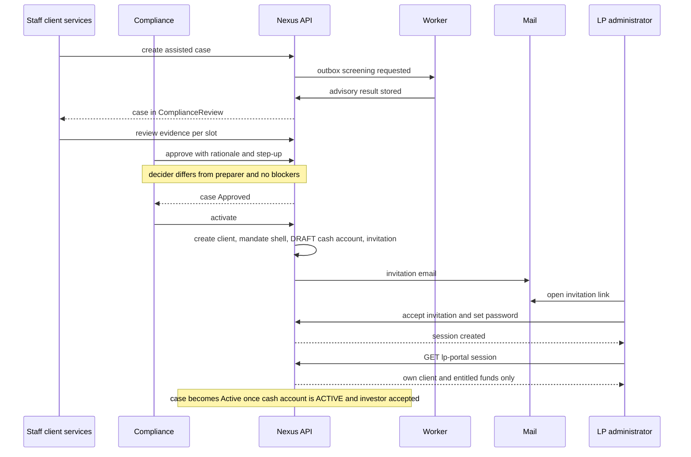

| Step | Pass criterion | Requirements |
| --- | --- | --- |
| Create case | case visible in admin Onboarding within 5 s, channel Assisted, stage Screening | FR-ONB-008, FR-ONB-017, FR-ONB-006 |
| Screening | worker runs; stage ComplianceReview; advisory exceptions listed | FR-ONB-007, FR-ONB-020, FR-PLAT-004 |
| Evidence | per-slot accept/reject; rejected slot blocks approval | FR-ONB-019, FR-ONB-042 |
| Decision | step-up required; same user as preparer refused | FR-ONB-012, FR-ONB-047, FR-AUTH-011 |
| Activation | client `CL-#####` KYC Current, mandate shell, DRAFT cash account, invitation emailed | FR-ONB-013, FR-CLI-009, FR-CLI-010 |
| Cash account | different user with `cash.approve` approves the account | FR-CLI-004, BR-035 |
| First login | LP user sees own client and funds, never another's; a user with no membership gets 403 `no_client_access` | FR-LP-002, FR-LP-003, FR-INV-001 |
| Completion | case becomes Active when both conditions hold | FR-ONB-046 |

Fallback from BUILD-PLAN: seed an activated client and invitation and start UAT from the invitation.

#### 7.10.3 J2 LP read journey (documents, notices, requests, messages)

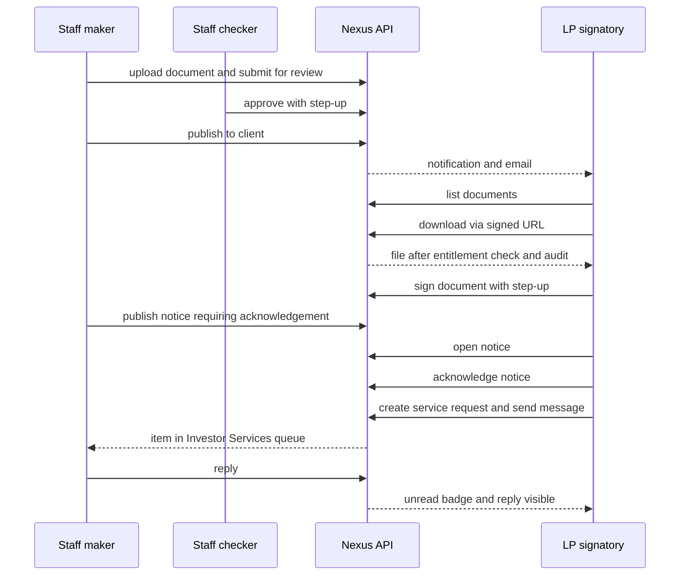

| Step | Pass criterion | Requirements |
| --- | --- | --- |
| Publish | Client or Public classification only; checker ≠ maker; withdrawal removes access immediately | FR-DOC-014, FR-DOC-015, FR-DOC-024, BR-046, BR-047 |
| Download | URL signed, 5 minutes, audited; tampered URL returns 403 `invalid_signature` | FR-DOC-002, FR-DOC-025, BR-175 |
| Sign | requires SIGNATORY or MANAGER and step-up; document leaves *Requires Signature* | FR-LP-071, FR-DOC-006 |
| Notice | published notice reaches entitled investors only; open and acknowledge recorded; VIEWER cannot acknowledge | FR-LP-083, FR-LP-084, FR-LP-089, BR-127 |
| Request and message | attachments validated (type, 20 MB UI / 25 MB platform); reply visible to the requester's colleagues only | FR-LP-075, FR-LP-076, FR-LP-081, FR-INV-015 |
| Dashboard | seeded fund KPIs match approved snapshot with as-of and valuation status | FR-LP-007, FR-LP-009, FR-INV-019 |

Drop notices (ribbon) before documents if behind.

#### 7.10.4 J3 Capital call to paid (and distribution)

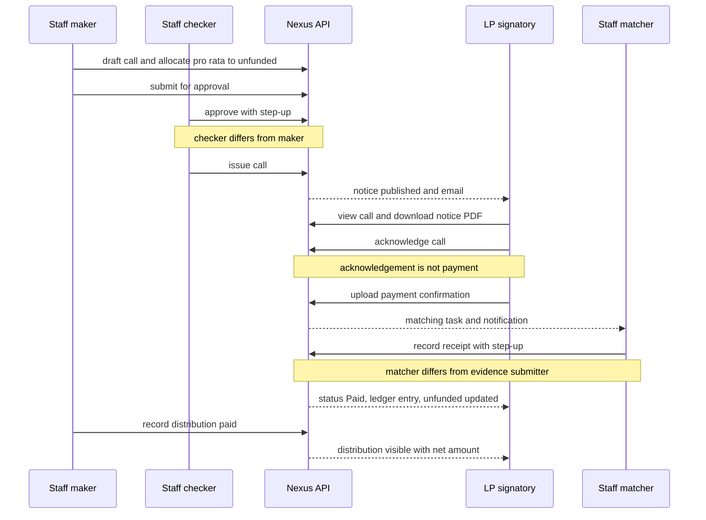

| Step | Pass criterion | Requirements |
| --- | --- | --- |
| Allocate | allocations sum exactly to the call total; one draft per investor | FR-INV-012, FR-INV-020, BR-150 |
| Approve and issue | checker ≠ maker; step-up; investors cannot see DRAFT or APPROVED | FR-INV-021, FR-LP-110, BR-153 |
| Acknowledge | SIGNATORY/MANAGER only; never changes `paid`; second acknowledgement returns 409 | FR-LP-038, FR-LP-053, BR-154 |
| Confirm | file type/size checked, SHA-256 stored, idempotent retry returns the same record | FR-LP-041, FR-LP-042, FR-LP-043, FR-LP-052, BR-155 |
| Settle | receipt ≤ remaining; status PARTIALLY_PAID or PAID; matcher ≠ submitter | FR-INV-021, BR-156 |
| Ledger and unfunded | ledger row with original and reporting currency and historic FX; unfunded = commitment − called | FR-LP-028, FR-LP-029, FR-LP-007, BR-146 |
| Distribution | read-only seeded data is acceptable if the lifecycle slips | FR-LP-045, FR-LP-046 |

#### 7.10.5 J5 Investee reporting loop

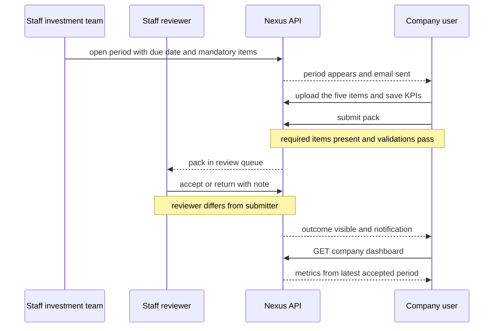

| Step | Pass criterion | Requirements |
| --- | --- | --- |
| Open period | `YYYY-MM` unique per company (409 `duplicate`); due date and mandatory list required | FR-CMP-047, BR-206, BR-247 |
| Upload and KPIs | allowed only for an open request; extension and size validated | FR-CMP-003, FR-CMP-014, FR-CMP-017, BR-246 |
| Submit | missing item → 400; balance and variance rules enforced | FR-CMP-004, BR-248, BR-251, BR-252 |
| Review | accept or return (note required); reviewer ≠ submitter; accepted files cannot be removed | FR-CMP-005, FR-CMP-048, BR-253 |
| Dashboard | values only from accepted periods; no fixture shown to a signed-in user | FR-CMP-008, FR-CMP-009, FR-CMP-012, BR-198 |

### 7.11 Investor snapshot

**Build:** Built. The snapshot is the interim source for the LP dashboard (FR-INV-019).

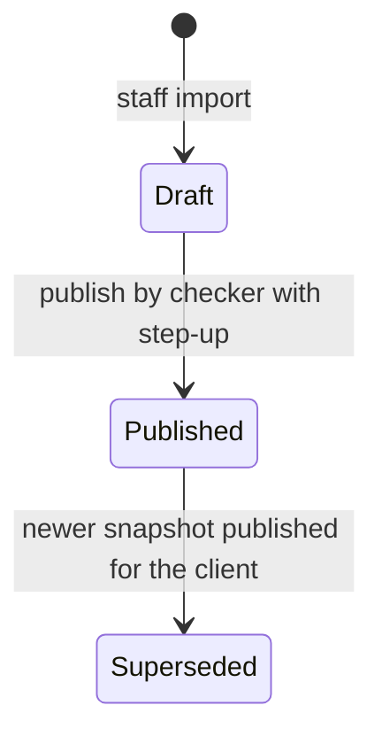

Guards: import requires `reports.create`; publish requires `reports.create`, step-up and `If-Match`, and the publisher must differ from the importer (policy `client_publish_approval`, 403 `sod_violation`). Investors see only the latest Published snapshot.

### 7.12 Invitation, session and MFA

**Build:** Built, with gaps DEF-519 to DEF-521.

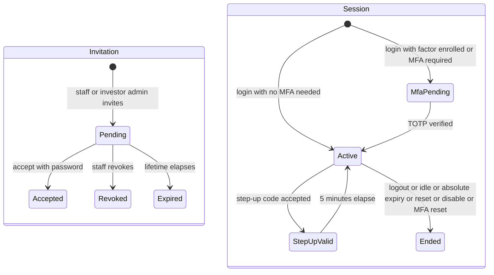

| Object | Rules |
| --- | --- |
| Invitation | single-use hashed token; acceptance creates or links the user, grants portal roles, links client or company and **opens a fully verified session** (target: `mfa_pending` when MFA is required, DEF-520); lifetime 7 days (target 72 h, Q-201) |
| Session | idle timeout = min(policy `session_idle_minutes`, deployment ceiling); absolute timeout = session TTL (12 h); a new login rotates any session the browser already held; an MFA-pending session may call only the MFA routes |
| MFA factor | unverified → verified on first valid code; at most one verified factor; re-enrolment replaces an unverified factor, an already-verified factor blocks re-enrolment (409); administrator reset deletes the factors (FR-RBAC-013) |
| Password reset | single-use token valid 60 min (target 30 min); success revokes all sessions |

### 7.13 LP capital call (fund level)

**Build:** Not started in Nexus. The LP UI shows this vocabulary on mock data; the built per-client model is 7.3. Target [P].

```mermaid
stateDiagram-v2
  [*] --> DRAFT: staff creates call
  DRAFT --> PENDING_APPROVAL: staff submits
  PENDING_APPROVAL --> APPROVED: checker approves with step-up
  PENDING_APPROVAL --> DRAFT: staff returns with reason
  APPROVED --> ISSUED: staff issues and notice published
  DRAFT --> CANCELLED: staff cancels
  APPROVED --> CANCELLED: staff cancels
  ISSUED --> CANCELLED: staff cancels before any payment
  ISSUED --> PARTIALLY_PAID: receipt below the call amount
  PARTIALLY_PAID --> PARTIALLY_PAID: another receipt
  ISSUED --> PAID: receipt equals the call amount
  PARTIALLY_PAID --> PAID: remaining receipt
  PAID --> [*]
  CANCELLED --> [*]
```

Investor-facing status per allocation, derived on read with precedence CANCELLED, PAID, PARTIALLY_PAID, OVERDUE, ACKNOWLEDGED, ISSUED (BR-156); acknowledgement is a flag, not a status:

```mermaid
stateDiagram-v2
  [*] --> ISSUED: issued and paid is zero and not past due
  ISSUED --> ACKNOWLEDGED: LP signatory acknowledges
  ISSUED --> OVERDUE: due date passed and unpaid
  ACKNOWLEDGED --> OVERDUE: due date passed and unpaid
  ISSUED --> PARTIALLY_PAID: receipt recorded
  ACKNOWLEDGED --> PARTIALLY_PAID: receipt recorded
  OVERDUE --> PARTIALLY_PAID: receipt recorded
  ISSUED --> PAID: full receipt
  ACKNOWLEDGED --> PAID: full receipt
  OVERDUE --> PAID: full receipt
  PARTIALLY_PAID --> PAID: remaining receipt
```

| Transition | Trigger | Actor / permission | Guards | Side effects |
| --- | --- | --- | --- | --- |
| DRAFT → ISSUED (via PENDING_APPROVAL, APPROVED) | staff create, submit, approve, issue | Staff `clients.edit`; then `cash.approve` with step-up (checker ≠ maker); then issue permission (FR-LP-110) | allocation total equals call total; every investor has an active commitment with uncalled capital; single currency per fund | one allocation per investor; notice document generated and linked; notification `capital.published`; LP event; audit |
| ISSUED → ACKNOWLEDGED (flag) | `POST /capital-calls/:id/acknowledge` + `Idempotency-Key` | LP SIGNATORY or MANAGER (`lp.capital_calls.acknowledge`) | allocation belongs to the client and fund scope; call issued and not cancelled; not already acknowledged (409 `LP_CALL_ALREADY_ACKNOWLEDGED`) | `acknowledged_at`, `acknowledged_by`; audit; never touches `paid` |
| Payment confirmation | `POST /capital-calls/:id/payment-confirmations` | LP SIGNATORY or MANAGER (`lp.capital_calls.upload_payment_confirmation`) | file present, type and size allowed, scanned (413 `LP_FILE_TOO_LARGE`) | confirmation row with SHA-256; staff queue item; notification to `cash.approve` holders; audit; no change to `paid` |
| Receipt recorded | staff records or matches a receipt per allocation | Staff `cash.approve` or `cash.journal.approve` with step-up (matcher ≠ confirming user) | amount > 0 and ≤ remaining balance; rounding half-up | `amount_paid`, allocation and header status; LP event and notification |
| → CANCELLED | staff cancels | Staff `cash.approve` | no receipts recorded (reverse first) | LP notice of cancellation; allocation hidden from lists |
| ISSUED → OVERDUE | derived on read | System | due date before today (UTC) and paid below amount | none persisted; optional reminder |

Differences in the reference backend (NVCCZ), not to be copied: header states INITIATED → NOTICES_SENT → PARTIALLY_PAID/FULLY_PAID; no approval step and no maker/checker; a call is LP-visible only after notices were sent; no cancel writer; ACKNOWLEDGED ranks above OVERDUE; payment confirmation creates no staff queue item; the call number is derived from the date, not sequential (BR-158).

### 7.14 LP distribution

**Build:** Not started in Nexus (built model: capital event type Distribution, 7.3). Target [P].

```mermaid
stateDiagram-v2
  [*] --> DRAFT: staff declares
  DRAFT --> APPROVED: checker approves with step-up
  APPROVED --> ISSUED: staff announces and statement published
  ISSUED --> PARTIALLY_PAID: payout below the share
  PARTIALLY_PAID --> PARTIALLY_PAID: further payout
  ISSUED --> PAID: payout equals the share
  PARTIALLY_PAID --> PAID: remaining payout
  DRAFT --> CANCELLED
  APPROVED --> CANCELLED
  PAID --> [*]
```

| Transition | Actor / permission | Guards |
| --- | --- | --- |
| declare | Staff `clients.edit` | gross > 0; net to investors > 0; split sums to net (BR-151); one currency per fund |
| approve | `cash.approve` + step-up | checker ≠ maker |
| announce | publish permission (FR-LP-110) | statement document generated (BR-159) |
| payout | `cash.approve` or `cash.journal.approve` + step-up | payout ≤ remaining share; matcher ≠ confirmer |

Visible to LPs from ISSUED (BR-153). In the reference backend the allocation is visible from DECLARED, the status set is DECLARED → NOTICES_SENT → PARTIALLY_PAID/PAID and no writer exists for CANCELLED. LP statuses: PENDING (amber), PAID (green) per FR-LP-046.

### 7.15 LP dealing request (subscription and redemption)

**Build:** Not started. In the reference backend only `[*] → SUBMITTED` exists; no staff route writes the later states (DEF-453: the redemption payload-hash check cannot pass). UI vocabulary: Submitted, Awaiting Funds, Allocated, Under Review, Settled, Rejected.

```mermaid
stateDiagram-v2
  [*] --> SUBMITTED: LP signatory submits with a valid estimate snapshot
  SUBMITTED --> COMPLIANCE_REVIEW: staff starts review
  COMPLIANCE_REVIEW --> AWAITING_FUNDS: staff clears subscription
  COMPLIANCE_REVIEW --> UNDER_REVIEW: staff clears redemption
  AWAITING_FUNDS --> FUNDS_RECEIVED: staff matches funds
  FUNDS_RECEIVED --> AWAITING_NAV: staff confirms
  UNDER_REVIEW --> AWAITING_NAV: staff approves
  AWAITING_NAV --> ALLOCATED: allocation at approved dealing NAV by a different user
  ALLOCATED --> SETTLED: staff records settlement for redemption
  SUBMITTED --> REJECTED
  COMPLIANCE_REVIEW --> REJECTED
  AWAITING_FUNDS --> REJECTED
  UNDER_REVIEW --> REJECTED
  SUBMITTED --> CANCELLED: LP or staff cancels before review
  AWAITING_FUNDS --> CANCELLED
  REJECTED --> [*]
  CANCELLED --> [*]
  SETTLED --> [*]
```

| Transition | Trigger | Actor / permission | Guards | Side effects |
| --- | --- | --- | --- | --- |
| Estimate → snapshot | `POST /dealing/{subscriptions,redemptions}/estimate` | any LP role (`lp.dealing.estimate`) | fund in scope; no compliance hold (`LP_COMPLIANCE_HOLD`); dealing not suspended (`LP_DEALING_SUSPENDED`); units and minimum balance (`LP_INSUFFICIENT_UNITS`, `LP_MIN_BALANCE_BREACH`); notice date (`LP_NOTICE_PERIOD`) | snapshot row with 15-minute expiry (`LP_ESTIMATE_EXPIRED`); nothing committed; always `isEstimate: true` |
| → SUBMITTED | `POST /dealing/{subscriptions,redemptions}` + `Idempotency-Key` | LP SIGNATORY or MANAGER (`lp.dealing.subscribe`, `lp.dealing.redeem`) | snapshot valid, unexpired, same client, type, fund and canonical payload hash; all rules re-checked; source bank account ACTIVE and in scope | request row with units and dates from the snapshot; snapshot consumed (single use, BR-103); files stored; audit with payload hash; staff queue |
| Review, funds, NAV, allocation, settlement | staff actions in the dealing desk | Staff with a dealing permission (Q-NEW: permission codes — default: `dealing.review`, `dealing.allocate`); allocator ≠ reviewer | transition list above (BR-111, BR-169) | ledger entries, holding update (units, account value), investor notification and dashboard action (FR-LP-058) |

Estimates never allocate units; units are confirmed only after funds are received and the dealing-date NAV is approved (BR-105, BR-161).

### 7.16 LP notice

**Build:** Not started in Nexus (notifications are per user and untargeted). Target [P].

```mermaid
stateDiagram-v2
  [*] --> DRAFT: staff composes
  DRAFT --> PUBLISHED: staff publishes with approver permission and receipts created
  PUBLISHED --> RECALLED: staff recalls
  PUBLISHED --> EXPIRED: system at expiry date
```

Per-recipient receipt: DELIVERED, then OPENED (first detail read by a user who has the notice visible), then ACKNOWLEDGED (SIGNATORY or MANAGER; the first timestamp is kept, BR-130, BR-134).

| Transition | Actor / permission | Guards | Side effects |
| --- | --- | --- | --- |
| DRAFT → PUBLISHED | Staff with notice-publish permission (FR-LP-089) | title and body; targeting ALL, FUND (active or pending commitment), SHARE CLASS, ORG or USER (BR-179) | receipts per entitled client; notification and email; realtime `lp_notice_updated` |
| PUBLISHED → OPENED | LP any role (`lp.notices.view`) | notice visible to the caller | receipt `openedAt`; open recorded per user (BR-129) |
| OPENED → ACKNOWLEDGED | LP SIGNATORY or MANAGER (`lp.notices.acknowledge`) + `Idempotency-Key` | notice visible and `requires_acknowledgement` | receipt `acknowledgedAt`; audit `NOTICE_ACKNOWLEDGED`; organisation counts as acknowledged when any signatory acknowledged (BR-180) |
| PUBLISHED → RECALLED / EXPIRED | Staff / System | `expires_at` for expiry (BR-133) | notice disappears from lists |

The reference backend stores only PUBLISHED, overwrites `acknowledgedAt` on repeat acknowledgement and has no withdraw, expire or draft.

### 7.17 LP service request and message thread

**Build:** Built model in 7.5 (any-to-any). LP vocabulary and attachments Not started. Target [P].

```mermaid
stateDiagram-v2
  [*] --> SUBMITTED: LP signatory creates
  SUBMITTED --> ASSIGNED: staff assigns
  ASSIGNED --> UNDER_REVIEW: staff starts
  UNDER_REVIEW --> AWAITING_INVESTOR: staff asks the investor
  AWAITING_INVESTOR --> UNDER_REVIEW: LP replies
  UNDER_REVIEW --> AWAITING_INTERNAL: staff waits for another team
  AWAITING_INTERNAL --> UNDER_REVIEW
  UNDER_REVIEW --> RESOLVED: staff resolves
  RESOLVED --> CLOSED: staff closes or auto after 7 days
  RESOLVED --> UNDER_REVIEW: LP replies and reopens
  CLOSED --> UNDER_REVIEW: LP replies within 30 days
```

Guards: staff transitions are explicit sub-resources requiring `clients.edit`; SLA due date at creation (priority HIGH 8 h, others 48 h); a reply by the investor on AWAITING_INVESTOR moves the request to UNDER_REVIEW (the reference backend leaves it unchanged); attachments use upload-then-attach and must belong to the client (BR-183). Side effects: realtime `lp_request_updated`, notification and email to the investor, audit. Reference backend: staff may set any of the eight states from any state, no event or history row is written, and assignment forces ASSIGNED (also from RESOLVED/CLOSED).

```mermaid
stateDiagram-v2
  [*] --> OPEN: staff or LP signatory creates with optional linked record
  OPEN --> OPEN: either side replies
  OPEN --> CLOSED: staff closes
  CLOSED --> OPEN: LP signatory replies
```

Read state is per user and per message (BR-182); `lp_thread_read` is emitted when a user marks a thread read. Staff create threads with the existing `POST /message-threads`; the reference backend has no operation that creates a thread. Staff and LP replies on the investee side follow 7.20.

### 7.18 LP bank-instruction change

**Build:** Not started (the reference backend stores a raw payload in status SUBMITTED and nothing else). Satisfies BR-006 and BR-185.

```mermaid
stateDiagram-v2
  [*] --> SUBMITTED: LP signatory or manager submits with MFA and idempotency key
  SUBMITTED --> UNDER_VERIFICATION: staff starts verification
  UNDER_VERIFICATION --> APPROVED: staff approves after callback by a different user
  UNDER_VERIFICATION --> REJECTED: staff rejects with reason
  SUBMITTED --> REJECTED
  APPROVED --> ACTIVATED: effective date reached and previous instruction ARCHIVED
  REJECTED --> [*]
  ACTIVATED --> [*]
```

Guards: submission needs a fresh TOTP step-up (FR-LP-096; reference: 403 `LP_MFA_REQUIRED` when policy `requireMfaForLp`), account number stored encrypted and shown masked (BR-135); verification is a callback to a number on file; approver ≠ verifier ≠ requester; until ACTIVATED the previous instruction stays active for every dealing and payout. Q-NEW: merge `requireMfaForLp` with the Nexus `mfa_required` policy? — default: merge into `mfa_required` per portal (Q-151 default).

### 7.19 LP colleague invitation and membership

**Build:** API partly Built (`/investor/users` invite, staff revoke); LP administrator update/revoke and session revocation Not started.

```mermaid
stateDiagram-v2
  [*] --> INVITED: LP manager or staff invites with role and fund subset
  INVITED --> ACTIVE: invitee accepts the one-time link and sets a password
  INVITED --> EXPIRED: lifetime elapses
  EXPIRED --> INVITED: resend
  ACTIVE --> ACTIVE: role or fund scope changed with last-manager guard
  ACTIVE --> SUSPENDED: LP manager or staff revokes and sessions invalidated
  SUSPENDED --> INVITED: re-invite
```

| Transition | Actor / permission | Guards |
| --- | --- | --- |
| invite | LP MANAGER or staff (`lp.organisation.manage_colleagues`) + `Idempotency-Key` | a MANAGER may grant VIEWER or SIGNATORY only; MANAGER is granted by staff; fund subset ⊆ inviter scope; empty list means no fund access (BR-138); invitation email failure surfaces a resend action (FR-LP-095) |
| accept | invitee | token unused and unexpired; password set; MFA enrolment when required |
| change role / funds | LP MANAGER or staff | last-manager guard (BR-184); audited |
| revoke | LP MANAGER or staff | target not MANAGER via the colleague API; all sessions of the user invalidated |

Reference backend: no INVITED state (the invitee shows ACTIVE before first login), no last-manager guard, no audit, `resendInvite` exists but is not routed. Nexus status mapping per Q-143 (default: *Invited* until first sign-in).

### 7.20 Reporting period and pack (company)

**Build:** Built (company module); the Investee UI does not call it yet (FR-CMP-008 to FR-CMP-014).

```mermaid
stateDiagram-v2
  [*] --> open: staff opens period with due date and mandatory attachments
  open --> submitted: company submits with required items present
  returned --> submitted: company resubmits
  submitted --> accepted: staff accepts
  submitted --> returned: staff returns with note
  accepted --> [*]
```

| Object | Transitions / guards |
| --- | --- |
| Period | company may edit only while open or returned; accept and return require `research.edit`; the reviewer must differ from the submitter (always enforced, not policy driven, BR-253); one period per `YYYY-MM` (409 `duplicate`) |
| Item | Due ↔ Complete (first upload / last file removed); *Expiring* is never set today (FR-CMP-002) |
| Submission | Draft → Submitted (pack submit) → Accepted / Returned (review); an Accepted file cannot be deleted (409) |
| Question / thread | open → resolved, by the company or staff; no reopen (replies blocked when resolved, 409 `invalid_state`; Q-NEW: allow reopen? — default: no reopen); the V8 Messages page maps to these threads and a company-started thread is a 20-line endpoint (FR-CMP-041) |

Reminders at 14, 7, 3 and 1 day before the due date plus manual nudges (BR-255); submit notifies `research.edit` holders and the outcome emails the company contact (BR-254).

### 7.21 Financial report (typed statement)

**Build:** Not started (fixtures; upstream uses raw-SQL tables outside the Prisma schema). Target [P]. UAT uses the five-item pack.

```mermaid
stateDiagram-v2
  [*] --> DRAFT: company creates draft with an open reporting request
  DRAFT --> DRAFT: company edits data or attaches file
  DRAFT --> PENDING: company submits bundle
  NEEDS_REVISION --> PENDING: company resubmits
  REJECTED --> PENDING: company resubmits
  PENDING --> ACCEPTED: staff accepts
  PENDING --> REJECTED: staff rejects with comment
  PENDING --> NEEDS_REVISION: staff requests revision
  ACCEPTED --> NEEDS_REVISION: system post-accept sync failure
```

Guards: edits and file replacement only in DRAFT, NEEDS_REVISION, REJECTED and only by the owner (BR-249); submit validates the open request, numeric strictness, balance equation and variance rule (BR-246, BR-250 to BR-252); the bundle submit moves every eligible report of the company and period in one transaction (BR-248); review: reviewer ≠ submitter, comment required for reject/revision, ACCEPT writes `TOTAL_REVENUE`, `NET_PROFIT`, `CASH_FLOW_NET` and recomputes derived KPIs (BR-253, BR-257 to BR-262). Statuses map to the pack states in 7.20.

### 7.22 Term sheet and signing

**Build:** Not started. Target [P]; J6 is cut-able.

```mermaid
stateDiagram-v2
  [*] --> DRAFT: staff creates
  DRAFT --> DRAFT: staff edits
  DRAFT --> FINAL: staff finalises and company notified
  FINAL --> FINAL: company signs or fund signs once each
  FINAL --> SIGNED: second party signs
  SIGNED --> [*]
```

Guards: signing requires FINAL; a party cannot sign twice; no update or finalise once any signature exists; the company signs as `applicant` (signatory with step-up MFA ≤ 5 minutes and a verified account), the fund signs as `investor` (administrator or fund manager); the term sheet is SIGNED only with both signatures; signature images PNG, JPEG, JPG, GIF, WEBP (BR-274, BR-225). On SIGNED while the deal is at TERM_SHEET or TERM_SHEET_NEGOTIATION the deal moves to UNDER_BOARD_REVIEW (never regress). Nexus adds states Issued (visible to the company) and Expired/Withdrawn [P]. Required fields: title, investment amount, equity %, valuation (BR-213); executed copy downloads via a 300-second signed URL (FR-CMP-024).

Applicant pipeline (NVCCZ, reference only; Nexus scope is Q-NEW — default: not ported, BUILD-PLAN 2.1 C3): SCREENING_PENDING → SCREENING → SHORTLISTED → ACTIVE_DD → DUE_DILIGENCE_COMPLETED → TERM_SHEET ⇄ TERM_SHEET_NEGOTIATION → UNDER_BOARD_REVIEW → BOARD_APPROVED / BOARD_CONDITIONAL / BOARD_REJECTED → INVESTMENT_IMPLEMENTATION → DISBURSED → FUNDED → PORTFOLIO_MANAGEMENT. The company-facing progress percentage maps SUBMITTED 5 to PORTFOLIO_MANAGEMENT 100 and DISBURSED 85 + 15 × (Σ disbursed ÷ requested).

### 7.23 Capital and procurement (drawdown) request

**Build:** Not started. Target [P]; J8 is cut first.

```mermaid
stateDiagram-v2
  [*] --> DRAFT: company creates within tranche
  DRAFT --> PENDING_REVIEW: company submits with use-of-funds attached
  PENDING_REVIEW --> DRAFT: company cancels
  PENDING_REVIEW --> APPROVED: fund executive approves
  PENDING_REVIEW --> REJECTED: staff rejects with reason
  PENDING_REVIEW --> RETURNED: staff returns for information
  REJECTED --> PENDING_REVIEW: company resubmits with changed content
  RETURNED --> PENDING_REVIEW: company resubmits with changed content
  APPROVED --> RFQ_SENT: system sends RFQ to top vendors
  RFQ_SENT --> CONVERTED_TO_PO: staff awards and raises PO
  CONVERTED_TO_PO --> [*]: goods received and paid
```

`PENDING_REVIEW` is `PENDING_VC_EXECUTIVE_REVIEW` in the reference product. Reservation: PENDING, APPROVED, RFQ_SENT and CONVERTED_TO_PO hold the drawdown; DRAFT, REJECTED, CANCELLED, RETURNED release it. Guards: reserved + amount ≤ committed (message "Drawdown Request Exceeds Available Investment Tranche.", BR-270, FR-CMP-035); required fields (BR-271); resubmission needs a changed content fingerprint and only the requester (BR-273); fund CFO or sysadmin is the final gate (no threshold table: Q-NEW — default: all investee requests go to the fund executive review, SLA 48 h, BR-230). V8 columns: Draft = DRAFT/REJECTED/RETURNED/CANCELLED; Under review = PENDING_*; Approved = APPROVED/RFQ_SENT; Fulfilled = CONVERTED_TO_PO and received (BR-228). Procurement (RFQ, PO, goods-received notes) is out of scope.

### 7.24 Signature request and consent request

**Build:** Document signature requests Partial (hash, MFA time, IP, authority are captured; staff and LP flows exist for documents); general signature requests and consent requests Not started. Target [P].

```mermaid
stateDiagram-v2
  [*] --> Pending: company or staff requests with locked document copy
  Pending --> PartiallySigned: first signatory signs
  PartiallySigned --> Signed: last signatory signs and certificate issued and document locked
  Pending --> Declined: signatory declines with reason
  PartiallySigned --> Declined: signatory declines
  Pending --> Cancelled: requester voids
  Pending --> Expired: system after due date and grace
  Declined --> [*]
```

Guards: the signatory is named and within the authority matrix (BR-223, BR-275); step-up MFA ≤ 5 minutes; consent ticked; signature image present; sequential order when selected; reminders only while Pending or PartiallySigned; each signatory signs once; a signature once applied is immutable (BR-222, BR-224). A declined request can be voided and re-issued (FR-CMP-032).

```mermaid
stateDiagram-v2
  [*] --> Draft: company
  Draft --> Submitted: company submits memo and category and decision date
  Submitted --> InformationRequested: staff asks questions
  InformationRequested --> Submitted: company responds
  Submitted --> InvestorReview: staff assigns
  InvestorReview --> BoardReview: staff escalates
  InvestorReview --> Approved: staff decision
  BoardReview --> Approved: staff decision
  InvestorReview --> Rejected: staff decision with reason
  BoardReview --> Rejected: staff decision with reason
  Submitted --> Withdrawn: company withdraws
```

Guards: a decision requires a reason and notifies the requester; the company cannot edit after submit; decision due defaults to submission date + the matter's notice period (BR-217, BR-218, FR-CMP-029).

### 7.25 Forecast version and cap-table transaction

**Build:** Not started; deferred past UAT (no upstream backend, fixtures).

```mermaid
stateDiagram-v2
  [*] --> draft: company creates working version from latest submitted
  draft --> submitted: approver submits and approver differs from preparer
  submitted --> accepted: staff accepts
  submitted --> returned: staff returns with note
  returned --> draft: company edits
  accepted --> superseded: next version accepted
```

Month cell lifecycle: forecast → actual-open (current month) → actual-locked (after acceptance or close day); window = current − 3 … current + 8 months (BR-207, BR-264). Submitted versions are immutable and the fund sees only submitted versions (BR-208, FR-CMP-020, FR-CMP-021).

```mermaid
stateDiagram-v2
  [*] --> DRAFT: staff creates issuance or transfer
  DRAFT --> PENDING_APPROVAL: staff submits
  PENDING_APPROVAL --> EXECUTED: approver executes with certificate
  DRAFT --> REJECTED: staff
  PENDING_APPROVAL --> REJECTED: staff
  EXECUTED --> PENDING_APPROVAL: system rollback after post-execution failure
```

Guards: creator ≠ approver (BR-269, to add), seller balance and authorised-share checks at create and execute; approval by CIO, CFO or administrator roles (BR-216); the investee page only reads the published register (FR-CMP-026).

### 7.26 Custodian execution and day-end package

**Build:** Not started. Today both records are written to browser storage with status Submitted that nothing reads (DEF-487, DEF-488). Target [P]; J7 is cut-able.

```mermaid
stateDiagram-v2
  [*] --> Received: counterparty submits and server validates
  Received --> Matched: matching run finds a counterpart within tolerance
  Received --> Exception: no counterpart or out of tolerance
  Exception --> Queried: reconciliation raises a query
  Queried --> Received: counterparty submits a corrected version
  Exception --> Matched: break resolved by maker and checker
  Received --> Superseded: newer version with reason
  Exception --> Superseded: newer version with reason
  Matched --> [*]
  Superseded --> [*]
```

```mermaid
stateDiagram-v2
  [*] --> Received: counterparty uploads file and control totals
  Received --> Approved: control totals validated and approver accepts
  Received --> Exception: trade count differs from executions received
  Exception --> Received: counterparty supersedes
  Received --> Superseded: newer package for same account and date and currency
  Approved --> Superseded: newer package with reason
  Approved --> [*]
```

| Object | Actor | Guards | Side effects |
| --- | --- | --- | --- |
| Execution submit | counterparty user (scope: counterparty and accounts) | unique reference per counterparty (409); account in scope (403); security in master; quantity and price > 0; settlement ≥ trade date (FR-REC-012) | counterpart Trades record in admin Reconciliations within 5 s; audit; `custodian.execution.submitted` event |
| Execution correction | counterparty user | a submitted execution is immutable; a correction is a new version superseding the earlier one with a reason, both retained (BR-193) | status round-trip: match result and queries visible in the custodian portal (FR-REC-015) |
| Day-end submit | counterparty user | original file stored encrypted; SHA-256 computed server-side; control totals (closing cash, holdings market value, trade count) validated; trade count must equal executions received for the account and date, else a Trades control exception (BR-194); approver rule is Q-NEW (default: operations user approves, ≠ submitter) | package appears in source health for the account and date (FR-REC-013, FR-REC-017) |
| Day-end correction | counterparty user | superseded only by a newer package for the same (account, date, currency) with a reason, earlier retained (BR-195) | |

Matching rule (manager side, [V61]): exact reference preferred, else ticker + side + quantity; quantity exact; execution price ±0.01 (configurable per family, BR-067). Timestamps are stored as ISO-8601 UTC and displayed in Africa/Harare (FR-REC-014).

### 7.27 Admin-console machines (prototype)

**Build:** Mock for all of 7.27 (in-memory or localStorage); targets below are [P].

```mermaid
stateDiagram-v2
  [*] --> PENDING_APPROVAL: journal drafted
  PENDING_APPROVAL --> POSTED: approved by different user
  PENDING_APPROVAL --> REJECTED: rejected with reason
  POSTED --> POSTED: reversal creates a new journal in PENDING_APPROVAL
```

```mermaid
stateDiagram-v2
  [*] --> ACTIVE: reservation created within available cash
  ACTIVE --> PARTIALLY_CONSUMED: part consumed
  PARTIALLY_CONSUMED --> CONSUMED: remainder consumed
  ACTIVE --> CONSUMED
  ACTIVE --> RELEASED: release remainder
  PARTIALLY_CONSUMED --> RELEASED: release remainder
```

```mermaid
stateDiagram-v2
  [*] --> RECEIVED: statement file uploaded
  RECEIVED --> VALIDATED: parsed and arithmetic within tolerance
  VALIDATED --> PENDING_APPROVAL: reviewed staging version frozen
  PENDING_APPROVAL --> COMMITTED: checker commits
  RECEIVED --> REJECTED
  VALIDATED --> REJECTED
  PENDING_APPROVAL --> REJECTED
```

```mermaid
stateDiagram-v2
  [*] --> Scheduled
  Scheduled --> Due: time reached
  Due --> Blocked: block with note
  Blocked --> Due: unblock or dependency done
  Due --> Done: complete with note or evidence
```

Operations task rules: overdue flag when CAT time > deadline and not Done; dependants of an incomplete task cannot be completed; completing a task moves cleared dependants Blocked → Due and notifies the next owner (BR-061 to BR-063, FR-OPS-010).

```mermaid
stateDiagram-v2
  [*] --> InPreparation
  InPreparation --> Validated: validation passes
  Validated --> Attested: two distinct attesters
  Attested --> Filed: filer submits
  Filed --> Acknowledged: regulator reference recorded
```

*Acknowledged* is [P] (FR-REG-002); selecting another obligation resets the state in the prototype; attestation by two distinct users and the filer ≠ preparer (BR-072).

```mermaid
stateDiagram-v2
  [*] --> Disputed: prototype entry
  Disputed --> Due: resolve dispute
  Due --> Funded: mark funded
```

Margin call target [P]: Due → Disputed → Resolved → Funded with reason and an independent checker (FR-FIN-004, BR-070). Model lifecycle: Draft (wizard) → Independent validation [O] → Validation due or Production [P] → Retired; approval by the committee requires closed high-severity findings (FR-MOD-002, BR-074). Integration: not_connected → configured → testing → healthy; disconnect → not_connected [O] (FR-DATA-004, BR-073). Corporate action: Announced → Entitlement projected → Election required → Election submitted → Instructed → Posted → Reconciled, each transition audited (FR-OPS-015, BR-071).

---


## 8. Non-Functional Requirements

Targets are **[P]** unless marked; they are sized for an institutional manager (≈500 internal users, ≈5 000 investor/LP and investee users, ≈200 portfolios, ≈50 000 positions) and must be confirmed (Q-14). Every v1.0 NFR keeps its ID. *Build* uses the same scale as section 6 (Built, Partial, Mock, Not started, Contradicted) and is taken from the backend audit. *Gap / reference* names the defect (DEF-5xx) or requirement that closes the gap; DEF items are collected with acceptance criteria in 8.8. Seven new NFRs from the register are marked **new** (NFR-PERF-005, NFR-AV-005, NFR-SEC-012, NFR-SEC-013, NFR-SEC-014, NFR-OPS-006, NFR-OPS-007). Needs that have no NFR ID yet are folded into the nearest existing ID and listed in 8.9 as `Q-NEW` items.

**UAT priority (BUILD-PLAN 12.1).** The one-day UAT cut needs only: the J0 security baseline (NFR-SEC-001, NFR-SEC-002, NFR-SEC-008 for money actions, NFR-SEC-009 auth limit), NFR-SEC-006 for the upload types used in J2, J3 and J5, NFR-OPS-004 health check and a DB dump before migration (DEF-515 minimum). Production hardening (pen test, load test, ClamAV, object storage, observability stack, SSE) is deferred past UAT and is marked as such below.

### 8.1 Performance

| ID | Requirement | Label | Build | Gap / reference |
| --- | --- | --- | --- | --- |
| NFR-PERF-001 | API p95 < 300 ms and p99 < 1 s for reads; p95 < 500 ms for writes, at 200 req/s sustained. | [P] | Not started | No load testing or latency measurement; deferred past UAT. |
| NFR-PERF-002 | Portal first contentful paint < 2.0 s, interaction-ready < 3.5 s on 20 Mbps desktop; list pages paginate at 50 rows (max 500). Targets added in v2: the first page of the IBOR positions list for a 50 000-position book answers in the NFR-PERF-001 read target with server-side search, filter and sort (FR-IBOR-002); the 170-point daily performance series renders within the page budget. | [P] | Partial | Lists are hard-capped at 200–500 rows with no pagination (NFR-PERF-005); portal paint not measured; the prototype filters client-side on eight rows. |
| NFR-PERF-003 | Long jobs (NAV run, optimiser, recon matching, report rendering, LP performance report, imports, IBOR refresh) are asynchronous with a single status vocabulary (QUEUED, RUNNING, COMPLETED, FAILED, CANCELLED, FR-LP-024); UI polls job status; NAV run for one fund < 2 min. | [P] | Partial | Screening and email run asynchronously via the outbox; there is no jobs table or status API; no NAV job exists (the NAV run is a synchronous in-memory toggle). |
| NFR-PERF-004 | Exports up to 100 000 rows stream within 30 s. | [P] | Partial | Audit CSV builds up to 10 000 rows in memory; no streaming. |
| NFR-PERF-005 **new** | **Pagination** on every list endpoint (`page`, `pageSize` ≤ 500, default 50; response `{data, page, pageSize, total}` where `total` is the full count). LP facade lists use `{items, page, pageSize, total, totalPages}` with default 50 and cap 200 (BUILD-PLAN 11.1; one envelope per facade). | [P] | Not started | Today lists are silently capped at 200–500 rows and `total` equals the returned length. AC: a list with 600 rows returns total 600 and pages through all of them. |

### 8.2 Availability, resilience, recovery

| ID | Requirement | Label | Build | Gap / reference |
| --- | --- | --- | --- | --- |
| NFR-AV-001 | 99.9 % monthly availability for API and portals during 06:00–22:00 CAT; planned maintenance outside this window. | [P] | Not started | No availability monitoring. |
| NFR-AV-002 | RPO ≤ 15 min (binlog/PITR), RTO ≤ 4 h; daily full backup retained 35 days, monthly 7 years; quarterly restore test. | [P] | Not started | DEF-515: no database or file-store backups in the deployment. UAT minimum: a MySQL dump before each migration plus a file-volume backup. |
| NFR-AV-003 | Stateless API/portal instances (≥ 2 each in production) behind a load balancer; workers restart safely (idempotent jobs). | [P] | Contradicted | One instance per service; the worker is neither idempotent nor safe to run as more than one instance (NFR-AV-005). |
| NFR-AV-004 | Integration failures degrade gracefully: stale-data banners with as-of time, never silent. | [P] | Not started | No integrations yet. LP and investee UIs must never fall back silently to mock data on a failed call: explicit error states and a persistent "Demo data" ribbon wherever a fixture is shown (FR-CMP-009, BUILD-PLAN 12.4). |
| NFR-AV-005 **new** | **Idempotent, single-delivery worker.** Claim outbox rows with locking so several workers can run; handlers are idempotent (notifications are not duplicated on retry). | [P] | Not started | AC: two workers processing the same queue produce each notification exactly once. DEF-518: the worker is not started by `npm run dev`. |

### 8.3 Security

| ID | Requirement | Label | Build | Gap / reference |
| --- | --- | --- | --- | --- |
| NFR-SEC-001 | TLS 1.2+ everywhere; HSTS; secure, httpOnly, SameSite=Lax cookies. | [O]/[P] | Built | certbot TLS with HTTP→HTTPS redirect; HSTS from the API in production; cookie flags as stated. The custodian host must be included (DEF-528). |
| NFR-SEC-002 | CSRF: origin allow-list on state-changing requests; credentialed CORS allow-list covering every portal id including `custodian`. | [O] | Built | Origin allow-list on state-changing `/api` requests plus credentialed CORS; `custodian` is not in it (DEF-528, FR-PLAT-003). |
| NFR-SEC-003 | Encryption at rest (DB, backups, object storage); field-level encryption for account numbers, tax IDs, ID numbers, bank-instruction account numbers. Applicant PII (email, phone, registration reference, owners) must not be written to browser storage in production (BR-039). | [P] | Partial | Files, tax IDs, ID numbers, account identifiers and TOTP secrets are encrypted; DB and backup encryption not addressed; no HMAC search columns. |
| NFR-SEC-004 | Secrets in a vault/secret manager; none in code or images. | [O] policy | Partial | Secrets live in a `chmod 600` env file and a users file on the host; no secret manager. DEF-532: `.env.example` is stale (AC: every variable the API reads is documented). |
| NFR-SEC-005 | OWASP ASVS L2; input validation with shared zod schemas; parameterised queries (Prisma); output encoding: toast, drawer and legacy markup content is rendered as text, never interpolated HTML (FR-UI-009). | [P] | Partial | zod validates bodies and most queries (some staff list filters unvalidated); Prisma parameterised; prototype toasts render unescaped HTML. |
| NFR-SEC-006 | Uploads: type allow-list, size limits, malware scan, stored outside web root, served by signed URL. Allow-list aligned across surfaces: pdf, docx, xlsx, csv, png, jpg (accounting statements also xls) with one platform limit (default 25 MB, `MAX_UPLOAD_MB`) and UI copy that matches it (the V8 UI states 50 MB and 100 MB, the LP UI 20 MB); `application/octet-stream` is refused; signed download links are HMAC-signed, user-bound and expire in ≤ 300 s; each upload and download is audited with SHA-256; previews carry a watermark where the product requires it. | [P] | Partial | Type allow-list includes `octet-stream`; 25 MB limit; encrypted outside web root; signed URLs. DEF-514: every file is recorded "clean". DEF-517: orphan uploads. UAT: scanning deferred (ClamAV is production hardening). |
| NFR-SEC-007 | Least privilege and SoD per section 4 (BR-001 to BR-006 and the rules in 7.9); quarterly access review export; server-side entitlement on every route and an automated IDOR test per resource type (a second client's, company's or counterparty's id returns 404). | [O] | Partial | Seeded role catalogue follows SoD; SoD scan and access-review CSV exist; no scheduled review process. DEF-526: investor account scope not applied to documents, capital events, requests or threads. DEF-527: company users are limited to their first company. DEF-522: BR-004 contradiction (AC: removing a role that would leave fewer than two active `admin.rbac` holders returns 409; the SoD scan flags fewer than two). DEF-530, DEF-531: KYC dual-control gap and automatic funds approval. |
| NFR-SEC-008 | MFA for all internal, LP, investee and custodian users; step-up for sensitive actions (approvals, signatures, bank-instruction changes, publishing, activation). Production default `mfa_required=true` (Q-88). | [P] | Partial | MFA is optional by default and step-up applies only to enrolled users (DEF-519); invitation acceptance bypasses MFA (DEF-520); step-up is missing on listed actions (DEF-524) and its status code is inconsistent (DEF-523). |
| NFR-SEC-009 | Rate limits: auth 20/15 min/IP, general 600/min/user, uploads 30/min/user; the sign endpoints are limited as uploads. LP facade targets (BR-189): reads 60/min, writes 20/min, uploads and report jobs 10/min per user and IP (Q-NEW: reconcile with 600/min — default: 600/min per user overall, the BR-189 values as per-route caps on LP writes). | [O]/[P] | Partial | Auth limit (20 per 15 min) built; no general per-user limit or upload limit (NFR-SEC-014). |
| NFR-SEC-010 | Security headers (CSP, frame-ancestors none, referrer policy, permissions policy). | [O] helmet/nginx | Partial | helmet headers on the API only; see NFR-SEC-013 for the portals. |
| NFR-SEC-011 | Annual penetration test; dependency scanning in CI; critical CVEs fixed within 7 days. | [P] | Not started | DEF-516: no CI pipeline. Pen test deferred past UAT. |
| NFR-SEC-012 **new** | **Optimistic concurrency:** `If-Match` (or `version` in the body) is compared to the row version on transitions, and a mismatch returns 409 `version_conflict`. | [O] | Built | AC: a stale version returns 409. Not applied to document publish and some capital transitions (DEF-524 list). |
| NFR-SEC-013 **new** | **Portal security headers** (CSP, frame-ancestors none, referrer policy, permissions policy) at nginx or in Next.js. | [P] | Not started | Today only the API sends helmet headers. AC: every portal response carries the headers. |
| NFR-SEC-014 **new** | **General rate limits:** 600 requests per minute per user and 30 uploads per minute per user (NFR-SEC-009). | [P] | Not started | AC: exceeding either returns 429. |

### 8.4 Compliance and data governance

| ID | Requirement | Label | Build | Gap / reference |
| --- | --- | --- | --- | --- |
| NFR-CMP-001 | Immutable audit trail retained ≥ 7 years (Q-15 confirms statutory period). The application database user has no UPDATE/DELETE on `audit_events`; the hash covers every column. | [P] | Partial | Audit rows have no delete path; retention not configured; append-only not DB-enforced; actor role, portal, IP and request id are outside the hash (DEF-525). |
| NFR-CMP-002 | KYC/AML records retained ≥ 5 years after relationship end; data-subject rights per Zimbabwe Cyber and Data Protection Act (Q-16). | [P] | Not started | No KYC retention or data-subject tooling. |
| NFR-CMP-003 | Data classification labels enforced on documents and exports. Q-NEW: one label list — default: API enum canonical (Public, Client, Internal, Restricted) shown as Public, Client Confidential, Internal, Regulatory Confidential (v1.0 names). | [P] | Contradicted | Built labels are Public / Client / Internal / Restricted; the editor offers Client confidential, Internal, Regulatory confidential; enforced only for publishing and Restricted downloads. |
| NFR-CMP-004 | Data residency per regulator/client contracts (Q-17). | [P] | Not started | Not addressed. |
| NFR-CMP-005 | Maker/checker evidence exportable per transaction for auditors. | [P] | Partial | Maker and checker ids are stored and audit is searchable per object; no per-transaction evidence export; audit export manifest is FR-AUD-004. |

### 8.5 Usability, accessibility, compatibility

| ID | Requirement | Label | Build | Gap / reference |
| --- | --- | --- | --- | --- |
| NFR-UX-001 | Preserve the approved visual design of each portal (admin V56; LP portal and Investee portal V8 as imported; onboarding and custodian V65); changes need design sign-off. | [O] | Contradicted | v1.0 said "preserve the V56 visual design": the investor, company and onboarding portals now render different designs (LP portal, Investee V8, V65). |
| NFR-UX-002 | WCAG 2.1 AA for new components; keyboard access to navigation, modals (Esc closes, focus trapped and restored to the opener), drawers, runbook rows and charts (data-table alternative); toasts announced with `aria-live` (FR-PLAT-002, FR-UI-008). | [P] | Not started | No accessibility testing; V34/V37/V44 modals do not close on Esc; no overlay traps focus. |
| NFR-UX-003 | Responsive: admin ≥ 1280 px primary (usable to 390 px with drawer nav); LP, investee (breakpoint ≤ 760 px), onboarding and custodian fully responsive at 390, 820, 1440 px. | [O] | Partial | Responsiveness inherited from the prototypes; not verified. |
| NFR-UX-004 | Browsers: latest two versions of Chrome, Edge, Safari, Firefox. | [P] | Not started | No browser test matrix. |
| NFR-UX-005 | Localisation: English; CAT time zone (stored UTC, displayed Africa/Harare); currency formats USD/ZWG/ZAR (the LP prototype hard-codes `$` and the label ZIG: map ZIG to ZWG at the facade edge, BR-172). | [O] | Built | English only; API display dates formatted in Africa/Harare. |

### 8.6 Observability and operations

| ID | Requirement | Label | Build | Gap / reference |
| --- | --- | --- | --- | --- |
| NFR-OPS-001 | Structured JSON logs with request id, user id, portal, route, latency; no secrets/PII in logs. | [P] | Not started | Plain console output; mail tokens appear in logs when SMTP is unset (NFR-OPS-007). |
| NFR-OPS-002 | Metrics (RED per route, job queue depth/age, integration freshness) and traces (OpenTelemetry). | [P] | Not started | None; observability stack deferred past UAT. |
| NFR-OPS-003 | Alerts: error rate > 2 % for 5 min, p95 > 1 s, job age > 15 min, integration stale beyond SLA, DB replication lag > 60 s, failed backups. | [P] | Not started | UAT minimum: an uptime and error alert script (BUILD-PLAN 12.2). |
| NFR-OPS-004 | Health endpoints: `/api/health` (liveness) and `/api/health?deep=1` (DB + queue + storage) returning 503 `degraded` on dependency failure. | [O] | Partial | The deep check covers the database only. |
| NFR-OPS-005 | Zero-downtime deploys (rolling); DB migrations backward-compatible (expand/contract). | [P] | Partial | Migrations run in a pre-start container; `docker compose up` is not a rolling deploy. UAT: additive-only migration, one per day (BUILD-PLAN 12.2). |
| NFR-OPS-006 **new** | Every response carries an `X-Request-Id` (a caller value is accepted when it matches `[\w.-]{8,64}`), and the id is stored on audit events. | [O] | Built | AC: an audit row links to the response header value. |
| NFR-OPS-007 **new** | **Structured request logging and metrics.** JSON log line per request (request id, user id, portal, route, status, latency) with no secrets or PII; RED metrics; worker queue depth and age. | [P] | Not started | Today logs are plain console output and mail tokens appear in logs when SMTP is unset. AC: every request produces one JSON log line; no token appears in any log. |

### 8.7 Maintainability

| ID | Requirement | Label | Build | Gap / reference |
| --- | --- | --- | --- | --- |
| NFR-MNT-001 | TypeScript strict across API and portals; shared DTO/zod schemas in `packages/shared` (including the LP and investee facade contracts). | [P] | Built | Strict mode on; shared zod auth schemas and typed client; domain schemas are defined inline in the API. |
| NFR-MNT-002 | ≥ 80 % unit coverage on domain services; contract tests for every endpoint (the LP facade is checked against the mock store as oracle, BUILD-PLAN 12.4); E2E browser tests for each workflow in section 7; an IDOR test per resource type; a test that a production build contains no fixture data and that `liveOnly:false` cannot be enabled when `NODE_ENV=production` (FR-CMP-009). | [P] | Not started | No unit or contract tests; two scripted journeys only. DEF-516: no CI (AC: every push runs install, typecheck, smoke and e2e against an ephemeral database and builds the images). |
| NFR-MNT-003 | Legacy prototype screens are replaced workflow-by-workflow; each migrated slice removes its `localStorage` usage (Appendix C); every portal domain flipped to live has a runtime flag and rollback by environment (no silent fallback to mock). | [P] | Partial | Admin slices replaced their `localStorage`; the investor and onboarding bridges are disabled (DEF-529). |

### 8.8 Defect-derived requirements (gaps against 8.1–8.7)

Each row is a defect found in the current code with the acceptance criterion that closes it. Build is Not started unless stated.

| Defect | Gap | Acceptance criterion | Closes / relates to |
| --- | --- | --- | --- |
| DEF-513 | **Idempotency not implemented.** `Idempotency-Key` is accepted by CORS but ignored, so repeated POSTs create duplicate capital events, documents and requests. | A repeat POST with the same key within 24 h returns the original response and creates no new row. The LP facade requires the key (8–200 printable ASCII characters) on acknowledge, payment confirmation, subscription, redemption, request create, notice acknowledge, colleague invite, bank-instruction change and performance report (BR-173, FR-LP-052). | NFR-SEC-012, FR-LP-052 |
| DEF-514 | **No malware scan.** Every file is recorded as "clean" and `application/octet-stream` is accepted. | An EICAR test file is rejected or quarantined; quarantined files cannot be downloaded. | NFR-SEC-006, FR-DOC-016, FR-LP-042 |
| DEF-515 | **No database or file-store backups** in the deployment. | A scheduled MySQL dump or binlog backup plus a file-volume backup with 35-day retention, and a documented restore test. | NFR-AV-002 |
| DEF-516 | **No CI pipeline** (only a GitHub Pages workflow for the legacy static site). | Every push runs install, typecheck, smoke and e2e against an ephemeral database and builds the images. | NFR-MNT-002, NFR-SEC-011 |
| DEF-517 | **Orphan uploads.** `POST /api/v1/uploads` stores encrypted files whose ids no endpoint consumes; they can never be downloaded or cleaned up. | Either domain endpoints accept `uploadId`, or the route is removed; unreferenced files older than 24 h are purged. | NFR-SEC-006 |
| DEF-518 | **Worker not started in development.** `npm run dev` does not run the outbox worker and there is no script for it, so local email, notifications and screening never fire. | `npm run dev` (or a documented `dev:worker`) starts the worker. | NFR-AV-005, FR-PLAT-004 |
| DEF-519 | **MFA is off by default** (`mfa_required=false`). Step-up is skipped for users without a factor, so approvals can run without a second factor. | Production default `mfa_required=true`; a step-up-protected action by an unenrolled user returns `mfa_enrolment_required`. | NFR-SEC-008, FR-AUTH-010, Q-88 |
| DEF-520 | **Invitation acceptance bypasses MFA** (creates a fully verified session). | When MFA is required for the portal, acceptance leaves the session MFA-pending with `mfa='enroll'`. | FR-AUTH-015 |
| DEF-521 | **Token TTL mismatches:** password reset 60 min (FR-AUTH-013 says 30), invitation 7 days (FR-AUTH-015 says 72 h). | TTLs match the SRD, or the SRD is updated after the Q-201 decision. Q-201 default: SRD values (72 h / 30 min). | FR-AUTH-013, FR-AUTH-015 |
| DEF-522 | **BR-004 contradiction.** The code enforces at least one active System Administrator and flags more than two; BR-004 requires at least two `admin.rbac` holders and confirmation on system_admin changes. | Removing a role that would leave fewer than two active `admin.rbac` holders returns 409; the SoD scan flags fewer than two. | BR-004, FR-RBAC-015 |
| DEF-523 | **Step-up status code**: 401 vs 403. | One status, used consistently by the API, the bridge, the LP and investee clients and the SRD. Q-NEW default: 403 `step_up_required`. | FR-AUTH-011 |
| DEF-524 | **Step-up missing** on cash-account approve, suspend, reactivate and close; document publish; capital publish; KYC activate. | Each returns `step_up_required` without a recent code. | FR-AUTH-011, NFR-SEC-008 |
| DEF-525 | **Audit gaps**: investor message post, public draft create/save, pre-case evidence upload, `/uploads`, step-up, failed logins, capital-evidence and company-file download URLs are not audited. The hash excludes actor role, portal, IP and request id. The table is not DB-protected against UPDATE/DELETE. | Every state change listed writes an audit row; the hash covers every column; the application DB user has no UPDATE/DELETE on `audit_events`. | FR-AUD-001, NFR-CMP-001 |
| DEF-526 | **Investor account scope** is not applied to documents, capital events, requests or threads. | A user with scope "documents" sees no capital events; a user with scope "managed" sees no private-fund documents. | FR-INV-001, NFR-SEC-007 |
| DEF-527 | **Company users are limited to their first linked company.** | A user linked to two companies can switch between them (Q-01). | FR-CMP-001 |
| DEF-528 | **Custodian portal** is deployed without auth, API or registry entry. | The custodian portal is registered as a portal id, is in the CORS allow-list and has an auth gate before go-live, or is removed from the deployment. | FR-AUTH-018, FR-PLAT-003 |
| DEF-529 | **Investor and onboarding bridges are disabled.** The running UIs do not persist to the API. | Both portals load their bridge and the e2e journey passes through the UI. | NFR-MNT-003, FR-ONB-027 |
| DEF-530 | **Dual-control gap on KYC decisions**: when no staff member has prepared a case, the preparer ≠ decider check is skipped. | A case with no preparer cannot be decided until a different user has prepared it (or the submission counts as the preparer). | FR-ONB-012 |
| DEF-531 | **Funds approval is automatic.** Approval sets `fundsApproved`, so the FR-ONB-010 funds gate never blocks. | Source-of-funds approval is an explicit, separately audited step. | FR-ONB-010 |
| DEF-532 | **`.env.example` is stale** (missing file encryption, signing secret, SMTP, storage, idle-timeout and demo-seed variables). | Every variable the API reads is documented. | NFR-SEC-004 |

### 8.9 Open questions raised by section 8

| Q | Question | Default |
| --- | --- | --- |
| Q-14 | Confirm the sizing and targets in 8.1–8.2. | as stated |
| Q-88 | Should `mfa_required` default to true in production? | true |
| Q-92 | Which realtime transport does Nexus provide (Socket.IO, Server-Sent Events, polling)? | polling every 30 s until a transport exists |
| Q-201 | Should invitation and reset lifetimes follow the SRD (72 h / 30 min) or the code (7 d / 60 min)? | SRD values |
| Q-NEW | Which status code does `step_up_required` use? | 403 |
| Q-NEW | Which data-classification label list is canonical (NFR-CMP-003)? | API enum with v1.0 display names |
| Q-NEW | Reconcile the LP facade rate limits (BR-189) with NFR-SEC-009. | 600/min per user overall; BR-189 values as per-route caps |
| Q-NEW | Promote the needs folded into existing rows to their own NFR IDs: idempotency (DEF-513), per-resource IDOR test (NFR-SEC-007, NFR-MNT-002), no fixtures in production builds (NFR-MNT-002), valuation-status labelling on every figure (BR-078, BR-143), e-signature evidence (FR-DOC-006, BR-274), signed-link lifetime and watermark (NFR-SEC-006), explicit-error-never-silent-mock (NFR-AV-004). | keep folded; assign IDs when the register owner next renumbers |

---


---

## 9. System architecture and diagrams

Labels: **[O]** observed in code or deployment files, **[I]** inferred from a UI or from the NVCCZ reference backend, **[P]** proposed. **Build status** (Built, Partial, Mock, Not started, Contradicted) is used in tables where the state of the code matters. Section references to BUILD-PLAN mean `docs/BUILD-PLAN.md`.

### 9.1 Current architecture as built **[O]** (1 Oct 2026)

```mermaid
flowchart TB
  users["Users' browsers"]
  subgraph edge ["Host nginx, one server, certbot SAN certificate"]
    nginx["6 hostnames, client_max_body_size 25m, X-Forwarded-* headers<br/>nexus, investor.nexus, onboarding.nexus, company.nexus, custodian.nexus, api.nexus (.matanho.com)"]
  end
  subgraph portals ["Five Next.js 16 portals (Docker, bound to 127.0.0.1)"]
    b1["admin-web 3100<br/>V56 legacy UI, bridge ON<br/>proxy gate optional"]
    b2["investor-web 3101<br/>LP portal, React + Tailwind<br/>12 domains on demo data"]
    b3["onboarding-web 3102<br/>V65 legacy UI, bridge OFF<br/>public"]
    b4["company-web 3103<br/>Investee V8 runtime in React<br/>demo data, investor accounts turned away"]
    b5["custodian-web 3104<br/>V65 static, no auth, no bridge<br/>not in PORTAL_IDS"]
  end
  subgraph api ["Express 5 API 4100, modular monolith"]
    mw["helmet, X-Request-Id, CORS allow-list, JSON 1 MB,<br/>cookie parser, origin guard on /api"]
    auth["auth: login, logout, me, MFA, step-up,<br/>password reset, invitations"]
    v1["v1: public onboarding, KYC, clients, cash accounts,<br/>investor-users, investor portal, investor staff,<br/>documents, files, notifications, admin, company,<br/>private-markets"]
    audit["audit hash chain<br/>(writeAudit in the business transaction)"]
    outbox["outbox writer<br/>(enqueue in the business transaction)"]
  end
  worker["Worker: polls outbox every 2 s<br/>notify.users, notify.permission, email.send,<br/>kyc.screening.requested (screening stub)"]
  db[("MySQL 8.4, 55 tables<br/>migrations init, phase1_core")]
  fs[("file-storage volume<br/>AES-256-GCM objects, SHA-256")]
  smtp["SMTP (nodemailer) or console log"]
  ls1[("localStorage: unmigrated admin pages")]
  ls3[("localStorage + IndexedDB: onboarding draft")]
  ls5[("localStorage: custodian submissions")]
  mem2[("in-memory demo store: LP portal")]
  mem4[("in-memory demo data: Investee runtime")]
  users -->|"HTTPS"| nginx
  nginx --> b1 & b2 & b3 & b4 & b5
  nginx --> api
  b1 -->|"cookie session, bridge fetches"| api
  b2 -. "login, MFA, GET /api/auth/me only" .-> api
  b4 -. "login, MFA, GET /api/auth/me only" .-> api
  b3 -. "login pages only; /public/applications built but not called" .-> api
  b1 -.-> ls1
  b3 -.-> ls3
  b5 -.-> ls5
  b2 -.-> mem2
  b4 -.-> mem4
  api --> db
  api --> fs
  worker --> db
  worker --> fs
  worker --> smtp
  b1 -->|"5-minute signed download URL"| api
```

The API serves downloads from `GET /api/v1/files/:id/download` (HMAC-signed, 5 minutes). Every portal serves `/login`, `/invite` and `/reset-password` from the shared `@matanho/portal-kit`; these call `/api/auth/*`. Portal route protection is opt-in per portal through `REQUIRE_AUTH_PORTALS` and is enforced by each portal's `proxy.ts` (`createPortalProxy`), which asks the API `GET /api/auth/me`; **the API enforces authorisation on every request and the proxy only decides where to send the browser** [O].

#### 9.1.1 Portal state table

| Portal (port, host) | UI source and bridge | Gate in `proxy.ts` | What reaches the API today | Build status |
| --- | --- | --- | --- | --- |
| Admin workspace (3100, `nexus.matanho.com`) | V56 `index.html` extracted into `public/legacy`; **bridge ON** (8 bridge files, about 1.8k lines). A single route `/`; no URL deep links, no history. | `requirePortalRole: true` when `admin` is in `REQUIRE_AUTH_PORTALS`. | Bridge loads `GET /api/auth/me`, `/api/v1/admin/access-context`, `/policy`, `/settings` before the prototype scripts, then calls the `/api/v1` families for KYC and onboarding, clients and cash accounts, investor services, documents, the company-reporting hub (`/private-markets/*`), RBAC, policy, settings, audit. If a call fails the bridge **falls back silently to the demo literals** (`window.__mxData && … \|\| literal`). | Partial. Performance, IBOR, Cash ledger, Operations, Reconciliations, NAV, Accounting, Financing, Corporate actions, Regulatory, Data fabric, Models and Copilot have no bridge and no API route (figures are literals or client-side data). |
| LP portal (3101, `investor.nexus.matanho.com`) | Native React + Tailwind v4 + shadcn/Radix; 10 screens under `/lp-portal`; **no bridge**. `LP_LIVE_DOMAINS` has 12 keys, all `false`; `api-client.ts` is a stub that rejects; `mock-api.ts` answers every `lpPortalApi` method from `mock-store.ts`. | `requirePortalRole: true` (needs a role on the `investor` portal; the LP role is not read). | Login, MFA and `GET /api/auth/me` only. `/api/v1/investor/*` is built and tested but not called (DEF-529). | Mock |
| Onboarding (3102, `onboarding.nexus.matanho.com`) | V65 `public-onboarding.html`, six steps; **bridge disabled** (`DISABLED` set in `tools/legacy-bridge.mjs`). | `/login`, `/invite`, `/reset-password` exist with `enforcePortalAccess=false` (Q-168). The page is public by design (draft token). | Nothing. The wizard writes browser storage (`matanho-public-onboarding-draft-v57`, holding tax ID and bank account in clear). OCR runs client-side from public CDNs (Tesseract.js 5, pdf.js 3.11.174). `/api/v1/public/applications/*` is built but not called. | Mock |
| Investee portal (3103, `company.nexus.matanho.com`) | React shell around the vendored runtime `matanho-investee-portal-runtime.js` (200 KB, generated) and `investee-portal-v8.css`; `liveOnly:false`; `matanho:before-action` extension point; 13 routes. | `requirePortalRole: false`; accounts holding an `investor` role go to `/access-denied` (`turnAwayPortals: ['investor']`); staff accounts can open it. | Login, MFA and `GET /api/auth/me` only. `/api/v1/company/*` is built but not called by this portal; the admin hub still calls `/api/v1/private-markets/*`. | Mock |
| Custodian (3104, `custodian.nexus.matanho.com`) | V65 `custodian-portal.html`; **no bridge**; no `(auth)` routes, no `proxy.ts`, no `portal-kit` dependency. | None (public). | Nothing. Hand-off through `localStorage["matanho-v61-custodian-submissions"]` cannot work across origins and no admin code reads it (DEF-485 to DEF-491, DEF-528). `custodian` is absent from `PORTAL_IDS`, `PORTALS`, `.env.example` and the default CORS allow-list (FR-PLAT-003). | Mock |

Other observed facts that the earlier 9.1 did not state **[O]**: the admin Orders page requests logos from third-party hosts (`logos.hunter.io`, Google favicons); `.env.example` is stale (DEF-532); the legacy static stack (`docker-compose.yml` behind Traefik, `nginx.conf`, `vercel.json`, `.github/workflows/pages.yml`) is still in the repository and conflicts with the new stack on the hostname `nexus.matanho.com` (Q-19).

#### 9.1.2 API as built **[O]**

Request pipeline (`backend/api/src/app.ts`), in order: `helmet` (HSTS only in production) → `requestId` (accepts `[\w.-]{8,64}`, echoes `X-Request-Id`) → CORS (credentialed allow-list; allowed headers `Content-Type, Accept, If-Match, Idempotency-Key, X-Request-Id, X-Draft-Token`; exposed `X-Request-Id, ETag`) → `express.json({limit: '1mb'})` → `cookieParser` → on `/api`: `originGuard` (rejects a state-changing request only when it carries an `Origin` header outside the allow-list; requests with no `Origin` pass) → router → `notFoundHandler` → `errorHandler`. `trust proxy` is 1 in production.

| Mount | Handlers | Guard family | Module |
| --- | ---: | --- | --- |
| `GET /api/health` | 1 | none | `controllers/healthController` |
| `/api/auth` (register, login, logout, me) | 4 | rate limit on credential routes (20 per 15 min per IP in production, 200 otherwise) | `routes/authRoutes` |
| `/api/auth` and `/api/v1/auth` (MFA, step-up, reset, invitations; mounted twice) | 8 | session, rate limit | `modules/identity` |
| `/api/v1` uploads, files, notifications | 5 | session or HMAC signature | `modules/files`, `modules/notifications` |
| `/api/v1/public` | 5 | draft token, rate limit | `modules/kyc/public.routes` |
| `/api/v1/kyc` | 12 | session, portal `admin`, `onboarding.*` | `modules/kyc` |
| `/api/v1` clients, mandates, cash accounts, investor-users | 13 (18 method and path pairs; one `/:action` handler serves six cash-account verbs) | `clients.*`, `cash.*` | `modules/clients` |
| `/api/v1` capital events, snapshots, service requests, message threads (staff) | 18 | `clients.*`, `cash.*`, `reports.*` | `modules/investor/staff.routes` |
| `/api/v1/documents` | 10 | `documents.*` | `modules/documents` |
| `/api/v1/admin` | 19 | `admin.rbac`, `admin.settings`, `audit.view` | `modules/admin` |
| `/api/v1/company` | 10 | session, company membership | `modules/company` |
| `/api/v1/private-markets` | 12 | `portfolio.view`, `research.edit` | `modules/company/company.staff.routes` |
| `/api/v1/investor` | 22 | session, portal `investor`, client membership | `modules/investor/investor.routes` |
| **Total** | **139** | | The backend audit reports 140 route handlers; the difference is the `GET /` service-info route. |

Cross-cutting libraries **[O]**: `lib/audit.ts` (`writeAudit`: hash-chained row in the same transaction), `lib/outbox.ts` (`enqueue` inside the business transaction), `lib/policy.ts` (cached policy reads), `lib/refs.ts` (human references from `sequences`), `lib/storage.ts` (AES-256-GCM, SHA-256, HMAC-signed URLs), `lib/mailer.ts` (nodemailer or console), `lib/totp.ts` (RFC 6238). There is no unit-test runner and no CI (DEF-516); `npm run smoke` and `npm run e2e` are the only automated checks.

Worker (`dist/worker.js`) **[O]**: polls `outbox_events` every 2 s, takes 25 rows, skips a failed row until `2^attempts` seconds after its creation, gives up after 8 attempts (`last_error` kept), delivers at least once and is not idempotent; one instance only; no health check; not started by `npm run dev` (DEF-518).

### 9.2 Target architecture (Option B) **[P]**

Decision (AD-09): keep one Nexus session, one audit chain, one document store and one database. The two imported UIs keep their contracts through **contract facades** inside `backend/api`; business logic lives in new Nexus modules. NVCCZ is a reference and an oracle, not a runtime dependency (BUILD-PLAN 3.6).

```mermaid
flowchart TB
  subgraph portals ["Next.js portals"]
    adm["admin-web 3100<br/>V56 legacy + bridge<br/>+ native ops console (ops) route group"]
    inv["investor-web 3101<br/>LP portal React<br/>per-domain flags"]
    onb["onboarding-web 3102"]
    cmp["company-web 3103<br/>Investee V8 runtime<br/>+ host adapter + action allow-list"]
    cus["custodian-web 3104<br/>authenticated, counterparty scoped"]
  end
  subgraph api ["backend/api, modular monolith: one session, one audit chain"]
    lpf["lp-portal facade<br/>/api/v1/lp-portal<br/>LP envelope, LP_* codes, idempotency, lp.* guard"]
    ipf["investee-portal facade<br/>/api/v1/investee-portal"]
    staff["staff routes /api/v1<br/>funds, capital, dealing, notices, term-sheets,<br/>cap-table, governance, capital-requests, ledger, jobs, custodian"]
    mods["domain modules<br/>funds, capital, dealing, notices, service-desk, organisation,<br/>statements, signing, term-sheets, reporting, cap-table,<br/>governance, capital-requests, data-room, forecast, custodian"]
    core["core (built): identity, kyc, clients, documents, files,<br/>notifications, admin, investor (legacy), company, audit"]
    plat["platform: idempotency, pagination, per-user rate limit,<br/>runtime portal flags, scheduler, AV hook, realtime hub"]
  end
  wrk["Worker: outbox with SKIP LOCKED, scheduler,<br/>pdf.render, jobs, file.scan, metrics.refresh"]
  db[("MySQL 8")]
  fs[("encrypted file store<br/>FileStore interface: local volume now, S3-compatible later")]
  av["ClamAV INSTREAM"]
  smtp["SMTP, Mailpit in UAT"]
  edge["nginx: TLS, security headers, SSE location without buffering"]
  edge --> portals
  edge --> api
  inv --> lpf
  cmp --> ipf
  adm --> staff
  onb --> core
  cus --> staff
  lpf --> mods
  ipf --> mods
  staff --> mods
  mods --> core
  lpf --> plat
  ipf --> plat
  staff --> plat
  core --> db
  mods --> db
  plat --> db
  core --> fs
  wrk --> db
  wrk --> fs
  wrk --> av
  wrk --> smtp
  db -. "realtime_events polled 1 s per API instance" .-> plat
```

#### 9.2.1 Module boundaries

All modules are folders in `backend/api/src/modules/*` with a route file, a service file and zod schemas. A module may call another module's service, never its tables (except `core` read models).

| Module | Responsibility | Depends on | Phase | Build status |
| --- | --- | --- | --- | --- |
| `identity` | Sessions, MFA, step-up, invitations, reset; gains LP, Investee and custodian role bundles and `fund_ids` / company role on invitations | `admin` (policy) | P0 | Built (extend) |
| `clients`, `kyc`, `documents`, `files`, `notifications`, `admin`, `investor` (legacy), `company` + `private-markets` | As in 9.1.2 | | | Built |
| `funds` | Fund master, share classes, valuation publication (NAV per unit, valuation status, as-of) with maker and checker, dealing rules, commitments register | `clients`, audit, outbox | P1 | Not started |
| `capital` | Capital calls, per-LP allocations, distributions, notice generation, acknowledgement, payment confirmation (reuses funding evidence), settlement matching, overdue marking | `funds`, `files`, `documents`, `statements`, outbox | P2 | Not started (the existing `capital_events` flow stays for non-fund events) |
| `dealing` | Subscription and redemption estimates and requests, compliance gate, staff lifecycle | `funds`, `kyc`, `capital`, `clients` | P3 | Not started |
| `notices` | Targeted publications with per-person receipts | `clients`, `funds`, `notifications`, `realtime` | P1 | Not started |
| `service-desk` | Requests and record-linked threads with attachments and assignee for LP and company (generalises `service_requests` and `message_threads`) | `files`, `notifications`, `realtime` | P4 | Partial (tables exist) |
| `organisation` | LP colleagues, roles, fund entitlements, bank-instruction changes with dual approval | `identity`, `clients`, `funds` | P4 | Partial (invite and staff revoke exist) |
| `statements` | Jobs and PDF rendering: performance reports, account statements, call and distribution notices, signature certificates | worker, `files`, `settings` | P2 and P4 | Not started |
| `realtime` | Event log and SSE hub (AD-12) | outbox | P1 | Not started |
| `signing` | Generalised e-signature (`subject_type`, `subject_id`), evidence pack, certificate, verify | `documents`, `files`, `identity` (step-up), audit | P6 | Partial (document signing built) |
| `term-sheets` | Draft, issue, version, track to fully signed | `signing`, `company`, `documents` | P6 | Not started |
| `reporting` (extends `company`) | Periods, items, structured statements, KPI definitions and values, covenants, review | `documents`, `files`, `service-desk` | P5 | Partial (5-item pack built) |
| `cap-table` | Registry, share classes, stakeholders, convertibles, transactions with maker and checker, dilution and waterfall engines, certificates | `company`, `documents`, `statements` | P7 | Not started (deferred past UAT) |
| `governance` | Consent requests, reserved matters, board calendar, actions, packs (thin) | `company`, `signing` | P7 | Not started (deferred) |
| `capital-requests` | Investee requests for funds with lines, attachments, drill-down questions, staff review (no procurement suite) | `company`, `funds`, `files` | P8 | Not started |
| `data-room` | Company folders, versions, access profiles on `documents` | `documents`, `files` | P8 | Not started |
| `forecast` | Forecast workbooks (JSON sheets, scenarios, close-day lock) | `company` | P8 | Not started (deferred) |
| `custodian` | Counterparties, users, accounts, executions, day-end packages, intake into reconciliation | `identity`, `files`, audit, later `recon` | P9 | Not started |
| `lp-portal` | **Contract facade** `/api/v1/lp-portal/*` (70 methods plus the attachment download route B1; the GP-admin routes are native staff routes, 11.3.4). No business logic: `lpContext`, `lpPermission`, envelope, error mapper, `idempotent()`, number serialisation | all LP-facing modules | P0 stubs, P1 to P4 live | Not started |
| `investee-portal` | **Contract facade** `/api/v1/investee-portal/*` (30 applicant methods plus the page endpoints of 11.6) | `company`, `reporting`, `term-sheets`, `signing`, later `cap-table`, `governance`, `capital-requests`, `data-room`, `forecast` | P5 to P8 | Not started |
| `platform` (in `lib/` and `middleware/`) | `idempotent(scope)`, `paginate`, per-user rate limiter, `flags`, `scheduler`, AV scan hook, structured JSON logging | | P0 | Not started |
| Ops console | Native React route group `portals/admin-web/src/app/(ops)/ops/*`, own root layout (no legacy CSS), `@matanho/shared` client, `@matanho/portal-kit` session and proxy, one bridge link shim `admin-70-ops-links.js` (AD-11) | staff routes | P0 to P9 | Not started |
| SRD v1.0 domains outside this build plan: portfolios and IBOR, OMS, risk, cash ledger, reconciliation, valuation and accounting, regulatory | Unchanged from v1.0 AD-02; they attach later through the same module rules | | After P10 | Not started (prototype only) |

#### 9.2.2 Facade pipeline (LP and Investee)

Order of middleware on `/api/v1/lp-portal/*` **[P]**:

1. `requestId` → 2. `requireAuth` (session, MFA complete) → 3. `requirePortalAccess('investor')` → 4. `lpContext`: resolve the membership among the caller's own `client_users` rows (`?client=<ref>` may select only among them; default first by `created_at`), the LP role (VIEWER, SIGNATORY, MANAGER) and the fund scope (`fund_ids`; null means all) from the database on every request, never from the request or a token → 5. `lpPermission(code)` (reads `req.user.permissions`, so the RBAC screen governs it) → 6. role gate (Gate S or Gate M of 11.5) → 7. `requireIdempotencyKey(action)` on the nine write routes (after the permission checks, so an unauthorised caller gets 403 before any key error) → 8. step-up where 9.4 requires it → 9. handler (calls a module service; never a table) → 10. LP serialiser (envelope, number rules) → 11. LP error mapper (9.6.3).

Not-yet-live stubs return contract-valid empty shapes and the header `X-Mx-Stub: 1`, so a contract test cannot mistake a stub for live behaviour **[P]**. The Investee facade follows the same pipeline with `requirePortalAccess('company')`, `companyContext` (explicit `?company=<ref>` among the caller's `company_users` links) and the company role bundle.

#### 9.2.3 Runtime flags **[P]**

| Flag | Where read | Content | Effect | Rollback |
| --- | --- | --- | --- | --- |
| `LP_LIVE_DOMAINS` | investor-web container environment, read at request time by the root layout and injected as `window.__MX_FLAGS__`; `isLpDomainLive(domain)` reads it | comma list of `session, dashboard, capital, activity, dealing, performance, documents, notices, requests, organisation, settings, reports` | a listed domain is served by the live API; others by the mock store and show a persistent "Demo data" ribbon | edit the variable and restart the container (seconds, no rebuild) |
| `INVESTEE_LIVE_ACTIONS` | company-web container environment, same mechanism | allow-list of host-adapter action ids (the NVCCZ `API_ACTIONS` allow-list pattern) | listed actions persist through `/api/v1/investee-portal`; fixture pages show the ribbon and write controls are disabled | same |
| `REQUIRE_AUTH_PORTALS` | each portal container | `admin, investor, onboarding, company, custodian` | proxy gate on or off | same |
| Portal flags panel (staff S26) | `GET /api/v1/admin/portal-flags` | read-only view of the flags above and of the demo-mode hosts | visibility only | none |

Flip groups (domains that show the same numbers must flip together): **G1** `session + organisation + settings`; **G2** `dashboard + capital + activity + performance`; **G3** `documents + notices + requests`; **G4** `dealing`; **G5** `reports`. A domain left in mock inside a live portal shows the ribbon. There is **no silent fallback to mock on an error** (AD-16): a failed live call shows an error toast with the `X-Request-Id`. The existing admin bridge's silent fallback to literals is retained for the legacy pages **[O]** and is a known exception (Q-NEW: should the bridge show a banner when it serves fallback data? — default: yes, a "Demo data" banner per page).

LP domains and method counts (the 70-method list of 11.5; BUILD-PLAN 1.3 counts 69 in `LP_METHOD_DOMAIN` with `capital` = 10, so one method is unmapped there and the harness uses the 70-method list): session 2, dashboard 3, capital 11, activity 4, dealing 9, performance 7, documents 8, notices 4, requests 9, organisation 7, settings 4, reports 2.

#### 9.2.4 Jobs and scheduler **[P]**

All jobs run in the worker (single instance until `SKIP LOCKED` and idempotent consumers land, NFR-AV-005). Time zone Africa/Harare for schedules.

| Job | Trigger | NVCCZ origin | Behaviour |
| --- | --- | --- | --- |
| `metrics.refresh` | nightly 01:00 CAT; events `valuation.published`, `capital.payment.settled`, `distribution.paid` | `POST /api/cron/lp-portal/snapshot-refresh` (shared secret) | recompute or copy `fund_metric_snapshots` per (client, fund, as-of); never at request time |
| `capital_call.mark_overdue` | daily | computed on read | set OVERDUE where due date has passed and unpaid; emit notice and event |
| `reporting.remind` | 3 days before and on the due date; escalation to the relationship owner | `reporting_notification_logs` | `notify.users` and `email.send` to company users |
| `pdf.render`, `report.generate` | `jobs` row | `LpPortalReportsService` | render with `pdfkit`, store a `files` row, set `jobs.status` READY or FAILED; UI polls `GET /jobs/{id}` |
| `file.scan` | on upload | none | ClamAV INSTREAM; `files.scan_status` pending, clean, infected; downloads blocked until clean |
| `kyc.review_due`, `signature.expire` | daily | none | notify owners; expire unsigned requests |
| `idempotency.purge`, `realtime.purge`, `dealing_estimates.purge`, `uploads.purge` | hourly | none | delete idempotency keys older than 24 h, realtime events older than 24 h, expired estimates, unreferenced uploads older than 24 h (DEF-517) |
| `outbox` | continuous | n/a | existing; add `FOR UPDATE SKIP LOCKED` and idempotent consumers |

#### 9.2.5 Realtime and polling **[P]**

- Transport: Server-Sent Events, `GET /api/v1/realtime/stream`, authenticated by the session cookie; channels `user:<id>`, `client:<id>`, `company:<id>` derived server-side from memberships; `Last-Event-ID` replay from `realtime_events`; 25 s heartbeat; nginx `proxy_buffering off` on that location (AD-12). Each API instance polls `realtime_events` (`id > last`) every second and fans out in memory, which works with the worker in a separate process and needs no Redis.
- Events: the eight NVCCZ names `lp_notice_updated, lp_request_created, lp_request_updated, lp_request_message, lp_thread_message, lp_thread_read, lp_thread_updated, lp_notification`, plus Nexus domain events (11.4).
- `GET /lp-portal/realtime` returns the UI type `LpRealtimeInfo` `{enabled, wsUrl?, namespace?, events?, pollingIntervalMs}` extended with `streamUrl`; it does **not** return the NVCCZ Socket.IO descriptor (the UI never read it).
- Until SSE ships the LP UI polls every 30 s per active query in `useLpQuery` (Q-92 default). SSE is not required for UAT (BUILD-PLAN Q-NEW-13).
- The LP UI's join and leave room functions become no-ops because membership is derived server-side. This closes the NVCCZ gap where any authenticated socket could join any thread or request room.

#### 9.2.6 Cross-portal flow: capital call **[P]**

```mermaid
sequenceDiagram
  participant Ops as Staff maker (ops console)
  participant Chk as Staff checker
  participant API as API and lp-portal facade
  participant W as Worker
  participant LP as LP signatory (investor-web)
  Ops->>API: POST /api/v1/capital/calls (fund, percent, due date) Idempotency-Key
  API-->>Ops: call DRAFT, allocations pro rata to unfunded
  Chk->>API: POST /api/v1/capital/calls/{id}/approve (step-up, checker differs from maker)
  Chk->>API: POST /api/v1/capital/calls/{id}/issue
  API->>W: outbox notify.users, email.send, pdf.render, realtime.emit
  W-->>LP: email, in-app notification, SSE lp_notification, notice PDF
  LP->>API: POST /lp-portal/capital-calls/{allocationId}/acknowledge (Idempotency-Key, step-up)
  LP->>API: POST /lp-portal/capital-calls/{allocationId}/payment-confirmations (file)
  API-->>Ops: settlement queue shows the evidence
  Chk->>API: POST /api/v1/capital/allocations/{id}/settle (step-up, matcher differs from confirmer)
  API->>W: outbox metrics.refresh, notify.users
  W-->>LP: status PAID, ledger entry, dashboard unfunded updated
```

#### 9.2.7 Day-one slice deviations (UAT on D+1) **[P]**

BUILD-PLAN 12.2 permits these shortcuts, each recorded in a debt register. They change the shape of 10.3 for the first release only.

| Shortcut | Target design | Removal phase |
| --- | --- | --- |
| Valuation, NAV per unit and dealing rules live as columns and a JSON column on `funds` | `fund_valuations` and `lp_dealing_rules` | P1 and P3 |
| Account activity is a read-time union over allocations, distributions, dealing requests and `snapshot_transactions` | immutable `fund_ledger_entries` with original and reporting amounts and FX stamping | P2 |
| DPI, TVPI, IRR are stored JSON on `fund_commitments`, never computed in the portal | `fund_metric_snapshots` refreshed by the worker | P1 |
| Request replies reuse `service_request_events` | `service_request_messages` and `request_attachments` | P4 |
| `client_users.fund_ids` JSON | join table `client_user_funds` (Q-155) | P4 |
| Realtime by polling | SSE | P1 |
| Unscanned uploads with synthetic data only | ClamAV | P10 |
| One migration file for the day, authored by the schema owner before 09:30 on day D, additive only; after 12:00 only column additions | normal expand and contract migrations | n/a |

### 9.3 Architectural decisions

Status uses the build vocabulary. "Revised" means the decision stands in spirit but the mechanism changed.

| ID | Decision | Status | Rationale | Alternatives | Label |
| --- | --- | --- | --- | --- | --- |
| AD-01 | Keep one Next.js app per portal on ports 3100 to 3104 (five portals). | **Built**, extended | Independent deploy and scale; matches the repository. The custodian port 3104 exists but `custodian` is not yet in `PORTAL_IDS` (FR-PLAT-003). | Single multi-tenant Next app. | [O] |
| AD-02 | One shared API as a **modular monolith**. Modules in code today: identity, kyc (public and staff), clients and cash accounts, documents, files, notifications, investor (portal and staff), company (portal and private-markets), admin; target additions in 9.2.1. The SRD v1.0 domain list (portfolio and IBOR, OMS, risk, cash ledger, reconciliation, valuation and accounting) remains the long-term shape. | **Built**, partial | Strong consistency across financial workflows; small team; split later along module boundaries. | Microservices from day one. | [O]/[P] |
| AD-03 | Express 5.1 + TypeScript 5.9 + zod 4 + Prisma 6.19 on MySQL 8.4. | **Built** | Typed end to end; already in place. | NestJS, PostgreSQL. | [O] |
| AD-04 | Background work through the **MySQL transactional outbox** polled by one worker (2 s poll, 25 per batch, back-off, 8 attempts). BullMQ on Redis is deferred; the worker gains `SKIP LOCKED` and idempotent consumers, a scheduler and a `jobs` table (9.2.4). | **Revised** (was BullMQ and Redis) | The outbox already guarantees that side effects commit with the business change; SSE and jobs work without Redis (BUILD-PLAN 4.6). Redis stays an option when queue volume or latency requires it. | BullMQ, RabbitMQ, SQS. | [O]/[P] |
| AD-05 | Encrypted, versioned object storage behind a `FileStore` interface: local volume with AES-256-GCM and HMAC-signed 5-minute URLs now; S3-compatible later. Signed URLs gain a user-bound claim; every download path is audited. | **Partial** (local store Built; S3 Not started) | Keeps files out of the database; the interface lets S3 replace the volume without API change. Data residency is open (BUILD-PLAN Q-NEW-14). | DB BLOBs. | [O]/[P] |
| AD-06 | Audit events in an append-only table with hash chaining; daily export to WORM storage. | **Partial**: chain Built; WORM export and database-level append-only protection Not started (DEF-525: the hash excludes actor role, portal, IP and request id, and the application user can UPDATE and DELETE). | Tamper evidence without extra infrastructure. | Dedicated ledger DB. | [O]/[P] |
| AD-07 | Keep the **legacy prototype UIs** for the admin workspace through the data bridge; replace pages gradually with React that keeps identical markup and CSS. Investor and company portals are **no longer legacy**: they are the native-React LP and Investee portals (AD-09). Onboarding and custodian bridges are disabled (DEF-529). New staff screens for fund operations are native React in an ops console (AD-11). | **Revised** | UI must stay identical for the legacy admin; risk managed per workflow. | Big-bang rewrite. | [O]/[P] |
| AD-08 | Money as DECIMAL(20,4) with a `CHAR(3)` currency; percentages DECIMAL(9,4); units DECIMAL(24,8); NAV per unit DECIMAL(20,8); never floats. | **Partial**: money and percentages Built; units and NAV per unit Not started (no table holds them); several snapshot values are display strings (balances in `cash_accounts.meta`, `snapshot_*` fields). | Financial precision. | Integer minor units. | [O]/[P] |
| AD-09 | **Option B: port natively behind contract facades.** `/api/v1/lp-portal/*` and `/api/v1/investee-portal/*` keep the NVCCZ paths, success and error envelopes, `LP_*` codes and idempotency semantics so the two UIs stay unchanged; everything behind them is Nexus services and tables. NVCCZ is a reference and oracle, not a runtime. The facade envelope is the only exception to the Nexus-native envelope (AD-22). | **Not started** | One source of truth, one audit chain, one RBAC, one vault. Port rules and contracts, not files: about 24k lines of NVCCZ own code are `@ts-nocheck`, coupled to a general ledger and use tables outside Prisma. Effort 44 to 62 person-weeks against 8 to 12 (A) or 50 to 70 (C). | **A** run NVCCZ behind a gateway (two sources of truth); **C** rebuild on Nexus conventions and adapt the UIs (permanent merge tax). Would change if Matanho runs NVCCZ as a product (BUILD-PLAN Q-NEW-04). | [P] |
| AD-10 | **Per-domain runtime flags** (`LP_LIVE_DOMAINS`, `INVESTEE_LIVE_ACTIONS`), flipped in groups G1 to G5, rolled back by environment edit and container restart (9.2.3). | **Not started** | Domains go live one at a time against a verified contract; rollback takes seconds. | One boolean for the whole portal (all-or-nothing, the earlier LP design). | [P] |
| AD-11 | **Native React ops console** in `admin-web` route group `(ops)`, beside the legacy bridge, for fund-operations screens S1 to S27 (BUILD-PLAN 6.2); the bridge keeps small shims only (document categories, service-desk fields, portal-access rows, audit filters, company hub) and one link file `admin-70-ops-links.js`. | **Not started** | A capital-call run or a cap-table transaction cannot be built reliably in the bridge style (`prompt()` dialogs, 35 timer-driven patch layers) and the bridge risks the pixel-identical guarantee. | Bridge-only; a separate staff app (NVCCZ `nvccz-new`). | [P] |
| AD-12 | **SSE, not Socket.IO**, with 30 s polling as the interim (9.2.5). | **Not started** | No Redis; works with a separate worker; membership derived server-side. | Socket.IO (NVCCZ), WebSocket hub, polling only. | [P] |
| AD-13 | **Valuation and fund metrics by publication.** NAV per unit, valuation status and fund metrics are published by staff with maker and checker (`valuation.publish`) and stored; portals never compute NAV, IRR or multi-fund aggregates at request time. | **Not started** | Authority for numbers stays with fund accounting (NVCCZ rule 3 and 28); avoids a 2,184-line dashboard service. Source of NAV is open (BUILD-PLAN Q-NEW-05). | Compute in the API from ledger and positions; import from a NAV module. | [P] |
| AD-14 | **No general-ledger posting** for capital calls, distributions or cap-table transactions in this scope. Domain events (`capital.call.issued`, `capital.payment.settled`, `distribution.paid`) are emitted for a future ABOR consumer; settlement stores a bank reference and evidence only. | **Not started** | NVCCZ coupling to the chart of accounts is the main reason a lift drags 35k lines. Nexus ABOR does not exist yet (BUILD-PLAN Q-NEW-03). | Post journals into a new Nexus ledger. | [P] |
| AD-15 | **Contract-first with a mock oracle.** `lp-portal-api.ts` (about 1,400 lines) and `application-portal-api.ts` (about 824 lines) move to `packages/shared/src/lp.ts` and `investee.ts` with zod schemas; the server validates its own responses in dev and test (`assertContract`); a harness runs every method on `mock-api.ts` (in process) and on the live API (seeded persona) and compares shape and selected values; a seed exporter makes live data equal demo data. | **Not started** | The mock store (876 + 2,288 lines) already answers every method; any visual difference after a flip is a logic bug. | Hand-written API tests only. | [P] |
| AD-16 | **No silent mock fallback** in the new portals. A domain that is not live shows the ribbon; a live call that fails shows an error with the request id. | **Not started** | A silent fallback hides defects during UAT. | Fallback to mock on any error. | [P] |
| AD-17 | **A fund is a first-class entity** (`funds` with share classes, valuations, dealing rules), distinct from `portfolios` and `private_investments`; an optional `portfolio_id` link can follow. | **Not started** | Everything fund-scoped in the LP portal needs it; `capital_events.investment_name` and `snapshot_investments.name` are free text today. Owner of fund master data: Q-157. | A fund is a portfolio or mandate type (BUILD-PLAN Q-NEW-01). | [P] |
| AD-18 | **Idempotency keys** on the nine LP write routes and on every Nexus POST that creates a financial record: header `Idempotency-Key` (8 to 200 printable ASCII), table `idempotency_keys` unique on (user, scope, key), 24 h expiry, atomic claim, same key and same hash replays the stored response with `Idempotent-Replay: true`, same key and different hash returns 409 `LP_IDEMPOTENCY_KEY_REUSED` (Nexus code `idempotency_key_reused`). The hash is taken after multipart parsing and ignores volatile fields. | **Not started** (DEF-513) | Closes DEF-513; fixes three NVCCZ defects (non-atomic check, hash of an empty body for multipart routes, no expiry). | Natural-key uniqueness only. | [P] |
| AD-19 | **Step-up for money and signing actions** (5-minute window) and `mfa_required` on for LP signatories and managers, Investee approvers and administrators, custodian approvers and all staff roles before UAT sign-off; no-factor users receive `mfa_enrolment_required`; the 401 versus 403 status is decided once (9.6.2). | **Partial** (step-up Built on KYC decision, capital approve and settle, document approve, snapshot publish, identifier reveal, admin writes; missing on cash-account approve, suspend, reactivate, close, document publish, capital publish, KYC activate: DEF-524) | A user without an enrolled factor skips step-up while `mfa_required` is false (DEF-519). | Step-up only for enrolled users (as built). | [O]/[P] |
| AD-20 | **One identity, default deny, server-derived scope.** The Nexus `users` row and the `nexus_session` cookie are the only identity (no NVCCZ JWT, `tokenVersion` or per-portal `aud`); every router starts with `requireAuth` and `requirePortalAccess(<portal>)`; scope comes from memberships, never from request input; out-of-scope identifiers answer 404. A test matrix of account types by portal by endpoint family must return 403 everywhere except the owning portal. | **Partial** (cookie and portal guard Built; `company` takes only the first link, DEF-527; investor scope not applied to documents and capital events, DEF-526) | The NVCCZ default-allow branch let INVESTEE accounts into the staff portal; that failure must not recur. | Per-portal JWT audiences. | [O]/[P] |
| AD-21 | **Additive, expand-and-contract migrations** only; `prisma migrate deploy` in the `migrate` container; statuses are `VARCHAR` with service-enforced vocabularies (current convention); rollback is previous image tags plus flags off, no down-migration. | **Built** (convention), **Not started** (rehearsal on a copy of UAT data) | Safe repeated deploys with the seed running on every deploy. | DB enums and check constraints. | [O]/[P] |
| AD-22 | **Two envelopes.** Nexus-native routes keep `{error:{code,message,details}}` and raw bodies; the two facades emit the NVCCZ envelope `{success, message, data, timestamp, meta:{requestId}}` and `{success:false, message, error:{code, message, fieldErrors, details, retryable}, timestamp, meta}`. A single mapper converts Nexus errors to `LP_*` codes (9.6.3). `meta.requestId` equals the `X-Request-Id` header (NVCCZ generated a different random id). | **Not started** | UIs unchanged; staff routes unaffected. FR-LP-109. | Nexus envelope everywhere (changes hundreds of call sites). | [P] |

### 9.4 Authentication sequence **[O]**, with proposed changes **[P]**

```mermaid
sequenceDiagram
  participant U as User
  participant P as Portal (Next.js proxy.ts)
  participant A as API
  participant D as MySQL
  U->>P: GET /
  Note over P: only when the portal is in REQUIRE_AUTH_PORTALS
  P->>A: GET /api/auth/me with nexus_session (server side)
  A-->>P: 401 unauthorized or mfa_required
  P-->>U: 302 /login?next=/
  U->>A: POST /api/auth/login {email, password, portal} (20 per 15 min per IP in production)
  A->>D: user by email, bcrypt compare (dummy hash when unknown), is_active
  A->>D: portal role check when portal is sent, else 403 portal_access_denied
  A->>D: factor verified? mfa=verify. none and policy mfa_required and (no portal or admin or investor)? mfa=enroll
  A->>D: replace any session the browser holds, insert session (token SHA-256, mfa_pending)
  A-->>U: 200 {user, mfa?} Set-Cookie nexus_session (httpOnly, SameSite=Lax, Secure in production, Domain=COOKIE_DOMAIN)
  alt mfa = enroll
    U->>A: POST /api/auth/mfa/enroll, then POST /api/auth/mfa/verify {code}
  else mfa = verify
    U->>A: POST /api/auth/mfa/verify {code}
  end
  A->>D: mfa_pending = false, mfa_verified_at = now
  A-->>U: 200 {user}
  U->>P: GET next
  P->>A: GET /api/auth/me (200)
  Note over P: company portal only: a user holding an investor role goes to /access-denied (turnAwayPortals)
  U->>A: sensitive write, for example POST /api/v1/capital-events/{id}/approve
  A-->>U: 401 step_up_required (factor enrolled, mfa_verified_at older than 5 minutes)
  U->>A: POST /api/auth/mfa/step-up {code}
  A-->>U: 200 {ok, validForSeconds: 300}
  U->>A: repeat the write (200)
```

Rules as built **[O]**:

1. **Session.** 256-bit random token; only its SHA-256 is stored (`sessions.token_hash`). Absolute lifetime `SESSION_TTL_HOURS` (default 12); idle lifetime is the stricter of the `session_idle_minutes` policy (default 30) and `SESSION_IDLE_MINUTES` (default 240); `last_used_at` is touched at most once a minute. A disabled account resolves to no session.
2. **Portal gate.** `requirePortalAccess(portal)` passes when the user holds a role whose `portal` equals the portal id. `portal` in the login body is optional (`admin, investor, onboarding, company`); when sent and the user lacks a role there, the answer is 403 `portal_access_denied`. The company portal's login form omits `portal`, so company users need no role and investor-role accounts are refused only by the Next proxy (`turnAwayPortals`), not by the API.
3. **MFA.** Enrolment is forced at sign-in only when the policy `mfa_required` is on **and** the login carries no `portal` or one of `admin`, `investor` (`MFA_PORTALS`). It is off by default (DEF-519). Invitation acceptance creates a fully verified session and bypasses MFA (DEF-520).
4. **Step-up.** `requireStepUp`: a user with a verified factor must have verified a code within 5 minutes (`401 step_up_required`); a user without a factor passes when `mfa_required` is off and gets `401 mfa_enrolment_required` when it is on.
5. **Revocation.** Password reset revokes every session of the user; staff removal of an investor membership (`DELETE /investor-users/:id`) does **not** revoke sessions; disabling a staff user revokes them.
6. **Cookie sharing.** `COOKIE_DOMAIN` on the parent domain of all portal hosts lets one cookie serve every portal; ports are ignored on `localhost`.

Proposed changes **[P]**: (a) turn `mfa_required` on in production and set `MFA_PORTALS` to include `company` and `custodian` (Q-NEW: should company login send `portal: 'company'` so the API, not only the proxy, enforces turn-away of investor accounts? — default: yes, add a portal role `viewer` and the API check); (b) `custodian` becomes a portal id with `/login`, `/invite`, `/reset-password` and the same proxy (FR-AUTH-018); (c) step-up is required on every action in 9.2.2 step 8, listed per portal in the table below; (d) removal or revocation of an LP colleague deletes that user's sessions immediately; (e) the SSE endpoint is authenticated by the same cookie, uses the origin allow-list, and puts no token in a URL; (f) a staff "view as" mode (`portal.view_as`: read-only, audited, banner, time-boxed) replaces NVCCZ's `?clientId=` impersonation.

| Action | Portal | Step-up (5 minutes) | Also |
| --- | --- | --- | --- |
| Acknowledge a capital call, confirm payment, submit a dealing request, request a bank change, invite or change a colleague, sign a document or term sheet | LP | Yes | Idempotency-Key; audit with payload hash |
| Sign a term sheet, submit a report pack, submit a capital request, change team | Investee | Yes (approver and administrator profiles) | role check |
| Approve or issue a call, publish a valuation, approve dealing, approve a bank change, execute a cap-table transaction, issue a term sheet | Staff | Yes | maker differs from checker |
| Day-end submission approval | Custodian | Yes (approver role) | file hash |

### 9.5 Deployment topology

#### 9.5.1 As built **[O]**

One host runs Docker Compose (`deploy/docker-compose.prod.yml`, project `matanho-nexus`).

| Service | Image | Host bind | Volumes | Notes |
| --- | --- | --- | --- | --- |
| `mysql` | `mysql:8.4` | none (internal) | `mysql-data` | utf8mb4_unicode_ci; healthcheck `mysqladmin ping` |
| `migrate` | `matanho-nexus-api` (`Dockerfile.api`) | none | `file-storage`; `secrets/users.json` read-only | `prisma migrate deploy` then `tsx prisma/seed.ts` (roles, users file, optional demo) on **every deploy**; waits for MySQL healthy; runs once |
| `api` | `matanho-nexus-api` | `127.0.0.1:4100` | `file-storage` | after `migrate` succeeds; HTTP healthcheck on `/api/health` |
| `worker` | `matanho-nexus-api` | none | `file-storage` | `node dist/worker.js`; no healthcheck; single instance |
| `admin`, `investor`, `onboarding`, `company`, `custodian` | `matanho-nexus-<portal>` (`Dockerfile.portal`, build arg `PORTAL`; `NEXT_PUBLIC_API_URL` inlined at build) | `127.0.0.1:3100` to `3104` | none | `next start`; server-side calls use `API_INTERNAL_URL` |

| Host | Target |
| --- | --- |
| `nexus.matanho.com` | admin, `127.0.0.1:3100` |
| `investor.nexus.matanho.com` | `127.0.0.1:3101` |
| `onboarding.nexus.matanho.com` | `127.0.0.1:3102` |
| `company.nexus.matanho.com` | `127.0.0.1:3103` |
| `custodian.nexus.matanho.com` | `127.0.0.1:3104` |
| `api.nexus.matanho.com` | `127.0.0.1:4100` |

- **Images**: `node:22-bookworm-slim`; `npm ci` over the whole workspace, then each workspace builds; images contain source and dev dependencies. Network: the Compose default bridge; MySQL is not exposed to the host.
- **Configuration**: `.env.production` on the host (`chmod 600`) and `secrets/users.json`; `.env.example` is stale (DEF-532).
- **Reverse proxy**: host nginx, one server block per hostname (`deploy/nginx/matanho-nexus.conf`), port 80 in the repository file; certbot rewrites the live copy in place (HTTP to HTTPS redirect). All blocks set `client_max_body_size 25m` and `X-Forwarded-*`; portal blocks add WebSocket upgrade headers; no security headers at nginx (NFR-SEC-013); HSTS comes from the API only.
- **TLS**: `issue-certs.sh` checks that each of the six hostnames resolves to the host IP, then runs `certbot --nginx --redirect` for one SAN certificate named `nexus.matanho.com`.
- **Session sharing**: `COOKIE_DOMAIN` on the parent domain.
- **Legacy**: the static-prototype stack (`docker-compose.yml` with Traefik on `lms_lms-network`, root `Dockerfile`, `nginx.conf`, `vercel.json`, Pages workflow) is still in the repository and conflicts with the new stack on `nexus.matanho.com` (Q-19). Q-18 is answered in practice (Compose behind host nginx, not Traefik, not Kubernetes) and the hostnames differ from the v1.0 proposal (`app.`, `onboard.`, `companies.`); confirm the as-built names (Q-NEW: confirm `*.nexus.matanho.com` as the production naming — default: yes).

Gaps **[O]**: no CI (DEF-516); no database or file backups (DEF-515); one instance per service; the worker is not health-checked; no slim images; no dev or staging environment; no security headers at nginx; no log shipping (NFR-OPS-007).

#### 9.5.2 Proposed repeatable pipeline and environments **[P]**

```mermaid
flowchart LR
  pr["PR"] --> ci["CI: install, typecheck, lint, unit, build,<br/>prisma migrate on an empty DB and on a seeded copy"]
  ci --> contract["contract harness: mock vs live,<br/>IDOR and portal-access matrix"]
  contract --> e2e["Playwright journeys on an ephemeral compose"]
  e2e --> img["build images tagged by git SHA, push to registry"]
  img --> uat["deploy UAT: DB dump, migrate, seed, set flags, smoke"]
  uat --> gate["manual approval"]
  gate --> prod["deploy production: same tag, expand migrations only"]
  prod --> rb["rollback = previous tag + flags off; schema is additive"]
```

| Environment | Purpose | Data |
| --- | --- | --- |
| local | developer machines (`npm run dev`, ports 3100 to 3104 and 4100, worker started by a documented `dev:worker`, DEF-518) | seeded dev data, Mailpit |
| ci | ephemeral compose per pull request | synthetic |
| uat | the existing server (`/opt/matanho-nexus`) is treated as UAT until go-live (BUILD-PLAN Q-NEW-21) | synthetic only; no personal data from production |
| production | live | real |

- Deploy kit `deploy/deploy.sh` (dump DB and snapshot the file store, pull tag, `docker compose up -d`, `migrate`, smoke, tag the release) and `rollback.sh` (previous tag, flags off). Keep the previous image tags for API, worker and portals; keep the worker at one instance until NFR-AV-005 is met.
- Registry images instead of on-host builds; slim production images (no dev dependencies, no source).
- Public demo mode beside live: a second container per portal from the same image with empty flags, auth proxy off and the "Demo data" ribbon, on extra hosts (`demo.investor…`, `demo.company…`: nginx blocks, DNS, certificates). No demo data is written to a live database except by `SEED_DEMO=1` in non-production environments.
- Optional hosts: `mail.nexus.matanho.com` (Mailpit behind basic auth) in UAT. New environment variables: `LP_LIVE_DOMAINS`, `INVESTEE_LIVE_ACTIONS`, `CUSTODIAN_PORTAL_URL`, `CLAMAV_HOST`, `CLAMAV_PORT`, `SMTP_*` (UAT points to Mailpit), `PDF_LETTERHEAD_*`.
- Backups: nightly `mysqldump --single-transaction` plus binary logging for point-in-time recovery, copy of `file-storage` (the AES key backed up separately), 35-day retention, quarterly restore drill verified by `GET /api/v1/admin/audit-events/verify` and the contract harness (NFR-AV-002, DEF-515).
- nginx: CSP, `frame-ancestors none`, referrer and permissions policy on portal responses; SSE location with `proxy_buffering off`; HSTS; the custodian host added to `CORS_ORIGINS`.
- Retire the Traefik compose and the Pages workflow at production go-live (Q-19).

### 9.6 Error handling

#### 9.6.1 Envelope and codes as built **[O]**

- Envelope: `{ "error": { "code": "snake_case", "message": "Human readable", "details"?: … } }`; list bodies `{data, total}`.
- Validation failures: 400 `bad_request`, message "Validation failed", `details: [{ path, message }]` (zod issues mapped by `validate.ts`). Two routes (investor create-request and document upload) return raw zod issues instead (DEF-512). Malformed JSON: 400 `invalid_json`; oversize JSON body: 413 `payload_too_large`.
- 5xx responses never carry a stack trace in production; outside production they include `details.stack`. Every response carries `X-Request-Id`. Rate-limited responses: 429 `rate_limited` with IETF draft-7 `RateLimit` headers.

| Status | Codes in use |
| --- | --- |
| 400 | `bad_request` (includes validation), `invalid_json`, `incomplete_application` |
| 401 | `unauthorized`, `invalid_credentials`, `mfa_required`, `invalid_mfa_code`, **`step_up_required`**, **`mfa_enrolment_required`** |
| 403 | `forbidden`, `permission_denied`, `portal_access_denied`, `origin_not_allowed`, `registration_disabled`, `compliance_role_required`, `role_locked`, `invalid_signature`, `no_client_access`, `no_company_access`, `sod_violation` (capital, snapshot, document, reporting pack) |
| 404 | `not_found` (also for out-of-scope investor and company ids and for bad or expired draft tokens) |
| 409 | `conflict`, `email_taken`, `version_conflict`, `invalid_transition`, `invalid_state`, `approval_blocked`, `activation_blocked`, `sod_violation` (KYC, cash account), `already_submitted`, `already_member`, `mfa_already_enrolled`, `self_lockout`, `self_reset`, `last_admin`, `duplicate` |
| 413 | `payload_too_large` |
| 429 | `rate_limited` |
| 500 | `internal_error` |
| 503 | health check only (`status: degraded`) |

Specified in v1.0 but **not implemented** (**Contradicted**, DEF-511): `validation_failed`, `locked` (423), `dependency_unavailable` (503), `maker_checker_violation`. v1.0 listed `step_up_required` under 403; the code returns 401.

#### 9.6.2 Decisions needed

| Item | As built | v1.0 text | Proposal |
| --- | --- | --- | --- |
| **Step-up and MFA-enrolment status (DEF-509, DEF-523)** | **401** `step_up_required` and `mfa_enrolment_required`; the admin bridge already reacts to 401; the LP UI has no handler yet (the LP front-end work adds a 401 handler and modal) | 403 (FR-AUTH-011) | Q-NEW: canonical status for step-up — default: **401** (the client must re-authenticate), update FR-AUTH-011 and this table, and keep it unchanged through the LP facade so the LP modal and the bridge share one rule. |
| **`sod_violation` status (DEF-510)** | 409 in KYC and cash accounts; 403 in capital, snapshot, document, reporting pack | `maker_checker_violation` 409 | Q-NEW: unify the code `sod_violation` and the status — default: **403** for all new modules (BUILD-PLAN C12), and migrate KYC and cash-account responses at the next major version. |
| **Validation code (DEF-511)** | 400 `bad_request` | `validation_failed` 400 | Keep `bad_request` for Nexus routes; the LP facade maps validation errors to 422 `LP_VALIDATION` (9.6.3). Update the code list. |
| **Details shape (DEF-512)** | two routes leak raw zod issues | `{path, message}` | Normalise through `validate.ts`; add a contract test per route. |
| **Not-implemented codes** | none | `locked` 423, `dependency_unavailable` 503 | Implement `locked` (period locked, signed term sheet immutable) and `dependency_unavailable` (screening, SMTP, ClamAV down) with the integrations they report on, or drop them. |

#### 9.6.3 LP and Investee facades: envelope and mapping **[P]**

Success (facade routes only): `{ "success": true, "message"?: string, "data": …, "timestamp": ISO-8601, "meta": { "requestId": string } }` where `meta.requestId` equals the `X-Request-Id` response header. Lists: `data = {items, page, pageSize, total, totalPages}`; `pageSize` defaults to 50 and is capped at 200; `fundId=all` means no filter. Binary routes return no envelope. **Number rule** (differs from the NVCCZ serialiser that turned every number into a string): money, units, rates and multiples are decimal **strings** (money 2 dp, units up to 6 dp trimmed, NAV and rates up to 8 dp trimmed, ratios 4 dp); fields typed `number` in the UI view-model (`page, pageSize, total, totalPages, callNo, noticeDays, settlementLagDays, counts, sizes`) are JSON **numbers**. The UI keeps its `coerceLpCounts` defence.

Error: HTTP status plus `{ "success": false, "message": string, "error": { "code": string, "message": string, "fieldErrors"?: {field: message}, "details"?: object, "retryable": false }, "timestamp": ISO-8601, "meta": { "requestId": string } }`. The UI client reads `error.*`.

| Nexus condition (native error) | Facade status and code | Notes |
| --- | --- | --- |
| 401 `unauthorized`, `mfa_required` | 401 `LP_UNAUTHORIZED` | |
| 401 `step_up_required`, `mfa_enrolment_required` | 401, code unchanged | the LP modal handles `step_up_required` (Q-NEW above) |
| 403 `permission_denied`, role gate, `no_client_access`, out-of-scope fund | 403 `LP_FORBIDDEN` | message "Missing permission <code>", "Authorised Signatory access required", "LP Manager access required", "Not entitled to this fund" |
| 404 `not_found` (also foreign and out-of-scope ids) | 404 `LP_NOT_FOUND` | never reveals existence |
| 400 `bad_request` (validation) | 422 `LP_VALIDATION` with `fieldErrors` built from `details[{path,message}]` | Idempotency-Key missing or malformed and "file is required" stay 400 `LP_VALIDATION` |
| 409 `invalid_state`, `invalid_transition` | 409 with the specific code: `LP_CALL_NOT_ISSUED`, `LP_CALL_ALREADY_ACKNOWLEDGED`, `LP_ESTIMATE_EXPIRED`, `LP_ACCOUNT_INACTIVE`, or `LP_VALIDATION` | |
| 409 `version_conflict` | 409 `LP_VERSION_CONFLICT` | NVCCZ also used this code for "user already has active access"; Nexus uses `already_member` mapped to `LP_VERSION_CONFLICT` only for that case |
| 409 idempotency key reused | 409 `LP_IDEMPOTENCY_KEY_REUSED` | |
| 413 `payload_too_large` | 413 `LP_FILE_TOO_LARGE` | not mapped in NVCCZ (it returned 500) |
| 415 unsupported file or preview type | 415 `LP_UNSUPPORTED_MEDIA` | |
| 422 dealing rules | 422 `LP_INSUFFICIENT_UNITS`, `LP_MIN_BALANCE_BREACH`, `LP_NOTICE_PERIOD` | |
| 403 dealing gates | 403 `LP_COMPLIANCE_HOLD`, `LP_DEALING_SUSPENDED`, `LP_MFA_REQUIRED` | `LP_MFA_REQUIRED` only for the bank-instruction rule when the LP MFA policy is on and the user has no factor |
| 429 `rate_limited` | 429 `rate_limited` | no LP-specific code |
| 500 `internal_error`, any unexpected error | 500 `internal_error` with a generic message | **Deliberate deviation**: NVCCZ returned `LP_EXPORT_FAILED` with the raw `err.message` for any unexpected error |
| 503 | 503 `dependency_unavailable` | when implemented |

Errors that the NVCCZ router returned **without** the LP body (plain `{success:false, message}`: authentication 401, `requireLpPortalAccess`, `requireGpAdmin`, cron) all use the LP error body in Nexus. The full code list with HTTP statuses is in 11.5.3.

---

## 10. Database schema

Source of truth for [O] rows: `backend/api/prisma/schema.prisma` (Prisma 6, 55 models) and the two migrations `init` and `phase1_core`. Build status vocabulary as in 9. A table is **Built** when it exists in the schema, **Built differently** when it exists with different columns from the v1.0 proposal (the difference is stated), **Not started** otherwise.

### 10.1 Conventions

| Topic | v1.0 text | As built **[O]** | v2 decision **[P]** |
| --- | --- | --- | --- |
| Engine | MySQL 8, InnoDB, utf8mb4 | `mysql:8.4`, utf8mb4_unicode_ci | Unchanged. |
| Table names | snake_case plural | snake_case, mostly plural (`client_users`); exceptions exist (`snapshot_allocation`, `sequences`, `policies`) | snake_case plural for new tables. |
| Primary key | `CHAR(36)` UUIDv7 | `CHAR(36)` UUID **v4**; `audit_events` and `outbox_events` use BIGINT autoincrement (serialised as strings in JSON); link tables use composite keys (`role_permissions`, `user_roles`, `message_reads`, `document_reads`, `company_users`, `notification_preferences`) | New tables use `CHAR(36)` UUID v4 for consistency with the built schema; UUIDv7 only if index locality is measured to matter (Q-NEW: UUID version — default: v4). `idempotency_keys` and `realtime_events` use BIGINT where noted. |
| Human references | separate unique `ref` column | unique `ref` from the `sequences` table, allocated atomically (FR-PLAT-005): `CL-` 5 digits from 00419, `MND-` 4 from 1001, `CCA-` 4 from 2001, `ONB-` 6 digits set at submit, `KYC-` 4 from 1001, `DOC-`, `REQ-` 4 from 2052, `CAP-` 4 from 1001, `Q-` (company questions), `PC-` | New kinds (the UIs only display `reference` strings): `FND-` fund; `CALL-` capital call (the integer `call_no` is per fund); `DIST-` distribution; `SUB-` subscription; `RDM-` redemption; `NTC-` notice; `TS-` term sheet; `ENV-` signature envelope; `CRQ-` capital request; `CPY-` counterparty; `EXE-` execution; `DAY-` day-end package. Q-NEW: confirm reference prefixes and the `SR-` format of NVCCZ requests — default: prefixes as listed; investor requests keep `REQ-` (Q-136). |
| Audit columns | `created_at, created_by, updated_at, updated_by, version` on every business table | `created_at`, `updated_at` on most tables; `created_by` and `updated_by` only on `clients` and `documents`, `created_by` on `mandates`, `updated_by` on `policies`; `version INT` (optimistic lock) on `clients`, `mandates`, `cash_accounts`, `kyc_cases`, `documents`, `capital_events`, `service_requests`, `investor_snapshots`, `portfolio_companies`, `reporting_periods` (`bank_instructions.version` is the instruction's own version number, not a lock) | New tables: `created_at`, `updated_at` always; `created_by` and `updated_by` on staff-written tables; `version INT` on every table that has a transition or an edit. |
| Approvable records | `status, maker_id, checker_id, submitted_at, approved_at`; CHECK maker differs from checker in the service layer | `maker_id`, `checker_id`, `approved_at` on `documents`, `cash_accounts`, `capital_events`, `investor_snapshots`; KYC uses `prepared_by_id` and `decided_by_id`; SoD is enforced in services, not in the database | Same pattern for `capital_calls`, `distributions`, `fund_valuations`, `lp_dealing_requests`, `bank_instruction_changes`, `cap_table_transactions`, `term_sheets` (issue). |
| Money | `DECIMAL(20,4)` + `CHAR(3)` | `DECIMAL(20,4)` + `CHAR(3)` currency; percentages `DECIMAL(9,4)`; `beneficial_owners.ownership_pct` `DECIMAL(7,4)`; some display values are `VARCHAR` (cash-account balances in `meta`, `snapshot_*` values) | Money `DECIMAL(20,4)`; units `DECIMAL(24,8)`; NAV per unit `DECIMAL(20,8)`; FX rate `DECIMAL(20,10)`; fee rates in basis points `DECIMAL(10,4)`; percentages `DECIMAL(9,4)`. Facade responses render money at 2 dp, units up to 6 dp, NAV and rates up to 8 dp as strings (9.6.3). NVCCZ used `DECIMAL(15,2)`; the platform standard applies. |
| Timestamps | not stated | `DATETIME(3)` UTC; dates as `DATE` | Unchanged; display time zone Africa/Harare. |
| Statuses | `status` columns | **`VARCHAR` with no database enum or check**; vocabularies enforced in services | Unchanged (AD-21). A vocabulary registry `packages/shared/src/vocab.ts` is the single source for zod schemas and contract tests. |
| Sensitive columns | encrypted at application level; searchable via an HMAC column | AES-256-GCM columns `tax_id_enc`, `id_number_enc`, `identifier_enc` (cash accounts), `secret_enc` (MFA factor); no HMAC search column | New encrypted columns: bank account numbers in `bank_instruction_changes`, wiring account numbers in `capital_calls.wire_enc`, counterparty account identifiers when they are bank accounts. Masked read-back everywhere ("••••" plus the last 3 or 4 characters). |
| Delete | soft delete for master data (`archived_at`); financial records never deleted | `clients.archived_at`; **foreign keys cascade on delete** and many logical references (file ids, maker and checker ids, `client_id` on documents and invitations) have no FK | New financial and ledger tables use `ON DELETE RESTRICT`; cascade only for pure child rows (messages, lines). Append-only tables (`audit_events`, `fund_ledger_entries`, `capital_call_payments`, `distribution_payouts`, `realtime_events`) receive no UPDATE or DELETE grant for the application database user (DEF-525). |
| JSON columns | not stated | used for payloads and display data (`form_data`, `meta`, `kpi_values`, `relationship`) | JSON is allowed for snapshots of a request or estimate and for display payloads; never for a column that is filtered, sorted or joined (exception: the day-one shortcuts of 9.2.7). |
| Migrations | Prisma migrate | two migrations; no triggers, no grants; seed runs on every deploy | Additive, expand and contract (AD-21); one migration file for the first release slice, authored by the schema owner. |

### 10.2 Built tables **[O]**

55 tables. Conventions specific to the built schema: primary keys `CHAR(36)` UUID v4 (BIGINT for `audit_events`, `outbox_events`); human `ref` columns are unique; timestamps `DATETIME(3)`; statuses are `VARCHAR` and the vocabularies below are enforced in services; foreign keys cascade on delete; many logical references have no FK. The earlier SRD and some drafts call `files` "file_objects"; the table is `files`.

#### 10.2.1 Identity (8)

| Table | Key fields | Relations | Unique and indexes | Status vocabulary |
| --- | --- | --- | --- | --- |
| `users` | id, email VARCHAR(254), password_hash, name, is_active, last_login_at | roles, sessions, factors, resets, notifications, client and company links | UQ email | `is_active` true or false |
| `sessions` | id, user_id, token_hash CHAR(64) (SHA-256), expires_at, last_used_at, user_agent, ip_address, mfa_pending, mfa_verified_at | → users | UQ token_hash; idx user_id; idx expires_at | none |
| `roles` | id, portal, key, label, locked, custom | permissions, users | UQ (portal, key) | portal: `admin` or `investor` (the role catalogue holds 14 roles: 10 admin, 4 investor) |
| `role_permissions` | role_id, permission VARCHAR(80) | → roles | PK (role_id, permission) | none |
| `user_roles` | user_id, role_id, assigned_at | → users, → roles | PK (user_id, role_id); idx role_id | none |
| `user_mfa_factors` | id, user_id, type (`totp`), secret_enc (encrypted), verified_at | → users | idx user_id | unverified or verified |
| `invitations` | id, email, name, portal, role_keys JSON, client_id?, company_id?, scope, token_hash, expires_at, accepted_at, revoked_at, invited_by_id | logical: client, company | UQ token_hash; idx email | pending, accepted, revoked, expired (derived); lifetime 7 days (DEF-521) |
| `password_resets` | id, user_id, token_hash, expires_at, used_at | → users | UQ token_hash | pending, used, expired; lifetime 60 minutes (DEF-521) |

#### 10.2.2 Platform (8)

| Table | Key fields | Relations | Unique and indexes | Status vocabulary and notes |
| --- | --- | --- | --- | --- |
| `policies` | key PK, value JSON, updated_by | none | PK key | keys: `order_approval`, `cash_approval`, `document_approval`, `client_publish_approval`, `mfa_required`, `kyc_dual_control`, `session_idle_minutes` |
| `settings` | owner_id, key, value JSON | none | PK (owner_id, key) | platform keys: `workspace`, `access_policy_extra` (holds `navApproval` and `bankApproval`), `role_catalog_applied` |
| `notifications` | id, user_id, type, title, body, link, read_at | → users | idx (user_id, read_at) | read or unread |
| `notification_preferences` | user_id, channel, type, enabled | none | PK (user_id, channel, type) | **unused** by any code |
| `audit_events` | id BIGINT, occurred_at DATETIME(3), actor_id, actor_role, portal, action, object_type, object_id, before JSON, after JSON, reason, ip, request_id, prev_hash, hash | none | idx (object_type, object_id); idx (actor_id, occurred_at); idx (occurred_at) | append-only by convention; the hash excludes actor role, portal, ip and request id; no database enforcement (DEF-525) |
| `outbox_events` | id BIGINT, type, payload JSON, created_at, published_at, attempts, last_error | none | idx (published_at, id) | pending, published, failed after 8 attempts |
| `sequences` | name PK, value INT | none | PK name | reference counters |
| `files` | id, storage_key, name, mime, size, sha256, scan_status, uploaded_by_id, application_id | referenced by document versions, evidence, submissions (no FK) | UQ storage_key; idx application_id | `scan_status` is always `clean` (DEF-514) |

#### 10.2.3 Documents (6)

| Table | Key fields | Relations | Unique and indexes | Status vocabulary |
| --- | --- | --- | --- | --- |
| `documents` | id, ref (`DOC-…`), name ≤255, type (13 values), label ≤120, classification, status, owner_name, related_type, related_id, related_label, client_id, company_id, year, document_date, requires_signature, retention_years (1 to 50, default 7), maker_id, checker_id, approved_at, audit columns, version | versions, publications, reads, signature requests | UQ ref; idx client_id; idx company_id; idx (related_type, related_id) | status: Draft, In review, Approved, Published (Superseded reserved, never set); classification: Public, Client, Internal, Restricted |
| `document_versions` | id, document_id, version, file_id, sha256, uploaded_by_id | → documents | UQ (document_id, version) | none |
| `publications` | id, document_id, client_id, published_at, published_by_id, withdrawn_at | → documents | UQ (document_id, client_id); idx client_id | active or withdrawn; no `audience_scope` |
| `document_reads` | document_id, user_id, read_at | → documents | PK (document_id, user_id) | none |
| `signature_requests` | id, document_id, client_id, status, requested_by_id, due_date | → documents | idx (client_id, status) | Pending, Signed, Cancelled |
| `signatures` | id, request_id, signer_user_id, signer_name, authority, consent_at, mfa_at, doc_sha256, ip, signed_at | → signature_requests | none | none |

#### 10.2.4 Parties (4)

| Table | Key fields | Relations | Unique and indexes | Status vocabulary |
| --- | --- | --- | --- | --- |
| `clients` | id, ref (`CL-#####`), name, type, base_currency, risk_rating, kyc_status, mandate_label, owner_name (free text), email, phone, registration_ref, address, notes, value_label, accounts_count, next_review_date, portal_enabled, archived_at, created_by, updated_by, version | client_users, mandates, cash accounts, capital events, requests, threads, snapshots, bank instructions | UQ ref | kyc_status: Pending, Current, Review due, Enhanced review; risk: Low, Medium, High |
| `client_users` | id, client_id, user_id, investor_role, account_scope | → clients, → users | UQ (client_id, user_id) | role: admin, investment, finance, auditor; scope: all, managed, private, documents (scope filters only investments and holdings, DEF-526) |
| `mandates` | id, ref (`MND-####`), client_id, name, type, status, version | → clients | UQ ref | type: discretionary, cis, private_markets, treasury, advisory; status: Shell (Active and Closed reserved) |
| `cash_accounts` | id, ref (`CCA-####`), client_id, mandate_id?, legal_entity, ownership, money_class, type VARCHAR(40), provider, identifier_enc, masked, currency, meta JSON (display balances posted, reserved, blocked, expected, available, withdrawable; GL, calendar, tolerance, portfolio text, effective date, `recon` text, statement, maker name), status, maker_id, checker_id, submitted_at, approved_at, version | → clients | UQ ref; idx client_id | DRAFT, PENDING_APPROVAL, ACTIVE, SUSPENDED, CLOSING, CLOSED; ownership SEGREGATED, OMNIBUS, HYBRID; the omnibus account uses a pseudo client `POOL-01`; `portfolio_id` and a real `mandate_id` are not implemented |

#### 10.2.5 Onboarding and KYC (6)

| Table | Key fields | Relations | Unique and indexes | Status vocabulary |
| --- | --- | --- | --- | --- |
| `onboarding_applications` | id, ref (`ONB-######`, set at submit), channel, applicant_type, legal_name, email, email_verified_at, the 5.C fields (`tax_id_enc` encrypted, masked read-back "••••" plus the last 3 characters), registration_ref, pep (free text), expected_investment DECIMAL, form_data JSON, consent_at, status, submitted_at, draft_token_hash, draft_token_expires_at (14-day resume token), client_id (set on activation) | owners, kyc_case (1:1) | UQ ref; UQ draft_token_hash; idx email | Draft, Submitted; channel: Investor portal, Assisted |
| `beneficial_owners` | id, application_id?, client_id?, full_name, id_number_enc, ownership_pct DECIMAL(7,4), is_controller, pep | → applications; copied to the client on activation with the id number re-encrypted | none | none |
| `kyc_cases` | id, ref (`KYC-####`), application_id, client_id (set on activation), stage, risk, sla_state, sla_due_at, owner_id, owner_name, prepared_by_id, decision, decision_reason, decided_by_id, decided_at, enhanced_review_done_at, funds_approved, version | → applications (1:1); evidence, screening, events | UQ ref; UQ application_id; idx stage | stage: see 7.1b; risk: Pending, Low, Medium, High; decision: approve, reject, enhanced_review |
| `kyc_evidence` | id, case_id?, application_id, slot (`doc1` to `doc8`: Identity or legal existence, Address evidence, Source of funds, Ownership structure, Bank verification, Tax / FATCA / CRS, Authority to invest, Investment mandate), label, file_id, status, reviewer_id, reviewed_at | → kyc_cases | UQ (application_id, slot) | Missing, Received, Accepted, Rejected; there is no `other` slot; the V65 prototype needs the 11-slot catalogue (5.C.5) |
| `screening_results` | id, case_id, provider, type, outcome, score, raw_ref (`SCR-<digits>-<4 digits>`, shared by the four rows of one run), received_at | → kyc_cases | none | type: sanctions, pep, adverse_media, document; outcome: Clear, Review, Match |
| `kyc_case_events` | id, case_id, at, title, detail, actor_id | → kyc_cases | idx (case_id, at) | none |

#### 10.2.6 Investor services (8)

| Table | Key fields | Relations | Unique and indexes | Status vocabulary |
| --- | --- | --- | --- | --- |
| `capital_events` | id, ref (`CAP-####` from 1001), client_id, investment_name (free text), type, amount DECIMAL, currency, due_date, status, purpose, breakdown JSON, bank_text, evidence_name, maker_id, checker_id, approved_at, published_at, version | → clients; funding evidence | UQ ref; idx (client_id, status) | type: Capital call, Distribution, Contribution, Withdrawal; status: Draft, Approved, Expected, Due, Processing, Funded, Paid. `notice_document_id` and `bank_instruction_id` of v1.0 are not used (the notice is text only) |
| `funding_evidence` | id, capital_event_id, file_id, confirmed_by_id, confirmed_at, matched_at, matched_by_id | → capital_events | none | confirmed or matched |
| `bank_instructions` | id, client_id, version, bank, account_name, identifier_enc, masked, verified_at, status | → clients | none | Active, Superseded (seed only; no write API) |
| `service_requests` | id, ref (`REQ-####` from 2052), client_id, type, priority, title (equals the type for staff-created requests), detail, status, owner_name, owner_id, progress 0 to 100, sla_due_at, file_id, opened_by_id, version | → clients; events | UQ ref; idx (client_id, status) | Open, In progress, Waiting on you, Closed; priority Normal, Time sensitive |
| `service_request_events` | id, request_id, at, title, detail, actor_id | → service_requests | none | none |
| `message_threads` | id, client_id, title, owner_name, owner_role | → clients; messages, reads | idx client_id | none |
| `messages` | id, thread_id, author_id, author_name, from_client, body | → threads | idx (thread_id, created_at) | none |
| `message_reads` | thread_id, user_id, read_at | → threads | PK (thread_id, user_id) | per-user read state |

#### 10.2.7 Published investor snapshots (IBOR and PBOR stand-in) (6)

| Table | Key fields | Relations | Unique and indexes | Status vocabulary |
| --- | --- | --- | --- | --- |
| `investor_snapshots` | id, client_id, valuation_date DATE, status, reporting_currency, fx JSON, metrics JSON, activity JSON, maker_id, checker_id, published_at, version | → clients; child tables | idx (client_id, status) | Draft, Published, Superseded |
| `snapshot_investments` | snapshot_id, key, name, kind, value, return and benchmark pct, currency, status, commitment, called, unfunded, distributions, irr, tvpi, dpi, sort | → snapshot | none | none |
| `snapshot_holdings` | snapshot_id, key, security, account, asset, quantity, price, value, weight_pct, ytd_pct, sort | → snapshot | none | none |
| `snapshot_transactions` | snapshot_id, key, trade_date, type, account, description, quantity, amount, status, sort | → snapshot | none | none |
| `snapshot_performance_points` | snapshot_id, range, idx, portfolio_pct, benchmark_pct | → snapshot | idx (snapshot_id, range) | range: 1M, 3M, YTD, 1Y, 3Y |
| `snapshot_allocation` | snapshot_id, label, pct, sort | → snapshot | none | none |

#### 10.2.8 Company reporting (9)

| Table | Key fields | Relations | Unique and indexes | Status vocabulary |
| --- | --- | --- | --- | --- |
| `portfolio_companies` | id, ref (`PC-…`), name, legal_name, ticker, sector, country, founded, employees, website, address, relationship JSON, contacts JSON, cash_runway JSON, volume_series JSON, version | users, periods, kpis, covenants, questions | UQ ref | seed only; no create or update API (BUILD-PLAN C3) |
| `company_users` | company_id, user_id | → companies, → users | PK (company_id, user_id) | no role, status or last-active columns |
| `company_kpis` | id, company_id, key, label, unit, invert, prev, budget, series JSON, sort | → companies | UQ (company_id, key) | none |
| `reporting_periods` | id, company_id, period (YYYY-MM), label, due_date, status, kpi_values JSON, notes, submitted_at, submitted_by, reviewed_at, reviewed_by, reviewer_name, review_note, version | → companies; items | UQ (company_id, period) | open, submitted, accepted, returned |
| `reporting_items` | id, period_id, key, title, detail, required, accept, status, expires_at, sort | → periods; submissions | UQ (period_id, key) | key: accounts, kpis, debt, board, compliance; status: Due, Complete (Expiring reserved) |
| `reporting_submissions` | id, item_id, file_id, name, size, status, uploaded_by_id | → items | none | Draft, Submitted, Accepted, Returned |
| `reporting_questions` | id, ref (`Q-####`), company_id, period_id?, title, from_name, from_role, status | → companies; messages | UQ ref; idx (company_id, status) | open, resolved |
| `reporting_question_messages` | id, question_id, author_id, author_name, from_company, body | → questions | none | none |
| `covenants` | id, company_id, key, name, threshold, actual, limit, unit, headroom, evidence, note, sort | → companies | UQ (company_id, key) | evidence: current, expiring; no `evidence_due` |

Migrations: `init` creates the five identity tables; `phase1_core` adds MFA columns to `sessions`, `locked` and `custom` to `roles`, 50 new tables and 40 cascading foreign keys. There are no triggers or grants. Reference sequences and facts that older SRD text got wrong are in 10.1 and in the notes of 10.2.4 to 10.2.6.

### 10.3 Proposed tables **[P]**

#### 10.3.1 Reconciliation of the v1.0 proposal

Tables proposed in v1.0 that now exist (pruned from the proposal; the live definition is in 10.2):

| v1.0 proposed table | Status | How the built table differs |
| --- | --- | --- |
| `user_mfa_factors` | Built | TOTP only |
| `invitations` | Built differently | `role_keys` instead of `role_ids`; adds `name`, `revoked_at`, `invited_by_id` |
| `password_resets` | Built | none |
| `policies` | Built differently | different key set (10.2.2); `nav_approval`, `dual_bank_approval` and `session_timeout_min` of v1.0 do not exist as keys: NAV and bank approval live in `settings` (`access_policy_extra`), the timeout is `session_idle_minutes` |
| `settings` | Built differently | PK (owner_id, key); no `scope` or `user_id` columns |
| `notifications` | Built | none |
| `notification_preferences` | Built | unused |
| `audit_events` | Built | none (see DEF-525) |
| `outbox_events` | Built differently | adds `attempts`, `last_error` |
| `clients` | Built differently | no `logo_document_id`; no `relationship_owner_id` (owner is text); adds display, portal and archive columns |
| `client_users` | Built differently | `investor_role` key instead of a role id; own `id` |
| `mandates` | Built differently | adds `ref`; no `ips_document_id` |
| `onboarding_applications` | Built differently | `purpose` instead of `objective`; `tax_status` instead of `fatca_crs_status`; adds `form_data` and draft-token columns |
| `beneficial_owners` | Built | none |
| `kyc_cases` | Built differently | adds `ref`, `prepared_by_id`, EDD timestamp, `funds_approved`, `owner_name`, `version` |
| `kyc_evidence` | Built differently | slots `doc1` to `doc8`; `file_id` instead of `document_id`; adds `application_id`, `label` |
| `screening_results`, `kyc_case_events` | Built | none |
| `portfolio_companies` | Built differently | full company profile; no `private_investment_id` |
| `cash_accounts` | Built differently | no `portfolio_id` or `effective_date`; calendar, tolerance and GL in `meta` JSON; balances are display strings |
| `documents` | Built differently | adds `ref`, client and company ids, dates, signature flag, `retention_years`, maker and checker; `owner_name` instead of `owner_id` |
| `document_versions` | Built differently | `file_id` to `files` (storage key, size, mime and scan status live there) |
| `publications` | Built differently | no `audience_scope`; adds `withdrawn_at` |
| `capital_events` | Built differently | `investment_name` text; `bank_text` instead of `bank_instruction_id`; Draft and Approved states; maker and checker; breakdown |
| `funding_evidence` | Built differently | `file_id`; `matched_at` and `matched_by_id` instead of `matched_journal_id` |
| `bank_instructions` | Built differently | `verified_at` instead of `verified_by`; adds `account_name` |
| `signature_requests`, `signatures` | Built differently | split into two tables as proposed, with the columns in 10.2.3 |
| `service_requests` | Built | plus `owner_name`, `progress`, `file_id`, `version` |
| `service_request_events` | Built | none |
| `message_threads`, `messages` | Built differently | owner name and role; `from_client`; read state in `message_reads` |
| `company_users` | Built | no role or status (extended in 10.3.6) |
| `reporting_periods` | Built differently | adds `label`, KPI values, notes, review fields |
| `reporting_items` | Built differently | keys accounts, kpis, debt, board, compliance; adds title, detail, required, accept |
| `reporting_submissions` | Built differently | `file_id`, name, size |
| `reporting_questions` | Built differently | thread model plus `reporting_question_messages`; no question or answer columns |
| `covenants` | Built differently | threshold, actual, limit, headroom, evidence, note; no `evidence_due` or `status` |

Built tables that v1.0 did not list (added to 10.2): `sequences`, `files`, `document_reads`, `message_reads`, `reporting_question_messages`, `company_kpis`, `investor_snapshots`, `snapshot_investments`, `snapshot_holdings`, `snapshot_transactions`, `snapshot_performance_points`, `snapshot_allocation`.

#### 10.3.2 Still proposed: core investment-operating-system tables (Not started)

Unchanged from v1.0 except for the column additions that the section 5.A drafts require (marked "adds"). None of these exists in the schema or has a route (11.3). They are outside the BUILD-PLAN scope and follow the SRD v1.0 module order.

**Platform**

| Table | Fields | Relations and notes |
| --- | --- | --- |
| `saved_views` | id, user_id, page, name, filters JSON | users 1 to n |
| `jobs` | id, type, status (QUEUED, RUNNING, READY, FAILED), owner user_id, client_id?, params JSON, result JSON, file_id?, error, attempts, created_at, started_at, finished_at, expires_at | needed first by the LP report jobs (10.3.3); also IBOR refresh, NAV runs, imports |
| `integrations` | id, key, name, purpose, transport, auth_type, endpoint, secret_ref (a vault reference, never a secret), status (not_connected, configured, testing, healthy; degraded and failed as [P]), last_tested_at, last_success_at; adds group, code, schedule, username, last_test | owned by Settings (5.A.27) |

**Portfolio, reference data, IBOR**

| Table | Fields | Notes |
| --- | --- | --- |
| `portfolios` | id, ref, name, type, base_currency, client_id?, mandate_id?, benchmark_id, manager_id, status; adds state `Setup` | Q-05 for who creates |
| `securities` | id, ticker, isin? (must be populated for ISIN search), name, market (ZSE, VFEX, OTC), asset_class, currency, board_lot, sector, logo_url | |
| `prices` | security_id, price_date, price, source, status (valid, stale, overridden) | UQ (security_id, price_date, source) |
| `fx_rates` | base, quote, rate_date, rate DECIMAL(20,10), source, approved_by, approved_at | **needed earlier by the LP portal** (presentation currency, immutable FX stamping on ledger rows; `ZIG` is mapped to ISO `ZWG` at the facade, BUILD-PLAN Q-NEW-11) |
| `benchmarks`, `benchmark_levels` | id, name; benchmark_id, date, level | index levels for performance; distinct from the LP `benchmark_series` (approved metric series, 10.3.3) |
| `positions` (snapshot) | portfolio_id, security_id, as_of, quantity, settled_qty, unsettled_qty, cost, market_value, accrued, available_to_trade; adds state (Current, Review), source, local_currency, local_market_value, price_ref, lot_count, restricted flag; as-of in Africa/Harare | |
| `position_lots`, `position_events` | lot: position_id, lot_ref, trade_date, settlement_status, quantity, cost, available_qty; event: position_id, seq_no, type, ref, occurred_at, recorded_at (effective time for as-of reconstruction) | `settlement_ladder` is a derived view (bucket Today, T+1, T+2, T+3, currency, net amount, status); `ibor_exceptions` or a Holdings-family link to recon breaks |
| `transactions` | id, portfolio_id, security_id?, type (buy, sell, dividend, fee, contribution, withdrawal, transfer, corporate_action), trade_date, settle_date, quantity, price, amount, currency, status, source_ref | `snapshot_transactions` is the stand-in |
| `construction_scenarios` | id, portfolio_id, name, targets JSON, constraints JSON, result JSON, status; adds optimised_at, promoted_at | |
| `private_investments` | id, portfolio_id, name, vintage, strategy, commitment, currency, called, distributed, nav, nav_date, fair_value_level; adds unfunded (derived), irr, multiple; no `tvpi` or `dpi` columns assumed | what a **fund owns**; do not overload with `funds` (AD-17) |
| `private_cashflows` | id, investment_id, type (call, distribution, fee), date, amount, status | |

**Research and risk**

| Table | Fields |
| --- | --- |
| `research_issuers` | security_id, thesis, view, score, target_price, owner_id, next_review |
| `research_models` | id, security_id, version, inputs JSON (growth, margin, discount), target_price, recommendation (Accumulate, Buy, Hold, Reduce, Sell), conviction (A, A-, B+, B, C), author_id |
| `research_notes` | id, security_id, type (note, catalyst, risk), body, author_id |
| `investment_cases` | id, security_id?, private_investment_id?, title, stage, ic_date, decision |
| `risk_limits` | id, metric, scope_type, scope_id, threshold, unit, breach_action, owner_id, status (Draft, Pending approval, Active, Retired), maker and checker; adds effective_from, version |
| `risk_breaches` | id, limit_id, detected_at, value, status, case_id |
| `risk_scenarios`, `risk_scenario_runs` | id, name, shocks JSON; id, scenario_id, as_of, results JSON |
| `risk_cases` | id, ref, type, description, severity, status, owner_id |
| `models`, `model_versions`, `model_validations` | registry, tier, owner, state, validation dates |

**Orders**

| Table | Fields |
| --- | --- |
| `orders` | id, ref `ORD-…`, portfolio_id, security_id, side, quantity, order_type, limit_price, tif, urgency, broker_id, allocation JSON, rationale, decision_price, status, precheck_result JSON, precheck_at, maker_id, approver_id, approved_at, router_id, routed_at, filled_qty, avg_price, cancel_reason |
| `order_drafts`, `order_check_results` | draft persistence; per-control Pass, Review, Fail with a fingerprint |
| `order_fills` | id, order_id, quantity, price, executed_at, source (manual, fix, contract_note), source_ref |
| `order_imports` | id, file_id, rows JSON, status, staged_by |
| `brokers` | id, name, email, fix_session?, status |
| `broker_instructions` | id, order_id, channel, payload, sent_at, delivery_status |

**Cash ledger**

| Table | Fields |
| --- | --- |
| `cash_journals` | id, ref `JRN-…`, purpose (BUY_SETTLEMENT, CLIENT_DEPOSIT, CLIENT_WITHDRAWAL, EXTERNAL_FEE, REVERSAL, MANUAL_CORRECTION, TRANSFER, …), value_date, posting_date, status (DRAFT, PENDING_APPROVAL, POSTED, REJECTED), reversal_of_id, maker and checker; adds reason, source_event, source_ref, evidence_document_id, posting_time, signed_amount, recon_status |
| `cash_journal_lines` | id, journal_id, cash_account_id, debit, credit, currency; adds ledger_account, line_no |
| `cash_reservations` | id, ref `RSV-###`, cash_account_id, order_id?, purpose (BUY_SETTLEMENT, WITHDRAWAL, TRANSFER), amount, consumed, status (ACTIVE, PARTIALLY_CONSUMED, CONSUMED, RELEASED); adds original_amount, remaining_amount, required_date, expiry_date, owner, source_event, released_at, released_by, release_reason |
| `cash_expectations` | id, ref `EXP-###`, cash_account_id, direction (INFLOW, OUTFLOW), amount, expected_date, status (EXPECTED, DUE, POSTED, CANCELLED), source; adds event, reservation_id |
| `cash_holds`, `cash_availability_rules` | hold: cash_account_id, reason class (compliance, legal, operational), amount, status, created_by, released_by; rule: version label, minimum buffer, effective dates |
| `statement_imports` | id, ref `IMP-…`, cash_account_id, format (CAMT053, CSV), file_id, file_hash (unique), status (adds REJECTED), maker and checker; adds provider, period, line_count, opening_balance, movement, closing_balance, checks, file_name, staging_version, reject_reason |
| `statement_lines` | id, import_id, value_date, amount, reference, matched_journal_id?; adds raw date, raw sign, raw reference, canonical cash_signed_amount |
| `cash_period_closes` | cash_account_id, period_end, closed_by, closed_at |

The derived cash-account balances (`posted`, `reserved`, `blocked`, `expected`, `available`, `withdrawable`) replace the display strings in `cash_accounts.meta`; the free-text `recon` label becomes a status derived from `recon_breaks`.

**Operations, reconciliation, corporate actions, NAV, accounting, financing, regulatory**

| Table | Fields |
| --- | --- |
| `ops_tasks` | id `OPS-#####`, area (Settlement, Cash, Corporate actions, Valuation, Close, Reporting, Manual), title, due_at, status (Scheduled, Due, Blocked, Done), dependency_text, depends_on_task_id?, owner user or team, blocked_reason, completion_note, completed_by, completed_at, evidence_document_id?, source (manual or system), source_ref, created_by, created_at, version |
| `ops_task_events`, `ops_status_snapshots` | task_id, event, from_status, to_status, actor_id, note, at; as_of, due_today, settlement_exposure, cash_deadline_count, corporate_actions, close_blockers, readiness per area |
| `recon_sources` | id, kind (Internal, Counterparty), provider, role, channel, transport and endpoint, schedule, auth_ref, schema_id, status (Current, Waiting, Configured; Failed and Late as [P]), latest_artifact, received_at, record_count, control_total, integration_id; the family is a many-to-many link (the custodian feeds Holdings and Settlement) |
| `recon_runs` | id, family, as_of, status, matched, breaks; adds started_at, finished_at, population counts, matched_pct |
| `recon_breaks` | id, ref `REC-#####`, run_id, family, item, internal_value, external_value, difference, cause, severity, status, owner_id, counterparty, maker and checker; adds group (Waiting source, Needs action, Ready checker, Matched), internal and external source ids and raw records, refs, why, next_action, confidence, matching_keys, age, rationale, evidence links |
| `recon_rules`, `recon_break_events`, `recon_break_evidence` | family, key, tolerance, effective dates; audit history; evidence |
| `counterpart_imports` | id, source_id, file_id, hash, status, maker and checker; adds account, file_name, size, record_count, imported_at, source route (connector, manual, custodian portal), sha256, and a normalised-record table |
| `recon_signoffs` | family, as_of, signed_by, signed_at; adds maker, checker, blocking_break_count; UQ (family, as_of) |
| `corporate_actions` | id, security_id, type (Voluntary, Choice, Mandatory), ex_date, record_date, pay_date, election_deadline, ratio, status |
| `ca_entitlements`, `ca_elections` | portfolio_id, quantity, entitlement; election option, maker and checker |
| `nav_runs` | id, fund_portfolio_id, nav_date, version, stage (Inputs, Exceptions, Maker review, Release), market_value, cash, accruals, fees, nav, units, nav_per_unit, price_coverage, status (Draft, ExceptionsOpen, MakerReviewed, Released, Superseded), maker and checker; adds calculation_version (`NAV-<date>.<n>`), cut_off_time, valuation_date, bridge components, released_at, superseded_by |
| `nav_exceptions`, `nav_input_sources` | id, run_id, type, security_id?, current_value, reference_value, difference, material, resolution, evidence_document_id, resolved_by; adds status, severity, source, difference_pct, rationale, resolved_at, approved_by, link to `recon_breaks`; input sources by kind (ibor, cash, zse, vfex, fx, fees_units, private) |
| `accounting_periods`, `gl_mappings` | id, period_end, status (Open, PreCheck, Closed), checklist JSON, closed_by; source_type, gl_account |
| `performance_periods` | id, portfolio_id, period, twr, benchmark_return, status (Provisional, Official), locked_by; adds tracking_error, information_ratio, return_basis (Net TWR), composite_id, methodology_version, locked_at, state_note |
| `attribution_results`, `attribution_effects`, `performance_controls` | period_id, sector, allocation, selection, interaction; adds segment, avg_weight, benchmark_weight, total_active; effect rows; control keys ibor_reconciled, cash_reconciled, valuation_approved, composite_review, fees_flows_validated with state and evidence |
| `financing_facilities`, `margin_calls` | id `FAC-###`, provider, committed, drawn, cost, collateral, state (Current, Review); id `MC-####`, facility_id, amount, house, due_at, state (Disputed, Due, Funded; target Due, Disputed, Resolved, Funded) |
| `regulatory_obligations`, `regulatory_filings` | regulator, return, frequency, due; period, validation JSON, attested_by, submitted_at, ack_ref; adds receipt_ref (for example `REG-RCPT-28491`); states In preparation, Validated, Attested, Filed |

**Documents and reports**

| Table | Fields |
| --- | --- |
| `retention_policies` | id, name, years, trigger (today a `retention_years` integer on `documents`) |
| `reports` | id, template_id, name, type, period, status (Draft, In review, Awaiting approval, Approved, Published), content JSON, maker and checker, published_document_id |
| `report_templates`, `report_schedules` | layout, bindings; cron, recipients |

#### 10.3.3 New: fund-operations tables for the LP portal (Not started)

"D1" marks the tables in the day-one migration of 10.3.7. All new tables follow 10.1. Source models: NVCCZ `Fund`, `InvestmentCommitment`, `LpHoldingPosition`, `CapitalCall*`, `Distribution*`, `Lp*` (5B domain model parts A to D). Dropped from NVCCZ: `journalEntryId` and currency FKs, fee periods, the GL, `LpPortalMfaPolicy` (use `policies`), duplicate `Lp*` request and thread tables, Firebase fields.

**A. Funds, valuation, commitments, holdings**

| Table | Fields | Keys and rules | Vocabularies |
| --- | --- | --- | --- |
| `funds` **(D1)** | id, ref `FND-####`, name, short_name, public_reference, operating_model, currency CHAR(3), vintage SMALLINT, status, portal_visible, default_share_class, portfolio_id? (optional later link); **day-one only**: valuation_status, as_of_date, nav_per_unit DECIMAL(20,8), total_nav DECIMAL(20,4), dealing_rules_json JSON; maker_id, checker_id, version | UQ ref; 16 of the 63 NVCCZ `Fund` columns are carried; owner of fund master data: Q-157 | operating_model: PRIVATE_CAPITAL, OPEN_ENDED (a "Credit" label exists in the NVCCZ performance service only); status: Draft, Active, Closed |
| `fund_share_classes` | id, fund_id, code VARCHAR(32), name, currency, is_default, status | UQ (fund_id, code) | Active, Closed |
| `fund_valuations` | id, fund_id, share_class_id?, as_of_date, nav_per_unit DECIMAL(20,8), total_nav DECIMAL(20,4), units_outstanding DECIMAL(24,8), valuation_status, source (manual, import, fund_admin), restates_id?, status, maker_id, checker_id, published_at, version | UQ (fund_id, share_class_id, as_of_date, valuation_status); maker differs from checker; step-up on publish; no update after Published (restate creates a new row) | valuation_status: ESTIMATED, PROVISIONAL, FINAL, RESTATED; status: Draft, Pending approval, Published, Superseded |
| `lp_dealing_rules` | id, fund_id UQ, min_balance_amount DECIMAL(20,4) default 1,000,000, min_balance_units DECIMAL(24,8) default 100,000, notice_days INT default 30, dealing_frequency VARCHAR(40) default `MONTHLY_LAST_BUSINESS_DAY`, next_dealing_date DATE, settlement_lag_days INT default 3, subscription_fee_bps DECIMAL(10,4), redemption_fee_bps DECIMAL(10,4), max_file_mb INT default 25 (Q-121), dealing_suspended BOOL, terms_document_id? (Q-126), maker_id, checker_id, version | edited with maker and checker (Q-122); day-one: JSON on `funds` | none |
| `fund_commitments` **(D1)** | id, client_id, fund_id, commitment_amount DECIMAL(20,4), currency, status, effective_date DATE, metrics_json (day-one stored DPI, TVPI, IRR, never computed in the portal), notes, version | UQ (client_id, fund_id); drives session funds and notice recipients | PENDING, ACTIVE (both eligible), CLOSED |
| `lp_holdings` **(D1)** | id, client_id, fund_id, share_class_code VARCHAR(32) NOT NULL default `DEFAULT`, units DECIMAL(24,8), nav_per_unit DECIMAL(20,8), account_value DECIMAL(20,4), currency, account_ref VARCHAR(64) (investorAccountReference), as_of_date, valuation_status, is_active | UQ (client_id, fund_id, share_class_code); the `NOT NULL` default avoids the MySQL NULL-uniqueness defect of NVCCZ | FINAL, PROVISIONAL, ESTIMATED, RESTATED |
| `fund_metric_snapshots` | id, client_id, fund_id, as_of_date, metrics JSON (total commitment, paid-in, called, NAV, distributions, net IRR, TVPI, DPI, RVPI), source_valuation_id?, refreshed_at | UQ (client_id, fund_id, as_of_date); refreshed by `metrics.refresh` | none |
| `benchmark_series` | id, benchmark_id VARCHAR(64), metric VARCHAR(32), as_of_date, value DECIMAL(18,6), label, source, maker_id, approved_by, approved_at | UQ (benchmark_id, metric, as_of_date); four-eyes approval (Q-98) | metric: NET_IRR (default), TVPI; benchmark default `CAMBRIDGE`; valuation status FINAL or UNAVAILABLE when no points |

**B. Capital calls, distributions, ledger**

| Table | Fields | Keys and rules | Vocabularies |
| --- | --- | --- | --- |
| `capital_calls` **(D1)** | id, ref `CALL-####`, fund_id, call_no INT, call_percent DECIMAL(12,6), total_amount DECIMAL(20,4), currency, due_date DATE, transaction_date DATE, wire_enc (bank, account name, account number, ABA or SWIFT, reference; account number encrypted), wire_text (free text fallback), notice_document_id?, status, maker_id, checker_id, approved_at, issued_at, cancelled_at, cancel_reason, version | UQ (fund_id, call_no); an LP sees a call only when status is not DRAFT or CANCELLED **and** `issued_at` is set; approve needs a checker, step-up; no GL posting (AD-14) | DRAFT, PENDING_APPROVAL, APPROVED, ISSUED, PARTIALLY_PAID, PAID, CANCELLED |
| `capital_call_allocations` **(D1)** | id, call_id, client_id, commitment_id, lp_legal_name_snapshot, total_commitment_snapshot, uncalled_before_snapshot, call_amount DECIMAL(20,4), amount_paid DECIMAL(20,4) default 0, status, acknowledged_at, acknowledged_by_id, version | UQ (call_id, client_id); **the LP-facing "capital call id" is this allocation id**; acknowledgement never changes `amount_paid` or status; `amount_paid` equals the sum of its payments | PENDING, PARTIALLY_PAID, PAID, CANCELLED. Portal-derived status: ISSUED, ACKNOWLEDGED, PARTIALLY_PAID, PAID, OVERDUE, CANCELLED (rule in 10.5; precedence is Q-NEW) |
| `capital_call_payments` | id, allocation_id, amount DECIMAL(20,4), recorded_at, recorded_by_id, bank_reference, confirmation_id?, matched_by_id | append-only; matcher differs from the confirmer of the proof | none |
| `distributions` **(D1)** | id, ref `DIST-###`, fund_id, distribution_date, type, currency, gross_amount, carry_amount default 0, adjustments_amount default 0, net_to_lps, hurdle_applied?, status, notes, maker_id, checker_id, issued_at, version | publish needs `cash.approve` and step-up (FR-LP-110) | type: RETURN_OF_CAPITAL, REALISATION_PROCEEDS (NVCCZ EXIT_PROCEEDS maps here), DIVIDEND, INTEREST, INCOME, OTHER (a `DISTRIBUTIONS` document category: Q-127); status: DRAFT, PENDING_APPROVAL, APPROVED, ISSUED, PARTIALLY_PAID, PAID, CANCELLED |
| `distribution_allocations` **(D1)** | id, distribution_id, client_id, commitment_id, lp_legal_name_snapshot, commitment_snapshot, paid_in_snapshot, share_amount (net, pro rata), adjustments, amount_paid, status, destination_bank_account_id?, document_id?, version | UQ (distribution_id, client_id); hidden from LPs while DRAFT or CANCELLED | PENDING, PARTIALLY_PAID, PAID, CANCELLED |
| `distribution_payouts` | id, allocation_id, amount, recorded_at, recorded_by_id, bank_reference | append-only | none |
| `fund_ledger_entries` | id, client_id, fund_id, entry_type, effective_date, posted_at, reference, source_type, source_id, original_amount, original_currency, reporting_amount, reporting_currency, fx_rate DECIMAL(20,10), fx_date, description, status, document_ids JSON | immutable; UQ (source_type, source_id, entry_type); **day-one: a read-time union, no table** | CAPITAL_CALL, CAPITAL_CALL_PAYMENT, DISTRIBUTION, DISTRIBUTION_PAYMENT, SUBSCRIPTION, REDEMPTION; status POSTED, or the source status |

**C. Dealing and bank instructions**

| Table | Fields | Keys and rules | Vocabularies |
| --- | --- | --- | --- |
| `lp_dealing_requests` **(D1)** | id, ref (`SUB-####` or `RDM-####`), client_id, fund_id, share_class_code, request_type, input_mode, redemption_mode, amount, units, currency, requested_dealing_date, status, estimate_id?, estimate_json, payload_hash CHAR(64), bank_account_id?, submitted_by_id, notes, processed_by_id, approved_by_id, dealing_nav_per_unit?, units_allocated?, rejection_reason, version | idx (client_id, fund_id), idx status; an estimate backs at most one request (the NVCCZ gap where one snapshot backed several requests is closed); compliance override needs the `compliance` role | request_type: SUBSCRIPTION, REDEMPTION; input_mode: AMOUNT, UNITS, FULL; redemption_mode: FULL, PARTIAL; status (8): SUBMITTED, COMPLIANCE_REVIEW, AWAITING_FUNDS, AWAITING_NAV, UNDER_REVIEW, COMPLETED, REJECTED, CANCELLED (the last three terminal; investor cancel is not offered, Q-118) |
| `dealing_estimates` | id (uuid), client_id, fund_id, estimate_type, estimate_json, payload_hash, created_at, expires_at (15 minutes), consumed_by_request_id? | purged by `dealing_estimates.purge`; Q-NEW: persist estimate snapshots in a short-lived table — default: yes (the request row does not exist yet when the estimate is validated; BUILD-PLAN 4.2 kept it as a JSON column on the request) | none |
| `bank_instruction_changes` | id, client_id, fund_id?, status, payload_enc (encrypted JSON: bank, account name, account number, SWIFT or BIC, currency, reference), masked, requested_by_id, verified_by_id (out-of-band callback), approved_by_id, approved_at, applied_at, reject_reason, version | dual approval and out-of-band verification (BR-006); step-up and MFA on submit; the account number is never echoed; NVCCZ stored it in clear | SUBMITTED, VERIFICATION_PENDING, APPROVED, REJECTED, APPLIED |
| `bank_instructions` (extend) | adds fund_id?, label, currency, is_default, status (Active, Superseded, Pending verification) | write path only through an approved change | none |
| `clients` (extend) | adds accredited_investor BOOL, dealing_hold BOOL, hold_reason VARCHAR(255), country VARCHAR(80) | the dealing compliance gate reads `kyc_status`, `risk_rating`, `accredited_investor`, `dealing_hold`; blockers COMPLIANCE_HOLD, DEALING_SUSPENDED, NOT_ACCREDITED | none |

**D. Notices, documents, service desk**

| Table | Fields | Keys and rules | Vocabularies |
| --- | --- | --- | --- |
| `lp_notices` **(D1)** | id, ref `NTC-####`, title VARCHAR(512), body TEXT, category, target_type, fund_id?, client_id?, user_id?, share_class_code?, requires_acknowledgement BOOL (Q-139), status, published_at, expires_at (Q-140), published_by_id, approved_by_id, version | idx (status, published_at); publication follows the `document_approval` policy (Q-156); per-class targeting | category: CAPITAL_CALL, REPORT, POLICY, GENERAL; target_type: ALL, FUND, ORG, USER; status: DRAFT, PUBLISHED, WITHDRAWN, EXPIRED |
| `lp_notice_receipts` **(D1)** | id, notice_id, client_id, user_id (NOT NULL), delivered_at, opened_at, acknowledged_at | UQ (notice_id, user_id); acknowledgement per person, organisation acknowledged once any SIGNATORY or MANAGER has (Q-138) | delivered, opened, acknowledged |
| `document_access_log` | id, document_id, user_id, client_id, action, ip, user_agent, at | high volume, not hash-chained; `secureDownloadsYtd` counts DOWNLOAD rows; Q-NEW: VIEW and PREVIEW in a log table rather than `audit_events` — default: log table, DOWNLOAD also audited | VIEW, PREVIEW, DOWNLOAD |
| `documents` (extend) | adds category, fund_id?, period VARCHAR(16), source_type, source_ref_id | LP document list filters by category and fund (FR-LP-113) | category: QUARTERLY_STATEMENT, CALL_NOTICE, PERFORMANCE_REPORT, TAX, LEGAL, GOVERNANCE, MANUAL, DISTRIBUTIONS (Q-127); source_type: GP_UPLOAD, CAPITAL_CALL, CAPITAL_CALL_ALLOCATION, FUND_REPORT_SYNC, QUARTERLY_STATEMENT_SYNC, TAX_RETURN_PACK_SYNC |
| `service_request_messages` | id, request_id, author_type, author_id, body, created_at | day-one: `service_request_events` is reused (9.2.7) | INVESTOR, OPS (and COMPANY for the Investee service desk) |
| `request_attachments` | id (`att_` plus 12 hex), client_id?, company_id?, file_id, name, size, mime, sha256, request_id?, message_id?, thread_message_id?, uploaded_by_id, created_at | upload-then-attach; closes DEF-517 for these flows | none |
| `service_requests` (extend) | adds fund_id?, assignee_id | LP status vocabulary stored (FR-LP-112): SUBMITTED, OPEN, ASSIGNED, UNDER_REVIEW, AWAITING_INVESTOR, AWAITING_INTERNAL, RESOLVED, CLOSED; priority LOW, NORMAL, HIGH, URGENT (Q-135); reference stays `REQ-####` (Q-136); the four Nexus labels are mapped at read time for the legacy routes | see left |
| `message_threads` (extend) | adds linked_type, linked_id, fund_id?, status (OPEN), last_message_at | one thread per request automatically (Q-132); participants derived | none |

**E. Platform tables**

| Table | Fields | Keys and rules |
| --- | --- | --- |
| `idempotency_keys` **(D1)** | id BIGINT, user_id, client_id?, scope VARCHAR(512) (`<action>:<METHOD>:<path>`), idem_key VARCHAR(200), request_hash CHAR(64), state (IN_PROGRESS, COMPLETED), response_status INT, response_body LONGTEXT, created_at, expires_at (24 h) | UQ (user_id, scope, idem_key); claimed atomically before the handler runs; only 2xx responses are stored for replay; purged hourly |
| `jobs` | see 10.3.2 | LP report and statement jobs use type `performance_report`, `statement`, `notice_pdf`, `export` |
| `realtime_events` | id BIGINT autoincrement, channel VARCHAR(80), type VARCHAR(60), payload JSON, created_at | idx (channel, id); retention 24 hours; written in the business transaction |
| `notification_preferences` | existing table, now used: user_id, channel (email, in_app), type (capital_calls, distributions, documents, messages, notices; digest) , enabled | per user (Q-150); the display preferences `presentationCurrency`, `defaultAsOfPreference` live in `settings` (owner = user, key `lp_display`); digest daily, weekly or off |
| `policies` (new keys) | `capital_call_approval`, `distribution_approval`, `valuation_approval`, `dealing_approval`, `term_sheet_approval`, `bank_change_dual` | extend the SoD scan |

**F. Memberships**

| Table | Change | Notes |
| --- | --- | --- |
| `client_users` (extend) | adds fund_ids JSON NULL (null means all commitments) **(D1)**, lp_role VARCHAR(16) (VIEWER, SIGNATORY, MANAGER; derived from `investor_role` in the first release), status (ACTIVE, INVITED, SUSPENDED), revoked_at, invited_by_id | Q-154: derive for the first release (admin to MANAGER, finance to SIGNATORY, investment and auditor to VIEWER), then converge on the three roles; Q-155: a join table `client_user_funds` (UQ membership, fund) replaces the JSON column in P4; MANAGER cannot be granted through the portal; a last-manager guard; revoke deletes sessions |

#### 10.3.4 New: Investee portal tables (Not started)

Derived from 5D domain model. Source: **NV** NVCCZ, **P** proposed. Deferred tables (cap table, governance, forecast) belong to phases P7 and P8 and are outside the UAT slice; they are listed so that the schema owner can reserve names. Each company-owned row carries `company_id` and is returned only for the caller's active company (an out-of-scope id answers 404).

| Table | Fields | Keys and rules | Vocabularies | Phase |
| --- | --- | --- | --- | --- |
| `portfolio_companies` (extend) | adds status, fund_id?, registration_number (unique), industry, description, contact_person, contact_email, contact_phone, funding_stage, company_size, annual_revenue, reporting_currency, investment_date, start_date, end_date, logo_file_id | staff create in Private Markets; no one-user-per-company rule; ref `PC-###` | status: Prospect, Pending, Approved, Active, Inactive, Closed, Exited (NVCCZ: PENDING, APPROVED, ACTIVE, INACTIVE, CLOSED; BUILD-PLAN adds Prospect and Exited) | P5 |
| `company_users` (extend) | adds profile, status, invited_by_id, last_active_at, signing_authority JSON, title | at least one `workspace_administrator` per company; explicit company selection when a user has several links (DEF-527) | profile: workspace_administrator, executive_approver, report_contributor, kpi_owner, finance_editor, read_only; status: active, disabled | P5 |
| `company_letterheads` | company_id UQ, legal_name, registration_number, tax_number, email, phone, website, logo_file_id, line1, line2, city, state, postal_code, country, address_label, twitter, facebook, linkedin, instagram | replaced as a whole; no IDOR (NVCCZ letterhead routes had none) | none | P5 |
| `company_notification_prefs` | company_id, user_id, deadline_reminders, investor_requests, decisions, signatures, channel_email, channel_in_app | UQ (user_id, company_id); the existing `notification_preferences` may serve instead (Q-NEW: reuse `notification_preferences` with type values — default: reuse) | none | P5 |
| `term_sheets` **(D1)** | id, ref `TS-###`, company_id, created_by_id, title, version, status, investment_amount, valuation, equity_percentage DECIMAL(5,2), key_terms (JSON), conditions, timeline, document_id?, issued_at, issued_by_id, approved_by_id, signed_at, version_no | one per company deal; **immutable after the first signature**; maker differs from checker on issue (step-up); NVCCZ per-party signature url columns dropped in favour of `signatures` | status: DRAFT, ISSUED, VIEWED, SIGNED_BY_COMPANY, COUNTERSIGNED, EXECUTED (NVCCZ: DRAFT, FINAL, SIGNED) | P6 |
| `term_sheet_terms` | term_sheet_id, key (security, liquidation_preference, participation, conversion, anti_dilution, dividend, founder_vesting, information_rights, pro_rata, reserved_matters, board_rights, esg_compliance), label, summary, detail, status, sort, published | UQ (term_sheet_id, key) | status: Current, Active, Pending, Effective | P6 |
| `term_sheet_dates` | term_sheet_id, kind (executed, closed, covenant_review), date, label, description | none | none | P6 |
| `reporting_periods` (extend) | adds period_type, period_start, period_end, requested_at, mandatory_attachments JSON, closed_at | unique (company_id, period); one reporting calendar per period per company | period_type: WEEKLY, MONTHLY, QUARTERLY, ANNUAL | P5 |
| `reporting_reports` | id, period_id, company_id, report_type, period_type, period_start, period_end, title, description, template_version, status, data JSON (canonical line items), report_file_id?, submitted_by_id, submitted_at, reviewer_id, reviewed_at, reviewer_comment, total_revenue, net_profit, cash_flow_net, version | UQ (period_id, report_type) for non-superseded rows; edits only in DRAFT, NEEDS_REVISION, REJECTED; balance-sheet equation and variance rules (BR in 5.D); rewrite of the NVCCZ raw-SQL `financial_reports`, not a port | report_type: INCOME_STATEMENTS, STATEMENT_OF_FINANCIAL_POSITION, CASHFLOW_STATEMENTS, NON_FINANCIAL_KPIS, OPERATIONAL_KPIS, BANK_STATEMENTS, TAX_COMPLIANCE, MANAGEMENT_ACCOUNTS, BUSINESS_PLAN, VARIANCE_EXPLANATION (legacy BALANCE_SHEET, INCOME_STATEMENT, CASHFLOW_STATEMENT); status: DRAFT, PENDING, ACCEPTED, REJECTED, NEEDS_REVISION | P5 |
| `reporting_request_events` | id, company_id, reporting_period, event_type, channel (EMAIL, PORTAL), recipient_email, status, meta JSON (due date, mandatory attachments), created_at | maps NVCCZ `reporting_notification_logs` | event_type: REQUEST, VIEWED_BY_INVESTEE, reminder phases (14, 7, 3, 1 days), MANUAL_NUDGE | P5 |
| `reporting_operational_kpis` | company_id, period_end, payload JSON (15 keys: churn rate, customer counts, lost and new customers, monthly recurring revenue, ARPU, sales and marketing spend, lead count, customers from leads, average selling price, variable cost per unit, average inventory, revenue from existing customers this and the prior period) | UQ (company_id, period_end) | none | P5 |
| `kpi_definitions` (extends `company_kpis`) | adds category, frequency, owner_title, target_value, target_period, tolerance_pct, definition, source, evidence_required, approved_at, approved_by_id, locked | UQ (company_id, key) | category: Financial, Commercial, Customer, Operations, People, ESG; frequency: Weekly, Monthly, Quarterly (Q-174) | P5 |
| `kpi_values` | company_id, kpi_key, period_end, value, source (submitted, derived), report_id?, evidence_file_id?, status | UQ (company_id, kpi_key, period_end) | status: On track, Above target, Watch, Submitted | P5 |
| `signature_requests` (extend) | adds subject_type, subject_id, company_id?, category, signing_order (parallel, sequential), message, certificate_file_id | document locked after the final signature; replaces the document-only scope | status: Pending, Partially signed, Signed, Declined, Cancelled, Expired | P6 |
| `signature_signatories` | request_id, user_id, role, sequence, status, signature_image_file_id?, decline_reason | | pending, signed, declined | P6 |
| `signatures` (extend) | adds consent_text_version, consent_hash, user_agent, session_id, certificate_document_id | evidence pack (9.4, 12) | none | P6 |
| `company_folders`, `document_share_links` | folder: company_id, name, access_default, system; link: document_id, token_hash, expires_at (7 days), created_by_id | with `documents.folder_id` and `documents.access_profile` (investor_reporting, executive_board, board, company_only) mapped to classification | none | P8 |
| `company_threads`, `company_thread_messages`, `company_thread_reads` | thread: company_id, team (portfolio, legal_governance, value_creation, fund_finance), subject, related_type, related_id, type (conversation, question), status; message: author, body, attachments; read per user | Q-NEW: company messages as new tables, extend `message_threads`, or unify with `reporting_questions` — default: new tables modelled on `message_threads` (BUILD-PLAN Q-NEW-08) | status: open, resolved | P8 (stretch D1) |
| `capital_requests` | id, ref `CRQ-###`, company_id, type (capital, procurement), title, description, priority (LOW, MEDIUM, HIGH, URGENT), justification, drawdown_request_amount, currency, sourcing_category, preferred_supplier, needed_by, use_of_funds_document_id?, status, submitted_by_id, submitted_at, decided_by_id, decided_at, rejection_reason, resubmission_count, version | requested amount must not exceed the available tranche; staff approval (SLA 48 h); NVCCZ procurement suite (RFQ, PO, GRN) out of scope | status: DRAFT, PENDING_REVIEW, PENDING_APPROVAL, APPROVED, REJECTED, RETURNED, CANCELLED (NVCCZ adds RFQ_SENT, CONVERTED_TO_PO) | P8 (stretch D1) |
| `capital_request_items`, `capital_request_documents`, `capital_request_drilldowns` | item: request_id, item_name, description, quantity, unit, unit_price, specifications JSON; document: kind (use_of_funds, specification, quotation, response), file_id; drill-down: question, asked_by, response, responded_by, status | | drill-down status: open, answered, closed | P8 |
| `company_investments`, `company_disbursements` | company_id, fund_id, total_committed, currency, disbursement_mode (ONE_TIME, MILESTONE_BASED), status; investment_id, amount, date, type, status (PENDING, APPROVED, DISBURSED) | named `investment_commitments` in the 5D draft; renamed here to avoid confusion with the LP `fund_commitments`; tranche: committed, reserved, available | none | P8 |
| `forecast_versions`, `forecast_sheets`, `forecast_rows`, `forecast_cells`, `forecast_scenarios` | version: company_id, name, status, base_version_id, owner_id, approved_by_id, submitted_at, change_note, model_file_id, current_period; sheet, row (key, label, kind section/input/formula, format, aggregate, formula_key, custom), cell (version_id, row_id, period_key, value, stage actual-locked, actual-open, forecast; source manual or report); scenario (name, purpose, revenue, ebitda, runway_months, financing_need, driver_overrides, is_board_approved) | UQ (company_id, name); UQ (version_id, row_id, period_key) | status: draft, submitted, accepted, returned, superseded | Deferred (P8) |
| `consent_requests`, `reserved_matter_definitions`, `board_meetings`, `board_actions`, `board_packs` | consent: ref `GOV-nnn`, matter, category (new_debt, budget_variance, share_capital, executive, material_contract, acquisition), approval_basis, memo, requested_by, submitted_at, decision_due, status, owner, decided_by, decided_at, decision_reason; definition: key, name, basis, threshold_amount, threshold_currency, notice_days; meeting, action, pack fields per 5D | UQ (company_id, ref); UQ (company_id, key) | consent status: Draft, Submitted, Information requested, Investor review, Board review, Approved, Rejected, Withdrawn | Deferred (P7) |
| `cap_table_registries`, `cap_table_share_classes`, `cap_table_stakeholders`, `cap_table_convertibles`, `cap_table_transactions`, `cap_table_transaction_lines`, `cap_table_option_grants`, `cap_table_rounds` (read model) | registry: company_id UQ, base_currency, status; class: registry_id, class_code (UQ per registry, upper-case), class_name, class_type, par_value, voting_multiplier, seniority_index, liquidation_multiplier, is_participating, authorized_shares, conversion_ratio, round_label; stakeholder: display_name, stakeholder_type, client_id (link to an LP client), email, is_active; convertible: principal, annual_interest_rate, valuation_cap, discount_rate, issue_date, maturity_date, status; transaction: type, status, class, quantity DECIMAL(20,4), price_per_share, issuance_date, board_resolution_file_id, from and to stakeholders, certificate_sha256, certificate_file_id, created_by, approved_by, executed_at; lines: signed quantity delta; holdings = sum of lines of EXECUTED transactions per (stakeholder, class); grants: granted, vested, exercised, cancelled shares | UQ (registry_id, class_code); creator differs from approver; the NVCCZ GL mapping and LP-snapshot hook are dropped (`valuation.published` event replaces the hook) | transaction type: ISSUANCE, TRANSFER, CONVERSION, REPURCHASE, CANCELLATION, OPTION_EXERCISE, IMPORT; status: DRAFT, PENDING_APPROVAL, EXECUTED, REJECTED | Deferred (P7) |
| `covenants` | built (10.2.8); no V8 page uses it | keep; Q-NEW: where covenants appear in the Investee UI — default: Term Sheet page | none | n/a |

Not carried from NVCCZ: the `applications` deal pipeline and `application_documents`, procurement tables (requisitions beyond the thin `capital_requests`, purchase orders, GRN), `FundraisingAgreementSignatory`, the one-user-per-company rule.

#### 10.3.5 New: custodian and counterparty tables (Not started)

From 5.E and the 5C5E corrections. The staging table `custodian_submissions` proposed in the 5.A.17 corrections is **replaced** by the two submission tables below plus `counterpart_imports` (10.3.2).

| Table | Fields | Keys and rules | Vocabularies | Phase |
| --- | --- | --- | --- | --- |
| `counterparties` **(D1)** | id, ref `CPY-###`, name, type, status | | type: CUSTODIAN, BROKER, OTHER; status: ACTIVE, SUSPENDED | P9 |
| `counterparty_users` **(D1)** | counterparty_id, user_id, role, status, invited_by_id | PK (counterparty_id, user_id); the portal `custodian` roles `submitter` and `approver` (Q-165) | role: submitter, approver | P9 |
| `counterparty_accounts` | counterparty_id, account_ref, cash_account_id?, portfolio_id?, status | defines the accounts a counterparty may submit for; submitting for an out-of-scope account answers 403 | none | P9 |
| `counterparty_executions` **(D1)** | id, ref `EXE-…`, counterparty_id, trade_ref VARCHAR(64), execution_at DATETIME(3) UTC, account_id, security_id, ticker, isin? (Q-166), side, quantity DECIMAL(24,8), price DECIMAL(20,8), currency, gross_consideration?, fees?, venue? (ZSE, VFEX), cl_ord_id?, exec_id?, settlement_date, broker_id?, note, status, supersedes_id?, supersede_reason, submitted_by_id, submitted_at | UQ (counterparty_id, trade_ref); immutable once submitted (BR-193); a correction is a new row that supersedes the earlier one with a reason, both retained | Received, Matched, Exception, Queried, Superseded (today `Submitted` in the prototype) | P9 |
| `counterparty_day_end_packages` **(D1)** | id, ref `DAY-…`, counterparty_id, account_id, statement_date, currency, closing_cash DECIMAL(20,2), holdings_mv DECIMAL(20,2), trade_count INT, file_id, sha256 CHAR(64) (server computed), note, status, supersedes_id?, supersede_reason, submitted_by_id, approved_by_id, approved_at, submitted_at | active package unique per (account_id, statement_date, currency) among non-superseded rows (BR-195); trade count must equal the executions received for the same account and date or a Trades control exception opens (BR-194); approver differs from submitter at the counterparty (Q-165) | Received, Approved, Superseded | P9 |
| `counterpart_imports` (link) | the worker registers a batch per submission, source "Custodian portal · <counterparty>", and updates `recon_sources.last_received_at` | FR-REC-016 | see 10.3.2 | P9 (needs `recon`) |

#### 10.3.6 Changes to existing tables (column additions, expand only)

| Table | Additions | Used by |
| --- | --- | --- |
| `clients` | `accredited_investor`, `dealing_hold`, `hold_reason`, `country` | LP dealing gate, organisation |
| `client_users` | `fund_ids`, `lp_role`, `status`, `revoked_at`, `invited_by_id` | LP session, colleagues |
| `company_users` | `profile`, `status`, `invited_by_id`, `last_active_at`, `signing_authority`, `title` | Investee team |
| `portfolio_companies` | see 10.3.4 | Investee settings, term sheets |
| `documents` | `category`, `fund_id`, `period`, `source_type`, `source_ref_id`, `folder_id`, `access_profile` | LP documents, data room |
| `files` | `scan_status` takes real values (pending, clean, infected), `scan_engine`, `scanned_at` | ClamAV (DEF-514) |
| `funding_evidence` | `allocation_id`, `amount_claimed`, `notes`, `sha256` | LP payment confirmations |
| `service_requests`, `message_threads` | see 10.3.3 D | LP and Investee service desk |
| `signature_requests`, `signatures` | see 10.3.4 | term sheets, company signatures |
| `reporting_periods`, `company_kpis` | see 10.3.4 | Investee reporting |
| `bank_instructions` | see 10.3.3 C | dealing, distributions |
| `policies` and `settings` | new keys (10.3.3 E) | approvals, LP display settings |
| `sequences` | new kinds (10.1) | references |

#### 10.3.7 Day-one migration (first release slice) **[P]**

BUILD-PLAN 12.2: one additive migration authored before 09:30 on day D, applied on an empty database and on a copy of the UAT database, about 18 tables:

`funds`, `fund_commitments`, `lp_holdings`, `capital_calls`, `capital_call_allocations`, `distributions`, `distribution_allocations`, `lp_notices`, `lp_notice_receipts`, `lp_dealing_requests`, `idempotency_keys`, `term_sheets`, `counterparties`, `counterparty_users`, `counterparty_executions`, `counterparty_day_end_packages`, `capital_requests` (stretch), `company_threads` (stretch).

Column additions in the same migration: `client_users.fund_ids`; `company_users.role` (as `profile`) and `status`; `documents.category`, `fund_id`, `period`; `service_requests.fund_id`; `message_threads.linked_type`, `linked_id`; `signature_requests.subject_type`, `subject_id`; evidence columns on `signatures`. Shortcuts: 9.2.7. After 12:00 on day D only column additions, no new tables.

Total new tables across the plan: about 42 (range 38 to 48) for P0 to P6 and P9, plus the deferred Investee tables of P7 and P8 listed above; the existing schema has 55.

#### 10.3.8 Status vocabularies introduced by 10.3 (Appendix B carries the colours)

| Entity | Vocabulary |
| --- | --- |
| Capital call | DRAFT, PENDING_APPROVAL, APPROVED, ISSUED, PARTIALLY_PAID, PAID, CANCELLED |
| Call allocation (stored) | PENDING, PARTIALLY_PAID, PAID, CANCELLED |
| Call allocation (portal-derived) | ISSUED, ACKNOWLEDGED, PARTIALLY_PAID, PAID, OVERDUE, CANCELLED; timeline codes ISSUED, ACKNOWLEDGED, PAYMENT_RECEIVED, CLOSED (Q-112) |
| Distribution | DRAFT, PENDING_APPROVAL, APPROVED, ISSUED, PARTIALLY_PAID, PAID, CANCELLED; allocation PENDING, PARTIALLY_PAID, PAID, CANCELLED |
| Dealing request | SUBMITTED, COMPLIANCE_REVIEW, AWAITING_FUNDS, AWAITING_NAV, UNDER_REVIEW, COMPLETED, REJECTED, CANCELLED |
| Notice | DRAFT, PUBLISHED, WITHDRAWN, EXPIRED; receipt delivered, opened, acknowledged |
| Valuation | Draft, Pending approval, Published, Superseded; status of figures ESTIMATED, PROVISIONAL, FINAL, RESTATED |
| Bank-instruction change | SUBMITTED, VERIFICATION_PENDING, APPROVED, REJECTED, APPLIED |
| Service request (LP) | SUBMITTED, OPEN, ASSIGNED, UNDER_REVIEW, AWAITING_INVESTOR, AWAITING_INTERNAL, RESOLVED, CLOSED |
| Term sheet | DRAFT, ISSUED, VIEWED, SIGNED_BY_COMPANY, COUNTERSIGNED, EXECUTED |
| Signature request | Pending, Partially signed, Signed, Declined, Cancelled, Expired |
| Capital request | DRAFT, PENDING_REVIEW, PENDING_APPROVAL, APPROVED, REJECTED, RETURNED, CANCELLED |
| Cap-table transaction | DRAFT, PENDING_APPROVAL, EXECUTED, REJECTED |
| Counterparty execution | Received, Matched, Exception, Queried, Superseded |
| Day-end package | Received, Approved, Superseded |
| Job | QUEUED, RUNNING, READY, FAILED |

### 10.4 Core relationships

The diagram covers the built core and the proposed fund-operations, Investee, custodian and (in its last block) core investment-operating-system entities. Relationships that exist only logically today (no foreign key) are listed in the notes below the diagram.

```mermaid
erDiagram
  users ||--o{ user_roles : has
  roles ||--o{ user_roles : assigned
  roles ||--o{ role_permissions : grants
  users ||--o{ sessions : opens
  users ||--o{ user_mfa_factors : enrols
  users ||--o{ notifications : receives
  clients ||--o{ client_users : grants
  users ||--o{ client_users : member
  clients ||--o{ mandates : has
  clients ||--o{ cash_accounts : owns
  clients ||--o{ capital_events : receives
  capital_events ||--o{ funding_evidence : evidenced_by
  clients ||--o{ service_requests : raises
  service_requests ||--o{ service_request_events : logs
  clients ||--o{ message_threads : has
  message_threads ||--o{ messages : contains
  clients ||--o{ investor_snapshots : valued_in
  investor_snapshots ||--o{ snapshot_investments : lists
  onboarding_applications ||--o| kyc_cases : creates
  onboarding_applications ||--o{ beneficial_owners : lists
  kyc_cases ||--o{ kyc_evidence : requires
  kyc_cases ||--o{ screening_results : screened_by
  kyc_cases }o--o| clients : activates
  documents ||--o{ document_versions : versions
  documents ||--o{ publications : published_as
  documents ||--o{ signature_requests : needs
  signature_requests ||--o{ signatures : signed_by
  files ||--o{ document_versions : stores
  funds ||--o{ fund_share_classes : has
  funds ||--o{ fund_valuations : valued_by
  funds ||--o| lp_dealing_rules : governed_by
  funds ||--o{ fund_commitments : receives
  clients ||--o{ fund_commitments : commits
  fund_commitments ||--o{ lp_holdings : holds
  funds ||--o{ capital_calls : calls
  capital_calls ||--o{ capital_call_allocations : allocates
  clients ||--o{ capital_call_allocations : owes
  capital_call_allocations ||--o{ capital_call_payments : paid_by
  capital_call_allocations ||--o{ funding_evidence : confirmed_by
  funds ||--o{ distributions : declares
  distributions ||--o{ distribution_allocations : splits
  clients ||--o{ distribution_allocations : receives
  distribution_allocations ||--o{ distribution_payouts : paid_by
  clients ||--o{ fund_ledger_entries : ledger
  funds ||--o{ fund_ledger_entries : ledger
  clients ||--o{ lp_dealing_requests : requests
  funds ||--o{ lp_dealing_requests : dealt_in
  lp_dealing_requests }o--o| dealing_estimates : based_on
  clients ||--o{ bank_instruction_changes : submits
  funds ||--o{ lp_notices : targets
  lp_notices ||--o{ lp_notice_receipts : delivered_as
  users ||--o{ lp_notice_receipts : acknowledges
  service_requests ||--o{ service_request_messages : thread
  service_requests ||--o{ request_attachments : attaches
  documents ||--o{ document_access_log : accessed
  funds ||--o{ fund_metric_snapshots : measured
  clients ||--o{ fund_metric_snapshots : measured
  users ||--o{ idempotency_keys : keyed
  users ||--o{ jobs : requests
  portfolio_companies ||--o{ company_users : staffed_by
  users ||--o{ company_users : member
  portfolio_companies ||--o{ reporting_periods : reports
  reporting_periods ||--o{ reporting_items : contains
  reporting_items ||--o{ reporting_submissions : files
  reporting_periods ||--o{ reporting_reports : statements
  portfolio_companies ||--o{ kpi_definitions : defines
  portfolio_companies ||--o{ reporting_questions : asked
  reporting_questions ||--o{ reporting_question_messages : thread
  portfolio_companies ||--o{ covenants : tracked
  portfolio_companies ||--o{ term_sheets : receives
  term_sheets ||--o{ term_sheet_terms : states
  term_sheets ||--o{ term_sheet_dates : dates
  portfolio_companies ||--o{ capital_requests : makes
  capital_requests ||--o{ capital_request_items : lines
  portfolio_companies ||--o{ company_threads : converses
  portfolio_companies ||--o{ cap_table_registries : registers
  cap_table_registries ||--o{ cap_table_share_classes : classes
  cap_table_registries ||--o{ cap_table_transactions : transacts
  counterparties ||--o{ counterparty_users : staffed_by
  users ||--o{ counterparty_users : member
  counterparties ||--o{ counterparty_accounts : services
  counterparties ||--o{ counterparty_executions : submits
  counterparties ||--o{ counterparty_day_end_packages : submits
  counterparty_executions }o--o| counterparty_executions : supersedes
  counterparty_day_end_packages }o--o| counterparty_day_end_packages : supersedes
  portfolios ||--o{ positions : holds
  portfolios ||--o{ orders : receives
  orders ||--o{ order_fills : fills
  cash_accounts ||--o{ cash_journal_lines : posts
  cash_journals ||--|{ cash_journal_lines : contains
  cash_accounts ||--o{ cash_reservations : reserves
  cash_accounts ||--o{ cash_expectations : expects
  cash_journals ||--o| cash_journals : reverses
  cash_accounts ||--o{ statement_imports : evidences
  portfolios ||--o{ nav_runs : valued
  nav_runs ||--o{ nav_exceptions : raises
  recon_runs ||--o{ recon_breaks : raises
  counterpart_imports }o--|| recon_sources : feeds
  ops_tasks }o--o| ops_tasks : depends_on
```

Notes: `funds` to `portfolios` is an optional later link (AD-17); `capital_events` remains for non-fund events and compatibility until its rows are migrated (BUILD-PLAN 8.4); `kyc_cases.client_id` and `onboarding_applications.client_id` are set on activation; logical references with no FK today include `files` ids in `document_versions`, `kyc_evidence`, `reporting_submissions`, `service_requests.file_id`, `capital_events` and `funding_evidence` makers, and `documents.client_id`.

### 10.5 Indexes, uniqueness and consistency

#### 10.5.1 Unique constraints

| Constraint | Status |
| --- | --- |
| every `ref` | Built for built tables; required for new ones |
| `statement_imports.file_hash` | Not started |
| `prices (security_id, price_date, source)` | Not started |
| `client_users (client_id, user_id)`; `company_users (company_id, user_id)`; `reporting_periods (company_id, period)`; `reporting_items (period_id, key)`; `kyc_evidence (application_id, slot)`; `document_versions (document_id, version)`; `publications (document_id, client_id)` | Built |
| `fund_commitments (client_id, fund_id)`; `lp_holdings (client_id, fund_id, share_class_code)`; `capital_calls (fund_id, call_no)`; `capital_call_allocations (call_id, client_id)`; `distribution_allocations (distribution_id, client_id)`; `fund_share_classes (fund_id, code)`; `lp_dealing_rules (fund_id)`; `fund_valuations (fund_id, share_class_id, as_of_date, valuation_status)`; `fund_metric_snapshots (client_id, fund_id, as_of_date)`; `benchmark_series (benchmark_id, metric, as_of_date)`; `lp_notice_receipts (notice_id, user_id)`; `idempotency_keys (user_id, scope, idem_key)`; `fund_ledger_entries (source_type, source_id, entry_type)` | Not started |
| `portfolio_companies (registration_number)`; `reporting_reports (period_id, report_type)` for non-superseded rows; `reporting_operational_kpis (company_id, period_end)`; `kpi_definitions (company_id, key)`; `term_sheets (company_id)` per deal; `capital_requests (ref)`; `cap_table_share_classes (registry_id, class_code)`; `forecast_versions (company_id, name)`; `consent_requests (company_id, ref)` | Not started |
| `counterparty_executions (counterparty_id, trade_ref)`; one active `counterparty_day_end_packages` per (account_id, statement_date, currency) | Not started |
| `nav_runs (fund_portfolio_id, nav_date, calculation_version)`; `recon_signoffs (family, as_of)` | Not started |

#### 10.5.2 Indexes

- Foreign keys; `status` plus `created_at` on queue tables.
- Built: `audit_events (object_type, object_id)`, `(actor_id, occurred_at)`, `(occurred_at)`; `outbox_events (published_at, id)`; `sessions (user_id)`, `(expires_at)`; `notifications (user_id, read_at)`.
- Proposed composites for the LP and Investee read paths (EXPLAIN-checked): `(client_id, fund_id, status)` on `capital_call_allocations`, `lp_dealing_requests`; `(client_id, status, due_date)` on `capital_call_allocations`; `(client_id, effective_date)` on `fund_ledger_entries`; `(company_id, period)` on `reporting_reports`; `(channel, id)` on `realtime_events`; `(status, published_at)` on `lp_notices`; `(document_id, at)` on `document_access_log`; `(status, nav_date)` on `nav_runs` (dependency tile counts).
- Pagination: every list endpoint pages in the database (`skip` and `take` or keyset); in-memory pagination (NVCCZ loaded all rows then sliced) is not permitted (NFR-PERF-005).

#### 10.5.3 Transactions and event consistency

- A journal, its lines and its audit event commit in one database transaction. Every write of a new module appends a hash-chained `audit_events` row (`writeAudit`) and, for side effects, an `outbox_events` or `realtime_events` row in the same transaction; external calls go through the outbox.
- Transitions use the `version` column (`If-Match` or `version` in the body); a mismatch returns 409 `version_conflict`.
- A capital-call allocation payment and its roll-up (`amount_paid`, call status) update in one transaction; settlement and its `fund_ledger_entries` row likewise.

#### 10.5.4 Invariants (each is a test) **[P]**

| No. | Invariant (each is a BR-NEW; the editor numbers them in REGISTER.md) |
| --- | --- |
| 1 | `unfunded = max(0, commitment - called)` per commitment, where `called` sums only calls visible to the investor (not DRAFT or CANCELLED and `issued_at` set); `outstanding_called = max(0, called - paid_in)`. |
| 2 | Acknowledging a call never changes `amount_paid` or the allocation status. |
| 3 | `capital_call_allocations.amount_paid` equals the sum of its `capital_call_payments`; `distribution_allocations.amount_paid` likewise for payouts. |
| 4 | Portal call status, computed in this order: call CANCELLED then CANCELLED; `paid >= amount > 0` then PAID; `paid > 0` then PARTIALLY_PAID; due date before today and unpaid then OVERDUE; acknowledged then ACKNOWLEDGED; else ISSUED. NVCCZ put ACKNOWLEDGED before OVERDUE, so an acknowledged overdue call showed ACKNOWLEDGED; Q-NEW: precedence of OVERDUE and ACKNOWLEDGED — default: OVERDUE outranks ACKNOWLEDGED (acknowledgement is not payment). |
| 5 | A draft or cancelled call or distribution is invisible to LPs in every LP endpoint, including the ledger and the recent-activity feed (NVCCZ leaked unissued calls into those two). |
| 6 | Maker differs from checker on capital calls, distributions, valuations, dealing approval, bank-instruction changes, cap-table transactions and term-sheet issue; the settlement matcher differs from the proof confirmer. |
| 7 | `fund_ledger_entries` rows are never updated or deleted; a correction is a new row. |
| 8 | A signed term sheet is immutable; no edit is accepted after the first signature. |
| 9 | A dealing estimate is never a commitment: `isEstimate` is always true, units are never allocated by an estimate, an estimate expires after 15 minutes and backs at most one request. |
| 10 | Every row of a company-owned or client-owned table returned by a portal belongs to the caller's membership; a foreign id answers 404 (IDOR matrix in CI). |
| 11 | Figures shown to investors carry a valuation status and an as-of date. |
| 12 | A counterparty execution and a day-end package are immutable once submitted; corrections supersede with a reason and both rows remain. |

#### 10.5.5 Retention and purge

Audit events and financial records: 7 years (NFR-CMP-001); KYC records: 5 years after the relationship ends (Q-15 default); idempotency keys 24 hours; realtime events 24 hours; dealing estimates 24 hours after expiry; unreferenced uploads 24 hours (DEF-517); `jobs` results 30 days; `document_access_log` follows the audit retention.

---

## 11. API specification

Labels: **[O]** observed in code, **[I]** inferred from the NVCCZ reference backend or a UI contract, **[P]** proposed. The **Build status** column or the status words **Built**, **Exists differently**, **Not started** say what exists. Guards use the abbreviations of 11.2. Permission codes come from section 4; "reuse" means an existing code is used until the business approves new ones (Q-04, BUILD-PLAN Q-NEW-22).

### 11.1 Conventions

| Topic | v1.0 text | As built **[O]** | v2 decision **[P]** |
| --- | --- | --- | --- |
| Base URL and prefixes | `https://api.matanho.com`; routes under `/api` and `/api/v1` | `https://api.nexus.matanho.com` (dev `http://localhost:4100`); authentication under `/api/auth`; domain routes under `/api/v1`; the identity routes (MFA, reset, invitations) are mounted at both `/api/auth` and `/api/v1/auth` | Two contract facades: `/api/v1/lp-portal/*` and `/api/v1/investee-portal/*`; custodian `/api/v1/custodian/*`; staff and native families stay under `/api/v1/*`. |
| Format | JSON only; camelCase; ISO-8601 UTC timestamps and dates; money as strings with `currency` | JSON; camelCase; ISO timestamps; BIGINT ids as strings; money representation is per endpoint (display strings in snapshots and cash-account balances, numeric request amounts validated `> 0` for capital events) | New Nexus-native endpoints return money as decimal strings with `currency`; requests accept numeric strings or numbers and reject more decimals than the column scale. The LP facade follows 9.6.3 (strings for money, units, rates and multiples; numbers for counts, pages and sizes). |
| Authentication | `nexus_session` cookie with `credentials: 'include'`; state-changing requests must carry an allowed `Origin` | Same; a state-changing request **without** an `Origin` header passes the guard (curl and server-to-server calls cannot carry a browser session; `SameSite=Lax` covers browser CSRF) | Unchanged. The custodian origin is added to `CORS_ORIGINS` (FR-PLAT-003). |
| Lists | `?page=1&pageSize=50&sort=-createdAt&q=&<filters>` returns `{data, page, pageSize, total}` | `{data, total}` capped at 200 to 500 rows with **no pagination** and `total` equal to the returned length (NFR-PERF-005); other shapes: notifications `{items, unread}`; audit `{data, nextBefore}` (cursor); KYC `{data: CaseSummary[], total}` | Native: `?page&pageSize&sort&q&filters` returns `{data, page, pageSize, total}`; default 50, maximum 500; `total` is the full count. LP facade: `{items, page, pageSize, total, totalPages}`, default 50, maximum 200, `pageSize` or `limit`; `fundId=all` means no filter. |
| Idempotency | `Idempotency-Key` required on POSTs that create financial records | **Not implemented** (the header is allowed by CORS and ignored, DEF-513) | AD-18: required on every POST that creates a financial record and on the nine LP write routes (11.5.2); 8 to 200 printable ASCII characters; 24 h; replay returns the stored 2xx with `Idempotent-Replay: true`; a different payload returns 409. |
| Concurrency | `If-Match: <version>` on PATCH and transitions; mismatch returns 409 | `version` in the body or `If-Match`, both optional; when sent and different, 409 `version_conflict` (message "This record was changed by someone else. Reload and try again."); `ETag` is exposed by CORS but not set | Unchanged for built routes; new PATCH and PUT of versioned rows honour `If-Match` and the facade maps a mismatch to 409 `LP_VERSION_CONFLICT` only where NVCCZ did. |
| Uploads | `POST /api/v1/uploads` returns `{uploadId, url, fields}` for direct-to-storage upload; the domain call references `uploadId` | `POST /api/v1/uploads` (multipart `file` 1 to 10) returns `{files:[{id,name,size,mime,sha256}]}` whose ids **no endpoint consumes** (DEF-517); domain routes accept multipart directly (KYC evidence, documents, funding evidence, reporting files, one service-request file); cap `MAX_UPLOAD_MB` (25) | Domain routes accept multipart with fields (payment confirmation, subscription) or upload-then-attach (`POST /lp-portal/requests/attachments` then `attachmentIds`); a MIME allow-list (no `application/octet-stream`); `/uploads` is either wired to a consumer or removed; direct-to-storage pre-signed uploads arrive with S3. |
| Downloads | `GET …/download-url` returns `{url, expiresAt}` | `{url, expiresIn: 300}` (KYC returns `expiresAt`); the file route `GET /api/v1/files/:id/download` is HMAC-signed and sends `Content-Disposition: attachment`, `no-store` | Native routes keep signed URLs, bound to the user (`uid` claim) and audited on every path. The LP facade keeps the UI's blob contract: the API streams bytes with `Content-Disposition` (or 302 to a signed URL), Q-130. |
| Transitions | explicit sub-resources, never a free `status` PATCH | Same, except `PATCH /service-requests/:ref` which sets `status` | Unchanged; new modules use explicit sub-resources, the dealing queue uses `POST …/transition {to, reason}` with a transition table. |
| Permission and scope | every endpoint lists its permission; investor and company endpoints enforce scope; out-of-scope ids return 404 | Permission guards on staff routes; investor scope is **not** applied to documents, capital events, requests and threads (DEF-526); company users reach only their first linked company (DEF-527) | `lpContext` and `companyContext` (AD-20, 9.2.2); 404 for foreign ids; IDOR matrix in CI. |
| Rate limits | auth 20 per 15 min per IP; general 600 per min per user; uploads 30 per min per user | credential routes 20 per 15 min per IP (200 outside production); MFA, reset and invitation routes and public onboarding (20 per hour per IP) are limited; **no general limit** (NFR-SEC-014) | Add per-user limits: general 600 per minute, uploads 30 per minute, money writes 20 per minute. |
| Body sizes | not stated | JSON 1 MB; multipart 25 MB (nginx `client_max_body_size 25m`) | Unchanged; payment confirmations and subscription attachments take their cap from the fund rule `max_file_mb`, default 25. |
| Errors | `{error:{code,message,details}}` | 9.6.1 | Native unchanged; facades use the LP envelope (9.6.3). |
| Request id | `x-request-id` | accepted when it matches `[\w.-]{8,64}`; echoed; stored on audit events | LP `meta.requestId` equals the header. |
| Realtime | none | none | `GET /api/v1/realtime/stream` (SSE) and polling (9.2.5). |
| Versioning and deprecation | `/api/v1` | `/api/v1` | `/api/v1/investor/*` stays callable read-only for one release after the LP facade is live, then is removed (BUILD-PLAN Q-NEW-16); no alias inside `/lp-portal` (Q-153, Q-158 default). |
| Content types | JSON | `application/json`, `multipart/form-data`, CSV for exports | LP downloads: `application/pdf`, `text/csv`, the document's real MIME (not forced to PDF). CSV cells are escaped against formula injection (FR-AUD-006). |
| Time | UTC ISO-8601 | UTC | Display in Africa/Harare; `asOf` parameters are `YYYY-MM-DD` and invalid values return 422 `LP_VALIDATION` (NVCCZ produced an Invalid Date). |

### 11.2 Existing endpoints as built **[O]** (Build status: Built)

139 route handlers (11.2 lists 144 method and path pairs because one `/:action` handler serves the six cash-account verbs; the eight identity routes mounted twice are listed once). Every table below is **Built** unless a defect is cited after the tables.

Guard abbreviations:

| Abbreviation | Meaning |
| --- | --- |
| anon | No session |
| draft | Valid `X-Draft-Token` |
| session | Signed in, MFA complete |
| session~ | Signed in, MFA may be pending |
| portal(x) | User holds a role in portal x |
| perm(a) | Holds permission a |
| perm(a\|b) | Holds either a or b |
| step-up | TOTP verified within 5 minutes (when the user has a factor or MFA is required) |
| inv(c) | Investor membership of a client whose investor role grants c |
| co | Company membership |
| sig | HMAC-signed URL |

Conventions that apply to every table below:
- `version` in a request body and `If-Match` are optional; when either is sent and does not match, the response is 409 `version_conflict`.
- Lists return `{data, total}`, capped at 200–500 rows, with no pagination.
- Download URL routes return `{url, expiresIn: 300}` (KYC returns `expiresAt`).

**Health and auth** (`/api`)

| Method | Path | Guard | Request | Response | Errors |
| --- | --- | --- | --- | --- | --- |
| GET | /api/health | anon | `?deep=1` | `{status, service, environment, uptimeSeconds, timestamp, database?}` | 503 `degraded` (database down) |
| POST | /api/auth/register | anon, rate limit | email (≤254, lowercased), password (10–128), name? (1–120) | 201 `{user}` (no session) | 403 registration_disabled, 409 email_taken, 400 |
| POST | /api/auth/login | anon, rate limit | email, password (1–128), portal? (admin\|investor\|onboarding\|company) | `{user, mfa?: verify\|enroll}` plus session cookie | 401 invalid_credentials, 403 portal_access_denied, 429 |
| POST | /api/auth/logout | anon (reads cookie) | — | `{ok}` | — |
| GET | /api/auth/me | session | — | `{user: {id, email, name, roles[], permissions[], createdAt}}` | 401 unauthorized / mfa_required |
| POST | /api/auth/mfa/enroll | session~, rate limit | — | `{secret, otpauthUri}` | 409 mfa_already_enrolled |
| POST | /api/auth/mfa/verify | session~, rate limit | code (6 digits) | `{user}`; session verified | 401 invalid_mfa_code |
| POST | /api/auth/mfa/step-up | session, rate limit | code | `{ok, validForSeconds: 300}` | 401 invalid_mfa_code |
| GET | /api/auth/mfa/status | session | — | `{enrolled, enrolledAt}` | — |
| POST | /api/auth/password/forgot | anon, rate limit | email, portal? | `{ok}` (always) | — |
| POST | /api/auth/password/reset | anon, rate limit | token (20–200), password (10–128) | `{ok}`; all sessions revoked | 400 invalid/expired |
| GET | /api/auth/invitations/:token | anon, rate limit | — | `{email, name, portal, existingAccount, expiresAt}` | 404 |
| POST | /api/auth/invitations/accept | anon, rate limit | token, name? (1–120), password (10–128) | `{user}` plus session cookie | 404, 401 invalid_credentials (existing account) |

The same eight MFA/password/invitation routes are also mounted under `/api/v1/auth/*`.

**Files and notifications** (`/api/v1`)

| Method | Path | Guard | Request | Response | Errors |
| --- | --- | --- | --- | --- | --- |
| POST | /uploads | session | multipart `file` ×1–10 | 201 `{files: [{id, name, size, mime, sha256}]}` | 400 type not accepted, 413 |
| GET | /files/:id/download | sig | exp, sig | File bytes (attachment, no-store) | 403 invalid_signature, 404 |
| GET | /notifications | session | — | `{items (50), unread}` | — |
| POST | /notifications/:id/read | session | — | `{ok}` | — |
| POST | /notifications/read-all | session | — | `{ok}` | — |

**Public onboarding** (`/api/v1/public`; every route rate-limited)

| Method | Path | Guard | Request | Response | Errors |
| --- | --- | --- | --- | --- | --- |
| POST | /applications | anon (20 per hour per IP) | email, applicantType? (≤64), name? (≤200), sendLink (default true) | 201 `{id, token}` | 400, 429 |
| GET | /applications/:id | draft (submitted allowed) | `?verified=1` | `{application: {id, ref, status, email, form, taxIdOnFile, owners, evidence[], requiredSlots, requestedSlots, caseStage}}` | 404 |
| PATCH | /applications/:id | draft (Draft only) | form: map of strings (≤4000 each); owners?: ≤20 × [name, id, pct] | `{ok, savedAt}` | 404, 409 already_submitted |
| POST | /applications/:id/evidence | draft (Draft, or case in ClientAction) | multipart `file` plus slot (doc1–doc8) | 201 `{slot, label, name, size, mime}` | 400, 409, 413 |
| POST | /applications/:id/submit | draft (Draft only) | consent: true, form? | `{ref, status: Submitted, screening: Queued}` | 400 incomplete_application `{fields[], evidence[]}` |

**KYC** (`/api/v1/kyc`; session + portal(admin))

| Method | Path | Guard | Request | Response | Errors |
| --- | --- | --- | --- | --- | --- |
| GET | /cases | perm(onboarding.view) | stage?, risk?, q? (≤120) | `{data: CaseSummary[], total}` | — |
| GET | /cases/legacy | perm(onboarding.view) | — | `{data}` (prototype shape) | — |
| GET | /cases/:id (uuid, KYC- or ONB- ref) | perm(onboarding.view) | — | `{case: CaseDetail}` | 404 |
| POST | /cases | perm(onboarding.manage) | applicantType (1–64), legalName (1–200), email, phone? (≤40), country? (≤80), expectedInvestment? (≥0) | 201 `{case}` | 400 |
| POST | /cases/:id/advance | perm(onboarding.manage) | toStage, reason? (≤2000), version? | `{case}` | 409 invalid_transition / version_conflict |
| POST | /cases/:id/request-evidence | perm(onboarding.manage) | slots[] (doc1–8), message (1–4000) | `{case}` | 409 invalid_transition |
| POST | /cases/:id/messages | perm(onboarding.manage) | message (1–4000), topic? (≤80) | `{ok}` | — |
| POST | /cases/:id/screening/refresh | perm(onboarding.manage) | — | 202 `{ok}` | 409 |
| POST | /cases/:id/evidence/:slot/review | perm(onboarding.manage) | status (Accepted\|Rejected), note? (≤1000) | `{case}` | 404 |
| GET | /cases/:id/evidence/:slot/download-url | perm(onboarding.view) | — | `{url, expiresAt}` | 404 |
| POST | /cases/:id/decision | perm(onboarding.manage) + compliance role + step-up | decision (approve\|reject\|enhanced_review), reason (5–4000), version? | `{case}` | 403 compliance_role_required, 401 step_up_required, 409 sod_violation / approval_blocked / invalid_transition / version_conflict |
| POST | /cases/:id/activate | perm(onboarding.manage) | — | `{clientId, clientRef, mandateRef, accountRef, case}` | 409 invalid_transition / activation_blocked |

**Clients, cash accounts, investor access** (`/api/v1`; session + portal(admin))

| Method | Path | Guard | Request | Response | Errors |
| --- | --- | --- | --- | --- | --- |
| GET | /clients | perm(clients.view) | q?, risk?, kyc? | `{data: Client[], total}` | — |
| POST | /clients | perm(clients.edit) | name (1–200), type (1–64), ccy (3, default USD), risk (Low\|Medium\|High), mandate?, owner?, email?, phone?, registration?, address? (≤255), notes? (≤4000), kyc? | 201 `{client}` | 400 |
| PATCH | /clients/:id | perm(clients.edit) | Same fields, all optional, plus version? | `{client}` | 404, 409 |
| GET | /clients/:id/360 | perm(clients.view) | — | `{client, mandates, cashAccounts, kycCases, documents, requests, portalUsers, pendingInvitations}` | 404 |
| GET | /clients/:id/mandates | perm(clients.view) | — | `{data}` | 404 |
| POST | /clients/:id/mandates | perm(clients.edit) | name (1–160), type (discretionary\|cis\|private_markets\|treasury\|advisory) | 201 `{mandate}` | — |
| GET | /cash-accounts | perm(cash.view\|clients.view) | — | `{data (masked), total}` | — |
| POST | /cash-accounts | perm(clients.edit) | clientId, provider (1–120), identifier (2–64), currency (3), portfolio?, type (default CLIENT_BANK), ownership (SEGREGATED\|OMNIBUS\|HYBRID) | 201 `{account}` (DRAFT) | 404 |
| POST | /cash-accounts/:id/{submit\|approve\|return\|suspend\|reactivate\|close} | Per 7.6a (checked in handler) | reason? (≤2000; required for return), version? | `{account}` | 403, 409 invalid_transition / sod_violation / version_conflict |
| POST | /cash-accounts/:id/reveal-identifier | perm(cash.approve) + step-up | — | `{identifier}` | 401, 403 |
| GET | /investor-users | perm(clients.view) | clientId? | `{data: members, invitations}` | — |
| POST | /investor-users | perm(clients.edit) | clientId, email, name?, role (admin\|investment\|finance\|auditor), scope (≤32) | 201 `{invitation}` | 404 |
| DELETE | /investor-users/:id (membership or invitation id) | perm(clients.edit) | — | `{ok}` | 404 |

**Investor services, staff** (`/api/v1`; session + portal(admin))

| Method | Path | Guard | Request | Response | Errors |
| --- | --- | --- | --- | --- | --- |
| GET | /capital-events | perm(cash.view\|clients.view) | clientId?, status? | `{data, total}` | — |
| POST | /capital-events | perm(clients.edit\|cash.journal.create) | clientId, investment (1–160), type (Capital call\|Distribution\|Contribution\|Withdrawal), amount (>0), currency (3), due (date), purpose? (≤2000), breakdown (≤20 × [label, amount], must sum to amount), bank? (≤255) | 201 `{capital}` | 400 |
| POST | /capital-events/allocate | perm(clients.edit\|cash.journal.create) | Same as create, minus clientId and breakdown | 201 `{refs[], investors}` | 400 no holders |
| POST | /capital-events/:id/approve | perm(cash.approve) + step-up | version? | `{capital}` | 403 sod_violation, 409 invalid_state |
| POST | /capital-events/:id/publish | perm(clients.edit\|cash.approve) | — | `{capital}` | 409 |
| POST | /capital-events/:id/settle | perm(cash.approve\|cash.journal.approve) + step-up | — | `{capital}` | 403 sod_violation, 409 |
| GET | /capital-events/:id/evidence/:evidenceId/download-url | perm(cash.view\|clients.view) | — | `{url, expiresIn}` | 404 |
| GET | /snapshots | perm(reports.view) | clientId? | `{data}` | — |
| GET | /snapshots/:id | perm(reports.view) | — | `{snapshot}` | 404 |
| POST | /snapshots | perm(reports.create) | clientId, valuationDate, reportingCurrency, fx, metrics, activity?, investments ≤200, holdings ≤2000, transactions ≤5000, performance, benchmark, allocation ≤50 | 201 `{snapshot: {id, status}}` | 400 |
| POST | /snapshots/:id/publish | perm(reports.create) + step-up | version? | `{ok}` | 403 sod_violation, 409 |
| GET | /service-requests | perm(clients.view) | clientId?, status? | `{data (with breached flag)}` | — |
| POST | /service-requests | perm(clients.edit) | clientId, type (1–64), priority, detail (1–4000), due? | 201 `{request}` | — |
| PATCH | /service-requests/:ref | perm(clients.edit) | status?, owner? (≤120), progress? (0–100), note? (≤4000), version? | `{request}` | 404, 409 |
| GET | /message-threads | perm(clients.view) | clientId? | `{data}` | — |
| POST | /message-threads | perm(clients.edit) | clientId, title (1–200), text (1–4000) | 201 `{thread}` | — |
| POST | /message-threads/:id/read | perm(clients.view) | — | `{ok}` | 404 |
| POST | /message-threads/:id/messages | perm(clients.edit) | text (1–4000) | `{thread}` | 404 |

**Documents** (`/api/v1/documents`; session + portal(admin))

| Method | Path | Guard | Request | Response | Errors |
| --- | --- | --- | --- | --- | --- |
| GET | / | perm(documents.view) | q?, status?, clientId? | `{data, total}` | — |
| GET | /:id | perm(documents.view) | — | `{document}` | 404 |
| POST | / | perm(documents.edit) | multipart `file` plus name (1–255), type (13 values), label?, classification (Public\|Client\|Internal\|Restricted), clientId?, relatedLabel?, documentDate?, requiresSignature, retentionYears (1–50) | 201 `{document}` (Draft) | 400, 413 |
| POST | /:id/versions | perm(documents.edit) | multipart `file` | `{document}` (back to Draft) | 409 |
| POST | /:id/submit | perm(documents.edit) | version? | `{document}` | 409 |
| POST | /:id/approve | perm(documents.edit) + step-up | version? | `{document}` | 403 sod_violation, 409 |
| POST | /:id/return | perm(documents.edit) | reason (3–1000) | `{document}` | 409 |
| POST | /:id/publish | perm(documents.edit) | clientIds? (≤500), signatureDueDate? | `{document}` | 400, 409 |
| POST | /:id/withdraw | perm(documents.edit) | clientId?, reason (3–1000) | `{document}` | — |
| GET | /:id/download-url | perm(documents.view) (Restricted: audit.view or maker) | version? | `{url, expiresIn}` | 403, 404 |

**Admin** (`/api/v1/admin`; session + portal(admin))

| Method | Path | Guard | Request | Response | Errors |
| --- | --- | --- | --- | --- | --- |
| GET | /access-context | session + portal(admin) | — | `{role, roles, permissions, roleLabels, rolePermissions}` | — |
| GET | /users | perm(admin.rbac) | — | `{data: staff users + pending invitations}` | — |
| POST | /users | perm(admin.rbac) + step-up | name (1–120), email, role (key) | 201 `{data}` (invitation sent) | 400, 409 already_member |
| PUT | /users/:id/roles | perm(admin.rbac) + step-up | roles: 1–10 keys | `{data}` | 404, 409 self_lockout / last_admin |
| PATCH | /users/:id | perm(admin.rbac) + step-up | isActive | `{data}` | 409 self_lockout |
| POST | /users/:id/mfa-reset | perm(admin.rbac) + step-up | reason (3–500) | `{data}` | 409 self_reset |
| GET | /roles | perm(admin.rbac) | — | `{data: [{key, label, locked, custom, users, permissions}]}` | — |
| GET | /permissions | perm(admin.rbac) | — | `{data: codes, protected: monetary codes}` | — |
| POST | /roles | perm(admin.rbac) + step-up | label (2–120), template (default blank) | 201 `{role}` | 400 |
| PUT | /roles/:key/permissions | perm(admin.rbac) + step-up | permissions ≤200 (pattern `a.b`) | `{role}` | 403 role_locked, 409 self_lockout |
| GET | /policy | session + portal(admin) | — | `{orderApproval, cashApproval, navApproval, bankApproval, sessionTimeout, mfa, policies}` | — |
| PUT | /policy | perm(admin.rbac) + step-up | orderApproval?, cashApproval? (independent\|threshold), navApproval?, bankApproval?, sessionTimeout? (5–240), mfa?, policies? {document_approval, client_publish_approval, kyc_dual_control} | Same shape as GET | — |
| GET | /sod-scan | perm(admin.rbac) | — | `{findings[], blocking, scannedAt}` | — |
| GET | /access-review.csv | perm(admin.rbac) | — | CSV | — |
| GET | /settings | session + portal(admin) | — | `{settings, updatedAt}` | — |
| PUT | /settings | perm(admin.settings) | settings: map of scalar values | `{settings, updatedAt}` | — |
| GET | /audit-events | perm(audit.view) | q?, actor?, action? (prefix), objectType?, objectId?, portal?, from?, to?, before? (cursor), limit (1–500, default 100) | `{data, nextBefore}` | — |
| GET | /audit-events.csv | perm(audit.view) | Same filters (≤10,000 rows) | CSV with hash column | — |
| GET | /audit-events/verify | perm(audit.view) | — | `{checked, brokenAt}` | — |

**Company portal** (`/api/v1/company`; session + co)

| Method | Path | Guard | Request | Response | Errors |
| --- | --- | --- | --- | --- | --- |
| GET | /workspace | co | — | `{company, periods, kpiDefs, covenants, cashRunway, volumeSeries, threads, history, activity, deadlines, library, currentPeriod, user}` | 403 no_company_access |
| GET | /periods/:period (YYYY-MM) | co | — | `{period}` | 404 |
| POST | /periods/:period/items/:key/files | co | multipart `files` ×≤10 (extension must be in the item's accept list) | 201 `{period}` | 400, 404, 409 |
| DELETE | /periods/:period/items/:key/files/:id | co | — | `{period}` | 404, 409 |
| GET | /periods/:period/files/:id/download-url | co | — | `{url, expiresIn, name}` | 404 |
| PUT | /periods/:period | co | kpis? (map to number or ''), notes? (≤10,000), version? | `{period}` | 409 |
| POST | /periods/:period/submit | co | Same as PUT | `{period}` | 400 still needed, 409 |
| POST | /questions/:ref/messages | co | text (1–5000) | `{thread}` | 404, 409 |
| POST | /questions/:ref/resolve | co | — | `{thread}` | 404 |
| GET | /library/:ref/download-url | co | — | `{url, expiresIn, name}` | 404 |

**Private markets review** (`/api/v1/private-markets`; session + portal(admin))

| Method | Path | Guard | Request | Response | Errors |
| --- | --- | --- | --- | --- | --- |
| GET | /companies | perm(portfolio.view) | — | `{data}` | — |
| GET | /reporting-packs | perm(portfolio.view) | status? (default submitted, or all) | `{data}` | — |
| GET | /companies/:ref | perm(portfolio.view) | — | Workspace plus periodDetails | 404 |
| POST | /companies/:ref/periods | perm(research.edit) | period (YYYY-MM), due (date) | 201 `{period}` | 409 duplicate |
| POST | /reporting-packs/:id/accept | perm(research.edit) | note? (≤5000) | `{period}` | 403 sod_violation, 409 |
| POST | /reporting-packs/:id/return | perm(research.edit) | note (required) | `{period}` | 400, 403, 409 |
| GET | /reporting-packs/:id/files/:fileId/download-url | perm(portfolio.view) | — | `{url, expiresIn, name}` | 404 |
| POST | /companies/:ref/questions | perm(research.edit) | title (1–200), text (1–5000), period?, role? | 201 `{thread}` | 404 |
| POST | /questions/:ref/messages | perm(research.edit) | text (1–5000) | `{thread}` | 409 |
| POST | /questions/:ref/resolve | perm(research.edit) | — | `{thread}` | 404 |
| PATCH | /companies/:ref/covenants/:key | perm(research.edit) | actual?, headroom? (≤40), evidence? (current\|expiring), note? (≤255) | `{covenant}` | 404 |
| POST | /companies/:ref/users | perm(research.edit) | name (1–120), email | 201 `{ok}` | 409 already_member |

**Investor portal** (`/api/v1/investor`; session + portal(investor) + membership; `?client=<ref>` selects among memberships)

| Method | Path | Guard | Request | Response | Errors |
| --- | --- | --- | --- | --- | --- |
| GET | /bootstrap | membership | — | Client, relationships, role, scope, permissions, canSign, snapshot data, capital, documents, requests, threads, portalUsers, bankInstruction (each section gated by permission) | 403 no_client_access |
| GET | /overview | inv(overview.view) | — | `{valuationDate, metrics, activity}` | 403 |
| GET | /investments | inv(investments.view) | — | `{data}` (scope-filtered) | 403 |
| GET | /performance | inv(performance.view) | — | `{sets, bench, allocation}` | 403 |
| GET | /holdings | inv(holdings.view) | — | `{data, transactions}` | 403 |
| GET | /capital-events | inv(capital.view) | — | `{data}` | 403 |
| GET | /documents | inv(documents.view) | — | `{data}` | 403 |
| GET | /requests | inv(requests.view) | — | `{data}` | 403 |
| GET | /threads | inv(messages.view) | — | `{data}` | 403 |
| GET | /users | membership | — | `{data}` | — |
| GET | /bank-instructions | inv(capital.view) or role admin | — | `{instruction}` | 403 |
| POST | /capital-events/:ref/funding-evidence | inv(capital.view), role admin or finance | multipart `file` plus confirm=true | `{capital}` | 400, 403, 404, 409 invalid_state |
| POST | /documents/:ref/read | inv(documents.view) | — | `{ok}` | 404 |
| GET | /documents/:ref/download-url | inv(documents.view) | — | `{url, expiresIn, name}` | 404 |
| POST | /documents/:ref/sign | step-up, role admin or finance | name (1–120), authority (1–160), consent: true | `{ok}` | 401, 403, 404, 409 |
| POST | /requests | inv(requests.view) | type (7 values), priority (Normal\|Time sensitive), detail (1–4000), title? (≤200), optional `file` | 201 `{request}` | 400 |
| POST | /profile-change-requests | inv(profile.view) | detail (1–4000), field? (≤80) | 201 `{request}` | — |
| POST | /requests/:ref/reply | inv(requests.view) | text (1–4000) | `{request}` | 404 |
| POST | /threads | inv(messages.view) | title (1–200), text? (≤4000) | 201 `{thread}` | — |
| POST | /threads/:id/messages | inv(messages.view) | text (1–4000) | `{thread}` | 404 |
| POST | /threads/:id/read | membership | — | `{ok}` | 404 |
| POST | /users/invite | inv(users.invite) | name (1–120), email, role (key or label), scope (all\|managed\|private\|documents) | 201 `{data}` | 409 already_member |

**Defects and notes on the built endpoints [O]**

| Endpoint or family | Note | Reference |
| --- | --- | --- |
| `POST /api/v1/uploads` | stores encrypted files whose ids no endpoint consumes; cannot be downloaded or cleaned up | DEF-517 |
| `POST /api/v1/cash-accounts/:id/{approve, suspend, reactivate, close}` | no step-up; `submit` is also allowed with `cash.approve`; maker differs from actor for approve, suspend, reactivate and close | DEF-524 |
| `POST /api/v1/capital-events/:id/publish`, `POST /api/v1/documents/:id/publish`, `POST /api/v1/kyc/cases/:id/activate` | no step-up; capital publish and snapshot publish have no optimistic-lock check | DEF-524, DEF-152, DEF-165 |
| `POST /api/v1/capital-events/:id/approve` and `/settle`, `POST /api/v1/documents/:id/approve`, `POST /api/v1/snapshots/:id/publish`, `POST /api/v1/kyc/cases/:id/decision`, `POST /api/v1/cash-accounts/:id/reveal-identifier`, admin writes | step-up with a 5-minute window; a user without a factor passes while `mfa_required` is off | DEF-519 |
| `POST /api/auth/invitations/accept` | creates a fully verified session and bypasses MFA | DEF-520 |
| `POST /api/auth/password/reset`, invitations | lifetimes 60 minutes and 7 days differ from FR-AUTH-013 and FR-AUTH-015 | DEF-521, Q-201 |
| `DELETE /api/v1/investor-users/:id` | does not revoke the removed user's sessions | BUILD-PLAN 4.3 |
| `/api/v1/investor/*` | `account_scope` is not applied to documents, capital events, requests or threads; all 22 routes remain callable but the LP UI no longer calls them | DEF-526, DEF-529 |
| `/api/v1/company/*` | the user's first linked company only; the Investee UI no longer calls these routes | DEF-527 |
| `GET /api/v1/files/:id/download`, capital-evidence and company-file download URLs | downloads of capital evidence and own-company files are not audited | DEF-525 |
| `POST /api/v1/investor/threads/:id/messages`, public draft create and save, pre-case evidence upload, step-up, failed logins | not audited | DEF-525 |
| lists of 11.2 | capped at 200 to 500 rows, no pagination, `total` equals the returned length | NFR-PERF-005 |
| `POST /api/v1/investor/requests`, `POST /api/v1/documents` | return raw zod issues in `details` | DEF-512 |
| `POST /api/auth/register` | disabled in production unless `ALLOW_SELF_REGISTRATION`; grants no portal access | |
| `GET /api/v1/kyc/cases` | filters are `stage`, `risk`, `q` only (no `sla`); `GET /cases/legacy` returns the prototype shape (200 newest first) | |
| `POST /api/v1/capital-events/allocate` | permission `clients.edit` or `cash.journal.create`, so `operations` (holding `cash.journal.create`) can create capital events although it lacks `clients.edit` | Q-NEW: intended or tighten — default: keep |
| `PUT /api/v1/admin/settings` | rejects nested objects, so the prototype's `letterhead` payload always fails | DEFECT in 5.A.27 |

Admin policy fields `navApproval` and `bankApproval` are stored in `settings` and returned by `GET /api/v1/admin/policy`; the NAV release check must read `navApproval` (`independent` or `dual`) when it exists.

### 11.3 Proposed endpoints

#### 11.3.1 Reconciliation of the v1.0 proposal

Status words: **Exists as proposed**, **Exists differently** (the actual path or the difference is given), **Not started**. Rows that now exist are pruned from the proposal and live in 11.2.

**Identity and admin**

| Proposed row | Status | Actual path / difference |
| --- | --- | --- |
| POST /api/auth/mfa/enroll, /verify | Exists as proposed | Plus /mfa/step-up and /mfa/status |
| POST /api/auth/password/forgot, /reset | Exists differently | Forgot returns 200, not 202 |
| POST /api/auth/invitations/{token}/accept | Exists differently | POST /api/auth/invitations/accept (token in body) plus GET /api/auth/invitations/:token |
| GET/DELETE /api/auth/sessions[/{id}] | Not started | — |
| GET/POST/PATCH /api/v1/admin/users[/{id}] | Exists differently | No GET by id; POST sends an invitation; PATCH `{isActive}` only; plus POST /users/:id/mfa-reset |
| PUT /api/v1/admin/users/{id}/roles | Exists differently | Body `{roles: [key]}`; no `confirm` flag (step-up instead) |
| GET/POST/PATCH /api/v1/admin/roles[/{id}] | Exists differently | GET, POST; PUT /roles/:key/permissions instead of PATCH |
| GET /api/v1/admin/permissions | Exists differently | Returns codes in use, not a catalogue |
| GET/PUT /api/v1/admin/policy | Exists differently | GET needs no permission; PUT adds step-up |
| GET /api/v1/admin/sod-scan | Exists as proposed | — |
| GET /api/v1/admin/access-review.csv | Exists as proposed | — |
| GET/PUT /api/v1/admin/settings | Exists differently | GET needs no permission |
| GET/PUT /api/v1/users/me/saved-views, /notification-preferences | Not started | — |
| GET/POST /api/v1/notifications, /{id}/read | Exists as proposed | Plus /read-all |
| GET /api/v1/search | Not started | — |
| GET /api/v1/audit-events | Exists differently | /api/v1/admin/audit-events (+ .csv, /verify) |
| GET /api/v1/jobs/{id} | Not started | — |

**Onboarding and KYC**

| Proposed row | Status | Actual path / difference |
| --- | --- | --- |
| POST /api/v1/public/applications | Exists differently | 201 `{id, token}`; no captcha |
| GET/PATCH /api/v1/public/applications/{id} | Exists as proposed | — |
| POST …/evidence | Exists differently | Multipart file plus slot (no uploadId) |
| POST …/submit | Exists as proposed | — |
| GET /api/v1/kyc/cases | Exists differently | No `sla` filter; plus /cases/legacy |
| GET /api/v1/kyc/cases/{id} | Exists as proposed | — |
| POST /api/v1/kyc/cases | Exists as proposed | — |
| POST …/advance | Exists as proposed | — |
| POST …/request-evidence | Exists as proposed | — |
| POST …/decision | Exists as proposed | Plus step-up |
| POST …/activate | Exists as proposed | — |
| POST /api/v1/webhooks/screening | Not started | — |

**Clients and cash accounts**

| Proposed row | Status | Actual path / difference |
| --- | --- | --- |
| GET/POST/PATCH /api/v1/clients[/{id}] | Exists differently | No GET by id |
| GET /api/v1/clients/{id}/360 | Exists as proposed | — |
| GET/POST /api/v1/clients/{id}/mandates | Exists as proposed | — |
| GET/POST/PATCH /api/v1/cash-accounts[/{id}] | Exists differently | No GET by id, no PATCH |
| POST /api/v1/cash-accounts/{id}/{action} | Exists differently | No step-up; submit also allowed with cash.approve |
| POST /api/v1/cash-accounts/{id}/reveal-identifier | Exists as proposed | — |

**Portfolio, IBOR, construction, private markets, research, risk, performance**

| Proposed row | Status |
| --- | --- |
| /dashboard/summary | Not started |
| /portfolios | Not started |
| /ibor/positions | Not started |
| /ibor/settlement-ladder | Not started |
| /ibor/refresh | Not started |
| /construction/scenarios (all) | Not started |
| /construction/scenarios/{id}/optimise | Not started |
| /construction/scenarios/{id}/promote | Not started |
| /private/* | Not started |
| /securities | Not started |
| /research/issuers | Not started |
| /research/cases | Not started |
| /risk/scenarios | Not started |
| /risk/limits | Not started |
| /risk/breaches | Not started |
| /risk/cases | Not started |
| /performance/returns, /attribution | Not started |
| /performance/periods/{id}/lock | Not started |

**Orders, cash, operations and later modules**

| Proposed rows | Status |
| --- | --- |
| Orders: all rows | Not started |
| Cash: all rows | Not started |
| Operations, recon, corporate actions, NAV, accounting, financing, regulatory: all rows | Not started |

**Documents, reports, investor services**

| Proposed row | Status | Actual path / difference |
| --- | --- | --- |
| POST /api/v1/uploads | Exists differently | Direct multipart upload; returned ids are not consumed anywhere |
| /api/v1/documents[/{id}], /versions, /download-url | Exists differently | No PATCH; plus submit/approve/return/publish/withdraw |
| /api/v1/reports… | Not started | — |
| /api/v1/report-templates | Not started | — |
| /api/v1/report-schedules | Not started | — |
| /api/v1/capital-events + approve/publish/match | Exists differently | `/settle` instead of `/match`; plus `/allocate`; different permissions (see 11.2) |
| /api/v1/publications | Not started | Via POST /documents/:id/publish |
| /api/v1/investor-users | Exists as proposed | — |
| /api/v1/service-requests | Exists differently | Writes need clients.edit |
| /api/v1/threads (staff) | Exists differently | /api/v1/message-threads |

**Investor portal**

| Proposed row | Status | Actual path / difference |
| --- | --- | --- |
| /investor/overview | Exists differently | No `currency` parameter |
| /investor/investments | Exists as proposed | — |
| /investor/performance | Exists differently | No parameters |
| /investor/capital-events | Exists differently | No filters |
| /investor/capital-events/{id}/funding-evidence | Exists differently | By ref; multipart file plus confirm |
| /investor/bank-instructions | Exists as proposed | — |
| /investor/holdings, /transactions | Exists differently | /holdings returns both |
| /investor/documents, /download-url, /bulk-download | Exists differently | No filters, no bulk-download; plus /read |
| /investor/documents/{id}/sign | Exists differently | Body `{name, authority, consent}` |
| /investor/requests | Exists as proposed | Plus /reply |
| /investor/threads, /messages | Exists as proposed | Plus /read |
| /investor/profile | Not started | Data comes from /bootstrap |
| /investor/profile/change-requests | Exists differently | /investor/profile-change-requests |
| /investor/users | Exists differently | Invite is POST /users/invite |

**Company portal and staff review**

| Proposed row | Status | Actual path / difference |
| --- | --- | --- |
| /company/companies | Not started | Replaced by /company/workspace |
| /company/companies/{id}/periods/current | Exists differently | /company/workspace (currentPeriod) and /company/periods/:period |
| /company/periods/{id}/items/{key}/draft | Exists differently | POST/DELETE …/items/:key/files and PUT /company/periods/:period |
| /company/periods/{id}/submit | Exists as proposed | — |
| /company/periods/{id}/questions | Exists differently | /company/questions/:ref/{messages,resolve} |
| Admin /companies/{id}/periods, accept/return, questions | Exists differently | /api/v1/private-markets/*; writes need research.edit |

**Platform**

| Proposed rows | Status |
| --- | --- |
| /integrations | Not started |
| /data-quality | Not started |
| /models | Not started |
| /copilot | Not started |

#### 11.3.2 Still proposed: core investment-operating-system endpoints (Not started)

None of the endpoints in this subsection exists. They are unchanged from v1.0 except for the amendments of 11.3.3, which come from the section 5.A drafts. Permission codes are from section 4 (`inv:` was the investor-portal prefix; `scope` meant client or company scope). The v1.0 investor-portal and company-portal tables are **superseded** by 11.5 and 11.6 and are not repeated.

**Portfolio, IBOR, construction, private markets, research, risk**

| Method | Path | Permission |
| --- | --- | --- |
| GET | `/api/v1/dashboard/summary?scope=` | `dashboard.view` |
| GET/POST/PATCH | `/api/v1/portfolios[/{id}]` | `portfolio.view` (write Q-05) |
| GET | `/api/v1/ibor/positions?portfolioId=&asOf=&assetClass=&state=` | `portfolio.view` |
| GET | `/api/v1/ibor/settlement-ladder` | `portfolio.view` |
| POST | `/api/v1/ibor/refresh` | `operations.view` → job |
| GET/POST/PATCH/DELETE | `/api/v1/construction/scenarios[/{id}]` | `portfolio.view` |
| POST | `/api/v1/construction/scenarios/{id}/optimise` | `portfolio.view` → job |
| POST | `/api/v1/construction/scenarios/{id}/promote` | `orders.create` |
| GET/POST | `/api/v1/private/investments`, `/pipeline`, `/cashflows`, `/valuations` | `portfolio.view` |
| GET | `/api/v1/securities?q=`, `/api/v1/securities/{id}/prices` | `research.view` or `orders.view` |
| GET/PUT | `/api/v1/research/issuers/{id}[/model\|/notes\|/financials\|/filings]` | view `research.view`, write `research.edit` |
| GET/POST | `/api/v1/research/cases` | `research.edit` |
| GET/POST | `/api/v1/risk/scenarios`, `POST /{id}/run` | `risk.view` |
| GET/POST/PATCH | `/api/v1/risk/limits`, `POST /{id}/approve` | `risk.manage` |
| GET | `/api/v1/risk/breaches` | `risk.view` |
| GET/POST/PATCH | `/api/v1/risk/cases` | view `risk.view`, write `risk.manage` |
| GET | `/api/v1/performance/returns`, `/attribution` | `reports.view` |
| POST | `/api/v1/performance/periods/{id}/lock` | `reports.create` + checker (Q-04) |

**Orders**

| Method | Path | Permission | Notes |
| --- | --- | --- | --- |
| GET | `/api/v1/orders` | `orders.view` | filters status, portfolioId, securityId, from, to |
| POST | `/api/v1/orders` | `orders.create` | status Draft |
| PATCH | `/api/v1/orders/{id}` | `orders.create` (maker, Draft/Validated only) | |
| POST | `/api/v1/orders/{id}/validate` | `orders.create` | returns checks |
| POST | `/api/v1/orders/{id}/submit` | `orders.create` | rationale required |
| POST | `/api/v1/orders/{id}/approve` \| `/reject` | `orders.approve` (≠ maker) | reject reason required |
| GET | `/api/v1/orders/{id}/broker-instruction/preview` | `orders.route` | |
| POST | `/api/v1/orders/{id}/route` | `orders.route` | Approved only |
| POST | `/api/v1/orders/{id}/fills` | `orders.route` | |
| POST | `/api/v1/orders/{id}/cancel` | `orders.create` or `orders.approve` | reason |
| POST | `/api/v1/orders/imports`, `/imports/{id}/confirm` | `orders.create` | preview then stage |

**Cash**

| Method | Path | Permission |
| --- | --- | --- |
| GET | `/api/v1/cash/balances?clientId=&portfolioId=&accountId=&currency=&asOf=` | `cash.view` |
| GET | `/api/v1/cash/balances/explain?state=AVAILABLE&…` | `cash.view` |
| GET/POST | `/api/v1/cash/journals` | view `cash.view`; create `cash.journal.create` |
| POST | `/api/v1/cash/journals/{id}/{submit\|approve\|reject\|reverse}` | approve `cash.journal.approve` (≠ maker) |
| GET/POST | `/api/v1/cash/reservations`, `POST /{id}/{consume\|release}` | `cash.reservation` |
| GET/POST | `/api/v1/cash/expectations` | `cash.view` / `cash.journal.create` |
| GET/POST | `/api/v1/cash/statement-imports`, `POST /{id}/{validate\|submit\|commit}` | `cash.import`; commit by checker `cash.journal.approve` |
| POST | `/api/v1/cash/period-closes` | `cash.close` |

**Operations, recon, corporate actions, valuation, accounting, financing, regulatory**

| Method | Path | Permission |
| --- | --- | --- |
| GET/POST/PATCH | `/api/v1/operations/tasks` | `operations.view` |
| GET | `/api/v1/operations/status` | `operations.view` |
| GET/POST | `/api/v1/recon/runs` (POST → job) | `operations.view` |
| GET/PATCH | `/api/v1/recon/breaks[/{id}]`, `POST /{id}/{assign\|resolve\|accept-match\|query-source}` | `operations.view` |
| POST | `/api/v1/recon/signoffs` | `operations.view` + checker (Q-04) |
| GET/POST | `/api/v1/recon/sources`, `/recon/imports` | `operations.view` |
| GET/POST | `/api/v1/corporate-actions`, `/{id}/entitlements`, `/{id}/elections`, `/elections/{id}/approve` | `operations.view` |
| GET/POST | `/api/v1/nav/runs`, `POST /{id}/{recalculate\|maker-review\|release}` | `valuation.view`; release by different user |
| PATCH | `/api/v1/nav/runs/{id}/exceptions/{exId}` | `valuation.view` (resolution + evidence) |
| GET | `/api/v1/accounting/periods`, `POST /{id}/{precheck\|close}` | `valuation.view` (close Q-04) |
| GET/POST/PATCH | `/api/v1/financing/facilities`, `/financing/margin-calls` | `risk.view` |
| GET/POST | `/api/v1/regulatory/obligations`, `/regulatory/filings`, `POST /filings/{id}/{validate\|attest\|submit}` | `reports.view` / `reports.create` |

**Platform**

| Method | Path | Permission |
| --- | --- | --- |
| GET/POST/PATCH | `/api/v1/integrations`, `POST /{id}/test` | `admin.settings` (Q-04) |
| GET | `/api/v1/data-quality/checks`, `/lineage` | `operations.view` |
| GET/POST | `/api/v1/models`, `/models/{id}/versions`, `/validations`, `/approve` | `risk.view` |
| GET/POST | `/api/v1/copilot/conversations`, `/{id}/messages` | `dashboard.view` |


**Documents and reports (Not started)**

| Method | Path | Permission | Notes |
| --- | --- | --- | --- |
| GET/POST/PATCH | `/api/v1/reports[/{id}]`, `POST /{id}/{submit\|approve\|publish}`, `GET /{id}/render?format=pdf` | `reports.view` / `reports.create`; approve differs from maker | the report editor has no persistence today (FR-DOC-003) |
| GET/POST | `/api/v1/report-templates`, `/api/v1/report-schedules` | `reports.create` | |
| GET/POST/PATCH | `/api/v1/retention-policies` | `documents.edit` | `retention_years` is an integer on `documents` today |

#### 11.3.3 Amendments to 11.3.2 from the section 5.A drafts

| Block | Amendment |
| --- | --- |
| Portfolio and IBOR | add `GET /api/v1/ibor/positions/{id}` (+ `/lots`, `/events`, `/reconciliation`), `GET /api/v1/ibor/summary` (KPI aggregates, as-of, lag, last event), `GET /api/v1/ibor/health` (book-health checks); `/ibor/positions` takes `q`, `sort`, `page`, `pageSize`; `POST /api/v1/recon/runs` with family `Holdings` is the target of *Reconcile positions* (`operations.view`). `POST /api/v1/ibor/refresh` keeps `operations.view` as [P] (the prototype applies no gate); Q-NEW: confirm the refresh and reconcile permissions — default: `operations.view`. |
| Performance | `GET /api/v1/performance/returns?portfolioId=&range=&basis=` (series incl. active and drawdown); `GET /api/v1/performance/attribution?period=&format=json\|csv\|xlsx` (Brinson rows and bridge); `GET /api/v1/performance/periods/{id}` (governance controls); `POST /api/v1/performance/periods/{id}/lock` (`reports.create` plus a checker, Q-04) returns 409 listing open controls; export and lock are audited. |
| Private markets | replace the v1.0 `/api/v1/private/*` and `/companies/*` rows for the company hub by the **built** `/api/v1/private-markets/*` (11.2); keep `/api/v1/private/*` [P] for investments, pipeline, cashflows and valuations. `/v1/dashboard/summary`, `/v1/performance/series`, `/v1/work-items`, `/v1/portfolios`, `/v1/construction/*`, `/v1/research/*`, `/v1/risk/*`, `/v1/orders`, `/v1/securities`, `/v1/brokers` stay [P]. Add `GET /api/v1/search` and the shell notification endpoints. |
| Cash | `POST /api/v1/cash/journals/{id}/reject {reason}` (reason mandatory); `POST /api/v1/cash/statement-imports/{id}/reject {reason}`; `GET/POST /api/v1/cash/holds` and `POST /{id}/release`; `POST /api/v1/cash/expectations/{id}/cancel`; `POST /api/v1/cash/period-closes/precheck` (itemised blockers); journal fields `reason`, `evidenceDocumentId`, `sourceEvent`; reservation fields `cashAccountId`, `requiredDate`, `expiryDate`, `sourceEvent`. Commit permission for imports: current text says `cash.journal.approve`, the prototype uses `cash.import` (Q-NEW in 5.A.15). |
| Operations | the v1.0 rows `GET/POST/PATCH /api/v1/operations/tasks` and `GET /api/v1/operations/status` are replaced by an explicit [P] list (none exists): `GET/POST /api/v1/operations/tasks` (`?state=&owner=&area=&date=&q=`), `GET/PATCH /api/v1/operations/tasks/{id}`, `POST /api/v1/operations/tasks/{id}/{block\|unblock\|complete\|reassign}` (note required; `If-Match`), `GET /api/v1/operations/status` (KPI tiles, dependency readiness, hourly workload, cash-deadline events), `GET /api/v1/operations/calendar`, `GET /api/v1/operations/tasks?format=csv\|xlsx`. Read `operations.view`; writes `operations.task.manage` (proposed); completion of a control task by a different user (BR-001). |
| Reconciliation | keep `GET/POST /api/v1/recon/runs`, `GET/PATCH /api/v1/recon/breaks[/{id}]`, `POST /{id}/{assign\|resolve\|accept-match\|query-source}`, `POST /api/v1/recon/signoffs`, `GET/POST /api/v1/recon/sources`, `/recon/imports`; add `POST /api/v1/recon/breaks/{id}/{approve\|return\|escalate\|attach-evidence}`, `POST /api/v1/recon/sources/{id}/{test\|fetch}`, `GET /api/v1/recon/kpis?asOf=&family=`, `GET /api/v1/recon/staging` (custodian submissions), `GET /api/v1/recon/imports?source=custodian` (`operations.view`). Permissions `recon.resolve`, `recon.signoff`, `recon.sources.manage` (or `operations.view` plus maker differs from checker until Q-04 closes). |
| Valuation | keep `/api/v1/nav/runs` (+ `recalculate`, `maker-review`, `release`) and `/nav/runs/{id}/exceptions/{exId}`; the permission column "`valuation.view`; release by different user" becomes `valuation.run`, `valuation.maker`, `valuation.release` with same-user rejection (403 `forbidden`) and maker-blocked 409; add `GET /api/v1/nav/runs/{id}/bridge`, `/sources`, `/sources/{kind}/preview`, `/pack` (PDF or print), `GET /api/v1/nav/history`, `GET/PUT /api/v1/nav/policy` (price hierarchy, stale-price threshold, tolerance, materiality), `POST /api/v1/nav/runs/{id}/exceptions/{exId}/evidence`. |
| Platform | `/api/v1/integrations` is owned by Settings (5.A.27) and takes `admin.settings`; drop it from Data Fabric; keep `/data-quality`, `/lineage`, `/models`, `/copilot/*` [P] (none is called today). `GET /api/v1/jobs/{id}` is first needed by the LP report jobs (11.3.4). |
| Cash accounts | `PATCH /api/v1/cash-accounts/{id}` is **not** implemented and there is no mapping-edit endpoint. |

Example (kept from v1.0): create and validate an order.

```http
POST /api/v1/orders
Idempotency-Key: 5e0c3f0e-7b7e-4a55-9b4f-5a0a2f1b9d11
Content-Type: application/json

{"portfolioId":"0192f…","securityId":"0192e…","side":"BUY","quantity":"25000",
 "orderType":"LIMIT","limitPrice":"1.2500","tif":"DAY","urgency":"NORMAL",
 "brokerId":"0192d…","rationale":"Add to target weight after IC review"}
```

```json
201
{"order":{"id":"0192f7…","ref":"ORD-512034","status":"Draft","quantity":"25000",
 "limitPrice":"1.2500","currency":"USD","notional":"31250.0000","version":1}}
```

```json
POST /api/v1/orders/0192f7…/validate  → 200
{"result":"Review","checks":[
 {"code":"mandate","result":"Within"},
 {"code":"cash","result":"Within","available":"412000.0000"},
 {"code":"concentration","result":"Within","postTradeWeight":"4.8"},
 {"code":"liquidity","result":"Review","daysToTrade":"3.2","message":"Size exceeds 20% ADV"}]}
```

Journal request (kept from v1.0): `{"purpose":"CLIENT_DEPOSIT","valueDate":"2026-09-30","lines":[{"cashAccountId":"…","debit":"100000.0000","credit":"0","currency":"USD"},{"cashAccountId":"…","debit":"0","credit":"100000.0000","currency":"USD"}]}` returns 201 `{journal:{ref:"JRN-…",status:"DRAFT"}}`; unbalanced returns 400 `bad_request` (v1.0 said `validation_failed`, DEF-511).

#### 11.3.4 Proposed: fund-operations and platform endpoints for staff (Not started)

Staff routes behind the LP and Investee facades. All are `/api/v1/…`, session plus portal `admin`. "Reuse" is the permission used for UAT until the proposed code is approved. "SoD" means maker differs from checker (a 403 `sod_violation` otherwise); "step-up" is 9.4. Build phases are those of 9.2.1. Every write is audited and, where it has a side effect, enqueues an outbox event (11.4).

**Funds, valuation and imports (S1 to S4, S12; P1)**

| Method | Path | Permission (reuse → proposed) | Notes |
| --- | --- | --- | --- |
| GET/POST/PATCH | `/funds[/{id}]` | `clients.view` / `clients.edit` → `funds.edit` | fund master; owner Q-157; audited |
| GET/POST/PATCH | `/funds/{id}/classes[/{classId}]` | same | share classes |
| GET/PUT | `/funds/{id}/rules` | `clients.edit` → `funds.edit` | dealing rules with maker and checker (Q-122); `If-Match` |
| GET/POST/PATCH | `/funds/{id}/commitments[/{commitmentId}]` | `clients.view` / `clients.edit` | LP commitments register; fields commitment, currency, status, effective date, stored metrics |
| GET | `/funds/{id}/holdings` | `clients.view` | units, NAV per unit, account value per LP |
| GET/POST | `/funds/{id}/valuations`, `POST /valuations/{vid}/{submit\|approve\|publish\|restate}` | maker `reports.create`; checker `valuation.view` holder → `valuation.publish` | SoD, step-up; publish emits `valuation.published` and enqueues `metrics.refresh` |
| GET/PUT | `/funds/{id}/performance`, `/funds/{id}/benchmarks` | `reports.create` plus checker | publication of stored metrics and benchmark series (four-eyes, Q-98) |
| POST | `/imports/{funds\|commitments\|valuations}` and `POST /imports/{id}/commit` | `clients.edit` | CSV with dry-run preview, per-row validation, batch id, rollback by batch; `Idempotency-Key` |

**Capital, ledger (S7 to S10; P2)**

| Method | Path | Permission (reuse → proposed) | Notes |
| --- | --- | --- | --- |
| GET/POST | `/capital/calls`; `GET/PATCH /capital/calls/{id}` | `clients.view` / `clients.edit` → `capital.call.create` | draft with pro-rata allocation to unfunded; overrides while DRAFT; wiring details; `Idempotency-Key` |
| POST | `/capital/calls/{id}/{allocate\|approve\|issue\|cancel}` | `clients.edit` / `cash.approve` / `cash.approve` → `capital.call.create` / `.approve` / `.issue` | SoD and step-up on approve and issue; issue stamps `issued_at`, generates notices, emits `capital.call.issued` |
| GET | `/capital/settlement-queue` | `cash.view` | evidence viewer, claimed amount, matching |
| POST | `/capital/allocations/{id}/payments`, `/{id}/settle`, `/{id}/reject-confirmation` | `cash.journal.approve` → `capital.settle` | matcher differs from the confirmer; step-up; partial payments; emits `capital.payment.settled` |
| GET/POST | `/capital/distributions`; `POST /{id}/{allocate\|approve\|issue\|cancel}`; `POST /capital/distributions/allocations/{id}/payouts` | `clients.edit` / `cash.approve` | gross, carry, adjustments, net per LP; `cash.approve` plus step-up to publish (FR-LP-110); emits `distribution.paid` |
| GET | `/ledger?clientId=&fundId=&from=&to=` | `clients.view` | read mostly; original and reporting amounts and FX stamp |

**Dealing, notices, bank changes, desk and access (S5, S11, S14 to S16; P1, P3, P4)**

| Method | Path | Permission (reuse → proposed) | Notes |
| --- | --- | --- | --- |
| GET | `/dealing/requests?status=&fundId=`, `GET /dealing/requests/{id}` | `clients.view` | queue with compliance gate view |
| POST | `/dealing/requests/{id}/transition` `{to, reason}` | `clients.edit` / `cash.approve` → `dealing.process` / `dealing.approve` | transition table over the 8 states; processor differs from approver; compliance hold override needs the `compliance` role; emits `dealing.status_changed` |
| POST | `/dealing/requests/{id}/allocate-units` | `dealing.approve` | units at the dealing NAV; writes the ledger row |
| GET/POST | `/notices`; `GET /notices/{id}` (delivered, opened, acknowledged per recipient); `POST /notices/{id}/{approve\|publish\|withdraw}` | `documents.edit` → `notices.publish` | targeting ALL, FUND (and class), ORG, USER; approval per policy `document_approval` (Q-156); emits `notice.published` |
| POST | `/documents/{id}/publish` (extended) | `documents.edit` | adds `category`, `fundId`, `period`, `fundWide` (all LPs of a fund) to the existing publish body |
| GET/POST/PATCH | `/service-requests`, `/message-threads` (extended) | `clients.view` / `clients.edit` | status in the 8 LP states, `assigneeId`, `priority`, attachments on replies, record links |
| GET/POST/PATCH/DELETE | `/investor-users[/{id}]` (extended); `POST /investor-users/{id}/resend` | `clients.edit` | role, fund subset, status; delete or revoke kills sessions; last-manager guard |
| GET/POST/PATCH/DELETE | `/company-users[/{id}]` | `research.edit` | profile, status, revoke |
| GET/POST | `/bank-changes`; `POST /bank-changes/{id}/{verify\|approve\|reject}` | `cash.approve` → `bank_change.approve` | dual approval and out-of-band verification (BR-006); step-up; applies the new instruction |
| POST | `/admin/view-as` `{clientId}` | `portal.view_as` (proposed) | read-only, audited, time-boxed, banner; replaces NVCCZ `?clientId=` |

**Jobs, realtime and platform (P0 to P4)**

| Method | Path | Permission | Notes |
| --- | --- | --- | --- |
| GET | `/jobs`, `/jobs/{id}`; `POST /jobs/{id}/retry` | session (owner) or `operations.view` | async job status for exports, statements and report jobs (S13) |
| GET | `/realtime/stream` | session | SSE; channels derived from memberships (9.2.5) |
| GET | `/ops/counts` | session | queue badges for the ops console |
| GET | `/admin/portal-flags` | `admin.settings` | read-only view of the flags of 9.2.3 |

**Investee staff counterparts under `/api/v1/private-markets` (S17 to S24; P5 to P8)**

| Method | Path | Permission (reuse → proposed) | Notes |
| --- | --- | --- | --- |
| POST/PATCH | `/companies`, `/companies/{ref}` | `research.edit` | company master incl. status Prospect, Active, Exited and fund link |
| POST | `/companies/{ref}/periods` (extended), `/periods/{period}/nudge` | `research.edit` | adds period type, due date, mandatory attachments; 409 on a second calendar for the same period; nudge message |
| GET | `/reporting/calendar` | `portfolio.view` | calendar across companies |
| GET/PUT | `/companies/{ref}/kpi-definitions` | `research.edit` | definitions, targets, owners, lock |
| POST | `/reporting-packs/{id}/{accept\|return\|request-revision}` (extended) | `research.edit` | reviewer differs from submitter (built); per-report review is optional |
| GET/POST/PATCH | `/companies/{ref}/term-sheets[/{id}]`; `POST /{id}/{approve\|issue\|finalise}` | `research.edit` → `term_sheets.edit` / `.issue` | SoD, step-up on issue; immutable after the first signature |
| GET/POST | `/companies/{ref}/cap-table/{registry\|classes\|stakeholders\|convertibles\|transactions}`; `POST /transactions/{id}/{submit\|approve\|reject\|execute}`; `POST /cap-table/simulator`, `/cap-table/waterfall`; `GET /transactions/{id}/certificate` | `research.edit` → `captable.edit` / `.approve` | deferred (P7); creator differs from approver; maintained by staff (BUILD-PLAN Q-NEW-10) |
| GET/POST | `/companies/{ref}/governance[/{id}]`, `POST /{id}/decide` | `research.edit` → `governance.manage` | deferred (P7) |
| GET | `/capital-requests`; `POST /capital-requests/{id}/{approve\|reject\|return\|question}` | `research.edit` → `capital_requests.review` | SLA 48 hours; not the requester's company contact |
| GET/POST | `/companies/{ref}/documents`, `/company-threads` | `documents.edit`, `research.edit` | data room and company message desk |

**Custodian staff counterparts (S25; P9)**

| Method | Path | Permission | Notes |
| --- | --- | --- | --- |
| GET/POST/PATCH | `/counterparties[/{id}]`, `/counterparties/{id}/users`, `/counterparties/{id}/accounts` | `operations.view` → `counterparty.view` (read), admin write | registry, users (submitter, approver) and accounts |
| GET | `/recon/staging`, `/recon/imports?source=custodian` | `operations.view` | custodian submissions in the reconciliation staging area |


### 11.4 Domain events and outbox

Three mechanisms carry events. **Outbox commands** are rows in `outbox_events` that the worker turns into side effects. **Domain events** are outbox rows named after a business fact, consumed by notifications, the audit export, search indexing and integrations. **Realtime events** are rows in `realtime_events` that the SSE hub pushes to open portals (9.2.5). Every one is written inside the business transaction. Delivery is at least once; consumers must be idempotent (NFR-AV-005).

**Naming rule [P].** Domain events are lower-case dotted `<domain>.<entity>.<verb>` (for example `capital.call.issued`). The drafts used underscores in places; the aliases are listed in 11.4.3 and are not emitted.

#### 11.4.1 Outbox commands as built **[O]**

Events are written to `outbox_events` in the same transaction as the business change and delivered by the worker. The worker polls every 2 s, takes batches of 25, backs off exponentially and gives up after 8 attempts. Delivery is at-least-once and not idempotent.

| Event type | Consumer (worker handler) | Emitted by |
| --- | --- | --- |
| `email.send` `{to, subject, text}` | SMTP mailer, or console log when SMTP is unset | Password reset link; invitation (7-day link); onboarding draft resume link; application received; evidence request (14-day link); message to applicant; application declined |
| `notify.permission` `{permission, type, title, body?, link?, email?}` | Resolves every active user holding the permission, then creates in-app notifications (and emails when `email` is set) | Permission `onboarding.manage`: application.submitted, kyc.review, kyc.evidence.received, kyc.case.decided. `cash.approve`: cash_account.pending, capital.approval, capital.funding_evidence. `clients.edit`: service_request.created, message.received, document.signed. `documents.edit`: document.review. `reports.create`: snapshot.review. `research.edit`: reporting.submitted, reporting.question.reply |
| `notify.users` `{userIds, type, title, body?, link?, email?}` | In-app notification per active user, plus optional email | Client members: capital.published (email), capital.settled, snapshot.published, service_request.updated (email on Waiting on you or Closed), message.received (email), document.published (email). Company users: reporting.review (period opened, pack accepted or returned, question raised or replied) |
| `kyc.screening.requested` `{caseId}` | Screening stub: writes 4 results, rates risk, moves Screening to ComplianceReview, adds a timeline entry, audits, notifies `onboarding.manage` | Public submit, assisted create, screening refresh |

The domain events proposed in v1.0 (`order.*`, `cash.journal.posted`, `nav.released`, …) are **not built**: the outbox currently carries side-effect commands only, not a domain-event stream (**Contradicted**). Notification links such as `/#clients` do not resolve because the admin portal has no URL routing (5.A.9).

New outbox command types **[P]**: `pdf.render`, `metrics.refresh`, `file.scan`, `realtime.emit`, `report.generate`, `reporting.remind`.

#### 11.4.2 Audit actions as built **[O]**

Static scan of `action: '…'` literals in `backend/api/src` (computed names such as `cash_account.<verb>` and `capital.settled` are not in this list). Every row is a hash-chained `audit_events` row written in the business transaction.

| Area | Actions |
| --- | --- |
| Authentication | `auth.login`, `auth.login.password_ok`, `auth.mfa.enrolled`, `auth.mfa.verified`, `auth.password.reset_requested`, `auth.password.reset`, `invitation.accepted`, `invitation.revoked` |
| Admin | `staff_user.invited`, `staff_user.roles_changed`, `staff_user.mfa_reset`, `role.created`, `role.permissions_changed`, `policy.updated`, `settings.updated`, `audit.exported`, `access_review.exported` |
| KYC and onboarding | `application.submitted`, `kyc.case.created`, `kyc.case.advanced`, `kyc.case.decided`, `kyc.case.activated`, `kyc.case.active`, `kyc.evidence.requested`, `kyc.evidence.uploaded`, `kyc.evidence.reviewed`, `kyc.evidence.downloaded`, `kyc.message.sent`, `kyc.screening.requested`, `kyc.screening.completed` |
| Clients and cash | `client.created`, `client.updated`, `mandate.created`, `cash_account.created`, `cash_account.<submit, approve, return, suspend, reactivate, close>`, `cash_account.identifier_revealed`, `investor_user.invited`, `investor_user.removed` |
| Documents | `document.created`, `document.version_added`, `document.submitted`, `document.approved`, `document.returned`, `document.published`, `document.withdrawn`, `document.downloaded`, `document.signed` |
| Investor services | `capital.created`, `capital.approved`, `capital.published`, `capital.funding_evidence.submitted`, `snapshot.imported`, `snapshot.published`, `service_request.created`, `service_request.updated`, `service_request.client_reply`, `message_thread.created`, `message.sent` |
| Company reporting | `reporting.period.opened`, `reporting.draft.saved`, `reporting.files.uploaded`, `reporting.file.removed`, `reporting.file.downloaded`, `reporting.pack.submitted`, `reporting.question.raised`, `reporting.question.replied`, `reporting.question.resolved`, `company_user.invited`, `covenant.updated` |

Not audited (DEF-525): investor message post, public draft create and save, pre-case evidence upload, `/uploads`, step-up, failed logins, capital-evidence and company-file download URLs; the hash excludes actor role, portal, IP and request id.

#### 11.4.3 Domain events: v1.0 list and additions **[P]**

| Event | Emitted by | Consumers | Aliases and notes | Phase |
| --- | --- | --- | --- | --- |
| `application.submitted`, `kyc.screening.requested`, `kyc.evidence.uploaded` | public submit, screening, evidence upload | notifications, audit | Built as audit actions and outbox commands | Built |
| `kyc.case.decided`, `client.activated` | KYC decision, activation | notifications, audit | Built as audit actions (`kyc.case.activated`) | Built |
| `order.submitted`, `order.approved`, `order.routed`, `order.filled` | OMS | notifications, audit, recon | v1.0; none built | After P10 |
| `cash.journal.posted`, `cash.journal.rejected`, `cash.reservation.created`, `cash.reservation.released`, `cash.expectation.created`, `statement.committed`, `statement.rejected`, `cash.period.closed` | cash ledger | notifications, recon | v1.0 plus 5.A.15; none built | After P10 |
| `ops.task.created`, `ops.task.blocked`, `ops.task.completed`, `ops.task.overdue`, `ops.status.refreshed` | operations | notification bell, Today work queue | 5.A.16 | After P10 |
| `recon.break.opened`, `recon.break.resolved`, `recon.break.approved`, `recon.signoff.recorded`, `recon.source.late`, `recon.source.received`, `custodian.submission.received` | reconciliation | notifications, custodian status | 5.A.17 | After P10 / P9 |
| `nav.recalculated`, `nav.maker_reviewed`, `nav.exception_resolved`, `nav.released` | NAV | notifications, performance | `nav.released` was listed in v1.0 with no producer | After P10 |
| `performance.period.locked`, `ibor.refresh.completed`, `ibor.position.review_flagged` | performance, IBOR | notifications | 5.A.8 and 5.A.14 | After P10 |
| `report.published` | reports | notifications | v1.0; none built | After P10 |
| `limit.breached` | risk | notifications | v1.0; none built | After P10 |
| `capital_event.published`, `capital_event.funded` | staff capital flow | notifications, investor portal | v1.0 names; built as `capital.published` and `capital.settled` notifications | Built (renamed) |
| `request.updated`, `message.created` | service desk, threads | notifications, realtime | Built as `service_request.updated` and `message.received` notifications; new names are domain events | P4 |
| `company.pack.submitted` | company pack submit | notifications | Built as `reporting.submitted` notification; stays | Built |
| `document.submitted`, `document.approved`, `document.returned`, `document.published`, `document.withdrawn`, `document.version_added`, `document.created`, `document.downloaded` | documents | notifications, audit | Built as audit actions | Built |
| `capital.call.issued` | call issue | notifications, email, `pdf.render`, realtime, future ABOR | alias `capital_call.issued` in the 5B drafts | P2 |
| `capital.payment.confirmed` | LP payment confirmation | settlement queue, audit | | P2 |
| `capital.payment.settled` | settlement | `metrics.refresh`, notifications, ledger, future ABOR | | P2 |
| `distribution.paid` | payout recorded | `metrics.refresh`, notifications, future ABOR | | P2 |
| `valuation.published` | valuation publish | `metrics.refresh`, notifications, dealing | replaces the NVCCZ cap-table hook that recomputed LP snapshots | P1 |
| `dealing.submitted`, `dealing.status_changed` | LP submit, staff transition | staff queue, notifications, realtime | alias `dealing_request.updated` in the 5B drafts | P3 |
| `notice.published` | notice publish | notifications, email, realtime | | P1 |
| `document.published` (LP) | publish with category and fund | notifications, email | already a built audit action | P1 |
| `term_sheet.issued`, `term_sheet.finalised`, `term_sheet.signed` | term sheet | notifications, audit | | P6 |
| `signature.requested`, `signature.completed` | signing | notifications, audit | | P6 |
| `report.submitted`, `report.accepted`, `report.returned`, `company.report.submitted`, `company.report.reviewed` | company reporting | notifications, `metrics.refresh` | BUILD-PLAN and 5D names for the same facts; **Q-NEW: one name per fact — default: `report.*`** | P5 |
| `company.forecast.submitted`, `company.request.submitted`, `company.request.decided`, `company.consent.submitted`, `company.consent.decided` | Investee modules | notifications | | P7, P8 |
| `vault.published`, `thread.message_created`, `team.invited` | data room, company threads, team | notifications | | P8 |
| `counterparty.dayend.submitted`, `custodian.execution.submitted`, `custodian.dayend.submitted` | custodian | recon staging, audit | BUILD-PLAN uses the first; 5C5E the other two; Q-NEW: default `custodian.execution.submitted` and `custodian.dayend.submitted` | P9 |

Consumers: notifications, audit export, search index, integrations.

#### 11.4.4 Realtime events **[I]/[P]**

The eight NVCCZ names are kept so the LP UI's `realtime.ts` needs only a new transport. Rooms are replaced by server-derived channels.

| Event | Trigger | Channel | Notes |
| --- | --- | --- | --- |
| `lp_notification` | any LP-visible change (call issued, notice published, request or message update) | `user:<id>` for the other users of the client | the LP UI refreshes the bell and counts on it (Q-114) |
| `lp_notice_updated` | notice opened or acknowledged | `client:<id>` | status OPENED or ACKNOWLEDGED |
| `lp_request_created`, `lp_request_updated`, `lp_request_message` | LP create, staff update or reply, LP reply | `client:<id>` | NVCCZ pushed nothing on staff replies or staff notice creation; Nexus does |
| `lp_thread_message`, `lp_thread_read`, `lp_thread_updated` | thread reply, read mark, status change | `client:<id>` | |


### 11.5 LP portal API `/api/v1/lp-portal/*` **[I]** contract, **[P]** implementation

The contract is the 70 methods of `lpPortalApi` (`portals/investor-web/src/lib/api/lp-portal-api.ts`, view-model types in 5B domain model part B). The reference implementation is NVCCZ (`/api/lp-portal`, 83 routes: the 70 below, 13 not called by the UI, one cron route). Nexus implements the same relative paths under `/api/v1/lp-portal` (AD-09, FR-LP-109) on Nexus services; NVCCZ behaviour that is wrong is **not** reproduced and each deviation is marked "Nexus:". The UI base path is `/lp-portal`; the reference mount adds `/api`, so every relative path is identical to the UI path. Express route order matters for four literal-before-parameter pairs: `/capital-calls/summary` before `/capital-calls/:id`, `/distributions/statement/download` before `/distributions/:id`, `/documents/summary` before `/documents/:id`, `/dealing/requests/export` before `/dealing/requests`. All routes are **Not started** in Nexus (stubs in P0, live per phase 9.2.1).

#### 11.5.1 Gates, roles and identifiers

| Gate | Pipeline (9.2.2) | Roles admitted |
| --- | --- | --- |
| **R** | `requireAuth` → `requirePortalAccess('investor')` → `lpContext` → `lpPermission(code)` | VIEWER, SIGNATORY, MANAGER |
| **S** | R + role gate "Authorised Signatory access required" | SIGNATORY, MANAGER |
| **M** | R + role gate "LP Manager access required" | MANAGER |
| **I** | `requireIdempotencyKey(action)` after the permission checks | the nine write routes below |

Role bundles (reference `ROLE_PERMS`): VIEWER 25 codes, SIGNATORY VIEWER plus 8, MANAGER SIGNATORY plus 1. The 28 codes carried by a route are in the table; six more are defined and used by no route (`lp.portal.switch_fund`, `lp.investments.view`, `lp.commitment.view`, `lp.capital_account.view`, `lp.holdings.view`, `lp.settings.manage_mfa`). A missing code returns 403 `LP_FORBIDDEN` "Missing permission <code>". In Nexus the three roles are seeded into the investor portal catalogue through `role_catalog_applied` and derive from `client_users.investor_role` in the first release (Q-154); every route declares one permission and one minimum role and the role matrix is the acceptance test (FR-LP-106). The UI disables write controls for VIEWER and while `lpRole` is unknown (FR-LP-107, FR-LP-108).

Identifiers: the "capital call id" in every URL is the investor **allocation** id; the "distribution id" is the **distribution allocation** id; ledger entry ids are a call allocation id, a call payment id or a distribution allocation id; service requests are addressed by `reference`, threads by id.

Idempotent routes (9): #11 acknowledge call (`capital-call-ack`), #12 payment confirmation (`capital-call-payment`), #28 subscription (`subscription`), #30 redemption (`redemption`), #35 performance report job (`perf-report-job`), #48 acknowledge notice (`notice-ack`), #51 create request (`service-request`), #60 invite colleague (`invite-colleague`), #64 bank-instruction change (`bank-instruction-change`). Step-up (9.4) is required on #11, #12, #28, #30, #60, #61, #62, #64 in Nexus.

Gap column: **Covered** (a Nexus endpoint does the same job; only an adapter is needed), **Partial** (a related endpoint or entity exists but the contract differs materially), **Missing** (nothing exists). Detail per method is in 11.5.4.

#### 11.5.2 Contract of the 70 methods

Paths are relative to `/api/v1/lp-portal`. "Res" is the `data` member of the success envelope (9.6.3). `⊕` marks a list envelope `{items, page, pageSize, total, totalPages}`.

**Session, dashboard, realtime, notifications (domains session, dashboard, notices)**

| # | UI method | HTTP and path | Gate · permission | Request | Res | Errors · idempotency · Nexus deviation | Gap |
| ---: | --- | --- | --- | --- | --- | --- | --- |
| 1 | getSession | GET `/session` | R · `lp.portal.access` | `clientId` (staff only) | `{client{id,legalName,email,investorId,displayName}, lpRole, presentationCurrency, defaultAsOfDate, defaultValuationStatus, funds[{fundId,publicReference,fundName,shortName,operatingModel,currencyCode,shareClass,asOfDate,valuationStatus,investorAccountReference,commitmentAmount}], unreadCounts{requests,messages,notices,notifications}}` | 404 profile not found; 403 profile not active; 401 no active access. Funds = the client's commitments with status ACTIVE or PENDING, filtered by the user's fund scope, one row per fund. `lpRole` is `VIEWER` when absent. Nexus: staff use audited "view as", not `clientId`; `presentationCurrency` and `defaultAsOfDate` come from the saved preference. | Partial |
| 2 | getDashboard | GET `/dashboard` | R · `lp.dashboard.view` | `fundId`, `asOfDate`, `presentationCurrency` (USD; `ZIG` accepted and mapped to ZWG) | `{asOfDate, valuationStatus, kpis{totalCommitment,paidIn,called,outstandingCalled,unfunded,currentNav,distributions,netIrr,tvpi,dpi,rvpi,investmentCount,portfolioCompanyCount}, openEndedSummary{accountValue,unitsHeld,navPerUnit,ytdReturn}, openEndedHistory{points[≤24 {label,navPerUnit}]}}` plus legacy `client, lpRole, funds[], exchangeRateWidget, latestReports[5]` | `unfunded = max(0, commitment - called)`; `called` counts only issued calls; consolidated tvpi, dpi, rvpi recomputed from aggregates when paid-in > 0; per-fund metrics from `fund_metric_snapshots`. Not entitled funds are silently filtered (no 403). Nexus: invalid `asOfDate` returns 422 (NVCCZ produced an Invalid Date). | Partial |
| 3 | getDashboardActions | GET `/dashboard/actions` | R · `lp.dashboard.view` | none | `{items[{id,type,label,severity,title,fundId,fundName,amount,relatedRecordId,href,dueDate}]}` sorted HIGH, MEDIUM, LOW | Sources: CAPITAL_CALL (first 50 issued, acknowledged, partially paid or overdue; severity HIGH if overdue; href `/lp-portal/capital-activity?tab=calls`), KYC_UPDATE (compliance hold or KYC update required; HIGH), NOTICE_REQUIRES_ACK (up to 30; MEDIUM), SUBSCRIPTION_AWAITING_FUNDS or REDEMPTION_UNDER_REVIEW (up to 20; dueDate = requested dealing date). | Missing |
| 4 | getDashboardRecentActivity | GET `/dashboard/activity/recent` | R · `lp.activity.view` | `limit` (default 10; clamp 1 to 50) | `{items[{id,type,title,fundId,amount,status,at}]}` merged from calls, distributions, dealing, documents, notices | Nexus: unissued calls are excluded (invariant 5, 10.5.4); NVCCZ did not apply call visibility here. | Partial |
| 5 | getRealtime | GET `/realtime` | R · `lp.portal.access` | none | UI type `LpRealtimeInfo {enabled, wsUrl?, namespace?, events?, pollingIntervalMs}` extended with `streamUrl` | Nexus: returns the UI shape; NVCCZ returned a Socket.IO descriptor the UI never read (9.2.5). Not called by any screen. | Missing |
| 6 | getNotifications | GET `/notifications` | R · `lp.portal.view_notifications` | `limit` (1 to 50; default 5; UI sends 10) | `{items[{id,type,title,fundName,href,createdAt}]}` (+ `read`) | Sources: unacknowledged notices (up to 20, href `/lp-portal/notices?id=`), open requests (up to 10, href `/lp-portal/requests?ref=`), issued calls (first 10). Nexus has per-user read state via `notifications`. | Partial |

**Capital calls and distributions (domain capital, 11 methods)**

| # | UI method | HTTP and path | Gate · permission | Request | Res | Errors · idempotency · Nexus deviation | Gap |
| ---: | --- | --- | --- | --- | --- | --- | --- |
| 7 | getCapitalCalls | GET `/capital-calls` | R · `lp.capital_calls.view` | `fundId` (or `all`), `status`, `page`, `pageSize` or `limit` | ⊕ of `{id (allocation id), callNo, fundId, fundName, issueDate, dueDate, currencyCode, amount, paid, outstanding (= max(0, amount - paid)), status, acknowledgedAt}` | 403 `LP_FORBIDDEN` fund out of scope. Visible only when not DRAFT or CANCELLED and issued. Status per invariant 4 (10.5.4). Nexus: database pagination (NVCCZ paged in memory). | Partial |
| 8 | getCapitalCall | GET `/capital-calls/:id` | R · `lp.capital_calls.view` | path id | #7 fields plus `wiring{bankName,accountName,accountNumber,accountNumberMasked,abaRouting,reference,raw}` and `timeline[{code,at,completed}]` for ISSUED, ACKNOWLEDGED, PAYMENT_RECEIVED, CLOSED | 404 `LP_NOT_FOUND` (other client, out-of-scope fund or not visible). Nexus: unmasked `accountNumber` only for SIGNATORY and MANAGER (Q-113). | Missing |
| 9 | getCapitalCallSummary | GET `/capital-calls/summary` | R · `lp.capital_calls.view` | `fundId` | `{openCount,outstanding,overdue,paidYtd,paidCallCount,dueSoonCount,dueSoonAmount,totalDistributions,upcomingDistributionNotices{count,amount},currencyCode}` | Nexus: `totalDistributions` sums net paid (Q-109) and the upcoming amount is real; **NVCCZ defect: both were always "0.00"**. One due-soon window of 14 days (Q-107). `currencyCode` from the fund, not hard-coded USD. | Missing |
| 10 | getCapitalCallDocuments | GET `/capital-calls/:id/documents` | R · `lp.capital_calls.view` | path id | bare array `[{id,name,category,publishedDate,checksumSha256,status}]` | 404 as #8. | Missing |
| 11 | acknowledgeCapitalCall | POST `/capital-calls/:id/acknowledge` | S · `lp.capital_calls.acknowledge` · **I** | header `Idempotency-Key`; body `{}` | `{acknowledgedAt}` (200, "Capital call acknowledged") | 400 `LP_VALIDATION` key; 409 `LP_CALL_NOT_ISSUED`; 409 `LP_CALL_ALREADY_ACKNOWLEDGED` (once per allocation, by anyone in the organisation); step-up. Never changes paid or status (invariant 2, 10.5.4). | Missing |
| 12 | uploadPaymentConfirmation | POST `/capital-calls/:id/payment-confirmations` | S · `lp.capital_calls.upload_payment_confirmation` · **I** | multipart `file`, `amountClaimed`, `notes` (≤2,000 chars); `Idempotency-Key` | 201 `{id,fileName,sha256,amountClaimed,uploadedAt}` | 400 file required; 415 `LP_UNSUPPORTED_MEDIA` (allow-list pdf, png, jpg, jpeg, txt, Q-108); 413 `LP_FILE_TOO_LARGE`; step-up. Nexus: the idempotency hash is taken **after** multipart parsing (NVCCZ hashed an empty body, so a reused key with another file replayed the first response); stored as `funding_evidence` with `allocation_id`; notifies `cash.approve` holders. | Partial |
| 13 | downloadCapitalCallNotice | GET `/capital-calls/:id/notice/download` | R · `lp.capital_calls.download_notice` | path id | PDF bytes, `Content-Disposition: attachment; filename="capital-call-<callNo>-notice.pdf"` | 404 as #8. Nexus: a real PDF from `statements`; NVCCZ returned a `text/plain` stub. Audited. | Missing |
| 14 | getDistributions | GET `/distributions` | R · `lp.distributions.view` | `fundId`, `from`, `to` (`YYYY-MM-DD`), `page`, `pageSize` | ⊕ of `{id (allocation id), reference, fundId, fundName, paymentDate, type, currencyCode, gross, adjustments, netPaid, status, destinationBankMasked, documentId}` | Hidden while DRAFT or CANCELLED. `type`: RETURN_OF_CAPITAL, REALISATION_PROCEEDS, DIVIDEND, INTEREST, INCOME, OTHER. `destinationBankMasked` from the fund-specific active bank account, else the default. | Partial |
| 15 | getDistribution | GET `/distributions/:id` | R · `lp.distributions.view` | path id | one #14 object | 404 `LP_NOT_FOUND` "Distribution not found". Not called by any screen. | Missing |
| 16 | downloadDistribution | GET `/distributions/:id/download` | R · `lp.distributions.download` | path id | PDF bytes `distribution-<reference>.pdf` | Nexus: real PDF with the fund name (NVCCZ text stub printed the fund id). | Missing |
| 17 | downloadDistributionStatement | GET `/distributions/statement/download` | R · `lp.distributions.download` | `fundId`, `asOfDate` | PDF (or CSV) statement | 403 fund. Nexus: all columns filled (**NVCCZ defect: date and amount columns blank**). | Missing |

**Account activity and ledger (domain activity)**

| # | UI method | HTTP and path | Gate · permission | Request | Res | Errors · idempotency · Nexus deviation | Gap |
| ---: | --- | --- | --- | --- | --- | --- | --- |
| 18 | getAccountActivity | GET `/account-activity` | R · `lp.activity.view` | `fundId`, `from`, `to`, `currency`, `page`, `pageSize` | ⊕ of `{entryId,entryType,fundId,fundName,operatingModel,structure,transactionDate,amount,currency,description,status}` sorted by date descending | `entryType`: CAPITAL_CALL, CAPITAL_CALL_PAYMENT, DISTRIBUTION, DISTRIBUTION_PAYMENT, SUBSCRIPTION, REDEMPTION. Nexus: real pagination and an up-front fund entitlement check (NVCCZ returned everything and only echoed `page`); unissued calls excluded (invariant 5, 10.5.4). | Partial |
| 19 | exportAccountActivity | GET `/account-activity/export` | R · `lp.activity.export` | same filters plus `format` (`csv` default, `xlsx`, `pdf`) | `text/csv` `account-activity.csv` header `id,date,type,amount,currency,fundId`; xlsx and pdf as files from a `jobs` row | Nexus: `id` and `type` columns filled (**NVCCZ defect: blank**); xlsx and pdf are real files (NVCCZ fell back to JSON); formula-injection escaping. | Missing |
| 20 | getLedger | GET `/ledger` | R · `lp.activity.view` | `fundId`, `from`, `to`, `currency` | bare array of the #18 entries | Alias kept during migration (Q-106). Not called by any screen. | Missing |
| 21 | getLedgerEntry | GET `/ledger/:entryId` | R · `lp.activity.view` | path entryId | `{entryType, allocation{id,clientId,currentCallAmount,amountPaid,status}, payments[], callNoticeDocumentId, documents[{id,name,publishedDate,size}]}` (and `payment` or `allocation` per type) | 404 `LP_NOT_FOUND`. **Nexus adds the fund-scope check** that NVCCZ omitted; `?entry=` shows the entry independent of the date range (Q-104); `postedBy` shows "System" or the role, never a staff name (Q-103). | Missing |

**Dealing (domain dealing)**

| # | UI method | HTTP and path | Gate · permission | Request | Res | Errors · idempotency · Nexus deviation | Gap |
| ---: | --- | --- | --- | --- | --- | --- | --- |
| 22 | getDealingBankAccounts | GET `/dealing/bank-accounts` | R · `lp.dealing.view` | `fundId` | bare array `[{id,label,bankName,accountName,accountNumberMasked,currencyCode,isDefault,fundId,status}]` (active accounts, default first) | 403 fund. | Partial |
| 23 | getDealingOverview | GET `/dealing/overview` | R · `lp.dealing.view` | `fundId` (required), `shareClass` | `{fundId,shareClass,asOfDate,valuationStatus,navPerUnit,accountValue,unitsHeld,availableToRedeemValue,availableUnits,pendingSubscriptions,pendingRedemptions,rules{…},compliance{accreditedInvestor,kycStatus,noUnsettledCapitalCalls,noLegalHolds,blockers[],termsUrl,holdReason}}` | `availableToRedeemValue = max(0, accountValue - minBalanceAmount)`; `availableUnits = availableToRedeemValue / navPerUnit` when NAV > 0; pending = requests in SUBMITTED, COMPLIANCE_REVIEW, AWAITING_FUNDS, AWAITING_NAV, UNDER_REVIEW; blockers COMPLIANCE_HOLD, DEALING_SUSPENDED, NOT_ACCREDITED. Nexus: `noUnsettledCapitalCalls` is computed (NVCCZ hard-coded true); `termsUrl` from the fund's terms document (Q-126). Defaults when no rules: min balance 1,000,000; min units 100,000; notice 30 days. | Missing |
| 24 | getDealingRules | GET `/dealing/rules` | R · `lp.dealing.view` | `fundId` | `{minBalanceAmount,minBalanceUnits,noticeDays,dealingFrequency,nextEligibleDealingDate,settlementLagDays,subscription{mgmtFeeRate,otherFeeFlat,maxFileMb},redemption{feeRate,modes},compliance{…}}` | `mgmtFeeRate` is the **subscription** fee (Q-116); `maxFileMb` from the rule (Q-121). Not called by any screen. | Missing |
| 25 | getDealingRequests | GET `/dealing/requests` | R · `lp.dealing.view` | `fundId`, `type`, `status`, `page`, `pageSize` | ⊕ of `{id,fundId,fundName,shareClass,requestType,status,amount,units,redemptionMode,currencyCode,requestedDealingDate,estimateSnapshotId,isEstimate,createdAt,notes}` | Database pagination; Nexus counts `total` after the fund-scope filter (NVCCZ counted before). Statuses per 10.3.8. | Missing |
| 26 | exportDealingRequests | GET `/dealing/requests/export` | R · `lp.dealing.view` | `fundId`, `type`, `format` (`csv` default, `xlsx`) | `text/csv` `dealing-requests.csv` header `id,fundName,shareClass,requestType,status,amount,units,createdAt` (first 500 rows) | Nexus: xlsx is a real file. | Missing |
| 27 | estimateSubscription | POST `/dealing/subscriptions/estimate` | R · `lp.dealing.estimate` | `{fundId, shareClass, amount > 0, currency}` | 200 `{estimateSnapshotId, navPerUnit, estimatedUnits (6 dp), managementFee, otherFees, estimatedTotalInvestment, isEstimate:true, disclaimer}` | 403 `LP_FORBIDDEN`, `LP_COMPLIANCE_HOLD`, `LP_DEALING_SUSPENDED`; 409 `LP_ACCOUNT_INACTIVE`; 422 `LP_VALIDATION` fieldErrors `{amount}`. Fees are charged on top of the amount and units = amount ÷ NAV (Q-115): `estimatedTotalInvestment = amount + fee`. Snapshot expires in 15 minutes. No idempotency. | Missing |
| 28 | submitSubscription | POST `/dealing/subscriptions` | S · `lp.dealing.subscribe` · **I** | JSON or multipart (supporting documents up to `maxFileMb`, stored in Nexus; NVCCZ accepted and ignored them): `fundId, shareClass, amount, currency, expectedFundingDate, sourceBankAccountId, investorNotes, estimateSnapshotId` (required) | 201 request `status:"SUBMITTED"`, `isEstimate:true` | 422 `LP_VALIDATION` "estimateSnapshotId is required"; 409 `LP_VALIDATION` invalid, mismatched or foreign snapshot; 409 `LP_ESTIMATE_EXPIRED`; step-up. Nexus: a snapshot backs **one** request (invariant 9, 10.5.4). | Missing |
| 29 | estimateRedemption | POST `/dealing/redemptions/estimate` | R · `lp.dealing.estimate` | `{fundId, shareClass, mode (AMOUNT, UNITS, FULL), amount, units, full, earliestDealingDate}` | 200 `{estimateSnapshotId, estimatedUnitsToCancel, estimatedSettlementAmount, earliestDealingDate, estimatedSettlementDate, noticeDays, aboveMinBalance:true, isEstimate:true, redemptionFee, disclaimer}` | 422 `LP_INSUFFICIENT_UNITS` (details unitsHeld, requested), `LP_MIN_BALANCE_BREACH` (rule: remaining value ≥ minimum − 0.01 **and** remaining units ≥ minimum units − 1e-6, Q-123; FULL bypasses), `LP_NOTICE_PERIOD` (calendar days from submission, no cut-off time, Q-117), `LP_VALIDATION`. Nexus: `estimatedSettlementDate = earliest + settlementLagDays` (NVCCZ hard-coded +3); fee on the gross value (Q-122). | Missing |
| 30 | submitRedemption | POST `/dealing/redemptions` | S · `lp.dealing.redeem` · **I** | `{fundId, shareClass, mode, amount, units, full, earliestDealingDate, estimateSnapshotId, bankAccountId, notes}` | 201 request (type REDEMPTION, `redemptionMode` FULL or PARTIAL) | Same snapshot errors as #28; step-up. **NVCCZ defect:** the submit re-hashed the whole body (which must contain `estimateSnapshotId`) against a hash of the estimate body, so every submit would fail with 409. Nexus: compare only the fund, class, mode, amount, units, full and date fields. | Missing |

**Performance and jobs (domain performance)**

| # | UI method | HTTP and path | Gate · permission | Request | Res | Errors · idempotency · Nexus deviation | Gap |
| ---: | --- | --- | --- | --- | --- | --- | --- |
| 31 | getPerformance | GET `/performance` | R · `lp.performance.view` | `fundId`, `period` (YTD, 1Y, 3Y, 5Y, SI or MAX), `asOfDate` | `{asOfDate,valuationStatus,period,calculationDate,version,sourceModule,reportingCurrency,approvedBy,metrics{totalCommitment,paidIn,distributions,currentNav,netIrr,tvpi,dpi,rvpi},byFund[{fundId,fundName,operatingModel,structure,netIrr,tvpi,dpi,rvpi,nav,paidIn,distributions}],benchmark,openEndedMetrics{ytdReturn,navPerUnit,unitsHeld,accountValue}}` | 403 fund. Nexus: `valuationStatus` and `approvedBy` come from the published valuation (NVCCZ hard-coded FINAL and null); `ytdReturn` is real (NVCCZ placeholder "0.0000"); a window the data does not cover is labelled unavailable (Q-97, Q-102). | Partial |
| 32 | getPerformanceHistory | GET `/performance/history` | R · `lp.performance.view` | `fundId`, `period` | `{asOfDate,valuationStatus,range,points[{date,label,nav,paidIn,distributions}]}` | Nexus honours `period` (**NVCCZ ignored it**: always SI); about 7 points; nav null when unknown. | Partial |
| 33 | getPerformanceByFund | GET `/performance/by-fund` | R · `lp.performance.view` | `asOfDate` | `{asOfDate,valuationStatus,funds[…]}` (rows of #31) | Nexus honours `asOfDate` (NVCCZ ignored it). | Partial |
| 34 | getPerformanceBenchmarks | GET `/performance/benchmarks` | R · `lp.performance.view` | `metric` (default NET_IRR), `benchmarkId` (default CAMBRIDGE), `fundId`, `asOfDate` | `{metric,benchmarkId,asOfDate,valuationStatus,configured,series[{date,label,value}],source,approvedAt,note}` | `valuationStatus` FINAL when points exist, else UNAVAILABLE; only benchmarks with an approved series are offered (Q-101). | Partial |
| 35 | requestPerformanceReport | POST `/jobs/performance-report` | R · `lp.performance.download_report` · **I** | `{fundId, asOfDate, period}`; `Idempotency-Key` | 202 `{jobId, status, createdAt}` | 403 fund. Nexus: a real asynchronous job (NVCCZ completed it synchronously). Not called by any screen. | Missing |
| 36 | getJob | GET `/jobs/:jobId` | R · `lp.portal.access` | path jobId | `{jobId,jobType,status,result,downloadUrl,errorMessage,createdAt,completedAt}` | 404 `LP_NOT_FOUND` (also for another client's job). Nexus: `downloadUrl` set when READY. | Missing |
| 37 | downloadPerformanceReport | GET `/performance/report/download` | R · `lp.performance.download_report` | `fundId` | 200 `{jobId, status, createdAt}` (creates a job; the UI then polls #36 and calls #70) | 403 fund. Not a file. | Missing |

**Documents (domain documents)**

| # | UI method | HTTP and path | Gate · permission | Request | Res | Errors · idempotency · Nexus deviation | Gap |
| ---: | --- | --- | --- | --- | --- | --- | --- |
| 38 | getDocuments | GET `/documents` | R · `lp.documents.view` | `category`, `fundId`, `q` (or `search`), `page`, `pageSize` | ⊕ of `{id,name,fundId,fundName,category,period,publishedDate,version,status,accessScope,checksumSha256,mimeType,fileSizeBytes,pageCount,permissions,sourceType,sourceRefId}` | Own documents only; documents of out-of-scope funds hidden, fund-less documents shown. `accessScope` is `INVESTOR_ORGANISATION`; `status`, `period`, `version` derive from the publication, signature state and latest version (Q-129). SUPERSEDED and RESTATED are listed with a label; WITHDRAWN is hidden and its download answers 404 (Q-128). | Partial |
| 39 | getDocumentsSummary | GET `/documents/summary` | R · `lp.documents.view` | none | `{total,newThisWeek,requiresSignature,secureDownloadsYtd,byCategory[{category,count}]}` | `secureDownloadsYtd` counts DOWNLOAD rows since 1 January. | Missing |
| 40 | getDocument | GET `/documents/:id` | R · `lp.documents.view` | path id | #38 object plus `history[{user,action,at,ip}]` (last 20) | 404. Side effect: a VIEW row in `document_access_log`. Nexus: `user` is a name or role, not a raw user id. | Partial |
| 41 | downloadDocument | GET `/documents/:id/download` | R · `lp.documents.download` | path id | file bytes, real MIME, `Content-Disposition: attachment` | 404 "Document not found" or "File not available". DOWNLOAD audit with user and IP. VIEWER may download (Q-131). | Partial |
| 42 | previewDocument | GET `/documents/:id/preview` | R · `lp.documents.view` | path id | inline bytes (PDF and `image/*` only) | 415 `LP_UNSUPPORTED_MEDIA`; 404. PREVIEW audit. | Missing |
| 43 | getVault | GET `/vault` | R · `lp.documents.view` | `category`, `fundId`, `search` | bare array `[{documentId,category,title,fundId,fundName,publishedAt,sourceType,sha256}]` | Nexus: `fundId` entitlement-checked up front. Not called by any screen. | Missing |
| 44 | downloadVaultDocument | GET `/vault/:documentId/download` | R · `lp.documents.download` | path documentId | file bytes | Nexus: real MIME (**NVCCZ forced `application/pdf`**). Not called by any screen. | Partial |
| 45 | verifyVaultDocument | GET `/vault/:documentId/verify` | R · `lp.documents.view` | path documentId | `{documentId, verified, expectedSha256, actualSha256}` or `{verified:false, reason:"No checksum on file"}` | Recomputes SHA-256 of the stored file against `document_versions.sha256`. Not called by any screen. | Missing |

**Notices (domain notices)**

| # | UI method | HTTP and path | Gate · permission | Request | Res | Errors · idempotency · Nexus deviation | Gap |
| ---: | --- | --- | --- | --- | --- | --- | --- |
| 46 | getNotices | GET `/notices` | R · `lp.notices.view` | `page`, `pageSize` | ⊕ of `{id,title,category,kind,status,fundId,fundName,shareClass,requiresAcknowledgement,publishedAt,acknowledgedAt,preview}` | `status` ACKNOWLEDGED, OPENED, else the notice status. Targets ALL, ORG, USER, FUND. Nexus: a FUND notice reaches only investors **with a commitment** in that fund (NVCCZ had no commitment check); fund-bound notices follow the fund selector (Q-141); `requiresAcknowledgement` is the publisher flag (Q-139). | Missing |
| 47 | getNotice | GET `/notices/:id` | R · `lp.notices.view` | path id | `{id,title,body,category,kind,status,fundId,fundName,shareClass,requiresAcknowledgement,publishedAt,openedAt,acknowledgedAt}` | 404. Side effect: sets the user's receipt `opened_at` and emits `lp_notice_updated` (OPENED). | Missing |
| 48 | acknowledgeNotice | POST `/notices/:id/acknowledge` | S · `lp.notices.acknowledge` · **I** | `Idempotency-Key`; body `{}` | `{acknowledgedAt}` (200) | 404. Per person; the organisation is acknowledged once any SIGNATORY or MANAGER has (Q-138); a second acknowledgement returns the first timestamp (NVCCZ overwrote it); emits `lp_notice_updated`. | Missing |

**Requests and messages (domain requests, 9 methods)**

| # | UI method | HTTP and path | Gate · permission | Request | Res | Errors · idempotency · Nexus deviation | Gap |
| ---: | --- | --- | --- | --- | --- | --- | --- |
| 49 | getRequests | GET `/requests` | R · `lp.requests.view` | `status`, `page`, `pageSize` (also `fundId`, `type`) | ⊕ of `{id,reference,type,fundId,fundName,status,priority,subject,description,submittedBy{id,email,name},createdBy,createdAt,updatedAt,attachments[{id,name,size,mimeType,downloadUrl,createdAt}]}` | Own client only; Nexus: out-of-scope fund rows are dropped before paging. Reference stays `REQ-####` (Q-136). Status vocabulary per 10.3.8. | Partial |
| 50 | getRequest | GET `/requests/:reference` | R · `lp.requests.view` | path reference | #49 item plus `messages[{id,authorType,authorId,body,attachments[],createdAt}]` | 404 `LP_NOT_FOUND`. | Partial |
| 51 | createRequest | POST `/requests` | S · `lp.requests.create` · **I** | `{type, fundId, subject, description, priority, attachmentIds[]}` | 201 request (status SUBMITTED) | 422 `LP_VALIDATION` "subject is required" and "Invalid attachmentIds". Nexus: `type` limited to the four types and `priority` to LOW, NORMAL, HIGH, URGENT, others rejected with 422 (Q-135); creates a thread automatically (Q-132); emits `lp_request_created`. | Partial |
| 52 | uploadRequestAttachment | POST `/requests/attachments` | S · `lp.requests.create` | multipart `file` (≤25 MB) | 201 `{id,name,size,mimeType,downloadUrl,createdAt}` (the UI type expects `uploadedAt`; Nexus returns both) | 400 "file is required (multipart)"; 413; 415. Stored encrypted in `files` and linked in `request_attachments`; unlinked until attached. The UI sends an `Idempotency-Key` that the route ignores. | Partial |
| 53 | replyToRequest | POST `/requests/:reference/messages` | S · `lp.messages.reply` | `{body, attachmentIds}` | 201 `{id,authorType,body,attachments[],createdAt}` | 422 `LP_VALIDATION` "body is required"; 404. RESOLVED or CLOSED moves to AWAITING_INVESTOR. Nexus applies the fund-scope check (NVCCZ checked only client ownership). | Partial |
| 54 | getMessages | GET `/messages` | R · `lp.messages.view` | `page`, `pageSize` (also `fundId`, `status`) | ⊕ of `{id,subject,fundId,fundName,relatedType,relatedId,status,lastMessageAt,lastMessagePreview (160 chars),unreadCount}` | `unreadCount` per user. No API creates a thread for the LP; staff create them. | Partial |
| 55 | getMessageThread | GET `/messages/:id` | R · `lp.messages.view` | path id | `{id,subject,fundId,fundName,relatedType,relatedId,status,participants[{id,email,name,initials,role}],messages[{id,authorType,authorId,body,attachments[],readAt,createdAt}]}` | 404. Nexus adds `participants.role`. | Partial |
| 56 | markMessageThreadRead | POST `/messages/:id/read` | R · `lp.messages.view` | body `{}` | `{threadId, markedRead}` | 404. Per-user read state (better than NVCCZ, which was per message); emits `lp_thread_read`. | Covered |
| 57 | replyToMessageThread | POST `/messages/:id/replies` | S · `lp.messages.reply` | `{body, attachmentIds}` | 201 `{id,authorType,body,attachments[],createdAt}` | 404; 422. Sets `last_message_at` and status OPEN; audited (the Nexus investor thread post is not audited today); emits `lp_thread_message`. | Partial |

**Organisation and settings (domains organisation, settings)**

| # | UI method | HTTP and path | Gate · permission | Request | Res | Errors · idempotency · Nexus deviation | Gap |
| ---: | --- | --- | --- | --- | --- | --- | --- |
| 58 | getOrganisation | GET `/organisation` | R · `lp.organisation.view` | none | `{id,legalName,investorId,email,country,phone,address,status,lpRole,colleagues[]}` | `colleagues` only for MANAGER, else `[]`; the UI shows "Only Managers can view colleagues." (FR-LP-100). | Partial |
| 59 | getColleagues | GET `/colleagues` | M · `lp.organisation.manage_colleagues` | none | bare array `[{membershipId,userId,email,name,lpRole,fundIds,isActive,status,revokedAt,mfaEnabled,lastActiveAt}]` | 403 `LP_FORBIDDEN` "LP Manager access required". `status` ACTIVE, INVITED (pending membership until first sign-in, Q-143) or SUSPENDED. Not called by any screen. | Partial |
| 60 | inviteColleague | POST `/colleagues` | M · `lp.organisation.manage_colleagues` · **I** | `{email, role (VIEWER or SIGNATORY), fundIds ⊆ the inviter's scope}` | 201 membership row | 400 invalid email; 403 "Cannot invite another MANAGER via portal"; 409 user already has active access; step-up. Nexus: creates an invitation (7-day link) through `identity`, never a temporary password; the UI sends `role:"VIEWER"` and all of the inviter's funds. | Partial |
| 61 | updateColleague | PATCH `/colleagues/:membershipId` | M · `lp.organisation.manage_colleagues` | `{role?, fundIds?}` | updated membership | 403 "Cannot promote to MANAGER via portal"; 404 (other client). Nexus: last-manager guard, no self-demotion of the last manager, audited, step-up. Not called by any screen. | Missing |
| 62 | revokeColleague | PATCH `/colleagues/:membershipId/revoke` | M · `lp.organisation.manage_colleagues` | none | `{membershipId,userId,revokedById}` (200 "Colleague revoked") | 403 "Cannot revoke manager via colleague API"; 404. Nexus: **deletes the user's sessions immediately**, sets `revoked_at`, last-manager guard, audited, step-up. | Missing |
| 63 | getBankInstructionChanges | GET `/bank-instructions/changes` | R · `lp.organisation.view` | none | `{items[{id,fundId,fundName,bankName,accountNumberMasked,requestedBy,submittedAt,status}]}` | Nexus returns the UI shape (NVCCZ returned the raw payload). | Missing |
| 64 | submitBankInstructionChange | POST `/bank-instructions/changes` | S · **I** (permission code `lp.organisation.view`, role-gated) | `{fundId?, bankName, accountName, accountNumber, swift, currency, reference}` | 201 `{id, status:"SUBMITTED", createdAt}` | 403 `LP_MFA_REQUIRED` when the LP MFA policy is on and the user has no factor; step-up. Nexus: the account number is encrypted and never echoed (NVCCZ stored it in clear); verification and dual approval by staff (BR-006); required fields per Q-145; SIGNATORY and MANAGER may submit (Q-144, the UI aligns). | Partial |
| 65 | getSettings | GET `/settings` | R · `lp.settings.view` | none | `{notifications{emailCapitalCalls,emailDistributions,emailDocuments,emailMessages,emailNotices,inAppCapitalCalls,inAppDistributions,inAppDocuments,inAppMessages,inAppNotices,digest},mfa{requireMfaForLp,issuerName,enabled,enabledAt,manageUrl,sessionsUrl,passwordUrl},presentationCurrency,defaultAsOfPreference}` | Nexus returns the UI names `digest` (daily, weekly, off) and `manageUrl`, `sessionsUrl`, `passwordUrl` (FR-LP-101; NVCCZ returned `emailDigest` and `manageUrls`). | Partial |
| 66 | getMfaSettings | GET `/settings/mfa` | R · `lp.settings.view` | none | the `mfa` object of #65 | `requireMfaForLp` maps to the `mfa_required` policy for LP roles. Not called by any screen. | Partial |
| 67 | updateNotificationSettings | PATCH `/settings/notifications` | R · `lp.settings.view` | partial: the 10 booleans, `digest`, `presentationCurrency`, `defaultAsOfPreference` | the saved preference object | Nexus: non-boolean values rejected with 422 (NVCCZ silently dropped them); stored in `notification_preferences` (per user, Q-150); the dispatcher honours the switches (Q-142). | Missing |
| 68 | updateDisplaySettings | PATCH `/settings/display` | R · `lp.settings.view` | `{presentationCurrency?, defaultAsOfPreference?}` | same object as #67 | Nexus validates currencies for which an FX rate exists (USD, ZAR, ZWG; Q-148); saved atomically or reports which part failed (FR-LP-105). | Missing |

**Reports (domain reports)**

| # | UI method | HTTP and path | Gate · permission | Request | Res | Errors · idempotency · Nexus deviation | Gap |
| ---: | --- | --- | --- | --- | --- | --- | --- |
| 69 | getReports | GET `/reports` | R · `lp.documents.view` | `fundId`, `page`, `limit` | `{data:[{jobId,runId,fundName,templateName,reportLevel,periodStart,periodEnd,status,deliveredAt,transportMethod,metrics}], pagination{page,limit,total,pages}}` | NVCCZ returned a flat `{success,data[],pagination}` body that does not match the UI type; Q-NEW: the shape the adapter must return — default: the UI type (`data` object holding `data` and `pagination`) inside the standard envelope, decided by the harness. `fundId` honoured. Legacy; superseded by documents. Not called by any screen. | Missing |
| 70 | downloadReport | GET `/reports/:jobId/download` | R · `lp.documents.download` | path jobId | PDF bytes `fund-performance-<fund>.pdf` | 404 "Report not found" or "PDF not yet available". | Missing |

Gap totals (70 methods): **Covered 1** (#56), **Partial 31**, **Missing 38**. Methods called by a screen: 58; defined but not called by any screen: 12 (getRealtime, getDistribution, getLedger, getDealingRules, requestPerformanceReport, getVault, downloadVaultDocument, verifyVaultDocument, getColleagues, updateColleague, getMfaSettings, getReports).


#### 11.5.3 Envelope, errors, pagination, headers, rate limits

Envelope and number rules: 9.6.3. Facade error codes (the 17 `LP_*` codes of the reference plus the Nexus status codes that pass through):

| Code | HTTP | Where |
| --- | ---: | --- |
| `LP_UNAUTHORIZED` | 401 | missing context |
| `step_up_required`, `mfa_enrolment_required` | 401 | unchanged Nexus codes; the LP UI shows the step-up modal (Q-NEW in 9.6.2) |
| `LP_FORBIDDEN` | 403 | missing permission code; role gate; "Not entitled to this fund"; "Manager access required"; colleague restrictions |
| `LP_NOT_FOUND` | 404 | unknown or foreign records; also hides records of other clients and out-of-scope funds |
| `LP_VALIDATION` | 400 (Idempotency-Key missing or malformed, file missing), 422 (field validation), 409 (estimate snapshot mismatches) | many |
| `LP_IDEMPOTENCY_KEY_REUSED` | 409 | "Idempotency-Key already used with a different payload" |
| `LP_CALL_NOT_ISSUED` | 409 | acknowledge a cancelled or unissued call |
| `LP_CALL_ALREADY_ACKNOWLEDGED` | 409 | second acknowledgement |
| `LP_ESTIMATE_EXPIRED` | 409 | estimate older than 15 minutes |
| `LP_ACCOUNT_INACTIVE` | 409 | dealing for an inactive client |
| `LP_VERSION_CONFLICT` | 409 | colleague already has active access (a duplicate error in NVCCZ, not a version check) |
| `LP_MIN_BALANCE_BREACH`, `LP_NOTICE_PERIOD`, `LP_INSUFFICIENT_UNITS` | 422 | redemption estimate |
| `LP_COMPLIANCE_HOLD`, `LP_DEALING_SUSPENDED`, `LP_MFA_REQUIRED` | 403 | dealing gates; bank-instruction change |
| `LP_FILE_TOO_LARGE` | 413 | uploads above the cap (documented upstream, never implemented there) |
| `LP_UNSUPPORTED_MEDIA` | 415 | document preview of a non-PDF, non-image file; disallowed upload type |
| `LP_EXPORT_FAILED` | 500 | **not used for unexpected errors in Nexus** (generic `internal_error` instead); reserved for a failed export or report job |

Idempotency (AD-18): header `Idempotency-Key` matching `^[\x21-\x7e]{8,200}$`, else 400 `LP_VALIDATION` "Idempotency-Key header required (8–200 printable ASCII)". Store `idempotency_keys` unique on (user, scope, key) where `scope = <action>:<METHOD>:<path>` (the path includes the record id), 24 h expiry, **atomic claim** before the handler runs (NVCCZ checked then inserted fire-and-forget, so two concurrent first requests both executed; it had no expiry and swallowed insert errors). Same scope, key and payload hash: the stored 2xx status and body are returned verbatim with `Idempotent-Replay: true`. Same key, different hash: 409 `LP_IDEMPOTENCY_KEY_REUSED`. Only 2xx responses are stored.

Pagination: `page` ≥ 1 (default 1); `pageSize` taken from `pageSize` else `limit` (default 50, minimum 1, maximum 200); `fundId=all` is no filter; `sortBy`, `sortDirection` and `search` are parsed but all LP lists use a fixed order, newest first (Q-111). Lists using the list envelope: capital calls, distributions, account activity, dealing requests, documents, notices, requests, message threads. `dashboard/activity/recent` and `notifications` use `limit` clamped 1 to 50. `GET /reports` uses `limit` (default 20; Nexus caps it at 100).

Headers: request `Idempotency-Key`, optional `X-Request-Id`; response `X-Request-Id`, `Idempotent-Replay: true` on replays, `Content-Type` and `Content-Disposition` on downloads; session by the `nexus_session` cookie (no `Authorization` bearer token, no `aud` claim). CORS: the Nexus investor host is in the allow-list already (`INVESTOR_PORTAL_URL`); NVCCZ's allow-list names its own hosts only.

Rate limits: none at NVCCZ on the LP router; Nexus applies the per-user limits of 11.1 (money writes 20 per minute).

#### 11.5.4 Gap detail per method (Nexus today and what is missing)

Nexus baseline (backend audit): 139 handlers; investor portal routes under `/api/v1/investor/*`; a 55-table model with no `funds`, `fund_commitments`, units, NAV, dealing, notice or LP-ledger entity; no `Idempotency-Key` handling; no pagination; no export; no realtime; error body `{error:{code,message,details}}`; list body `{data,total}`.

| # | Method | Nexus equivalent today | What is missing (entity, endpoint, rule) |
| ---: | --- | --- | --- |
| 1 | getSession | `GET /api/auth/me` (user, roles, permissions) and `GET /api/v1/investor/bootstrap` (client, relationships, role, scope, permissions, `snapshot{valuationDate, reportingCurrency}`) | `funds` and per-client fund entitlements (operating model, share class, public reference, account reference, commitment per fund); derive `lpRole`; `unreadCounts`; `defaultAsOfDate` and `defaultValuationStatus` from fund snapshots; `presentationCurrency` from the display preference; the endpoint itself |
| 2 | getDashboard | `GET /investor/overview` (`metrics`, `activity` from the latest published snapshot) and `/investments` | fund and commitment ledger so that commitment, paid-in, called, outstanding, unfunded, NAV, distributions, net IRR, TVPI, DPI, RVPI are computed per fund and consolidated; `fundId`, `asOfDate`, `presentationCurrency`; open-ended summary and history; `valuationStatus` |
| 3 | getDashboardActions | none (data exists in part: capital events in Due, pending signature requests, requests in Waiting on you) | the endpoint and the rule set (types, severity, ordering, links) |
| 4 | getDashboardRecentActivity | `snapshot.activity` (`string[][]`) from `/investor/overview` and `/bootstrap` | a typed live feed of calls, distributions, dealing, documents, notices with `limit` |
| 5 | getRealtime | none (no Socket.IO or SSE; the worker only sends email and in-app notifications) | SSE transport or a polling contract; channel authorisation; the eight `lp_*` events |
| 6 | getNotifications | `GET /api/v1/notifications` (latest 50 of the user, `unread`) and `POST /{id}/read` | the response shape with `href`, `fundName`, `limit`; derived items (calls due, unacknowledged notices, open requests) or event-generated rows |
| 7 | getCapitalCalls | `GET /investor/capital-events` (published events in Expected, Due, Processing, Funded, Paid; calls and distributions mixed) | capital call with call number, fund link, issue date, paid and outstanding (partial payments), acknowledgement, derived status; `fundId`, `status`, pagination; per-investor allocation (a `capital_events` row carries one amount and free-text `investment_name`) |
| 8 | getCapitalCall | none (list only; bank text from `bank_instructions`; `breakdown` JSON) | detail with `wiring` and the 4-step `timeline` |
| 9 | getCapitalCallSummary | none | the aggregates |
| 10 | getCapitalCallDocuments | none (`capital_events.noticeDocumentId` exists in v1.0 but is never set or read) | link between a call and published documents (notice, subscription agreement) and the listing with checksum |
| 11 | acknowledgeCapitalCall | none | `acknowledged_at` and `acknowledged_by` on the allocation, endpoint, SIGNATORY gate, idempotency, guards, audit |
| 12 | uploadPaymentConfirmation | `POST /investor/capital-events/:ref/funding-evidence` (multipart `file` plus `confirm=true`; role admin or finance; moves to Processing; notifies `cash.approve`) | `amountClaimed` and `notes`; SIGNATORY gate; `Idempotency-Key`; response shape; staff review queue; allowed statuses |
| 13 | downloadCapitalCallNotice | none (`GET /investor/documents/:ref/download-url` exists for published documents) | a notice PDF per allocation and a streamed, audited download |
| 14 | getDistributions | `GET /investor/capital-events` filtered to type Distribution | distribution entity with reference, payment date, type, gross, adjustments, net paid, status, masked destination bank, document id, `fundId`, pagination |
| 15 | getDistribution | none | detail endpoint |
| 16 | downloadDistribution | none | per-distribution notice file |
| 17 | downloadDistributionStatement | none | statement generator for fund and as-of date |
| 18 | getAccountActivity | `snapshot_transactions` through `GET /investor/holdings` plus capital events | investor ledger with the six entry types, filters, real pagination, original and reporting amount, FX rate and date |
| 19 | exportAccountActivity | none (no export endpoints exist) | CSV, XLSX, PDF generation honouring the same filters |
| 20 | getLedger | none | alias returning a bare array |
| 21 | getLedgerEntry | none | entry detail with fund-scope check |
| 22 | getDealingBankAccounts | `GET /investor/bank-instructions` (one masked instruction per client; `capital.view` or role admin) | list per fund and currency with label, default flag, status; write path only through #64 |
| 23 | getDealingOverview | none | holdings (units, NAV per unit, account value, share class), dealing rules, compliance status, the computations and blockers |
| 24 | getDealingRules | none | dealing rules per fund |
| 25 | getDealingRequests | none (service-request types "Contribution / funding instruction" and "Withdrawal enquiry" are free-text tickets) | dealing request entity, status vocabulary, list filters |
| 26 | exportDealingRequests | none | CSV and XLSX export |
| 27 | estimateSubscription | none | estimate calculation, 15-minute snapshot store, compliance and suspension gates |
| 28 | submitSubscription | none | multipart create bound to the estimate, idempotent, attachments, source bank account, status workflow and staff queue |
| 29 | estimateRedemption | none | modes AMOUNT, UNITS, FULL; units, minimum balance, notice period checks; dates; fee |
| 30 | submitRedemption | none | create bound to the estimate, idempotent, bank account, notes, workflow |
| 31 | getPerformance | `GET /investor/performance` (`sets`, `bench`, `allocation`) and snapshot `metrics` | fund-level and consolidated metrics with `period` and `asOfDate`; metadata (calculation date, version, source, currency, approver, valuation status); by-fund rows; open-ended metrics |
| 32 | getPerformanceHistory | `perfSets` per range (1M, 3M, YTD, 1Y, 3Y) of portfolio percentage points | history of NAV, cumulative paid-in and distributions by date with `period` |
| 33 | getPerformanceByFund | `GET /investor/investments` | per-fund rows with operating model, structure, multiples (null for open-ended), NAV, paid-in, distributions, `asOfDate` |
| 34 | getPerformanceBenchmarks | `benchSets` per range in `/investor/performance` | benchmark catalogue with `benchmarkId`, metric, approved series, source, approval, `configured` and UNAVAILABLE |
| 35 | requestPerformanceReport | none | async job framework (`jobs`), report generation, idempotency, job states |
| 36 | getJob | none | status endpoint with result, download URL, error, timestamps |
| 37 | downloadPerformanceReport | none | report generation and delivery |
| 38 | getDocuments | `GET /investor/documents` (published documents with an active publication; id, title, type, label, date, year, investment, size, unread, signature, hasFile) | `category`, `fundId`, `q`, `page`, `pageSize`; LP envelope; fund, period, version, status, access scope, checksum, permissions, file metadata; the category vocabulary |
| 39 | getDocumentsSummary | none (derivable) | total, new this week, requires signature, secure downloads, by category |
| 40 | getDocument | none by id (list row only) | detail with access history; a VIEW audit on every read |
| 41 | downloadDocument | `GET /investor/documents/:ref/download-url` then `GET /api/v1/files/:id/download` (HMAC-signed, 300 s; marks read; audit `document.downloaded`) | streamed blob with filename and MIME from the endpoint; per-user audit with IP |
| 42 | previewDocument | none | inline preview for PDF and images with 415 for others; PREVIEW audit |
| 43 | getVault | none for investors (staff `GET /api/v1/documents`) | alias list |
| 44 | downloadVaultDocument | same as #41 | alias route |
| 45 | verifyVaultDocument | none (`document_versions.sha256` is stored) | verification endpoint |
| 46 | getNotices | none (in-app notifications and document publications only) | notice entity, receipts, list with per-user status, `requiresAcknowledgement`, preview |
| 47 | getNotice | none | detail with body; open records `opened_at` and emits an event |
| 48 | acknowledgeNotice | none | acknowledge endpoint, idempotent, per-person receipt, event |
| 49 | getRequests | `GET /investor/requests` | reference format, priority, fund link, `submittedBy`, attachments, LP status vocabulary (Nexus: Open, In progress, Waiting on you, Closed), `status` filter, pagination |
| 50 | getRequest | list item only (`requestView` with events) | detail by reference with `messages[]` and attachments |
| 51 | createRequest | `POST /investor/requests` (multipart or JSON; seven types; priority Normal or Time sensitive; one optional file) | LP request types, `fundId`, `subject`, `description`, `priority`, `attachmentIds[]`, `Idempotency-Key`, SIGNATORY gate (Nexus: `requests.view`) |
| 52 | uploadRequestAttachment | `POST /api/v1/uploads` (returns file ids no endpoint consumes, DEF-517) | attachment entity linked to a request or message; response shape; download route; limits; scan |
| 53 | replyToRequest | `POST /investor/requests/:ref/reply` (`text` 1 to 4000; Waiting on you to In progress; audited) | field `body`, `attachmentIds`, response shape, reopen rule, realtime event |
| 54 | getMessages | `GET /investor/threads` | `relatedType`, `relatedId`, `fundId`, `status`, `lastMessagePreview`, `unreadCount`, pagination |
| 55 | getMessageThread | thread view in the same list | participants, message `readAt`, attachments |
| 56 | markMessageThreadRead | `POST /investor/threads/:id/read` (upserts `message_reads` per user) | only the response shape and the realtime event |
| 57 | replyToMessageThread | `POST /investor/threads/:id/messages` (`text`; not audited; notifies `clients.edit`) | field `body`, `attachmentIds`, reopening, audit row, realtime event |
| 58 | getOrganisation | `/investor/bootstrap` (`client`) and `GET /investor/users` | country, phone, address, status, `lpRole`, colleagues (manager only), investor id |
| 59 | getColleagues | `GET /investor/users` (members plus pending invitations; no permission gate) | per-colleague `fundIds`, role, `status`, `revokedAt`, `mfaEnabled`, `lastActiveAt`; manager-only gate |
| 60 | inviteColleague | `POST /investor/users/invite` (`users.invite`; roles admin, investment, finance, auditor; scope all, managed, private, documents; 7-day invitation; audited) | role vocabulary, `fundIds` subset of the inviter's entitlement, "a manager cannot grant MANAGER", `Idempotency-Key`, response |
| 61 | updateColleague | none | `PATCH` role and fund scope with last-manager guard and audit |
| 62 | revokeColleague | staff only: `DELETE /api/v1/investor-users/:id` (`clients.edit`; sessions not revoked) | investor-side revoke with session invalidation, "cannot revoke a manager", last-manager guard, audit |
| 63 | getBankInstructionChanges | none (`bank_instructions` is seed-only) | entity and list with fund, bank, masked account, requester, time, status |
| 64 | submitBankInstructionChange | `POST /investor/profile-change-requests` (a generic "Profile update" service request; no dual approval) | structured payload, MFA and step-up gate, SIGNATORY gate, verification workflow, activation and archive of old details, idempotency |
| 65 | getSettings | `GET /api/auth/mfa/status`; table `notification_preferences` exists, nothing reads or writes it | preference store and endpoint; the MFA block |
| 66 | getMfaSettings | `GET /api/auth/mfa/status` | `requireMfaForLp` policy mapping, issuer name, manage links |
| 67 | updateNotificationSettings | none | `PATCH` and a dispatcher that honours the switches and the digest |
| 68 | updateDisplaySettings | none | `PATCH` and application of the preferences in the session |
| 69 | getReports | none | legacy report-job list (superseded by documents) |
| 70 | downloadReport | none | report file download by job id |

Cross-cutting gaps that affect every row:

- **Envelope** (FR-LP-109): the UI expects `{success, message, data, timestamp, meta.requestId}`; Nexus returns bare payloads or `{data,total}`. A response adapter on `/api/v1/lp-portal/*` is required.
- **Errors**: the UI reads `fieldErrors`, `code`, `retryable` and a message; Nexus returns `{error:{code,message,details}}` with snake_case codes (9.6.3).
- **Idempotency**: nine write routes need `Idempotency-Key`; Nexus has none (DEF-513).
- **Pagination**: Nexus lists are unpaged (`take` 200 to 500); LP lists need `page` and `pageSize` (default 50, maximum 200).
- **Fund entity**: Nexus has no fund; `capital_events.investment_name` and `snapshot_investments.name` are free text. Everything fund-scoped (session, dashboard, calls, distributions, dealing, performance, documents, notices, requests, threads) needs `funds` and per-membership `fund_ids`.
- **Valuation status, as-of date, share class, operating model** are stored nowhere in Nexus; `investor_snapshots.valuation_date` is the only as-of concept and has no status.
- **Money and units**: Nexus stores `DECIMAL(20,4)` amounts and `VARCHAR` quantities; the LP contract needs units (6 dp) and NAV per unit (8 dp) as decimal strings.
- **Downloads**: Nexus returns signed URLs; the UI calls blob endpoints and saves them with a file name. Either add streaming endpoints or change the UI to follow the URL (Q-130 default: stream).
- **Uploads**: `POST /api/v1/uploads` produces orphan ids; the LP flows need upload-then-attach (requests, replies) and multipart-with-fields (payment confirmation, subscription).
- **Audit**: LP actions to audit (acknowledgements, dealing submissions, document views and downloads, bank-change requests, colleague changes); thread messages and document reads are not audited today.
- **Notifications**: the LP bell needs three feed sources and the preference switches honoured.
- **Staff side**: almost every investor-facing entity needs a staff publish and maintain path (11.3.4).

#### 11.5.5 Reference routes the UI does not call, and their Nexus mapping **[I]**

13 routes in `lpPortalRoutes.ts`, one cron route, one socket channel and the adjacent authentication routes. In Nexus the GP-admin routes become staff routes (11.3.4); none is exposed under `/lp-portal` except B1.

| # | HTTP and reference path | Reference behaviour | Nexus mapping |
| --- | --- | --- | --- |
| B1 | GET `/api/lp-portal/attachments/:id/download` | file bytes of a request attachment (the URL inside every attachment's `downloadUrl`); gate R, `lp.requests.view`; 404 for another client | **Kept** as `GET /api/v1/lp-portal/attachments/:id/download` (R, `lp.requests.view`) |
| B2 | GET `/api/lp-portal/admin/requests` | staff list (`requireGpAdmin`: admin, fund_manager, cfo); filters status, clientId, fundId, assignedToId; `awaitingInternal` flag | `GET /api/v1/service-requests` (extended, `clients.view`) |
| B3 | GET `/admin/requests/:reference` | staff detail with client name and email, messages | `GET /api/v1/service-requests/{ref}` |
| B4 | PATCH `/admin/requests/:reference` | status (8 values), `assignedToId`, `priority`; any status to any status; no event or email | `PATCH /api/v1/service-requests/{ref}` with a transition table, history, realtime event |
| B5 | POST `/admin/requests/:reference/messages` | OPS message; status becomes AWAITING_INVESTOR unless RESOLVED or CLOSED; no event or email | `POST /api/v1/service-requests/{ref}/messages` with attachments; emits `lp_request_message` and a notification |
| B6 | GET `/admin/notices` | list with delivered, opened, acknowledged counts (distinct clients) | `GET /api/v1/notices` with per-recipient breakdown |
| B7 | POST `/admin/notices` | targetType ALL (default), FUND, ORG, USER; one receipt per entitled client; no push | `POST /api/v1/notices` + `/publish`; per-person receipts, class targeting, push on publish |
| B8 | GET `/admin/memberships` | memberships (no fund ids, status or MFA) | `GET /api/v1/investor-users` (extended) |
| B9 | POST `/admin/memberships` | creates user with temporary password and activation email; first membership overwrites `client.userId`; role stored unvalidated | `POST /api/v1/investor-users` creating an invitation; no temporary passwords |
| B10 | PATCH `/admin/memberships/:id/revoke` | `isActive=false`, `revokedAt`, `tokenVersion++`; can revoke a MANAGER | `DELETE`/revoke with session deletion and last-manager guard |
| B11 | POST `/admin/documents` | multipart upload (25 MB, no MIME filter), category default MANUAL, one client per call; no unknown-client check | `POST /api/v1/documents` + `/publish` with `category`, `fundId`, `period`; approval per `document_approval` (Q-156) |
| B12 | GET `/admin/mfa-policy` | `requireSysAdmin`; singleton policy row | the `mfa_required` policy in `/api/v1/admin/policy` (Q-NEW in 5.A.27) |
| B13 | PUT `/admin/mfa-policy` | `requireMfaForLp`, `issuerName`; no validation | `PUT /api/v1/admin/policy` (`admin.rbac`, step-up) |
| B14 | POST `/api/cron/lp-portal/snapshot-refresh` | `X-Cron-Secret`; recompute `lpPortalMetricSnapshot` for every ACTIVE or PENDING commitment | worker job `metrics.refresh` (9.2.4); no HTTP cron route |
| B15 | Socket.IO `/socket.io` | JWT handshake, an invalid token is not rejected; rooms `user:<id>`, `lp_portal:<clientId>`; thread and request room joins perform **no ownership check** | SSE `GET /api/v1/realtime/stream`, cookie-authenticated, server-derived channels (9.2.5) |
| B16 | POST `/api/auth/login` (`portal:"lp"`), `/api/auth/mfa/verify`, `/enroll`, `/confirm-enrollment` | JWT login, `mfaPendingToken`, backup codes (8) | Nexus identity (9.4): `portal:"investor"`, `/api/auth/mfa/*`; backup codes are not built (Q-NEW: MFA backup codes — default: yes, 8 single-use codes at enrolment) |

Facts about the reference that Nexus does **not** carry over: JWT (7-day token, `aud` unverified), `tokenVersion`, staff impersonation by `?clientId=` (replaced by audited "view as"), `@ts-nocheck`, Socket.IO with a hard-coded fallback secret and open CORS, `lp-portal-swagger-paths` (documents only 22 routes; not a source of truth), `methodGuard` (not applied to any LP route).

#### 11.5.6 Behaviours to preserve and defects not to reproduce

- Visibility: a call is visible only when issued (invariant 5, 10.5.4); a distribution when not DRAFT or CANCELLED; the ledger and the activity feed apply the same rule (NVCCZ did not).
- Derived call status precedence: invariant 4 (10.5.4) (the OVERDUE versus ACKNOWLEDGED precedence is a Q-NEW).
- Document reads write an access row (VIEW, DOWNLOAD, PREVIEW with user, IP, user agent); `secureDownloadsYtd` counts DOWNLOAD rows.
- Realtime events on notice open and acknowledge, request create, message and update, thread message and read, and a per-user `lp_notification` to the other users of the client; Nexus also pushes on staff replies and publications.
- Not found upstream and decided here: idempotency expiry (24 h); a staff route to create threads, bank accounts, dealing rules, holdings, compliance status and fund portal context (11.3.4); review of bank-instruction changes and dealing requests (11.3.4); review of payment confirmations (settlement queue); email on investor actions (notifications honour preferences); rate limits (11.1); `LP_FILE_TOO_LARGE`; per-fund notice entitlement (commitment check); accreditation enforcement on dealing (blocker NOT_ACCREDITED rejects the request, Q-119 default: no minimum amount is enforced).
- Q-NEW: should the reference `GET /session` field `presentationCurrency` accept `ZIG`? — default: accept `ZIG` as an alias of `ZWG` at the facade edge (BUILD-PLAN Q-NEW-11).


### 11.6 Investee portal API `/api/v1/investee-portal/*` **[I]** contract, **[P]** implementation

The Investee UI (13 pages) runs the vendored runtime `matanho-investee-portal-runtime.js` with a host adapter. The adapter that fed it upstream (`lib/investee-portal-v8/actions.ts` 532 lines, `live-loaders.ts` 59 lines, `lib/api/application-portal-api.ts` 824 lines, 30 methods) was **not** brought into Nexus; it is reused (AD-09, AD-15) and retargeted. The runtime reads `livePayload.{profile, application, company, termSheets, dashboard, reportingRequests, financialReports, drawdown}` in its `liveOnly` branches. The NVCCZ source of truth is its Prisma schema and services; where NVCCZ is only a fixture (cap table view, governance, forecast, data room, messages, team) there is nothing to port and the design is native (5D domain model, 10.3.4).

#### 11.6.1 Namespace, identity and capability gates

- **Facade path rule [P].** The relative path of each NVCCZ route is kept under `/api/v1/investee-portal`: `/api/applicant/<x>` becomes `/api/v1/investee-portal/applicant/<x>`, `/api/term-sheets/<x>` becomes `/api/v1/investee-portal/term-sheets/<x>`, `/api/cap-table/<x>` becomes `/api/v1/investee-portal/cap-table/<x>`, `/api/portfolio-companies/<x>` becomes `/api/v1/investee-portal/portfolio-companies/<x>`. The facade emits the NVCCZ **payload shapes** and the NVCCZ envelope (9.6.3) so the adapter is unchanged apart from its base URL and its bearer header (the session cookie replaces the JWT). It is implemented over the native company services whose resource paths (`/api/v1/company/*`, the 5D "Nexus target") are the canonical model. Q-NEW: are the native `/api/v1/company/*` families exposed to the browser or only behind the facade — default: only behind the facade; the browser calls `/api/v1/investee-portal/*`.
- **Guard.** `requireAuth` → `requirePortalAccess('company')` (or a `company_users` link; today the company portal needs no role) → `companyContext` (explicit `?company=<ref>` among the caller's links; a user with several links is no longer limited to the first, DEF-527) → capability check from the access profile → `idempotent` where listed. Foreign company ids answer 404; no link answers 403 `no_company_access`. The NVCCZ "isApplicant" and `requireApplicantRole()` tests are replaced by this single guard; the unguarded NVCCZ routes (letterhead IDOR, cap-table registry list and bootstrap, unfiltered company update) are not ported.
- **Profile capabilities** (5D roles): workspace_administrator (all pages; team, letterhead, company profile; approve; sign per authority), executive_approver (submit and approve reports, forecast, requests, consents; sign), report_contributor (report drafts, evidence, vault upload, messages), kpi_owner (period KPIs; read reports), finance_editor (statements, forecast cells, request drafts, vault upload, messages), read_only (view all; no writes). Submitting a report pack: administrator and approver. Signing: named signatory with administrator or approver profile; step-up required. No preparer-differs-from-approver rule exists inside the company in either system (the CFO to CEO approval route shown by the UI is decorative; Q-NEW: enforce preparer differs from approver inside the company — default: no).
- **Status vocabulary of the "NVCCZ status" column:** exists, partial (exists with defects or limits), absent, asked (written up as a backend ask in `investee-portal-v8-backend-asks.md`).
- **Gap column:** Covered, Partial, Missing (Nexus capability today, 11.6.4).

#### 11.6.2 A. Methods the V8 portal calls in NVCCZ live mode

Responses use the NVCCZ envelope `{success, message, data, timestamp}`. Errors in Nexus use the facade error body with the codes `no_company_access`, `not_found`, `invalid_state`, `version_conflict`, `sod_violation`, `payload_too_large`, `permission_denied`.

| # | HTTP · NVCCZ path | Request | Response `data` | Errors | NVCCZ service · status | Nexus native target | Gap |
| --- | --- | --- | --- | --- | --- | --- | --- |
| A1 | GET `/api/applicant/profile` | none | `{id, firstName, lastName, email, userDepartment, roleCode, createdAt, updatedAt}` | 401; 403; 500 "User not found" | `ApplicantPortalService.getApplicantProfile` · exists | `GET /api/v1/company/me` (user, profile, MFA state) | Partial |
| A2 | PUT `/api/applicant/profile` | `{firstName?, lastName?, email?}` | updated profile | no e-mail-uniqueness handling upstream | `updateApplicantProfile` · partial | `PUT /api/v1/company/me` (409 `email_taken`; first and last name versus the single `users.name`; e-mail change with re-verification) | Missing |
| A3 | GET `/api/applicant/application` | none | `{…application, fund{id,name,description}, documents[{id,documentType,fileName,fileUrl,fileSize,isRequired,isSubmitted,uploadedAt}], dueDiligenceReview, boardReview, termSheet, hasReceivedInvestment}` | 403; 500 "No application found for this user" | `getApplicantApplication` · exists | none: the deal pipeline is out of scope (Q-181). Facade returns a read-only view synthesised from the company, its term sheet and `company_investments`; `dueDiligenceReview` and `boardReview` are null. Published documents come from the vault. | Missing (out of scope) |
| A4 | GET `/api/applicant/company` | none | `{…portfolioCompany(id,name,registrationNumber,industry,foundingDate,address,website,description,logoUrl,status,companySize,employeeCount,annualRevenue,fundingStage,contact*,socialMedia,fundId,startDate,endDate,capTable,financialKpis,financialHistoryExcel,eSign), fund, disbursements[{id,amount,disbursementDate,disbursementType,status,notes,transactionReference,approvedAt,disbursedAt}]}` | 403; 500 "No portfolio company found for this user" | `getApplicantCompany` · exists | `GET /api/v1/company/profile` and `GET /api/v1/company/workspace` (fund name becomes a stable field, not inside `relationship` JSON) | Partial |
| A5 | PUT `/api/applicant/company` | any subset of name, industry, foundingDate, address, website, description, logoUrl, companySize, employeeCount, annualRevenue, fundingStage, contactPerson, contactPhone, contactEmail, socialMedia | `{id,name,industry,status,updatedAt}` | prisma errors | `updateApplicantCompany` · partial (mass assignment: body passed unfiltered) | `PUT /api/v1/company/profile` (whitelisted fields; `If-Match` version) | Missing |
| A6 | GET `/api/applicant/dashboard?reportingPeriod=` | optional `reportingPeriod` (logs a VIEWED_BY_INVESTEE receipt, 15-minute dedupe) | `{hasReceivedInvestment, application{…}, portfolioCompany{id,name,status,industry,fundingStage}, recentActivities[≤5 {id,notificationType,title,message,createdAt}], summary{hasApplication,hasPortfolioCompany,hasReceivedInvestment,applicationStage,companyStatus,applicationProgress,requestedAmount,approvedAmount}}` | 403 | `getApplicantDashboard` · exists | `GET /api/v1/company/overview?period=` | Partial |
| A7 | GET `/api/term-sheets/my?page&limit` | paging (default page 1, limit 10) | `{termSheets[{id,applicationId,title,version,status,investmentAmount,equityPercentage,valuation,keyTerms,conditions,timeline,documentUrl,documentFileName,documentSize,isDraft,isFinal,isSigned,signedAt,application{…},createdBy{…},applicantSignature{signatureUrl,signatureFileName,signedAt,signedBy}\|null,investorSignature{…}\|null,createdAt,updatedAt}], total, page, totalPages}` | 403; upstream swallows errors and returns an empty list | `TermSheetController.getMyTermSheets` · exists | `GET /api/v1/company/term-sheets` | Missing |
| A8 | POST `/api/term-sheets/:applicationId/sign` | multipart `signature` image (png, jpeg, jpg, gif, webp) | `{success, message:"Term sheet signed successfully", data: term sheet}` | 400 already signed, not finalised, "Applicant signature already exists. Signatures cannot be updated once uploaded.", file missing or not an image; 403 not authorised; 404 | `TermSheetService.signTermSheet` · exists (the signature is an uploaded image stored in Firebase Storage, not evidence-grade) | `POST /api/v1/company/term-sheets/{id}/sign` (multipart image plus `consent=true`, `name`; step-up; evidence pack and certificate, 12) | Missing |
| A9 | GET `/api/applicant/reporting/requests` | none | `[{portfolioCompanyId, companyName, reportingPeriod, dueDate, lastRequestedAt, status OPEN\|SUBMITTED, portalStatus REPORTING_OPEN\|SUBMITTED, mandatoryAttachments[]}]` (the client adds an empty `mandatoryAttachments`); side effect: view receipts for open periods | 403 | `getOpenReportingRequests` (raw SQL on `reporting_notification_logs`, `financial_reports`) · exists | `GET /api/v1/company/periods` (key, label, due, status, mandatory items) | Partial |
| A10 | GET `/api/applicant/financial-reports?page&limit` | paging (limit ≤ 100, default 20) | `{page,limit,total,items[{id,portfolioCompanyId,companyName,reportType,periodType,periodStart,periodEnd,reportingPeriod,title,description,reportUrl,fileUrl,storagePath,templateVersion,status,totalRevenue,netProfit,cashFlowNet,reviewerId,reviewedAt,reviewerComment,isDraft,canSubmit,canUploadFile,canDownload,data?,createdAt,updatedAt}]}` deduped by report-type slot and period | 403 | `FinancialReportService.listReportsForApplicant` · exists | `GET /api/v1/company/periods/{period}/reports` and `GET /api/v1/company/reports?status=` | Partial |
| A11 | POST `/api/applicant/financial-reports/{income-statement,balance-sheet,cash-flow,operational-kpis}/draft` | `{reportingPeriod YYYY-MM-DD, periodType, periodStart, periodEnd, title, description?, templateVersion?, data{canonical line items}}` | 201 `{id, reportType, reportUrl:null, fileUrl:null, storagePath:null}` (the V8 type also expects `status`, `reportingPeriod`) | 400 missing fields, invalid period, "No open reporting request found for reportingPeriod …", "Invalid Input: Please enter a numerical value for this KPI.", "Accounting Error: Balance Sheet is out of balance by $x.xx." | `createDraftReport` · exists | `POST /api/v1/company/periods/{period}/reports` (409 `invalid_state` when the period is locked) | Missing |
| A12 | POST `/api/applicant/financial-reports` | multipart `file` or `files[≤25]` plus period and type fields (10 MB per file upstream) | 201 `{id, reportUrl, fileUrl, storagePath}` or `{reports[], count}` | 400 file, extension and title rules | `createReport` · exists (not used by V8) | `POST /api/v1/company/periods/{period}/items/{key}/files` (built) | Covered |
| A13 | POST `/api/applicant/financial-reports/:reportId/file` | multipart `file` | 201 `{id, reportUrl, fileUrl, storagePath}` | 400 file required, extension rules, "Only draft, needs-revision, or rejected reports can accept file uploads"; 404; "Report does not belong to you" | `attachFileToReport` · exists | `POST /api/v1/company/reports/{id}/files` | Partial |
| A14 | GET `/api/applicant/financial-reports/:reportId` | none | report with `data`, `reviewerComment`, `canSubmit`, `canUploadFile` | 404 | `getFinancialReportDetailForApplicant` · exists (not used by V8) | `GET /api/v1/company/reports/{id}` | Missing |
| A15 | PATCH `/api/applicant/financial-reports/:reportId/data` | `{data:{…}}` | updated report | 400 type, status, format; 403; 404 | `updateReportParsedSnapshotForApplicant` · exists (not used by V8) | `PATCH /api/v1/company/reports/{id}` (`If-Match`) | Missing |
| A16 | POST `/api/applicant/financial-reports/submit/:reportId` (aliases `/submit`, `/:reportId/submit`) | reportId or reportIds | `{success:true, message:"Financial report(s) submitted for review"}` | 400 nothing to submit, no open request, variance validation | `submitDrafts` · exists | `POST /api/v1/company/periods/{period}/submit` (built; extended with report-type completeness, balance equation, variance rule) | Partial |
| A17 | POST `/api/applicant/financial-reports/period-kpis` (+ `/income-statement`, `/balance-sheet`, `/cash-flow`) | `{periodStart, periodEnd, totalRevenue?, netProfit?, cashFlowNet?, incomeStatement?, statementOfFinancialPosition?, cashflowStatement?, nonFinancialKpis?, varianceExplanationNote?}` | `{periodStart, periodEnd, totalRevenue, netProfit, cashFlowNet}` | 400 dates required, no open request, numeric and balance errors | `savePeriodKPIs` · exists | `PUT /api/v1/company/periods/{period}` (built `kpis`) plus derived KPI recompute | Partial |
| A18 | GET `/api/applicant/financial-reports/period-kpis/summary?periodEnd=` | `periodEnd` | `{periodEnd, operational{15 keys}, derived\|null}` | 400 | `ReportingPeriodKpiService.getPeriodSummaryForApplicant` · exists (not used by V8) | `GET /api/v1/company/kpis?period=` | Missing |
| A19 | GET `/api/applicant/financial-reports/template/:reportType` | path type | `.xlsx` (INCOME_STATEMENTS, STATEMENT_OF_FINANCIAL_POSITION, CASHFLOW_STATEMENTS, NON_FINANCIAL_KPIS, OPERATIONAL_KPIS), else CSV | file missing returns 500 | `downloadReportTemplate` · exists; the V8 host fetches as text and corrupts the `.xlsx` | `GET /api/v1/company/report-templates/{type}/download-url` (signed URL); the adapter fetches as a blob | Partial |
| A20 | GET `/api/applicant/procurement/drawdown` | none | `{totalInvestmentAward, committed, reserved, available, totalApprovedDrawdownAmount, ledgerApprovedPrs[], requisitions[{id,requisitionNumber,title,status,drawdownRequestAmount,useOfFundsDocumentUrl,investeeSubmittedAt,approvedAt,sourcingCategory,rejectionReason,rejectionContentFingerprint,createdAt,updatedAt}]}` | 403; 404; 500 "No investment implementation found for this portfolio company." | `InvesteeDrawdownProcurementService.getDrawdownSummaryForPortfolio` · exists | `GET /api/v1/company/requests` (+ tranche) | Missing |
| A21 | POST `/api/applicant/procurement/requisitions` | `{title, description, priority, justification, sourcingCategory, drawdownRequestAmount, useOfFundsDocumentUrl, department, items[{itemName, description, quantity, unit, specifications?}]}` | 201 requisition (status DRAFT) | 400 title and items required, amount must be positive, use-of-funds attachment required, line errors, "Drawdown Request Exceeds Available Investment Tranche."; 404 | `ProcurementService.createPurchaseRequisition` · exists | `POST /api/v1/company/requests` | Missing |
| A22 | PUT `/api/applicant/procurement/requisitions/:id/submit` | none | requisition (status PENDING_VC_EXECUTIVE_REVIEW) | 400 wrong status, details required, attachment required, tranche error, owner only | `submitPurchaseRequisition` · exists | `POST /api/v1/company/requests/{id}/submit` | Missing |
| A23 | PUT `/api/applicant/procurement/requisitions/:id` | editable fields | updated requisition | owner and status errors | `updatePurchaseRequisitionByOwner` · exists (no V8 control) | `PUT /api/v1/company/requests/{id}` | Missing |
| A24 | POST `/api/applicant/procurement/requisitions/:id/cancel` | none | requisition (status DRAFT) | only draft or pending-review requisitions | `cancelInvesteePurchaseRequisition` · exists (no V8 control) | `POST /api/v1/company/requests/{id}/cancel` | Missing |
| A25 | GET/POST `/api/applicant/procurement/goods-received-notes` (+ `/:id`) | list: `purchaseOrderId, status, qualityStatus, grnNumber, limit (≤200), offset`; create: `{purchaseOrderId, receivedDate, items[…], attachmentUrls?, latitude?, longitude?, geoCapturedAt?}` | `{items, total, limit, offset}` or a GRN | 403 "Purchase order is not linked to your investee requisition"; 404 | `ProcurementService.createGoodsReceivedNote` · exists (no V8 control) | `GET/POST /api/v1/company/requests/{id}/receipts` [P], **out of scope** (procurement suite) | Missing (out of scope) |
| A26 | PUT `/api/portfolio-companies/:id/letterhead` | `{legalName, registrationNumber, taxNumber, email, phone, website, line1, line2, city, state, postalCode, country, addressLabel, twitter, facebook, linkedin, instagram}` | `Letterhead` | 404 | `PortfolioCompanyLetterheadService.upsert` · partial (**IDOR**: any authenticated user, any company) | `PUT /api/v1/company/letterhead` (company-scoped) | Missing |
| A27 | GET `/api/portfolio-companies/:id/letterhead` | none | `Letterhead` or null | 404 | `getByPortfolioCompanyId` · partial (IDOR; V8 never calls it) | `GET /api/v1/company/letterhead` | Missing |
| A28 | DELETE `/api/portfolio-companies/:id/letterhead` | none | `{success, message, deleted}` | 404 | `deleteForPortfolioCompany` · partial (IDOR; no V8 control) | `DELETE /api/v1/company/letterhead` | Missing |
| A29 | POST `/api/portfolio-companies/:id/letterhead/logo` | multipart `logo` (≤ 10 MB upstream; 25 MB platform cap) | `{logoUrl, letterhead}` | 400 "logo file is required (multipart field: logo)", "Logo upload failed" | `RemoteUploadService` + `setLogoUrl` · partial (IDOR) | `POST /api/v1/company/letterhead/logo` (signed URL for display) | Missing |

#### 11.6.3 B. Cap table, C. Staff endpoints that feed the Investee pages, D. Endpoints the V8 pages need that do not exist upstream

**B. Cap table.** NVCCZ API exists under `/api/cap-table`; the V8 UI does not call it yet (the page is a fixture). Staff-only configuration and transactions are staff routes in Nexus (11.3.4).

| # | HTTP · NVCCZ path | Gate (NVCCZ) | Response `data` | NVCCZ service · status | Nexus target | Gap |
| --- | --- | --- | --- | --- | --- | --- |
| B1 | GET `/api/cap-table/registries/:portfolioCompanyId` | view: admin, fund manager, CIO, CFO, board, legal, corporate secretary, company owner, assigned analyst | registry `{id, portfolioCompanyId, baseCurrencyCode, status, glMapping, shareClasses[]}` | `CapTableRegistryService.getByPortfolioCompanyId`, `CapTableAccessService.assertCanView` · exists | `GET /api/v1/company/cap-table` (404 when no registry) | Missing |
| B2 | GET `…/registries/:id/register` | view | `{registry, fullyDilutedShareCount, classes[…], stakeholders[…fullyDilutedPct]}` | `CapTableBalanceService.issuedByClass` · exists | same endpoint (register) | Missing |
| B3 | GET `…/share-classes`, `…/stakeholders`, `…/convertibles`, `…/transactions` | view | arrays (transactions include `lines[]`) | `CapTableShareClassService`, `…StakeholderService`, `…ConvertibleService`, `…TransactionService` · exists | `GET /api/v1/company/cap-table/{classes,holders,convertibles,rounds}` | Missing |
| B4 | POST `…/simulator/run` | view | `{preMoneyValuation, postMoneyValuation, roundPricePerShare, newRoundShares, noteConversionShares, noteBreakdown[], esopExpansionShares, postMoneyFullyDilutedShares, newInvestorOwnershipPct}` | `CapTableDilutionEngine.run` (103 lines, pure; unit tests exist upstream) · exists | `POST /api/v1/company/cap-table/simulator` | Missing |
| B5 | POST `…/waterfall/evaluate` | view | `{totalProceeds, remainingUndistributed, payouts[{classCode, preferentialPayout, participationPayout, totalPayout}]}` | `CapTableWaterfallEngine.evaluate` (69 lines, pure) · exists | `POST /api/v1/company/cap-table/waterfall` (optional) | Missing |
| B6 | GET `…/transactions/:id/certificate` (+ `/certificate/verify`) | view | PDF; `{valid, sha256…}` | `CapTableCertificateService` · exists | `GET /api/v1/company/cap-table/certificates/{id}/download-url` | Missing |
| B7 | GET and POST `/api/cap-table/registries` | authenticate only (**defect**: no guard) | registries; registry (201) | `list`, `bootstrap` · partial | staff only: `/api/v1/private-markets/companies/{ref}/cap-table` | Missing |
| B8 | POST and PATCH `…/share-classes`, `…/stakeholders`, `…/convertibles`, `…/transactions/issuance`, `…/transactions/transfer`, `…/transactions/:id/{submit,approve,reject,execute}` | configure: admin, legal; edit: admin, fund manager, corporate secretary, legal; approve and execute: admin, CIO, CFO | created or updated rows | `CapTable*Service` · exists (errors: "Quantity must be positive", "Insufficient holdings: seller has x, transfer requires y", "Only DRAFT transactions can be submitted", "Only PENDING_APPROVAL transactions can be approved/executed", "Issuance exceeds authorized shares") | staff: `/api/v1/private-markets/companies/{ref}/cap-table/*` (11.3.4); creator differs from approver | Missing |

**C. Staff endpoints in NVCCZ that feed the Investee pages.** Nexus counterparts are staff routes (11.3.4).

| # | HTTP · NVCCZ path | Gate (NVCCZ) | Request · response | NVCCZ service · status | Nexus target | Gap |
| --- | --- | --- | --- | --- | --- | --- |
| C1 | POST `/api/portfolio-companies/reporting/requests` | authenticate (staff) | `{reportingPeriod YYYY-MM-DD, dueDate, phase=REQUEST, attachmentOptionIds[] \| mandatoryAttachments[{name,formats[]}]}`; 409 "This reporting period is already on the calendar…" | `ReportingReminderService.run`, `ReportingCalendarService` · exists | `POST /api/v1/private-markets/companies/{ref}/periods` (built; add attachments and due) | Partial |
| C2 | POST `/api/portfolio-companies/:id/reporting/nudge` | authenticate (staff) | `{reportingPeriod, dueDate, message \| notes, attachmentOptionIds?}`; `{success, message:"Nudge sent"}` | `ReportingReminderService.run` · exists | `POST …/periods/{period}/nudge` | Missing |
| C3 | GET `/api/portfolio-companies/reporting/calendar`, `/calendar/detail?reportingPeriod=`, `/reporting/mandatory-attachment-options`, schedule-configs CRUD | authenticate (staff) | calendar rows, options | `ReportingCalendarService`, `ReportingScheduleConfigController` · exists | staff Private Markets reporting calendar | Missing |
| C4 | POST `/api/portfolio-companies/:id/financial-reports/:reportId/review` | authenticate (staff) | `{action ACCEPT\|REJECT\|NEEDS_REVISION, comment, totalRevenue, netProfit, cashFlowNet, valuationAdjustment, dividend}`; 400 "Invalid action", "Report has not been submitted for review" | `FinancialReportService.reviewReport` · exists | `POST /api/v1/private-markets/reporting-packs/{id}/accept` and `/return` (built, pack level; reviewer differs from submitter) | Partial |
| C5 | GET `/api/portfolio-companies/:id/financial-reports`, `/:reportId/download`, `/:id/reporting-audit`, `/:id/document-organisation` | authenticate (staff) | reports, file, audit | `FinancialReportService`, `listReportingAuditForCompany` · exists | staff company workspace | Partial |
| C6 | POST `/api/term-sheets/:applicationId` | admin, fund_manager, portfolio_mgr | multipart `title, investmentAmount, equityPercentage, valuation, keyTerms, conditions, timeline, document` (≤ 50 MB); 400 stage rules; also provisions the investee user and company | `TermSheetService.createTermSheet` · exists | staff: `POST /api/v1/private-markets/companies/{ref}/term-sheets` | Missing |
| C7 | PUT and POST `/api/term-sheets/:applicationId`, `/:applicationId/finalize`, GET `/api/term-sheets`, `/:applicationId` | same roles (GET by id: any authenticated) | "Cannot update signed term sheet…" | `updateTermSheet`, `markAsFinal`, `getAllTermSheets` · exists | staff equivalents | Missing |
| C8 | GET `/api/procurement/requisitions/investee`, `/investee/sla-breached` | VC staff (fund-scoped) | investee requisitions; those pending more than 48 hours | `ProcurementService.listInvesteePurchaseRequisitionsForVc` · exists | staff queue (`capital-requests`) | Missing |
| C9 | PUT `/api/procurement/requisitions/:id/approve`, `/:id/reject` | VC CFO or SYSADMIN | `{}` or `{rejectionReason}`; "Only VC CFO (or SYSADMIN) can approve investee drawdown requisitions at this stage." | `ProcurementService.approvePurchaseRequisition` · exists | staff queue (`capital_requests.review`) | Missing |

**D. Endpoints the V8 pages need that do not exist upstream (asks and proposals).**

| # | HTTP · path | Request · response | NVCCZ status | Nexus native target | Gap |
| --- | --- | --- | --- | --- | --- |
| D1 | GET `/applicant/documents` | `?folder&q`; `[{id,name,folder,mimeType,sizeBytes,version,accessProfile,updatedAt}]`; 401, 403 | asked (T3.7) | `GET /api/v1/company/vault/documents` | Missing |
| D2 | POST `/applicant/documents` | multipart `file, folder, note?, accessProfile?`; document; 413, 415 | asked | `POST /api/v1/company/vault/documents` | Missing |
| D3 | GET `/applicant/documents/:id`, `/:id/download` | metadata; signed URL or stream; 404 | asked | `GET /api/v1/company/vault/documents/{id}` and `/download-url` | Partial |
| D4 | DELETE `/applicant/documents/:id` | archive result; 404 | asked (optional) | `DELETE /api/v1/company/vault/documents/{id}` (soft delete; locked when signed) | Missing |
| D5 | GET and POST `/applicant/messages/threads`; `/threads/:id`; POST `/threads/:id/replies` | `{recipientTeam, subject, body}`; `{body}`; thread or messages; 422 empty body | asked (T4.2; product decision) | `GET/POST /api/v1/company/threads`, `POST /threads/{id}/messages`, `POST /threads/{id}/read` | Partial |
| D6 | GET and POST governance: requests, actions, calendar, reserved matters, board packs | lists | absent (the UI text says "pending") | `/api/v1/company/governance/*` | Missing |
| D7 | GET, PUT, POST forecast: model, versions, cells, scenarios, submit, export | model or version; `locked`, `version_conflict` | absent | `/api/v1/company/forecast/*` | Missing |
| D8 | GET and POST signatures: list, create, sign, decline, remind, certificate | requests; `invalid_state`, `step_up_required` | absent (only term-sheet signing) | `/api/v1/company/signatures/*` | Partial |
| D9 | GET, POST, PATCH, DELETE team: list, invitations, profile change, disable, access-review, external-access | members; `already_member`, `last_admin` | absent | `/api/v1/company/team/*` | Partial |
| D10 | GET KPI register with definitions, targets, owners, frequency, status, history | `?period`; rows plus series | absent (values only in `financialKpis` JSON) | `GET /api/v1/company/kpis` | Partial |
| D11 | GET and PUT `/api/v1/company/notification-preferences`; `GET /api/v1/notifications` (built) | prefs; list | absent | as stated | Missing |
| D12 | GET `/api/v1/company/search?q=` | grouped results | absent | as stated | Missing |
| D13 | GET `/api/v1/company/overview?period=` | aggregates | partial (dashboard A6 is application-centric) | as stated | Partial |
| D14 | POST `/api/v1/company/term-sheets/{id}/questions` | `{clause, question}`; thread | absent | as stated | Partial |
| D15 | GET `/api/v1/company/cap-table/export`, `/requests/export`, `/kpis/export` | `format=xlsx\|csv`; signed URL | absent | as stated | Missing |

Rate limits and idempotency (proposed for the Nexus endpoints): a per-user limit on uploads and signatures; `Idempotency-Key` honoured on `POST` create, submit and sign (the Nexus audit shows the header is allowed but never read); `If-Match` on `PATCH` and `PUT` of reports, forecast versions and requests.


#### 11.6.4 Gap of the Nexus API against the Investee portal (57 capabilities)

Nexus equivalent = `/api/v1/company/*` and `/api/v1/private-markets/*` as built (11.2). **Covered** works for the V8 need, **Partial** exists but cannot serve the V8 page without change, **Missing** nothing exists.

| # | Page | Capability | Nexus equivalent today | Gap | What is missing |
| ---: | --- | --- | --- | --- | --- |
| 1 | 5.D.0 | Company-scoped access guard | `companyContext`: first `company_users` link; 403 `no_company_access`; other companies 404 | Partial | only the first linked company is reachable; no company switcher; the Next path performs no scope check |
| 2 | 5.D.0 | Company card (name, fund) | `GET /company/workspace` → `company{name, legalName, sector, country, relationship JSON}` | Covered | the fund name must be a stable field, not inside `relationship` JSON |
| 3 | 5.D.0 | Period selector data | `workspace.periods[{id, label, due, status}]` | Covered | the selector must drive every period-aware page |
| 4 | 5.D.0 | In-app notifications drawer | shared notifications module (`notify.users` on period opened, pack accepted or returned, question raised) | Partial | events for term sheet, requests, consents, signatures, vault; unread count; per-user read state |
| 5 | 5.D.0 | Global search and command palette | none (FR-NOT-002 not built) | Missing | company-scoped search over reports, requests, documents, clauses, threads, members |
| 6 | 5.D.0 | Help guide and templates | `library` documents (kinds guide, template, legal, board) and `GET /library/:ref/download-url` | Covered | support-request entry point (Messages thread) |
| 7 | 5.D.1 | Overview aggregates | `workspace` returns `activity` (6), `deadlines`, `cashRunway`, `volumeSeries`, `history` | Partial | period-scoped metrics from accepted data; readiness percentage; computed action items |
| 8 | 5.D.1 | Investment snapshot (invested, ownership, valuation, lead) | `relationship JSON`, `contacts JSON` (free-form) | Partial | typed fields: invested amount, fully diluted ownership (from the cap table), last valuation, governance right, portfolio lead |
| 9 | 5.D.2 | KPI register (definitions, values, series) | `company_kpis` and `reporting_periods.kpi_values` | Partial | category, frequency, owner, per-period target, status vocabulary, evidence link, lock and approval of definitions |
| 10 | 5.D.2 | Submit period KPIs | `PUT /periods/:period` (`kpis`) and `POST /periods/:period/submit` | Partial | named revenue, net profit and cash flow fields, open-request gate, numeric strictness messages, recompute of derived KPIs |
| 11 | 5.D.2 | Derived KPIs and ratios | none | Missing | server-side formulas (margins, ratios, burn, runway, LTV and CAC, NDR) from accepted statements |
| 12 | 5.D.2 | KPI history and scorecard export | `series JSON` only | Missing | history by period, xlsx and csv export from a signed URL |
| 13 | 5.D.3 | Staff opens a reporting period | `POST /private-markets/companies/:ref/periods` (`period` YYYY-MM, `due`; copies the 5-item template; notifies company users; 409 duplicate) | Partial | mandatory-attachment catalogue, period type, reminder phases, calendar view across companies, nudges |
| 14 | 5.D.3 | Period schedule and submission history | `workspace.periods`, `workspace.history`, `GET /periods/:period` | Covered | per-period owner, completion percentage, version label |
| 15 | 5.D.3 | Checklist file upload and remove with accepted extensions | `POST` and `DELETE /periods/:period/items/:key/files` (accept lists per item, 25 MB cap, Draft, Submitted, Accepted, Returned) | Covered | type-specific accept lists for the 6 builder types; scan status |
| 16 | 5.D.3 | Typed statements with line items | none | Missing | `reporting_reports` with canonical line-item JSON, numeric strictness, balance equation check, per-line notes |
| 17 | 5.D.3 | Server-side report draft and restore | `PUT /periods/:period` stores `kpis` and `notes` only | Partial | per-report draft with owner, version conflict handling, multi-member editing |
| 18 | 5.D.3 | Submit pack with validation | `POST /periods/:period/submit` (all required items need a file; moves submissions to Submitted; notifies `research.edit`) | Partial | balance-sheet equation, variance rule (more than 50 percent revenue fall), report-type completeness, bundle semantics |
| 19 | 5.D.3 | Staff review (accept, return) with SoD | `POST /private-markets/reporting-packs/:id/accept` and `/return` (reviewer differs from submitter; return needs a note) | Covered | per-report review and NEEDS_REVISION only if report-level review is adopted |
| 20 | 5.D.3 | Post-accept sync (KPIs, forecast actuals, accounting hooks) | none | Missing | write accepted figures to KPI values and forecast actual cells; the valuation and dividend payload (NVCCZ) is out of scope until an accounting integration exists |
| 21 | 5.D.3 | Report templates download | `library` documents of kind template | Partial | template per report type with version; signed download for xlsx |
| 22 | 5.D.3 | Reporting reminders and read receipts | outbox and worker exist; no reminder schedule; no view receipts | Missing | 14, 7, 3, 1-day reminders, manual nudge with message, VIEWED_BY_INVESTEE log for staff |
| 23 | 5.D.3 | Reporting audit trail | audit events `reporting.*` (hash-chained); company file downloads not audited | Covered | audit company-own file downloads; field-level change diff for statements |
| 24 | 5.D.4 | Forecast model (sheets, rows, cells, versions, scenarios) | none (`cashRunway` and `volumeSeries` JSON on the company only) | Missing | the entire model and persistence |
| 25 | 5.D.4 | Actuals posting and month locking | none | Missing | link accepted reports to actual cells; lock rules; close day |
| 26 | 5.D.4 | Forecast export (xlsx) | none | Missing | signed-URL export |
| 27 | 5.D.5 | Term sheet record, structured terms, key dates, documents | none | Missing | `term_sheets`, `term_sheet_terms`, `term_sheet_dates`, published documents, company read endpoint |
| 28 | 5.D.5 | Staff issues and finalises a term sheet | none | Missing | staff create, edit, finalise endpoints and UI in Private Markets |
| 29 | 5.D.5 | Clarification question to the fund | `reporting_questions`: only staff create; the company replies and resolves | Partial | company-created threads related to a term-sheet clause |
| 30 | 5.D.6 | Cap-table registry, share classes, holders, fully diluted percentage, option pool | none | Missing | the full register read model (reference: NVCCZ `capTable` services) |
| 31 | 5.D.6 | Cap-table transactions, certificates, GL posting, maker and checker | none | Missing | issuance and transfer with draft, pending, executed; certificate with SHA-256; creator differs from approver (GL posting is out of scope, AD-14) |
| 32 | 5.D.6 | Dilution simulator and waterfall | none | Missing | server simulator (notes, pool top-up) and waterfall |
| 33 | 5.D.7 | Consent and reserved-matter requests and decisions | none | Missing | `consent_requests`, decisions, reserved-matter definitions |
| 34 | 5.D.7 | Board calendar, actions and board packs | none | Missing | meetings, actions, pack compilation |
| 35 | 5.D.7 | Covenant tracking | `covenants` table, `workspace.covenants`, staff `PATCH /companies/:ref/covenants/:key` | Covered | no V8 page shows covenants; decide placement (Governance or Term Sheet) |
| 36 | 5.D.8 | Signature requests visible to the company | `signature_requests` and `signatures` exist but are scoped by `client_id` (investor documents) | Partial | `company_id` scope, signatory list, status model, company list endpoint |
| 37 | 5.D.8 | Native signing record (consent, MFA time, document hash, IP) | `signatures` table (signer, authority, consent_at, mfa_at, doc_sha256, ip); step-up MFA | Partial | drawn-signature image, certificate generation, document lock, sequential or parallel order |
| 38 | 5.D.8 | Company-initiated requests and signing authority matrix | none | Missing | create endpoint, `signing_authorities`, decline, remind, void |
| 39 | 5.D.9 | Drawdown and capital request lifecycle and tranche | none (`capital_events` are investor calls and distributions) | Missing | `capital_requests`, items, documents, tranche calculation, statuses |
| 40 | 5.D.9 | Fund drill-down questions on a request | `reporting_questions` pattern (staff raise, company reply) | Partial | attach to a request; evidence uploads; open-question flag on cards |
| 41 | 5.D.9 | Staff queue and approval (VC CFO gate) for requests | none | Missing | staff list, SLA 48 hours, approve, reject, return with reason |
| 42 | 5.D.10 | Company reads published documents | `GET /library/:ref/download-url` (company id, classification Client or Public, status Approved or Published; 300 s HMAC) | Covered | folders and access profiles shown in V8 |
| 43 | 5.D.10 | Company upload, versioning, folders, access profiles | `documents`, `document_versions`, classification exist (staff-only `POST /documents`); the company uploads only as reporting-item files | Partial | company upload endpoint, `company_folders`, `accessProfile`, per-document audit view |
| 44 | 5.D.10 | Share link and in-browser preview | none | Missing | 7-day share links; preview renderer with watermark |
| 45 | 5.D.11 | Company and fund-team message threads | `reporting_questions` and `reporting_question_messages` (company reply and resolve); `message_threads` client-scoped | Partial | company-created threads, team routing, subject, attachments, unread counts |
| 46 | 5.D.12 | Company membership model | `company_users (company_id, user_id)`; invitation with `companyId`, `roleKeys: []` | Covered | access profile column |
| 47 | 5.D.12 | Invite company users | staff `POST /private-markets/companies/:ref/users`; invitation accept creates `company_users` | Partial | company-administrator invite, profile selection, remove or disable, last-administrator guard |
| 48 | 5.D.12 | MFA coverage, access review, external access log | MFA factors and audit events exist | Missing | aggregations and endpoints; access-review certification record |
| 49 | 5.D.13 | Company profile edit | none (no company update endpoint; seed-only companies) | Missing | whitelisted update with version check |
| 50 | 5.D.13 | User profile edit | none for the company portal (user `name` is a single field) | Missing | first and last name versus single `name`; e-mail change with re-verification |
| 51 | 5.D.13 | Letterhead and logo | none | Missing | letterhead table, logo upload and signed URL, delete |
| 52 | 5.D.13 | Notification preferences | none (outbox exists) | Missing | per-user preferences and reminder schedule |
| 53 | 5.D.13 | Security information (MFA, session timeout) | MFA enrol, verify, step-up and policy settings exist | Partial | read endpoint for the user's factor status and platform timeouts |
| 54 | All | Uploads: cap, extension allow-list, signed downloads | `MAX_UPLOAD_MB` 25; per-item accept lists; HMAC 300 s URLs | Covered | malware scan (`scan_status` hard-coded clean); reconcile the UI copy of 50 and 100 MB |
| 55 | All | Append-only audit with hash chain | `audit_events` with chain; company events listed in the audit | Covered | new event names for the V8 actions |
| 56 | All | Idempotency and optimistic concurrency | `expectVersion` only when supplied; `Idempotency-Key` and `ETag` not implemented | Missing | header support for create, submit and sign and `If-Match` on edits |
| 57 | All | Outbox notifications and e-mail | the worker consumes the outbox (production container); not started by `npm run dev` | Covered | new templates (term sheet, requests, consents, signatures) |

Totals (57 capabilities): **Covered 13, Partial 18, Missing 26**.

| Page | Covered | Partial | Missing | Total |
| --- | :-: | :-: | :-: | :-: |
| 5.D.0 | 3 | 2 | 1 | 6 |
| 5.D.1 | 0 | 2 | 0 | 2 |
| 5.D.2 | 0 | 2 | 2 | 4 |
| 5.D.3 | 4 | 4 | 3 | 11 |
| 5.D.4 | 0 | 0 | 3 | 3 |
| 5.D.5 | 0 | 1 | 2 | 3 |
| 5.D.6 | 0 | 0 | 3 | 3 |
| 5.D.7 | 1 | 0 | 2 | 3 |
| 5.D.8 | 0 | 2 | 1 | 3 |
| 5.D.9 | 0 | 1 | 2 | 3 |
| 5.D.10 | 1 | 1 | 1 | 3 |
| 5.D.11 | 0 | 1 | 0 | 1 |
| 5.D.12 | 1 | 1 | 1 | 3 |
| 5.D.13 | 0 | 1 | 4 | 5 |
| All | 3 | 0 | 1 | 4 |

Reading: the Nexus API serves the checklist-reporting part of the portal (periods, files, questions, covenants, library) and company membership. The V8 portal additionally needs new backend areas: typed statements, derived KPIs, forecast model, term sheets, cap table, governance, requests and drawdown, company vault, company messaging, team administration and settings (profile, letterhead, preferences). Of the 13 pages, upstream wires only dashboard, term sheet read and sign, KPI and financial-report submission, settings and (partially) capital requests; cap table, governance, forecast, data room, messages and team are fixtures there. Phasing: 9.2.1 (P5 to P8) and BUILD-PLAN 7.2.

### 11.7 Custodian API `/api/v1/custodian/*` **[P]**

The custodian portal (3104) is a static prototype today: no authentication, no API, no model (DEF-485 to DEF-491, DEF-528). The proposal is from 5.E and the 5C5E corrections. All routes are **Not started** (P9; UAT stretch J7, BUILD-PLAN Q-NEW-12).

**Access.** Portal id `custodian` (registered in `PORTAL_IDS`, `PORTALS`, `CUSTODIAN_PORTAL_URL`, CORS; FR-PLAT-003, FR-AUTH-018); users are invited by operations, MFA required, `/login`, `/invite`, `/reset-password`, `proxy.ts`. Roles `submitter` and `approver` (Q-165 default: both; a day-end package needs an approver who differs from the submitter at the counterparty). Guard: `requireAuth` → `requirePortalAccess('custodian')` → `counterpartyContext` (the caller's `counterparty_users` row and its `counterparty_accounts`). A foreign submission id answers 404; an account outside the counterparty's list answers 403 `forbidden`.

| Method | Path | Guard | Request | Response | Errors |
| --- | --- | --- | --- | --- | --- |
| POST | `/api/v1/custodian/executions` | counterparty submitter · `Idempotency-Key` | JSON `{tradeRef (≤64, unique per counterparty), executionTime (ISO-8601 UTC, not in the future), account, ticker or isin, side (BUY or SELL), quantity (>0, lot size), price (>0, tick), currency (USD, ZWG, ZAR), settlementDate (not before the trade date; business-day calendar ZSE or VFEX), broker, note (≤2000)}`; Q-166 default adds `isin`, `venue` (ZSE, VFEX), `grossConsideration`, `fees`, `clOrdId`, `execId` | 201 `{id, ref, status:"Received"}` | 400 `bad_request` (field errors); 403 `forbidden` out-of-scope account; 409 `duplicate` (trade reference already submitted by this counterparty); "Unknown security" when the ticker or ISIN is not in the security master |
| POST | `/api/v1/custodian/day-end` | counterparty submitter · `Idempotency-Key` | multipart: `statementDate` (≤ today), `account`, `closingCash` (decimal, 2 dp; negative only with an overdraft flag), `currency`, `holdingsMarketValue` (≥ 0), `tradeCount` (integer ≥ 0), `controlNote` (≤2000), `file` (required; csv, xlsx, xls, xml, json, pdf, txt; ≤ 25 MB; malware scan) | 201 `{id, ref, sha256, status:"Received"}`; the SHA-256 is computed server-side and equals `sha256sum` of the uploaded file | 400; 403 account; 409 `duplicate` when an active package already exists for (account, date, currency) and no supersede was requested; 413 `payload_too_large`; 415 type; "Attach the official day-end file" |
| GET | `/api/v1/custodian/submissions?type=&account=&from=&to=&page=&pageSize=` | counterparty member | filters | `{data:[{id, ref, type (execution or dayEnd), account, status, submittedAt, summary}], page, pageSize, total}` of the counterparty's own submissions; ISO-8601 UTC timestamps (DEF-489), displayed in Africa/Harare, newest first across month boundaries | |
| GET | `/api/v1/custodian/submissions/{id}` | counterparty member | none | the record, its status and the manager's queries (match result, exception text, query thread; FR-REC-015) | 404 |
| POST | `/api/v1/custodian/submissions/{id}/supersede` | counterparty submitter | `{reason (≥5), …replacement fields}` | 201 the new record; the earlier one becomes `Superseded` and is retained (BR-193, BR-195) | 404; 409 `invalid_state` when already superseded |
| POST | `/api/v1/custodian/day-end/{id}/approve` | counterparty approver · step-up | none | `{id, status:"Approved", approvedBy, approvedAt}` | 403 `sod_violation` (approver is the submitter); 409 `invalid_state` |
| GET | `/api/v1/custodian/accounts` | counterparty member | none | the accounts the counterparty services (the submit forms render a select, not free text) | |

Staff side (11.3.4): `GET/POST/PATCH /api/v1/counterparties[/{id}]`, `/users`, `/accounts`; `GET /api/v1/recon/staging`; `GET /api/v1/recon/imports?source=custodian` (`operations.view`). Hand-off steps **[P]**: (1) the submission is stored and audited (`custodian.execution.submitted`, `custodian.dayend.submitted`) with an outbox event; (2) the worker registers a `counterpart_imports` batch for source "Custodian portal · <counterparty>" and updates `recon_sources.last_received_at`; (3) *Run matching* (`POST /api/v1/recon/runs`) matches internal against counterpart records (trade reference first, else ticker, side and quantity; quantity must match exactly; price tolerance ±0.01 absolute [V61], configurable per Q-13) and creates `recon_breaks` for differences and missing records; (4) the status is visible to the custodian through `GET /submissions`. Acceptance (FR-REC-012, FR-REC-013, FR-REC-016): a duplicate reference returns 409; an out-of-scope account returns 403; an accepted execution is a counterpart Trades record in admin Reconciliations within 5 seconds and is matched on the next run; the day-end hash equals `sha256sum` of the file. The 5 second target depends on the reconciliation module; until it exists the staging panel (S25) is the visible result.

Status vocabularies: execution Received, Matched, Exception, Queried, Superseded (green, green, amber, blue, grey); day-end package Received, Approved, Superseded. BR-194: the day-end trade count must equal the number of executions received for the same account and statement date, otherwise a Trades control exception opens.


---

## 12. Integrations and third-party services

Vendors are **not selected**; each row is a capability with a decision point. **Build status** is the state in the repository on 1 Oct 2026: **Built**, **Partial**, **Stubbed** (a local stand-in produces advisory output), **Mock** (UI only), **Not started**. Labels: [O] observed, [I] inferred, [P] proposed.

### 12.1 Integrations built or stubbed **[O]**

| Integration | Purpose | Protocol and format | Direction | As built | Build status | Failure mode and handling | Next step **[P]** |
| --- | --- | --- | --- | --- | --- | --- | --- |
| Email | notifications, invitations, magic links, reset links, notices | SMTP via nodemailer (`SMTP_HOST`, `SMTP_PORT`, `SMTP_USER`, `SMTP_PASSWORD`, `SMTP_SECURE`, `MAIL_FROM`; TLS automatic on port 465); plain text | out | delivered only through the outbox worker (`email.send`, `notify.users` with `email`); when SMTP is unset messages go to the worker console log **including their tokens** | **Built** (transport); no templates, no HTML, no DKIM or SPF, no bounce handling | handler error: the outbox row is retried with exponential back-off up to 8 attempts, then left with `last_error`; an undelivered invitation or reset is re-issued by staff or the user | configure SMTP in production; templates (invitation, notification, notice, term sheet, signature) with server-side escaping of user text; bounce tracking; never log bodies; disable the console transport outside development; Mailpit in UAT |
| KYC and AML screening | sanctions, PEP, adverse media, document check | in-process stub `stub-screening-v1` run by the worker on `kyc.screening.requested`; sanctions from a fixed watch-list of names, PEP from the applicant's declaration, adverse media from a high-risk country list, document check by file count; output is a risk rating and advisory results (`screening_results`, 4 rows per run sharing a `raw_ref`) | in-process | the case moves Screening to ComplianceReview, a timeline entry is written, `onboarding.manage` holders are notified | **Stubbed** | provider timeout (target): the case stays in Screening, the job retries with back-off, an SLA alert fires; the stub cannot fail | select a vendor; REST client plus `POST /api/v1/webhooks/screening` (HMAC-SHA256 signature; 403 `invalid_signature` on mismatch); keep results advisory; retry and idempotent webhook handling |
| Object storage | documents, KYC evidence, reporting files, payment proofs | local disk volume (`STORAGE_DIR`, Compose volume `file-storage`); AES-256-GCM per object; SHA-256 recorded; HMAC-signed downloads valid 5 minutes (`GET /api/v1/files/:id/download`); upload cap `MAX_UPLOAD_MB` (25); MIME allow-list (pdf, png, jpeg, webp, csv, plain text, xls, xlsx, doc, docx, zip, octet-stream) | both | `FILE_ENCRYPTION_KEY` and `DOWNLOAD_SIGNING_SECRET` are required in production (the API refuses to start without them) | **Built** (local); S3-compatible storage **Not started** | volume full or unreadable: upload returns 5xx and the business transaction rolls back; the key is lost: files are unrecoverable (back the key up separately, 9.5.2) | `FileStore` interface with an S3-compatible implementation (versioned, encrypted) keeping the encryption and signed-URL contract; `uid`-bound URLs; drop `application/octet-stream`; data residency decision (BUILD-PLAN Q-NEW-14, Q-17) |
| TOTP MFA | second factor and step-up | in-house RFC 6238: SHA-1, 6 digits, 30 s, ±1 step drift; secret encrypted at rest (`secret_enc`); step-up window 5 minutes | in-process | enrol, verify, step-up and status routes (11.2) | **Built** | wrong code: 401 `invalid_mfa_code`; lost device: staff `POST /admin/users/:id/mfa-reset` | WebAuthn optional (Q-21); eight single-use backup codes (Q-NEW in 11.5.5) |
| E-signature (documents) | investor document signing | in-house: signer name, authority, consent time, MFA time, document SHA-256, IP, in `signatures` | in-process | `POST /api/v1/investor/documents/:ref/sign` with step-up; the Investee term-sheet signing and any certificate are not built | **Built** (in-house, documents only) | step-up missing: 401 `step_up_required` | see 12.3 (evidence pack and certificate); external provider only if Q-20 requires it |
| FX rates | reporting-currency conversion | the FX map is imported with each published investor snapshot; no feed | in | display only; no approved-rate source | **Stubbed** (manual import) | no rate: the UI shows the base currency; target: use the last approved rate and show its as-of date | `fx_rates` with an approved source (BR-018); official rate from the Reserve Bank of Zimbabwe or a provider; `ZIG` accepted as an alias of `ZWG` |

### 12.2 Market, trading, custody and bank integrations (v1.0 list) **[P]**

| Integration | Purpose | Protocol and format | Direction | Build status | Failure mode and handling | Label |
| --- | --- | --- | --- | --- | --- | --- |
| ZSE market data | prices, indices, corporate actions | REST or SFTP file | in | **Not started** | stale: prices marked stale and a NAV exception raised (**not implemented**; NFR-AV-004 requires a visible stale-data banner with the as-of time) | [P] (was [O] in v1.0: no code exists) |
| VFEX market data | USD prices | REST or SFTP | in | **Not started** | as above | [P] |
| Broker executions | fills, contract notes | FIX 4.4 drop-copy or SFTP CSV | in | **Not started** | missing: source-completeness exception, matching blocked (Q-NEW in 5.A.17; v1.0 said "recon Trades break"); manual fill entry | [P] |
| Broker contract notes | executions evidence | secure SFTP, PGP-encrypted CSV | in | **Not started** | missing file raises a source-late event | [P] |
| Broker instructions | route approved orders | approved email gateway (SMTP or API) or FIX | out | **Not started** | delivery failure: the order stays Approved and the dealer is alerted | [P] |
| Custodian position file | holdings | SFTP CSV, hourly and end of day | in | **Not started** | missing source flagged in recon source health | [P] |
| Custodian settlement status | settlement instructions and status | REST and SFTP, ISO 20022 | in | **Not started** | as above | [P] |
| Custodian income feed | dividends, interest | SFTP CSV or MT535 and MT536 | in | **Not started** | as above | [P] |
| Custodian and counterparty portal | executions and day-end packages | the custodian API of 11.7 | in | **Mock** (static prototype; localStorage hand-off cannot work across origins) | rejected submission: 4xx with the reason; missing day-end package: source-late event | [P] |
| Operating bank | balances and statements | CAMT.053 or CSV through API or SFTP | in | **Not started**; the prototype's manual fallback accepts csv, xlsx, xls, txt files without parsing them | manual statement import fallback | [P] (was [O] in v1.0) |
| Transfer-agent unit register | unit holders and register | SFTP CSV or XML, daily close | in | **Not started** | missing file blocks dealing allocation for open-ended funds | [P] |
| Fund administrator NAV statement | private-fund NAV and valuation | SFTP or portal API; monthly or per valuation date | in | **Not started** | stale NAV: the portal shows the as-of date and valuation status (never silent) | [P] |
| Regulators | filing submission | portal upload or API per regulator | out | **Not started** | manual submission with an acknowledgement reference | [I] |
| LLM (copilot) | grounded answers | API with retrieval over entitled data | out | **Not started**; **removed from the LP scope** (the LP UI has no assistant) | disabled flag; answers never execute actions | [I] |
| SMS and OTP | optional MFA fallback and alerts | API | out | **Not started** | fallback to TOTP or email | [P] |

### 12.3 Integrations implied by the LP, Investee and custodian portals **[P]**

| Integration | Purpose | Protocol and format | Direction | Build status | Failure mode and handling | Label |
| --- | --- | --- | --- | --- | --- | --- |
| **PDF generation** | capital-call and distribution notices, account and distribution statements, performance reports, signature certificates, NAV pack | `pdfkit` (about 230 lines upstream) run in the worker from a `jobs` row; single Matanho template and letterhead (BUILD-PLAN Q-NEW-15); result stored as a `files` row and a document version | internal | **Not started** | job FAILED after 3 attempts: the UI shows the failure and offers retry; the download answers 404 "PDF not yet available" until READY; a fidelity check compares notices with the NVCCZ layout | [P] |
| **E-signature evidence** | term sheets, company and investor signatures | typed or drawn signature, signer, authority, consent text version and hash, document SHA-256, UTC time, IP, user agent, session id, MFA time (within 5 minutes), plus a generated certificate PDF as a document version; a verify endpoint recomputes the hash and the audit-chain link | internal | **Not started** (documents signing is built) | step-up failure: 401; a signed term sheet is immutable; legal standard open (BUILD-PLAN Q-NEW-07, Q-20 default: in-house plus certificate) | [P] |
| **Realtime or polling** | live bell, notices, requests, threads | SSE `GET /api/v1/realtime/stream` with `Last-Event-ID`, 25 s heartbeat, nginx `proxy_buffering off`; `realtime_events` table; interim polling every 30 s | out (server to browser) | **Not started** | connection drop: `EventSource` reconnects and replays from the last id; if SSE is blocked the UI keeps polling; no events are lost within 24 hours | [P] |
| **NAV and valuation source** | NAV per unit, valuation status, fund metrics for dashboards, performance and dealing | manual publication with maker and checker (`valuation.publish`), CSV import with dry-run, later a fund-administrator feed (12.2) | in | **Not started** | missing or stale valuation: portals show the last published value with its as-of date and status; estimates carry `isEstimate:true`; dealing estimates fail with a clear error when no NAV exists | [P] (BUILD-PLAN Q-NEW-05) |
| **Benchmark index data** | performance benchmark series | approved series per benchmark id and metric (`benchmark_series`) maintained by Investor Relations with four-eyes approval (Q-98); no automatic vendor feed | in | **Not started** | no approved series: `valuationStatus: "UNAVAILABLE"`, `configured:false`, a note | [P] |
| **Bank statement and settlement evidence** | match LP payments to bank receipts | LP proof upload and staff matching today (funding evidence); later CAMT.053 or CSV statement import through the cash ledger | in | **Partial** (evidence upload built; no statement import) | proof missing: the allocation stays unpaid and turns OVERDUE by the daily job | [P] |
| **SMTP in UAT (Mailpit)** | catch all mail in UAT; read invitation and notification mail | SMTP to a Mailpit container; web UI behind basic auth at `mail.nexus.matanho.com` (optional) | out | **Not started** | none; synthetic data only | [P] |
| **Malware scan** | every upload (evidence, payment proofs, reporting files, request attachments, custodian files) | ClamAV `INSTREAM` (or ICAP or a provider) from the worker (`file.scan`); `files.scan_status` pending, clean, infected | internal | **Not started** (every file is recorded `clean`, DEF-514) | scanner down: files stay `pending` and downloads are blocked (503 `dependency_unavailable`); infected: quarantined, not downloadable, alert | [P] |
| **Scheduler** | metrics refresh, overdue marking, reminders, purge jobs | cron-like loop in the worker (9.2.4) | internal | **Not started** | a missed run is repeated at the next tick; jobs are idempotent | [P] |
| **Metrics and error tracking** | RED metrics, queue depth, error alerts | `/api/metrics` (internal), Sentry or an equivalent in the API and the five portals, structured JSON logs | out | **Not started** (console logs only, NFR-OPS-007) | the monitoring outage never blocks requests | [P] |
| **ACME and certificates** | TLS for six hostnames | Let's Encrypt through certbot (`issue-certs.sh`, single SAN certificate named `nexus.matanho.com`) | out | **Built** (manual issue and renewal on the host) | DNS not pointing at the host: the script refuses and names the host | [O] |
| **CI, registry and backups** | build, test, image storage, MySQL and file backups | GitHub Actions, a container registry, off-host object storage for dumps | out | **Not started** (DEF-515, DEF-516) | failed backups alert (NFR-OPS-003) | [P] |

### 12.4 Dependencies observed in front-ends and reference code, with a decision **[O]**

| Dependency | Where | Decision |
| --- | --- | --- |
| OCR: Tesseract.js 5 and pdf.js 3.11.174 loaded from public CDNs | onboarding V65 (client-side document text extraction) | target a server-side OCR service after the malware scan; until then the CDN scripts need a CSP allow-list and the privacy impact (documents processed in the browser) is accepted by compliance (Q-NEW: OCR location — default: server-side after scan) |
| `logos.hunter.io` and Google favicons | admin Orders page | remove or proxy through the API; they leak the ticker and issuer being viewed |
| Public CDN assets in legacy prototypes | admin and onboarding legacy scripts | inventory and self-host; add a CSP at nginx (NFR-SEC-013) |
| Firebase Storage and `RemoteUploadService` | NVCCZ | **dropped**: files use the Nexus store |
| `PROCUREMENT_API_BASE_URL` (external procurement and RFQ system) | NVCCZ drawdown flow | out of scope; capital requests are staff-reviewed in Nexus (Q-192) |
| NVCCZ general ledger, chart of accounts, journal posting for calls, distributions and cap-table transactions | NVCCZ | **dropped** (AD-14); domain events feed a future ABOR |
| Socket.IO | NVCCZ | **dropped** (AD-12) |

### 12.5 Operating rules for every integration

- Credentials live in the secret manager (the `integrations` registry stores a `secret_ref`, never a secret); each integration has a connection-test endpoint, health metrics and a last-success timestamp shown in Data Fabric; every inbound file is hashed (SHA-256) and stored as evidence.
- Integration states in the registry: `not_connected`, `configured`, `testing`, `healthy` [O in the prototype]; `degraded` and `failed` are [P].
- `/api/health?deep=1` probes the database today and returns 503 `degraded` when it is down. Target: also a storage write test, outbox lag, migration version, SMTP and ClamAV reachability (NFR-OPS-004).
- Degradation is never silent (NFR-AV-004): a stale price, valuation or feed shows a banner with the as-of time; a failed integration surfaces `dependency_unavailable` (503) where a request needs it.
- Inbound webhooks (screening) are authenticated by an HMAC signature over the raw body with a shared secret and a timestamp tolerance; replay is rejected by an idempotency key.
- Rate limits and retry budgets are set per integration; outbound retries use exponential back-off with jitter and a dead-letter state visible to operations (the outbox keeps `last_error` after 8 attempts).

---

## 13. Assumptions, Constraints & Open Questions

> SRD v2 text (1 Oct 2026), replacing section 13 of v1.0. Evidence labels: **[O]** observed in code or documents, **[I]** inferred, **[P]** proposed. "Register" means `docs/srd/REGISTER.md` (every new FR, NFR, BR, Q and DEF with its final number and source); "BUILD-PLAN" means `docs/BUILD-PLAN.md`.

### 13.1 Assumptions

| ID | Assumption (v2 wording) | Change from v1.0 | Label |
| --- | --- | --- | --- |
| A-01 | The operator is a single asset-management group (single tenant). Clients, LP organisations, investee companies and counterparties are separated by **scope**, never by separate databases: an LP organisation is a `clients` row reached through a `client_users` membership with an optional fund entitlement (`fund_ids`); an investee is a `portfolio_companies` row reached through `company_users`; a custodian is a `counterparties` row reached through `counterparty_users`. | Extended: LP, investee and custodian populations added. | [O] clients, company_users; [P] fund_ids, counterparties |
| A-02 | Primary markets are ZSE and VFEX; currencies USD, ZWG, ZAR; time zone Africa/Harare. The operator now also runs private-capital and open-ended **funds** alongside listed mandates. The API uses ISO `ZWG`; the NVCCZ-derived UIs say `ZIG` and are mapped at the facade (Q-212). LP presentation currencies are USD, ZAR, ZWG (Q-148). | Funds added; currency mapping added. | [I] |
| A-03 | Sample data is illustrative and will be replaced by migrated or real data: the admin prototype arrays, the LP mock store (organisation Horizon Pension Fund LP; funds `growth-fund-i`, private-capital, and `equity-opportunities`, open-ended), the Investee fixtures (Zambezi Pay, Matanho Venture Fund I) and the seeds `CL-00418`, `PC-100`, `PC-101` (Q-220). UAT uses **synthetic data only**; no production personal data. | Mock stores and seeds named. | [O] |
| A-04 | The V56 visual design is approved and preserved for the **admin** workspace (legacy runtime), the onboarding page (V65) and the custodian page (V65). The **LP portal** and the **Investee portal** keep the design language of the NVCCZ-derived UIs, not V56. The new native ops console uses V56 tokens; a look that differs from V56 is accepted for UAT (Q-219). This SRD adds behaviour, not visual changes. | Scope of the design freeze narrowed. | [O] |
| A-05 | The investment team funds and pays out money outside the platform; the platform records and reconciles evidence. Capital calls, distributions and dealing settlements store a bank reference and evidence only. There is **no general-ledger posting** in this scope; outbox events (`capital.call.issued`, `capital.payment.settled`) are emitted for a future ABOR consumer (Q-204). | No-GL decision added. | [P] |
| A-06 | Where the prototype has two implementations of a screen, the one visible in the running portal is canonical. For the external portals the implementation of record is now the **LP portal** (10 screens, replaced the investor V53/V59 pages) and the **Investee portal V8** (13 pages, replaced the native company portal), both swapped in on 30 Sep 2026. The V53 6-item investor skin is retired (Q-08, Q-09 closed). | Investor and company portals replaced. | [O] |
| A-07 | English is the only UI language. | Unchanged. | [O] |
| A-08 | NVCCZ (the sibling PE/VC fund-ERP, also called "Arcus") is a **reference product and contract source**, not a runtime dependency: Nexus owns the data, the audit chain and the identity; no NVCCZ service runs beside Nexus and no NVCCZ data is migrated unless Q-205 says otherwise. Its code is used for rules, contracts, engines (cap-table dilution and waterfall), seeds and UAT scripts as test oracles. | New (BUILD-PLAN 11). | [P] |
| A-09 | Nexus serves `/api/v1/lp-portal/*` and `/api/v1/investee-portal/*` as **contract facades**: paths, envelopes (`{success, message, data, timestamp, meta}`), error codes (`LP_*`) and idempotency semantics follow the UIs' typed contracts. The UIs' mock stores are the executable specification; each domain goes live behind a runtime per-domain flag, never silently falling back to mock. | New (BUILD-PLAN 11). | [P] |

**Working defaults binding for the one-day build (not separate assumptions; each is a question in 13.3):** a fund is a first-class table (Q-202); LP roles `viewer/signatory/manager` replace the four investor roles with a migration (Q-203); NAV per unit and fund metrics are **published by maker/checker, stored and never computed** by the portal (Q-206); the typed-signature, step-up MFA and SHA-256 evidence standard applies until legal review (Q-208); MFA is enforced for signatories, approvers, custodian and staff before UAT sign-off (Q-218); the server in `/opt/matanho-nexus` is UAT until go-live (Q-222).

### 13.2 Constraints

| ID | Constraint (v2 wording) | Label |
| --- | --- | --- |
| C-01 | Ports (fixed): admin 3100, investor (LP portal) 3101, onboarding 3102, company (Investee portal) 3103, **custodian 3104**, API 4100. Hostnames: `nexus`, `investor.nexus`, `onboarding.nexus`, `company.nexus`, `custodian.nexus` and `api.nexus` under `matanho.com` (production hosts are `*.nexus.matanho.com`, not `*.matanho.com`). `COOKIE_DOMAIN` is the parent of all portal hosts (single sign-on); `custodian` must be added to `PORTAL_IDS`, `PORTALS`, `CORS_ORIGINS` and the auth proxy (FR-PLAT-003). | [O] |
| C-02 | Frontends never access MySQL; only the API does. The LP, Investee and custodian UIs call the facades only. | [O] |
| C-03 | No invented business roles; new permission codes need business approval (Q-04, Q-223). The following are **proposed** and need approval, with defaults binding for UAT: LP roles `viewer`, `signatory`, `manager` and the 34 `lp.*` codes (Q-203); investee roles `contributor`, `kpi_owner`, `approver`, `viewer`, `admin` (Q-198); custodian roles `submitter`, `approver` (Q-165); staff codes for funds, capital, dealing, notices, term sheets, cap table (reuse of existing codes plus maker ≠ checker until approved). | [P] |
| C-04 | Passwords are never stored in plaintext and secrets are never committed. No placeholder secret fallbacks; production refuses to start without `FILE_ENCRYPTION_KEY` and `DOWNLOAD_SIGNING_SECRET`; UAT credentials are delivered out of band through `SEED_USERS_FILE`. | [O] |
| C-05 | Node.js ≥ 22.9; TypeScript; Next.js 16 portals; Express 5 API; MySQL 8; Prisma migrate. Migrations are **additive (expand/contract)**; the one-day build uses a single migration authored by WS0. PDFs use `pdfkit`; exactly one worker instance runs until the worker is made idempotent (NFR-AV-005). | [O]/[P] |
| C-06 | Hosting: Docker Compose (`deploy/docker-compose.prod.yml`: mysql, migrate, api, worker, five portals) bound to 127.0.0.1 behind host nginx with certbot certificates, on one server treated as UAT until go-live (Q-222). The legacy Traefik stack on the `lms_lms-network` host network and the GitHub Pages workflow that served the static prototype must not run on the same hostnames and are retired before go-live (Q-19). | [O] |

**Constraint notes (no separate IDs):** the two facades are an exception to the Nexus-native error envelope; flags are read from the portal container's environment at request time (`LP_LIVE_DOMAINS`, `INVESTEE_LIVE_ACTIONS`), so rollback is an environment edit plus restart; the Investee runtime script is patched, never regenerated; every money-adjacent write carries an `Idempotency-Key` and a step-up window of 5 minutes.

### 13.3 Open questions (prioritised)

**How to read this register.** Priority: **High** = blocks the build or UAT; **Medium** = must be settled before go-live or changes rules the user sees; **Low** = can run on the default. Every row carries a proposed default so that no one waits. Numbering: Q-01…Q-25 are the v1.0 questions; **Q-26…Q-201** are the 176 questions in the Register (raised while documenting each page); **Q-202…Q-225** are the BUILD-PLAN's own `Q-NEW-01…24`, renumbered (13.3.3). BUILD-PLAN section 11 proposed "Q-26 onward" for its questions; that is superseded because Q-26…Q-201 were already allocated.

Totals: v1.0 questions 25 (5 answered by build, 4 superseded, 16 still open); Register questions 176 (22 High, 69 Medium, 85 Low); BUILD-PLAN questions 24 (10 High, 8 Medium, 6 Low).

#### 13.3.0 Decisions that block the one-day build

These five must be decided (or their default accepted in writing) at the 07:30 kick-off of the development day; the defaults are binding for the day so nobody waits (BUILD-PLAN 10.2, 12.2). Decisions needed before UAT sign-off but not before coding follow in the second table.

| Q | Was | Decision | Why it blocks | Default (binding) | Owner | If not decided |
| --- | --- | --- | --- | --- | --- | --- |
| Q-202 | Q-NEW-01 | Is a *fund* a first-class vehicle (new `funds` table) or a kind of portfolio/mandate? | The day-one migration (`funds`, `fund_commitments`, `lp_holdings`, `capital_calls`, …) and every LP screen hang on it. | New `funds` table; optional `portfolio_id` added later. | Product owner + fund accounting | WS0 cannot author the migration; all LP domains slip. |
| Q-203 | Q-NEW-02 | Replace the four investor roles with the three LP roles, or keep both? | The 34 `lp.*` permission bundles, `lpPermission` guard, seed personas and IDOR tests need the role set. | Add `viewer/signatory/manager`; migrate rows (`admin`→manager, `finance`→signatory, `investment` and `auditor`→viewer). Supersedes Q-154. | Product owner + security | Role catalogue, seed and guards cannot be finalised. |
| Q-205 | Q-NEW-04 | What is NVCCZ's relationship to Matanho: reference only, or running software with real data, and may its code be reused? | Chooses Option B (port by contract) over Option A (gateway to a running NVCCZ). | Reference and contract source only; no real data to migrate (A-08). | Product owner (executive sponsor) | Plan reverts to the Option A contingency; one-day slice changes. |
| Q-206 | Q-NEW-05 | What is the source of NAV per unit and of fund metrics (NAV module, manual publication, import)? | Dealing estimates, the LP dashboard and valuation-status labelling need a defined source; Nexus has no NAV/IBOR yet. | Manual publication with maker/checker; metrics stored, not computed. | Fund accounting | Dashboard and dealing stay on mock; J2/J4 shrink. |
| Q-208 | Q-NEW-07 | What legal standard applies to e-signatures and term-sheet execution in Zimbabwe; is an external provider needed? | Term-sheet signing (J6) and document signing evidence design. | In-house typed signature + step-up MFA + SHA-256 evidence + certificate PDF; legal review before go-live. | Legal | J6 reduces to issue-and-read; signing shown with a ribbon. |

Also needed before UAT sign-off (defaults binding, no build block): **Q-218** MFA enforced for LP signatories, investee approvers, custodian and all staff (default yes); **Q-221** acceptance criteria and sign-off authority for the cut line (default: journeys J0–J3 and J5 pass, others labelled); **Q-215** data residency and object-storage target (default: encrypted local volume now, S3-compatible later); **Q-223** approve the proposed staff permission codes or keep reuse (default: reuse for UAT); **Q-207** who may receive a term sheet (default: a `portfolio_companies` row in status Prospect).

#### 13.3.1 Questions Q-01…Q-25 (v1.0): status after the build

Status: **Answered by build** = the code or the replaced UI settles it; **Superseded** = overtaken by the new portals or merged into a newer question; **Still open** = unchanged or sharpened.

| ID | Priority (v1.0) | Question (short) | Status | Why, and where it went |
| --- | --- | --- | --- | --- |
| Q-01 | High | Provisioning and scoping of portfolio-company users; roles? | **Superseded** | Nexus has `company_users` links, staff invitation (`POST /private-markets/companies/{ref}/users`), no roles and only the first company reachable (DEF-527) [O]. The Investee portal adds five workspace roles. Now Q-197 (first user), Q-198 (profiles vs roles), Q-169 (company switcher). |
| Q-02 | High | Applicant account or magic-link draft; when invited to the investor portal? | **Answered by build** | The API implements a 30-day draft token with an emailed resume link, and invites an investor administrator on activation (FR-ONB-041, FR-ONB-013) [O]. The V65 UI does not call it yet (DEF-458, DEF-484). |
| Q-03 | High | `onboarding.manage` for investment_director, compliance, client_services | **Answered by build** | Present in the seed catalogue [O]. Residual defect: the prototype "Reset defaults" drops it (DEF-300). |
| Q-04 | High | Approve new permission codes (4.5) | **Still open** | List grew: `financing.manage`, `corporate_actions.elect`, `regulatory.submit`, `models.approve`, `accounting.close`, `investee.review` (Q-32), `recon.signoff` (Q-75), `valuation.maker/release` (Q-80) and the staff codes of BUILD-PLAN 5.2 (Q-223). Default unchanged: reuse existing codes + maker ≠ checker. |
| Q-05 | High | Who creates portfolios, mandates, benchmarks? | **Still open** | No portfolio module exists (FR-PORT-001 not started); funds are now a separate question (Q-202, Q-157). Default kept. |
| Q-06 | High | Which regulatory returns apply? | **Still open** | The four visible obligations (REG-31…34) are treated as the starting catalogue (Q-85); the 13F/N-PORT/EMIR list is unreachable prototype data. |
| Q-07 | Medium | LLM-based copilot? | **Still open** | The copilot is keyword-matched with canned answers, not retrieval [O]; an LLM is removed from LP scope (BUILD-PLAN 11). Default: rule-based. |
| Q-08 | High | Investor MVP scope: V53 simplified or full pages? | **Superseded** | The LP portal (10 screens) replaced the investor portal on 30 Sep 2026; the 6-item skin is retired. |
| Q-09 | Medium | Does the relationship switcher filter all pages? | **Superseded** | The LP fund switcher scopes every screen; a client switcher for multi-client users is FR-LP-004 (Q-23). |
| Q-10 | Medium | Minimum initial investment per relationship type | **Still open** | V65 enforces none; the form defaults to 250,000. Dealing minimums are Q-119. |
| Q-11 | Medium | Company pack: 5 items or 3 upload slots? | **Answered by build** | Nexus keeps 5 items; kept as the mandatory attachments of a period, typed statements are additional (Q-177). |
| Q-12 | Medium | Complaint SLA and escalation | **Still open** | Only a computed 48 h / 8 h request SLA flag exists (FR-INV-004 Partial); no complaint SLA or escalation. |
| Q-13 | High | NAV tolerance and materiality | **Still open** | Refined by Q-79 (stale-price, NAV-movement, override materiality); NAV module not built. |
| Q-14 | Medium | Expected user and data volumes | **Still open** | BUILD-PLAN 9.1 proposes p95 < 500 ms at 200 concurrent LP users [P]; no business figures yet. |
| Q-15 | High | Statutory retention periods | **Still open** | Repeated as Q-61; retention is not enforced (NFR-CMP-001). Default 7 years audit/financial, 5 years KYC post-exit. |
| Q-16 | High | Cyber and Data Protection Act obligations | **Still open** | BUILD-PLAN 9.7 adds notification consent, data-subject export of an LP's own records and a breach register. |
| Q-17 | High | Data residency / hosting location | **Superseded** | Merged into Q-215; interim default: encrypted local volume, S3-compatible target later. |
| Q-18 | Medium | Kubernetes or Docker Compose? | **Answered by build** | Docker Compose behind host nginx and certbot is the deployed target [O]; Traefik is legacy. |
| Q-19 | Low | When to retire the static prototype deployment | **Still open** | Traefik compose and the Pages workflow remain in the repository; default: retire before go-live and never share a hostname with the new stack. |
| Q-20 | Medium | In-house e-signature legally acceptable? | **Still open** | In-house capture exists for investor documents (FR-DOC-006 Partial: MFA time may be null; no verify endpoint) [O]. Legal question now Q-208 (term sheets) and Q-188 (external provider). |
| Q-21 | Medium | MFA methods and enforcement | **Still open** | TOTP enrol/verify built; WebAuthn and SMS not built; enforcement off by default (DEF-519). Decision: Q-218, Q-88. |
| Q-22 | Medium | Market-data licensing and vendors | **Still open** | No market-data integration (FR-DATA-001 not started). |
| Q-23 | Medium | One user, several investor roles or clients? | **Still open** | `client_users` allows several memberships; the LP session takes the first by creation time unless `?client=` names one (FR-LP-004); company users are limited to the first company (DEF-527, Q-169). |
| Q-24 | Medium | Fee calculation rules for NAV | **Still open** | New inputs: subscription fee on top of the amount (Q-115), redemption fee (Q-122), recurring management fee kept out of the dealing estimate (Q-116). |
| Q-25 | Low | Do admin links open the new portal URLs? | **Answered by build** | The applicant links open the configured onboarding URL [O]. Residual: the Private Markets hub still targets the replaced company URL (DEF-072) and the Investor Services button targets a missing `client-portal.html` (DEF-159). |

#### 13.3.2 Questions Q-26…Q-201 (Register), by theme

Each row shows the page where it was raised. Questions that duplicate or fragment each other in the Register are marked in the text (Q-82 repeats Q-49; Q-153 and Q-158 repeat each other; Q-168 is truncated at source).

##### Theme A — Identity, roles & access

| ID | Question | Priority | Proposed default | Owner | Raised in |
| --- | --- | --- | --- | --- | --- |
| Q-32 | Should `research.edit` remain the permission for company-reporting review? | Medium | Introduce a dedicated `investee.review` permission; keep `research.edit` until seeded. | Investment director (private markets) | 5.A.3 |
| Q-36 | Should Compliance and Auditor have read access to research evidence? | Medium | Yes, read-only (`research.view`). | Head of research | 5.A.6 |
| Q-38 | Which approver may activate a draft limit (Compliance, Risk, Investment Director)? | Medium | A user with `risk.manage` who is not the maker. | Compliance / risk | 5.A.7 |
| Q-40 | Which user may lock an official return (new permission code or `reports.create`) and must the locker differ from the preparer? | Medium | `reports.create` plus maker ≠ checker, per existing Q-04. | Investment director (performance) | 5.A.8 |
| Q-43 | Should operations and fund_accountant (prototype approvers) hold `cash.approve`, or is approval limited to investment_director and compliance as seeded? | Medium | Seed stays (investment_director, compliance); prototype approver list is dropped. | Client services | 5.A.9 |
| Q-44 | Should creating a cash account require only `clients.edit` (client_services, compliance, system_admin) or also operations? | Medium | `clients.edit` only. | Client services | 5.A.9 |
| Q-48 | Should *Investment director* and *Portfolio manager* be able to create service requests and reply to messages (they hold `clients.view` only)? | Medium | No; keep `clients.edit` for creation and replies. | Client services | 5.A.10 |
| Q-62 | Which permission and roles may refresh the IBOR and start a holdings reconciliation? | Medium | `operations.view` holders (Operations, Dealer, Fund Accountant, Compliance, Auditor read-only), matching the proposed `POST /ibor/refresh` gate. | Operations | 5.A.14 |
| Q-65 | Is a separate permission needed for committing statement imports (checker) distinct from uploading them (maker)? | Medium | Statement commit requires `cash.journal.approve` and the maker may not commit. | Operations | 5.A.15 |
| Q-66 | Should `cash.approve` (held by `investment_director` and `compliance`) gate any cash-ledger action, or only cash-account lifecycle and capital-event approval? | Medium | Only account lifecycle and capital events. | Operations | 5.A.15 |
| Q-67 | Should expected movements be creatable by roles that cannot post journals (for example `portfolio_manager`, `dealer`)? | Medium | Only holders of `cash.journal.create`. | Operations | 5.A.15 |
| Q-71 | Which roles may complete or block a task, and is maker/checker required for control tasks such as *Prepare NAV close readiness*? | Medium | `operations` and `fund_accountant` may create/complete; control tasks require a different completer than the creator. | Operations | 5.A.16 |
| Q-75 | Which permission codes gate resolve, approve, sign-off and source management? | Medium | Reuse `operations.view` plus maker ≠ checker until `recon.signoff` is approved (Q-04). | Operations | 5.A.17 |
| Q-80 | Is the NAV maker a role (`fund_accountant`) or a permission, and who is the independent NAV checker? | High | Permissions `valuation.maker` and `valuation.release` held by different users. | Fund accounting | 5.A.18 |
| Q-83 | Which roles may create service requests and reply to threads? | Medium | Roles with `clients.edit` (compliance, client_services, system_admin). | Product owner + security | 5.A.10 |
| Q-87 | Should permission-bundle changes require a second administrator's approval (maker-checker on RBAC)? | Medium | Yes for monetary codes. | Security | 5.A.26 |
| Q-88 | Should `mfa_required` default to true for the admin portal, matching the prototype UI? | High | True in production (see Q-218). | Security | 4.5 / backend |
| Q-89 | What should a user with zero fund entitlements see? | Medium | A full-page "No funds are linked to your account" empty state and no navigation other than *Settings*, *Requests* and *Notices*. | Product owner + security | 5.B.0 |
| Q-90 | Is the LP-role badge (viewer, authorised signatory, administrator) shown in the profile menu? | Low | Yes, "Viewer", "Authorised signatory" or "Administrator" under the user name, replacing the Nexus investor-role label. | Product owner + security | 5.B.0 |
| Q-94 | How are LP roles mapped to Nexus investor roles (*VIEWER*, *SIGNATORY*, *MANAGER* versus *admin*, *investment*, *finance*, *auditor*)? | High | *MANAGER* = Investor Admin, *SIGNATORY* = Finance, *VIEWER* = Investment Viewer, all holding the four dashboard permissions listed under Access. | Product owner | 5.B.1 |
| Q-113 | Is a VIEWER allowed to see the full wiring text of a capital call? | Medium | No. | Product owner + security | 5.B.4 |
| Q-131 | Should a VIEWER be allowed to download documents? | Low | Yes (reference rule; both permissions are in the VIEWER set). | Product owner + security | 5.B.6 |
| Q-138 | Is notice acknowledgement recorded per person or per organisation? | Medium | Per person; organisation status is acknowledged once any SIGNATORY or MANAGER has acknowledged. | Product owner + security | 5.B.8 |
| Q-143 | Should an invitation create a pending membership that is activated on first sign-in? | Medium | Yes; status *Invited* until first sign-in, *Active* afterwards. | Product owner + security | 5.B.9 |
| Q-144 | Who may submit a bank-instruction change? | Medium | SIGNATORY and MANAGER (service behaviour); align the UI to it. | Product owner + security | 5.B.9 |
| Q-147 | Nexus today stores investor users as `client_users` with roles `admin`, `investment`, `finance`, `auditor` and a scope string, managed by staff only (`/investor-users`); how do these map to `VIEWER`, `SIGNATORY`, `MANAGER`? | High | `admin` → MANAGER, `finance` → SIGNATORY, `investment` and `auditor` → VIEWER. | Product owner + security | 5.B.9 |
| Q-151 | Does the portal enforce MFA for Signatories and Managers (design: "MFA is mandatory for signatories, administrators and bank-detail changes")? | High | Yes; when `requireMfaForLp` is on, a user without a confirmed factor is taken to MFA enrolment at sign-in (FR-AUTH-010), whereas the current service only checks at bank-change submission. | Security + product owner | 5.B.10 |
| Q-154 | Replace the four Nexus investor roles by VIEWER, SIGNATORY and MANAGER (migration of `user_roles` and `client_users.investor_role`), or keep the four roles and derive `lpRole` by the table above? | High | Derive for the first release (no data migration), then converge on the three roles. | Product owner + security | — |
| Q-155 | Is `fundIds` stored on `client_users` (JSON) or in a join table `client_user_funds`? | High | Join table with a unique (membership, fund) key so that fund deletion and audits are relational. | Tech lead | — |
| Q-165 | Custodian user roles (single submitter, or submitter + approver for day-end packages)? | Medium | Submitter and approver; day-end package requires approver ≠ submitter at the counterparty. | Operations (custody) | 5.E.0 |
| Q-169 | Should the portal support users linked to several companies (company switcher)? | Medium | Yes, the Company drawer becomes a switcher; the API honours `?company=<ref>` for members only. | Product owner + security | 5.D.0 |
| Q-197 | Who provisions the first company user — the fund (Nexus `POST /companies/:ref/users`) — and may the company administrator invite others? | High | Yes, within the same company only. | Investment director | 5.D.12 |
| Q-198 | Are profiles an entitlement list or a replacement for roles (4.4 says no roles)? | High | Scoped profiles on `company_users`, evaluated by the API; no role catalogue entries. | Product owner + security | 5.D.12 |
| Q-201 | Should invitation and reset lifetimes follow the SRD (72 h / 30 min) or the code (7 d / 60 min)? | Medium | SRD values. | Security / tech lead | backend |

##### Theme B — Funds & LP domain (dashboard, performance, activity, valuation)

| ID | Question | Priority | Proposed default | Owner | Raised in |
| --- | --- | --- | --- | --- | --- |
| Q-91 | Does the notification bell total include `unreadCounts.notifications`? | Low | The badge shows `unreadCounts.notifications` (items in the list) and the sidebar badges keep their own counts. | Fund accounting / investor relations | 5.B.0 |
| Q-93 | What is the Nexus API prefix and source of the LP endpoints (the LP UI calls `/lp-portal/*`; the Nexus investor API is `/api/v1/investor/*` backed by published `InvestorSnapshot` records)? | High | Implement `/api/v1/lp-portal/*` as in the NVCCZ contract, backed by the approved investor snapshot tables, and keep `/api/v1/investor/*` for the legacy pages until they are retired. | Tech lead + product owner | 5.B.1 |
| Q-95 | How are amounts of funds in different currencies consolidated on *All Funds*? | Medium | Convert each amount to the presentation currency at the as-of date's approved rate and disclose the rate and date. | Fund accounting / investor relations | 5.B.1 |
| Q-96 | Which treatment applies to a consolidated Net IRR when funds have different currencies and valuation dates? | Medium | Merged dated cash flows converted at their own dates; *—* if any fund's cash flows are missing. | Fund accounting / investor relations | 5.B.1 |
| Q-97 | Does the Nexus API produce period figures (1Y, 3Y, 5Y, YTD) from stored period snapshots or compute them from dated cash flows? | Medium | Compute from approved dated cash flows and NAV snapshots, and mark a window as unavailable when the data does not cover it. | Fund accounting / investor relations | 5.B.2 |
| Q-98 | Where does benchmark index data come from and who approves it? | Medium | A maintained table of approved index points per benchmark id and metric (as in the NVCCZ `lp_benchmark_series_points`), approved by Investor Relations with a four-eyes check. | Fund accounting / investor relations | 5.B.2 |
| Q-100 | Is the report a single PDF per fund or a multi-fund pack for *All Funds*, and who composes it (staff-approved fund report versus generated on demand)? | Medium | Generated on demand from approved snapshots, a consolidated pack for *All Funds*. | Fund accounting / investor relations | 5.B.2 |
| Q-101 | Which benchmark options does the investor see? | Low | Only those with an approved series for the selected metric; the fixed three-item list (*Cambridge Associates U.S. PE Index*, *S&P 500*, *Russell 3000*) is replaced by an API-provided list. | Fund accounting / investor relations | 5.B.2 |
| Q-102 | What is the 3Y, 5Y, 10Y and MAX behaviour for an investor with less history than the window? | Low | Show all available points and label the range with the actual window. | Fund accounting / investor relations | 5.B.2 |
| Q-103 | Which `postedBy` value may an investor see (internal staff names are normally hidden)? | Medium | Show "System" or the role name, never a staff user name. | Fund accounting / investor relations | 5.B.3 |
| Q-104 | Should `?entry=` widen the as-of date to the entry date? | Low | Yes, the entry's detail is shown independently of the date range. | Fund accounting / investor relations | 5.B.3 |
| Q-105 | Should Currency, Structure and Status options be derived from the data? | Low | Yes. | Fund accounting / investor relations | 5.B.3 |
| Q-106 | Keep `/ledger` as an alias of `/account-activity` during migration? | Low | Yes during migration. | Fund accounting / investor relations | 5.B.3 |
| Q-145 | Which bank fields are required per currency for a bank-instruction change? | Low | Bank name, account name, account number, SWIFT/BIC and currency. | Product owner | 5.B.9 |
| Q-146 | Should the organisation profile (e-mail, country, phone, address, status) be shown read-only on Organisation? | Low | Yes, as a read-only card; changes go through a *Profile / Access* request. | Product owner | 5.B.9 |
| Q-148 | Which presentation currencies are offered? | Medium | USD, ZAR, ZWG (the currencies with a published rate in the valuation snapshot), restricted to currencies for which an FX rate exists. | Product owner | 5.B.10 |
| Q-149 | Should capital calls and distributions have separate rows? | Low | Keep merged, and show the switch as on only when both are on (as implemented). | Product owner | 5.B.10 |
| Q-150 | Are notification preferences per user or per organisation? | Low | Per user (as in the service). | Product owner | 5.B.10 |
| Q-157 | Who owns fund master data, share classes and dealing rules in Nexus (Private Markets page, NAV & Valuation page, or a new Funds page)? | High | A new "Funds" administration page under 5.A.3 with maker-checker, because all LP screens depend on it. | Product owner + fund accounting | — |

##### Theme C — Dealing (subscriptions & redemptions)

| ID | Question | Priority | Proposed default | Owner | Raised in |
| --- | --- | --- | --- | --- | --- |
| Q-115 | Are subscription fees paid on top of the invested amount (design example: 2,000,000 + 20,000 + 5,000 = 2,025,000; real backend) or deducted from it (prototype)? | High | On top, units = amount ÷ NAV, matching the design document formula "Units Allocated = Net Subscription Amount / NAV Per Unit". | Fund operations + compliance | 5.B.5 |
| Q-116 | Is the rate labelled *Management Fee (Est.)* a one-off subscription fee or a recurring management fee? The real backend feeds it from the subscription-fee setting (`subscriptionFeeBps`), the prototype from `mgmtFeeRate`. | High | Relabel as *Subscription Fee (Est.)* and keep a separate recurring management fee out of this estimate. | Fund operations + compliance | 5.B.5 |
| Q-117 | Does the notice period run in calendar days from the submission date (as the page text "Calendar Days" and the real backend say) and is there a cut-off time of day on the notice date? | High | Calendar days from submission date, no time-of-day cut-off. | Fund operations + compliance | 5.B.5 |
| Q-118 | May an investor cancel a request that is still `SUBMITTED` from this page? The design lists `CANCELLED` but the page has no cancel action. | Low | No investor-side cancel in this release; cancellation is requested through the Requests screen. | Fund operations + compliance | 5.B.5 |
| Q-119 | What are the minimum initial and additional subscription amounts per share class, and is a subscription document set mandatory (for example a signed subscription agreement and proof of payment) before the request leaves `SUBMITTED`? | Medium | No minimum enforced in this release; documents optional and visible to staff. | Fund operations + compliance | 5.B.5 |
| Q-120 | Which documents are "proof of payment"? The page offers only "Supporting Documents" and the NVCCZ design lists no distinct proof-of-payment field. | Low | Treat all uploads as supporting documents; staff mark funds received. | Fund operations + compliance | 5.B.5 |
| Q-121 | Which maximum file size applies? The prototype shows 10 MB (rules `maxFileMb`), the real backend hard-codes 25 MB and the design example is 25 MB. | Low | Take `maxFileMb` from the fund rules, default 25, enforce it on the client and the server. | Fund operations + compliance | 5.B.5 |
| Q-122 | Is the redemption fee rate (design example 0.208613 %, seed 0.50 %, real backend 0 by default) charged on the gross redemption value, and who may change the fee, notice, minimum balance and suspension flag? | Medium | Gross value; fund rules edited by Fund Operations with maker-checker. | Fund operations + compliance | 5.B.5 |
| Q-123 | Should the redemption minimum balance test use amount, units, or both? The prototype tests amount only; the real backend tests both. | High | Both. | Fund operations + compliance | 5.B.5 |
| Q-124 | Is a fund the investor holds through several share classes redeemable per class on this page? The page supports one class per fund. | Low | One class per fund in this release; additional classes appear as extra options in *Share Class* and the estimate is per class. | Fund operations + compliance | 5.B.5 |
| Q-125 | Should an investor with a pending redemption be allowed to submit another one for the same dealing date? | Low | Yes, provided the sum of pending requests stays within the available position. | Fund operations + compliance | 5.B.5 |
| Q-126 | `termsUrl` — where are the dealing terms hosted, and is the link per fund or per share class? | Low | A document in the Documents vault per fund, opened through the document viewer. | Fund operations + compliance | 5.B.5 |

##### Theme D — Capital calls & distributions

| ID | Question | Priority | Proposed default | Owner | Raised in |
| --- | --- | --- | --- | --- | --- |
| Q-107 | Use one due-soon window? The row highlight uses 7 days and the summary tile 14 days. | Low | A single configurable constant of 14 days shared by the row highlight and the *Upcoming Due Amount* tile. | Fund operations + finance | 5.B.4 |
| Q-108 | Notes length limit and allowed types for payment confirmations (the server allows any type up to 25 MB; the picker offers pdf, png, jpg, jpeg, txt). | Medium | Server enforces the same five types and 25 MB, notes at most 2 000 characters, error 415 `LP_UNSUPPORTED_MEDIA` / 413 `LP_FILE_TOO_LARGE`. | Fund operations + finance | 5.B.4 |
| Q-109 | Should *Total Distributions* be net paid or gross? | High | Net paid to the investor (consistent with the table's *Net Paid*). | Fund operations + finance | 5.B.4 |
| Q-110 | Which five tiles does Capital Activity show, and how is *Paid Calls* defined? | Low | Keep the five shown and label *Paid Calls* "Paid (year to date)" with a year-to-date count. | Fund operations + finance | 5.B.4 |
| Q-111 | What is the sort order of the call register? | Low | Newest first (the service orders by allocation creation time; the demo by call number descending). | Fund operations + finance | 5.B.4 |
| Q-112 | Which canonical timeline steps does a capital call show? | High | ISSUED, ACKNOWLEDGED, PAYMENT_RECEIVED, CLOSED, labelled "Call Issued", "Acknowledged", "Payment Received", "Call Closed". | Fund operations + finance | 5.B.4 |
| Q-114 | Which realtime event name signals a changed call or distribution? | Low | Reuse the notification event and refresh on `lp_notification`. | Fund operations + finance | 5.B.4 |

##### Theme E — Documents, notices, e-signature & service desk

| ID | Question | Priority | Proposed default | Owner | Raised in |
| --- | --- | --- | --- | --- | --- |
| Q-50 | Should publishing a document to several clients at once be supported from this page? | Low | Yes, multi-select audience; the API already accepts a list of client ids. | Client services | 5.A.10 |
| Q-58 | Should document type taxonomy in the UI be the five categories (Client, Investment, Operations, Regulatory, Governance) or the API types/folders (research, ic, clients, compliance, valuations, legal, …)? | Medium | Keep the API types as the stored value and show the five categories as a derived filter. | Compliance / document owner | 5.A.13 |
| Q-59 | Is the *Restricted* download rule (`audit.view` or maker) sufficient, or should it use entitlement groups? | Medium | Keep `audit.view` or maker plus an explicit entitlement list per document. | Compliance / document owner | 5.A.13 |
| Q-60 | Does *Needs signature* / *Expiring* status belong to the lifecycle status or to separate flags? | Low | Separate flags (signature state, expiry date) alongside the lifecycle status. | Compliance / document owner | 5.A.13 |
| Q-127 | How are *Distributions* distinguished from *Other* documents in the target data (the prototype maps both to `MANUAL`)? | Low | A dedicated `DISTRIBUTIONS` category. | Compliance + investor services | 5.B.6 |
| Q-128 | Do SUPERSEDED, RESTATED and WITHDRAWN documents appear in the register? | Low | SUPERSEDED and RESTATED are listed with their label; WITHDRAWN is hidden and its download answers 404. | Compliance + investor services | 5.B.6 |
| Q-130 | Blob streaming or a 5-minute signed URL for download and preview? | Medium | Keep the blob contract in `lpPortalApi`; the API returns file bytes (or a 302 to a signed URL). | Compliance + investor services | 5.B.6 |
| Q-132 | Are threads created automatically one per request, or does the investor see request replies only in *Request Details*? | Medium | Create one thread per request automatically (related type `REQUEST`) and write replies to both the request timeline and the thread. | Compliance + investor services | 5.B.7 |
| Q-133 | Should *Messages (n)* show unread or total threads, and should *Closed / Resolved* be limited to the current month? | Low | *Messages (n)* shows threads with unread messages; *Closed / Resolved* stays all-time. | Compliance + investor services | 5.B.7 |
| Q-134 | Should a request show the related record (capital call, document)? | Low | Show the fund and request type and link to the type's screen. | Compliance + investor services | 5.B.7 |
| Q-135 | Which request-type and priority values may the API accept? | Low | Four types (ACCOUNT_STATEMENT, CAPITAL_ACTIVITY, OPEN_ENDED_ACTIVITY, PROFILE_ACCESS) and priorities LOW, NORMAL, HIGH, URGENT; other values rejected with 422. | Compliance + investor services | 5.B.7 |
| Q-136 | Which request reference format: `SR-…` (reference service) or `REQ-nnnn` (prototype and Nexus staff requests)? | Medium | Keep the Nexus `REQ-` sequence so investor and staff views agree. | Compliance + investor services | 5.B.7 |
| Q-139 | Which notices require acknowledgement? | Medium | A publisher-set flag, true for capital-call and policy notices. | Compliance + investor services | 5.B.8 |
| Q-140 | Do notices expire, and can staff withdraw them? | Low | Yes: `expires_at` and a withdraw action; withdrawn notices disappear from the list and the bell. | Compliance + investor services | 5.B.8 |
| Q-141 | Should notices follow the top-bar fund selector? | Low | Fund notices follow the selector; notices without a fund (ALL, ORG, USER) are always shown. | Compliance + investor services | 5.B.8 |
| Q-142 | Should the portal e-mail or push a notice on publication? | Medium | Yes, honouring the in-app and e-mail notification preferences on Settings. | Compliance + investor services | 5.B.8 |
| Q-156 | Does LP document publication follow the Nexus approval workflow (draft, in review, approved, published) or publish immediately as in the reference backend? | Medium | Nexus workflow (`document_approval` policy). | Compliance + investor services | 5.B.6 (documents) |
| Q-162 | Upload size limit per evidence file? | Low | 25 MB (matches API and nginx). | Compliance + tech lead | 5.C.5 |
| Q-182 | Is the term sheet the same object as the executed SHA (legal documents) shown under *Governing documents*? | Medium | Separate published documents linked to the term sheet. | Compliance + investor services | 5.D.5 |
| Q-188 | Native drawn signature versus an external e-signature provider (Nexus section 12)? | High | Native for internal documents, provider integration for third-party legal documents. | Legal | 5.D.8 |
| Q-189 | Are company-initiated signature requests in scope (the UI offers them) or only fund-initiated? | Medium | Both, company-initiated limited to company-internal approvals. | Legal | 5.D.8 |
| Q-193 | Is the company vault the same store as Nexus `documents` (staff vault, 5.A.13) with a `company_id` scope, or a separate company-owned store? | Medium | Same store, new `company_folders` and `access_profile` fields. | Compliance + investor services | 5.D.10 |
| Q-194 | Maximum file size — 25 MB (current platform) versus 100 MB shown? | Low | 25 MB, correct the copy. | Compliance + investor services | 5.D.10 |
| Q-195 | Messages vs Q&A questions — one thread model? | Medium | One model; questions are threads with `type=question` and a Resolve action. | Compliance + investor services | 5.D.11 |
| Q-196 | Are attachments allowed in threads? | Low | Yes via the vault. | Compliance + investor services | 5.D.11 |

##### Theme F — Investee reporting, term sheets, cap table & governance

| ID | Question | Priority | Proposed default | Owner | Raised in |
| --- | --- | --- | --- | --- | --- |
| Q-31 | Where does the hub live now that the V16 hub is removed and company reporting is the Investee portal's counterpart — keep in Private Markets? | Medium | Keep the hub on this page and always render it (empty state when offline). | Investment director (private markets) | 5.A.3 |
| Q-170 | What is the Help & Support destination (guide document, support thread, external URL)? | Low | Guide = library document; support = new Messages thread to the investment team. | Investment team (portfolio) + legal | 5.D.0 |
| Q-171 | Which five headline metrics are mandatory (Revenue, Gross margin, Cash available, Runway, Burn)? | Medium | Those five, each tied to an investor-agreed KPI key. | Investment team (portfolio) + legal | 5.D.1 |
| Q-172 | Is "Last valuation" shown to the company? | Low | Yes when the fund has published a valuation; otherwise "—". | Investment team (portfolio) + legal | 5.D.1 |
| Q-173 | What is the tolerance for *Watch* (per-KPI or global)? | Low | Per KPI, default 5% adverse. | Investment team (portfolio) + legal | 5.D.2 |
| Q-174 | Are KPIs reported monthly only (Nexus period model) or at the frequencies shown (Weekly, Monthly, Quarterly)? | Medium | Stored per period key with `frequency` metadata; weekly values roll up to the month. | Investment team (portfolio) + legal | 5.D.2 |
| Q-175 | Reconcile the V8 simplified statements (8/11/4 lines) with the canonical NVCCZ schemas (33/23/21 lines)? | Medium | The server stores canonical keys; the builder shows grouped inputs that map onto them, with an "advanced lines" disclosure. | Investment team (portfolio) + legal | 5.D.3 |
| Q-176 | Is the "Quarterly investor report" a separate pack from monthly management accounts or a roll-up? | Low | Separate period type (quarter-end key) with its own request. | Investment team (portfolio) + legal | 5.D.3 |
| Q-177 | Do the existing Nexus five checklist items (Management accounts, Operating KPIs, Debt & cash, Board pack, Compliance certificates) remain? | Medium | Yes as the *mandatory attachments* of a period; typed statements are additional. | Investment team (portfolio) + legal | 5.D.3 |
| Q-178 | Is the forecast model an investor-reviewed deliverable (staff comment/accept like a report) or company-internal? | Medium | Submitted versions are reviewed (accept/return) like reports. | Investment team (portfolio) + legal | 5.D.4 |
| Q-179 | Are scenario definitions (driver overrides) company-defined or fund-defined? | Low | Company-defined, fund may require named Base/Upside/Downside. | Investment team (portfolio) + legal | 5.D.4 |
| Q-180 | Should cells hold formulas (Excel-like) or only values with calculated rows? | Low | Values + fixed calculated rows (as built). | Investment team (portfolio) + legal | 5.D.4 |
| Q-181 | Do Nexus companies have a deal/application pipeline (application → DD → term sheet) or are companies created directly in Private Markets? | High | Companies are created by staff in Private Markets; a term sheet is a record on the company with a signature workflow. | Investment director | 5.D.5 |
| Q-183 | Who maintains the cap table in Nexus — fund staff (legal), the company, or both with approval? | Medium | Company proposes (draft transaction), fund legal approves and executes. | Investment team (portfolio) + legal | 5.D.6 |
| Q-184 | Is the "Verified {date}" attestation a staff sign-off? | Low | Yes, set by the fund at each executed transaction batch. | Investment team (portfolio) + legal | 5.D.6 |
| Q-185 | Where does the Series structure (Seed, Series A, Series B) come from — rounds as first-class records? | Low | Share classes carry round label; add a `rounds` read model. | Investment team (portfolio) + legal | 5.D.6 |
| Q-186 | Who owns the board calendar and board pack — the company secretary (company) or the fund? | Low | Company secretary creates meetings; the fund is invited. | Investment team (portfolio) + legal | 5.D.7 |
| Q-187 | Are consent requests legally binding records or workflow aids (signed resolutions via 5.D.8)? | Low | Workflow aids; a formal written resolution is created as a signature request. | Investment team (portfolio) + legal | 5.D.7 |
| Q-190 | Is a "capital request" a different object from a "procurement requisition"? | Medium | One `requests` table with `type`, capital requests following the investment-committee route and procurement following the VC-CFO/RFQ route. | Investment team (portfolio) + legal | 5.D.9 |
| Q-191 | Currency list (USD, ZAR, ZWG) — are requests allowed in non-commitment currencies with FX at approval? | Low | Yes, converted at the system rate on the decision date. | Investment team (portfolio) + legal | 5.D.9 |
| Q-192 | Does Nexus (investment OS) contain a procurement module, or are requisitions handed to an external procurement system (NVCCZ proxies to `PROCUREMENT_API_BASE_URL`)? | Medium | Requests are staff-reviewed in Nexus; sourcing is out of scope until a procurement module exists. | Investment team (portfolio) + legal | 5.D.9 |
| Q-199 | Which company fields can the company edit versus only the fund (legal name, registration number)? | Low | Contact and descriptive fields editable; legal name and registration changes go through a staff-approved change request. | Investment team (portfolio) + legal | 5.D.13 |
| Q-200 | Reminder schedule (14, 7, 3, 1 days) — configurable per fund? | Low | Fixed as shown, owned by the reporting-request settings. | Investment team (portfolio) + legal | 5.D.13 |

##### Theme G — Custodian

| ID | Question | Priority | Proposed default | Owner | Raised in |
| --- | --- | --- | --- | --- | --- |
| Q-166 | Minimum execution fields (ISIN, venue ZSE/VFEX, gross/net consideration, fees, ClOrdID/ExecID)? | Medium | Add ISIN, venue, gross consideration, fees and optional ClOrdID/ExecID. | Operations (custody) | 5.E.1 |
| Q-167 | Day-end file formats to parse (MT535/MT536, CSV template)? | Medium | CSV template + PDF evidence; MT535/536 later. | Operations (custody) | 5.E.2 |
| Q-168 | Custodian roles and permissions: remove or keep (REGISTER text truncated; custodian has no roles or permissions today; see Q-165). | Low | Add portal `custodian` with roles `submitter` and `approver` (BUILD-PLAN 5.2). | Operations (custody) | 5.E |

##### Theme H — Admin console (staff workspaces)

| ID | Question | Priority | Proposed default | Owner | Raised in |
| --- | --- | --- | --- | --- | --- |
| Q-26 | Should the sidebar section headers hide when empty? | Low | Yes. | Product owner | 5.A.0.1 |
| Q-27 | Should Focus mode default to on? | Low | On, stored per user. | Product owner | 5.A.0.2 |
| Q-28 | Should the Auditor (no `dashboard.view`) have a landing page of their own? | Low | Whole Portfolio. | Product owner | 5.A.1 |
| Q-29 | Which of the two settlement narratives (Zimplats US$ 412k VFEX fail vs private valuation exception) is the canonical top item? | Low | Both appear, ranked by financial impact. | Product owner | 5.A.1 |
| Q-30 | Should ZAR be offered as base currency in the wizard while the SRD baseline is {USD, ZWG}? | Low | Keep ZAR (present in the wizard). | Product owner | 5.A.2 |
| Q-33 | Can short weights be allowed per mandate? | Low | No (slider minimum 0). | Product owner | 5.A.4 |
| Q-34 | Should ZSE buys be allowed from a portfolio with no ZWG dealing account (e.g. USD Equity Fund)? | Low | No (fail). | Head of dealing / investment director | 5.A.5 |
| Q-35 | Which of the two cash estimates (V54 dead, V56 live) is canonical? | Low | V56 (0.65 % buffer). | Head of dealing / investment director | 5.A.5 |
| Q-37 | Is conviction a letter grade (A…C) or a 1–5 score? | Low | Letter grade as implemented. | Head of research | 5.A.6 |
| Q-39 | Is the severe scenario in the banner a fixed preset or the latest saved run? | Low | A fixed preset named *Severe cross-asset*. | Compliance / risk | 5.A.7 |
| Q-41 | Is factor exposure part of the scope of this page? | Low | No; it is mentioned only in the superseded subtitle and is not built. | Investment director (performance) | 5.A.8 |
| Q-42 | Which benchmark and composite apply per portfolio, and how often is the composite membership reviewed? | Medium | One approved composite per portfolio, reviewed monthly. | Investment director (performance) | 5.A.8 |
| Q-45 | Is the full set of account types limited to CLIENT_BANK, CUSTODY_CASH, BROKER_SETTLEMENT, SUSPENSE, or must FX_SETTLEMENT, INCOME_RECEIPT and FEE_COLLECTION (present in the V43 form and original V56 form) remain? | Low | All seven are allowed by the API; the form offers the three used by V49 plus SUSPENSE. | Client services | 5.A.9 |
| Q-46 | Is the omnibus pool account (`POOL-01`) linked to a vehicle record instead of a client? | Low | Yes, a client-type "vehicle" record. | Client services | 5.A.9 |
| Q-47 | Does the weekly/monthly reporting cadence workspace of V61 (see below) replace or extend the V49 page? | Low | Extend as a tab after the cash-account lifecycle is complete. | Client services | 5.A.9 |
| Q-49 | Is Investor Services to be split into the V61 sub-tabs (*Service queue*, *Capital*, *Publications*) in the production build? | Low | Yes, following V61. | Client services | 5.A.10 |
| Q-51 | Should the queue show a SLA-breach indicator and default sort by blockers, risk and SLA (as the V33 header claimed)? | Low | Sort by SLA due ascending, show "Overdue" chip. | Compliance (MLRO) | 5.A.11 |
| Q-52 | Is the "Applicant portal" link intended for staff to demonstrate or to onboard on behalf of a client? | Low | Demonstration only; assisted flow handled by the new form. | Compliance (MLRO) | 5.A.11 |
| Q-53 | Should presets anchor on the system date, the last locked period end, or a user-chosen as-of date? | Low | System date in the Africa/Harare timezone, with an optional as-of override. | Compliance / document owner | 5.A.12 |
| Q-54 | Is "Awaiting review" a single state or the pair In review + Awaiting approval? | Low | Count both as "Awaiting review". | Compliance / document owner | 5.A.12 |
| Q-55 | Which of the four editor templates (client, compliance, investment, management) are in scope for phase 1? | Low | All four, selected from the template catalogue. | Compliance / document owner | 5.A.12 |
| Q-56 | Should the Regulatory report type link to 5.A.22 filings (the V33 link *Regulatory reporting* was dropped)? | Low | Restore a header link to the Regulatory Reporting workspace. | Compliance / document owner | 5.A.12 |
| Q-63 | Should position quantities be shown as numbers with currency columns rather than preformatted strings? | Low | Yes; numeric fields with formatting in the UI. | Operations | 5.A.14 |
| Q-64 | Source for the "Last event" and "Processing lag" values? | Low | The position-event stream metadata. | Operations | 5.A.14 |
| Q-68 | Are minimum buffer and pending-withdrawal amounts configured per account (tolerance profile) or per portfolio mandate? | Low | Per cash account, versioned with the availability rule. | Operations | 5.A.15 |
| Q-69 | Which cash accounts feed order-ticket availability when a portfolio has several accounts in one currency? | Medium | Sum of ACTIVE accounts of that portfolio and currency. | Operations | 5.A.15 |
| Q-70 | Is the runbook per fund/portfolio, per business unit, or firm-wide, and are tasks generated automatically from scheduled events (settlement dates, capital-call due dates, election deadlines) or only created manually? | Low | Firm-wide, mix of system-generated recurring tasks and manual tasks. | Operations | 5.A.16 |
| Q-72 | Should *Service health* come from `GET /api/health?deep=1`, from the integration registry (5.A.23), or both? | Low | Both, as the lowest of the two. | Operations | 5.A.16 |
| Q-73 | Operating-day hours and cut-offs (the workload chart spans 09:00-18:00 CAT; tasks run 15:50-17:30) — are they configurable per calendar and holiday set? | Low | Configurable operating window 08:00-18:00 CAT, ZSE/VFEX holiday calendar. | Operations | 5.A.16 |
| Q-74 | Is a missing counterparty record a break (V61 wording) or a source-completeness exception that blocks matching (V56 behaviour)? | Medium | A source-completeness exception that blocks matching and daily sign-off, shown separately from value breaks. | Operations | 5.A.17 |
| Q-76 | Which families are in scope for the first release? | Medium | The six families present in the running UI (Trades, Settlement, Cash, Holdings, Units, Pricing / NAV); the other six V33 families are deferred. | Operations | 5.A.17 |
| Q-77 | Where do the unit register and valuation book appear as internal sources? | Low | Add internal sources `SRC-UNITS` and `SRC-VAL`. | Operations | 5.A.17 |
| Q-78 | Which value is authoritative for the Growth Equity IV exception (administrator US$ 4.31m or approved valuation US$ 4.46m), and in which direction does resolution move the NAV? | Medium | The maker documents the authoritative value; the resolved value is recorded and the draft NAV recalculated from it. | Fund accounting | 5.A.18 |
| Q-79 | What are the stale-price threshold, NAV-movement tolerance and override materiality per asset class (refines Q-13)? | Medium | 1 % or US$ 50k. | Fund accounting | 5.A.18 |
| Q-81 | Should the valuation currency for *Zimbabwe Opportunities* (ZWG fund) be displayed in ZWG with a USD equivalent? | Low | Show the fund currency with a USD-equivalent line using the valuation-date FX (BR-018). | Fund accounting | 5.A.18 |
| Q-82 | Adopt the V61 three-tab structure of Investor Services (Service queue, Capital, Publications)? | Low | Yes (duplicate of Q-49). | Product owner | 5.A.10 |
| Q-84 | Is collateral posted per facility or per counterparty CSA? | Low | Per counterparty CSA. | Compliance / risk | 5.A.20 |
| Q-86 | Should the Data page connection form and the Settings integration registry be one register? | Low | One `integrations` table; the Data page shows it read-only with lineage, Settings edits it. | Data / product owner | 5.A.23 |

##### Theme I — Platform, API contract & NFR

| ID | Question | Priority | Proposed default | Owner | Raised in |
| --- | --- | --- | --- | --- | --- |
| Q-92 | Which realtime transport does Nexus provide (Socket.IO as in the source product, Server-Sent Events, or polling)? | Low | Polling every 30 s until a transport exists. | Tech lead | 5.B.0 |
| Q-129 | How does the Nexus `documents` / `publications` / `signature_requests` / `document_versions` model supply `period`, `version`, `status` and `accessScope`? | High | `period` from the report period, `version` from the latest version, `status` from publication and signature state, `accessScope` constant `INVESTOR_ORGANISATION`. | Tech lead | 5.B.6 |
| Q-137 | Nexus today exposes `/api/v1/investor/threads` and staff `/service-requests`; the LP contract (`/lp-portal/requests`, `/lp-portal/messages`) must either be implemented as a facade over them or replace them? | High | Implement the LP contract paths on the Nexus API and map them to the existing tables. | Tech lead | 5.B.7 |
| Q-152 | Which notification categories exist in the Nexus notification table (`notification_preferences` exists but is not read or written)? | Medium | Use it with `channel` ∈ {email, in_app} and the four alert types plus digest. | Tech lead | 5.B.10 |
| Q-153 | Keep `/api/v1/investor/*` as an alias for the four legacy routes? (REGISTER text is fragmentary; the reference router has 83 routes: 70 called by the UI, 13 not called, one cron route; every number in `data` is serialised as a string.)? | Low | No alias; legacy routes stay read-only for one release (see Q-217). | Tech lead | 5.B (API) |
| Q-158 | Same question as Q-153 (REGISTER duplicate): the existing `/api/v1/investor/*` routes remain in the API but no UI calls them. | Low | Keep read-only for one release, then remove (Q-217). | Tech lead | 5.B (API) |
| Q-159 | Keep a theme toggle on the public onboarding portal? | Low | No (retire FR-ONB-015). | Product owner | 5.C.0 |
| Q-160 | Should the applicant see the advisory risk badge ("High review risk")? | Low | No; show only completeness. | Compliance | 5.C.0 |

##### Theme J — Compliance, legal & onboarding

| ID | Question | Priority | Proposed default | Owner | Raised in |
| --- | --- | --- | --- | --- | --- |
| Q-57 | What is the retention and versioning policy for generated report PDFs? | Medium | Store each published PDF as a document version in the vault with the vault's default retention (7 years). | Compliance | 5.A.12 |
| Q-61 | Statutory retention periods per class (see Q-15)? | High | 7 years audit/financial, 5 years KYC post-exit. | Compliance | 5.A.13 |
| Q-85 | Are the visible obligations (Quarterly investment return, AML transaction summary, Capital adequacy return, Offshore exposure return) the SECZ/RBZ/FIU catalogue for Q-06? | Medium | Yes, configurable. | Compliance | 5.A.22 |
| Q-99 | Is the GIPS compliance statement correct for Matanho funds? | Medium | Show it only for funds flagged as GIPS-compliant; otherwise show a neutral methodology note. | Compliance / investor relations | 5.B.2 |
| Q-161 | Is suitability (risk profile, liquidity) captured at onboarding or later in mandate setup? | Medium | Later, in mandate setup. | Compliance (MLRO) / legal / DPO | 5.C.1 |
| Q-163 | Which evidence set is mandatory per investor type (7 types)? | Medium | The "Target required set" column above. | Compliance (MLRO) / legal / DPO | 5.C.5 |
| Q-164 | Enhanced-review value threshold? | Medium | 1,000,000 USD equivalent, configurable in policy. | Compliance (MLRO) / legal / DPO | 5.C.6 |
#### 13.3.3 Questions Q-202…Q-225 (BUILD-PLAN `Q-NEW-01…24`, renumbered)

**Mapping note.** `Q-NEW-n` becomes `Q-(201+n)`: Q-NEW-01 → Q-202 … Q-NEW-24 → Q-225. Priorities and defaults are those of BUILD-PLAN 10.2; owners and "needed by" are this editor's proposal. Q-NEW references inside the Register, the per-portal drafts and the BUILD-PLAN text read as the renumbered IDs.

| ID | Was | Priority | Question | Default used in the plan | Owner | Needed by |
| --- | --- | --- | --- | --- | --- | --- |
| Q-202 | Q-NEW-01 | High | Is a *fund* a first-class vehicle in Nexus (new `funds` table) or a kind of portfolio/mandate? | New `funds` table, optional `portfolio_id` later | Product owner + fund accounting | P0 / kick-off |
| Q-203 | Q-NEW-02 | High | Replace the 4 investor roles with the 3 LP roles, or keep both? | Add `viewer/signatory/manager`, migrate existing rows (admin→manager, finance→signatory, investment and auditor→viewer) | Product owner + security | P0 / kick-off |
| Q-204 | Q-NEW-03 | High | Must capital calls and distributions post to a general ledger? | No GL; emit outbox events for a future ABOR consumer; store bank reference and evidence only | Product owner + fund accounting | P0 |
| Q-205 | Q-NEW-04 | High | What is NVCCZ's relationship to Matanho: reference only, or running software with real data? Licence to reuse its code? | Reference and contract source only; no real data to migrate | Product owner (executive sponsor) | P0 / kick-off |
| Q-206 | Q-NEW-05 | High | Source of NAV per unit for dealing and of fund metrics (NAV module, manual publication, import)? | Manual publication with maker/checker; metrics stored, not computed | Fund accounting | P0 / kick-off |
| Q-207 | Q-NEW-06 | High | Who can receive a term sheet: onboarding applicant, prospect company, existing portfolio company? | `portfolio_companies` row with status Prospect; users invited by staff | Investment director | P0 |
| Q-208 | Q-NEW-07 | High | Legal standard for e-signatures and term-sheet execution in Zimbabwe; external provider needed? | In-house typed signature + step-up MFA + SHA-256 evidence + certificate PDF | Legal | P0 / kick-off; legal review before go-live |
| Q-209 | Q-NEW-08 | Medium | Investee Messages: reuse reporting questions, new threads, or drop (NVCCZ options A, B, C)? | New `company_threads` modelled on `message_threads` | Investment director + product owner | P8 |
| Q-210 | Q-NEW-09 | Medium | Investee data room: read-only library, or company uploads reviewed by staff? | Company uploads, visible to staff, versioned | Investment director | P8 |
| Q-211 | Q-NEW-10 | Medium | Who maintains the cap table: staff (maker/checker) or the company? | Staff maintain; company reads and comments | Investment director + legal | P7 |
| Q-212 | Q-NEW-11 | Medium | Currency set and FX source: USD, ZWG, ZAR; NVCCZ uses `ZIG` and its own rate resolver | ISO `ZWG` at the API, `ZIG` mapped at the facade; `fx_rates` table | Fund accounting / finance | P1 |
| Q-213 | Q-NEW-12 | Medium | Is the custodian portal in scope for UAT and for the first release? | UAT stretch; release in P9 | Operations + product owner | P0 (UAT scope) |
| Q-214 | Q-NEW-13 | Low | Is realtime required for UAT? | No; polling; SSE in P1 | Tech lead | P1 |
| Q-215 | Q-NEW-14 | High | Data residency and object-storage target? | Encrypted local volume now, S3-compatible later | Compliance (DPO) + tech lead | P0 (storage), go-live |
| Q-216 | Q-NEW-15 | Low | Branded statement and notice templates (letterhead) required? | Single Matanho template | Product owner | P2 |
| Q-217 | Q-NEW-16 | Medium | Fate of `/investor/*` endpoints and snapshot import after the LP facade? | Keep read-only for one release, then remove | Product owner + tech lead | P1 |
| Q-218 | Q-NEW-17 | High | Enforce MFA for LP signatories, investee approvers, custodian and all staff? | Yes, before UAT sign-off | Security | UAT sign-off |
| Q-219 | Q-NEW-18 | Low | Accept a different visual treatment for ops-console screens until a design pass? | Yes for UAT | Product owner | UAT |
| Q-220 | Q-NEW-19 | Low | Keep demo companies `PC-100` Africa Payments Holdings and add `PC-101` Zambezi Pay (Investee mock), or rename? | Add `PC-101` | Product owner | Seed (WS8) |
| Q-221 | Q-NEW-20 | High | One-day UAT: acceptance criteria and sign-off authority for the section 12 slice? | Journeys J0–J3 and J5 pass; others are labelled | Product owner (name the signer) | Kick-off |
| Q-222 | Q-NEW-21 | Medium | Is the server at `/opt/matanho-nexus` UAT or production? | UAT until go-live | Tech lead / devops | Deploy |
| Q-223 | Q-NEW-22 | Medium | Approve the proposed staff permission codes (BUILD-PLAN 5.2) or keep reuse? (extends Q-04) | Reuse for UAT | Product owner + security | P0 |
| Q-224 | Q-NEW-23 | Low | What does "governance" mean for investees (resolutions, reserved matters, approvals) and who owns the data? | Thin register maintained by staff, read-only for the company | Investment director | P7 |
| Q-225 | Q-NEW-24 | Low | Is the forecast workbook owned by the company (self-service) or by the fund team? | Company-owned, staff read-only | Investment director | P8 |

#### 13.3.4 Defaults that disagree, and how they are reconciled

Several Register defaults were written before the BUILD-PLAN fixed the architecture. Where they differ, the decision below governs the one-day build; the loser is marked superseded in the Register when it is merged.

| Topic | Register default | BUILD-PLAN default | Governing decision |
| --- | --- | --- | --- |
| LP roles | Q-154: derive `lpRole` from the four roles; migrate later | Q-203: add the three roles and migrate rows now | **Q-203.** Q-154 superseded. The mapping is the same as Q-94 and Q-147. |
| Fund entitlement storage | Q-155: join table `client_user_funds` | `client_users.fund_ids` JSON (null = all commitments) | **JSON column for UAT** (day-one migration); join table at hardening (recorded as debt). |
| Company access model | Q-198: scoped profiles on `company_users`, no role-catalogue entries | Five roles in the catalogue, mirrored in `company_users.role` | **Five roles for UAT**; the UI's "access profile" labels map one-to-one to the five roles. Re-open at Q-198. |
| Legacy `/investor/*` | Q-153, Q-158: no alias | Q-217: keep read-only one release | Compatible: no alias, routes kept read-only, then removed. |
| Realtime | Q-92: polling every 30 s until a transport exists | Q-214: polling for UAT, SSE in P1 | Polling for UAT; **SSE, not Socket.IO**. |
| Question numbering | (Register uses Q-26…Q-201) | BUILD-PLAN 11: "renumber as Q-26 onward" | Register numbering stands; BUILD-PLAN questions are Q-202…Q-225. |
| Staff permission codes | Q-32 (`investee.review`), Q-75, Q-80 propose new codes | Q-223: reuse for UAT | Reuse existing codes plus maker ≠ checker for UAT; new codes after approval (Q-04). |

### 13.4 Known defects

The Register lists **532 defects** (DEF-001…DEF-532) found in the prototypes, the replaced portals and the current code, each with the page where it was found. They are **not repeated here**; this section summarises them and lists the ones that must be fixed first. The Register does not carry a severity, so the severity below is this editor's triage using three classes:

- **S1, security or data integrity:** authentication, MFA and step-up gaps; access-scope or tenant leaks; segregation-of-duties or permission enforcement missing; injection; secrets or personal data in clear; lost, duplicated or forgeable records; missing audit, backup or immutability.
- **S2, functional:** a feature is wrong, fake (toast-only), missing, unwired or its contract does not match.
- **S3, cosmetic or accessibility:** labels, colours, static badges, Esc/focus behaviour, dead code.

S1 was assigned item by item (the 44 listed below). S2 versus S3 was assigned by a keyword rule over the defect text, so the S3 figure is a lower bound and S2 an upper bound (±10 %). Defects marked "reference" are in the NVCCZ reference backend or UI that Nexus does **not** port (Option B); they are listed so that the rewrite does not reproduce them. Prototype defects disappear when the page is rebuilt natively; the S1 items below must be closed regardless (target: P0 or the phase that touches the area).

#### 13.4.1 Summary by portal and severity

| Portal / area | DEF range | Total | S1 | S2 | S3 |
| --- | --- | --- | --- | --- | --- |
| Admin workspace (5.A) | DEF-001…318 | 318 | 23 | 251 | 44 |
| LP portal (5.B) | DEF-319…457 | 139 | 4 | 117 | 18 |
| Onboarding V65 (5.C) | DEF-458…484 | 27 | 2 | 24 | 1 |
| Custodian (5.E) | DEF-485…491 | 7 | 3 | 4 | 0 |
| Investee portal (5.D) | DEF-492…508 | 17 | 2 | 15 | 0 |
| Backend and platform | DEF-509…532 | 24 | 10 | 13 | 1 |
| **Total** | DEF-001…532 | **532** | **44** | **424** | **64** |

Register gaps: DEF-136 and DEF-137 contain only "(see Gaps)" and DEF-453…457 are text fragments; they are counted (as S2, except DEF-455 as S1) but should be repaired in the Register.

#### 13.4.2 Fix first: the 44 S1 defects (security first)

| Theme | DEF | Portal | Defect |
| --- | --- | --- | --- |
| Identity, MFA, step-up | DEF-519 | Backend | `mfa_required` is off by default; step-up is skipped for users with no factor (NFR-SEC-008). |
| | DEF-520 | Backend | Invitation acceptance creates a fully verified session and bypasses MFA. |
| | DEF-524 | Backend | Step-up missing on cash-account approve/suspend/reactivate/close, document publish, capital publish, KYC activate. |
| | DEF-438 | LP (reference) | Bank-instruction change claims "requires MFA" but has no step-up, no verification and no approval step (BR-006). |
| Access scope and leaks | DEF-526 | Backend | Investor account scope is not applied to documents, capital events, requests or threads. |
| | DEF-495 | Investee | The portal path performs no company-scope check; an admin-only staff account can open it. |
| | DEF-493 | Investee | Mock mode shows another company's data to real signed-in users as if it were theirs. |
| | DEF-455 | LP (reference) | A list ignores the `fundId` query parameter: cross-investor leakage (Register text fragmentary). |
| | DEF-428 | LP (reference) | Fund-targeted notice visibility has no commitment check and ignores share class. |
| | DEF-485 | Custodian | No authentication or authorisation at all; not a registered portal. |
| | DEF-297 | Admin | Copilot answers are not filtered by the user's entitlements. |
| | DEF-010 | Admin | Global search is not permission-filtered. |
| | DEF-312 | Admin | An unknown record id silently shows another record, so users can act on the wrong record. |
| Segregation of duties and missing enforcement | DEF-530 | Backend | KYC dual control is skipped when no staff member has prepared the case. |
| | DEF-531 | Backend | Funds approval is automatic, so the FR-ONB-010 funds gate never blocks. |
| | DEF-087 | Admin | Orders: no RBAC or SoD; the approver may equal the creator (BR-003, FR-OMS-006). |
| | DEF-114 | Admin | `risk.manage` is never enforced; limits need no approval (FR-RSK-002/004). |
| | DEF-102 | Admin | `research.edit` is not enforced; any `research.view` role can save. |
| | DEF-145 | Admin | Cash-account lifecycle has no permission checks; maker-checker compares the literal name "T. Moyo". |
| | DEF-222 | Admin | Cash maker-checker compares a literal name; BR-001 is not enforced against real users. |
| | DEF-229 | Admin | One permission (`cash.import`) both uploads and commits statements. |
| | DEF-247 | Admin | Reconciliation resolution needs no rationale or evidence; checker approval has no maker ≠ checker test. |
| | DEF-257 | Admin | NAV page has no action-level permission (seven roles hold `valuation.view`). |
| | DEF-258 | Admin | NAV maker and checker are not separated; `navApproval` is stored but never consulted. |
| | DEF-280 | Admin | Financing: no permission or maker-checker on margin disposition or facility creation. |
| | DEF-148 | Admin | The profile editor lets a `clients.edit` user set the KYC state directly, bypassing the KYC workflow. |
| | DEF-192 | Admin | `reports.create` is not enforced on any control. |
| | DEF-199 | Admin | `documents.edit` is not enforced on the vault page controls. |
| | DEF-152 | Admin | Document publish has no optimistic-lock check and no step-up on the server. |
| | DEF-165 | Admin | Capital-notice publish has no optimistic-lock check and no step-up on the server. |
| Injection | DEF-022 | Admin | Toast HTML is unescaped (injection with API-supplied text). |
| | DEF-074 | Admin | Toasts built from API data (company names, e-mails) use unescaped HTML. |
| | DEF-250 | Admin | Registered provider name is inserted unescaped into the "Source registered" toast. |
| | DEF-317 | Admin | Report editor toast messages are unescaped HTML. |
| Personal data in clear | DEF-440 | LP (reference) | The clear account number is persisted unmasked in the bank-change payload (BR-135). |
| | DEF-470 | Onboarding | Tax ID and bank account number are stored in plain text in browser localStorage. |
| Files | DEF-200 | Admin | Server accepts octet-stream, webp and zip, with no malware scan. |
| | DEF-476 | Onboarding | `scanStatus` is stored as "clean" unconditionally (FR-ONB-003 unmet). |
| | DEF-514 | Backend | No malware scan; every file is recorded as clean. |
| Integrity, audit, recovery | DEF-513 | Backend | Idempotency is not implemented; repeated POSTs duplicate capital events, documents and requests. |
| | DEF-525 | Backend | Audit gaps (message post, drafts, uploads, step-up, failed logins, downloads); hash omits role, portal, IP and request id; table not DB-protected from UPDATE/DELETE. |
| | DEF-487 | Custodian | The "immutable" execution record is editable browser storage. |
| | DEF-488 | Custodian | Day-end hash is computed only in the browser; no API, model or object storage. |
| | DEF-515 | Backend | No database or file-store backups in the deployment. |

#### 13.4.3 Next group: S2 blockers and contract mismatches to carry into the build

| DEF | Portal | Defect | Consequence |
| --- | --- | --- | --- |
| DEF-326 | LP | The per-domain flag (`LP_LIVE_DOMAINS`, `isLpDomainLive`) is not consulted by the `lpPortalApi` Proxy. | Flipping a flag does nothing; rollback by flag impossible until fixed (WS5). |
| DEF-328 | LP | The whole dashboard is demo data; All Funds shows one fund; nothing is scoped to the investor. | Live dashboard needs the facade (P1). |
| DEF-529 | Backend | Investor and onboarding bridges are disabled. | The running UIs do not persist to the API (NFR-MNT-003). |
| DEF-458 | Onboarding | Legacy data bridge disabled; wizard persists to browser only. | J1B (public onboarding to KYC) depends on a rewrite. |
| DEF-463 | Onboarding | API `FIELD_MAP` uses V56 keys; V65 keys are not mapped. | Fields lost on submit; map server-side. |
| DEF-462, DEF-480 | Onboarding | 21 collected fields are dropped from the submitted record. | Data loss before KYC. |
| DEF-473, DEF-474 | Onboarding | Required evidence 9 (UI) vs 3–4 (API); 11 UI slots vs `doc1…doc8`. | Submission rejected or incomplete. |
| DEF-305 | Admin | Live Settings save always fails (nested `letterhead` vs a scalar-only schema). | Settings cannot persist. |
| DEF-008 | Admin | Live and demo data are indistinguishable; a failed bridge silently shows demo data. | Hides defects in UAT; "Demo data" ribbon required. |
| DEF-086 | Admin | Submitted orders are written only to localStorage. | No orders exist server-side. |
| DEF-527 | Backend | Company users are limited to their first linked company. | Company switcher (Q-169) needed. |
| DEF-486, DEF-528 | Custodian / backend | `custodian` missing from `PORTAL_IDS`, `PORTALS` and the CORS allow-list. | Custodian cannot authenticate (FR-PLAT-003). |
| DEF-509, DEF-510, DEF-523 | Backend | Step-up returns 401 not 403; `sod_violation` is 409 in some modules and 403 in others. | Inconsistent client handling; unify. |
| DEF-389, DEF-390, DEF-453 | LP (reference) | Dealing upload part name mismatch causes HTTP 500; the redemption payload hash can never match its estimate. | Do not port; build dealing natively (P3). |
| DEF-454, DEF-391, DEF-392 | LP (reference) | Distribution totals always 0; export limited and unquoted; every request row shows "(Est.)". | Do not port; assert in contract harness. |

#### 13.4.4 What happened to the seven v1.0 defect bullets

| v1.0 bullet | Status in v2 | Register entries |
| --- | --- | --- |
| Investor `v53-client-portal.js` MutationObserver loop | **Obsolete**: the investor page was replaced by the LP portal (React). | LP defects DEF-319…457 replace it. |
| Onboarding review counts 4 of 8 slots; fields dropped on submit; inconsistent totals | **Superseded** by the V65 form; the same class of defect remains. | DEF-462, 463, 467, 471, 473, 474, 480 |
| Company *Reporting guide* and *Save draft* have no behaviour | **Superseded**: the company page was replaced by the Investee portal V8. | DEF-492…508 |
| Admin filters rendered but not wired (portfolio strategy/currency, client risk) | **Open** | DEF-050, DEF-146, DEF-197 |
| Regulatory renderer targets a non-existent container (`#v15RegRows`) | **Open**, widened: V15 regulatory, model, financing and data-product screens are unreachable. | DEF-287 |
| Sidebar badge and notification counts are static | **Open** | DEF-001, 012, 036, 077, 156, 178, 214, 232, 249 |
| Cross-portal data sharing through `localStorage` fails across origins | **Open**, now also affects the custodian hand-off. | DEF-256, DEF-490 |

---

## 14. Glossary

> Existing v1.0 terms are kept (updated where the portals changed their meaning). Terms new in v2 are marked **new**. "See" points to the page or section where the term is specified.

| Term | Definition | See |
| --- | --- | --- |
| ABOR | Accounting Book of Record: official accounting positions and journals. | 9 |
| Access profile **new** | A scoped entitlement set on an investee user (reporting, KPIs, signing, team). Proposed to map one-to-one to the five company roles (Q-198). | 5.D.12 |
| Acknowledge **new** | An LP signatory's flag that a capital-call or other notice was read and accepted. It is a flag, not a status, and never marks a call paid. | 5.B.4, 5.B.8 |
| Active return | Portfolio return minus benchmark return. | 5.A.8 |
| ADV | Average daily volume. | 5.A.5 |
| AML / KYC | Anti-money-laundering / Know-your-customer checks. | 5.A.11 |
| Allocation **new** | The pro-rata split of a fund-level event across LPs: by unfunded commitment for calls, by commitment otherwise. One row per LP with amount, paid and status. | 5.A.10, 5.B.4 |
| Applicant **new** | A person or organisation completing the public onboarding form; not a user until activation. | 5.C |
| As-of date **new** | The date a figure refers to. In the LP portal it is limited to dates that have an approved valuation snapshot and is always shown with the valuation status. | 5.B.0 |
| Attribution (Brinson) | Decomposition of active return into allocation, selection and interaction effects by segment; the Performance page also shows an active-return bridge (selection, allocation, currency, trading/implementation). | 5.A.8 |
| Authorised signatory **new** | A person entitled to bind an organisation: the LP role SIGNATORY (acknowledges calls, uploads payment proof, submits dealing and bank changes) or an investee approver inside the authority matrix who signs term sheets. Every signing needs step-up MFA. | 4.3, 5.D.8 |
| Available to redeem **new** | max(0, account value − minimum balance), net of unsettled redemption requests (BR-165). | 5.B.5 |
| Available to trade | Settled quantity less pending sales and reservations. | 5.A.14 |
| Benchmark series **new** | Approved index points per benchmark and metric shown on LP Performance; approved with a four-eyes check (Q-98). | 5.B.2 |
| Blocker | A server-computed reason that prevents approval or activation (missing evidence, screening running, EDD open, sanctions match). | 5.A.11 |
| Break | A proven difference between an internal expected record and an independent counterparty record. | 5.A.17 |
| Bridge **new** | The scripts (`admin-00…99`) that connect the legacy admin runtime to the API; a "bridge shim" is a small script adding a link or dialog to a legacy page. The investor and onboarding bridges are disabled. | 13.4 |
| Called capital **new** | Total capital calls issued to an LP; *paid-in* is the part received. | 5.B.1 |
| CAMT.053 | ISO 20022 bank-to-customer statement message. | 12 |
| Cap table **new** | The register of an investee's share classes, stakeholders, convertibles and transactions with a fully diluted view; maintained by staff, read by the company (Q-211). | 5.D.6 |
| Capital call | Request to an LP to fund part of its commitment. At fund level it has a header and per-LP allocations; lifecycle in Appendix B. | 5.B.4, 7 |
| Capital notice **new** | A per-investor record of a call, distribution, contribution or withdrawal in the client-level event model (`capital_events`). | 5.A.10 |
| Capital request **new** | An investee's request for funds against an approved investment (a drawdown), reviewed by staff; distinct from a procurement requisition (Q-190). | 5.D.9 |
| CAT | Central Africa Time (UTC+2). | 8 |
| Checker | The independent approver in a maker/checker control. | 7 |
| CIS | Collective investment scheme. | 2 |
| Close blocker | A task or control that prevents period close. | 5.A.16 |
| Commitment **new** | The amount an LP has agreed to invest in a fund; the base for allocations and unfunded capital. | 5.B.1 |
| Company role **new** | One of five investee workspace roles: contributor, KPI owner, approver, viewer, admin. | 4.4, 5.D.12 |
| Composite | A group of mandates sharing a strategy, used for official returns. | 5.A.8 |
| Consent request **new** | An investee's governance request to the fund for approval of a reserved matter; a workflow aid, not a binding record (Q-187). | 5.D.7 |
| Contract facade **new** | An API layer serving a UI's typed contract (`/lp-portal/*`, `/investee-portal/*`) with no business logic of its own. | 15.2 |
| Contract harness **new** | A script that compares the mock store with the live API (shape and selected values) per domain; it gates CI for any domain whose flag is on. | 15.2 |
| Control total | A record count, cash or quantity total used to prove completeness of a source. | 5.A.17 |
| Counterparty **new** | An external party (custodian, broker) with its own users and submissions; table `counterparties`. | 5.E |
| Cut-off **new** | The latest time for an action to count for a given date: the valuation cut-off (16:00 or 15:30 CAT) and any dealing-notice cut-off (Q-117). | 5.A.18, 5.B.5 |
| Cut line | See *UAT cut line*. | 15.4 |
| Day-end package **new** | A custodian's end-of-day file submission with a server-computed SHA-256 hash. | 5.E.2 |
| Dealing **new** | The periodic subscription and redemption of an open-ended fund at a dealing NAV on a dealing date, subject to notice period, minimum balance and a compliance gate. | 5.B.5 |
| Dealing date / dealing NAV **new** | The date a request is priced under the fund's dealing frequency, and the approved NAV per unit used to allocate units for it. | 5.B.5 |
| Demo data ribbon **new** | A persistent banner on any domain or page still running on mock data inside a live portal. | 15.4 |
| Digital case | A KYC case sourced from the applicant portal (all live cases). | 5.A.11 |
| Distribution **new** | A payment of proceeds to LPs: a fund-level header with gross, adjustments and net per LP. | 5.B.4 |
| DPI / TVPI / RVPI **new** | Distributions to paid-in; total value to paid-in; residual value (NAV) to paid-in. Stored metrics, not computed by the portal (Q-206). | 5.B.1 |
| Drawdown **new** | The LP-side draw of a commitment through a capital call, or an investee's draw of an approved tranche through a capital request. | 5.B.4, 5.D.9 |
| Draft NAV | A NAV computed but not yet released. | 5.A.18 |
| Drop copy | A FIX copy of execution reports. | 5.A.17 |
| EDD | Enhanced due diligence. | 5.A.11 |
| Estimate snapshot **new** | A stored dealing estimate with a 15-minute expiry; a submit must reference a valid snapshot. Estimates are always flagged `isEstimate` and never commit units. | 5.B.5 |
| Evidence pack **new** | The record kept for a signature or dealing request: signer, authority, consent hash, document SHA-256, user agent, session, time, certificate. | 5.A.13, 5.D.8 |
| Execution **new** | A trade execution record submitted by a custodian. | 5.E.1 |
| Expected cash movement | A projection that never posts to the ledger. | 5.A.15 |
| FATCA / CRS | US and OECD tax-reporting regimes. | 5.C.4 |
| FIX | Financial Information eXchange messaging protocol. | 12 |
| Flip group **new** | A set of LP domains that must go live together so figures do not contradict (G1 session, organisation, settings; G2 dashboard, capital, activity, performance; G3 documents, notices, requests; G4 dealing; G5 reports). | 15.2 |
| Fully diluted **new** | A cap-table view including options and convertibles as if converted. | 5.D.6 |
| Fund **new** | A first-class vehicle (private-capital or open-ended) with share classes, valuation, dealing rules and commitments; table `funds` (Q-202). | 5.B, 10 |
| Funding evidence | Investor-uploaded proof of payment, matched by a different user. | 5.A.10 |
| GP **new** | General partner or fund manager: the operator's staff acting for a fund. | 2 |
| Hand-off | Transfer of a task's output to the next owner; also the custodian-to-reconciliation hand-off. | 5.A.16, 5.E.4 |
| IBOR | Investment Book of Record: intraday positions for investment decisions. | 5.A.14 |
| IC | Investment Committee. | 5.A.6 |
| Idempotency key **new** | A client header (`Idempotency-Key`) on money-adjacent POSTs: the same key within 24 h returns the original response; one key per user intent. | 8, 11 |
| Information ratio | Active return divided by tracking error. | 5.A.8 |
| Investee **new** | A portfolio company that reports to the fund; the user of the Investee portal. | 5.D |
| Investee portal **new** | The company-facing portal (port 3103, 13 pages). | 5.D |
| IPS | Investment policy statement. | 5.A.6 |
| IRR / Net IRR | Internal rate of return; the net form is after fees (consolidated treatment, Q-96). | 5.B.1 |
| Journal reversal | An exact-inverse journal linked to the original. | 5.A.15 |
| Letterhead **new** | A company's branding record (name, logo) used on generated documents. | 5.D.13 |
| LP | Limited partner: an organisation investing in a fund. In Nexus an LP organisation is a `clients` row and its users hold an LP role. | 4.3, 5.B |
| LP role **new** | VIEWER (read), SIGNATORY (adds acknowledge, upload payment proof, subscribe, redeem, create requests, manage own MFA), MANAGER (adds colleague administration); 25, 33 and 34 of the `lp.*` codes. | 4.3 |
| Maker | The person who prepares a record that needs approval. | 7 |
| Mandate | Agreement defining how a client's assets are managed. | 5.A.9 |
| Masked identifier | An account number shown as `**** 1234`. | 5.A.9 |
| Mock oracle **new** | The UI's own mock API and store used as the executable specification and as the parity target for seeds and the contract harness; NVCCZ UAT scripts are further oracles. | 15.2 |
| NAV | Net asset value. | 5.A.18 |
| NAV bridge | Previous NAV → market movement → net subscriptions/redemptions → fees and accruals → draft NAV. | 5.A.18 |
| NAV per unit **new** | NAV of a share class divided by units, held to four decimals; published by maker/checker, not computed by the portal (Q-206). | 5.B.5 |
| Needs attention | A derived list of non-current KYC clients plus accounts with break, blocker, pending or closing state. | 5.A.9 |
| Notice **new** | A targeted publication to LPs (all, fund, class, organisation, user) with per-recipient receipt states: delivered, opened, acknowledged. | 5.B.8 |
| Notice period **new** | Calendar days between a dealing request and its dealing date (Q-117). | 5.B.5 |
| NVCCZ **new** | The sibling PE/VC fund-ERP (also "Arcus") whose LP and Investee UIs were imported; a reference product, not a runtime (A-08). | 13.1 |
| Official return | A locked performance return for a period (states Provisional, Official). | 5.A.8 |
| Open-ended fund / operating model **new** | `OPEN_ENDED` funds hold units priced at NAV per unit and deal periodically; `PRIVATE_CAPITAL` funds have commitments, calls and DPI/RVPI/TVPI. | 5.B.1 |
| Operating day | The 09:00–18:00 CAT window of the operations workload chart. | 5.A.16 |
| Outbox | The transactional table of side effects (email, notifications, screening) processed by the worker. | 9 |
| PBOR | Performance Book of Record: official returns. | 5.A.8 |
| PEP | Politically exposed person. | 5.A.11 |
| Per-domain flag **new** | A runtime flag (`LP_LIVE_DOMAINS`, `INVESTEE_LIVE_ACTIONS`) switching a domain between mock and live without a rebuild. | 15.2 |
| Portal | One of the five web applications: admin, investor (LP portal), onboarding, company (Investee portal), custodian. | 3 |
| Pre-trade check | Automated controls run before an order can be submitted. | 5.A.5 |
| Preparer | The user who last requested evidence, advanced a stage or re-ran screening; barred from deciding under dual control. | 5.A.11 |
| Presentation currency **new** | The currency in which an LP views amounts (display only; USD, ZAR, ZWG). | 5.B.10 |
| Price coverage | Share of a fund's value priced from current sources (BR-013). | 5.A.18 |
| Publication | Per-client visibility of an approved document. The **publication model** for valuation means NAV per unit and metrics are released by maker/checker and only displayed by the portals. | 5.A.13, 15 |
| Redemption **new** | An LP request to sell units back at the dealing NAV, subject to minimum balance, notice period and fee. | 5.B.5 |
| Reporting request / period **new** | A monthly (YYYY-MM) request, with a due date and mandatory attachments, to which an investee responds; reminders at 14, 7, 3 and 1 day (BR-255). | 5.D.3 |
| Requisition **new** | A procurement or drawdown request document (NVCCZ); in Nexus a capital request. | 5.D.9 |
| Reservation | Cash earmarked for a pending use (for example an order) that reduces availability. | 5.A.15 |
| Reserved matter **new** | A decision that needs investor consent under the investment terms (governance). | 5.D.7 |
| Retention hold | A hold that stops a record from being deleted. | 5.A.13 |
| Runbook | The time-ordered list of the operating day's tasks with dependencies and owners. | 5.A.16 |
| RVPI | See DPI / TVPI / RVPI. | 5.B.1 |
| Share class **new** | A class of fund units with its own NAV per unit and dealing rules; or, in a cap table, a class of equity. | 5.B.5, 5.D.6 |
| Signature request | A request for named signatories to sign a locked copy of a document (Pending, Partially signed, Signed, Declined, Cancelled, Expired). | 5.D.8 |
| SLA | Service-level agreement (target time). | 5.A.10 |
| SoD | Segregation of duties. | 4.5 |
| SSI | Standing settlement instructions. | 5.A.17 |
| Staging area | The landing zone for counterparty submissions before matching. | 5.A.17 |
| Step-up MFA **new** | Re-entry of an authenticator code, valid for 5 minutes, before a sensitive action (call approval, signing, dealing submit, bank change, publish). Returns 401 `step_up_required` today (DEF-509). | 6.1 |
| Strangler **new** | The migration technique used in the build plan: facades exist from day one and each domain is replaced by a native implementation behind its flag. | 15.1 |
| Subscription **new** | An LP request to buy units: units = amount ÷ dealing NAV, with fees on top (Q-115). | 5.B.5 |
| Tax lot | A parcel of a security with its own acquisition date and cost. | 5.A.14 |
| Term sheet **new** | A document of proposed investment terms issued by the fund to a prospect company: Draft, Final, Signed; immutable once signed. | 5.D.5 |
| TIF | Time in force. | 5.A.5 |
| Tracking error | Annualised standard deviation of active return. | 5.A.8 |
| Tranche **new** | An instalment of an approved investment released against conditions. | 5.D.9 |
| TWR | Time-weighted return. | 5.A.8 |
| UAT cut line **new** | The scope boundary of the one-day build: journeys J0–J3 and J5 are protected; the rest are built if time allows or shown with the Demo data ribbon. | 15.4 |
| Unfunded commitment **new** | Commitment minus called capital. | 5.B.1 |
| Units **new** | The holding measure of an open-ended fund position. | 5.B.5 |
| Valuation cut-off | The time (16:00 or 15:30 CAT) after which prices or valuations roll to the next date. | 5.A.18 |
| Valuation status **new** | A label on every investor-facing figure: ESTIMATED, PROVISIONAL, FINAL or RESTATED, always shown with the as-of date. | 5.B.0 |
| Vault | The document store with per-document SHA-256 and a verify action. | 5.A.13, 5.B.6 |
| VFEX / ZSE | Victoria Falls Stock Exchange / Zimbabwe Stock Exchange. | 2 |
| Waiting source | A reconciliation case whose counterparty population has not arrived; not a break. | 5.A.17 |
| Waterfall **new** | The allocation of exit proceeds among share classes and holders by preference rules; the engine is ported with its tests. | 5.D.6 |
| Withdrawal | Cancelling a publication so investors lose access. | 5.A.13 |
| Workspace administrator **new** | The investee role that manages team access. | 5.D.12 |
| Workstream (WS0–WS8) **new** | A work package of the one-day plan, each owning directories. | 15.4 |
| ZWG | Zimbabwe Gold currency (ISO `ZWG`; NVCCZ writes `ZIG`). | A-02 |

---

## 15. Build plan & roadmap (summary)

> New in v2. A condensed form of `docs/BUILD-PLAN.md` sections 3–7 and 12 (full analysis, evidence and estimates). The actionable plan for the development branch is `docs/DEV-PLAN-1DAY.md` (**to be written**). Estimates are planning figures, not commitments. **1 pw** (person-week) = one senior full-stack engineer working with an AI assistant for 5 days, with unit and contract tests, excluding UAT cycles and product decisions. Labels: [O] observed, [I] inferred, [P] proposed.

### 15.1 Recommendation and why

**Recommendation: Option B, executed as a strangler with a contract-first method.** Nexus owns `/api/v1/lp-portal/*` and `/api/v1/investee-portal/*` from day one, with the paths, envelopes, error codes and idempotency semantics the imported UIs already speak. Each domain is served by a thin native implementation behind a runtime flag; the UI's mock store is the executable specification; NVCCZ is a reference implementation and a test oracle, not a runtime dependency (A-08, A-09). [P]

| Criterion | A: gateway to a running NVCCZ | **B: port by contract (recommended)** | C: rebuild and adapt the UIs |
| --- | --- | --- | --- |
| Single source of truth, one audit chain, one vault, one RBAC | No (split permanently) | **Yes** | Yes |
| Portal UIs unchanged | Yes | **Yes** | No |
| Effort | 8–12 pw (staff via NVCCZ app) or 13–19 pw | **44–62 pw** | 50–70 pw |
| First LP demo on real data | 3–5 days | **3–4 weeks native slice; 1 day possible as a thin facade (15.4)** | 4–5 weeks |
| Run cost | +25–30 % (second service, schema, backup path) | **Baseline** | Baseline |
| Security posture | Inherits NVCCZ debt | **Nexus controls** | Nexus controls |
| Delivers the six pages that are fixtures upstream | No | **Yes (designed natively)** | Yes |
| Follows NVCCZ UI refreshes | Easy | **Easy (same contract)** | Hard (permanent merge tax) |
| Reversibility | High | **Medium** (additive schema; any domain can flip back by flag) | Low |

**Evidence for B** (all [O] unless stated):

1. The SRD's own principles (one audit chain, maker/checker, published-data boundary, evidence first) need a single data and audit spine; Option A splits it permanently.
2. The contract is fixed and portable: the LP UI calls **69 methods in 12 domains** and the Investee adapter has **30 methods**, all typed; the mock store already answers every method.
3. The reusable value in NVCCZ is rules and contracts, not code. The in-scope own code is about **24k LOC**, 3.6 times the whole Nexus API (6.7k LOC, 52 files, 55 tables); 20 of 21 LP services start with `@ts-nocheck`; capital calls and cap-table postings are coupled to a general ledger; some tables live outside Prisma; the schema has **565 models** and is applied by `db push` and manual SQL.
4. Nexus already covers about **40–60 % of the semantics** (documents, publications, signatures, requests, threads, invitations, KYC, audit) [I]; the native build is mostly additive: about **42 new tables** (range 38–48), roughly 7.5 % of the NVCCZ schema [I].
5. For six of the 13 Investee pages (cap table, governance, forecast, data room, messages, team) upstream has only fixtures, so native design is required whichever option is chosen. For the LP portal the opposite holds: the reference backend (83 routes) was built to the UI contract, which is why contracts and rules are worth porting.

**What would change the recommendation:** (a) Matanho will actually run NVCCZ as a product with the same funds, LP records and daily staff use (Q-205), then choose A with an identity bridge and accept the split; (b) a demonstration for under six weeks with no real investor data, then use A as a throw-away bridge; (c) fewer than two backend engineers for three months, then A for the Investee reporting and term-sheet domains and B only for the LP read slice; (d) capital calls and distributions must post to the NVCCZ ledger (Q-204), then keep that domain on A until Nexus ABOR exists; (e) NVCCZ stops evolving its UIs and Nexus wants its own design language, then C becomes acceptable.

### 15.2 Target architecture in brief

**Modules** (new or changed, under `backend/api/src/modules/*`; existing `admin`, `clients`, `company`, `documents`, `files`, `identity`, `investor`, `kyc`, `notifications` stay) [P]:

| Module | Responsibility |
| --- | --- |
| `funds` | Fund master, share classes, valuation publication (NAV per unit, status, as-of), dealing rules, commitments register |
| `capital` | Calls, per-LP allocations, distributions, notice generation, acknowledge, payment confirmation, settlement, overdue marking |
| `dealing` | Subscription and redemption estimates and requests, compliance gate, ops lifecycle |
| `notices` | Targeted publications to LPs with receipts |
| `service-desk` | Requests and record-linked threads with attachments (LP and company) |
| `lp-portal` | Contract facade `/api/v1/lp-portal/*` (69 methods, GP admin passthrough); `lpContext`, envelope, error codes, idempotency, `lp.*` guard |
| `organisation` | LP colleagues, roles, fund entitlements, bank-instruction changes (dual approval) |
| `statements` | Async jobs and PDF rendering (performance reports, statements, notices, signature certificates) |
| `realtime` | SSE hub and event log (not Socket.IO) |
| `signing`, `term-sheets` | Generalised e-signature (`subject_type`/`subject_id`, evidence pack, certificate); term-sheet draft, issue, sign |
| `company` / reporting | Periods, items, structured statements, KPI definitions and values, covenants, review |
| `investee-portal` | Contract facade `/api/v1/investee-portal/*` (30 applicant methods plus new page endpoints) |
| `cap-table`, `governance`, `capital-requests`, `data-room`, `forecast` | Investee registers and workflows (staff-maintained where stated in Q-211, Q-224) |
| `custodian` | Counterparties, custodian users, executions, day-end packages, intake into reconciliation |
| `platform` | Idempotency, pagination, per-user rate limits, runtime flags, scheduler, AV scan hook, structured logging |

**Data.** About 42 new tables (money `DECIMAL(20,4)`, units `DECIMAL(24,8)`, NAV `DECIMAL(20,8)`), every write in a transaction with a hash-chained audit event: funds and valuations; commitments, holdings, metric snapshots, benchmarks; capital calls, allocations, distributions, ledger; dealing requests and bank-instruction changes; notices and receipts; service-desk messages and attachments; idempotency keys, jobs, realtime events; investee core, term sheets, cap table (seven tables), structured reports, other investee registers; custodian tables. Appendix A lists the entities per page.

**Identity and scope.** One identity (`users` row and the `nexus_session` cookie on `COOKIE_DOMAIN`), default deny (every router starts with `requireAuth` plus `requirePortalAccess`), scope derived server-side from the membership and never from request input (`?client=` and `?company=` select among the caller's memberships), foreign ids answer 404. Roles: LP `viewer/signatory/manager` (34 `lp.*` codes), investee five roles, custodian `submitter/approver`, staff roles unchanged with proposed new codes (Q-223). Step-up MFA (5 minutes) guards money-adjacent actions on every portal; `mfa_required` goes on before UAT sign-off (Q-218).

**Contract-first technique** (applies to every phase) [P]: (1) shared types and zod schemas in `packages/shared/src/lp.ts` and `investee.ts`, with `assertContract` in dev and test; (2) the mock store as executable spec and a **contract harness** comparing mock and live shape and selected values per domain; (3) **seed parity** through a mock-to-seed exporter, so any visual difference is a logic bug; (4) **per-domain runtime flags** read at request time, rollback by environment edit and restart, never a silent fallback to mock; (5) **flip groups** G1…G5 so domains that show the same numbers flip together; (6) NVCCZ UAT scripts and engine tests as black-box oracles; (7) the Investee host adapter (about 1.4k LOC) is reused and the generated runtime is patched, never regenerated.

**Native ops console.** Staff need about 15–20 new screens (BUILD-PLAN S1…S27) that cannot be built reliably as `prompt()` dialogs in the legacy bridge. They go in a new route group `(ops)/ops/*` of the admin app with its own layout and V56 tokens; one small bridge file adds the "Fund operations" sidebar link and queue badges. Small additions on already-live pages stay as bridge shims.

### 15.3 Phases

Effort ranges are pw; total **44–62 pw**, about 4 engineers for **11–16 calendar weeks** plus QA and a product owner, in two squads (LP, Investee) of two engineers after P0. The first LP slice (session, dashboard, documents, notices, organisation read) is about 8–11 pw (3–4 weeks). [I]

```mermaid
gantt
  dateFormat  YYYY-MM-DD
  axisFormat  W%W
  section Platform
  P0 Decisions and plumbing         :p0, 2026-10-05, 10d
  section LP squad
  P1 LP read-only slice             :p1, after p0, 21d
  P2 Capital and distributions      :p2, after p1, 18d
  P3 Dealing                        :p3, after p2, 15d
  P4 Performance, service desk, org :p4, after p3, 18d
  section Investee squad
  P5 Reporting and dashboard        :p5, after p0, 21d
  P6 Term sheets and e-sign         :p6, after p5, 15d
  P7 Cap table and governance       :p7, after p6, 18d
  P8 Requests, data room, forecast  :p8, after p7, 15d
  section Both
  P9 Custodian intake               :p9, after p4, 10d
  P10 Hardening and UAT cycles      :p10, after p9, 15d
```

| Phase | Goal | Main deliverables | Exit criteria | Effort (pw) | Depends on |
| --- | --- | --- | --- | --- | --- |
| **P0** Decisions and plumbing | Unblock parallel work | Decisions Q-202…Q-209; migration conventions; `idempotency_keys`, `jobs`, `realtime_events`; LP envelope, error mapper, `lpContext`, `lpPermission`, `idempotent()`; stub routers returning contract-valid empty shapes; shared types and zod; runtime flags; real `api-client.ts` for the LP portal; contract harness; CI (typecheck, build, smoke, contract); Mailpit; worker `SKIP LOCKED`; per-user rate limit; LP, investee and custodian role catalogue; mock-seed exporter | CI green; harness runs 69 methods on stubs; flag flip verified without rebuild; deploy script repeatable | 2–3 | none |
| **P1** LP read-only slice | Real LP login and real numbers, no money movement | `funds`, share classes, valuations, commitments, holdings, metric snapshots, notices, receipts, notification preferences; endpoints for session, dashboard, documents, vault verify, notices, notifications, organisation and settings read; SSE basic; staff S1–S6, S27 | LP persona shows mock-equal numbers; IDOR matrix green (LP A cannot read LP B's anything); staff publishes notice and document and the LP sees it within 30 s; audit events written; G1 on in UAT | 6–8 | P0 |
| **P2** Capital calls, distributions, activity | Money-adjacent journey with maker/checker | `capital_calls`, allocations, `distributions`, `fund_ledger_entries`; migration from `capital_events`; capital (10) and activity (4) endpoints; notice PDF; acknowledge; payment confirmation; settle; overdue and metrics jobs; S7–S10; step-up on writes | Unfunded = commitment − called (unit test); acknowledge never marks paid; maker ≠ checker; historic FX immutable; NVCCZ phase-1 UAT script passes against Nexus | 5–7 | P1 |
| **P3** Dealing | Open-ended subscriptions and redemptions | `lp_dealing_rules`, `lp_dealing_requests`, bank instructions with fund scope; overview, rules, requests, export, bank accounts, 2 estimates, 2 submits; compliance gate; units allocation at dealing NAV; S11 | Six hard validations return the documented codes; estimates always `isEstimate` and never commit units; min-balance and notice-period rules; compliance hold | 4–5 | P1, P2 |
| **P4** Performance, reports, service desk, organisation, bank change, settings | Complete the LP surface | `benchmark_series`; performance (5), reports and jobs (4), PDF renderer; request messages and attachments; colleague invite/update/revoke with session kill; bank-instruction changes; display and MFA settings; S12–S16 | All 12 LP domains live; report job completes and downloads; revoked colleague loses access at once | 6–8 | P1, P2 |
| **P5** Investee reporting, dashboard, KPIs, settings, team | Replace fixtures on the highest-value Investee pages | Host adapter; `/investee-portal` dashboard, profile, company, reports, KPIs, templates; structured statements; company roles; S17, S18; reminders | Staff opens a period, investee submits statements and KPIs, staff accepts or returns, investee sees the outcome; KPI series updates | 5–7 | P0 |
| **P6** Term sheets and e-signature | Issue and sign | `term_sheets`, generalised `signing`, evidence pack and certificate; terms and signatures pages; S19 | Issue, view, sign (step-up), countersign, immutable after signature; verify recomputes the hash | 3–4 | P5 |
| **P7** Cap table and governance | Register, simulator, waterfall, read-only investee view | Seven cap-table tables, engines ported with their tests, maker/checker transactions, certificates; `governance_items`; S20, S21 | Dilution and waterfall tests pass unchanged; a transaction needs a second user | 4–6 | P5 |
| **P8** Requests, data room, messages, forecast | Close the remaining pages | `capital_requests`, `company_threads`, `data_room_folders`, `forecast_workbooks`; S22–S24 | Each page's primary action persists and is visible to staff | 4–6 | P5 |
| **P9** Custodian and reconciliation intake | Real custodian portal | `counterparties`, users, executions, day-end packages; custodian auth and proxy; S25 | Authenticated submission with server-side SHA-256; staff sees submissions in Reconciliations | 2–3 | P0 |
| **P10** Hardening, UAT cycles, go-live | Production readiness | Pen-test fixes, load test, backup-restore drill, monitoring and alerts, runbooks, data import, cut-over rehearsal | NFR checklist green (BUILD-PLAN 9); UAT sign-off | 3–5 | all |

Order rationale: the LP read slice exercises identity, scoping, documents and notices with no money movement and unlocks the investor demo; capital movement follows because it has the strongest maker/checker and audit value; Investee reporting runs in parallel from P5 because the existing `company` module is live and only the adapter and structured reports are new; cap table, governance and forecast come last because upstream has no working backend for those pages. Cut Investee P7 and P8 first if capacity falls (risk R1).

### 15.4 One day to UAT: the plan in brief

**Definition.** "Fully functional from A to Z" for UAT means: each journey in the cut line works from the first click in the portal that starts it to the last visible result in the portal that ends it, on real persistence (MySQL, encrypted files), with the staff action in the admin portal, an audit event and the notification, for the seeded personas, in a deployed UAT environment. Everything outside the cut line is hidden or shown with a persistent **Demo data ribbon**; nothing outside the cut line pretends to be live. It cannot mean all 12 LP domains and 13 Investee pages, the whole SRD, production hardening, or legally reviewed e-signatures. Development day is D (Africa/Harare); UAT starts on D+1. [P]

**Cut line.** Value 5 = business-critical. P(live) is the plan's estimate that the journey passes its UAT script at code freeze.

| ID | Journey (portals) | Value | P(live) | If it slips |
| --- | --- | --- | --- | --- |
| **J0** | Access and security baseline: logins per persona, wrong-portal refusal, invitation, reset, MFA enrol and step-up, idle timeout, IDOR checks (all) | 5 | 90 % | Verification, not new build; keep going |
| **J1A** | Staff-assisted onboarding to LP first login (admin, mail, LP) | 5 | 85 % | Seed an activated client and invitation; start UAT from the invite |
| **J1B** | Public V65 onboarding form to a KYC case, 11 evidence slots (onboarding, admin) | 4 | 45 % | Public page stays in demo with ribbon; start J1A |
| **J2** | LP read journey: dashboard, document publish and download, notice and acknowledge, request and message with staff reply (admin, LP) | 5 | 80 % | Drop notices (ribbon) before documents |
| **J3** | Capital call to Paid, plus distribution: draft, second-person approve with step-up, issue, LP acknowledge and proof, settle (matcher ≠ confirmer), unfunded updates (admin, LP) | 5 | 65 % (call to paid 75 %, distribution 55 %) | Ship call to paid; distribution as seeded read-only data |
| **J4** | Dealing: estimate, subscription and redemption with min-balance and notice-period rejections, staff queue (LP, admin) | 4 | 45 % | Mock plus ribbon; estimator unit-tested only |
| **J5** | Investee reporting loop: open period, upload 5 items and KPIs, submit, reviewer ≠ submitter accepts or returns (admin, investee) | 5 | 60 % | Reduce to dashboard and reports; KPI centre in demo |
| **J6** | Term sheet issue to signature with step-up (admin, investee) | 4 | 50 % | Issue and read only; signing flagged demo |
| **J7** | Custodian day-end to reconciliation with server hash (custodian, admin) | 3 | 30 % | Cut; page stays static with ribbon |
| **J8** | Investee capital request (investee, admin) | 2 | 20 % | Cut |
| **J9** | Investee messages and data-room read (investee, admin) | 2 | 35 % | Cut; ribbon |

**Cut order if behind:** J8, J7, J9, J1B, J6, J4; then reduce J3 to call-to-paid and J5 to reports only. **J0, J1A and J2 are protected.** If Checkpoint 1 (09:30) slips beyond 10:00, J4, J6 and J7 are cut automatically.

**Deferred past UAT:** cap table, governance and forecast workbook (no upstream backend; Q-211, Q-224, Q-225); data-room upload and document requests (Q-210); structured income-statement, balance-sheet and cash-flow forms (UAT uses the 5-item pack plus KPI map); performance report jobs, reports centre, benchmarks and activity exports; bank-instruction change workflow and colleague role admin (read-only in UAT); realtime SSE (30 s polling); procurement and goods-received notes; general-ledger posting and ABOR (Q-204); ClamAV, S3, pen test, load test, observability stack; legal sign-off on e-signature (Q-208).

**Parallel workstreams** (one integration branch `uat/d1`; one git worktree, branch, database schema and port range per workstream; each edits only the directories it owns; hot-spot files are single-owner; **one migration for the day, authored by WS0 before 09:30, additive only, columns only after 12:00**):

| WS | Owns | Output |
| --- | --- | --- |
| **WS0** Schema, contracts, plumbing | `backend/api/prisma/**`, `routes/v1.ts`, `src/lib/**`, `src/config/**`, `packages/shared/**`, role catalogue and seed | About 18 tables, shared types and zod, facade helpers, stub routers, role catalogue, flags, `PORTAL_IDS` + custodian, CORS |
| **WS1** LP facade core | `modules/lp-portal/**` (except capital and dealing route files) | Session, dashboard, activity union, documents, notices, notifications, requests and messages, organisation read, settings |
| **WS2** Capital and dealing | `modules/capital/**`, `modules/dealing/**` and their LP route files | Call and distribution lifecycle, one-page notice PDF, estimator and six validations, staff routes, audit and outbox events |
| **WS3** Investee backend and term sheets | `modules/investee-portal/**`, `modules/term-sheets/**`, `modules/company/**` | Investee payload endpoints, term-sheet issue and sign with evidence, company role bundles |
| **WS4** Custodian and onboarding | `modules/custodian/**`, `modules/kyc/public.routes.ts`, `portals/custodian-web/**`, `portals/onboarding-web/**` | Counterparty auth and endpoints; V65 key mapping and 11 evidence slots |
| **WS5** LP frontend wiring | `portals/investor-web/**` | Real `api-client.ts`, flags and ribbon, step-up modal on 401, polling, numeric-string fixes |
| **WS6** Investee frontend wiring | `portals/company-web/**` | Ported adapter and live loaders, action allowlist, ribbon on fixture pages |
| **WS7a / WS7b** Ops console | `portals/admin-web/src/app/(ops)/ops/**` | Funds, capital, notices, dealing, term sheet, counterparty panel, links shim |
| **WS8** Deploy, seed, QA | `deploy/**`, `.github/**`, `scripts/**`, `tools/**`, seeds | Mailpit, deploy and rollback scripts, seed exporter, personas, harness, Playwright journeys, smoke suite, UAT scripts UAT-01…UAT-18 |

**Day-one shortcuts, each recorded in a debt register:** valuation and NAV per unit live on `funds`; dealing rules are a JSON column on `funds`; account activity is a read-time union (no `fund_ledger_entries`); DPI, TVPI and IRR are stored JSON on `fund_commitments`, not computed; request replies reuse `service_request_events`; fund entitlement is `client_users.fund_ids` JSON.

**Schedule (Africa/Harare):**

| Time | Activity | Checkpoint |
| --- | --- | --- |
| 07:30 | Kick-off: confirm scope cut and defaults; commit the dirty working tree to `uat/d1`; per-agent DB and ports; baseline typecheck | Scope frozen |
| 09:30 | Schema v1 and stub routers merged, typecheck green, harness shape-valid | **Checkpoint 1**: go/no-go on the full cut |
| 12:00 | Schema freeze (columns only through WS0) | |
| 12:30 | Merge to `uat/d1`, rebuild, run harness; flip G1 and G3 on the dev stack; hand-test J0, J1A, J2 | **Checkpoint 2** |
| 15:00 | J3 and J5 happy paths green; scratch-stack rehearsal deploy and migration on a UAT copy | **Checkpoint 3**: stay, ribbon or cut per journey |
| 16:00 | Feature freeze: fixes only | |
| 17:00 | Code freeze, tag `uat-d1-rc1` (builds start 16:30) | |
| 18:00 | Deploy to UAT: `migrate deploy`, seed, restart, set flags, verify hosts and certificates | |
| 18:30–19:30 | Smoke suite S1–S12; blocker-only fixes | Go/no-go for UAT at 19:30 |
| D+1 08:00 | UAT starts | |

**Rollback and safety.** Before deploy: `mysqldump --single-transaction`, file-store snapshot, previous image tags recorded. Rollback is flags off for the affected domain plus the previous tags; the schema is additive so no down-migration. One worker instance. `mfa_required` on for approver and signatory roles so step-up is real. No silent fallback to mock on error. Testers receive a known-issues sheet (the deferred list) and personas for staff, LP (viewer, signatory, manager on client A; a second client B for IDOR tests), investee (roles on PC-101; PC-102 for IDOR) and custodian.

**What will probably not be finished (chance it is NOT complete at freeze):** J7 custodian 70 %; J8 80 %; J4 dealing end to end 55 %; J1B 55 %; J6 50 %; performance page live 50 %; J3 distribution 45 %; reports centre, benchmarks, exports 85 %; SSE, ClamAV, S3 and observability 95 %; cap table, governance, forecast, data-room upload and team admin 100 %. UAT tests the integrated slice and its controls (access, scoping, maker/checker, audit), not the whole SRD and not production readiness.

### 15.5 Top ten risks

Ten of the BUILD-PLAN's fourteen, by likelihood times impact; the full table is BUILD-PLAN 10.1. Identifiers R1…R14 are the BUILD-PLAN's.

| Risk | Likelihood / impact | Mitigation | Decision owner |
| --- | --- | --- | --- |
| R1 Scope: about 24k LOC of in-scope NVCCZ own code is 3.6 times the Nexus API; estimate 44–62 pw | High / High | Phase by value; two squads; weekly burn-down; cut Investee P7 and P8 first | Product owner |
| R2 Fund-ops semantics undecided (what is a fund, where NAV and metrics come from); Nexus has no IBOR/NAV | High / High | Decide Q-202, Q-206; publication model with maker/checker; no computation in the portal | Product owner, fund accounting |
| R11 No CI, no tests, manual deploys | High / High | P0 pipeline; contract harness gates; Playwright journeys | DevOps |
| R5 Money-adjacent actions without step-up when users have no factor | High / High | `mfa_required` on for signatories, approvers and staff; 401 handling in the LP UI (Q-218) | Security |
| R6 IDOR across LP clients and companies | Medium / Critical | Server-derived scope, 404 for foreign ids, CI matrix with a second client and company | Security |
| R4 The 200 KB generated Investee runtime is fragile; regeneration wipes patches | Medium / High | Patch script, never regenerate; action allowlist; Playwright per page | Frontend lead |
| R3 Porting by copy imports NVCCZ debt (`@ts-nocheck`, GL coupling, raw SQL) | Medium / High | Port rules and contracts, not files; typecheck on; oracle tests | Tech lead |
| R12 Legal standing of e-signature and term-sheet execution | Medium / High | Evidence pack and certificate; legal review before go-live; external provider hook (Q-208, Q-188) | Legal |
| R13 Data protection and residency of investor data and files | Medium / High | Decide Q-215; encryption at rest exists; S3-compatible abstraction | Compliance |
| R7 Legacy admin bridge brittleness (35 timer layers, `prompt()`) | High / Medium | Native ops console; bridge only for small shims | Frontend lead |

Day-specific technical risks (BUILD-PLAN 12.5) include: Investee runtime `liveOnly` branches expecting fields not supplied (40 % chance of losing more than 4 hours), first-run migration failing on UAT data (20 %), merge conflicts in `schema.prisma`, `routes/v1.ts` and `package.json` (40 %), no step-up UI in the LP portal (certain unless WS5 builds it in Block 1), email not delivered (50 %; Mailpit first), seed and mock disagreeing (50 %), and decisions arriving mid-day (50 %; the defaults in 13.3.0 are binding).

### 15.6 Where the detail lives

| Document | Content | Status |
| --- | --- | --- |
| `docs/BUILD-PLAN.md` | Full analysis: fit with the core, options, target architecture, identity, staff screens S1–S27, phases, migration and seed, NFRs, risks, questions, SRD impact, one-day plan, UAT checklist, smoke suite | Written (1 Oct 2026) |
| `docs/DEV-PLAN-1DAY.md` | The actionable plan for the development branch: workstream briefs, per-workstream acceptance, commands, checkpoint scripts | **To be written** |
| `docs/srd/REGISTER.md` | Every new FR, NFR, BR, Q and DEF with final number and source | Written |
| `docs/srd/5A…5E-*.md` | Per-portal section 5 drafts | Written |

---

## Appendix A: Traceability matrix

> Covers every page heading of sections 5.A.0–5.A.30 (admin), 5.B.0–5.B.10 (LP portal), 5.C.0–5.C.7 (onboarding V65), 5.D.0–5.D.13 (Investee portal) and 5.E.0–5.E.4 (custodian). Requirement IDs: the v1.0 IDs are shown first; **new** IDs come from `docs/srd/REGISTER.md`, assigned to the page named in its "Source" column. Business rules, questions and defects per page are in A.2; IDs with no page are in A.3.
>
> **Reading the Build status column.** API: **Built** (route and tables exist and are tested), **Partial** (some requirements built, gaps named), **None** (nothing in the API); status words follow the per-requirement status in the backend audit (`backend__6-status`). UI: **Live** (calls the API, through the bridge or natively), **Prototype** (admin arrays, `localStorage`), **Mock** (LP React mock store), **Fixtures** (Investee runtime constants), **Static** (custodian page). **[P]** marks proposed endpoints and tables; unmarked resources exist today. `Sn` is the staff workflow of BUILD-PLAN 6.2 that supplies the page's data; `P1…P9` is the build phase of section 15.

### A.1 Matrix

| Page (section) | Requirement IDs (existing; **new**) | API resources | Main entities | Build status |
| --- | --- | --- | --- | --- |
| Login (all portals) | FR-AUTH-001…017; **new:** FR-AUTH-019…020 (step-up endpoint, invitation preview) | `/api/auth/*` (login, logout, me, register, MFA, step-up, password reset, invitations) | users, sessions, user_mfa_factors, invitations | API Built/Partial (FR-AUTH-011/013/015 contradicted, 016/017 not started); UI Live (portal-kit) |
| Admin shell: frame and sidebar (5.A.0.1) | FR-RBAC-001; **new:** FR-UI-001…003, FR-RBAC-016 | `/auth/me`, `/admin/access-context`, `/health` | users, roles, role_permissions | API Partial; UI Prototype (static badges and health text, DEF-001…008) |
| Admin shell: topbar, search, bell (5.A.0.2) | FR-NOT-001/002; **new:** FR-UI-004…006, FR-NOT-003 | `/notifications`, `/search` [P] | notifications | API Partial (notifications built, search not started); UI Prototype |
| Admin shell: command palette (5.A.0.3) | (none); **new:** FR-UI-007 | (client-side; navigation only) | (none) | UI Prototype |
| Admin shell: global overlays (5.A.0.4) | (none); **new:** FR-UI-008…009 | (client-side) | (none) | UI Prototype (unescaped toast HTML, DEF-022) |
| Admin shell: second-layer pages (5.A.0.5) | (parent page); **new:** FR-UI-010…011 | (parent page resources) | (parent page) | UI Prototype |
| Command Centre (5.A.1) | FR-PORT-002, FR-NOT-001; **new:** FR-DASH-001…005 | `/dashboard/summary`, `/performance/series`, `/work-items` [P] | portfolios, positions | API None; UI Prototype |
| Whole Portfolio (5.A.2) | FR-PORT-001/002; **new:** FR-PORT-009…011 | `/portfolios`, `/users/me/saved-views` [P] | portfolios, saved_views | API None; UI Prototype |
| Private Markets (5.A.3) | FR-PORT-008, FR-CMP-005; **new:** FR-PM-001…005, FR-CMP-047 | `/private-markets/*` (company hub, live); `/private/*`, `/companies/*` [P]; staff S1–S4 funds and valuation, S17–S22 term sheets, cap table, governance, capital requests [P] | private_investments, private_cashflows, reporting_periods; [P] funds, fund_commitments, fund_valuations, term_sheets, cap_table_*, governance_items, capital_requests | API Partial (company review hub built; FR-PORT-008 not started); UI Partial (hub live, rest prototype) |
| Portfolio Construction (5.A.4) | FR-PORT-005/006/007; **new:** FR-PORT-012…015 | `/construction/scenarios` [P] | construction_scenarios, orders | API None; UI Prototype (optimiser computes nothing, DEF-078…085) |
| Orders (5.A.5) | FR-OMS-001…012; **new:** FR-OMS-013…021 | `/orders`, `/securities`, `/brokers`, `/cash/balances` [P] | orders, order_fills, cash_reservations, broker_instructions | API None; UI Prototype (orders kept in localStorage, DEF-086) |
| Research (5.A.6) | FR-RES-001…005; **new:** FR-RES-006…010 | `/research/*` [P] | research_issuers, research_models, research_notes, investment_cases | API None; UI Prototype |
| Risk (5.A.7) | FR-RSK-001…005; **new:** FR-RSK-006…013 | `/risk/*` [P] | risk_limits, risk_breaches, risk_scenarios, risk_cases | API None; UI Prototype |
| Performance (5.A.8) | FR-VAL-007; **new:** FR-PERF-001…007 | `/performance/returns`, `/performance/attribution`, `/performance/periods/{id}` [P]; staff S12 benchmarks and performance publication (phase P4) | performance_periods, attribution_results, performance_controls, benchmark_series | API None; UI Prototype |
| Clients & Cash Accounts (5.A.9) | FR-CLI-001…007, BR-001, BR-010; **new:** FR-CLI-008…021 | `/clients`, `/clients/{id}`, `/clients/{id}/360`, `/clients/{id}/mandates`, `/cash-accounts/{id}/{action}`, `/cash-accounts/{id}/reveal-identifier`; staff S2 fund holdings tab, S16 bank-change approval [P] | clients, mandates, cash_accounts, audit_events; [P] fund_commitments, lp_holdings, bank_instruction_changes | API Built/Partial (FR-CLI-007 not started); UI Live (bridge) |
| Investor Services (5.A.10) | FR-DOC-005, FR-DOC-003/006, FR-INV-003/004/005/006; **new:** FR-INV-011…018, FR-CLI-022, FR-INV-020…021 | `/capital-events` (+`allocate`, `approve`, `publish`, `settle`, evidence download), `/documents`, `/service-requests`, `/message-threads`, `/clients`; `/investor-users` (backend only); target S5 notices, S7–S9 capital run and distribution, S11 dealing queue, S14 service desk, S15 portal access [P] | capital_events, publications, client_users, funding_evidence, signature_requests, message_threads, messages; [P] capital_calls, capital_call_allocations, distributions, lp_notices, lp_dealing_requests | API Built/Partial for the client-level event model; fund-level capital, dealing and notices not started; UI Live (bridge) |
| Onboarding & KYC (5.A.11) | FR-ONB-006…014; **new:** FR-ONB-016…026, FR-ONB-042…047 | `/kyc/cases` (+`legacy`, `{id}/messages`, `{id}/screening/refresh`, `{id}/evidence/{slot}/review`, `{id}/evidence/{slot}/download-url`), `/api/auth/mfa/step-up` | kyc_cases, kyc_case_events, kyc_evidence, screening_results, beneficial_owners, clients, mandates, cash_accounts, invitations | API Built (FR-ONB-007/010/014 Partial); UI Live (bridge; DEF-173/174) |
| Reports (5.A.12) | FR-DOC-003/004/005; **new:** FR-DOC-007…013 | `/reports`, `/report-templates`, `/report-schedules` [P]; staff S13 jobs monitor (P4) | reports, report_templates, report_schedules, jobs | API None (FR-DOC-003 Partial, FR-DOC-004 not started); UI Prototype |
| Vault (5.A.13) | FR-DOC-001/002, FR-DOC-005/006; **new:** FR-DOC-014…022, FR-DOC-024…025 | `/documents`, `/uploads`; staff S6 LP document publication (category, fund, period), S23 data room admin [P] | documents, document_versions, publications, signature_requests; [P] documents.category/fund_id/period/company_id | API Built/Partial (FR-DOC-001 Partial); UI Partial (table static, DEF-195) |
| IBOR (5.A.14) | FR-PORT-003/004; **new:** FR-IBOR-001…008 | `/ibor/positions`, `/ibor/positions/{id}`, `/ibor/summary`, `/ibor/settlement-ladder`, `/ibor/health`, `/ibor/refresh` [P] | positions, position_lots, position_events, transactions | API None; UI Prototype |
| Cash (5.A.15) | FR-CASH-001…008; **new:** FR-CASH-009…019 | `/cash/*` [P] (cash-account master is built, see 5.A.9); staff S10 ledger and FX view (P2) | cash_journals, cash_journal_lines, cash_reservations, cash_expectations, statement_imports, cash_holds, cash_availability_rules, cash_period_closes; [P] fund_ledger_entries | API None (ledger); UI Prototype |
| Operations (5.A.16) | FR-OPS-001; **new:** FR-OPS-007…013 | `/operations/tasks`, `/operations/status`, `/operations/calendar` [P] | ops_tasks, ops_task_events, ops_status_snapshots | API None; UI Prototype |
| Reconciliations (5.A.17) | FR-OPS-002…005; **new:** FR-REC-001…011 | `/recon/*`, `/custodian/*` [P]; staff S25 counterparty submissions panel (P9) | recon_runs, recon_breaks, recon_sources, recon_rules, recon_break_events, counterpart_imports, recon_signoffs, custodian_submissions | API None; UI Prototype (V61 staging area absent, DEF-491) |
| NAV (5.A.18) | FR-VAL-001…005; **new:** FR-VAL-008…016 | `/nav/runs`, `/nav/runs/{id}/exceptions`, `/nav/history`, `/nav/policy` [P]; staff S4 interim valuation publication `/funds/{id}/valuations` (P1) | nav_runs, nav_exceptions, nav_input_sources; [P] fund_valuations | API None; UI Prototype |
| Accounting (5.A.19) | FR-VAL-006; **new:** FR-VAL-017…019 | `/accounting/*` [P] | accounting_periods, gl_mappings | API None; UI Prototype |
| Financing (5.A.20) | FR-FIN-001…003; **new:** FR-FIN-004…005 | `/financing/*` [P] | financing_facilities, margin_calls, margin_statement_imports | API None; UI Prototype |
| Corporate Actions (5.A.21) | FR-OPS-006; **new:** FR-OPS-014…015 | `/corporate-actions` [P] | corporate_actions, ca_entitlements, ca_elections | API None; UI Prototype |
| Regulatory (5.A.22) | FR-REG-001; **new:** FR-REG-002 | `/regulatory/*` [P] | regulatory_obligations, regulatory_filings | API None; UI Prototype |
| Data Fabric (5.A.23) | FR-DATA-001/002; **new:** FR-DATA-003 | `/data-quality`, `/lineage` [P] (`/integrations` moved to Settings) | integrations (read-only here) | API None; UI Prototype |
| Model Governance (5.A.24) | FR-MOD-001; **new:** FR-MOD-002…003 | `/models` [P] | models, model_versions, model_validations | API None; UI Prototype |
| Copilot (5.A.25) | FR-COP-001; **new:** FR-COP-002 | `/copilot/*` [P] | (conversation store) | API None; UI Prototype (keyword-matched canned answers) |
| RBAC (5.A.26) | FR-RBAC-002…008; **new:** FR-RBAC-009…010, FR-RBAC-011…015 | `/admin/users`, `/admin/roles`, `/admin/roles/{key}/permissions`, `/admin/policy`, `/admin/sod-scan`, `/admin/access-context`, `/admin/users/{id}/mfa-reset`, `/admin/access-review.csv` | users, roles, role_permissions, user_roles, policies, invitations, user_mfa_factors | API Built/Partial (FR-RBAC-003 contradicted: 403 not 409); UI Live |
| Settings (5.A.27) | FR-SET-001, FR-DATA-001; **new:** FR-DATA-004, FR-SET-002 | `/admin/settings`, `/integrations` | settings, integrations | API Partial; UI Live but every save fails (DEF-305) |
| Audit (5.A.28) | FR-AUD-001/002; **new:** FR-AUD-003…004, FR-AUD-005…006 | `/admin/audit-events`, `/admin/audit-events.csv`, `/admin/audit-events/verify`; staff S27 portal and objectType filters (P1) | audit_events | API Partial (hash chain built; not DB-protected, DEF-525); UI Live |
| Record detail page (5.A.29) | (parent page); **new:** FR-PLAT-001 | (parent page resources) | (parent page entities) | UI Prototype (unknown id shows first record, DEF-312) |
| Shared overlays (5.A.30) | FR-DOC-001/003/005; **new:** FR-DOC-023, FR-PLAT-002 | `/documents/*`, `/reports/*`, `/orders/{id}/route` [P] | documents, document_versions, reports, broker_instructions | API Partial; UI Prototype (editor persists nothing, DEF-314) |
| LP shell (5.B.0) | FR-INV-001, FR-INV-007; **new:** FR-LP-001…006 | `/lp-portal/session`, `/notifications`, `/realtime` (phase P1) | client_users, clients, funds, fund_commitments, notifications | API facade None (reference NVCCZ backend exists, not ported); UI Mock (React mock store); session error invisible (DEF-322) |
| LP Dashboard (5.B.1) | FR-INV-001/002; **new:** FR-LP-007…015 | `/lp-portal/dashboard`, `/dashboard/actions`, `/dashboard/activity/recent` (P1) | funds, fund_commitments, lp_holdings, fund_metric_snapshots, fund_valuations | API facade None (reference NVCCZ backend exists, not ported); UI Mock (React mock store); whole dashboard is demo data (DEF-328) |
| LP Performance (5.B.2) | FR-INV-002, FR-INV-009; **new:** FR-LP-016…027 | `/lp-portal/performance`, `/performance/history`, `/performance/by-fund`, `/performance/benchmarks`, `/jobs/performance-report`, `/jobs/{id}`, `/performance/report/download` (P4) | benchmark_series, fund_metric_snapshots, jobs, files | API facade None (reference NVCCZ backend exists, not ported); UI Mock (React mock store); UAT slice: stored metrics or ribbon |
| LP Account Activity (5.B.3) | FR-INV-009; **new:** FR-LP-028…037 | `/lp-portal/account-activity`, `/account-activity/export`, `/ledger`, `/ledger/{id}` (P2) | fund_ledger_entries (UAT: read-time union over allocations, distributions, dealing, snapshot_transactions) | API facade None (reference NVCCZ backend exists, not ported); UI Mock (React mock store) |
| LP Capital Activity (5.B.4) | FR-INV-003; **new:** FR-LP-038…056 | `/lp-portal/capital-calls*` (list, summary, detail, documents, acknowledge, payment-confirmations, notice/download), `/distributions*` (P2) | capital_calls, capital_call_allocations, distributions, distribution_allocations, funding_evidence; legacy capital_events | API facade None (reference NVCCZ backend exists, not ported); UI Mock (React mock store) |
| LP Subscriptions & Redemptions (5.B.5) | (none in v1.0); **new:** FR-LP-057…066 | `/lp-portal/dealing/*` (overview, rules, requests, export, bank-accounts, 2 estimates, 2 submits) (P3) | lp_dealing_requests, funds.rules (UAT JSON) / lp_dealing_rules, fund_valuations, bank_instructions | API facade None (reference NVCCZ backend exists, not ported); UI Mock (React mock store); reference redemption hash defect (DEF-390) |
| LP Documents (5.B.6) | FR-DOC-005, FR-DOC-006; **new:** FR-LP-067…073 | `/lp-portal/documents*` (list, summary, detail, download, preview), `/vault*`, `/reports` (P1) | documents (+category, fund_id, period), publications, signature_requests, signatures, document_versions | API facade None (reference NVCCZ backend exists, not ported); UI Mock (React mock store) |
| LP Requests & Messages (5.B.7) | FR-INV-004, FR-INV-005; **new:** FR-LP-074…082 | `/lp-portal/requests*`, `/messages*` (P4; UAT J2 uses basic requests over existing tables) | service_requests, service_request_messages, request_attachments, message_threads | API facade None (reference NVCCZ backend exists, not ported); UI Mock (React mock store) |
| LP Notices (5.B.8) | (none in v1.0); **new:** FR-LP-083…089 | `/lp-portal/notices*` (list, detail, acknowledge) (P1) | lp_notices, lp_notice_receipts | API facade None (reference NVCCZ backend exists, not ported); UI Mock (React mock store) |
| LP Organisation (5.B.9) | FR-INV-006, FR-INV-008, BR-006; **new:** FR-LP-090…100 | `/lp-portal/organisation`, `/colleagues*`, `/bank-instructions/changes` (P1 read, P4 write) | client_users (+fund_ids), invitations, bank_instructions, bank_instruction_changes | API facade None (reference NVCCZ backend exists, not ported); UI Mock (React mock store); bank change has no step-up (DEF-438) |
| LP Settings (5.B.10) | FR-INV-007; **new:** FR-LP-101…105 | `/lp-portal/settings`, `/settings/mfa`, `/settings/notifications`, `/settings/display` (P1 read, P4 write) | notification_preferences, policies, user_mfa_factors | API facade None (reference NVCCZ backend exists, not ported); UI Mock (React mock store) |
| LP cross-cutting (all 5.B pages; legacy `/investor/*` API) | FR-INV-001…010; **new:** FR-LP-106…113, FR-INV-019, FR-INV-022…023 | `/api/v1/investor/*` (legacy, read-only for one release, Q-217), `/api/v1/lp-portal/*` conventions (envelope, idempotency) | investor_snapshots, snapshot_investments, snapshot_transactions, idempotency_keys | Legacy API Built/Partial, no UI calls it (DEF-529) |
| Onboarding shell, step rail, readiness panel (5.C.0) | FR-ONB-015 (retire, Q-159); **new:** FR-ONB-027…028, FR-ONB-041 | `/public/applications` (create draft, `X-Draft-Token`) | onboarding_applications | API Built (`/public/applications/*`, FR-ONB-004/005/006 Built); UI V65 on browser storage only (bridge disabled, DEF-458) |
| Onboarding: Investor profile (5.C.1) | FR-ONB-001; **new:** FR-ONB-029 | `/public/applications/{id}` (PATCH autosave) | onboarding_applications | API Built (`/public/applications/*`, FR-ONB-004/005/006 Built); UI V65 on browser storage only (bridge disabled, DEF-458); fields dropped on submit (DEF-462, 463) |
| Onboarding: Ownership and authority (5.C.2) | FR-ONB-001; **new:** FR-ONB-030 | `/public/applications/{id}` | onboarding_applications, onboarding_signatories, beneficial_owners | API Built (`/public/applications/*`, FR-ONB-004/005/006 Built); UI V65 on browser storage only (bridge disabled, DEF-458); owner shape mismatch (DEF-465) |
| Onboarding: KYC/AML declarations (5.C.3) | FR-ONB-001; **new:** FR-ONB-031 | `/public/applications/{id}` | onboarding_applications | API Built (`/public/applications/*`, FR-ONB-004/005/006 Built); UI V65 on browser storage only (bridge disabled, DEF-458); only `pep` stored (DEF-468) |
| Onboarding: Tax and bank (5.C.4) | FR-ONB-001; **new:** FR-ONB-032 | `/public/applications/{id}` | onboarding_applications | API Built (`/public/applications/*`, FR-ONB-004/005/006 Built); UI V65 on browser storage only (bridge disabled, DEF-458); tax ID and bank in browser localStorage (DEF-470) |
| Onboarding: Supporting evidence (5.C.5) | FR-ONB-003, FR-ONB-004; **new:** FR-ONB-033…034 | `/public/applications/{id}/evidence/{slot}`, `/public/evidence-catalogue` | kyc_evidence, files | API Built (`/public/applications/*`, FR-ONB-004/005/006 Built); UI V65 on browser storage only (bridge disabled, DEF-458); 11 UI slots vs doc1…doc8 (DEF-474), no malware scan (DEF-476) |
| Onboarding: Review and submit (5.C.6) | FR-ONB-005, FR-ONB-006, FR-ONB-007; **new:** FR-ONB-035…038 | `/public/applications/{id}/submit` | onboarding_applications, kyc_cases | API Built (`/public/applications/*`, FR-ONB-004/005/006 Built); UI V65 on browser storage only (bridge disabled, DEF-458) |
| Onboarding: Submission result and resume (5.C.7) | FR-ONB-002, FR-ONB-006; **new:** FR-ONB-039…040 | `/public/applications/{id}` via `/?resume=<id>.<token>` | onboarding_applications | API Built (`/public/applications/*`, FR-ONB-004/005/006 Built); UI V65 on browser storage only (bridge disabled, DEF-458); magic-link resume not wired (DEF-484) |
| Investee shell (5.D.0) | FR-CMP-001; **new:** FR-CMP-008…011 | `/auth/me`, `/investee-portal/profile`; `?company=` switcher [P] (P5) | users, company_users, portfolio_companies, notifications | API Partial (first company only, DEF-527); UI Fixtures (V8 runtime; live branches dormant); mock data shown as the company's own (DEF-493) |
| Investee Overview (5.D.1) | FR-CMP-006; **new:** FR-CMP-012 | `/investee-portal/dashboard` (`/company/overview` [P]) (P5) | reporting_periods, kpi values, term_sheets, covenants | API Partial; UI Fixtures (V8 runtime; live branches dormant) |
| Investee KPI Centre (5.D.2) | FR-CMP-003; **new:** FR-CMP-013…014 | `/investee-portal/kpis`; existing `PUT /company/periods/{period}` (kpis) (P5) | kpi_definitions, reporting_kpi_values (today company_kpis) | API Partial; UI Fixtures (V8 runtime; live branches dormant); Submit-KPIs has no handler |
| Investee Reporting Centre (5.D.3) | FR-CMP-002/003/004/005; **new:** FR-CMP-015…019, FR-CMP-048 | `/investee-portal/reports`; existing `/company/periods/*` (checklist files); staff S17–S18 (P5) | reporting_periods, reporting_items, reporting_submissions, reporting_questions; [P] financial_reports, financial_report_files | API Built for the 5-item pack (FR-CMP-003/004/005 Built); typed statements not started; UI Fixtures (V8 runtime; live branches dormant) |
| Investee Actuals & Forecast (5.D.4) | (none in v1.0); **new:** FR-CMP-020…022 | `/investee-portal/forecast` (P8) | forecast_workbooks | API None; UI Fixtures (V8 runtime; live branches dormant) (state in localStorage) |
| Investee Term Sheet (5.D.5) | (none in v1.0); **new:** FR-CMP-023…025 | `/investee-portal/terms`; staff S19 (P6) | term_sheets, documents | API None; UI Fixtures (V8 runtime; live branches dormant) |
| Investee Cap Table (5.D.6) | (none in v1.0); **new:** FR-CMP-026…028 | `/investee-portal/cap-table`; staff S20 (P7) | cap_table_registries, cap_table_share_classes, cap_table_stakeholders, cap_table_convertibles, cap_table_transactions, cap_table_transaction_lines, cap_table_option_grants | API None; UI Fixtures (V8 runtime; live branches dormant) |
| Investee Governance (5.D.7) | (none in v1.0); **new:** FR-CMP-029…030 | `/investee-portal/governance`; staff S21 (P7) | governance_items | API None; UI Fixtures (V8 runtime; live branches dormant) (static) |
| Investee Signatures (5.D.8) | FR-DOC-006; **new:** FR-CMP-031…033 | `/investee-portal/signatures` (generalised `signing`) (P6) | signature_requests (subject_type, subject_id), signatures (evidence columns) | API Partial (client-scoped signing exists); UI Fixtures (V8 runtime; live branches dormant) |
| Investee Capital & Procurement Requests (5.D.9) | (none in v1.0); **new:** FR-CMP-034…037 | `/investee-portal/capital-requests`; staff S22 (P8) | capital_requests, capital_request_lines | API None; UI Fixtures (V8 runtime; live branches dormant) |
| Investee Document Vault / data room (5.D.10) | FR-CMP-007; **new:** FR-CMP-038…040 | `/company/library` (download); `/investee-portal/documents` [P]; staff S23 (P8) | documents (+company_id, folder, access_profile), data_room_folders | API Partial (library download built); UI Fixtures (V8 runtime; live branches dormant) |
| Investee Messages (5.D.11) | FR-CMP-005 (question threads); **new:** FR-CMP-041…042 | `/investee-portal/messages` (reuse `reporting_questions` or `company_threads`, Q-209); staff S24 (P8) | reporting_questions, company_threads, company_messages | API Partial (question threads built); UI Fixtures (V8 runtime; live branches dormant) |
| Investee Team & Access (5.D.12) | FR-CMP-001; **new:** FR-CMP-043…044 | `/investee-portal/team`; staff `POST /private-markets/companies/{ref}/users` (P5) | company_users (+role, status, invited_by), invitations | API Partial (staff invite built, no roles, DEF-527); UI Fixtures (V8 runtime; live branches dormant) |
| Investee Settings (5.D.13) | (none in v1.0); **new:** FR-CMP-045…046 | `/investee-portal/settings`, `/investee-portal/company` (P5) | portfolio_companies (letterhead JSON), notification_preferences | API None (no company update endpoint); UI Fixtures (V8 runtime; live branches dormant) |
| Investee cross-cutting (all 5.D pages) | FR-CMP-001…007; **new:** FR-CMP-047…048 | `/api/v1/investee-portal/*` facade [P]; existing `/api/v1/company/*` | company_users, portfolio_companies | API Partial; UI Fixtures |
| Custodian shell (5.E.0) | (none in v1.0); **new:** FR-AUTH-018, FR-PLAT-003 | `/api/auth/*`, `/custodian/session` [P] (P9) | users, counterparty_users, counterparties | API None; UI Static prototype (browser storage, no auth, DEF-485/487) |
| Custodian Trade execution (5.E.1) | FR-OPS-002/004; **new:** FR-REC-012 | `POST /custodian/executions` [P] | counterparty_executions | API None; UI Static prototype (browser storage, no auth, DEF-485/487) |
| Custodian Day-end package (5.E.2) | FR-OPS-002/004; **new:** FR-REC-013 | `POST /custodian/day-end` (multipart, server SHA-256) [P] | counterparty_day_end_packages, files | API None; UI Static prototype (browser storage, no auth, DEF-485/487) |
| Custodian Submission status (5.E.3) | (none in v1.0); **new:** FR-REC-014…015 | `GET /custodian/submissions` [P] | counterparty_executions, counterparty_day_end_packages | API None; UI Static prototype (browser storage, no auth, DEF-485/487); display-string timestamps (DEF-489) |
| Custodian hand-off to Reconciliations (5.E.4, process) | FR-OPS-002/004; **new:** FR-REC-016…017 | `/recon/imports`, `/custodian/*` [P]; staff S25 (P9) | counterpart_imports, recon_sources, counterparty_* | API None; UI Static prototype (browser storage, no auth, DEF-485/487); localStorage hand-off cannot work across origins (DEF-490) |

### A.2 Business rules, open questions and defects per page

Counts and IDs come from the Register (BR = new business rules, Q = open questions, DEF = defects). Existing business rules BR-001…BR-020 are cited in A.1 where a page applies them.

| Page | New business rules | Open questions | Defects |
| --- | --- | --- | --- |
| Admin shell: frame and sidebar (5.A.0.1) | — | Q-26 | 8 |
| Admin shell: topbar, search, bell (5.A.0.2) | — | Q-27 | 9 |
| Admin shell: command palette (5.A.0.3) | — | — | 4 |
| Admin shell: global overlays (5.A.0.4) | — | — | 7 |
| Admin shell: second-layer pages (5.A.0.5) | — | — | 3 |
| Command Centre (5.A.1) | BR-021 | Q-28…29 | 18 |
| Whole Portfolio (5.A.2) | BR-022 | Q-30 | 13 |
| Private Markets (5.A.3) | BR-023 | Q-31…32 | 15 |
| Portfolio Construction (5.A.4) | BR-024 | Q-33 | 8 |
| Orders (5.A.5) | BR-025…026 | Q-34…35 | 16 |
| Research (5.A.6) | BR-027 | Q-36…37 | 12 |
| Risk (5.A.7) | BR-028…029 | Q-38…39 | 12 |
| Performance (5.A.8) | BR-030…032 | Q-40…42 | 10 |
| Clients & Cash Accounts (5.A.9) | BR-033…035 | Q-43…47 | 15 |
| Investor Services (5.A.10) | BR-036…037 | Q-48…50, Q-82…83 | 18 |
| Onboarding & KYC (5.A.11) | BR-038…039 | Q-51…52 | 14 |
| Reports (5.A.12) | BR-040…045 | Q-53…57 | 12 |
| Vault (5.A.13) | BR-046…054 | Q-58…61 | 11 |
| IBOR (5.A.14) | BR-055…057 | Q-62…64 | 10 |
| Cash (5.A.15) | BR-058…060 | Q-65…69 | 17 |
| Operations (5.A.16) | BR-061…064 | Q-70…73 | 9 |
| Reconciliations (5.A.17) | BR-065…067 | Q-74…77 | 15 |
| NAV (5.A.18) | BR-068…069 | Q-78…81 | 15 |
| Accounting (5.A.19) | — | — | 4 |
| Financing (5.A.20) | BR-070 | Q-84 | 5 |
| Corporate Actions (5.A.21) | BR-071 | — | 4 |
| Regulatory (5.A.22) | BR-072 | Q-85 | 4 |
| Data Fabric (5.A.23) | BR-073 | Q-86 | 3 |
| Model Governance (5.A.24) | BR-074 | — | 5 |
| Copilot (5.A.25) | BR-075 | — | 3 |
| RBAC (5.A.26) | — | Q-87, Q-88 | 5 |
| Settings (5.A.27) | BR-076 | — | 5 |
| Audit (5.A.28) | BR-077 | — | 1 |
| Record detail page (5.A.29) | — | — | 3 |
| Shared overlays (5.A.30) | — | — | 5 |
| LP shell (5.B.0) | BR-078…079 | Q-89…92 | 9 |
| LP Dashboard (5.B.1) | BR-080…087 | Q-93…96 | 15 |
| LP Performance (5.B.2) | BR-088…097 | Q-97…102 | 13 |
| LP Account Activity (5.B.3) | BR-098…099 | Q-103…106 | 9 |
| LP Capital Activity (5.B.4) | BR-100…101 | Q-107…114 | 13 |
| LP Subscriptions & Redemptions (5.B.5) | BR-102…114 | Q-115…126 | 15 |
| LP Documents (5.B.6) | BR-115…124 | Q-127…131 | 13 |
| LP Requests & Messages (5.B.7) | BR-125…126 | Q-132…137 | 15 |
| LP Notices (5.B.8) | BR-127…134 | Q-138…142 | 10 |
| LP Organisation (5.B.9) | BR-135 | Q-143…147 | 14 |
| LP Settings (5.B.10) | BR-136 | Q-148…152 | 8 |
| Onboarding shell, step rail, readiness panel (5.C.0) | BR-190 | Q-159…160 | 4 |
| Onboarding: Investor profile (5.C.1) | — | Q-161 | 3 |
| Onboarding: Ownership and authority (5.C.2) | BR-191 | — | 2 |
| Onboarding: KYC/AML declarations (5.C.3) | BR-192 | — | 3 |
| Onboarding: Tax and bank (5.C.4) | — | — | 3 |
| Onboarding: Supporting evidence (5.C.5) | — | Q-162…163 | 6 |
| Onboarding: Review and submit (5.C.6) | — | Q-164 | 5 |
| Onboarding: Submission result and resume (5.C.7) | — | — | 1 |
| Investee shell (5.D.0) | BR-196…197 | Q-169…170 | 4 |
| Investee Overview (5.D.1) | BR-198…200 | Q-171…172 | 1 |
| Investee KPI Centre (5.D.2) | BR-201…205 | Q-173…174 | 1 |
| Investee Reporting Centre (5.D.3) | BR-206 | Q-175…177 | 1 |
| Investee Actuals & Forecast (5.D.4) | BR-207…211 | Q-178…180 | 1 |
| Investee Term Sheet (5.D.5) | BR-212…215 | Q-181…182 | 1 |
| Investee Cap Table (5.D.6) | BR-216 | Q-183…185 | 1 |
| Investee Governance (5.D.7) | BR-217…221 | Q-186…187 | 1 |
| Investee Signatures (5.D.8) | BR-222…225 | Q-188…189 | 1 |
| Investee Capital & Procurement Requests (5.D.9) | BR-226…231 | Q-190…192 | 1 |
| Investee Document Vault / data room (5.D.10) | BR-232…236 | Q-193…194 | 1 |
| Investee Messages (5.D.11) | BR-237…238 | Q-195…196 | 1 |
| Investee Team & Access (5.D.12) | BR-239…242 | Q-197…198 | 1 |
| Investee Settings (5.D.13) | BR-243…245 | Q-199…200 | 1 |
| Custodian shell (5.E.0) | — | Q-165, Q-168 | 2 |
| Custodian Trade execution (5.E.1) | BR-193 | Q-166 | 1 |
| Custodian Day-end package (5.E.2) | BR-194…195 | Q-167 | 1 |
| Custodian Submission status (5.E.3) | — | — | 1 |
| Custodian hand-off to Reconciliations (5.E.4) | — | — | 2 |

### A.3 IDs not tied to a single page

| Area | IDs | Applies to |
| --- | --- | --- |
| LP cross-cutting domain rules (resolution chain user → membership → client → fund → resource, pro-rata allocation, available to redeem, rate limits, response conventions) | BR-137…BR-189 | All LP pages |
| Investee cross-cutting rules (open reporting request, reminders 14/7/3/1, month stages, invitations, MFA coverage) | BR-246…BR-276 | All Investee pages |
| LP contract, permission and projection requirements | FR-LP-106…113 | All LP pages and the facade |
| Legacy investor API requirements | FR-INV-019, FR-INV-022, FR-INV-023 | `/api/v1/investor/*` (read-only for one release, Q-217) |
| Platform foundations | FR-PLAT-004 (transactional outbox), FR-PLAT-005 (atomic references) | All portals and the worker |
| Non-functional requirements added | NFR-OPS-006 (`X-Request-Id`), NFR-OPS-007 (structured logs and metrics), NFR-SEC-012 (`If-Match` concurrency), NFR-SEC-013 (portal security headers), NFR-SEC-014 (rate limits), NFR-PERF-005 (pagination), NFR-AV-005 (idempotent single-delivery worker) | Platform |
| Questions without a page | Q-153 and Q-158 (legacy routes, duplicates), Q-156 (document workflow), Q-201 (token lifetimes) | LP API, identity |
| Defects without a page | DEF-453…DEF-457 (fragments of LP reference notes, see 13.4); DEF-509…DEF-532 (backend and platform, 13.4) | LP reference, backend |

### A.4 Role to page coverage

- **Admin:** every admin page's permission (the 5.A.x headers) exists in the matrix in 4.2. The Auditor lacks `dashboard.view`, so has no Command Centre or Copilot (Q-28); `cash.approve`, `admin.rbac` and `admin.settings` are not editable in the RBAC screen UI.
- **LP portal:** every LP page's `lp.*` permission exists in the matrix in 4.3 (34 codes: VIEWER 25, SIGNATORY 33, MANAGER 34). The server gate is the permission and the minimum role; the UI mirrors it (FR-LP-106, FR-LP-107). A user with no fund entitlements sees only Settings, Requests and Notices (Q-89).
- **Investee portal:** company scope plus the company role (4.4): contributor, KPI owner, approver, viewer, admin (Q-198). Approver and admin need step-up for submit and sign actions.
- **Custodian portal:** counterparty scope plus the roles `submitter` and `approver` (Q-165); the approver is a different person from the submitter for day-end packages.
- **Onboarding portal:** public, protected by the draft token (`X-Draft-Token`), not by a role.

### A.5 Staff workflows to admin pages

The LP and Investee pages depend on staff screens that supply their data (BUILD-PLAN 6.2). **N** = native screen in the ops console, **B** = bridge shim in a legacy page.

| Staff workflow | Admin page | Build | Phase | Feeds |
| --- | --- | --- | --- | --- |
| S1 Fund master, share classes, dealing rules | 5.A.3 (or 5.A.2) | N | P1 | 5.B.1, 5.B.5 |
| S2 LP commitments register and LP 360 | 5.A.9 | N+B | P1 | 5.B.1, 5.B.9 |
| S3 Import funds, commitments, valuations from CSV | new | N | P1 | 5.B.1 |
| S4 Valuation publication (maker/checker) | 5.A.18 | N | P1 | 5.B.1, 5.B.5 |
| S5 Notice composer and publisher | 5.A.10 | N+B | P1 | 5.B.8 |
| S6 LP document publication | 5.A.13 | B | P1 | 5.B.6 |
| S7 Capital call run | 5.A.10 | N+B | P2 | 5.B.4 |
| S8 Payment settlement queue | 5.A.10, 5.A.15 | N+B | P2 | 5.B.4 |
| S9 Distribution run | 5.A.10 | N | P2 | 5.B.4 |
| S10 Ledger and FX stamping view | 5.A.15 | N | P2 | 5.B.3 |
| S11 Dealing queue | 5.A.10 | N+B | P3 | 5.B.5 |
| S12 Benchmarks and performance publication | 5.A.8 | N | P4 | 5.B.2 |
| S13 Statements and report jobs monitor | 5.A.12 | N | P4 | 5.B.2, 5.B.6 |
| S14 Service desk with attachments and SLA | 5.A.10 | B | P4 | 5.B.7 |
| S15 Portal access admin (LP and investee users) | 5.A.10, 5.A.26 | B+N | P4 | 5.B.9, 5.D.12 |
| S16 Bank-instruction change approval (dual) | 5.A.9 | N | P4 | 5.B.9 |
| S17 Company master, reporting calendar, KPI definitions | 5.A.3 | N+B | P5 | 5.D.1–5.D.3 |
| S18 Structured report review | 5.A.3 | N | P5 | 5.D.3 |
| S19 Term sheet builder and signature tracker | 5.A.3 | N | P6 | 5.D.5, 5.D.8 |
| S20 Cap table administration | new | N | P7 | 5.D.6 |
| S21 Governance register | new | N | P7 | 5.D.7 |
| S22 Capital request review | new | N | P8 | 5.D.9 |
| S23 Data room administration | 5.A.13 | B | P8 | 5.D.10 |
| S24 Company message desk | 5.A.3 | B | P8 | 5.D.11 |
| S25 Counterparty registry and submissions panel | 5.A.17 | N+B | P9 | 5.E.1–5.E.4 |
| S26 Portal flags and demo-mode switches | 5.A.27 | N | P0 | all flagged domains |
| S27 Audit view of LP, investee and custodian events | 5.A.28 | B | P1 | audit of all portals |

---

## Appendix B: Status vocabularies

> Merged from v1.0, the as-built backend (`backend__7-state-machines`), the per-portal drafts and the BUILD-PLAN. Origin: **[O]** implemented or observed in a running UI or the API today; **[Proto]** prototype-only value (admin arrays, no server); **[P]** target vocabulary to build; **[Ref]** the NVCCZ reference backend, listed so it is not copied. Where [O] and [P] differ, the [P] vocabulary is the contract for the new modules.

### B.1 Staff workspace objects (admin portal)

| Object | Statuses | Origin and notes |
| --- | --- | --- |
| Order | Draft, Validated (= *Pre-trade checked*), Awaiting approval, Approved, Rejected, Routing, Partially filled, Filled, Settled, Cancelled; prototype subsets *Working*, *Pre-trade checked* | [Proto]; no orders module (7.2 not built) |
| Pre-trade result | Within, Review, Blocked; per control: Pass, Review, Fail | [Proto] |
| Portfolio | Setup (new portfolio); risk status Within, Amber | [Proto] |
| Research | Recommendation Buy, Accumulate, Hold, Reduce, Sell (seed *Review*); conviction A, A-, B+, B, C | [Proto]; conviction scale open (Q-37) |
| Scenario decision state | Within, Review, Escalate | [Proto] |
| Risk limit | Draft, Pending approval, Active, Retired; prototype values Tight, Within, Draft (Within green, others amber) | [P]/[Proto] |
| Onboarding application (applicant view) | Draft, Submitted | [O]; created by `POST /public/applications` |
| Triage risk (advisory, applicant side) | Pending, Low, Medium, High | [O]; never a decision (BR-190) |
| Onboarding / KYC case | Screening, Compliance review, Client action, Enhanced review, Approved, Rejected, Activation, Active; *Submitted* exists but is never used | [O]; the case starts at Screening. v1.0 list (Draft, Submitted, …) kept as the application view above |
| Onboarding SLA | Stage SLA hours: Screening 4, Compliance review 48, Client action 120, Enhanced review 72, Approved 24, Activation 72; display values New, Within SLA, Review open, Client action, Escalated, Ready, Activated, Complete | [O] hours; no breach detection and no Escalated state yet (FR-ONB-014); display values [Proto] |
| Client KYC | Pending, Current, Review due, Enhanced review | [O]; no scheduler to Review due (FR-CLI-006) |
| Client risk; cash-account ownership | Low, Medium, High; SEGREGATED, OMNIBUS, HYBRID | [O] |
| Cash account | DRAFT, PENDING_APPROVAL, ACTIVE, SUSPENDED, CLOSING, CLOSED; actions submit, approve, return (UI *Reject*), suspend, reactivate, close | [O]; close does not check a zero balance |
| Cash journal | DRAFT, PENDING_APPROVAL, POSTED | [P] |
| Reservation | ACTIVE, PARTIALLY_CONSUMED, CONSUMED, RELEASED | [P] |
| Expectation | EXPECTED, DUE, POSTED, CANCELLED | [P] |
| Statement import | RECEIVED, VALIDATED, PENDING_APPROVAL, COMMITTED | [P] |
| IBOR position data state; settlement ladder dot | Current, Review; positive (green), warning (amber) | [Proto] |
| Reconciliation break | New, Assigned, Investigating, Awaiting counterparty, Candidate selected, Pending checker, Matched, Closed (flags Critical, Overdue) | [P]; recon module not built |
| NAV run | Draft, ExceptionsOpen, MakerReviewed, Released, Superseded | [P] |
| Performance control; official return | Done, Pending (explorer readiness Pass); Provisional, Official | [Proto] |
| Margin call; financing facility | Disputed, Due, Funded (transition Disputed → Due → Funded); Current, Review | [Proto] |
| Corporate action (control state; type) | Election required, Review, Projected; Voluntary, Choice, Mandatory | [Proto] |
| Regulatory filing; obligation chip | In preparation, Validated, Attested, Filed; Draft, Review, Ready | [Proto] |
| Model | Draft, Independent validation, Validation due, Production | [Proto] |
| Integration; data connection | not_connected, configured, testing, healthy [O]; degraded, failed [P]; Live, Sandbox; data product Certified | [O]/[P] |
| Staff user access; SoD finding severity | Active, Privileged, Read only, Invited, Disabled; block, warn, ok | [O] |
| Report / document | Draft, In review, Awaiting approval, Approved, Published, Restricted, Superseded; as built: Draft → In review → Approved → Published, Return goes to Draft, withdrawal returns to Approved; *Awaiting approval* and *Superseded* are never set; Restricted is a classification | [O] subset. Classifications: Public, Client, Internal, Restricted (NFR-CMP-003) |
| Investor snapshot | Draft, Published, Superseded | [O]; publish needs a different user and step-up |
| Capital event (client-level) | Draft, Approved, Expected, Due, Processing, Funded, Paid | [O]; Draft → Approved (checker) → Due (call) or Expected (other) → Processing (evidence) → Funded (incoming) or Paid (outgoing) |
| Service request (staff view) | Open, In progress, Waiting on you, Closed | [O]; staff may move any to any, Closed reopens unguarded |
| Signature request (document) | Pending, Signed, Cancelled | [O] |

### B.2 Identity and platform

| Object | Statuses | Origin and notes |
| --- | --- | --- |
| Invitation | Pending, Accepted, Revoked, Expired | [O]; token valid 7 days today (SRD 72 h, Q-201) |
| Session | MfaPending, Active, StepUpValid (5 min), Ended | [O] |
| MFA factor | Unverified, Verified (at most one verified factor) | [O] |
| Membership (LP colleague) | INVITED, ACTIVE, SUSPENDED (EXPIRED on a lapsed invite) | [P]; the reference creates ACTIVE at once (DEF-437) |
| LP role; company role; custodian role | VIEWER, SIGNATORY, MANAGER; contributor, KPI owner, approver, viewer, admin; submitter, approver | [P] |
| Job | QUEUED, RUNNING, READY (UI waits for COMPLETED), FAILED, CANCELLED | [P]; reference has QUEUED and READY only |
| Document access action | VIEW, PREVIEW, DOWNLOAD | [Ref]/[P] |

### B.3 LP portal objects

| Object | Statuses | Origin and notes |
| --- | --- | --- |
| Fund operating model | PRIVATE_CAPITAL, OPEN_ENDED | [P] |
| Valuation status | ESTIMATED, PROVISIONAL, FINAL, RESTATED | [P]; every investor-facing figure shows it with the as-of date |
| Capital call (header) | DRAFT, PENDING_APPROVAL, APPROVED, ISSUED, PARTIALLY_PAID, PAID, CANCELLED | [P]; maker ≠ checker with step-up from PENDING_APPROVAL to APPROVED. [Ref]: INITIATED, NOTICES_SENT, PARTIALLY_PAID, FULLY_PAID |
| Capital call (investor view, derived on read) | ISSUED, ACKNOWLEDGED, OVERDUE, PARTIALLY_PAID, PAID, CANCELLED; precedence CANCELLED > PAID > PARTIALLY_PAID > OVERDUE > ACKNOWLEDGED > ISSUED; the UI collapses to Issued, Paid, Overdue | [P]; acknowledgement is a flag. [Ref] stored allocation: PENDING, PARTIALLY_PAID, PAID |
| Capital-call timeline step | ISSUED, ACKNOWLEDGED, PAYMENT_RECEIVED, CLOSED (labels Call Issued, Acknowledged, Payment Received, Call Closed) | [P] Q-112 |
| Distribution | DRAFT, APPROVED, ISSUED, PARTIALLY_PAID, PAID, CANCELLED; allocation PENDING, PARTIALLY_PAID, PAID | [P]. [Ref]: DECLARED, NOTICES_SENT, PARTIALLY_PAID, PAID |
| Dealing request | SUBMITTED, COMPLIANCE_REVIEW, AWAITING_FUNDS (subscription), UNDER_REVIEW (redemption), FUNDS_RECEIVED, AWAITING_NAV, ALLOCATED, SETTLED (redemption), REJECTED, CANCELLED | [P]. [Ref] writes only SUBMITTED; its vocabulary has eight values (no SETTLED) and reads UNDER_REVIEW |
| Dealing request type; mode | SUBSCRIPTION, REDEMPTION; redemption FULL, PARTIAL | [P] |
| Estimate snapshot | Valid 15 minutes; consumed on submit; not a status column | [P] |
| Notice (stored) | DRAFT, PUBLISHED, RECALLED, EXPIRED | [P]. [Ref] stores PUBLISHED only |
| Notice (per-recipient receipt) | DELIVERED, OPENED, ACKNOWLEDGED (first acknowledgement timestamp kept) | [P]; displayed LP status PUBLISHED, OPENED, ACKNOWLEDGED |
| LP service request | SUBMITTED, OPEN, ASSIGNED, UNDER_REVIEW, AWAITING_INVESTOR, AWAITING_INTERNAL, RESOLVED, CLOSED; priorities LOW, NORMAL, HIGH, URGENT; types ACCOUNT_STATEMENT, CAPITAL_ACTIVITY, OPEN_ENDED_ACTIVITY, PROFILE_ACCESS | [P]; replaces the staff *Service request* row for LP-raised requests (Q-135). Reference allows any-to-any staff moves |
| Message thread | OPEN, CLOSED (staff close; LP reply reopens) | [P]; the reference writes OPEN only |
| Bank-instruction change | DRAFT, SUBMITTED, UNDER_VERIFICATION, APPROVED, REJECTED, ACTIVATED (previous instruction ARCHIVED on activation) | [P]; verifier ≠ approver, step-up on submit. [Ref]: SUBMITTED only |
| Document (LP publication) | PUBLISHED, SUPERSEDED, RESTATED listed; WITHDRAWN hidden (download 404); DRAFT and REQUIRES_SIGNATURE not shown | [P] Q-128 |
| Dashboard action | Severity HIGH, MEDIUM, LOW (UI also maps CRITICAL, WARNING); types CAPITAL_CALL, KYC_UPDATE, NOTICE_REQUIRES_ACK, SUBSCRIPTION_AWAITING_FUNDS, REDEMPTION_UNDER_REVIEW, DOCUMENT_REQUIRES_SIGNATURE | [P] |
| Recent-activity type; benchmark availability | CAPITAL_CALL, DISTRIBUTION, SUBSCRIPTION, REDEMPTION, DOCUMENT, NOTICE; FINAL, UNAVAILABLE | [P] |
| As-of preference (display setting) | LATEST, LATEST_ANY, PRIOR_MONTH_END (BR-136); the mock's `LATEST_FINAL` is read as `LATEST` | [P] |

### B.4 Investee portal objects

| Object | Statuses | Origin and notes |
| --- | --- | --- |
| Reporting period | open, submitted, returned, accepted | [O]; accept needs reviewer ≠ submitter; return needs a note |
| Reporting item | Due, Complete (Expiring is never set) | [O] |
| Submission | Draft, Submitted, Accepted, Returned | [O]; an Accepted file cannot be deleted |
| Question | open, resolved (no reopen) | [O]; the `overdue` chip used by the prototype is not defined by the backend |
| Financial report (typed statement) | DRAFT, PENDING, ACCEPTED, REJECTED, NEEDS_REVISION | [P] (NVCCZ vocabulary, rewritten natively) |
| KPI status | On track, Above target, Watch, Submitted | [P] Q-173 |
| Term sheet | DRAFT, FINAL, SIGNED; Nexus adds Issued (visible to the company) and Expired/Withdrawn | [P]; immutable once a signature exists |
| Signature request (generalised) | Pending, Partially signed, Signed, Declined, Cancelled, Expired | [P] |
| Consent request (governance) | Draft, Submitted, Information requested, Investor review, Board review, Approved, Rejected, Withdrawn | [P] |
| Capital request (requisition) | DRAFT, PENDING_VC_EXECUTIVE_REVIEW, PENDING_APPROVAL, APPROVED, REJECTED, RETURNED, CANCELLED, RFQ_SENT, CONVERTED_TO_PO; V8 board columns Draft, Under review, Approved, Fulfilled | [P]; procurement states RFQ_SENT and CONVERTED_TO_PO stay out of scope (Q-192) |
| Forecast version | draft, submitted, accepted, returned, superseded; month cell forecast, actual-open, actual-locked | [P] |
| Cap-table transaction | DRAFT, PENDING_APPROVAL, EXECUTED, REJECTED | [P]; approver ≠ maker |
| Message thread (company) | open, resolved | [P] Q-195 |
| Applicant pipeline (NVCCZ) | SCREENING_PENDING … PORTFOLIO_MANAGEMENT; the company sees a progress percentage | [Ref]; Nexus scope decided by Q-181 and Q-207 |

### B.5 Custodian objects

| Object | Statuses | Origin and notes |
| --- | --- | --- |
| Custodian execution | Submitted [Proto]; target Received, Matched, Exception, Queried, Superseded | [P] |
| Day-end package | Submitted [Proto]; target Received, Approved, Superseded (approver at the counterparty ≠ submitter) | [P] Q-165 |

---

## Appendix C: Prototype persistence to replace

> Browser keys and in-memory stores that the portals use today, and the table or endpoint that replaces each. Status words: **Ignored live** (the key is not used once the bridge is live), **Dead** (written, never read), **Write-only**, **In memory** (lost on reload). Rows marked **new** or **changed** differ from v1.0. The LP and Investee in-memory stores become test oracles, not deleted code.

### C.1 Admin portal

| Browser key / store | Today | Replaced by |
| --- | --- | --- |
| `matanho-rbac-v8` | Ignored live | `roles`, `role_permissions`, `user_roles`, `policies`, `settings.access_policy_extra` |
| `matanho-settings-v8` | Ignored live, but live save currently fails (DEF-305) | `settings.workspace` plus a letterhead record with a logo asset |
| `matanho-scenarios-v8` | Dead V8 code; the final Construction page is in memory | `construction_scenarios` |
| `matanho-portfolio-view-v8` | Stores only `{search, at}`, never read | `saved_views` (per user) |
| `matanho-v34-portfolio-drafts`, `matanho-v34-portfolio-configs` | Wizard; configs write-only | `portfolios` |
| `matanho-client-profiles-v10` | Prototype clients | `clients` |
| `matanho-onboarding-v10` | Case store shared with onboarding (V65 record shape) | `onboarding_applications`, `kyc_cases` |
| `matanho-cash-accounts-v43` | Prototype accounts | `cash_accounts` |
| `matanho-recon-v12`, v13 sign-off keys | Settlement layer | `recon_breaks`, `recon_signoffs` |
| `matanho-v37-orders`, `matanho-v37-order-draft`, `matanho-v37-imported-orders`, `matanho-v44-order-draft`, `matanho-v53-order-draft`, `matanho-v53-submitted-orders` (50), `matanho-v56-order-draft` (write-only), `matanho-v56-submitted-orders` (100, never read) | **Changed**: full key list | `orders`, `order_drafts` |
| `matanho-v52-financing` | Includes `imports` (staged statement metadata with SHA-256) | `financing_facilities`, `margin_calls`, `margin_statement_imports` |
| `matanho-v53-counterpart-imports` | Counterpart uploads | `counterpart_imports` |
| `matanho-v53-evidence-requests` **new** | Evidence-tab requests stored locally while the toast claims they were sent (DEF-169) | `kyc_case_events` plus an e-mail through the outbox (FR-ONB-043) |
| `matanho-v37-models` | **Changed**: the correct key; `matanho-models-v37` does not exist; `matanho-model-register.csv` is an export file name | `models`, `model_versions` |
| `matanho-v55-integrations` | Secrets are never stored | `integrations` (`secret_ref`) |
| IndexedDB `matanho-v35-evidence` | Admin V56 still reads it; onboarding V65 no longer writes it | Object storage plus `kyc_evidence` |
| `matanhoFocus`, `matanho-v39-orders-metrics` (hidden toggle) | Per browser origin, not per user (DEF-014) | UI preferences: may stay in the browser or move to `settings` (user scope) |
| In memory, no key **new**: research models and notes, risk limits and imports, private-markets drafts, construction targets, Data page connections, regulatory workflow flags, model wizard draft, settings configuration-audit list, Copilot conversation, report editor drafts, corporate-action elections | Lost on reload | `research_models`, `research_notes`, `risk_limits`, `risk_sources`, `private_investments`, `construction_scenarios`, `integrations`, `regulatory_filings`, `model_versions`, `audit_events`, copilot conversations, `reports`, `ca_elections` |
| UI-only values **new**: Digital KYC policy card (auto pre-screen, 35 threshold, 1,000,000 EDD threshold) | Never saved or used; the KYC engine hard-codes them (DEF-308) | `settings` (KYC policy) consumed by the KYC engine |
| In-memory seed arrays (`portfolios`, `orders`, `clients`, `research`, …) | Prototype data | The respective API resources (Appendix A) |

### C.2 Onboarding portal (V65)

| Browser key / store | Today | Replaced by |
| --- | --- | --- |
| `matanho-public-onboarding-draft-v57` | **Changed** (was `-v19`): V65 draft holding tax ID and bank account in plain text (DEF-470) | `onboarding_applications` draft (token `X-Draft-Token`, 30-day expiry); stop storing sensitive fields locally |
| `matanho-onboarding-v10` | V65 record shape; shared with admin | `onboarding_applications` then `kyc_cases` on submit |
| IndexedDB `matanho-v35-evidence` | No longer written by V65 | Object storage plus `kyc_evidence` |
| `mx-onboarding-draft` **new** | Bridge draft pointer `{id, token}`; only if the bridge is rewritten | May stay in the browser (not sensitive) |
| `matanho-theme-v19` | **Retired** in onboarding (theme toggle removed, Q-159) | n/a |

### C.3 Custodian portal

| Browser key / store | Today | Replaced by |
| --- | --- | --- |
| `matanho-v61-custodian-submissions` **new** | Holds `executions[]` and `dayEnd[]` in the custodian origin's localStorage with an in-memory fallback; file content is never stored; no admin code reads it and it cannot cross origins (DEF-490) | `counterparty_executions` (`POST /custodian/executions`), `counterparty_day_end_packages` (`POST /custodian/day-end`, multipart, server SHA-256), `files`, `counterpart_imports`; read through `GET /custodian/submissions` |

### C.4 Investor portal (LP) mock store

| Store | Today | Replaced by |
| --- | --- | --- |
| **Changed**: `lib/lp-portal/mock-store.ts` (2,288 LOC) and `mock-api.ts`: session, funds, dashboards, calls, distributions, dealing, performance, ledger, documents, notices, requests, threads, organisation, settings; resets on every page load | Replaces the v1.0 row "in-memory seed arrays (investor `investments`, `holdings`, `capitalActivity`, `documents`, `requests`, `threads`, `portalUsers`)", now obsolete | `funds`, `fund_share_classes`, `fund_valuations`, `fund_commitments`, `lp_holdings`, `fund_metric_snapshots`, `benchmark_series`, `capital_calls` and allocations, `distributions` and allocations, `fund_ledger_entries`, `lp_dealing_requests`, `documents` with publications, `lp_notices` and receipts, `service_requests`, `message_threads`, `client_users`, `invitations`. The mock stays as the **contract oracle**; `tools/export-mock-seed.ts` emits `prisma/seed/lp-demo.json` |
| `LP_LIVE_DOMAINS` in `lib/lp-portal/config.ts` (12 booleans, all false) | Compile-time; not consulted by the API proxy (DEF-326) | Runtime flags read from the container environment and injected as `window.__MX_FLAGS__` |
| `lib/api/api-client.ts` | Stub that rejects | Credentialed fetch to `/api/v1/lp-portal` with `Idempotency-Key` and error `.response` |
| Sidebar-collapsed state, last selected fund | Browser only | Per user in `display` settings or browser storage (FR-LP-005) |
| Realtime hooks | No-ops | SSE `GET /api/v1/realtime/stream`; polling every 30 s until then |

### C.5 Investee portal runtime

| Browser key / store | Today | Replaced by |
| --- | --- | --- |
| `matanho-investee-theme` **new** | Read and written | User preference (`settings`, user scope) or browser |
| `matanho-investee-collapsed` **new** | Written, never read | User preference |
| `matanho-forecast-close-day`, `matanho-forecast-lock-past` **new** | Read, never written | Forecast policy settings on `forecast_workbooks` (close-day lock) |
| `matanho-report-actuals` **new** | Written on report submit and replayed into the forecast workbook; the report row and KPI changes do not survive reload | Actuals posted from accepted `financial_reports` into the forecast |
| `matanho-report-draft` **new** | Written, never restored | Server-side report draft (`financial_reports` status DRAFT) |
| Runtime fixtures (company, KPIs, reports, term sheet, cap table, governance, requests, vault, messages, team, settings), 200 KB generated script `matanho-investee-portal-runtime.js` | **Changed**: the v1.0 row "Company portal data file … replaced" is obsolete because the native store was itself replaced on 30 Sep 2026; fixtures reset on every load | `/api/v1/investee-portal/*` through the host adapter (`livePayload`), per-action allowlist `INVESTEE_LIVE_ACTIONS`; tables per page in Appendix A. The runtime is patched, never regenerated |

