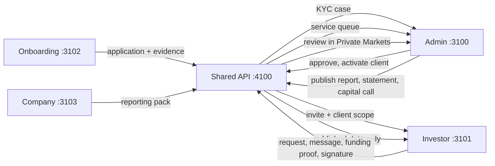
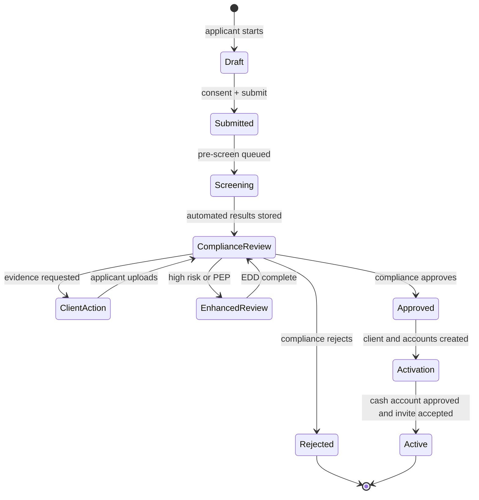
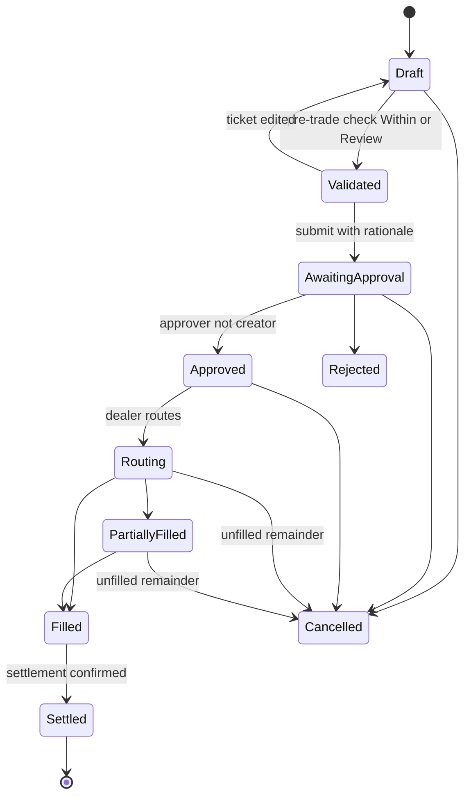
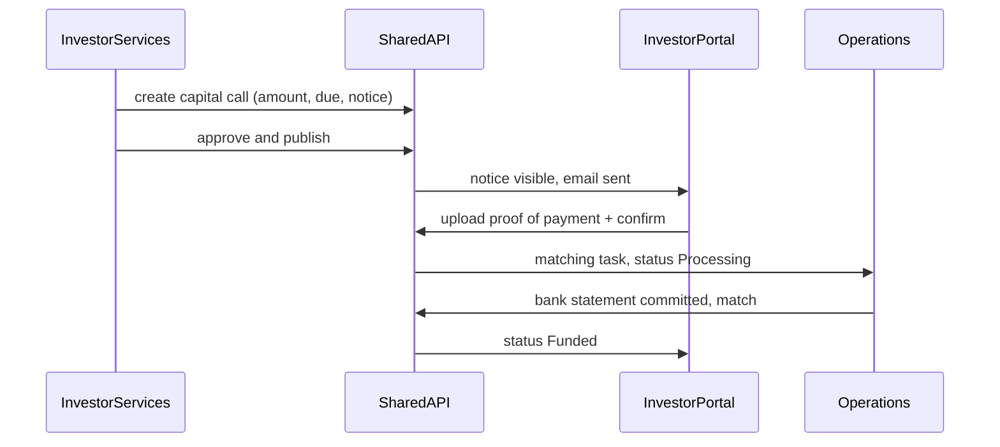
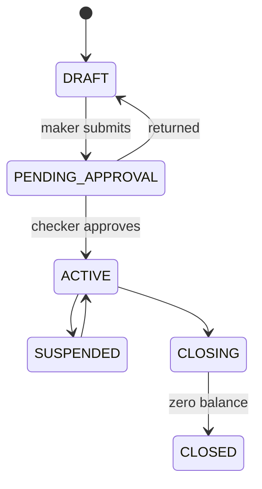
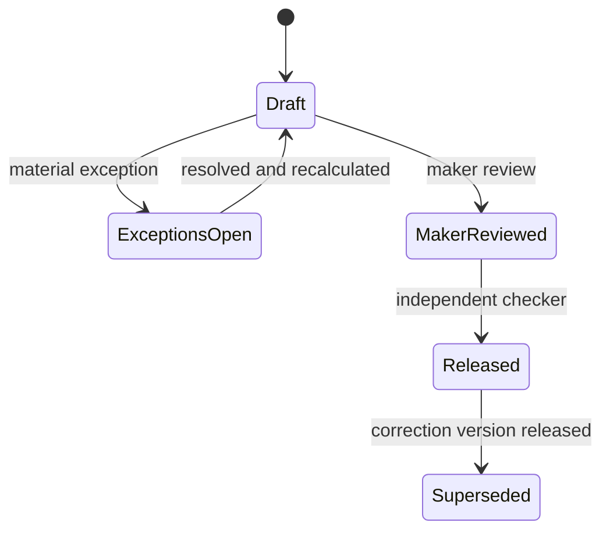
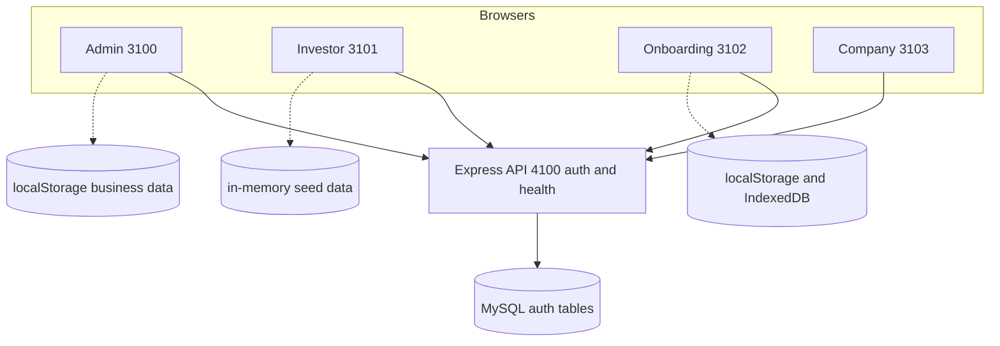
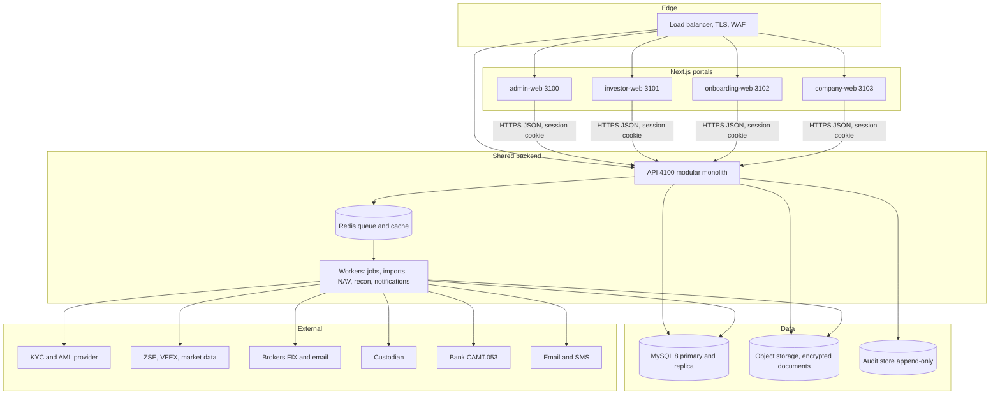
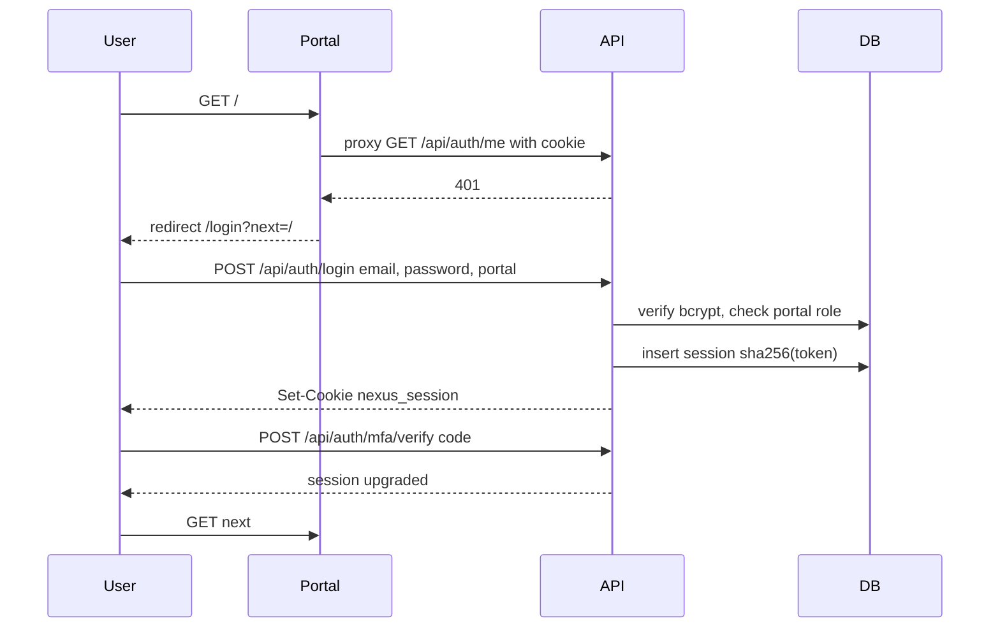
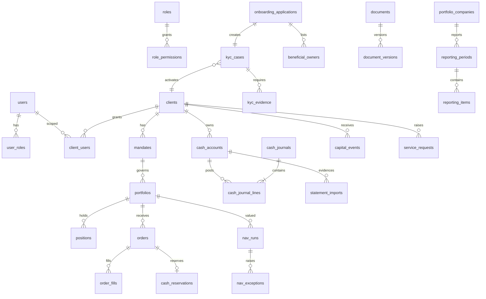

# Matanho Nexus — Software Requirements Document (SRD)

| Field | Value |
| --- | --- |
| Product | Matanho Nexus — institutional investment platform |
| Document version | 1.0 (derived from UI prototype V56) |
| Date | 29 Sep 2026 |
| Status | Draft for business sign-off |
| Source of truth | This document supersedes `docs/DOMAIN-ENTITIES.md` (partial) and extends `docs/ARCHITECTURE.md` (current state) |

## How to read this document

Every requirement, rule and design decision carries one evidence label:

| Label | Meaning |
| --- | --- |
| **[O] Observed** | Visible in the running V56 UI or implemented in the current code. |
| **[I] Inferred** | Implied by the UI (labels, copy, disabled states, sample data) but not implemented. |
| **[P] Proposed** | A design decision made by this SRD to fill a gap. Changeable without contradicting the UI. |
| **[Q] Open Question** | Cannot be decided from the UI. Listed in section 13 with an ID (`Q-nn`). |

Nothing labelled [I] or [P] is an approved business rule until the business owner signs it off. Where the prototype
contains two implementations of the same feature (a common artefact of its 35 incremental patch layers, v33–v56),
the one visible in the running UI is canonical and the other is noted.

Requirement IDs: `FR-<AREA>-nnn` (functional), `NFR-<AREA>-nnn` (non-functional), `BR-nnn` (business rule).
Priorities: **M** = must (MVP), **S** = should, **C** = could (later phase).

---

## Table of contents

1. Introduction
2. System Overview
3. Portals & Port Assignments
4. User Roles & Permissions Matrix
5. Page-by-Page UI Breakdown
6. Functional Requirements
7. User Workflows & State Diagrams
8. Non-Functional Requirements
9. System Architecture & Diagrams
10. Database Schema
11. API Specification
12. Integrations & Third-Party Services
13. Assumptions, Constraints & Open Questions
14. Glossary
- Appendix A — Traceability matrix (page → requirements → API → entities)
- Appendix B — Status vocabularies
- Appendix C — Prototype persistence keys to be replaced

---

## 1. Introduction

### 1.1 Purpose

Define, completely and testably, the system that the Matanho Nexus UI prototype represents, so that a development team
can build the production platform (frontends, shared API, database, integrations, operations) without further discovery.

### 1.2 Scope

In scope:

- Four web portals already designed: **Admin / Investment OS**, **Investor**, **Public Onboarding**, **Portfolio Company**.
- One shared backend API, one relational database, one identity/session system, background workers and integrations.
- Investment lifecycle for an institutional asset manager operating in Zimbabwe (ZSE, VFEX) with USD, ZWG and ZAR:
  onboarding/KYC, client and mandate master, portfolios, research, portfolio construction, order management,
  risk and compliance, IBOR, cash sub-ledger, reconciliations, corporate actions, valuation/NAV, accounting and close,
  financing/collateral, performance, reporting, document vault, investor servicing, regulatory reporting,
  data fabric, model governance, an advisory copilot, RBAC, settings and audit.

Out of scope (the UI explicitly excludes or never shows them):

- Moving money directly. **[O]** Investor capital calls are funded out-of-band and matched by operations; the portal never initiates payments.
- Direct exchange connectivity for execution **[O]** (orders are routed to brokers by approved email/FIX drop-copy only).
- Retail self-directed trading, mobile native apps, public marketing website.

### 1.3 Audience

Product owner, business analysts, solution architects, backend/frontend engineers, QA, security, compliance, operations/DevOps.

### 1.4 Current implementation baseline **[O]**

| Area | State today |
| --- | --- |
| Frontends | Four Next.js 16 apps. Admin, investor and onboarding render the original prototype through a legacy bridge; company is native React. |
| Backend | Express 5 + TypeScript, `/api/health` and `/api/auth/{register,login,logout,me}` only. |
| Database | MySQL 8 via Prisma: `users`, `sessions`, `roles`, `role_permissions`, `user_roles`. 14 roles seeded from the prototype. |
| Business data | Hard-coded JS arrays and browser `localStorage`/IndexedDB (Appendix C). |
| Deployment | Existing Docker/nginx/Pages config serves only the archived static prototype (`legacy-static/`). |

### 1.5 References

`docs/ARCHITECTURE.md`, `docs/DOMAIN-ENTITIES.md`, `docs/CLEANUP-NOTES.md`, `backend/api/prisma/schema.prisma`,
`backend/api/prisma/seed/role-catalog.json`, `packages/shared/src/{auth,portals,client}.ts`, portal sources under `portals/*`.

---

## 2. System Overview

Matanho Nexus is an **investment operating system** for an institutional asset manager and its stakeholders.

| Stakeholder | What they do in the platform |
| --- | --- |
| Investment team (directors, PMs, dealers, analysts) | Research issuers, build target portfolios, create/approve/route orders, monitor risk and performance. |
| Control functions (compliance, operations, fund accounting, auditors) | KYC decisions, limits and breaches, cash sub-ledger, reconciliations, NAV release, period close, regulatory filings, audit evidence. |
| Client services | Client master, cash account opening, investor servicing, publications, portal access. |
| Platform administrators | Users, roles, policies, settings, integrations — explicitly **without monetary authority** **[O]**. |
| Institutional investors / LPs | View published portfolio, performance, capital activity, holdings, documents; sign documents; raise requests; message the relationship team. |
| Prospective investors | Complete a four-step digital KYC application with evidence upload. |
| Portfolio companies | Submit monthly reporting packs (management accounts, board pack, compliance evidence). |

Core design principles visible throughout the UI **[O]**:

1. **Books of record**: IBOR (positions), ABOR (accounting), PBOR (performance) and an immutable cash sub-ledger — balances are derived, never edited.
2. **Maker/checker** on every financially material state change (orders, cash journals, cash accounts, statement imports, NAV release, bank details, elections, reconciliation sign-off).
3. **Published-data boundary**: external portals only show data that has passed an internal publish/approval step.
4. **Evidence first**: every exception resolution, approval and import stores source evidence and an audit event.
5. **Advisory automation**: AI/automation (KYC pre-screen, copilot) supports but never replaces human decisions.

---

## 3. Portals & Port Assignments

### 3.1 Portal registry

| Portal | ID | Target users | Dev port | Prod host **[P]** | Access model |
| --- | --- | --- | --- | --- | --- |
| Admin / Investment OS | `admin` | Internal staff (10 roles) | **3100** | `app.matanho.com` | Authenticated, internal roles required |
| Investor Portal | `investor` | Institutional investors / LPs (4 roles) | **3101** | `investor.matanho.com` | Authenticated, investor role + client scope required |
| Public Onboarding | `onboarding` | Prospective investors | **3102** | `onboard.matanho.com` | Public form; applicant identity via email-verified draft link **[P]** |
| Portfolio Company | `company` | Portfolio-company finance users | **3103** | `companies.matanho.com` | Authenticated, company scope required **[P]** (Q-01) |
| Shared API | — | All portals | **4100** | `api.matanho.com` | Session cookie + CSRF origin guard |
| Background workers | — | Internal | n/a (no HTTP) | private | Queue consumers |
| Database (MySQL 8) | — | API/workers only | 3306 | private subnet | Never reachable from browsers |

**[O]** Ports 3100–3103 and 4100 are fixed in `packages/shared/src/portals.ts`, `.env.example` and each portal's `package.json`.
Each portal runs as an independent process and can be deployed, scaled and rolled back independently.

### 3.2 Shared vs portal-specific services

| Service | Shared | Admin | Investor | Onboarding | Company |
| --- | :-: | :-: | :-: | :-: | :-: |
| Identity, sessions, MFA, RBAC | ✓ | | | | |
| Audit event store | ✓ | | | | |
| Document storage & signed download links | ✓ | | | | |
| Notifications (email, in-app) | ✓ | | | | |
| Client/party master | ✓ | edit | read (own) | create (application) | |
| Portfolio, IBOR, performance | ✓ | full | published read | | |
| OMS, research, risk, cash, recon, NAV, accounting | | ✓ | | | |
| Capital events, requests, messages | ✓ | service | self-service | | |
| KYC case management | ✓ | review/decide | status read | submit | |
| Reporting-pack management | ✓ | review | | | submit |

### 3.3 Authentication & SSO across portals

- **[O]** One user store and one session cookie (`nexus_session`, httpOnly, SameSite=Lax, Secure in production). Only the SHA-256 of the 256-bit token is stored.
- **[O]** A user may hold roles on several portals; login to a portal with a `portal` parameter is refused (403 `portal_access_denied`) unless the user holds a role for that portal.
- **[P]** Production: all portals are sibling sub-domains of `matanho.com` with `COOKIE_DOMAIN=.matanho.com` → single sign-on. The session is portal-agnostic; authorisation is evaluated per request against the portal and permission required.
- **[P]** Admin and investor portals require MFA (TOTP; WebAuthn optional) at login and step-up MFA for approvals, signatures and bank-detail changes (UI shows "MFA verified · device trusted" **[O]**).
- **[P]** Onboarding applicants do not need an account: a draft is bound to a verified email via a one-time magic link; on approval the applicant is invited to the investor portal (Q-02).

### 3.4 Data flow between portals



**[O]** In the prototype these flows are faked: onboarding writes `localStorage["matanho-onboarding-v10"]`, which the admin
Onboarding page reads only when both run on the same origin. On separate ports this bridge does not work, so the API must own these flows.

---

## 4. User Roles & Permissions Matrix

### 4.1 Admin portal roles **[O]** (from `rolePermissions` / `roleLabels`, seeded in `role-catalog.json`)

| Key | Label | Purpose |
| --- | --- | --- |
| `investment_director` | Investment Director | Final investment authority; approves orders and cash. |
| `portfolio_manager` | Portfolio Manager | Owns portfolios; creates orders and scenarios. |
| `dealer` | Dealer / Trader | Routes approved orders to brokers. |
| `analyst` | Investment Analyst | Research, models, reports. |
| `compliance` | Compliance Officer | KYC decisions, limits, breaches, cash approval. |
| `operations` | Operations | Cash journals, imports, reconciliations, settlements. |
| `fund_accountant` | Fund Accountant | NAV, accounting, journals, close. |
| `client_services` | Client Services | Client master, cash accounts, investor servicing. |
| `auditor` | Auditor | Read-only evidence access. |
| `system_admin` | System Administrator | Users, roles, settings; no monetary permissions. |

### 4.2 Admin permission matrix **[O]**

| Permission | Dir | PM | Dealer | Analyst | Compl. | Ops | FundAcc | ClientSvc | Auditor | SysAdmin |
|---|:-:|:-:|:-:|:-:|:-:|:-:|:-:|:-:|:-:|:-:|
| `dashboard.view` | ✓ | ✓ | ✓ | ✓ | ✓ | ✓ | ✓ | ✓ | | ✓ |
| `portfolio.view` | ✓ | ✓ | ✓ | ✓ | ✓ | ✓ | ✓ | ✓ | ✓ | ✓ |
| `orders.view` | ✓ | ✓ | ✓ | | ✓ | ✓ | ✓ | | ✓ | ✓ |
| `orders.create` | ✓ | ✓ | ✓ | | | | | | | |
| `orders.approve` | ✓ | | | | | | | | | |
| `orders.route` | | | ✓ | | | | | | | |
| `research.view` | ✓ | ✓ | ✓ | ✓ | | | | | | ✓ |
| `research.edit` | ✓ | ✓ | | ✓ | | | | | | ✓ |
| `risk.view` | ✓ | ✓ | ✓ | ✓ | ✓ | ✓ | ✓ | | ✓ | ✓ |
| `risk.manage` | | | | | ✓ | | | | | ✓ |
| `clients.view` | ✓ | ✓ | | | ✓ | ✓ | | ✓ | ✓ | ✓ |
| `clients.edit` | | | | | ✓ | | | ✓ | | ✓ |
| `onboarding.view` | ✓ | ✓ | | | ✓ | ✓ | | ✓ | ✓ | ✓ |
| `onboarding.manage` **[O-runtime]** | ✓ | | | | ✓ | | | ✓ | | |
| `reports.view` | ✓ | ✓ | | ✓ | ✓ | | ✓ | ✓ | ✓ | ✓ |
| `reports.create` | ✓ | ✓ | | ✓ | ✓ | | ✓ | ✓ | | ✓ |
| `documents.view` | ✓ | ✓ | ✓ | ✓ | ✓ | ✓ | ✓ | ✓ | ✓ | ✓ |
| `documents.edit` | ✓ | ✓ | | ✓ | ✓ | ✓ | ✓ | ✓ | | ✓ |
| `operations.view` | ✓ | ✓ | ✓ | | ✓ | ✓ | ✓ | | ✓ | ✓ |
| `valuation.view` | ✓ | ✓ | | | ✓ | ✓ | ✓ | | ✓ | ✓ |
| `audit.view` | ✓ | | | | ✓ | ✓ | ✓ | | ✓ | ✓ |
| `cash.view` | ✓ | ✓ | ✓ | | ✓ | ✓ | ✓ | ✓ | ✓ | ✓ |
| `cash.approve` | ✓ | | | | ✓ | | | | | |
| `cash.journal.create` | | | | | | ✓ | ✓ | | | |
| `cash.journal.approve` | | | | | | ✓ | ✓ | | | |
| `cash.reservation` | | ✓ | ✓ | | | ✓ | | | | |
| `cash.import` | | | | | | ✓ | ✓ | | | |
| `cash.close` | | | | | | ✓ | ✓ | | | |
| `admin.rbac` | | | | | | | | | | ✓ |
| `admin.settings` | | | | | | | | | | ✓ |

Notes:

- **[O]** `onboarding.manage` is injected at runtime by `03-v10-branding-kyc-js.js` but is missing from the seed. **[P]** Add it to the seed for the three roles shown (resolves drift; Q-03 confirms).
- **[O]** `cash.approve` is granted but absent from the RBAC matrix UI. **[P]** Define `cash.approve` as approval of cash-account lifecycle changes and bank instructions; journal approval stays `cash.journal.approve`.
- **[P]** Permissions not present in the prototype but needed by designed screens are expressed only by reusing existing codes (e.g. NAV release requires `valuation.view` **and** a checker rule) until the business names new codes (Q-04). Candidate new codes are listed in 4.5 and are **not** seeded.

### 4.3 Investor portal roles and entitlements **[O]**

| Permission | `admin` Investor Admin | `investment` Investment Viewer | `finance` Finance/Treasury | `auditor` Auditor |
|---|:-:|:-:|:-:|:-:|
| `overview.view` | ✓ | ✓ | ✓ | ✓ |
| `investments.view` | ✓ | ✓ | ✓ | ✓ |
| `performance.view` | ✓ | ✓ | | ✓ |
| `capital.view` | ✓ | | ✓ | |
| `holdings.view` | ✓ | ✓ | ✓ | ✓ |
| `documents.view` | ✓ | ✓ | ✓ | ✓ |
| `requests.view` | ✓ | | ✓ | |
| `messages.view` | ✓ | ✓ | ✓ | |
| `profile.view` | ✓ | ✓ | ✓ | ✓ |
| `users.invite` | ✓ | | | |

**[I]** Investor users are additionally scoped to one client relationship and an account scope chosen at invite time
(All accounts / Managed accounts / Private funds / Documents only — from the invite modal).

### 4.4 Onboarding and company portals

**[O]** No roles exist in the prototype. None are invented here. **[P]** Access is controlled by *scope* not role:
an onboarding draft belongs to its verified email; a company user belongs to one or more `PortfolioCompany` records (Q-01).

### 4.5 Segregation-of-duties rules

| ID | Rule | Label |
| --- | --- | --- |
| BR-001 | A user may not approve an item they created (orders, journals, imports, cash accounts, NAV, elections, recon sign-off, reports). | [O] |
| BR-002 | `system_admin` must never hold a monetary permission (`orders.create/approve/route`, `cash.*` except `cash.view`). The SoD scan flags violations. | [O] |
| BR-003 | Order approval and routing are held by different people (`orders.approve` vs `orders.route`). | [O] |
| BR-004 | At least two active users must hold `admin.rbac` **[I]** (SoD scan checks admin count); assigning/removing `system_admin` requires confirmation. | [O]/[I] |
| BR-005 | Policy toggles (order approval, cash approval, NAV approval, dual bank approval, MFA, session timeout) are configurable in RBAC; relaxing any is flagged by the SoD scan. | [O] |
| BR-006 | Changes to bank instructions require dual approval and out-of-band verification. | [O] copy |

Candidate permission codes needed later (not seeded, Q-04): `valuation.release`, `accounting.close`, `recon.signoff`,
`corporate_actions.elect`, `regulatory.submit`, `integrations.manage`, `models.approve`, `financing.manage`, `investor_services.publish`.

---

## 5. Page-by-Page UI Breakdown

Conventions per page: **Purpose · Entry/exit · Elements · Inputs & validation · Actions · Data & source · Permissions · States & edge cases · Responsive**.
"Data source (target)" names the API resource in section 11. Global loading/empty/error behaviour is defined once in 5.0 and applies to every page.

### 5.0 Global UI rules (all portals) **[P]** unless marked

- **Loading**: skeleton rows for tables, shimmer for KPI tiles; buttons show busy label (e.g. "Saving…", "Checking…" **[O]**) and are disabled while the request runs.
- **Empty**: every table shows a one-line explanation and, where the user has permission, the primary create action.
- **Error**: API errors render as a toast with the API `error.message` (format `{error:{code,message}}` **[O]**); validation errors render inline under the field; 401 redirects to `/login?next=`; 403 shows "Permission denied" toast **[O]** and the control is disabled with a tooltip **[O]**.
- **Toasts** **[O]**: title + message + tone (success/warn/error); admin stack `#toastStack`, investor 2.6 s, company 1.8 s.
- **Drawers** **[O]**: right-side panel with eyebrow, title, subtitle, body; closes on ×, backdrop click, Escape.
- **Modals** **[O]**: centred; Cancel/close on backdrop and Escape.
- **Currency formatting** **[O]**: `US$ 1.23m`, `ZWG`, `ZAR`; investor portal converts display currency.
- **Dates**: `dd Mon yyyy`, times in `Africa/Harare` (CAT) **[O]**.

---

### 5.A Admin / Investment OS (port 3100)

#### 5.A.0 Shell

| Element | Behaviour | Label |
| --- | --- | --- |
| Sidebar (28 items, grouped) | Each item has `data-page` + `data-permission`; hidden when the user lacks the permission; badges show queue counts. | [O] |
| Collapse sidebar | Toggles icon-only sidebar; state kept per user **[P]**. | [O] |
| Health footer | "All services operational", last sync time. Target: `GET /api/health` + integration status. | [O]/[P] |
| Global search / ⌘K palette | Searches portfolios, clients, securities, orders, documents; Enter opens the entity. | [O] UI, [P] scope |
| Market status + local clock | ZSE/VFEX session state and CAT time. | [O] |
| Notifications bell | Count + drawer of the user's notifications. | [O] static, [P] live |
| Role switcher | **Prototype only**: previews any role. **[P]** Production: shows only roles the signed-in user holds; switching changes the active role context, never grants new rights. | [O]/[P] |
| Profile button | Name + role label; menu: profile, MFA, sign out. | [O]/[P] |
| Focus mode button | Toggles compact "focus" presentation; preference stored per user. | [O] |
| Copilot FAB (⌘J) | Opens Copilot page. | [O] |
| Second-layer page | Full-page drill-down for portfolio, client, research case, risk limit/case, performance, onboarding case, position, settlement, accounting close, data source, order approval, work queue. | [O] |
| Forbidden navigation | Toast + redirect to the first permitted page. | [O] |

#### 5.A.1 Command Centre — "Global Investment Office" (`command`, `dashboard.view`)

- **Purpose**: daily cockpit — firm-wide KPIs, performance, decisions awaiting the user, allocation, mandate headroom, liquidity, control exceptions.
- **Elements**: header actions *Run scenario* (→ Risk), *My work* (→ work-queue second layer), *Investment pack* (download); scope chips *Whole / Listed / Fixed income / Private / Liquidity*; 6 clickable KPI tiles (each jumps to its page); tabs *Overview / Performance / Risk & controls*; performance chart with ranges 1M/3M/YTD/1Y and hover tooltip; worklist (settlement breaks, mandate headroom, order approvals, private capital calls); allocation ring; controls tiles IBOR/ABOR/PBOR/Data quality.
- **Inputs**: scope chip, tab, chart range (single-select).
- **Actions**: open worklist item (second layer), jump from KPI, download investment pack (PDF).
- **Data (target)**: `GET /v1/dashboard/summary?scope=`, `GET /v1/performance/series?range=`, `GET /v1/work-items?assignee=me`.
- **States**: KPI tile turns amber/red when a control is breached; worklist empty state "Nothing needs your decision".
- **Edge**: auditor has no `dashboard.view` **[O]** → lands on first permitted page.

#### 5.A.2 Whole Portfolio (`portfolios`, `portfolio.view`)

- **Elements**: search box, strategy and currency filters **[O markup; not wired]**, summary KPIs, portfolio table (name, type, currency, AUM, cash %, return, benchmark, risk, manager), *Save view*, *+ New portfolio*.
- **Validation (new portfolio) [P]**: name unique (3–120 chars), base currency ∈ {USD, ZWG, ZAR}, mandate required, benchmark required, manager must hold `portfolio_manager`.
- **Actions**: row → second-layer portfolio 360 (holdings, exposures, performance, orders, cash); save view persists filters per user.
- **Permissions [P]**: creation requires `portfolio.view` + `admin.settings`? — **Q-05** (no create code in prototype).
- **Data**: `GET /v1/portfolios`, `POST /v1/portfolios`, `GET/PUT /v1/users/me/saved-views`.

#### 5.A.3 Private Markets (`private-markets`, `portfolio.view`)

- **Tabs**: Overview (scenario Base/Downside/Upside; cash-flow forecast chart; exception list; investment inventory), Portfolio (look-through exposure bars; underlying asset cards), Pipeline (funnel counts; diligence list), Cashflows (liquidity bridge; call/distribution table), Valuations (fair-value table; IFRS 13 level hierarchy metrics).
- **Header actions**: *New diligence case*, *Cashflow scenario*, *+ New investment* (drawers).
- **Data (sample)**: 6 private investments with commitment, called, unfunded, NAV, IRR, TVPI, DPI.
- **Portfolio-company reporting drawer [O]**: lists companies and pack status; link opens the Company portal.
- **Validation [P]**: commitment > 0; vintage year 1990–current; currency required; valuation date ≤ today; fair-value level ∈ {1,2,3}.
- **Data**: `/v1/private/investments`, `/v1/private/pipeline`, `/v1/private/cashflows`, `/v1/private/valuations`, `/v1/companies/{id}/packs`.

#### 5.A.4 Portfolio Construction (`portfolio-lab`, `portfolio.view`)

- **KPIs**: expected return, tracking error, VaR, liquidity, turnover, constraint breaches.
- **Tabs**: Target / Constraints / Scenarios / Implementation.
- **Actions**: *Save scenario* (named, persisted — today `matanho-scenarios-v8`), *Run optimiser*, *Promote to orders* (requires `orders.create` **[O]**) → creates draft orders.
- **Validation [P]**: target weights sum to 100 % ±0.01; no weight < 0 unless shorting permitted by mandate (default no); constraints must reference existing limits.
- **Data**: `/v1/construction/scenarios`, `POST /v1/construction/scenarios/{id}/optimise` (async job), `POST /v1/construction/scenarios/{id}/promote`.

#### 5.A.5 Order Management (`orders`, `orders.view`)

- **Tabs**: Workstation (security picker, market context, ticket), All orders (blotter), Approvals, Post-trade.
- **KPIs**: working count, awaiting approval, fills, slippage; *More metrics* expander (state remembered).
- **Actions**: *New order* (ticket), *Import orders* (CSV/JSON/text with preview before staging **[O]**), *Save draft*, *Run pre-trade check*, *Submit*, *Approve/Reject*, *Route* (broker email modal), *Cancel*.
- **Ticket fields [O]**: security, side (Buy/Sell), portfolio, quantity, limit price, order type, TIF, urgency, broker, allocation, rationale.
- **Validation [O]**: portfolio, quantity > 0, price > 0 required; rationale required on submit; pre-trade check must pass (or produce a documented review flag) before submit. **[P]** Quantity integer and ≥ board lot; price within ±10 % of last unless override reason.
- **Pre-trade controls [O]**: mandate, cash/position availability, concentration, liquidity/size; result *Within / Review / Blocked*.
- **Broker modal [O]**: previews email instruction; *Send* enabled only when order is Approved and user has `orders.route`.
- **Data**: `/v1/orders` (+ `validate`, `submit`, `approve`, `reject`, `route`, `cancel`), `/v1/orders/import`, `/v1/securities`, `/v1/brokers`.

#### 5.A.6 Research & IC (`research`, `research.view`)

- **Universe list** (ZSE/VFEX issuers; sample DLTA, CBZ, ECO, MEIK).
- **Tabs**: Overview (price chart, thesis, fact grid), Financials (statement table, read-through), Filings (document list + preview), Valuation (revenue growth, margin, discount rate, target price, recommendation, conviction), Notes (analyst note, catalysts, risks).
- **Actions**: *Import filing*, *IC pack* (download), *New investment case*, *Open full case* (second layer), *Save model* (`research.edit`).
- **Validation [P]**: growth −100…+500 %, margin −100…100 %, discount 0–50 %, recommendation ∈ {Buy, Accumulate, Hold, Reduce, Sell}, conviction 1–5.
- **Data**: `/v1/research/issuers`, `/v1/research/issuers/{id}/{financials|filings|model|notes}`, `/v1/research/cases`.

#### 5.A.7 Risk & Compliance (`risk`, `risk.view`)

- **Scenario lab [O]**: equity shock, FX shock, rate shock, redemption shock → computes loss, liquidity coverage, cash impact and status *Escalate / Review / Within*; presets *liquidity / equity / fx*.
- **Limit administration [O]**: metric, scope, threshold, unit, action on breach, owner → *Add limit* creates a **draft** limit awaiting approval.
- **Limit book, saved scenarios, early warnings, compliance queue** tables.
- **Actions**: *New case* (drawer; description required **[O]**), open limit/case second layer.
- **Permissions**: `risk.manage` for limits and cases **[O]**.
- **Data**: `/v1/risk/scenarios` (`POST …/run`), `/v1/risk/limits`, `/v1/risk/breaches`, `/v1/risk/cases`.

#### 5.A.8 Performance & Attribution (`performance`, `reports.view`)

- **Elements**: range 1M/3M/YTD/1Y, cumulative return chart, Brinson attribution bars (allocation, selection, interaction), factor exposure, official-return governance checklist (state *Provisional*, validations pending).
- **Actions**: *Methodology*, *Export attribution* (CSV/XLSX), *Lock official return* (checker action, blocked while validations pending **[I]**), drill bar → drawer with linked IBOR/orders/research.
- **Data**: `/v1/performance/returns`, `/v1/performance/attribution`, `POST /v1/performance/periods/{id}/lock`.

#### 5.A.9 Clients & Cash Accounts (`clients`, `clients.view`)

- **Sections**: cash-account registry (search, status filter), investor register (search, risk filter **[O not wired]**), lifecycle lane DRAFT → PENDING_APPROVAL → ACTIVE → SUSPENDED → CLOSING → CLOSED.
- **Actions**: *Export registry*, *Client report*, *New client* **[O v49]**, *New cash account* (`clients.edit`), row → client drawer / cash account drawer (approve, suspend, close).
- **New client fields [O]**: legal/display name (required), client type (Pension Fund, Provident Fund, Insurance, Corporate, Family Office, Trust, Individual), relationship owner, base currency, mandate, initial risk. New client starts **KYC Pending**. ID format `CL-#####`.
- **New cash account fields [O]**: client, portfolio, provider (required), external account identifier (required, stored masked `••••1234`), currency, account type (CLIENT_BANK, CUSTODY_CASH, BROKER_SETTLEMENT). Starts **DRAFT**; ID `CCA-####`.
- **Permissions [O]**: create cash account requires `clients.edit` or role in {operations, compliance, system_admin} (prototype rule). **[P]** Normalise to `clients.edit`; activation requires `cash.approve` by a different user.
- **Data**: `/v1/clients`, `/v1/cash-accounts` (+ `submit`, `approve`, `suspend`, `close`).

#### 5.A.10 Investor Services (`investor-services`, `clients.view`)

- **Elements**: workbench table (search; filter money / document / kyc / current), capital-event queue, publication queue, portal-access list, communications, calendar.
- **Actions (drawers) [O]**: create capital event (call/distribution: fund, investors, amount, due date, notice document), release publication (report/statement to investor portal), manage portal access (invite, revoke, change scope).
- **Data**: `/v1/capital-events`, `/v1/publications`, `/v1/investor-users`.

#### 5.A.11 Onboarding & KYC (`onboarding`, `onboarding.view`)

- **Layout**: case list (search; filter *Action needed / All / Ready / High risk*) + case detail pane.
- **Case detail [O]**: applicant data, channel (Assisted, Investor portal, Adviser link, Website), stage, risk, identity, screening, source of funds, document checklist (x of N), SLA state, AI pre-screen result with exceptions and "human decision required", timeline, evidence preview.
- **Actions**: *New client* (assisted onboarding), *Review*, *Request evidence*, *Advance stage*, *Approve / Reject / Enhanced review*, *Activate* (`onboarding.manage`).
- **Rules [O]**: high risk or unapproved source of funds blocks activation; AI result is advisory only.
- **Data**: `/v1/kyc/cases` (+ `advance`, `request-evidence`, `decide`, `activate`), `/v1/kyc/cases/{id}/documents`.

#### 5.A.12 Reports & BI (`reports`, `reports.view`)

- **Elements**: search, type, status, sort; report table; inline preview pane; *+ Report*; *Schedules*.
- **Report editor modal [O]**: WYSIWYG canvas, outline, data bindings, approval route, preview, print.
- **States**: Draft → In review → Awaiting approval → Approved → Published.
- **Data**: `/v1/reports`, `/v1/report-templates`, `/v1/report-schedules`, `POST /v1/reports/{id}/{submit|approve|publish}`, `GET /v1/reports/{id}/render?format=pdf`.

#### 5.A.13 Document Vault (`vault`, `documents.view`)

- **Elements**: search, type, advanced filters (classification, owner, related entity, date), table, preview, *Upload*, *Retention*; document modal with metadata and version history.
- **Document fields [O]**: name, type (research, ic, clients, compliance, valuations, legal), related entity, owner, version, access (classification), status, format.
- **Validation [P]**: allowed types pdf, docx, xlsx, csv, png, jpg; ≤ 25 MB; malware scan before availability; classification required.
- **Data**: `/v1/documents` (+ `versions`, `download-url`), `/v1/retention-policies`.

#### 5.A.14 IBOR & Positions (`ibor`, `portfolio.view`)

- **Elements**: search, asset class and state filters, positions table (security, portfolio, quantity, settled/unsettled, price, market value, accrued, available to trade, lineage), settlement ladder T/T+1/T+2/T+3, book health.
- **Actions**: *Historical snapshot* (as-of date), *Reconcile positions*, *Refresh IBOR*.
- **Data**: `/v1/ibor/positions?asOf=`, `/v1/ibor/settlement-ladder`, `POST /v1/ibor/refresh` (job).

#### 5.A.15 Cash & Ledgers (`cash`, `cash.view`)

- **Context bar**: client, portfolio, account, currency, as-of.
- **Cash states [O]**: POSTED, RESERVED, BLOCKED, EXPECTED, AVAILABLE, WITHDRAWABLE — each with *Explain* (shows derivation).
- **Tabs**: Ledger (journals), Reservations, Expectations, Statement imports.
- **Actions**: *New journal* (`cash.journal.create`), *Approve journal* (`cash.journal.approve`, not maker), *Reverse journal*, *New reservation* (`cash.reservation`), *Import statement* (`cash.import`), *Commit import* (checker), *Close day/period* (`cash.close`).
- **Validation [O]**: journal debits = credits; reservation amount ≤ available; posted journals immutable (corrections by reversal only).
- **Data**: `/v1/cash/balances`, `/v1/cash/journals`, `/v1/cash/reservations`, `/v1/cash/expectations`, `/v1/cash/statement-imports`.

#### 5.A.16 Operations Control (`operations`, `operations.view`)

- **Elements**: daily runbook (filters All/Due/Blocked), dependency map (settlement %, cash, valuation exceptions, accounting status), quick links to reconciliations, valuation, corporate actions.
- **Actions**: *New task*, mark task done/blocked with note.
- **Data**: `/v1/operations/tasks`, `/v1/operations/status`.

#### 5.A.17 Reconciliations (`reconciliations`, `operations.view`)

- **Families [O]**: Cash, Holdings, Trades, Settlement, Units, Income, Fees, FX, Omnibus, Subledger/GL, Pricing/NAV.
- **Elements**: match-rate KPI, open breaks, source-health strip (connected feeds, missing sources, manual imports), break queue, break detail (internal vs external, difference, cause, owner, age, severity, evidence), *Run matching*, *Daily sign-off*, *View/upload counterpart records*.
- **Actions**: assign, investigate, attach evidence, accept candidate match, query source, resolve (maker), sign off (checker).
- **Data**: `/v1/recon/runs`, `/v1/recon/breaks`, `/v1/recon/sources`, `/v1/recon/imports`, `POST /v1/recon/signoffs`.

#### 5.A.18 NAV & Valuation (`valuation`, `valuation.view`)

- **Stage bar [O]**: Positions → Cash → Prices & FX → Fees → Units → Maker review → Release.
- **Elements**: fund selector, draft NAV, NAV/unit, units, price coverage, release state, exceptions table, NAV bridge, source evidence buttons.
- **Actions**: *Run/Recalculate NAV*, *Preview pack*, *Resolve exception* (rationale required + optional evidence **[O]**), *Maker review* (blocked while material exception open **[O]**), *Release* (checker, requires maker done).
- **Data**: `/v1/nav/runs` (+ `recalculate`, `maker-review`, `release`), `/v1/nav/runs/{id}/exceptions`.

#### 5.A.19 Accounting & Close (`accounting`, `valuation.view`)

- **Elements**: IBOR→ABOR→PBOR→GL banner, NAV oversight table, journal queue, close checklist (blocked by cash suspense and price review **[O]**).
- **Actions**: *Accounting report*, *Run close pre-check*, *Close period* (only when checklist clear).
- **Data**: `/v1/accounting/periods`, `POST /v1/accounting/periods/{id}/{precheck|close}`, `/v1/accounting/gl-mappings`.

#### 5.A.20 Collateral & Financing (`financing`, `risk.view`)

- **Elements**: facilities table (`FAC-###`: provider, committed, drawn, cost, collateral, state), margin calls (`MC-####`: call, house, due, state Due/Disputed/Funded), collateral optimiser, funding curve.
- **Actions**: *New facility*, *New margin call*, *Run collateral optimiser*, *Import margin statement*, dispute/fund margin call.
- **Data**: `/v1/financing/facilities`, `/v1/financing/margin-calls`.

#### 5.A.21 Corporate Actions (`corporate-actions`, `operations.view`)

- **Elements**: event book table (type, security, ex/record/pay dates, election deadline, status, cash/position impact).
- **Actions**: *Import notice*, *Project entitlements*, *+ New event*, election drawer (voluntary vs mandatory; maker/checker for elections **[O]**).
- **Data**: `/v1/corporate-actions` (+ `entitlements`, `elections`).

#### 5.A.22 Regulatory Reporting (`regulatory`, `reports.view`)

- **Elements**: obligation calendar, obligations list, filing package detail (validation results, attestation).
- **Actions**: *New obligation*, *Validate*, *Calendar*, attest, submit, record regulator acknowledgement.
- **Note [O]**: sample obligations include foreign formats (13F, N-PORT, EMIR) — **Q-06** which Zimbabwean returns (SECZ, RBZ, FIU) apply.
- **Data**: `/v1/regulatory/obligations`, `/v1/regulatory/filings`.

#### 5.A.23 Data Fabric & Studio (`data`, `operations.view`)

- **Tabs**: Connections, Data products, Pipelines, Quality, Lineage.
- **Integration editor [O]**: name, purpose, transport (REST, SFTP, FIX 4.4, SMTP, API), auth method, endpoint, status (default `not_connected`), *Test connection*.
- **Default connectors [O]**: ZSE, VFEX, broker executions, primary custodian, operating bank, KYC/AML screening, approved mail gateway.
- **Data**: `/v1/integrations` (+ `test`), `/v1/data-quality/checks`, `/v1/lineage`.

#### 5.A.24 Model Governance (`model-governance`, `risk.view`)

- **Elements**: model registry (name, owner, use, tier, state, last validation, next validation), build wizard tabs Definition / Dataset / Method / Testing / Governance, 7-stage governance timeline.
- **Data**: `/v1/models` (+ `versions`, `validations`, `approve`).

#### 5.A.25 Investment Copilot (`copilot`, `dashboard.view`)

- **Elements**: question box, suggestion chips, answer thread with source chips, rail links, policy box ("cannot approve orders, move cash, close periods…" **[O]**), *Conversation history*, *Source permissions*, *New analysis*, *Draft action* (creates a draft stress scenario).
- **Rules [O]**: advisory only; answers limited to data the user is entitled to see. Prototype uses keyword matching; **[P]** production uses retrieval over entitled data with citations (Q-07).
- **Data**: `/v1/copilot/conversations`, `POST /v1/copilot/conversations/{id}/messages`.

#### 5.A.26 RBAC & Controls (`rbac`, `admin.rbac`)

- **Elements**: permission matrix (roles × permissions, grouped), users table (name, email, role select, preview), role builder (from template or blank), policy panel (order approval, cash approval, NAV approval, dual bank approval, session timeout, MFA), SoD scan results.
- **Actions**: toggle permission (not allowed on `system_admin` **[O]**), assign role (confirm for system admin **[O]**), *Add user* (name, email, role), *New role*, *Preview current role*, *Export access review*, *Reset*, *Save policy*.
- **Data**: `/v1/admin/users`, `/v1/admin/roles`, `/v1/admin/permissions`, `/v1/admin/policy`, `/v1/admin/sod-scan`.

#### 5.A.27 Settings (`settings`, `admin.settings`)

- **Panels [O]**: Workspace (density, default landing page), Trading (default portfolio, default order type), Risk (horizon, confidence), Research & Data (ingestion), Document Branding (letterhead, logo), Notifications, Change-control audit.
- **Actions**: *Save settings*, *Reset defaults*.
- **Data**: `/v1/admin/settings`.

#### 5.A.28 Audit Trail (`audit`, `audit.view`)

- **Columns [O]**: time, user, role, action, object, previous value, new value, reason.
- **Actions**: *Filter* (user, action, object type, date range **[P]**), *Export evidence* (CSV + signed hash manifest **[P]**).
- **Rule**: read-only; no role can edit or delete audit events **[O copy]**.
- **Data**: `/v1/audit-events`.

---

### 5.B Investor Portal (port 3101)

#### 5.B.0 Shell

| Element | Behaviour | Label |
| --- | --- | --- |
| Sidebar | Brand, relationship block (client name, "5 accounts · USD reporting"), relationship switcher, 9 nav items with entitlement gates and badges (Capital 2, Documents 3, Requests 1, Messages 2), session footer "MFA verified · device trusted · Last access". | [O] |
| V53 simplified skin | Hides Performance, Holdings, Requests from the sidebar; renames Investments → **Portfolio**, Secure messages → **Support**; overview reduced to chart, allocation, action centre. | [O] — Q-08 decides MVP scope |
| Top bar | Mobile menu, client title + context, global search (Enter → documents/holdings/capital), reporting currency (USD / ZWG eq. / ZAR eq.), KYC chip, assistant, notifications (3), profile. | [O] |
| Mobile bottom nav (≤720 px) | Home, Portfolio, Capital, Docs, Profile. | [O] |
| Access restriction | Navigating to a page without entitlement → toast "Access restricted". | [O] |
| Client display override | URL parameter `?client=` replaces the displayed client name. | [O] prototype-only; **[P]** remove — client context comes from the session's entitled relationships (Q-09) |
| Role preview (profile button) | **Prototype only**; production shows the user's actual role(s). | [O]/[P] |

#### 5.B.1 Overview (`overview.view`)

Context bar (NAV, unfunded, next capital call), metrics, performance chart with ranges, allocation donut, action centre (capital call due, document to sign, statement request), investments list, recent activity, assistant card. Actions: *Investor pack* download, *Capital activity*, range change, open action item. Data: `GET /v1/investor/overview`.

#### 5.B.2 Investments / Portfolio (`investments.view`)

Metrics (NAV, commitments, called, unfunded, distributions, private NAV), fund cards (→ Investment 360 drawer with KPIs, mandate/commitment summary and role-scoped buttons), commitment waterfall, upcoming private-market cash. Action: *Download commitment schedule* (CSV). Data: `/v1/investor/investments`.

#### 5.B.3 Performance (`performance.view`)

Account selector (Consolidated + mandates), range, summary metrics, managed-account table, chart with hover, drill to holdings/transactions, attribution waterfall (row → drawer). Action: *Download report*. Data: `/v1/investor/performance`.

#### 5.B.4 Capital activity (`capital.view`)

Metrics (due 30 d, unfunded, distributions YTD, contributions YTD, open requests), featured notices, history table with type/status filters, *Verified bank instructions* drawer, *New funding/withdrawal request*, *View notice*, *Fund* → funding modal. Statuses: Due, Expected, Processing, Funded, Paid. Data: `/v1/investor/capital-events`, `POST …/{id}/funding-evidence`.

#### 5.B.5 Holdings & transactions (`holdings.view`)

Search, asset-class filter, holdings table, transaction filter + table, largest exposures, *Download holdings* (CSV), row → position / transaction drawer. Data: `/v1/investor/holdings`, `/v1/investor/transactions`.

#### 5.B.6 Documents (`documents.view`)

Type filters with counts (all, statement, report, capital, tax, legal, needs signature, unread), search, year, table with checkboxes, *Open* (preview; marks read), *Download*, *Bulk download* (enabled when ≥1 selected), *Review & sign*. Data: `/v1/investor/documents`, `…/{id}/download-url`, `…/{id}/signatures`.

#### 5.B.7 Requests (`requests.view`)

Metrics (open, SLA, average response, closed YTD, relationship owner), status filter (Open, In progress, Waiting on you, Closed), request table with progress, templates (statement/report, contribution/funding, withdrawal enquiry, profile update, complaint). Data: `/v1/investor/requests`.

#### 5.B.8 Messages / Support (`messages.view`)

Thread list with search, thread view, compose + send, *New message*. Selecting a thread clears unread. Data: `/v1/investor/threads`, `…/{id}/messages`.

#### 5.B.9 Profile & access (`profile.view`)

Organisation profile (read-only; *Request change* per field), authorised portal users, KYC & review status, bank instructions (masked), notification switches (capital, reports, service updates, weekly summary). Actions: *Invite user* (`users.invite`), *Request profile change*, *Bank instructions*. Data: `/v1/investor/profile`, `/v1/investor/users`, `/v1/users/me/notification-preferences`.

#### 5.B.10 Investor modals (all **[O]**)

| Modal | Fields | Validation | Result |
| --- | --- | --- | --- |
| Funding workflow | proof-of-payment file, confirmation checkbox | both required | capital event → Processing; evidence stored; ops matching task |
| E-signature | signer name, authority (Trustee / Director / Authorised signatory), consent | consent required; **[P]** step-up MFA | document signed; signature evidence recorded |
| New request | type, priority, message, optional file | message required | request created `REQ-…` with timeline |
| Invite user | name, email, role, scope | name + email required; inviter must be investor admin | invitation email; user pending |
| Relationship view | relationship/account selector | — | **[P]** filters all pages (prototype only changes label; Q-09) |

---

### 5.C Public Onboarding Portal (port 3102)

Single page, four-step wizard. Header: brand, "Secure digital onboarding" badge, theme toggle (light/dark, remembered). Hero with three promise cards. Step rail (Applicant, Ownership, Evidence, Review) with "Application state: Draft saved"; **[O]** rail items are not clickable — **[P]** make completed steps clickable.

| Step | Fields (required in bold) | Validation |
| --- | --- | --- |
| 1 Applicant | applicant type (Corporate, Institutional, Pension Fund, Trust, Individual); **legal name**; registration/ID reference; **email**; telephone; country (Zimbabwe); expected initial investment USD (≥0, default 100000); relationship (Discretionary portfolio, CIS, Private markets/LP, Corporate treasury, Advisory); classification (Institutional/professional, Qualified/sophisticated, Retail); base currency (USD, ZWG, ZAR); risk profile; liquidity requirement; investment objective | **[O]** HTML required on name and email. **[P]** email RFC 5322 + verification, phone E.164, amount ≥ minimum (Q-10), registration ref required for non-individuals. |
| 2 Ownership | source of funds; source of wealth; tax residence; tax ID; FATCA/CRS status; PEP relationship; bank jurisdiction; signing authority; expected activity; beneficial owners (**full name**, ID, % ownership; add/remove rows, ≥1 row) | **[P]** owners' % ≤ 100 and all owners ≥ 25 % (or controllers) listed; PEP = Yes forces enhanced review. |
| 3 Evidence | 8 upload slots: identity/legal existence, address, source of funds, ownership structure, bank verification, tax/FATCA/CRS, authority to invest, investment mandate | **[O]** none required to proceed. **[P]** required set depends on applicant type (Individual: slots 1–3, 5, 6; entities: 1–7); pdf/jpg/png ≤ 10 MB each; virus scan. |
| 4 Review | summary cards; **consent** checkbox (KYC/AML authorisation); *Submit securely* | **[O]** consent required. |

Action bar: *Back* (disabled on step 1), *Save draft* ("Saved ✓"), *Continue*, *Submit* (step 4 only). Progress 25/50/75/100 %.
Result screen **[O]**: reference `ONB-####`, automated checks "Queued" → "Packaged for review".

Prototype defects to fix in production **[O]**: review counts only slots 1–4; several step 1–2 fields are dropped from the submitted record; required-document total is inconsistent (3/4 vs 8); files are not restored on reload.

Responsive **[O]**: ≤800 px single column, horizontal rail, owner rows two columns.

---

### 5.D Portfolio Company Portal (port 3103)

Single page. Header (brand, "Portfolio company · secure reporting"). Hero: company name, "Monthly reporting", *Reporting guide* **[O dead control]**. Status tiles: current period (Aug 2026, due 05 Sep), completion 82 % (3 items remaining), open questions 2, covenants 4/4. Attention list (management accounts – Due; operating KPIs – Complete; debt & cash – Complete; board pack – Due; compliance certificates – 1 expiring). Submit pack card: uploads *Management accounts*, *Board / supporting pack*, *Compliance evidence*; *Save draft* **[O dead]**; *Submit pack* → toast "Reporting pack submitted for review".

**[P]** Production behaviour: period selector; checklist items map 1:1 to required submissions (5 items, not 3 slots — Q-11); open questions open a Q&A thread with the investment team; save draft persists; submit requires all mandatory items; status updates in admin Private Markets. Responsive **[O]**: ≤760 px single column.

---

## 6. Functional Requirements

Each requirement is testable via its acceptance criterion (AC). All state-changing requirements implicitly include
**FR-AUD-001** (an audit event is written) and **BR-001** (maker ≠ checker) where an approval exists.

### 6.1 Identity, access and sessions (AUTH)

| ID | Requirement | Acceptance criterion | Pri | Label |
| --- | --- | --- | --- | --- |
| FR-AUTH-001 | Users sign in with email + password on each portal's `/login`. | Valid credentials → 200, session cookie set, redirected to `next` (same-site path only). | M | [O] |
| FR-AUTH-002 | Invalid email or password returns a generic error. | Wrong password and unknown email both → 401 "Invalid email or password"; response time difference < 50 ms. | M | [O] |
| FR-AUTH-003 | Portal login is refused without a role on that portal. | Investor-only user on admin → 403 `portal_access_denied`, no cookie, no session row. | M | [O] |
| FR-AUTH-004 | Passwords are hashed with bcrypt (cost ≥12) and never returned. | DB value starts `$2`; no API response contains `password`/`hash`. | M | [O] |
| FR-AUTH-005 | Password policy: ≥10 chars. | 9-char password → 400. **[P]** also reject top-10k breached passwords. | M | [O]/[P] |
| FR-AUTH-006 | Logout deletes the session server-side. | After logout, `/me` with the old cookie → 401 on every portal. | M | [O] |
| FR-AUTH-007 | `GET /me` returns id, email, name, roles, permissions. | Response matches `AuthUser`; no secrets. | M | [O] |
| FR-AUTH-008 | Credential endpoints are rate limited. | >20 attempts / 15 min / IP in production → 429. | M | [O] |
| FR-AUTH-009 | Protected portals redirect anonymous users to `/login?next=`. | Anonymous `GET /` → 307 to login; after login lands on `next`. | M | [O] |
| FR-AUTH-010 | MFA (TOTP) enrolment and verification for admin and investor users. | Login without second factor for an enrolled user → session in `mfa_pending` state, only `/auth/mfa/verify` allowed. | M | [P] |
| FR-AUTH-011 | Step-up MFA for approvals, signatures, bank-instruction changes. | Approving without MFA in last 5 min → 403 `step_up_required`. | M | [P] |
| FR-AUTH-012 | Idle timeout per policy (default 30 min) and absolute timeout (12 h). | Idle 31 min → next request 401. | M | [O] policy UI/[P] |
| FR-AUTH-013 | Password reset by emailed single-use token (30 min). | Token reuse → 400; all sessions revoked on reset. | M | [P] |
| FR-AUTH-014 | Self-registration disabled in production; users are invited. | `POST /auth/register` in prod → 403 `registration_disabled`. | M | [O] |
| FR-AUTH-015 | Invitation flow sets password and MFA on first use. | Invite link valid 72 h, single use. | M | [P] |
| FR-AUTH-016 | Account lockout after 10 consecutive failures for 15 min. | 11th attempt → 423 even with correct password. | S | [P] |
| FR-AUTH-017 | Session list and "sign out other devices". | User sees active sessions (UA, IP, created) and can revoke. | C | [P] |

### 6.2 RBAC administration (RBAC)

| ID | Requirement | AC | Pri | Label |
| --- | --- | --- | --- | --- |
| FR-RBAC-001 | Every API route declares required permission(s); UI hides/disables controls accordingly. | Calling any route without permission → 403 `permission_denied`. | M | [O] |
| FR-RBAC-002 | System admin can create users, assign/remove roles. | Role change effective on next request; audit event written. | M | [O] |
| FR-RBAC-003 | Toggle role permissions; `system_admin` bundle is locked. | Toggling system_admin → 409. | M | [O] |
| FR-RBAC-004 | Create custom roles from template or blank. | New role key unique, label required; appears in matrix. | S | [O] |
| FR-RBAC-005 | Policy settings (approvals, dual bank approval, session timeout, MFA). | Saved values enforced by FR-AUTH-012 and approval routes. | M | [O] |
| FR-RBAC-006 | SoD scan lists violations of BR-002/BR-004/BR-005. | Granting `cash.view`+`orders.create` to system_admin produces a finding. | M | [O] |
| FR-RBAC-007 | Access review export (users × roles × permissions × last login). | CSV downloads with all active users. | S | [O] |
| FR-RBAC-008 | Effective-permission preview for a user without granting rights. | Preview is read-only and audited. | S | [O] |

### 6.3 Onboarding and KYC (ONB)

| ID | Requirement | AC | Pri | Label |
| --- | --- | --- | --- | --- |
| FR-ONB-001 | Public four-step application (fields in 5.C). | All fields persisted server-side, including those the prototype dropped. | M | [O]/[P] |
| FR-ONB-002 | Draft auto-save and resume via verified email link. | Reload/resume restores all fields and uploaded files. | M | [O] save/[P] resume |
| FR-ONB-003 | Evidence upload to encrypted storage with scan. | Infected file rejected with message; clean file shows name + size. | M | [P] |
| FR-ONB-004 | Required evidence by applicant type enforced at submit. | Missing required slot → submit blocked with list of missing items. | M | [P] |
| FR-ONB-005 | Consent required to submit. | Unchecked → submit disabled/validation message. | M | [O] |
| FR-ONB-006 | Submission returns reference `ONB-######` and creates a KYC case. | Case visible in admin Onboarding within 5 s. | M | [O] |
| FR-ONB-007 | Automated pre-screen (sanctions, PEP, adverse media, document checks) queued on submit. | Result stored as advisory with exceptions; case stage becomes Screening. | M | [O] |
| FR-ONB-008 | Assisted onboarding by staff (`onboarding.manage`). | Channel = Assisted. | M | [O] |
| FR-ONB-009 | Case stage advance follows the state machine in 7.1. | Invalid transition → 409. | M | [O] |
| FR-ONB-010 | Activation blocked if risk High without enhanced-review approval or funds unapproved. | Attempt → 409 with reason. | M | [O] |
| FR-ONB-011 | Request additional evidence from applicant. | Applicant receives email link; case SLA = Client action. | M | [O] |
| FR-ONB-012 | Decision (approve / reject / enhanced review) by compliance, with rationale. | Rationale required; decider ≠ preparer. | M | [O] |
| FR-ONB-013 | Activation creates client, mandate shell and investor-portal invitation. | Client `CL-#####` with KYC Current; invite sent. | M | [I] |
| FR-ONB-014 | SLA tracking per stage with escalation. | Breach flags case Escalated and notifies owner. | S | [O] |
| FR-ONB-015 | Theme toggle persists per browser. | Reload keeps theme. | C | [O] |

### 6.4 Clients, mandates and cash accounts (CLI)

| ID | Requirement | AC | Pri | Label |
| --- | --- | --- | --- | --- |
| FR-CLI-001 | Maintain client master (fields in 5.A.9, plus email, phone, registration, address, notes, logo). | Edit requires `clients.edit`; versioned history. | M | [O] |
| FR-CLI-002 | Search/filter clients by name, id, risk, KYC state. | Filters return correct subset. | M | [O] |
| FR-CLI-003 | Client 360 shows mandates, portfolios, cash accounts, documents, KYC, requests. | All linked entities render. | M | [O] |
| FR-CLI-004 | Cash-account lifecycle DRAFT→PENDING_APPROVAL→ACTIVE→SUSPENDED/CLOSING→CLOSED (7.6). | Activation by a different user with `cash.approve`. | M | [O] |
| FR-CLI-005 | Account numbers stored encrypted and displayed masked. | API never returns full identifier except to `cash.approve` in an audited reveal. | M | [O]/[P] |
| FR-CLI-006 | Periodic KYC review dates; "Review due" state. | Client moves to Review due at date. | S | [O] |
| FR-CLI-007 | Client report generation. | PDF generated from template with client data. | S | [O] |

### 6.5 Portfolios, construction, IBOR (PORT)

| ID | Requirement | AC | Pri | Label |
| --- | --- | --- | --- | --- |
| FR-PORT-001 | Portfolio registry with search and saved views. | Saved view restores filters. | M | [O] |
| FR-PORT-002 | Portfolio 360 (holdings, exposures, performance, orders, cash, limits). | Values reconcile to IBOR as-of. | M | [O] |
| FR-PORT-003 | IBOR positions with settled/unsettled, accrued, available-to-trade, as-of snapshots. | Historical as-of returns positions at that time. | M | [O] |
| FR-PORT-004 | Settlement ladder T..T+3. | Sum per day equals pending settlements. | M | [O] |
| FR-PORT-005 | Construction scenarios with targets and constraints; save/list/delete. | Weights validation per 5.A.4. | S | [O] |
| FR-PORT-006 | Optimiser run as async job with result diff vs current. | Job status visible; result persisted. | C | [O] |
| FR-PORT-007 | Promote scenario to draft orders (`orders.create`). | Draft orders created per trade line. | S | [O] |
| FR-PORT-008 | Private-markets investments, pipeline, cash-flow forecast, valuations. | IRR/TVPI/DPI computed from cash flows (7.x formulas). | S | [O] |

### 6.6 Orders and trading (OMS)

| ID | Requirement | AC | Pri | Label |
| --- | --- | --- | --- | --- |
| FR-OMS-001 | Create order with ticket fields (5.A.5). | Missing portfolio/qty/price → 400 field errors. | M | [O] |
| FR-OMS-002 | Save draft. | Draft retrievable by creator; not visible in approvals. | M | [O] |
| FR-OMS-003 | Pre-trade check (mandate, cash/position, concentration, liquidity). | Returns per-check result and overall Within/Review/Blocked; Blocked cannot be submitted. | M | [O] |
| FR-OMS-004 | Submit requires passed check and rationale. | Submit without check → 409. | M | [O] |
| FR-OMS-005 | Cash reservation created on submit for buys. | Available cash reduced by notional + fees estimate. | M | [I] |
| FR-OMS-006 | Approve/reject by `orders.approve`, not the creator. | Creator approval → 403. | M | [O] |
| FR-OMS-007 | Route approved order to broker by approved email/FIX with preview. | Only Approved orders; only `orders.route`; instruction stored. | M | [O] |
| FR-OMS-008 | Record fills (manual or broker feed), partial fills, average price. | Filled qty ≤ order qty; status updates. | M | [O] |
| FR-OMS-009 | Cancel before full fill with reason. | Reservation released. | M | [O] |
| FR-OMS-010 | Import orders from CSV/JSON with preview and per-row validation before staging. | Invalid rows reported; nothing staged until confirm. | S | [O] |
| FR-OMS-011 | Post-trade: allocation, contract-note match, settlement status, slippage. | Slippage = (avg − decision price)/decision price. | S | [O] |
| FR-OMS-012 | Blotter filters (status, portfolio, security, date) and export. | CSV export matches filter. | M | [O] |

### 6.7 Research (RES)

| ID | Requirement | AC | Pri | Label |
| --- | --- | --- | --- | --- |
| FR-RES-001 | Issuer universe with price history, financials, filings. | Data sourced from market/reference feeds with as-of. | M | [O] |
| FR-RES-002 | Valuation model inputs and derived target price saved (`research.edit`). | Version history of models. | M | [O] |
| FR-RES-003 | Analyst notes, catalysts, risks. | Notes are time-stamped and attributed. | M | [O] |
| FR-RES-004 | Import filing document into issuer record. | File stored in vault, linked. | S | [O] |
| FR-RES-005 | Investment case workflow and IC pack export. | IC pack PDF generated. | S | [O] |

### 6.8 Risk and compliance (RSK)

| ID | Requirement | AC | Pri | Label |
| --- | --- | --- | --- | --- |
| FR-RSK-001 | Stress scenarios with four shocks and presets; persisted results. | Result = deterministic function of positions + shocks (7.9). | M | [O] |
| FR-RSK-002 | Limit definitions (metric, scope, threshold, unit, action, owner) with approval. | New limit starts Draft; active only after approval. | M | [O] |
| FR-RSK-003 | Limit monitoring daily and pre-trade; breaches create cases. | Breach → case + notification to owner. | M | [I] |
| FR-RSK-004 | Risk/compliance cases (`risk.manage`). | Description required; states Open→Investigating→Resolved/Closed. | M | [O] |
| FR-RSK-005 | Early-warning indicators list. | Rules configurable. | C | [O] |

### 6.9 Cash sub-ledger (CASH)

| ID | Requirement | AC | Pri | Label |
| --- | --- | --- | --- | --- |
| FR-CASH-001 | Balances POSTED, RESERVED, BLOCKED, EXPECTED, AVAILABLE, WITHDRAWABLE are derived (7.10). | *Explain* shows the contributing journals/reservations. | M | [O] |
| FR-CASH-002 | Double-entry journals; debits = credits. | Unbalanced → 400. | M | [O] |
| FR-CASH-003 | Journal approval by different user → POSTED; posted journals immutable. | PATCH on posted → 409. | M | [O] |
| FR-CASH-004 | Reversal creates inverse journal pending approval. | Original linked. | M | [O] |
| FR-CASH-005 | Reservations ≤ available; consume/release. | Over-reservation → 409. | M | [O] |
| FR-CASH-006 | Expectations (inflow/outflow) do not affect POSTED. | Only EXPECTED changes. | M | [O] |
| FR-CASH-007 | Bank statement import (CAMT.053/CSV): Received→Validated→Pending approval→Committed. | Duplicate file hash → 409. | M | [O] |
| FR-CASH-008 | Day/period close (`cash.close`) locks value dates. | Journals dated in closed period → 409. | M | [O] |

### 6.10 Operations, reconciliations, corporate actions (OPS)

| ID | Requirement | AC | Pri | Label |
| --- | --- | --- | --- | --- |
| FR-OPS-001 | Daily runbook tasks with due/blocked states. | Filters work; completion audited. | M | [O] |
| FR-OPS-002 | Reconciliation runs per family matching internal vs counterpart records with tolerances. | Breaks created for unmatched/out-of-tolerance items. | M | [O] |
| FR-OPS-003 | Break workflow (7.7) with evidence. | Resolve requires cause + evidence; checker sign-off. | M | [O] |
| FR-OPS-004 | Counterpart source registry, health and manual upload with hash. | Missing scheduled source flagged. | M | [O] |
| FR-OPS-005 | Daily sign-off per family by checker. | Sign-off blocked while Critical breaks open. | M | [O] |
| FR-OPS-006 | Corporate-action event book, entitlement projection, elections with maker/checker. | Projected entitlement = holding on record date × ratio. | S | [O] |

### 6.11 Valuation, accounting, performance (VAL)

| ID | Requirement | AC | Pri | Label |
| --- | --- | --- | --- | --- |
| FR-VAL-001 | NAV run through stages (7.8); versioned recalculation. | Each recalc increments version. | M | [O] |
| FR-VAL-002 | Price/FX exceptions (stale, missing, tolerance) block maker review when material. | Material exception open → maker 409. | M | [O] |
| FR-VAL-003 | Exception resolution with rationale and evidence. | Rationale required. | M | [O] |
| FR-VAL-004 | Maker review then independent checker release. | Same user → 403. | M | [O] |
| FR-VAL-005 | Released NAV immutable; corrections via new version with reason. | Released run PATCH → 409. | M | [I] |
| FR-VAL-006 | Accounting close pre-check and close. | Close blocked while checklist items open. | M | [O] |
| FR-VAL-007 | Performance returns (TWR) and Brinson attribution; official-return lock. | Lock blocked while validations pending. | S | [O] |

### 6.12 Financing (FIN)

| ID | Requirement | AC | Pri | Label |
| --- | --- | --- | --- | --- |
| FR-FIN-001 | Facilities register. | Drawn ≤ committed. | S | [O] |
| FR-FIN-002 | Margin calls Due→Disputed/Funded. | Funding creates cash expectation/journal. | S | [O] |
| FR-FIN-003 | Margin statement import. | Parsed rows create/update calls. | C | [O] |

### 6.13 Reports, documents, publications (DOC)

| ID | Requirement | AC | Pri | Label |
| --- | --- | --- | --- | --- |
| FR-DOC-001 | Document vault with metadata, classification, versions, retention. | New upload of same doc creates version n+1. | M | [O] |
| FR-DOC-002 | Downloads via short-lived signed URLs after entitlement check. | URL expires in 5 min; audited. | M | [P] |
| FR-DOC-003 | Report authoring from templates with approval route and publish. | Publish only from Approved. | M | [O] |
| FR-DOC-004 | Scheduled reports. | Cron-like schedule produces draft for review. | S | [O] |
| FR-DOC-005 | Publication to investor portal only after approval. | Unpublished items invisible to investor API. | M | [O] |
| FR-DOC-006 | E-signature with identity, step-up MFA, timestamp, document hash, authority. | Signature record verifiable against hash. | M | [O] copy/[P] |

### 6.14 Investor self-service (INV)

| ID | Requirement | AC | Pri | Label |
| --- | --- | --- | --- | --- |
| FR-INV-001 | All investor data scoped to the user's client and account scope. | Cross-client id access → 404. | M | [I] |
| FR-INV-002 | Display in reporting currency with FX as-of disclosed. | Converted values use published FX rate of the valuation date. | M | [O] |
| FR-INV-003 | Capital-event funding evidence upload. | Status → Processing; ops task created. | M | [O] |
| FR-INV-004 | Service requests with templates, status, timeline, SLA. | Investor sees status changes. | M | [O] |
| FR-INV-005 | Secure messaging threads with unread counts. | New staff reply increments badge. | M | [O] |
| FR-INV-006 | Investor admin invites users with role and scope. | Invitee can only see scoped accounts. | M | [O] |
| FR-INV-007 | Notification preferences persisted. | Toggle survives reload. | M | [O] UI/[P] |
| FR-INV-008 | Profile/bank change via controlled request, never direct edit. | Request creates case for client services + dual approval. | M | [O] |
| FR-INV-009 | Exports (commitment schedule, holdings, performance, investor pack). | Files contain only entitled data. | M | [O] |
| FR-INV-010 | Rule-based assistant limited to published data. | Questions outside scope return guidance, never other clients' data. | C | [O] |

### 6.15 Portfolio-company reporting (CMP)

| ID | Requirement | AC | Pri | Label |
| --- | --- | --- | --- | --- |
| FR-CMP-001 | Company users see only their companies and current/previous periods. | Other company → 404. | M | [P] |
| FR-CMP-002 | Reporting checklist per period with status (Due, Complete, Expiring). | Status derived from submissions and expiry dates. | M | [O] |
| FR-CMP-003 | Upload submissions per checklist item; save draft. | Draft survives reload. | M | [O]/[P] |
| FR-CMP-004 | Submit pack when mandatory items present; confirmation toast. | Missing item → blocked. | M | [O] |
| FR-CMP-005 | Investment team reviews, raises questions, accepts pack in admin. | Company sees open questions count and threads. | S | [O] |
| FR-CMP-006 | Covenant tracking with evidence currency. | "4 / 4" derived from covenant records. | S | [O] |
| FR-CMP-007 | Reporting guide document. | Opens PDF guide. | C | [O] |

### 6.16 Regulatory, data, models, copilot, settings, audit, notifications (PLAT)

| ID | Requirement | AC | Pri | Label |
| --- | --- | --- | --- | --- |
| FR-REG-001 | Regulatory obligations calendar, validation, attestation, submission record. | Submit requires validation pass + attestation. | S | [O] |
| FR-DATA-001 | Integration registry with test connection and health. | Test result stored with timestamp. | M | [O] |
| FR-DATA-002 | Data-quality checks and lineage per data product. | Failed check visible on dashboard. | S | [O] |
| FR-MOD-001 | Model registry, versions, validation schedule, approval. | Overdue validation flagged. | C | [O] |
| FR-COP-001 | Copilot answers with citations from entitled data; cannot perform financial actions. | Requests to approve/move cash refused. | C | [O] |
| FR-SET-001 | Platform settings persisted and applied. | Default order type pre-fills ticket. | M | [O] |
| FR-AUD-001 | Append-only audit event for every state change (who, role, action, object, before, after, reason, IP, request id). | No update/delete path exists; hash chain verifies. | M | [O] |
| FR-AUD-002 | Audit search and export. | Filters + CSV with hash manifest. | M | [O] |
| FR-NOT-001 | Notifications (in-app + email) for approvals awaiting, breaches, capital calls, publications, request updates, KYC actions. | Event → notification within 60 s. | M | [I] |
| FR-NOT-002 | Global search across entities within entitlement. | Results only include permitted objects. | S | [O] |

---

## 7. User Workflows & State Diagrams

### 7.1 Onboarding → KYC → activation



Journey: applicant (onboarding portal) → pre-screen (worker + KYC provider) → client services checks evidence → compliance
decides → client services activates (client, mandate, cash account DRAFT) → operations/compliance approve cash account →
investor invited → investor admin invites colleagues. **[O]** stage names in admin: Application, Identity & Documents,
Screening, Compliance Review, Activation, Active (the SRD states map 1:1: Draft/Submitted=Application; ClientAction=Identity & Documents). **[O]** A later prototype layer (v11) shows an alternative stage set for digital
applications: Submitted → AI Verification → AI AML Screening → Human Review → Activation → Active. **[P]** Treat the AI steps
as sub-states of Screening; the AI result is advisory only and a human compliance decision is always required (FR-ONB-007).

### 7.2 Order lifecycle



### 7.3 Capital call (investor)



Statuses: Expected → Due → Processing → Funded (contributions); distributions Expected → Paid.

### 7.4 Report / document publication

Draft → In review → Awaiting approval → Approved → Published → (Superseded). Restricted documents never publish externally.

### 7.5 Service request (investor)

Open → In progress → Waiting on you ↔ In progress → Closed; complaints carry a separate SLA and escalation (Q-12).

### 7.6 Cash account



### 7.7 Reconciliation break

New → Assigned → Investigating → (Awaiting counterparty) → Pending checker → Matched/Closed; severity Critical and
age > SLA mark Overdue.

### 7.8 NAV run



### 7.9 Calculations and business rules

| ID | Rule | Label |
| --- | --- | --- |
| BR-010 | AVAILABLE = POSTED − RESERVED − BLOCKED; WITHDRAWABLE = AVAILABLE − pending outflows − minimum balance; EXPECTED is shown separately and never added to AVAILABLE. | [O] copy/[P] formula |
| BR-011 | Journal: Σ debits = Σ credits per currency. | [O] |
| BR-012 | NAV = market value of positions + cash + accruals − fees/liabilities; NAV/unit = NAV ÷ units outstanding (4 dp). | [O] |
| BR-013 | Price coverage = valued positions ÷ total positions by market value; material exception if difference > tolerance (default 1 % of position or US$ 50k; Q-13). | [O]/[P] |
| BR-014 | Stress loss = Σ exposure × shock by factor (equity, FX, rates duration × Δy); liquidity coverage = liquid assets ÷ (redemption shock × NAV). Status Escalate if a limit is breached, Review if within 10 % of limit, else Within. | [O]/[P] |
| BR-015 | Private-markets: called ≤ commitment; unfunded = commitment − called; DPI = distributions ÷ paid-in; TVPI = (distributions + NAV) ÷ paid-in; IRR from dated cash flows. | [O] |
| BR-016 | Returns: daily TWR chain-linked; Brinson allocation/selection/interaction per sector vs benchmark. | [O] |
| BR-017 | Slippage (bp) = (avg fill − decision price) ÷ decision price × 10 000 (sign by side). | [O] |
| BR-018 | Reporting-currency conversion uses the valuation-date FX rate from the approved rate source. | [O] fx map/[P] |
| BR-019 | Every approval requires the approver to hold the permission at approval time and differ from the maker (BR-001). | [O] |
| BR-020 | Onboarding required evidence per type (5.C); PEP = Yes → Enhanced review mandatory. | [P] |

---

## 8. Non-Functional Requirements

Targets are **[P]** unless marked; they are sized for an institutional manager (≈500 internal users, ≈5 000 investor users, ≈200 portfolios, ≈50 000 positions) and must be confirmed (Q-14).

### 8.1 Performance

| ID | Requirement |
| --- | --- |
| NFR-PERF-001 | API p95 < 300 ms and p99 < 1 s for reads; p95 < 500 ms for writes, at 200 req/s sustained. |
| NFR-PERF-002 | Portal first contentful paint < 2.0 s, interaction-ready < 3.5 s on 20 Mbps desktop; list pages paginate at 50 rows (max 500). |
| NFR-PERF-003 | Long jobs (NAV run, optimiser, recon matching, report rendering, imports) are asynchronous; UI polls job status; NAV run for one fund < 2 min. |
| NFR-PERF-004 | Exports up to 100 000 rows stream within 30 s. |

### 8.2 Availability, resilience, recovery

| ID | Requirement |
| --- | --- |
| NFR-AV-001 | 99.9 % monthly availability for API and portals during 06:00–22:00 CAT; planned maintenance outside this window. |
| NFR-AV-002 | RPO ≤ 15 min (binlog/PITR), RTO ≤ 4 h; daily full backup retained 35 days, monthly 7 years; quarterly restore test. |
| NFR-AV-003 | Stateless API/portal instances (≥2 each in production) behind a load balancer; workers restart safely (idempotent jobs). |
| NFR-AV-004 | Integration failures degrade gracefully: stale-data banners with as-of time, never silent. |

### 8.3 Security

| ID | Requirement | Label |
| --- | --- | --- |
| NFR-SEC-001 | TLS 1.2+ everywhere; HSTS; secure, httpOnly, SameSite=Lax cookies. | [O]/[P] |
| NFR-SEC-002 | CSRF: origin allow-list on state-changing requests; credentialed CORS allow-list. | [O] |
| NFR-SEC-003 | Encryption at rest (DB, backups, object storage); field-level encryption for account numbers, tax IDs, ID numbers. | [P] |
| NFR-SEC-004 | Secrets in a vault/secret manager; none in code or images. | [O] policy |
| NFR-SEC-005 | OWASP ASVS L2; input validation with shared zod schemas; parameterised queries (Prisma); output encoding (legacy markup must not interpolate untrusted HTML). | [P] |
| NFR-SEC-006 | Uploads: type allow-list, size limits, malware scan, stored outside web root, served by signed URL. | [P] |
| NFR-SEC-007 | Least privilege and SoD per section 4; quarterly access review export. | [O] |
| NFR-SEC-008 | MFA for all internal and investor users; step-up for sensitive actions. | [P] |
| NFR-SEC-009 | Rate limits: auth 20/15 min/IP, general 600/min/user, uploads 30/min/user. | [O]/[P] |
| NFR-SEC-010 | Security headers (CSP, frame-ancestors none, referrer policy, permissions policy). | [O] helmet/nginx |
| NFR-SEC-011 | Annual penetration test; dependency scanning in CI; critical CVEs fixed within 7 days. | [P] |

### 8.4 Compliance and data governance

| ID | Requirement |
| --- | --- |
| NFR-CMP-001 | Immutable audit trail retained ≥ 7 years (Q-15 confirms statutory period). |
| NFR-CMP-002 | KYC/AML records retained ≥ 5 years after relationship end; data-subject rights per Zimbabwe Cyber and Data Protection Act (Q-16). |
| NFR-CMP-003 | Data classification labels (Public, Internal, Client Confidential, Regulatory Confidential) enforced on documents and exports. |
| NFR-CMP-004 | Data residency per regulator/client contracts (Q-17). |
| NFR-CMP-005 | Maker/checker evidence exportable per transaction for auditors. |

### 8.5 Usability, accessibility, compatibility

| ID | Requirement | Label |
| --- | --- | --- |
| NFR-UX-001 | Preserve the V56 visual design; changes need design sign-off. | [O] |
| NFR-UX-002 | WCAG 2.1 AA for new components; keyboard access to navigation, modals (Esc closes), drawers. | [P] |
| NFR-UX-003 | Responsive: admin ≥ 1280 px primary (usable to 390 px with drawer nav); investor, onboarding, company fully responsive at 390, 820, 1440 px. | [O] |
| NFR-UX-004 | Browsers: latest two versions of Chrome, Edge, Safari, Firefox. | [P] |
| NFR-UX-005 | Localisation: English; CAT time zone; currency formats USD/ZWG/ZAR. | [O] |

### 8.6 Observability and operations

| ID | Requirement |
| --- | --- |
| NFR-OPS-001 | Structured JSON logs with request id, user id, portal, route, latency; no secrets/PII in logs. |
| NFR-OPS-002 | Metrics (RED per route, job queue depth/age, integration freshness) and traces (OpenTelemetry). |
| NFR-OPS-003 | Alerts: error rate > 2 % for 5 min, p95 > 1 s, job age > 15 min, integration stale beyond SLA, DB replication lag > 60 s, failed backups. |
| NFR-OPS-004 | Health endpoints: `/api/health` (liveness) and `/api/health?deep=1` (DB + queue + storage) returning 503 `degraded` on dependency failure. [O] |
| NFR-OPS-005 | Zero-downtime deploys (rolling); DB migrations backward-compatible (expand/contract). |

### 8.7 Maintainability

| ID | Requirement |
| --- | --- |
| NFR-MNT-001 | TypeScript strict across API and portals; shared DTO/zod schemas in `packages/shared`. |
| NFR-MNT-002 | ≥ 80 % unit coverage on domain services; contract tests for every endpoint; E2E browser tests for each workflow in section 7. |
| NFR-MNT-003 | Legacy prototype screens are replaced workflow-by-workflow; each migrated slice removes its `localStorage` usage (Appendix C). |

---

## 9. System Architecture & Diagrams

### 9.1 Current architecture **[O]**



### 9.2 Target architecture **[P]**



### 9.3 Architectural decisions

| ID | Decision | Rationale | Alternatives | Label |
| --- | --- | --- | --- | --- |
| AD-01 | Keep one Next.js app per portal on ports 3100–3103. | Independent deploy/scale; already built; matches requirement. | Single multi-tenant Next app. | [O] |
| AD-02 | One shared API as a **modular monolith** (modules: identity, parties/KYC, portfolio/IBOR, OMS, risk, cash, recon, valuation/accounting, documents/reports, investor services, company reporting, platform). | Strong consistency across financial workflows; small team; can split later along module boundaries. | Microservices from day one. | [P] |
| AD-03 | Express 5 + TypeScript + zod + Prisma on MySQL 8. | Already in place; typed end to end. | NestJS, PostgreSQL. | [O] |
| AD-04 | Background jobs with BullMQ on Redis; outbox table for reliable events. | Async NAV/recon/imports/notifications with retries. | RabbitMQ, SQS. | [P] |
| AD-05 | S3-compatible object storage (encrypted, versioned) for documents and evidence. | Large binary files out of DB; signed URLs. | DB BLOBs. | [P] |
| AD-06 | Audit events in an append-only MySQL table with hash chaining and daily export to WORM storage. | Tamper evidence without extra infrastructure. | Dedicated ledger DB. | [P] |
| AD-07 | Replace legacy prototype screens gradually with React components that keep identical markup/CSS; data via the typed API client. | UI must stay identical; risk managed per workflow. | Big-bang rewrite. | [O]/[P] |
| AD-08 | Money as DECIMAL(20,4) (units DECIMAL(24,8), prices DECIMAL(20,8)) and currency code; never floats. | Financial precision. | Integer minor units. | [P] |

### 9.4 Authentication sequence **[O]**/[P]



### 9.5 Deployment topology **[P]**

| Environment | Purpose | Data |
| --- | --- | --- |
| local | Developer machines (`npm run dev`, ports 3100–3103/4100) | Seeded dev data |
| dev | Integration of main branch | Synthetic |
| staging | UAT and pre-release; production-like | Anonymised copy |
| production | Live | Real |

- Containers: one image per portal (Next.js standalone), one API image, one worker image; orchestrated by Kubernetes or Docker Compose + Traefik (the current host already uses Traefik on `lms_lms-network` **[O]**; Q-18).
- Host routing: `app.`, `investor.`, `onboard.`, `companies.`, `api.` sub-domains of `matanho.com`; internal container ports remain 3100–3103/4100.
- CI/CD (GitHub Actions): install → typecheck → lint → unit/contract tests → build images → E2E on ephemeral env → push → deploy staging → manual approval → production; `prisma migrate deploy` runs as a pre-deploy job; rollback = previous image + backward-compatible schema.
- The existing static nginx/Pages deployment of `legacy-static/` is retired when production goes live (Q-19).

### 9.6 Error handling

- API error body **[O]**: `{ "error": { "code": "snake_case", "message": "Human readable", "details": {...} } }`.
- Codes: `bad_request` 400, `validation_failed` 400 (details = field errors), `unauthorized` 401, `mfa_required` 401, `forbidden`/`permission_denied`/`portal_access_denied`/`step_up_required` 403, `not_found` 404, `conflict`/`invalid_transition`/`maker_checker_violation` 409, `payload_too_large` 413, `locked` 423, `rate_limited` 429, `internal_error` 500, `dependency_unavailable` 503.
- No stack traces or SQL in responses **[O]**; every response carries `x-request-id`.

---

## 10. Database Schema

### 10.1 Conventions **[P]**

- MySQL 8, InnoDB, utf8mb4; table names snake_case plural; PK `id CHAR(36)` UUIDv7; human references (`CL-00433`, `ORD-512034`) in a separate unique `ref` column.
- Every business table: `created_at`, `created_by`, `updated_at`, `updated_by`, `version INT` (optimistic locking).
- Approvable records: `status`, `maker_id`, `checker_id`, `submitted_at`, `approved_at`, CHECK maker ≠ checker in service layer.
- Money: `amount DECIMAL(20,4)` + `currency CHAR(3)`.
- Sensitive columns (tax_id, id_number, account_identifier) encrypted at application level; searchable via HMAC column.
- Soft delete only for master data (`archived_at`); financial records are never deleted.

### 10.2 Existing tables **[O]**

| Table | Key fields |
| --- | --- |
| `users` | id, email (unique), password_hash, name, created_at, updated_at |
| `sessions` | id, user_id → users (cascade), token_hash (unique), expires_at, user_agent, ip |
| `roles` | id, portal, key, label; unique(portal, key) |
| `role_permissions` | role_id → roles, permission; unique(role_id, permission) |
| `user_roles` | user_id → users, role_id → roles; unique(user_id, role_id) |

### 10.3 Proposed tables **[P]** by module

**Identity & platform**

| Table | Fields | Relations |
| --- | --- | --- |
| `user_mfa_factors` | id, user_id, type (totp/webauthn), secret_enc, verified_at | users 1–n |
| `invitations` | id, email, portal, role_ids JSON, client_id?, company_id?, scope, token_hash, expires_at, accepted_at | |
| `password_resets` | id, user_id, token_hash, expires_at, used_at | |
| `policies` | key, value JSON (order_approval, cash_approval, nav_approval, dual_bank_approval, session_timeout_min, mfa_required) | |
| `settings` | key, value JSON, scope (platform/user), user_id? | |
| `saved_views` | id, user_id, page, name, filters JSON | |
| `notifications` | id, user_id, type, title, body, link, read_at | |
| `notification_preferences` | user_id, channel, type, enabled | |
| `audit_events` | id BIGINT, occurred_at, actor_id, actor_role, portal, action, object_type, object_id, before JSON, after JSON, reason, ip, request_id, prev_hash, hash | append-only |
| `outbox_events` | id, type, payload JSON, created_at, published_at | |
| `jobs` | id, type, status, params JSON, result JSON, error, started_at, finished_at | |
| `integrations` | id, key, name, purpose, transport, auth_type, endpoint, secret_ref, status, last_tested_at, last_success_at | |

**Parties, KYC, onboarding**

| Table | Fields |
| --- | --- |
| `clients` | id, ref `CL-#####`, name, type, base_currency, risk_rating, kyc_status (Pending, Current, Review due, Enhanced review), relationship_owner_id, email, phone, registration_ref, address, notes, logo_document_id, next_review_date |
| `client_users` | client_id, user_id, investor_role_id, account_scope (all/managed/private/documents) |
| `mandates` | id, client_id, name, type (discretionary, CIS, private markets/LP, treasury, advisory), ips_document_id, status |
| `onboarding_applications` | id, ref `ONB-######`, channel, applicant_type, legal_name, email, email_verified_at, phone, country, expected_investment, relationship, classification, base_currency, risk_profile, liquidity_need, objective, source_of_funds, source_of_wealth, tax_residence, tax_id_enc, fatca_crs_status, pep, bank_jurisdiction, signing_authority, expected_activity, consent_at, status, submitted_at, client_id? |
| `beneficial_owners` | id, application_id / client_id, full_name, id_number_enc, ownership_pct, is_controller, pep |
| `kyc_cases` | id, application_id, client_id?, stage, risk, sla_state, sla_due_at, owner_id, decision, decision_reason, decided_by, decided_at |
| `kyc_evidence` | id, case_id, slot (identity, address, source_of_funds, ownership, bank, tax, authority, mandate, other), document_id, status (Missing, Received, Accepted, Rejected), reviewer_id |
| `screening_results` | id, case_id, provider, type (sanctions, pep, adverse_media, document), outcome, score, raw_ref, received_at |
| `kyc_case_events` | id, case_id, at, title, detail, actor_id |

**Portfolio, reference data, IBOR**

| Table | Fields |
| --- | --- |
| `portfolios` | id, ref, name, type, base_currency, client_id?, mandate_id?, benchmark_id, manager_id, status |
| `securities` | id, ticker, isin?, name, market (ZSE, VFEX, OTC), asset_class, currency, board_lot, sector, logo_url |
| `prices` | security_id, price_date, price, source, status (valid, stale, overridden); unique(security_id, price_date, source) |
| `fx_rates` | base, quote, rate_date, rate, source |
| `benchmarks` / `benchmark_levels` | id, name; benchmark_id, date, level |
| `positions` (snapshot) | portfolio_id, security_id, as_of, quantity, settled_qty, unsettled_qty, cost, market_value, accrued, available_to_trade |
| `transactions` | id, portfolio_id, security_id?, type (buy, sell, dividend, fee, contribution, withdrawal, transfer, corporate_action), trade_date, settle_date, quantity, price, amount, currency, status, source_ref |
| `construction_scenarios` | id, portfolio_id, name, targets JSON, constraints JSON, result JSON, status |
| `private_investments` | id, portfolio_id, name, vintage, strategy, commitment, currency, called, distributed, nav, nav_date, fair_value_level |
| `private_cashflows` | id, investment_id, type (call, distribution, fee), date, amount, status |
| `portfolio_companies` | id, name, private_investment_id |

**Research & risk**

| Table | Fields |
| --- | --- |
| `research_issuers` | security_id, thesis, view, score, target_price, owner_id, next_review |
| `research_models` | id, security_id, version, inputs JSON (growth, margin, discount), target_price, recommendation, conviction, author_id |
| `research_notes` | id, security_id, type (note, catalyst, risk), body, author_id |
| `investment_cases` | id, security_id?, private_investment_id?, title, stage, ic_date, decision |
| `risk_limits` | id, metric, scope_type, scope_id, threshold, unit, breach_action, owner_id, status (Draft, Pending approval, Active, Retired), maker/checker |
| `risk_breaches` | id, limit_id, detected_at, value, status, case_id |
| `risk_scenarios` / `risk_scenario_runs` | id, name, shocks JSON; id, scenario_id, as_of, results JSON |
| `risk_cases` | id, ref, type, description, severity, status, owner_id |
| `models` / `model_versions` / `model_validations` | registry, tier, owner, state, validation dates |

**Orders**

| Table | Fields |
| --- | --- |
| `orders` | id, ref `ORD-…`, portfolio_id, security_id, side, quantity, order_type, limit_price, tif, urgency, broker_id, allocation JSON, rationale, decision_price, status, precheck_result JSON, precheck_at, maker_id, approver_id, approved_at, router_id, routed_at, filled_qty, avg_price, cancel_reason |
| `order_fills` | id, order_id, quantity, price, executed_at, source (manual, fix, contract_note), source_ref |
| `order_imports` | id, file_document_id, rows JSON, status, staged_by |
| `brokers` | id, name, email, fix_session?, status |
| `broker_instructions` | id, order_id, channel, payload, sent_at, delivery_status |

**Cash**

| Table | Fields |
| --- | --- |
| `cash_accounts` | id, ref `CCA-####`, legal_entity, client_id, mandate_id, portfolio_id, ownership (SEGREGATED, HYBRID, OMNIBUS), money_class, type (CLIENT_BANK, CUSTODY_CASH, BROKER_SETTLEMENT, SUSPENSE), provider, account_identifier_enc, masked, currency, calendar, tolerance_profile, gl_account, status, maker/checker, effective_date |
| `cash_journals` | id, ref `JRN-…`, purpose (BUY_SETTLEMENT, CLIENT_DEPOSIT, CLIENT_WITHDRAWAL, EXTERNAL_FEE, …), value_date, posting_date, status (DRAFT, PENDING_APPROVAL, POSTED), reversal_of_id, maker/checker |
| `cash_journal_lines` | id, journal_id, cash_account_id, debit, credit, currency |
| `cash_reservations` | id, ref `RSV-###`, cash_account_id, order_id?, purpose, amount, consumed, status (ACTIVE, PARTIALLY_CONSUMED, CONSUMED, RELEASED) |
| `cash_expectations` | id, ref `EXP-###`, cash_account_id, direction, amount, expected_date, status (EXPECTED, DUE, POSTED, CANCELLED), source |
| `statement_imports` | id, ref `IMP-…`, cash_account_id, format (CAMT053, CSV), file_document_id, file_hash (unique), status, maker/checker |
| `statement_lines` | id, import_id, value_date, amount, reference, matched_journal_id? |
| `cash_period_closes` | cash_account_id, period_end, closed_by, closed_at |

**Operations, valuation, accounting, financing, regulatory**

| Table | Fields |
| --- | --- |
| `ops_tasks` | id, title, due_at, status (Due, Blocked, Done), owner_id, note |
| `recon_sources` | id, family, integration_id, schedule, last_received_at, status |
| `recon_runs` | id, family, as_of, status, matched, breaks |
| `recon_breaks` | id, ref `REC-#####`, run_id, family, item, internal_value, external_value, difference, cause, severity, status, owner_id, counterparty, maker/checker |
| `counterpart_imports` | id, source_id, file_document_id, hash, status, maker/checker |
| `recon_signoffs` | family, as_of, signed_by, signed_at |
| `corporate_actions` | id, security_id, type, ex_date, record_date, pay_date, election_deadline, ratio, status |
| `ca_entitlements` / `ca_elections` | portfolio_id, quantity, entitlement; election option, maker/checker |
| `nav_runs` | id, fund_portfolio_id, nav_date, version, stage, market_value, cash, accruals, fees, nav, units, nav_per_unit, price_coverage, status (Draft, ExceptionsOpen, MakerReviewed, Released, Superseded), maker/checker |
| `nav_exceptions` | id, run_id, type, security_id?, current_value, reference_value, difference, material, resolution, evidence_document_id, resolved_by |
| `accounting_periods` | id, period_end, status (Open, PreCheck, Closed), checklist JSON, closed_by |
| `gl_mappings` | id, source_type, gl_account |
| `performance_periods` | id, portfolio_id, period, twr, benchmark_return, status (Provisional, Official), locked_by |
| `attribution_results` | period_id, sector, allocation, selection, interaction |
| `financing_facilities` | id, ref `FAC-###`, provider, committed, drawn, cost, collateral, state |
| `margin_calls` | id, ref `MC-####`, facility_id, amount, house, due_at, state (Due, Disputed, Funded) |
| `regulatory_obligations` / `regulatory_filings` | regulator, return, frequency, due; period, validation JSON, attested_by, submitted_at, ack_ref |

**Documents, reporting, investor services, company reporting**

| Table | Fields |
| --- | --- |
| `documents` | id, name, type, classification, owner_id, related_type, related_id, status, retention_policy_id |
| `document_versions` | id, document_id, version, storage_key, sha256, size, mime, scan_status, uploaded_by |
| `retention_policies` | id, name, years, trigger |
| `reports` | id, template_id, name, type, period, status (Draft, In review, Awaiting approval, Approved, Published), content JSON, maker/checker, published_document_id |
| `report_templates` / `report_schedules` | layout, bindings; cron, recipients |
| `publications` | id, document_id, client_id, audience_scope, published_at, published_by |
| `capital_events` | id, ref, private_investment_id?, client_id, type (call, distribution, contribution, withdrawal), amount, currency, due_date, status (Expected, Due, Processing, Funded, Paid), notice_document_id, bank_instruction_id |
| `funding_evidence` | id, capital_event_id, document_id, confirmed_by, confirmed_at, matched_journal_id |
| `bank_instructions` | id, client_id, version, bank, account_identifier_enc, masked, verified_by, status |
| `signature_requests` / `signatures` | document_id, signer_user_id, authority, consent_at, mfa_at, doc_sha256, ip |
| `service_requests` | id, ref `REQ-…`, client_id, type, priority, title, detail, status (Open, In progress, Waiting on you, Closed), owner_id, sla_due_at |
| `service_request_events` | request_id, at, title, detail, actor_id |
| `message_threads` / `messages` | client_id, title, owner_id; thread_id, author_id, body, read_at |
| `company_users` | company_id, user_id |
| `reporting_periods` | id, company_id, period, due_date, status |
| `reporting_items` | id, period_id, key (management_accounts, kpis, debt_cash, board_pack, compliance), status (Due, Complete, Expiring), expires_at |
| `reporting_submissions` | id, item_id, document_id, status (Draft, Submitted, Accepted, Returned) |
| `reporting_questions` | id, period_id, question, answer, status |
| `covenants` | id, company_id, name, evidence_due, status |

### 10.4 Core relationships



### 10.5 Indexes and consistency

- Unique: every `ref`; `statement_imports.file_hash`; `prices(security_id, price_date, source)`; `client_users(client_id, user_id)`.
- Indexes: foreign keys; `status` + `created_at` on queue tables; `audit_events(object_type, object_id)`, `(actor_id, occurred_at)`.
- Transactions: journal + lines + audit event in one DB transaction; state transitions use `version` checks; external calls go through the outbox.

---

## 11. API Specification

### 11.1 Conventions

- Base URL: `https://api.matanho.com` (dev `http://localhost:4100`). Existing routes live under `/api`; new domain routes under `/api/v1` **[P]**.
- JSON only; camelCase fields; ISO-8601 timestamps (UTC) and dates; money as strings (`"1250000.0000"`) with `currency`.
- Auth: `nexus_session` cookie with `credentials: 'include'`; state-changing requests must carry an allowed `Origin` **[O]**.
- Lists: `?page=1&pageSize=50&sort=-createdAt&q=&<filters>` → `{ data: [...], page, pageSize, total }`.
- Idempotency: `Idempotency-Key` header required on POST that creates financial records (orders, journals, capital events, imports); repeat key returns the original response.
- Concurrency: `If-Match: <version>` on PATCH/transition; mismatch → 409.
- Uploads: `POST /api/v1/uploads` returns `{ uploadId, url, fields }` for direct-to-storage upload, then the domain call references `uploadId`; downloads via `GET …/download-url` → `{ url, expiresAt }`.
- Transitions are explicit sub-resources: `POST /orders/{id}/approve`, never a free `status` PATCH.
- Every endpoint lists its permission; investor and company endpoints additionally enforce client/company scope (out-of-scope ids → 404).

### 11.2 Existing endpoints **[O]**

| Method | Path | Auth | Request | Response |
| --- | --- | --- | --- | --- |
| GET | `/api/health` | — | `?deep=1` | `{status:"ok"\|"degraded", service, environment, uptimeSeconds, timestamp, database?}`; 503 if degraded |
| POST | `/api/auth/register` | — (disabled in prod) | `{email, password, name?}` | 201 `{user}`; 409 `email_taken`; 400 |
| POST | `/api/auth/login` | — | `{email, password, portal?}` | 200 `{user}` + cookie; 401; 403 `portal_access_denied`; 429 |
| POST | `/api/auth/logout` | cookie | — | `{ok:true}` |
| GET | `/api/auth/me` | cookie | — | `{user: {id, email, name, roles:[{portal,key,label}], permissions:[], createdAt}}` |

### 11.3 Proposed endpoints **[P]**

Permission column uses codes from section 4 (`inv:` = investor portal code; `scope` = client/company scope).

**Identity & admin**

| Method | Path | Permission | Notes |
| --- | --- | --- | --- |
| POST | `/api/auth/mfa/enroll`, `/api/auth/mfa/verify` | session | TOTP setup/verify; step-up |
| POST | `/api/auth/password/forgot`, `/api/auth/password/reset` | — | always 202 on forgot |
| POST | `/api/auth/invitations/{token}/accept` | — | set password + MFA |
| GET/DELETE | `/api/auth/sessions`, `/api/auth/sessions/{id}` | session | |
| GET/POST/PATCH | `/api/v1/admin/users[/{id}]` | `admin.rbac` | create = invitation |
| PUT | `/api/v1/admin/users/{id}/roles` | `admin.rbac` | `{roleIds:[]}`; system_admin change needs `confirm:true` |
| GET/POST/PATCH | `/api/v1/admin/roles[/{id}]` | `admin.rbac` | permissions array; system_admin locked |
| GET | `/api/v1/admin/permissions` | `admin.rbac` | catalog |
| GET/PUT | `/api/v1/admin/policy` | `admin.rbac` | |
| GET | `/api/v1/admin/sod-scan` | `admin.rbac` | findings |
| GET | `/api/v1/admin/access-review.csv` | `admin.rbac` | |
| GET/PUT | `/api/v1/admin/settings` | `admin.settings` | |
| GET/PUT | `/api/v1/users/me/saved-views`, `/notification-preferences` | session | |
| GET/POST | `/api/v1/notifications`, `/{id}/read` | session | |
| GET | `/api/v1/search?q=` | session | entitlement-filtered |
| GET | `/api/v1/audit-events` | `audit.view` | filters actor, action, objectType, from, to; `.csv` export |
| GET | `/api/v1/jobs/{id}` | session (owner) | async job status |

**Onboarding (public) and KYC**

| Method | Path | Permission | Notes |
| --- | --- | --- | --- |
| POST | `/api/v1/public/applications` | — (captcha, rate limit) | `{email, applicantType}` → sends magic link; 202 |
| GET/PATCH | `/api/v1/public/applications/{id}` | draft token | save draft (all fields of 5.C) |
| POST | `/api/v1/public/applications/{id}/evidence` | draft token | `{slot, uploadId}` |
| POST | `/api/v1/public/applications/{id}/submit` | draft token | requires consent + required evidence → `{ref, status:"Submitted"}` |
| GET | `/api/v1/kyc/cases` | `onboarding.view` | filters stage, risk, sla, q |
| GET | `/api/v1/kyc/cases/{id}` | `onboarding.view` | full case incl. screening, evidence, timeline |
| POST | `/api/v1/kyc/cases` | `onboarding.manage` | assisted onboarding |
| POST | `/api/v1/kyc/cases/{id}/advance` | `onboarding.manage` | `{toStage}`; 409 invalid |
| POST | `/api/v1/kyc/cases/{id}/request-evidence` | `onboarding.manage` | `{slots:[], message}` |
| POST | `/api/v1/kyc/cases/{id}/decision` | `onboarding.manage` + compliance role | `{decision: approve\|reject\|enhanced_review, reason}` |
| POST | `/api/v1/kyc/cases/{id}/activate` | `onboarding.manage` | creates client, mandate, cash account draft, invitation |
| POST | `/api/v1/webhooks/screening` | HMAC signature | provider results |

**Clients & cash accounts**

| Method | Path | Permission |
| --- | --- | --- |
| GET/POST/PATCH | `/api/v1/clients[/{id}]` | view `clients.view`; write `clients.edit` |
| GET | `/api/v1/clients/{id}/360` | `clients.view` |
| GET/POST | `/api/v1/clients/{id}/mandates` | `clients.view` / `clients.edit` |
| GET/POST/PATCH | `/api/v1/cash-accounts[/{id}]` | `cash.view` / `clients.edit` |
| POST | `/api/v1/cash-accounts/{id}/{submit\|approve\|return\|suspend\|reactivate\|close}` | approve/suspend/close: `cash.approve` (≠ maker) |
| POST | `/api/v1/cash-accounts/{id}/reveal-identifier` | `cash.approve` + step-up (audited) |

**Portfolio, IBOR, construction, private markets, research, risk**

| Method | Path | Permission |
| --- | --- | --- |
| GET | `/api/v1/dashboard/summary?scope=` | `dashboard.view` |
| GET/POST/PATCH | `/api/v1/portfolios[/{id}]` | `portfolio.view` (write Q-05) |
| GET | `/api/v1/ibor/positions?portfolioId=&asOf=&assetClass=&state=` | `portfolio.view` |
| GET | `/api/v1/ibor/settlement-ladder` | `portfolio.view` |
| POST | `/api/v1/ibor/refresh` | `operations.view` → job |
| GET/POST/PATCH/DELETE | `/api/v1/construction/scenarios[/{id}]` | `portfolio.view` |
| POST | `/api/v1/construction/scenarios/{id}/optimise` | `portfolio.view` → job |
| POST | `/api/v1/construction/scenarios/{id}/promote` | `orders.create` |
| GET/POST | `/api/v1/private/investments`, `/pipeline`, `/cashflows`, `/valuations` | `portfolio.view` |
| GET | `/api/v1/securities?q=`, `/api/v1/securities/{id}/prices` | `research.view` or `orders.view` |
| GET/PUT | `/api/v1/research/issuers/{id}[/model\|/notes\|/financials\|/filings]` | view `research.view`, write `research.edit` |
| GET/POST | `/api/v1/research/cases` | `research.edit` |
| GET/POST | `/api/v1/risk/scenarios`, `POST /{id}/run` | `risk.view` |
| GET/POST/PATCH | `/api/v1/risk/limits`, `POST /{id}/approve` | `risk.manage` |
| GET | `/api/v1/risk/breaches` | `risk.view` |
| GET/POST/PATCH | `/api/v1/risk/cases` | view `risk.view`, write `risk.manage` |
| GET | `/api/v1/performance/returns`, `/attribution` | `reports.view` |
| POST | `/api/v1/performance/periods/{id}/lock` | `reports.create` + checker (Q-04) |

**Orders**

| Method | Path | Permission | Notes |
| --- | --- | --- | --- |
| GET | `/api/v1/orders` | `orders.view` | filters status, portfolioId, securityId, from, to |
| POST | `/api/v1/orders` | `orders.create` | status Draft |
| PATCH | `/api/v1/orders/{id}` | `orders.create` (maker, Draft/Validated only) | |
| POST | `/api/v1/orders/{id}/validate` | `orders.create` | returns checks |
| POST | `/api/v1/orders/{id}/submit` | `orders.create` | rationale required |
| POST | `/api/v1/orders/{id}/approve` \| `/reject` | `orders.approve` (≠ maker) | reject reason required |
| GET | `/api/v1/orders/{id}/broker-instruction/preview` | `orders.route` | |
| POST | `/api/v1/orders/{id}/route` | `orders.route` | Approved only |
| POST | `/api/v1/orders/{id}/fills` | `orders.route` | |
| POST | `/api/v1/orders/{id}/cancel` | `orders.create` or `orders.approve` | reason |
| POST | `/api/v1/orders/imports`, `/imports/{id}/confirm` | `orders.create` | preview then stage |

Example — create and validate an order:

```http
POST /api/v1/orders
Idempotency-Key: 5e0c3f0e-7b7e-4a55-9b4f-5a0a2f1b9d11
Content-Type: application/json

{"portfolioId":"0192f…","securityId":"0192e…","side":"BUY","quantity":"25000",
 "orderType":"LIMIT","limitPrice":"1.2500","tif":"DAY","urgency":"NORMAL",
 "brokerId":"0192d…","rationale":"Add to target weight after IC review"}
```

```json
201
{"order":{"id":"0192f7…","ref":"ORD-512034","status":"Draft","quantity":"25000",
 "limitPrice":"1.2500","currency":"USD","notional":"31250.0000","version":1}}
```

```json
POST /api/v1/orders/0192f7…/validate  → 200
{"result":"Review","checks":[
 {"code":"mandate","result":"Within"},
 {"code":"cash","result":"Within","available":"412000.0000"},
 {"code":"concentration","result":"Within","postTradeWeight":"4.8"},
 {"code":"liquidity","result":"Review","daysToTrade":"3.2","message":"Size exceeds 20% ADV"}]}
```

**Cash**

| Method | Path | Permission |
| --- | --- | --- |
| GET | `/api/v1/cash/balances?clientId=&portfolioId=&accountId=&currency=&asOf=` | `cash.view` |
| GET | `/api/v1/cash/balances/explain?state=AVAILABLE&…` | `cash.view` |
| GET/POST | `/api/v1/cash/journals` | view `cash.view`; create `cash.journal.create` |
| POST | `/api/v1/cash/journals/{id}/{submit\|approve\|reject\|reverse}` | approve `cash.journal.approve` (≠ maker) |
| GET/POST | `/api/v1/cash/reservations`, `POST /{id}/{consume\|release}` | `cash.reservation` |
| GET/POST | `/api/v1/cash/expectations` | `cash.view` / `cash.journal.create` |
| GET/POST | `/api/v1/cash/statement-imports`, `POST /{id}/{validate\|submit\|commit}` | `cash.import`; commit by checker `cash.journal.approve` |
| POST | `/api/v1/cash/period-closes` | `cash.close` |

Journal request example: `{"purpose":"CLIENT_DEPOSIT","valueDate":"2026-09-30","lines":[{"cashAccountId":"…","debit":"100000.0000","credit":"0","currency":"USD"},{"cashAccountId":"…","debit":"0","credit":"100000.0000","currency":"USD"}]}` → 201 `{journal:{ref:"JRN-…",status:"DRAFT"}}`; unbalanced → 400 `validation_failed`.

**Operations, recon, corporate actions, valuation, accounting, financing, regulatory**

| Method | Path | Permission |
| --- | --- | --- |
| GET/POST/PATCH | `/api/v1/operations/tasks` | `operations.view` |
| GET | `/api/v1/operations/status` | `operations.view` |
| GET/POST | `/api/v1/recon/runs` (POST → job) | `operations.view` |
| GET/PATCH | `/api/v1/recon/breaks[/{id}]`, `POST /{id}/{assign\|resolve\|accept-match\|query-source}` | `operations.view` |
| POST | `/api/v1/recon/signoffs` | `operations.view` + checker (Q-04) |
| GET/POST | `/api/v1/recon/sources`, `/recon/imports` | `operations.view` |
| GET/POST | `/api/v1/corporate-actions`, `/{id}/entitlements`, `/{id}/elections`, `/elections/{id}/approve` | `operations.view` |
| GET/POST | `/api/v1/nav/runs`, `POST /{id}/{recalculate\|maker-review\|release}` | `valuation.view`; release by different user |
| PATCH | `/api/v1/nav/runs/{id}/exceptions/{exId}` | `valuation.view` (resolution + evidence) |
| GET | `/api/v1/accounting/periods`, `POST /{id}/{precheck\|close}` | `valuation.view` (close Q-04) |
| GET/POST/PATCH | `/api/v1/financing/facilities`, `/financing/margin-calls` | `risk.view` |
| GET/POST | `/api/v1/regulatory/obligations`, `/regulatory/filings`, `POST /filings/{id}/{validate\|attest\|submit}` | `reports.view` / `reports.create` |

**Documents, reports, investor services**

| Method | Path | Permission |
| --- | --- | --- |
| POST | `/api/v1/uploads` | session |
| GET/POST/PATCH | `/api/v1/documents[/{id}]`, `/{id}/versions`, `/{id}/download-url` | `documents.view` / `documents.edit` |
| GET/POST/PATCH | `/api/v1/reports[/{id}]`, `POST /{id}/{submit\|approve\|publish}`, `GET /{id}/render?format=pdf` | `reports.view` / `reports.create`; approve ≠ maker |
| GET/POST | `/api/v1/report-templates`, `/report-schedules` | `reports.create` |
| GET/POST | `/api/v1/capital-events`, `POST /{id}/{approve\|publish\|match}` | `clients.view` / `clients.edit`; match by `cash.journal.approve` |
| GET/POST | `/api/v1/publications` | `reports.create` |
| GET/POST/DELETE | `/api/v1/investor-users` (staff view of portal access) | `clients.edit` |
| GET/POST/PATCH | `/api/v1/service-requests` (staff) | `clients.view` |
| GET/POST | `/api/v1/threads`, `/threads/{id}/messages` (staff) | `clients.view` |

**Investor portal (all scoped to the signed-in user's client and account scope)**

| Method | Path | Permission |
| --- | --- | --- |
| GET | `/api/v1/investor/overview?currency=` | `inv:overview.view` |
| GET | `/api/v1/investor/investments` | `inv:investments.view` |
| GET | `/api/v1/investor/performance?account=&range=` | `inv:performance.view` |
| GET | `/api/v1/investor/capital-events?type=&status=` | `inv:capital.view` |
| POST | `/api/v1/investor/capital-events/{id}/funding-evidence` | `inv:capital.view` | `{uploadId, confirmed:true}` |
| GET | `/api/v1/investor/bank-instructions` | `inv:capital.view` |
| GET | `/api/v1/investor/holdings`, `/transactions` | `inv:holdings.view` |
| GET | `/api/v1/investor/documents?type=&year=&unread=&q=`, `/{id}/download-url`, `POST /bulk-download` | `inv:documents.view` |
| POST | `/api/v1/investor/documents/{id}/sign` | `inv:documents.view` + step-up | `{signerName, authority, consent:true}` |
| GET/POST | `/api/v1/investor/requests` | `inv:requests.view` |
| GET/POST | `/api/v1/investor/threads`, `/{id}/messages` | `inv:messages.view` |
| GET | `/api/v1/investor/profile` | `inv:profile.view` |
| POST | `/api/v1/investor/profile/change-requests` | `inv:profile.view` |
| GET/POST | `/api/v1/investor/users` | list `inv:profile.view`; invite `inv:users.invite` |

**Company portal (scoped to the user's companies)**

| Method | Path | Permission |
| --- | --- | --- |
| GET | `/api/v1/company/companies` | company scope |
| GET | `/api/v1/company/companies/{id}/periods/current` | company scope |
| PUT | `/api/v1/company/periods/{id}/items/{key}/draft` | company scope |
| POST | `/api/v1/company/periods/{id}/submit` | company scope; all mandatory items |
| GET/POST | `/api/v1/company/periods/{id}/questions` | company scope |
| GET/POST | `/api/v1/companies/{id}/periods`, `POST /periods/{id}/{accept\|return}`, questions | admin: `portfolio.view` |

**Platform**

| Method | Path | Permission |
| --- | --- | --- |
| GET/POST/PATCH | `/api/v1/integrations`, `POST /{id}/test` | `admin.settings` (Q-04) |
| GET | `/api/v1/data-quality/checks`, `/lineage` | `operations.view` |
| GET/POST | `/api/v1/models`, `/models/{id}/versions`, `/validations`, `/approve` | `risk.view` |
| GET/POST | `/api/v1/copilot/conversations`, `/{id}/messages` | `dashboard.view` |

### 11.4 Domain events (outbox) **[P]**

`application.submitted`, `kyc.case.decided`, `client.activated`, `order.submitted`, `order.approved`, `order.routed`,
`order.filled`, `cash.journal.posted`, `statement.committed`, `recon.break.opened`, `nav.released`, `report.published`,
`capital_event.published`, `capital_event.funded`, `request.updated`, `message.created`, `company.pack.submitted`,
`limit.breached`. Consumers: notifications, audit export, search index, integrations.

---

## 12. Integrations & Third-Party Services

Vendors are **not selected**; each row is a capability with a decision point.

| Integration | Purpose | Protocol / format | Direction | Failure mode & handling | Label |
| --- | --- | --- | --- | --- | --- |
| ZSE market data | Prices, indices, corporate actions | REST or SFTP file | in | Stale → prices marked stale; NAV exception raised | [O] |
| VFEX market data | USD prices | REST/SFTP | in | as above | [O] |
| Broker executions | Fills, contract notes | FIX 4.4 drop-copy / SFTP CSV | in | Missing → recon Trades break; manual fill entry | [O] |
| Broker instructions | Route approved orders | Approved email gateway (SMTP/API) or FIX | out | Delivery failure → order stays Approved, alert dealer | [O] |
| Custodian | Holdings, settlements, income | REST/SFTP (e.g. MT535/MT536 or CSV) | in | Missing source flagged in recon source health | [O] |
| Operating bank | Balances, statements | CAMT.053 / CSV via API/SFTP | in | Manual statement import fallback | [O] |
| KYC/AML screening | Sanctions, PEP, adverse media, ID verification | REST + webhook | out/in | Timeout → case stays Screening, retries with back-off, SLA alert | [O] |
| Email | Notifications, invitations, magic links, notices | SMTP/API with DKIM/SPF | out | Queue retry; bounce tracking | [O] |
| SMS / OTP | Optional MFA fallback and alerts | API | out | Fallback to TOTP/email | [P] |
| E-signature | Optional external provider if in-house signing is insufficient | REST | out/in | Q-20 | [P] |
| Object storage | Documents, evidence | S3 API | both | Upload retries; scan quarantine | [P] |
| Malware scanning | Uploads | ClamAV/ICAP or provider | internal | Quarantine until clean | [P] |
| FX rates | Reporting currency conversion | Reserve Bank of Zimbabwe official rate / provider | in | Use last approved rate, show as-of | [O] |
| LLM (copilot) | Grounded answers | API with retrieval over entitled data | out | Disabled flag; answers never execute actions | [I] |
| Regulators | Filing submission | Portal upload / API per regulator | out | Manual submission with ack reference | [I] |

Every integration: credentials in the secret manager, connection test endpoint, health metrics, last-success timestamp shown in Data Fabric, all inbound files hashed and stored as evidence.

---

## 13. Assumptions, Constraints & Open Questions

### 13.1 Assumptions

| ID | Assumption |
| --- | --- |
| A-01 | The operator is a single asset-management group (single tenant); clients are separated by scope, not by separate databases. |
| A-02 | Primary markets are ZSE and VFEX; currencies USD, ZWG, ZAR; time zone Africa/Harare. |
| A-03 | Sample data in the prototype (names, amounts, issuers) is illustrative and will be replaced by migrated/real data. |
| A-04 | The V56 visual design is approved and must be preserved; this SRD adds behaviour, not visual changes. |
| A-05 | The investment team funds and pays out money outside the platform; the platform records and reconciles evidence. |
| A-06 | Where the prototype has two implementations of a screen (e.g. legacy and v33 reports/vault/research lists), the one visible in V56 is canonical. |
| A-07 | English is the only UI language. |

### 13.2 Constraints

| ID | Constraint |
| --- | --- |
| C-01 | Ports: admin 3100, investor 3101, onboarding 3102, company 3103, API 4100 (fixed). |
| C-02 | Frontends never access MySQL; only the API does. |
| C-03 | No invented business roles; new permission codes need business approval (Q-04). |
| C-04 | Passwords never stored in plaintext; secrets never committed. |
| C-05 | Node.js ≥ 22.9; TypeScript; MySQL 8; Prisma migration workflow. |
| C-06 | The existing Traefik host network (`lms_lms-network`) and domain `nexus.matanho.com` currently serve the static prototype. |

### 13.3 Open questions (prioritised)

| ID | Priority | Question | Default used in this SRD |
| --- | --- | --- | --- |
| Q-01 | High | How are portfolio-company users provisioned and scoped? Do they need roles (e.g. submitter vs approver)? | Scope by company, no role; invited by investment team. |
| Q-02 | High | Do onboarding applicants get an account, or a magic-link draft only? When are they invited to the investor portal? | Magic link; invite on activation. |
| Q-03 | High | Confirm `onboarding.manage` for investment_director, compliance, client_services (present in UI, missing in seed). | Add to seed. |
| Q-04 | High | Approve new permission codes for release/close/sign-off/publish/integration actions (list in 4.5). | Reuse existing codes + maker ≠ checker. |
| Q-05 | High | Who may create portfolios, mandates and benchmarks? | `admin.settings` holders with investment_director approval. |
| Q-06 | High | Which regulatory returns apply (SECZ, RBZ, FIU, ZIMRA) and their formats/deadlines? | Configurable obligation catalog. |
| Q-07 | Medium | Should the copilot use an LLM, and which provider/data residency? | Rule-based until approved. |
| Q-08 | High | Investor MVP scope: V53 simplified (6 nav items) or full 9 pages? | V53 visible set; hidden pages enabled per role later. |
| Q-09 | Medium | Does the relationship switcher filter all investor pages or only the context label? | Filters all pages. |
| Q-10 | Medium | Minimum initial investment per relationship type and classification. | None enforced. |
| Q-11 | Medium | Company pack: 5 checklist items vs 3 upload slots — which is authoritative? | 5 items, each with upload. |
| Q-12 | Medium | Complaint handling SLA and escalation path. | 5 business days, escalate to compliance. |
| Q-13 | High | NAV price tolerance and materiality thresholds per asset class. | 1 % or US$ 50k. |
| Q-14 | Medium | Expected user and data volumes. | As in section 8. |
| Q-15 | High | Statutory retention periods for audit, orders, cash and KYC records. | 7 years audit/financial, 5 years KYC post-exit. |
| Q-16 | High | Obligations under the Cyber and Data Protection Act (consent, DPO, breach notification). | Standard privacy controls. |
| Q-17 | High | Data residency / hosting location requirements. | Regional cloud or local DC, decided by compliance. |
| Q-18 | Medium | Hosting platform: Kubernetes vs Docker Compose on the existing Traefik host. | Compose + Traefik for phase 1. |
| Q-19 | Low | When to retire the static prototype deployment (Docker/nginx/Pages/Vercel). | At production go-live. |
| Q-20 | Medium | In-house e-signature acceptable legally, or external provider required? | In-house with MFA + hash evidence. |
| Q-21 | Medium | MFA methods (TOTP, WebAuthn, SMS) and enforcement for investor users. | TOTP required, WebAuthn optional. |
| Q-22 | Medium | Market data licensing and vendors for ZSE/VFEX. | File/API feed per exchange. |
| Q-23 | Medium | Can an investor user hold several investor roles or belong to several clients? | Multiple clients allowed, one role per client. |
| Q-24 | Medium | Fee calculation rules (management, performance, custody) for NAV. | Configurable accrual per fund; not specified in UI. |
| Q-25 | Low | Should admin "Applicant experience" and "Company portal" links open the new portal URLs? | Yes, configured URLs. |

### 13.4 Known prototype defects (must not be carried into production)

- Investor `v53-client-portal.js` infinite MutationObserver loop (patched in the extractor).
- Onboarding review counts only 4 of 8 evidence slots; several fields dropped on submit; inconsistent required-document totals.
- Company *Reporting guide* and *Save draft* have no behaviour.
- Several admin filters are rendered but not wired (portfolio strategy/currency, client risk).
- Admin regulatory renderer targets a non-existent container (`#v15RegRows`).
- Sidebar badge counts and notification counts are static.
- Cross-portal data sharing through `localStorage` fails across ports/origins.

---

## 14. Glossary

| Term | Definition |
| --- | --- |
| ABOR | Accounting Book of Record — official accounting positions and journals. |
| ADV | Average daily volume. |
| AML / KYC | Anti-money-laundering / Know-your-customer checks. |
| Attribution (Brinson) | Decomposition of active return into allocation, selection and interaction effects. |
| CAMT.053 | ISO 20022 bank-to-customer statement message. |
| Capital call | Request to an LP to fund part of its commitment. |
| CAT | Central Africa Time (UTC+2). |
| Checker | The independent approver in a maker/checker control. |
| CIS | Collective investment scheme. |
| DPI / TVPI / IRR | Distributions to paid-in; total value to paid-in; internal rate of return. |
| EDD | Enhanced due diligence. |
| FATCA / CRS | US and OECD tax-reporting regimes. |
| FIX | Financial Information eXchange messaging protocol. |
| IBOR | Investment Book of Record — intraday positions for investment decisions. |
| IC | Investment Committee. |
| IPS | Investment policy statement. |
| LP | Limited partner (investor in a private fund). |
| Maker | The person who prepares a record that needs approval. |
| Mandate | Agreement defining how a client's assets are managed. |
| NAV | Net asset value. |
| PBOR | Performance Book of Record — official returns. |
| PEP | Politically exposed person. |
| Portal | One of the four web applications (admin, investor, onboarding, company). |
| Pre-trade check | Automated controls run before an order can be submitted. |
| Reservation | Cash earmarked for a pending use (e.g. an order) that reduces availability. |
| SLA | Service-level agreement (target time). |
| SoD | Segregation of duties. |
| TIF | Time in force. |
| TWR | Time-weighted return. |
| VFEX / ZSE | Victoria Falls Stock Exchange / Zimbabwe Stock Exchange. |
| ZWG | Zimbabwe Gold currency. |

---

## Appendix A — Traceability matrix

| Page (section) | Requirements | API resources | Main entities |
| --- | --- | --- | --- |
| Login (all portals) | FR-AUTH-001…017 | `/api/auth/*` | users, sessions, user_mfa_factors |
| Admin shell (5.A.0) | FR-RBAC-001, FR-NOT-001/002 | `/auth/me`, `/notifications`, `/search`, `/health` | notifications |
| Command Centre (5.A.1) | FR-PORT-002, FR-NOT-001 | `/dashboard/summary`, `/performance/series`, `/work-items` | portfolios, positions |
| Whole Portfolio (5.A.2) | FR-PORT-001/002 | `/portfolios`, `/users/me/saved-views` | portfolios, saved_views |
| Private Markets (5.A.3) | FR-PORT-008, FR-CMP-005 | `/private/*`, `/companies/*` | private_investments, private_cashflows, reporting_periods |
| Portfolio Construction (5.A.4) | FR-PORT-005/006/007 | `/construction/scenarios` | construction_scenarios, orders |
| Orders (5.A.5) | FR-OMS-001…012 | `/orders`, `/securities`, `/brokers` | orders, order_fills, cash_reservations, broker_instructions |
| Research (5.A.6) | FR-RES-001…005 | `/research/*` | research_issuers, research_models, research_notes, investment_cases |
| Risk (5.A.7) | FR-RSK-001…005 | `/risk/*` | risk_limits, risk_breaches, risk_scenarios, risk_cases |
| Performance (5.A.8) | FR-VAL-007 | `/performance/*` | performance_periods, attribution_results |
| Clients & Cash Accounts (5.A.9) | FR-CLI-001…007 | `/clients`, `/cash-accounts` | clients, mandates, cash_accounts |
| Investor Services (5.A.10) | FR-DOC-005, FR-INV-003/004/005/006 | `/capital-events`, `/publications`, `/investor-users`, `/service-requests`, `/threads` | capital_events, publications, client_users |
| Onboarding & KYC (5.A.11) | FR-ONB-006…014 | `/kyc/cases` | kyc_cases, kyc_evidence, screening_results |
| Reports (5.A.12) | FR-DOC-003/004/005 | `/reports`, `/report-templates`, `/report-schedules` | reports, report_templates |
| Vault (5.A.13) | FR-DOC-001/002 | `/documents`, `/uploads` | documents, document_versions |
| IBOR (5.A.14) | FR-PORT-003/004 | `/ibor/*` | positions, transactions |
| Cash (5.A.15) | FR-CASH-001…008 | `/cash/*` | cash_journals, cash_journal_lines, cash_reservations, cash_expectations, statement_imports |
| Operations (5.A.16) | FR-OPS-001 | `/operations/*` | ops_tasks |
| Reconciliations (5.A.17) | FR-OPS-002…005 | `/recon/*` | recon_runs, recon_breaks, recon_sources, counterpart_imports |
| NAV (5.A.18) | FR-VAL-001…005 | `/nav/runs` | nav_runs, nav_exceptions |
| Accounting (5.A.19) | FR-VAL-006 | `/accounting/*` | accounting_periods, gl_mappings |
| Financing (5.A.20) | FR-FIN-001…003 | `/financing/*` | financing_facilities, margin_calls |
| Corporate Actions (5.A.21) | FR-OPS-006 | `/corporate-actions` | corporate_actions, ca_entitlements, ca_elections |
| Regulatory (5.A.22) | FR-REG-001 | `/regulatory/*` | regulatory_obligations, regulatory_filings |
| Data Fabric (5.A.23) | FR-DATA-001/002 | `/integrations`, `/data-quality`, `/lineage` | integrations |
| Model Governance (5.A.24) | FR-MOD-001 | `/models` | models, model_versions, model_validations |
| Copilot (5.A.25) | FR-COP-001 | `/copilot/*` | (conversation store) |
| RBAC (5.A.26) | FR-RBAC-002…008 | `/admin/users`, `/admin/roles`, `/admin/policy`, `/admin/sod-scan` | users, roles, role_permissions, user_roles, policies |
| Settings (5.A.27) | FR-SET-001 | `/admin/settings` | settings |
| Audit (5.A.28) | FR-AUD-001/002 | `/audit-events` | audit_events |
| Investor Overview → Profile (5.B.1–5.B.9) | FR-INV-001…010, FR-DOC-006 | `/investor/*` | client_users, capital_events, documents, service_requests, message_threads, bank_instructions |
| Onboarding wizard (5.C) | FR-ONB-001…005, FR-ONB-015 | `/public/applications/*` | onboarding_applications, beneficial_owners, kyc_evidence |
| Company portal (5.D) | FR-CMP-001…007 | `/company/*` | reporting_periods, reporting_items, reporting_submissions, reporting_questions, covenants |

Role → page coverage: every admin page's permission (5.A.x headers) exists in the matrix in 4.2; every investor page's permission exists in 4.3; onboarding/company pages use scope (4.4).

## Appendix B — Status vocabularies

| Object | Statuses |
| --- | --- |
| Order | Draft, Validated, Awaiting approval, Approved, Rejected, Routing, Partially filled, Filled, Settled, Cancelled |
| Pre-trade result | Within, Review, Blocked |
| Onboarding case | Draft, Submitted, Screening, Client action, Compliance review, Enhanced review, Approved, Rejected, Activation, Active |
| Onboarding SLA | New, Within SLA, Review open, Client action, Escalated, Ready, Activated, Complete |
| Client KYC | Pending, Current, Review due, Enhanced review |
| Cash account | DRAFT, PENDING_APPROVAL, ACTIVE, SUSPENDED, CLOSING, CLOSED |
| Cash journal | DRAFT, PENDING_APPROVAL, POSTED |
| Reservation | ACTIVE, PARTIALLY_CONSUMED, CONSUMED, RELEASED |
| Expectation | EXPECTED, DUE, POSTED, CANCELLED |
| Statement import | RECEIVED, VALIDATED, PENDING_APPROVAL, COMMITTED |
| Recon break | New, Assigned, Investigating, Awaiting counterparty, Pending checker, Matched, Closed (+ flags Critical, Overdue) |
| NAV run | Draft, ExceptionsOpen, MakerReviewed, Released, Superseded |
| Report / document | Draft, In review, Awaiting approval, Approved, Published, Restricted, Superseded |
| Capital event | Expected, Due, Processing, Funded, Paid |
| Service request | Open, In progress, Waiting on you, Closed |
| Margin call | Due, Disputed, Funded |
| Risk limit | Draft, Pending approval, Active, Retired |
| Company reporting item | Due, Complete, Expiring; submission Draft, Submitted, Accepted, Returned |
| Official return | Provisional, Official |
| Integration | not_connected, connected, degraded, failed |

## Appendix C — Prototype persistence to replace

| Browser key / store | Portal | Replaced by |
| --- | --- | --- |
| `matanho-rbac-v8` | admin | `roles`, `role_permissions`, `user_roles`, `policies` |
| `matanho-settings-v8` | admin | `settings` |
| `matanho-scenarios-v8` | admin | `construction_scenarios` |
| `matanho-portfolio-view-v8` | admin | `saved_views` |
| `matanho-client-profiles-v10` | admin | `clients` |
| `matanho-onboarding-v10` | admin + onboarding | `onboarding_applications`, `kyc_cases` |
| `matanho-cash-accounts-v43` | admin | `cash_accounts` |
| `matanho-recon-v12`, v13 sign-off keys | admin | `recon_breaks`, `recon_signoffs` |
| `matanho-v37-orders`, `matanho-v53-submitted-orders`, `matanho-v56-submitted-orders`, `*-order-draft` | admin | `orders` |
| `matanho-v52-financing` | admin | `financing_facilities`, `margin_calls` |
| `matanho-v53-counterpart-imports` | admin | `counterpart_imports` |
| `matanho-v37-models` / `matanho-models-v37` | admin | `models` |
| `matanho-v55-integrations` | admin | `integrations` |
| `matanho-public-onboarding-draft-v19` | onboarding | `onboarding_applications` (draft) |
| IndexedDB `matanho-v35-evidence` | onboarding + admin | object storage + `kyc_evidence` |
| `matanhoFocus`, `matanho-v39-orders-metrics`, `matanho-theme-v19` | admin, onboarding | UI preferences — may stay in the browser or move to `settings` (user scope) |
| In-memory seed arrays (investor `investments`, `holdings`, `capitalActivity`, `documents`, `requests`, `threads`, `portalUsers`; admin `portfolios`, `orders`, `clients`, `research`, …) | investor, admin | respective API resources |
