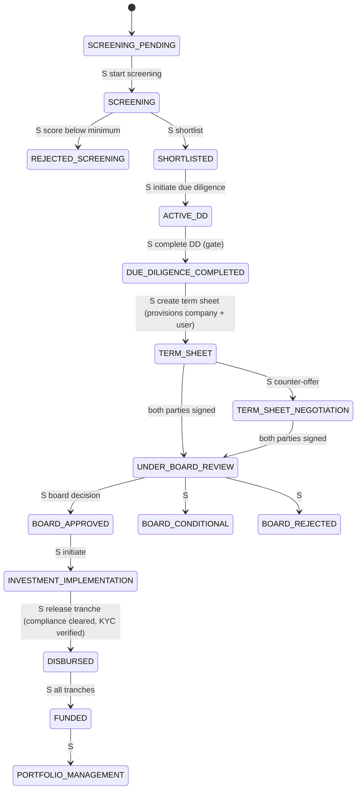
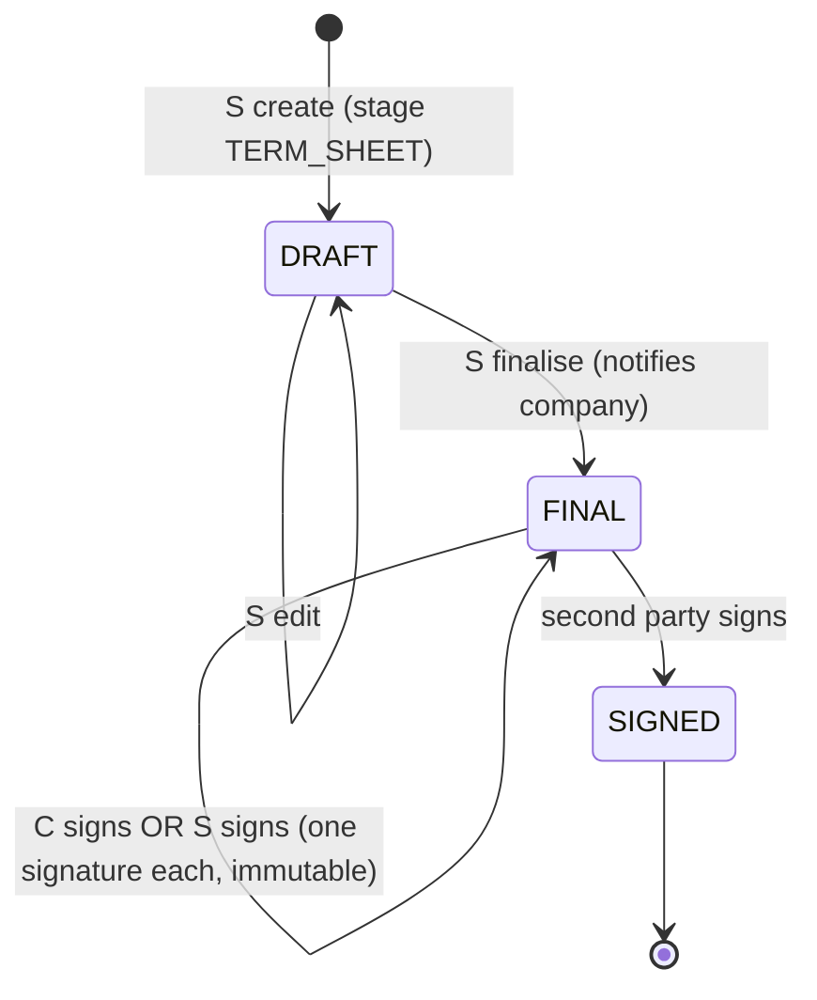
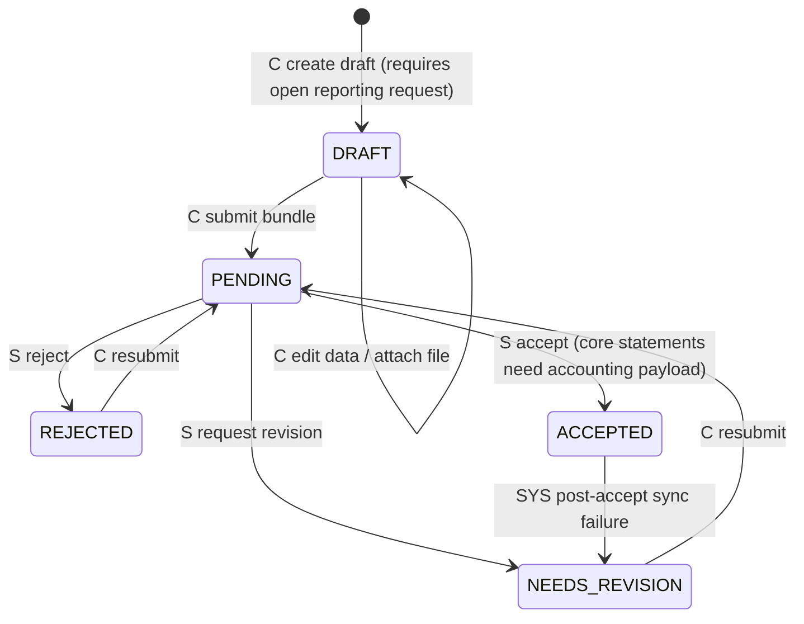
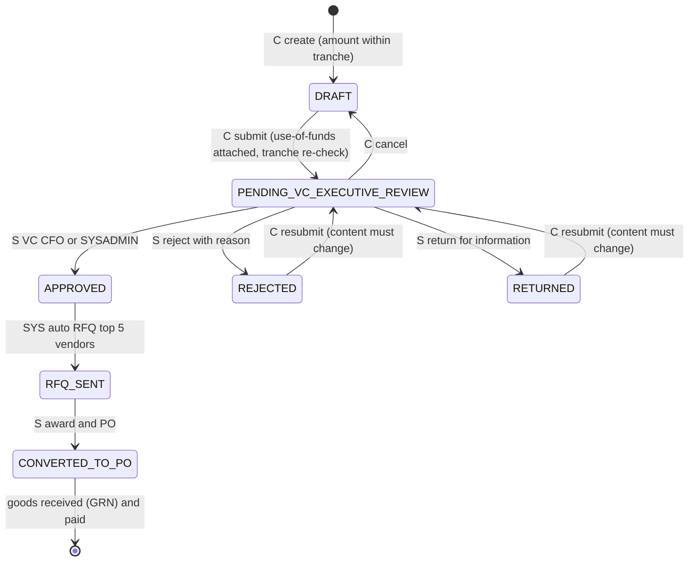
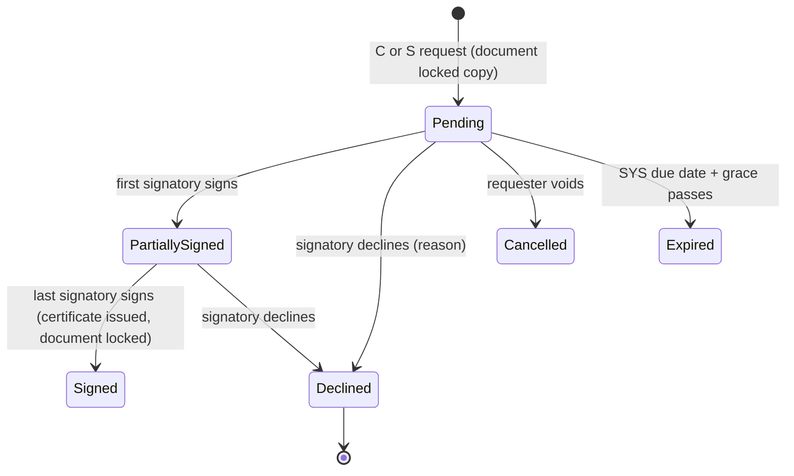
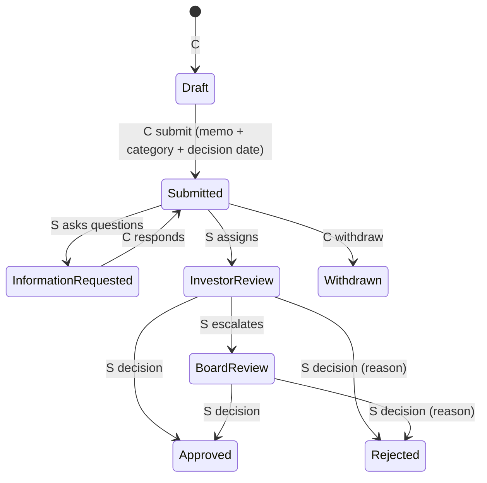
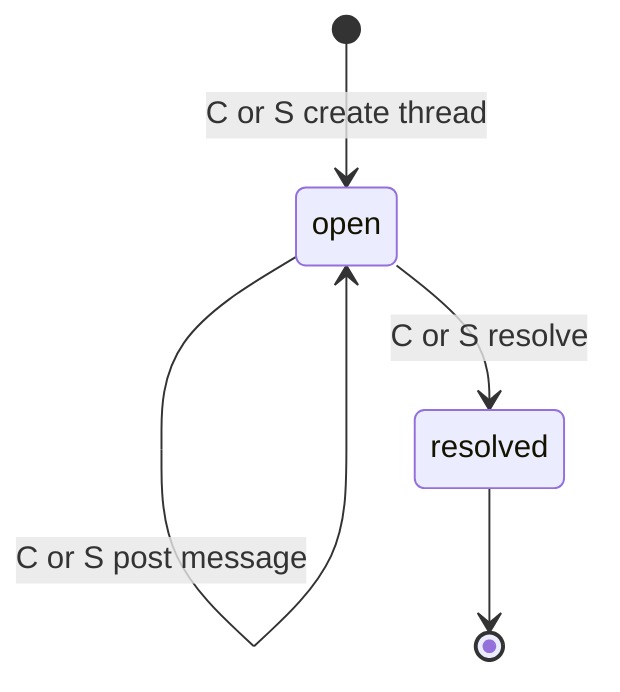
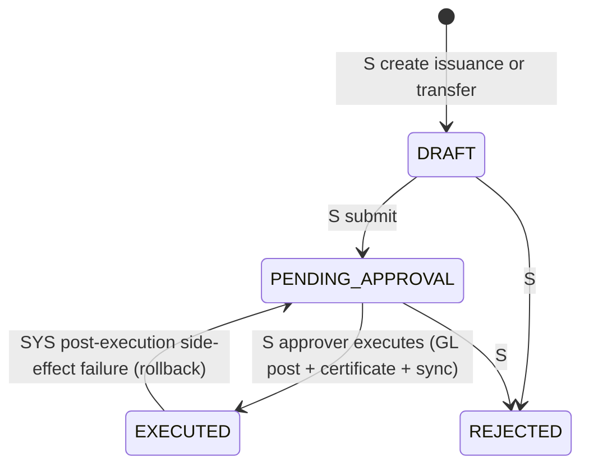
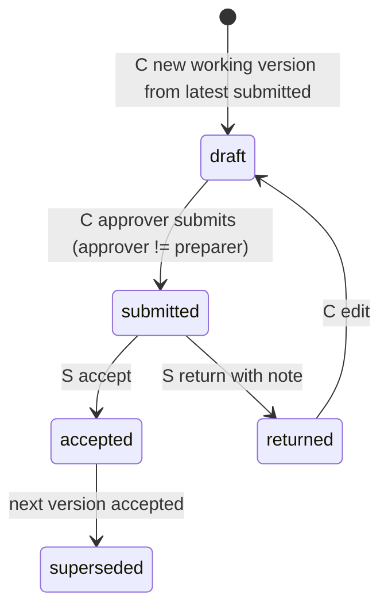

# STATE MACHINES (from the 5D draft)

Who triggers: **C** = company user, **S** = fund staff, **SYS** = system/scheduler.

**1. Applicant / application (NVCCZ pipeline; Nexus scope is Q-NEW)**

Guards: create term sheet only in TERM_SHEET or TERM_SHEET_NEGOTIATION; the company account (user + company) is created idempotently at term-sheet creation; progress % shown to the company: SUBMITTED 5, SCREENING_PENDING 5, SCREENING 10, PENDING_SHORTLISTING 5, SHORTLISTED 10, ACTIVE_DD/UNDER_DUE_DILIGENCE 20, DUE_DILIGENCE_COMPLETED 30, TERM_SHEET 40, TERM_SHEET_NEGOTIATION 45, UNDER_BOARD_REVIEW 50, BOARD_CONDITIONAL 55, BOARD_APPROVED 60, INVESTMENT_IMPLEMENTATION 70, DISBURSED 85 + 15 × (Σ DISBURSED / requested) (100 when fully disbursed), FUNDED 95, PORTFOLIO_MANAGEMENT 100, rejected stages 0.

**2. Term sheet**

Guards: signing requires FINAL; a party cannot sign twice; no update/finalise once any signature exists or `isSigned`; company signs as `applicant` (e-mail equals the deal's applicant e-mail), fund signs as `investor` (admin or fund manager). On SIGNED while the deal is at TERM_SHEET/TERM_SHEET_NEGOTIATION → deal moves to UNDER_BOARD_REVIEW (email + memo + execution pack). **[P]** Nexus adds states Issued (visible to company) and Expired/Withdrawn.

**3. Financial report (typed statement) — NVCCZ**

Guards: edits and file replacement only in DRAFT, NEEDS_REVISION, REJECTED; submit validates open request, balance, numeric, variance; reviewer must have submitted-state report (DRAFT cannot be reviewed); **[P]** reviewer ≠ submitter, return needs a note (Nexus).

**3b. Reporting period (Nexus, enforced today)**

```mermaid
stateDiagram-v2
  [*] --> open: S open period (due date, mandatory attachments)
  open --> submitted: C submit (all required items present; variance rules)
  returned --> submitted: C resubmit
  submitted --> accepted: S accept (reviewer != submitter)
  submitted --> returned: S return (note required)
```

Item: Due → Complete on first file; Complete → Due when the last file is removed; Accepted files cannot be deleted.

**4. Requisition / drawdown request**

Reservation: PENDING_VC_EXECUTIVE_REVIEW, PENDING_APPROVAL, APPROVED, RFQ_SENT, CONVERTED_TO_PO hold the drawdown; DRAFT, REJECTED, CANCELLED, RETURNED release it. V8 columns map: Draft = DRAFT/REJECTED/RETURNED/CANCELLED; Under review = PENDING_*; Approved = APPROVED/RFQ_SENT; Fulfilled = CONVERTED_TO_PO + received.

**5. Signature request [P]**

Guards: signatory must be named and within the authority matrix; step-up MFA ≤ 5 min; consent ticked; signature image present; sequential order enforced when selected; reminders only while Pending/PartiallySigned.

**6. Consent request (governance) [P]**

Guards: decision requires a reason; company cannot edit after submit; decision notifies the requester.

**7. Message thread [P] (aligned with Nexus questions)**

Guard: replies blocked when resolved (409 `invalid_state`); reopen not allowed (Q-NEW).

**8. Cap table transaction (NVCCZ)**

**9. Forecast version [P]**

Month cell lifecycle: forecast → actual-open (current month) → actual-locked (after acceptance or close day).
