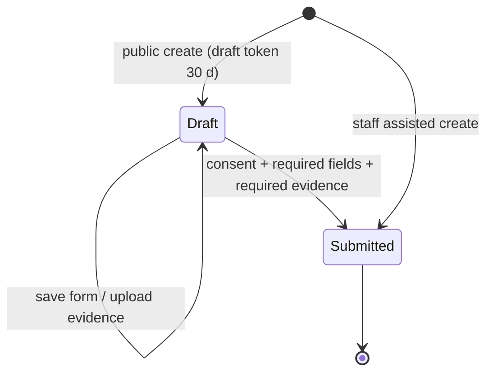
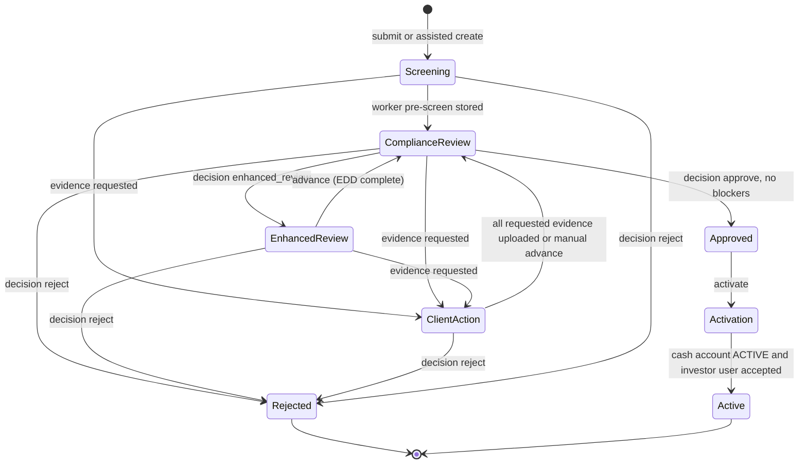
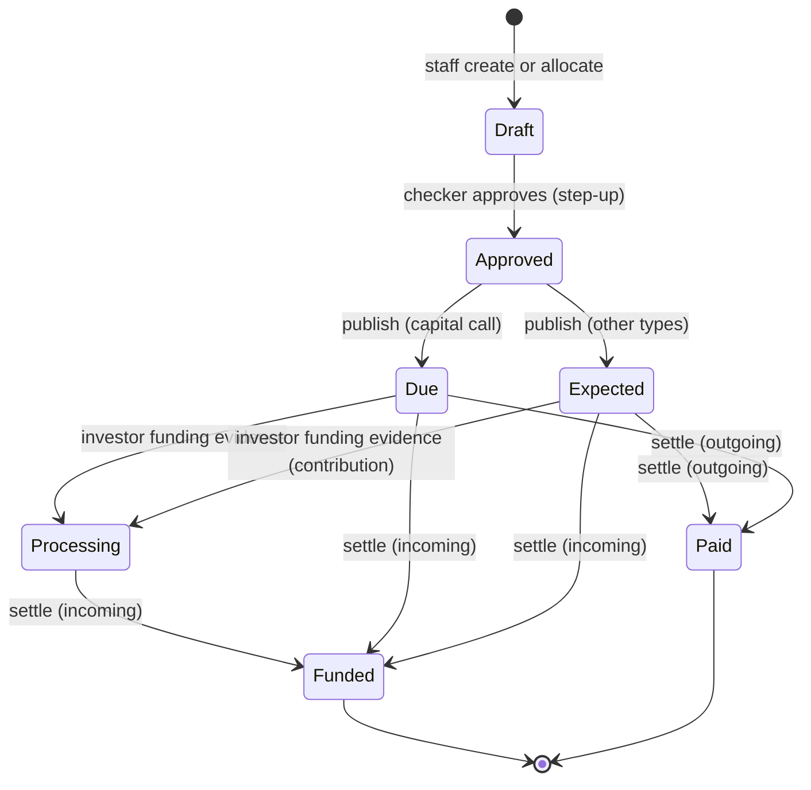
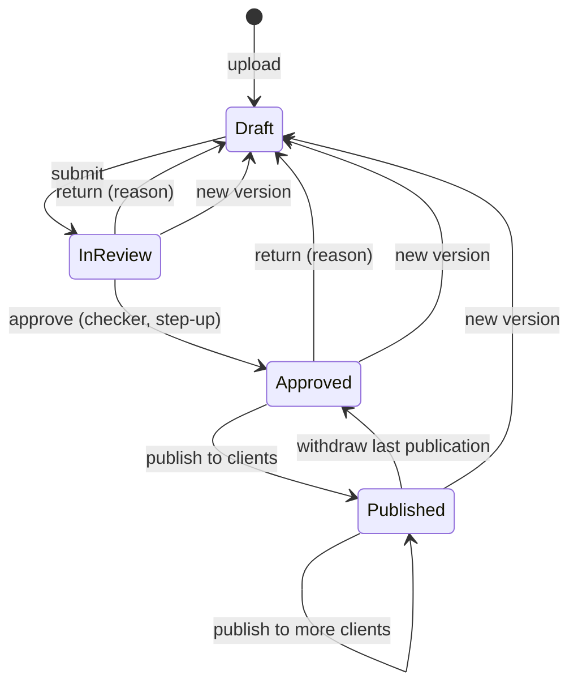
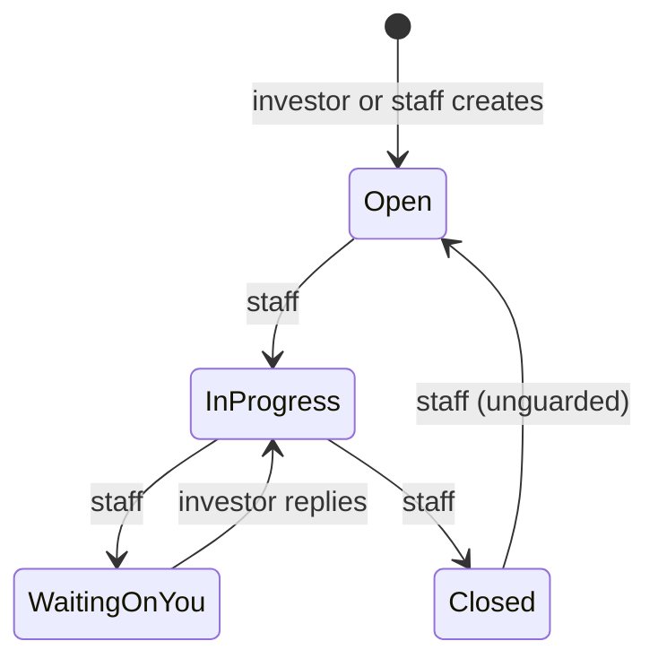
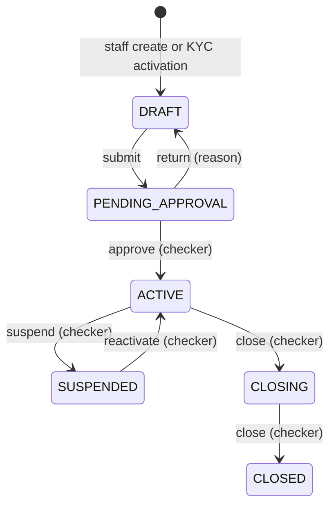
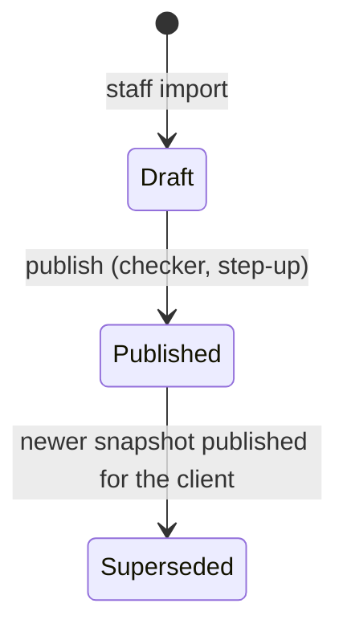
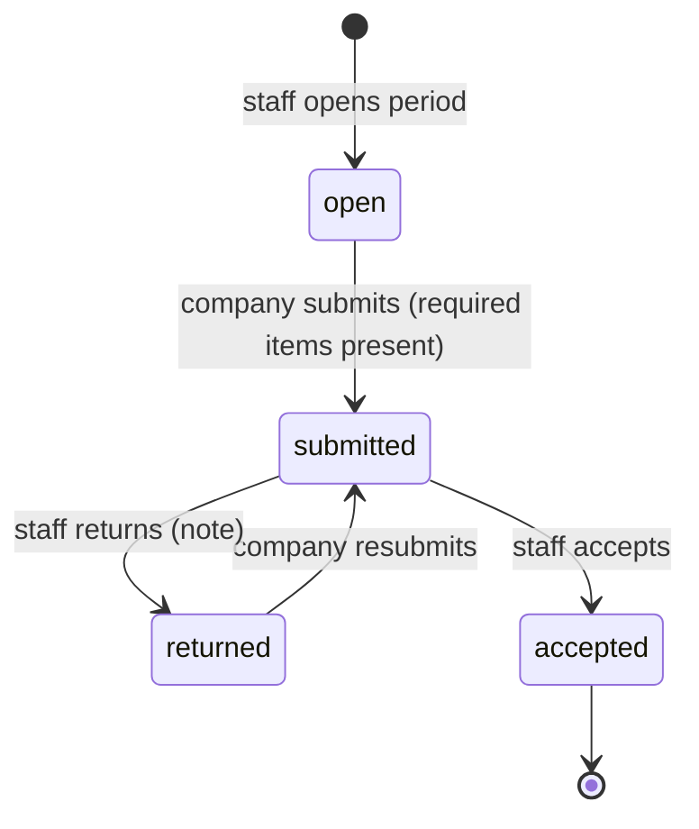
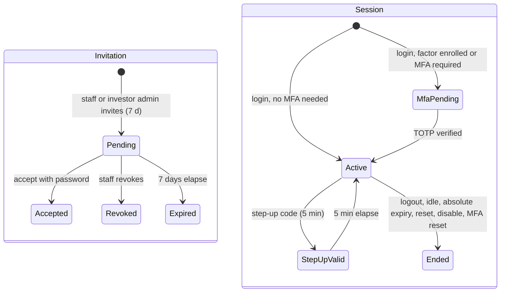

# 7-STATE-MACHINES (from the backend draft)

### 7.x State machines as enforced **[O]**

Each machine lists its differences from SRD 7.1–7.8 after the table ("Δ SRD"). Guards named "step-up" are skipped for users with no MFA factor while `mfa_required` is off.

#### 7.1a Onboarding application

| From | To | Trigger | Guard |
| --- | --- | --- | --- |
| none | Draft | `POST /public/applications` | Rate limit (20 per hour per IP in production) |
| Draft | Submitted | `POST …/submit` | `consent=true`; legal name, email and country present; required slots have files |
| none | Submitted | `POST /kyc/cases` (Assisted) | `onboarding.manage` |

Δ SRD: no separate email-verification step (`emailVerifiedAt` is set when the resume link is opened). Applicant uploads after submission are allowed only while the case is in ClientAction.

#### 7.1b KYC case

| From | To | Trigger | Guards |
| --- | --- | --- | --- |
| none | Screening | submit / assisted create | Pre-screen queued via outbox |
| Screening | ComplianceReview | Worker screening result, or `advance` | Worker: automatic. `advance`: `onboarding.manage`, If-Match |
| ComplianceReview / Screening / EnhancedReview / ClientAction | ClientAction | `request-evidence` | `onboarding.manage`; new 14-day draft token emailed |
| ClientAction | ComplianceReview | Last requested upload (automatic) or `advance` | none |
| EnhancedReview | ComplianceReview | `advance` | Sets EDD-complete timestamp |
| ComplianceReview | Approved | `decision=approve` | Compliance role; step-up; rationale ≥5 chars; decider ≠ preparer (policy `kyc_dual_control`); no blockers; If-Match |
| ComplianceReview | EnhancedReview | `decision=enhanced_review` | Same as approve, except blockers |
| ComplianceReview / EnhancedReview / ClientAction / Screening | Rejected | `decision=reject` | Same as approve, except blockers; applicant emailed |
| Approved | Activation | `activate` | `onboarding.manage`; not (High risk without EDD); funds approved. No step-up. |
| Activation | Active | Automatic | Client has an ACTIVE cash account and at least one investor user |

SLA hours per stage: Screening 4, ComplianceReview 48, ClientAction 120, EnhancedReview 72, Approved 24, Activation 72.

Δ SRD 7.1:
- Stage `Submitted` exists but is never used.
- Reject is also allowed from Screening, ClientAction and EnhancedReview.
- Evidence can be requested from Screening and EnhancedReview.
- Entering EnhancedReview is a compliance decision, not an automatic High/PEP rule. High risk instead blocks approval until EDD is complete.
- No SLA escalation.
- The dual-control check is skipped when no staff member has prepared the case.

#### 7.3a Capital event

| From | To | Trigger | Guards |
| --- | --- | --- | --- |
| none | Draft | Create / allocate | `clients.edit` or `cash.journal.create`; breakdown sums to amount |
| Draft | Approved | approve | `cash.approve`; step-up; If-Match; checker ≠ maker (policy `cash_approval`) |
| Approved | Due / Expected | publish | `clients.edit` or `cash.approve`; investors emailed |
| Due / Expected / Processing | Processing | Investor funding evidence | Capital call or contribution; investor role admin or finance; file plus confirmation |
| Due / Expected / Processing | Funded (call, contribution) / Paid (distribution, withdrawal) | settle | `cash.approve` or `cash.journal.approve`; step-up; matcher ≠ evidence submitter |

Δ SRD 7.3: adds Draft and Approved states before investors see the notice. Uses `settle` instead of a bank-statement match (there is no cash ledger). Publish has no maker/checker check of its own.

#### 7.4a Document and publication

| From | To | Trigger | Guards |
| --- | --- | --- | --- |
| Draft | In review | submit | `documents.edit`; If-Match |
| In review | Approved | approve | `documents.edit`; step-up; If-Match; checker ≠ maker (policy `document_approval`) |
| In review / Approved | Draft | return | Reason 3–1000 chars |
| Approved / Published | Published | publish | Classification Client or Public; a file exists; at least one client; creates signature requests when required. No step-up, no If-Match. |
| Published | Approved | withdraw | Reason; applies when no active publication remains |
| any except Superseded | Draft | New version | Clears approval; withdraws publications |

Signature request: Pending → Signed (signatory signs with step-up) or Cancelled (withdrawal).

Δ SRD 7.4: no "Awaiting approval" state. "Superseded" is never set. Restricted is a classification, not a status.

#### 7.5a Investor service request

| From | To | Trigger | Guards |
| --- | --- | --- | --- |
| none | Open | Investor `POST /investor/requests`, staff `POST /service-requests`, or profile change request | Investor `requests.view` or `profile.view`; staff `clients.edit`. SLA 48 h (Normal) or 8 h (Time sensitive). |
| any | any of Open / In progress / Waiting on you / Closed | Staff PATCH | `clients.edit`; If-Match. Closed sets progress to 100. |
| Waiting on you | In progress | Investor reply | none |

Δ SRD 7.5: staff transitions are not restricted to the diagram (any-to-any). No complaint SLA or escalation. An SLA breach is only a computed flag.

#### 7.6a Cash account

| Action | Permission | Checker ≠ maker (policy `cash_approval`) |
| --- | --- | --- |
| submit | `clients.edit` or `cash.approve` | no |
| approve | `cash.approve` | yes |
| return | `cash.approve` (reason required) | no |
| suspend | `cash.approve` | yes |
| reactivate | `cash.approve` | yes |
| close | `cash.approve` | yes |

All actions accept If-Match.

Δ SRD 7.6: CLOSING → CLOSED does not check for a zero balance. No step-up on approval. A DRAFT account cannot be edited, so the KYC-created draft keeps provider and identifier "Pending".

#### 7.10 Investor snapshot (new)

Guards: import requires `reports.create`. Publish requires `reports.create`, step-up and If-Match, and the publisher must differ from the importer (policy `client_publish_approval`).

#### 7.11 Company reporting pack (new)

| Object | Transitions / guards |
| --- | --- |
| Period | Company may edit only while open or returned. Accept and return require `research.edit`. The reviewer must differ from the submitter (always enforced, not policy-driven). |
| Item | Due ↔ Complete (first upload / last file removed). Expiring is never set. |
| Submission | Draft → Submitted (on pack submit) → Accepted / Returned (on review). An Accepted file cannot be deleted. |
| Question | open → resolved, by the company or staff. No reopen. |

#### 7.12 Invitation, session and MFA (new)

| Object | Rules |
| --- | --- |
| Invitation | Single-use hashed token. Acceptance creates or links the user, grants the portal roles, links the client or company, and opens a fully verified session. |
| Session | Idle timeout = min(policy `session_idle_minutes`, deployment ceiling). Absolute timeout = session TTL. A new login rotates any session the browser already held. An MFA-pending session may call only the MFA routes. |
| MFA factor | Unverified → verified on the first valid code. At most one verified factor. Re-enrolment replaces an unverified factor; an already-verified factor blocks re-enrolment (409). Admin reset deletes the factors. |
| Password reset | Token valid 60 min, single use; success revokes all sessions. |

Δ SRD FR-AUTH-013/015: token lifetimes differ (60 min vs 30 min; 7 d vs 72 h). Invitation acceptance does not include MFA.

Not built: 7.2 Order, 7.7 Reconciliation break, 7.8 NAV run.
