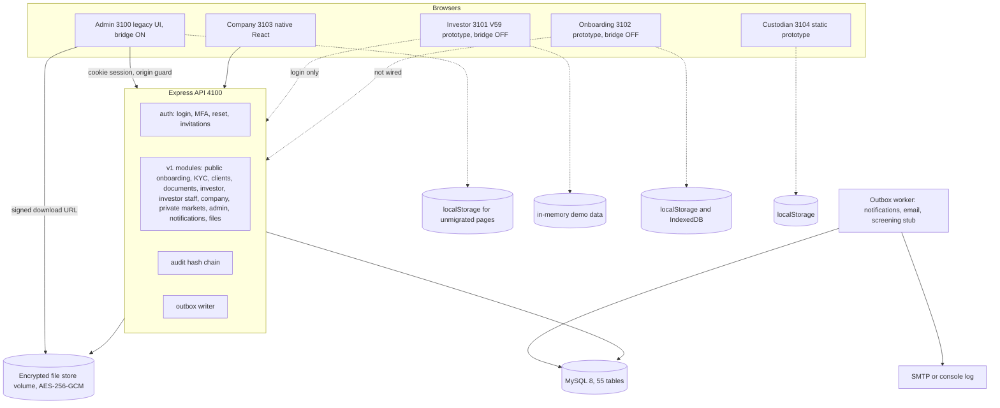

# 9.1 (from the backend draft)

### 9.1 Current architecture **[O]** (30 Sep 2026)

The signed download URL is served by the API's `/api/v1/files/:id/download` route (drawn directly to the store for clarity). Portal login/MFA/invite pages come from the shared `portal-kit` and call `/api/auth/*` on every portal, including investor and onboarding.
