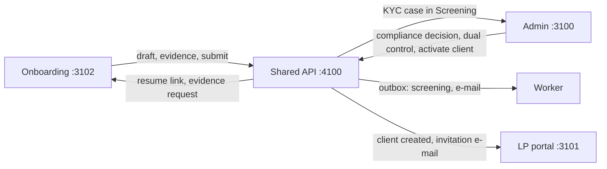
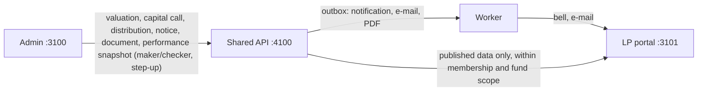
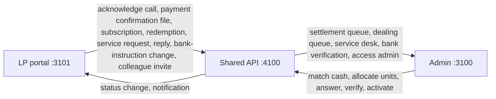
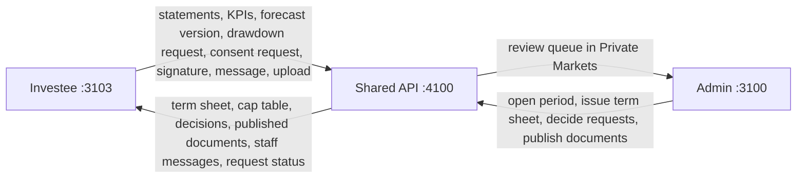
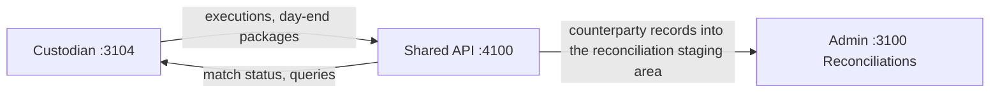

# Matanho Nexus — Software Requirements Document (SRD)

| Field | Value |
| --- | --- |
| Product | Matanho Nexus — institutional investment and fund-operations platform |
| Document version | **2.0** |
| Supersedes | 1.0 (29 Sep 2026, derived from UI prototype V56) |
| Date | **1 Oct 2026** |
| Status | **Draft for business sign-off and UAT planning** |
| Repository state described | Branch `docs/srd-v2`, base commit `0adef6f` plus the uncommitted working tree of 1 Oct 2026 (five portals, `deploy/`, Phase 1 API) |
| Business owner | To be named at sign-off |

## What changed since v1.0

- **Backend.** v1.0 described an API with auth routes only. A Phase 1 backend is built: about 140 route handlers under `/api/auth` and `/api/v1`, 55 tables in two migrations, an outbox worker, a hash-chained audit trail, encrypted file storage and a seeded role catalogue (14 roles).
- **Portals replaced (30 Sep).** The investor portal is now the **LP portal** (native React, 10 screens) and the portfolio-company portal is now the **Investee portal** (13 pages). Both were imported from a sibling PE/VC fund-ERP product (NVCCZ / "Arcus") and run on demo data. Sections 5.B and 5.D are rewritten.
- **New portals and prototypes.** A **custodian / counterparty portal** (3104) and the V65 onboarding prototype (six steps) were added. Section 5.C is rewritten and 5.E is new.
- **Scope widened.** Fund-operations capabilities are now in scope (LP capital calls, distributions, dealing, notices, term sheets, cap table, structured investee reporting, forecast, governance, capital requests, data room). See 1.2 and 2.2.
- **Deployment.** One server runs Docker Compose behind host nginx with certbot and six hostnames under `*.nexus.matanho.com` (v1.0 proposed `*.matanho.com`). See 1.4 and 3.1.
- **Roles and SoD corrected.** The admin permission matrix is reconciled to the seed and to runtime. BR-004 and BR-005 are recorded as **contradicted** by the code. Seven enforced rules are added. LP, Investee, onboarding and custodian access models are defined (4.3, 4.4).
- **Authentication.** Step-up failures return 401 (not 403). MFA is off by default. The Investee proxy turns investor-role accounts away. See 3.3.
- **Structure.** Section 5 is split into five per-portal files. Companion blocks (API contracts, domain models, state machines, business rules, role analyses, gap analyses, staff-side counterparts, backend sections) live under `docs/srd/appendix/`. New requirement, rule, question and defect IDs are numbered once in `docs/srd/REGISTER.md` (377 FR, 7 NFR, 256 BR, 176 Q, 532 DEF).
- **Method.** Every statement carries an evidence label and, where useful, a **Build status** (see "How to read this document").

## Source-of-truth statement

1. For statements labelled **[O]**, the repository at the state above is the source of truth. Where this SRD and the code disagree, the disagreement is recorded as a defect (`DEF-nnn`) or a **Contradicted** build status, and the code is not changed by this document.
2. For **[P]** and **[Q]** statements, nothing is an approved business rule until the business owner signs it off. Decisions are taken through the `Q-nn` register.
3. This SRD supersedes `docs/SRD.md` v1.0 in full and supersedes `docs/DOMAIN-ENTITIES.md` where they differ. `docs/ARCHITECTURE.md` and `docs/PORTALS.md` describe the current build and must be kept in step with section 1.4. `docs/BUILD-PLAN.md` is a plan (proposals, estimates), not a specification.
4. NVCCZ (the sibling product) is a **reference implementation and contract source**, not a dependency or a runtime (BUILD-PLAN Q-NEW-04, A-08).

## File map

| Path | Content |
| --- | --- |
| `docs/SRD.md` | Core text: sections 1–4 (this part), 6–15 and appendices A–D |
| `docs/srd/5A-admin.md` | 5.A Admin / Investment OS (port 3100) |
| `docs/srd/5B-lp-portal.md` | 5.B LP portal (3101) with its companion blocks |
| `docs/srd/5C-onboarding-portal.md` | 5.C Public onboarding (3102) |
| `docs/srd/5D-investee-portal.md` | 5.D Investee portal (3103) with its companion blocks |
| `docs/srd/5E-custodian-portal.md` | 5.E Custodian / counterparty portal (3104) |
| `docs/srd/appendix/` | API contracts, domain models, state machines, business rules, role analyses, gap analyses, staff-side counterparts, backend sections, and the `corrections-to-other-srd-sections` block of each draft |
| `docs/srd/REGISTER.md` | Register of all new FR, NFR, BR, Q and DEF IDs with source drafts |
| `docs/BUILD-PLAN.md` | Fit with the core, option analysis, target architecture, phased plan |
| `docs/DEV-PLAN-1DAY.md` | Actionable one-day plan to UAT (derived from BUILD-PLAN section 12) |
| `docs/PORTALS.md` | How the five portals are structured, built and deployed |
| `docs/ARCHITECTURE.md` | Current-state architecture (API, auth, data bridge, seed, tests) |

---

## How to read this document

### Evidence labels

Every requirement, rule and design decision carries one label.

| Label | Meaning |
| --- | --- |
| **[O] Observed** | Visible in a running UI or implemented in the current code or deployment configuration. |
| **[I] Inferred** | Implied by a UI, a design document or a reference backend (labels, disabled states, sample data, NVCCZ contract) but not implemented in Nexus. |
| **[P] Proposed** | A design decision made by this SRD or BUILD-PLAN to fill a gap. Changeable without contradicting the UI. |
| **[Q] Open question** | Cannot be decided from the evidence. Listed in section 13 as `Q-nn`. |
| **[V61]** | Documented only in the V61 prototype notes; not visible in the running UI. |

Where a prototype holds two implementations of one feature (35 patch layers, v33–v56), the one visible in the running UI is canonical.

### Identifier schemes

| Scheme | Meaning |
| --- | --- |
| `FR-<AREA>-nnn` | Functional requirement. Areas include AUTH, RBAC, AUD, CLI, CASH, DOC, INV, LP, CMP, ONB, OPS, REC, PLAT. |
| `NFR-<AREA>-nnn` | Non-functional requirement. |
| `BR-nnn` | Business rule (calculation, validation, segregation of duties). |
| `DEF-nnn` | Defect found in a prototype or in current code. Defects are recorded, not fixed, by this document. |
| `Q-nn` | Open question with a proposed default. |
| `Q-NEW: … — default: …` | A question raised in a draft and not yet numbered. The editor numbers it in `REGISTER.md`. |
| `BUILD-PLAN Q-NEW-nn` | A question in `docs/BUILD-PLAN.md` 10.2, pending renumbering. |

Priorities: **M** = must (first release), **S** = should, **C** = could (later).

### Build status

Used in tables to say what exists today. It is independent of the evidence label.

| Build status | Meaning |
| --- | --- |
| **Built** | Implemented in code and reachable (server behaviour, or a UI wired to it). |
| **Partial** | Some of the behaviour exists; the gap is stated. |
| **Mock** | The UI exists and runs on fixture data or browser storage; no server behaviour. |
| **Not started** | No code for it. |
| **Contradicted** | The code or UI does the opposite of what the earlier text or rule requires. The difference is stated and, where one exists, the DEF is cited. |

---

## Table of contents (v2)

1. Introduction
2. System overview
3. Portals and port assignments
4. User roles and permissions
5. Page-by-page UI breakdown (index of the five per-portal files)
6. Functional requirements
7. User workflows and state diagrams
8. Non-functional requirements
9. System architecture and diagrams
10. Database schema
11. API specification
12. Integrations and third-party services
13. Assumptions, constraints, open questions and defects
14. Glossary
15. Build plan (condensed from `docs/BUILD-PLAN.md`)
- Appendix A — Traceability matrix (page, requirements, API, entities)
- Appendix B — Status vocabularies
- Appendix C — Prototype persistence to be replaced
- Appendix D — Contract oracle (LP mock API and NVCCZ UAT scripts)

**Section 5 index.** Section 5.0 (global UI rules) stays in `docs/SRD.md` and is amended by each per-portal draft. Page numbering is fixed:

| Part | File | Portal and port | Numbering |
| --- | --- | --- | --- |
| 5.A | `docs/srd/5A-admin.md` | Admin, 3100 | 5.A.0.1–5.A.0.5 shell, topbar, palette, overlays, second-layer pages; 5.A.1–5.A.28 the 28 workspaces; 5.A.29 record detail; 5.A.30 shared overlays |
| 5.B | `docs/srd/5B-lp-portal.md` | LP, 3101 | 5.B.0 shell; 5.B.1 Dashboard, 5.B.2 Performance, 5.B.3 Account Activity, 5.B.4 Capital Activity, 5.B.5 Subscriptions & Redemptions, 5.B.6 Documents, 5.B.7 Requests & Messages, 5.B.8 Notices, 5.B.9 Organisation, 5.B.10 Settings; companion blocks (API contract of 70 methods, domain model, state machines, business rules, roles and permissions, gap vs Nexus API, staff-side counterparts) |
| 5.C | `docs/srd/5C-onboarding-portal.md` | Onboarding, 3102 | 5.C.0 shell; 5.C.1–5.C.6 the six wizard steps; 5.C.7 submission result and resume |
| 5.D | `docs/srd/5D-investee-portal.md` | Investee, 3103 | 5.D.0 shell; 5.D.1 Overview, 5.D.2 KPI Centre, 5.D.3 Reporting Centre, 5.D.4 Actuals & Forecast, 5.D.5 Term Sheet, 5.D.6 Cap Table, 5.D.7 Governance, 5.D.8 Signatures, 5.D.9 Capital & Procurement Requests, 5.D.10 Document Vault, 5.D.11 Messages, 5.D.12 Team & Access, 5.D.13 Settings |
| 5.E | `docs/srd/5E-custodian-portal.md` | Custodian, 3104 | 5.E.0 shell; 5.E.1 Trade execution; 5.E.2 Day-end package; 5.E.3 Submission status; 5.E.4 hand-off to admin reconciliation (a process, not a page) |

---

## 1. Introduction

### 1.1 Purpose

Define, completely and testably, the system that the Matanho Nexus portals and the Phase 1 backend represent, and state for every part what is already built and what is still required, so that a development team can finish the platform (frontends, shared API, database, integrations, operations) and a business team can plan UAT without further discovery.

### 1.2 Scope

**In scope**

- **Five web portals:** Admin / Investment OS, LP portal, Public Onboarding, Investee portal and Custodian / Counterparty portal. **[O]**
- One shared backend API, one relational database, one identity and session system, background workers and integrations. **[O]**
- **Asset-manager core** (family A, 2.2): an institutional asset manager operating in Zimbabwe (ZSE, VFEX) with USD, ZWG and ZAR: onboarding and KYC, client and mandate master, portfolios, research, portfolio construction, order management, risk and compliance, IBOR, cash sub-ledger, reconciliations, corporate actions, valuation and NAV, accounting and close, financing and collateral, performance, reporting, document vault, investor servicing, regulatory reporting, data fabric, model governance, an advisory copilot, RBAC, settings and audit. **[O]** (UI) / see 1.4 for what is server-backed.
- **Fund operations** (family B, 2.2), now in scope **[I]/[P]** (the UIs exist; the services are specified in 5.B, 5.D and `docs/BUILD-PLAN.md`):
  - fund registry, share classes, valuation status and as-of publication, LP commitments;
  - capital calls with per-LP allocation, acknowledgement, payment confirmation and settlement matching; distributions; the LP account ledger;
  - dealing: subscription and redemption estimates, rules, compliance gate and request lifecycle;
  - notices with targeting and receipts; performance snapshots, benchmarks and report jobs; LP organisation, colleague administration and bank-instruction changes;
  - investee workspace: term sheets and signing, structured financial reports, KPI centre, forecast workbook, cap table and waterfall (staff-maintained), governance register, capital (drawdown) requests, document vault, messages, team and access;
  - custodian / counterparty submission of executions and day-end control totals for reconciliation.

**Out of scope** (explicitly excluded by the UIs or by decision)

- Moving money. **[O]** Capital calls and dealing are funded out-of-band and matched by operations; no portal initiates a payment.
- General-ledger posting of capital calls, distributions and cap-table transactions. **[P]** The platform emits outbox events for a future ABOR consumer and stores bank references and evidence only (BUILD-PLAN Q-NEW-03).
- Direct exchange connectivity for execution. **[O]** Orders are routed to brokers by approved email or FIX drop-copy.
- NVCCZ deal pipeline, due diligence, investment-committee and board tooling, and its procurement suite (RFQ, purchase orders, vendors) **[P]** (Q-192).
- Running the NVCCZ backend or its accounting engine as part of Nexus **[P]**.
- Retail self-directed trading, native mobile apps, a public marketing site.
- A third-party e-signature provider is optional **[P]**: the baseline is an in-house typed signature with step-up MFA, document SHA-256 and a certificate (BUILD-PLAN Q-NEW-07).

### 1.3 Audience

Product owner, business analysts, solution architects, backend and frontend engineers, QA and UAT leads, security, compliance, operations and DevOps.

### 1.4 Current implementation baseline as of 1 Oct 2026 **[O]**

#### 1.4.1 Portals

| Portal | UI source | Wiring state | Auth gate | Build status |
| --- | --- | --- | --- | --- |
| **Admin** (3100) | V56 prototype (28 workspaces, single route `/`) rendered unchanged by `legacy-runtime` | **Data bridge active.** Server-backed: onboarding/KYC queue, client and cash-account master, investor services, document vault, Private Markets company review hub, RBAC, policy, settings, audit. Everything else uses prototype arrays and `localStorage`. | `proxy.ts`, `requirePortalRole: true`; inert unless `admin` is in `REQUIRE_AUTH_PORTALS` | **Partial** |
| **LP** (3101) | Native React + Tailwind v4 + shadcn/Radix, 10 screens under `/lp-portal` (14 navigation entries) | **Mock.** A typed client of 70 methods is answered from an in-memory store; the HTTP client is a stub that rejects. Real: sign-in, `GET /api/auth/me`, sign-out. The LP session (role, funds) is a hard-coded demo session, not derived from the signed-in user. | `proxy.ts`, `requirePortalRole: true` (any investor-portal role) | **Mock** |
| **Onboarding** (3102) | V65 `public-onboarding.html`, six-step wizard with a client-side "AI ATS" triage panel | **Mock.** Bridge disabled; draft in `localStorage`; the public applications API is built and tested but not called by this UI. | Public by design; `proxy.ts` with `requirePortalRole: false`, no-op unless listed | **Mock** (UI), **Built** (API) |
| **Investee** (3103) | Investee Portal V8 vanilla runtime hosted by `InvesteePortal.tsx` (13 pages), `liveOnly: false` | **Mock.** All figures are fixtures of a fictional company. Only name, e-mail, role text and sign-out come from the session. `/api/v1/company/*` exists but no screen calls it. | `proxy.ts`, `requirePortalRole: false`, `turnAwayPortals: ['investor']` | **Mock** |
| **Custodian** (3104) | V65 `custodian-portal.html` (execution and day-end forms) | **Mock.** `localStorage` only; no API, no model. | **None.** No `proxy.ts`, no login routes; not in `PORTAL_IDS`, `PORTALS`, `.env.example` or the default CORS allow-list (DEF-485, DEF-486, DEF-528) | **Mock** |

#### 1.4.2 Platform

| Area | State today | Build status |
| --- | --- | --- |
| API | Express 5 + TypeScript on 4100: `/api/health`, `/api/auth/*` (login, logout, me, register, MFA, step-up, password reset, invitations) and `/api/v1`: public applications, KYC, clients and cash accounts, documents and publications, capital events and investor services (staff and investor), company reporting, private-markets review, admin (RBAC, policy, settings, audit), notifications, files. About 140 route handlers. Hash-chained audit on every audited write; optimistic concurrency with `version` and `If-Match`; human references from a `sequences` table. | **Built** |
| Fund-ops and ledger services | No `/lp-portal`, `/investee-portal`, `/custodian` or `/recon` routes; no funds, commitments, calls, dealing, notices, term sheets, cap table, performance, IBOR, reconciliation, NAV or accounting tables. | **Not started** |
| Database | MySQL 8 via Prisma. Migrations `init` (29 Sep) and `phase1_core` (30 Sep) create 55 tables: identity, platform (policies, settings, notifications, audit, outbox, sequences, files), documents, parties, onboarding/KYC, investor services, published investor snapshots, company reporting. | **Built** |
| Seed | `role-catalog.json`: 14 roles (10 admin, 4 investor). Users from `SEED_USERS_FILE`. `SEED_DEMO=1` loads client `CL-00418` (Horizon Pension Fund) and company `PC-100` (Africa Payments Holdings). Run by the `migrate` container on every deploy. | **Built** |
| Worker | `worker.js` polls the transactional outbox every 2 s: in-app notifications, e-mail (SMTP, or console when unset), KYC screening (provider is a stub). Own container in production; **not** started by `npm run dev` (DEF-518). | **Partial** |
| File storage | Local volume, AES-256-GCM at rest, HMAC-signed download URLs valid 5 minutes. No malware scanning: every file is marked clean (DEF-514). | **Partial** |
| Deployment | One server, **207.180.234.151**, application root `/opt/matanho-nexus`. `deploy/docker-compose.prod.yml` runs `mysql`, `migrate` (migrate deploy plus seed), `api`, `worker` and five portal containers, all bound to `127.0.0.1`. **Host nginx** (`deploy/nginx/matanho-nexus.conf`) has six server blocks and **certbot** issues Let's Encrypt certificates (`deploy/issue-certs.sh`). Hostnames: `nexus`, `investor.nexus`, `onboarding.nexus`, `company.nexus`, `custodian.nexus`, `api.nexus` under `matanho.com`. Production env example: `REQUIRE_AUTH_PORTALS=admin,investor,company`, `COOKIE_DOMAIN=.nexus.matanho.com`; `CORS_ORIGINS` lists four portals and omits the custodian. Whether this server is UAT or production is BUILD-PLAN Q-NEW-21 (default: UAT until go-live). | **Built** |
| Legacy hosting | The Traefik `docker-compose.yml`, root `Dockerfile`/`nginx.conf` and the GitHub Pages workflow for the static prototype are still in the repository. | **Built** (obsolete) |
| Tests | `npm run smoke` (auth, portal access, CORS/CSRF) and `E2E_CONFIRM=throwaway-db npm run e2e` (cross-portal Phase 1 journey, disposable database only). No unit tests, no test runner, no CI pipeline (DEF-516). | **Partial** |
| Business data (admin) | **Server-backed:** onboarding/KYC, clients, mandates, cash-account master (balances are display values), documents and publications, e-signatures, capital notices, service requests, secure messages, investor portfolio snapshots (a stand-in for IBOR/PBOR), company reporting, RBAC/policy/settings, audit. **Prototype-only (no routes, no tables):** portfolios, performance, IBOR, orders, research, risk, cash ledger, reconciliations, NAV, accounting, financing, corporate actions, regulatory, data fabric, models, copilot. | **Partial** |

#### 1.4.3 SRD v1.0 statements now contradicted

| v1.0 statement | v2 position |
| --- | --- |
| "Four web portals"; "admin, investor and onboarding render the original prototype through a legacy bridge; company is native React" | Five portals. Only admin has the bridge. Investor (LP) and company (Investee) are React and runtime portals on demo data; onboarding and custodian are legacy pages without a bridge. |
| "Backend: `/api/health` and `/api/auth/{register,login,logout,me}` only"; "5 tables" | About 140 routes, 55 tables, worker, audit chain (1.4.2). |
| "Existing Docker/nginx/Pages config serves only the archived static prototype" | `deploy/` stack with six hostnames (1.4.2). The legacy stack remains but is obsolete. |
| Production hosts `app.`, `investor.`, `onboard.`, `companies.`, `api.matanho.com`; `COOKIE_DOMAIN=.matanho.com` | `*.nexus.matanho.com`; `COOKIE_DOMAIN=.nexus.matanho.com` (3.1, 3.3; Q-NEW below in 3.1). |
| BR-004 "at least two `admin.rbac` holders"; BR-005 "relaxing any policy toggle is flagged" | **Contradicted** by the server (4.5). |
| Step-up failure is 403 `step_up_required` (FR-AUTH-011) | 401 `step_up_required` / `mfa_enrolment_required` (DEF-509, DEF-523). |
| Onboarding hands over to admin through `localStorage["matanho-onboarding-v10"]` | The API owns the hand-off; the browser bridge cannot cross origins and the V65 UI no longer calls the API (3.4). |

### 1.5 References

`docs/ARCHITECTURE.md`, `docs/PORTALS.md`, `docs/DOMAIN-ENTITIES.md`, `docs/CLEANUP-NOTES.md`, `docs/BUILD-PLAN.md`, `docs/srd/REGISTER.md`, `docs/srd/appendix/*`, `backend/api/prisma/schema.prisma`, `backend/api/prisma/seed/role-catalog.json`, `packages/shared/src/{auth,portals,client}.ts`, `packages/portal-kit/src/proxy.ts`, `deploy/*`, portal sources under `portals/*`. NVCCZ design references used for 5.B and 5.D (LP backend SRD, LP UI requirements, investee-portal-v8 handoff, backend asks, gap analysis) and the NVCCZ backend as the reference implementation (`C:\Users\lysp\Downloads\nvccz`).

---

## 2. System overview

Matanho Nexus is an **investment operating system** for an institutional asset manager and its stakeholders, extended with the **fund-operations** services that a PE/VC-style fund needs to serve its limited partners, its investee companies and its custodians.

### 2.1 Stakeholders

| Stakeholder | What they do in the platform | Portal |
| --- | --- | --- |
| Investment team (directors, PMs, dealers, analysts) | Research issuers, build target portfolios, create, approve and route orders, monitor risk and performance. | Admin |
| Control functions (compliance, operations, fund accounting, auditors) | KYC decisions, limits and breaches, cash sub-ledger, reconciliations, NAV release, period close, regulatory filings, audit evidence. | Admin |
| Client services and fund operations staff | Client master, cash accounts, investor servicing, publications, portal access. Fund operations (calls, dealing queue, notices, valuation publication, term sheets, cap table) is performed by existing admin roles until new staff codes are approved (4.2). | Admin |
| Platform administrators | Users, roles, policies, settings, integrations, **without monetary authority**. **[O]** | Admin |
| **Limited partners (LP users)** | Users of an LP organisation with a role of viewer, authorised signatory or administrator: see published fund data, performance, capital activity and documents; acknowledge calls and notices; upload payment confirmations; request subscriptions and redemptions; raise requests; manage colleagues and bank-instruction changes. | LP |
| Prospective investors | Complete the six-step digital KYC application with evidence upload. No account. | Onboarding |
| **Investee users** | Finance, executive and company-secretary users of a portfolio company: file structured reports and KPIs, maintain the forecast, read and sign the term sheet, view the cap table, raise capital requests, use the vault and messages, manage their team. | Investee |
| **Custodian users** | Counterparty operations users who submit trade executions and day-end packages for reconciliation (target: invite-only, counterparty-scoped, MFA). | Custodian |

### 2.2 Platform scope: two product families

| | Family A: asset-manager core | Family B: fund-operations extension |
| --- | --- | --- |
| Business | Discretionary mandates, collective schemes and some private holdings on ZSE/VFEX in USD, ZWG, ZAR **[O]** | Raising and running funds: LP commitments, capital calls, distributions, dealing, investee reporting, term sheets, cap table **[I]** |
| External party | **Client** (`clients`, `CL-#####`) with mandates and cash accounts | **LP organisation** (the same `clients` row) with fund commitments; **investee** (`portfolio_companies`, `PC-###`) |
| Books of record | IBOR, ABOR, PBOR, cash sub-ledger (prototype; mostly not built) | Published fund snapshots and valuations; no GL (BUILD-PLAN Q-NEW-03) |
| Staff surface | The 28 admin workspaces | Extensions of 5.A.3, 5.A.9, 5.A.10, 5.A.13, 5.A.15, 5.A.17, 5.A.18 and new fund-ops screens (BUILD-PLAN section 6) |
| External surface | Investor snapshot API (`/api/v1/investor/*`, retained for legacy routes) | LP portal, Investee portal, Custodian portal |
| Build status | **Partial** (server-backed slice in 1.4.2) | **Mock** (UIs) / **Not started** (services) |

How they relate:

- **One spine.** Both families share identity, sessions and MFA, RBAC, KYC and client activation, documents and signed downloads, notifications and the outbox, files and the hash-chained audit trail. **[O]**
- **One party master.** An LP organisation is a `clients` row. A new `funds` table (the vehicle) and `fund_commitments` (the LP-in-fund relation) are added; `funds` is not overloaded onto portfolios or `private_investments` (BUILD-PLAN C1, C2, Q-NEW-01). **[P]**
- **One boundary.** External portals read only data that staff have published through a maker/checker step (principle 3).
- **Authority for numbers.** The LP portal never computes NAV, IRR or TVPI; it shows approved snapshots published by staff (NVCCZ LP backend SRD, rule 3). **[I]**
- **Contract facades.** The LP and Investee UIs keep their NVCCZ-style contracts through two facades (`/api/v1/lp-portal`, `/api/v1/investee-portal`); everything staff-side stays Nexus-native (BUILD-PLAN C8). **[P]**

### 2.3 Design principles

1. **Books of record.** IBOR (positions), ABOR (accounting), PBOR (performance) and an immutable cash sub-ledger; balances are derived, never edited. **[O]** (UI) — **Mock**.
2. **Maker/checker** on every financially material state change (orders, cash journals, cash accounts, statement imports, NAV release, bank details, elections, reconciliation sign-off, capital calls, dealing allocation). **[O]** (UI) — enforcement is **Partial** (4.5).
3. **Published-data boundary.** External portals show only data that has passed an internal publish or approval step. **[O]**
4. **Evidence first.** Every exception resolution, approval and import stores source evidence and an audit event. **[O]**
5. **Advisory automation.** AI and automation (KYC pre-screen, copilot) support and never replace human decisions. **[O]**
6. **One identity, default deny.** The Nexus user and the `nexus_session` cookie are the only identity. Every router starts with `requireAuth` and a portal or scope check. **[O]** for admin and investor modules; **[P]** for the rest (3.3).
7. **Server-derived scope.** Client, fund and company scope come from the caller's memberships, never from request input; `?client=` and `?company=` select among the caller's memberships only; out-of-scope identifiers answer 404. **[I]/[P]** (BR-137).
8. **Acknowledgement is not payment.** Acknowledging a capital call never changes the paid amount (BR-154). **[I]**

---

## 3. Portals and port assignments

### 3.1 Portal registry

| Portal | ID | Target users | Dev port | Production host **[O]** | Access model | What it renders now | Build status |
| --- | --- | --- | --- | --- | --- | --- | --- |
| Admin / Investment OS | `admin` | Internal staff (10 roles) | **3100** | `nexus.matanho.com` | Authenticated; admin-portal role required | V56 prototype through the legacy bridge (28 workspaces) | Partial |
| LP portal | `investor` | Limited partners and their colleagues (3 LP roles, 4.3) | **3101** | `investor.nexus.matanho.com` | Authenticated; investor-portal role **and** an LP membership with fund entitlements **[P]** | Native React, 10 screens under `/lp-portal`, demo data | Mock |
| Public onboarding | `onboarding` | Prospective investors | **3102** | `onboarding.nexus.matanho.com` | Public; the draft belongs to the holder of its draft token | V65 six-step wizard, browser-local draft | Mock |
| Investee portal | `company` | Portfolio-company (investee) finance, executive and company-secretary users | **3103** | `company.nexus.matanho.com` | Authenticated; investor-role accounts are turned away; company scope required **[P]** | Investee V8 runtime, 13 pages, fixtures | Mock |
| Custodian / counterparty portal | `custodian` **[P]** (not yet registered) | Custodian and counterparty operations users | **3104** | `custodian.nexus.matanho.com` | Today public, no gate **[O]**; target invite-only, counterparty-scoped, MFA **[P]** | V65 execution and day-end forms, browser-local | Mock |
| Shared API | n/a | All portals | **4100** | `api.nexus.matanho.com` | Session cookie + allow-listed `Origin` guard | — | Built |
| Background worker | n/a | Internal | none (no HTTP) | private (container `worker`) | Outbox consumer | — | Partial |
| Database (MySQL 8) | n/a | API, worker | 3306 | private (container `mysql`, not published) | Never reachable from browsers | — | Built |

- **[O]** Ports 3100–3103 and 4100 are fixed in `packages/shared/src/portals.ts`, `.env.example` and each portal's `package.json`. Port 3104 appears only in `portals/custodian-web/package.json`, `deploy/docker-compose.prod.yml` and the nginx config (the root `npm run dev` also starts it); `custodian` is not in `PORTAL_IDS`, `PORTALS`, `CUSTODIAN_PORTAL_URL` or the default CORS allow-list (DEF-486). **FR-PLAT-003** registers it (**M**, before any custodian user exists).
- **[O]** Each portal is an independent Next.js 16 process and container, bound to `127.0.0.1:310x`, and can be deployed, scaled and rolled back independently. Host nginx proxies one hostname per portal; certbot renews certificates in place.
- **[O]** `npm run dev` starts the API and the five portals, not the worker (DEF-518).
- **[O]** Portal names in the registry: *Nexus Admin Workspace*, *LP Portal*, *Public Onboarding*, *Investee Portal*. The browser titles are "Matanho LP Portal" and "Matanho Investee Portal".
- **[O]** Legacy-bridge status: only `admin` has the bridge enabled. `onboarding` and `custodian` are in the `DISABLED` set of `tools/legacy-bridge.mjs`; LP and Investee do not use `legacy-runtime`.
- **[O]** v1.0 proposed `app.`, `investor.`, `onboard.`, `companies.` and `api.matanho.com`. The deployed names above replace them.

`Q-NEW: Confirm the deployed hostnames (*.nexus.matanho.com) as the production hostnames, or record the intended names — default: keep the deployed names and update `COOKIE_DOMAIN`, `CORS_ORIGINS`, `*_PORTAL_URL`, nginx and certificates only if the names change.`
Server status (UAT or production) is BUILD-PLAN Q-NEW-21.

### 3.2 Shared versus portal-specific services

Cell values: *full* / *edit* (staff write), *review*, *publish*, *read* (published data only), *self* (self-service within scope), *submit*, *—* (none). The last column is the build status of the **shared service**, not of the portal screen.

| Service | Shared | Admin | LP | Onboarding | Investee | Custodian | Build status of service |
| --- | :-: | --- | --- | --- | --- | --- | --- |
| Identity, sessions, MFA, RBAC | ✓ | RBAC admin | sign-in, own MFA | draft token only | sign-in | sign-in (target) | Built (custodian not wired) |
| Audit event store (hash chain) | ✓ | search, verify, export | — | — | — | — | Built |
| Documents, files, signed downloads | ✓ | vault, approve, publish | read published, sign | upload evidence | company vault (target) | day-end file (target) | Built for admin and legacy investor; Not started for LP and Investee facades |
| Notifications (e-mail, in-app); realtime | ✓ | service | read | — | read | — | Built (notifications); Not started (realtime, SSE) |
| Client / party master | ✓ | edit | read own organisation | create (application) | — | — | Built |
| Portfolio, IBOR, performance | | full | published snapshot read | — | — | — | Mock (admin); snapshots Built |
| OMS, research, risk, cash, reconciliation, NAV, accounting | | full | — | — | — | counterpart submit (reconciliation) | Mock |
| Funds, share classes, valuation publication, commitments | ✓ | edit, publish (maker/checker) | read | — | read (fund name) | — | Not started |
| Capital calls, distributions, LP ledger | ✓ | create, approve, issue, settle | view, acknowledge, confirm payment | — | — | — | Partial (`capital_events` per client) |
| Dealing (subscription, redemption) | ✓ | queue, rules, allocate | estimate, submit | — | — | — | Not started |
| Notices and acknowledgements | ✓ | publish | read, acknowledge | — | — | — | Not started |
| Service requests and secure messages | ✓ | service desk | self | — | company threads | — | Partial (no attachments or record links) |
| KYC case management | ✓ | review, decide, activate | status read (target) | submit | — | — | Built (API); UI Mock |
| Colleague admin; bank-instruction change | ✓ | verify, approve | MANAGER self; SIGNATORY submit | — | — | — | Partial (invite only; bank instructions seed-only) |
| Reporting packs, structured reports, KPIs | ✓ | review, accept, return | — | — | submit | — | Partial (5-item pack and KPI map) |
| Term sheets and signatures | ✓ | issue, countersign | — | — | read, sign | — | Partial (document signing only) |
| Cap table, governance | ✓ | maintain (maker/checker) | — | — | read | — | Not started |
| Forecast, capital requests, data room, company threads, team | ✓ | review, publish | — | — | self | — | Not started (team: invite only) |
| Counterparty submissions and reconciliation intake | ✓ | review in reconciliation | — | — | — | submit | Not started |
| Platform: idempotency, jobs and PDF, per-user rate limits, AV scan | ✓ | — | — | — | — | — | Not started (DEF-513, DEF-514) |

### 3.3 Authentication and single sign-on

**Identity and sessions**

- **[O]** One user store and one session cookie `nexus_session` (httpOnly, SameSite=Lax, Secure in production). Only the SHA-256 of the 256-bit token is stored. Login rotates the session. The absolute lifetime is `SESSION_TTL_HOURS` (default 12). The idle timeout is the policy `session_idle_minutes` (default 30), capped by `SESSION_IDLE_MINUTES` (240 in the production example).
- **[O]** One person may hold roles on several portals and sees each, never one role inside another. `POST /api/auth/login` with a `portal` parameter returns 403 `portal_access_denied` (no cookie, no session row) unless the user holds a role for that portal. The onboarding and Investee login forms omit `portal` (`enforcePortalAccess={false}`) because those portals have no role catalogue.
- **[O]** Production single sign-on: all portals are sibling hosts of `nexus.matanho.com` with `COOKIE_DOMAIN=.nexus.matanho.com`. In development cookies ignore ports, so one login covers `localhost:3100–3104`. Logout deletes the session row, so the cookie fails on every portal (FR-AUTH-006).
- **[O]** CSRF: state-changing requests must carry an allow-listed `Origin`; CORS is a credentialed allow-list (`CORS_ORIGINS`). The custodian origin is missing from it (DEF-486).
- **[O]** The API enforces authorisation on every request; the Next.js proxy only decides where to send the browser. Admin and investor modules mount `requireAuth` plus `requirePortalAccess('admin'|'investor')`; staff modules require the admin portal and then a permission code; the company module requires a `company_users` link and no permission code; public onboarding is anonymous with a draft token.
- **[P]** Disabling a user or revoking a membership deletes that user's sessions. Today this is true for staff disable; investor-user removal does not revoke sessions (BUILD-PLAN 5.5).

**The proxy gate per portal** (`packages/portal-kit/src/proxy.ts`, `portals/*/src/proxy.ts`). The gate does nothing unless the portal id is listed in `REQUIRE_AUTH_PORTALS` (empty in `.env.example`; `admin,investor,company` in the production example). With the gate on, a missing or invalid session, or an unreachable API, redirects to `/login?next=<path+query>` (FR-AUTH-009).

| Portal | Requires a role on the portal | Turn-away | Un-gated paths | Production gate | Build status |
| --- | --- | --- | --- | --- | --- |
| Admin | Yes | — | `_next/`, `legacy/`, `assets/`, `login`, `invite`, `reset-password` | on | Built |
| LP (`investor`) | Yes (any investor-portal role). The LP role (viewer, signatory, manager) is **not** read by the proxy. | — | `_next/`, `assets/`, auth routes, `new_logo.png` | on | Built |
| Onboarding | No | — | everything (public by design) | off | Built (no-op) |
| Investee (`company`) | No (company users hold no roles) | accounts holding an **investor** role go to `/access-denied` | `_next/`, `assets/`, `investee-portal-v8/`, auth routes, `access-denied` | on | Partial |
| Custodian | n/a | n/a | everything: no proxy exists | not applicable | Not started |

- **[O] Investee rule.** An investor-role account is turned away (`turnAwayPortals: ['investor']`). **Staff accounts and any other signed-in account are allowed**, and no company-scope check exists on the page path, so any signed-in non-investor sees the fixtures (DEF-495). **[P]** Once the portal is live, the API requires a `company_users` link for every data call and answers 403 `no_company_access` without one; a user linked to several companies selects one explicitly (`?company=<ref>`, Q-169, DEF-527).
- `Q-NEW: A person who holds both an investor role and a company link is turned away from the Investee portal by turnAwayPortals — default: replace the role-based turn-away by the API company-scope check once the Investee portal is live.`

**MFA and step-up**

| Aspect | Today **[O]** | Target **[P]** |
| --- | --- | --- |
| Policy `mfa_required` | Default **false** (DEF-519). When true, a user without a verified factor is forced to enrol at sign-in on the admin and investor portals and on logins that send no `portal` (onboarding, Investee). | `true` in production for all staff, LP signatories and managers, Investee approvers and administrators, and custodian users (Q-88, BUILD-PLAN Q-NEW-17). |
| Enrolled users | Always challenged (`mfa='verify'`); the session stays MFA-pending until a TOTP or backup code is verified. | Unchanged. |
| Step-up window | 5 minutes after `POST /api/auth/mfa/step-up {code}` (FR-AUTH-019). Required on every RBAC, policy, user and role mutation and on the sensitive staff approvals that mount `requireStepUp`; a gap list is DEF-524. | Required for: acknowledge call, confirm payment, submit dealing, request bank change, invite or change colleague, sign (LP); sign term sheet, submit pack or request, change team (Investee approver and admin); approve or issue call, publish valuation, approve dealing or bank change, execute cap-table transaction, issue term sheet (staff); day-end approval (custodian approver). |
| Failure response | **401** `step_up_required`; **401** `mfa_enrolment_required` when `mfa_required` is on and no factor exists (DEF-509, DEF-523). The admin bridge prompts for a code on `step_up_required`. | One status used by API, bridge and SRD. |
| Users without a factor | Skip step-up while the policy is off (DEF-519). | `mfa_required` on removes the bypass. |
| Invitation acceptance | Creates a fully verified session, bypassing MFA (DEF-520). | Leaves the session MFA-pending with `mfa='enroll'` when MFA is required. |
| LP policy | The reference backend has a separate flag `requireMfaForLp` that blocks bank-instruction submission only. | Merged into `mfa_required` plus step-up (BR-186, Q-151). |

`Q-NEW: Which HTTP status is canonical for a failed step-up or missing enrolment — default: 401, as implemented and as handled by the admin bridge; FR-AUTH-011 and section 9.6 are amended.`

**Onboarding applicants** have no account. **[O]** The API issues a draft token (`X-Draft-Token`, SHA-256 stored, 30-day expiry) on `POST /api/v1/public/applications` and e-mails a resume link; an evidence request issues a 14-day link `<onboarding portal>/?resume=<applicationId>.<token>` and moves the case to Client action. The V65 UI does not call these endpoints (bridge disabled), so today's draft is browser-local. After activation the applicant is invited to the LP portal (Q-02, default: invitation after approval). Applicant-facing risk badges are never shown (BR-190).

**Custodian users** do not exist today (DEF-485). **[P]** FR-AUTH-018: a `custodian` portal id, counterparty-scoped users invited by operations, MFA, `/login`, `/invite`, `/reset-password`; an unauthenticated request to `/` redirects to `/login?next=/` and a user of counterparty A cannot see or submit for counterparty B.

### 3.4 Data flow between portals

**Integration rule [O]/[P].** External portals (LP, Investee, Custodian, Onboarding) see only data that has passed an internal publish or approval step, and only within the caller's scope (4.3, 4.4). Testable form: for every external read endpoint, an item in Draft, In review or Withdrawn state returns 404 to the external caller and is absent from list results; a staff-only field never appears in an external payload; an identifier outside the caller's membership returns 404, not 403 (BR-079, BR-137). Hand-offs through browser storage (`matanho-onboarding-v10`, `matanho-v61-custodian-submissions`) never cross ports 3100, 3102 and 3104, so the API must own every flow below.

| Flow | Diagram | Build status today |
| --- | --- | --- |
| A. Onboarding to KYC to activation to LP | 3.4.1 | API **Built**; onboarding UI **Mock**; LP sign-in **Built**, LP data **Mock** |
| B. Staff publish to LP | 3.4.2 | Documents, signatures, capital notices and snapshots **Built** on legacy routes; fund-ops publication **Not started** |
| C. LP requests and dealing to staff | 3.4.3 | Legacy investor requests and funding evidence **Built**; LP facade **Not started** |
| D. Investee reporting and term sheet with staff | 3.4.4 | Pack submit and review **Built** (legacy routes, no UI calls them); term sheet **Not started** |
| E. Custodian to reconciliation | 3.4.5 | **Not started** |

#### 3.4.1 Onboarding to KYC to activation to LP

#### 3.4.2 Staff publish to LP

#### 3.4.3 LP requests and dealing to staff

#### 3.4.4 Investee reporting and term sheet with staff

#### 3.4.5 Custodian to reconciliation

Notes **[P]**:

- Every flow writes an `outbox_events` row inside the business transaction; the worker delivers e-mail, notifications, PDFs and (target) SSE events. The target event names are in BUILD-PLAN 4.5 and section 11.4.
- A staff user who is also an LP is one user with two portal roles; each portal evaluates only its own role (3.3).
- The custodian hand-off today is `localStorage["matanho-v61-custodian-submissions"]`, which no admin code reads (5.E.4).

---

## 4. User roles and permissions

Five populations use the platform. Staff hold **roles** that bundle **permission codes** (4.1, 4.2). LP users hold an LP role and a fund-scoped membership (4.3). Investee, onboarding and custodian users are controlled by **scope** (4.4). The role catalogue is `backend/api/prisma/seed/role-catalog.json`; `GET /api/auth/me` returns the caller's id, e-mail, name, roles and permissions; `GET /api/v1/admin/access-context` returns the admin role labels and bundles.

### 4.1 Admin portal roles **[O]** (Build status: **Built**)

Sources: the prototype `roleLabels` / `rolePermissions`, the runtime `GET /api/v1/admin/access-context`, and the seed. Live users may hold several admin roles; effective permissions are the union.

| Key | Label | Purpose | Seeded permissions | Locked |
| --- | --- | --- | :-: | :-: |
| `investment_director` | Investment Director | Final investment authority; approves orders and cash-account changes. | 20 | No |
| `portfolio_manager` | Portfolio Manager | Owns portfolios; creates orders and scenarios; reserves cash. | 17 | No |
| `dealer` | Dealer / Trader | Creates orders and routes approved orders to brokers. | 11 | No |
| `analyst` | Investment Analyst | Research, models, reports. No order, client, cash or operations access. | 9 | No |
| `compliance` | Compliance Officer | KYC decisions (`onboarding.manage`), risk cases, client master, cash approval. | 18 | No |
| `operations` | Operations | Cash journals, imports, reservations, period close, reconciliations; owns the daily operations runbook. | 17 | No |
| `fund_accountant` | Fund Accountant | NAV, accounting, journals, statement imports, cash close; co-owns close-related runbook tasks. | 16 | No |
| `client_services` | Client Services | Client master, onboarding cases (`onboarding.manage`), investor servicing. No risk, financing, operations or valuation access. | 11 | No |
| `auditor` | Auditor | Read-only evidence access. **No `dashboard.view`**: cannot open the Command Centre or Copilot and lands on the first permitted page. | 11 | No |
| `system_admin` | System Administrator | Users, roles, policy, settings, audit. No monetary permissions. The bundle cannot be edited: the server returns 403 `role_locked`, and re-seeding forces it back to the catalogue. The matrix UI shows no column for it. | 20 | **Yes** |
| *custom* | user-defined label | Created in the role builder from a template or from `dashboard.view` only. Label 2–120 characters; key = slug of the label, de-duplicated; `custom = true`. `system_admin` cannot be a template. | n/a | No |

- **[O]** Re-seeding adds only catalogue permissions not applied before (`settings.role_catalog_applied`). Permissions an administrator removed stay removed, except on locked roles.
- **[O]** The prototype stores role edits in `localStorage['matanho-rbac-v8']`; this is ignored in live mode. In live mode the role switcher lists only the user's own roles, plus "Preview · {label}".
- **[O]** The auditor description "read-only" is contradicted in the prototype Operations page (the auditor can press *+ Operations task* and *Export runbook*); the prototype is the defect.
- **[O]** No admin roles exist for LP, Investee, onboarding or custodian users. **[P]** None are created for Investee or onboarding (4.4). Custodian roles are proposed in 4.4.3.

### 4.2 Admin permission matrix

Legend: ✓ granted in the **seed**. The seed equals the prototype bundles plus `onboarding.manage` for Director, Compliance and Client Services (Q-03 is resolved in the seed). **UI**: **M** = toggleable in the RBAC matrix, **—** = not shown. Verified against `role-catalog.json` (30 permission codes, 0 differences).

| Permission | UI | Dir | PM | Dealer | Analyst | Compl. | Ops | FundAcc | ClientSvc | Auditor | SysAdmin | Seed vs runtime |
|---|:-:|:-:|:-:|:-:|:-:|:-:|:-:|:-:|:-:|:-:|:-:|---|
| `dashboard.view` | M | ✓ | ✓ | ✓ | ✓ | ✓ | ✓ | ✓ | ✓ | | ✓ | same |
| `portfolio.view` | M | ✓ | ✓ | ✓ | ✓ | ✓ | ✓ | ✓ | ✓ | ✓ | ✓ | same |
| `orders.view` | M | ✓ | ✓ | ✓ | | ✓ | ✓ | ✓ | | ✓ | ✓ | same |
| `orders.create` | M | ✓ | ✓ | ✓ | | | | | | | | same |
| `orders.approve` | M | ✓ | | | | | | | | | | same |
| `orders.route` | M | | | ✓ | | | | | | | | same |
| `research.view` | M | ✓ | ✓ | ✓ | ✓ | | | | | | ✓ | same |
| `research.edit` | M | ✓ | ✓ | | ✓ | | | | | | ✓ | same |
| `risk.view` | M | ✓ | ✓ | ✓ | ✓ | ✓ | ✓ | ✓ | | ✓ | ✓ | same |
| `risk.manage` | M | | | | | ✓ | | | | | ✓ | same |
| `clients.view` | M | ✓ | ✓ | | | ✓ | ✓ | | ✓ | ✓ | ✓ | same |
| `clients.edit` | M | | | | | ✓ | | | ✓ | | ✓ | same |
| `onboarding.view` | M | ✓ | ✓ | | | ✓ | ✓ | | ✓ | ✓ | ✓ | same |
| `onboarding.manage` | M | ✓ | | | | ✓ | | | ✓ | | | Seed: present. Prototype base bundles lack it and inject it at load; the prototype *Reset defaults* drops it until reload (DEF-300) |
| `reports.view` | M | ✓ | ✓ | | ✓ | ✓ | | ✓ | ✓ | ✓ | ✓ | same |
| `reports.create` | M | ✓ | ✓ | | ✓ | ✓ | | ✓ | ✓ | | ✓ | same |
| `documents.view` | M | ✓ | ✓ | ✓ | ✓ | ✓ | ✓ | ✓ | ✓ | ✓ | ✓ | same |
| `documents.edit` | M | ✓ | ✓ | | ✓ | ✓ | ✓ | ✓ | ✓ | | ✓ | same |
| `operations.view` | M | ✓ | ✓ | ✓ | | ✓ | ✓ | ✓ | | ✓ | ✓ | same |
| `valuation.view` | M | ✓ | ✓ | | | ✓ | ✓ | ✓ | | ✓ | ✓ | same |
| `audit.view` | M | ✓ | | | | ✓ | ✓ | ✓ | | ✓ | ✓ | same |
| `cash.view` | M | ✓ | ✓ | ✓ | | ✓ | ✓ | ✓ | ✓ | ✓ | ✓ | same |
| `cash.approve` | — | ✓ | | | | ✓ | | | | | | same; **not in the matrix UI**, so it cannot be granted or revoked there (FR-RBAC-010); the server treats it as monetary |
| `cash.journal.create` | M | | | | | | ✓ | ✓ | | | | same |
| `cash.journal.approve` | M | | | | | | ✓ | ✓ | | | | same |
| `cash.reservation` | M | | ✓ | ✓ | | | ✓ | | | | | same |
| `cash.import` | M | | | | | | ✓ | ✓ | | | | same |
| `cash.close` | M | | | | | | ✓ | ✓ | | | | same |
| `admin.rbac` | — | | | | | | | | | | ✓ | same; not in the matrix UI (locked role) |
| `admin.settings` | — | | | | | | | | | | ✓ | same; not in the matrix UI |

#### 4.2.1 Notes on enforcement **[O]**

- **Defined and seeded but not checked by the admin UI:** `research.edit` (Research), `risk.manage` (Risk), `orders.create`, `orders.approve`, `orders.route` (Orders). The only reachable checks are the legacy broker modal (`orders.route`) and the legacy Order 360 drawer. Enforcement is **[P]**; do not read these cells as enforced rules.
- **Page gates:** `portfolio.view` gates Whole Portfolio, Private Markets, Portfolio Construction and IBOR, with no finer code. `reports.view` gates Performance, Reports and Regulatory (denied to Dealer and Operations on Performance). `clients.view` gates Clients and Investor Services. `operations.view` is the **only** gate for Operations Control, Reconciliations, Corporate Actions and Data; there is no action-level code, so *Submit maker resolution*, *Checker approve & close*, *Register source* and *Run matching* are open to all eight holders including the Auditor. `valuation.view` gates NAV and Accounting. A second-level detail page inherits its parent's gate. Nav hiding is client-side; a refusal shows an "Access restricted" toast and keeps the user on the page. The server enforces real permissions.
- **Company reporting hub:** the bridged hub uses `research.edit` (client) and, on the server, `research.edit` for REVIEW and `portfolio.view` for VIEW.
- **Absences:** the Auditor lacks `dashboard.view` and `research.view`; Client Services lacks `risk.view` and `orders.view`; `valuation.view` is held by seven roles (not Dealer, Analyst, Client Services).
- **`cash.approve`** gates return, approve, suspend, reactivate, close and `reveal-identifier` of a cash account (`submit` needs `clients.edit` or `cash.approve`), and approval of capital notices. `cash.approve` or `cash.journal.approve` gates cash matching of capital notices. `operations` holds `cash.journal.create` and can therefore create capital events through `POST /api/v1/capital-events/allocate` although it lacks `clients.edit`. No onboarding control is hidden by RBAC in the UI; enforcement is server-only.
- **Hard-coded role checks bypass the codes:** cash match confirmation requires the role `operations` or `fund_accountant` itself.
- **Monetary codes differ by layer.** Server `MONETARY` = `orders.create`, `orders.approve`, `orders.route`, `cash.approve`, `cash.journal.create`, `cash.journal.approve`, `cash.close`. The prototype SoD list is the same **without** `cash.approve`.
- **Seed counts per role** (20, 17, 11, 9, 18, 17, 16, 11, 11, 20) differ slightly from the prototype fallback matrix used when not signed in.

`Q-NEW: Operations can create capital events through POST /capital-events/allocate because it holds cash.journal.create but not clients.edit — default: keep, and record it as intended.`

#### 4.2.2 Proposed permission codes (not seeded)

Nothing below exists in the seed. Until the business approves new codes (Q-04, extended by BUILD-PLAN Q-NEW-22) the "reuse today" column applies, with maker/checker.

| Workflow | Reuse today **[P]** | Proposed code | Rule |
| --- | --- | --- | --- |
| Fund master, commitments register | `clients.edit` | `funds.edit` | audited |
| Publish valuation / NAV per unit | `reports.create` | `valuation.publish` (and `valuation.run`, `valuation.maker`, `valuation.release`, Q-80) | maker `reports.create`, checker a different `valuation.view` holder, step-up |
| Capital call draft / approve / issue | `clients.edit` / `cash.approve` / `cash.approve` | `capital.call.create` / `.approve` / `.issue` | maker not checker, step-up |
| Settle payment, pay distribution | `cash.journal.approve` | `capital.settle` | matcher not evidence confirmer |
| Dealing process / approve | `clients.edit` / `cash.approve` | `dealing.process` / `dealing.approve` | different users; compliance-hold override needs the `compliance` role |
| Publish notice | `documents.edit` | `notices.publish` | approval per `document_approval` policy |
| Term sheet draft / issue | `research.edit` | `term_sheets.edit` / `.issue` | maker not checker, step-up |
| Cap table edit / approve | `research.edit` | `captable.edit` / `.approve` | maker not checker |
| Governance register | `research.edit` | `governance.manage` | audited |
| Capital request review | `research.edit` | `capital_requests.review` | not the requester's own company contact |
| Bank-instruction change approval | `cash.approve` | `bank_change.approve` | dual approval plus out-of-band verification (BR-006) |
| Custodian submissions (read) | `operations.view` | `counterparty.view` | read-only in reconciliation |
| Support "view as" | none | `portal.view_as` | read-only, audited, banner, time-boxed |
| Operations, reconciliation, close | `operations.view`, `valuation.view` | `operations.task.manage` (Ops, FundAcc), `recon.resolve`, `recon.signoff`, `recon.sources.manage`, `accounting.close` | maker ≠ checker |
| Other v1.0 candidates | n/a | `corporate_actions.elect`, `regulatory.submit`, `integrations.manage`, `models.approve`, `financing.manage`, `investor_services.publish` | per module |

The 5D draft proposes a different naming for the investee staff codes (`portfolio.terms.issue`, `portfolio.captable.edit`, `portfolio.captable.approve`, `portfolio.requests.review`, `portfolio.requests.approve`, `portfolio.governance.decide`, `portfolio.forecast.review`, `portfolio.vault.publish`).
`Q-NEW: Reconcile the two proposed naming schemes for investee staff permission codes (BUILD-PLAN module-based vs 5D portfolio.*) — default: the BUILD-PLAN names; reuse research.edit (review) and portfolio.view (view) for UAT.`

### 4.3 LP roles and permission codes

**Build status.** The LP UI shows a hard-coded session with `lpRole = "MANAGER"` and enforces two gates client-side (**Mock**). The LP API, the 34 `lp.*` codes and the three LP roles are **Not started** in Nexus. The four legacy investor roles and their routes (`/api/v1/investor/*`) are **Built** and no UI calls them. The NVCCZ reference backend is the specification **[I]**.

#### 4.3.1 LP roles

| LP role | UI label | Rights **[I]** (reference backend) | Typical person |
| --- | --- | --- | --- |
| `VIEWER` | Viewer | Read everything in scope; run estimates; download; mark threads read; edit own settings. | Analyst, auditor, finance reader |
| `SIGNATORY` | Signatory (authorised signatory) | Viewer rights plus acknowledge calls and notices, upload payment confirmations, submit subscriptions and redemptions, create requests, reply to requests and threads, submit bank-instruction changes. | Authorised signatory of the investor |
| `MANAGER` | Investor Admin (administrator) | Signatory rights plus list, invite, change and revoke colleagues (never grant `MANAGER`, never revoke a `MANAGER`). | Institutional investor administrator |

Each role is a superset of the one below. Values are normalised on read (`LP_VIEWER` to VIEWER; `LP_MANAGER`, `ADMIN` to MANAGER; anything else to VIEWER). `MANAGER` is granted by staff (BR-184).

#### 4.3.2 LP permission codes (34, reference `ROLE_PERMS`) **[I]**

| Domain | VIEWER (25 codes in total) | SIGNATORY adds (8) | MANAGER adds (1) |
| --- | --- | --- | --- |
| Shell | `lp.portal.access`, `lp.portal.switch_fund`\*, `lp.portal.view_notifications` | | |
| Dashboard and holdings | `lp.dashboard.view`, `lp.investments.view`\*, `lp.commitment.view`\*, `lp.capital_account.view`\*, `lp.holdings.view`\* | | |
| Capital | `lp.capital_calls.view`, `.download_notice`, `lp.distributions.view`, `.download` | `lp.capital_calls.acknowledge`, `.upload_payment_confirmation` | |
| Dealing | `lp.dealing.view`, `.estimate` | `lp.dealing.subscribe`, `.redeem` | |
| Performance, activity | `lp.performance.view`, `.download_report`, `lp.activity.view`, `.export` | | |
| Documents | `lp.documents.view`, `.download` | | |
| Notices | `lp.notices.view` | `lp.notices.acknowledge` | |
| Requests and messages | `lp.requests.view`, `lp.messages.view` | `lp.requests.create`, `lp.messages.reply` | |
| Organisation | `lp.organisation.view` | | `lp.organisation.manage_colleagues` |
| Settings | `lp.settings.view` | `lp.settings.manage_mfa`\* | |

\* Defined by the reference but used by no route. The matrix of 70 methods by role is the acceptance test (5B ROLES & PERMISSIONS, E.3; FR-LP-106). A missing code returns 403 `LP_FORBIDDEN` "Missing permission <code>"; a failed role gate returns 403 `LP_FORBIDDEN` "Authorised Signatory access required" or "LP Manager access required".

#### 4.3.3 Where the LP role and scope come from

| Item | Reference behaviour **[I]** | Nexus requirement **[P]** |
| --- | --- | --- |
| `lpRole` | Not in the token. Resolved on every request from the first ACTIVE membership; a role change applies immediately. | Stored or derived per `client_users` membership and returned by the LP session with `funds`, counts and the organisation. |
| Resolution chain | user → active membership → organisation → fund entitlement → resource. | Same (BR-137). Identifiers sent by the browser (`fundId`, `clientId`, as-of) are advisory; the server recomputes the allowed set and answers a generic 404 outside it (BR-079). |
| Fund scope | `fund_ids` JSON on the membership; null or empty = all funds; not applied uniformly (ledger detail, vault list, request replies, unread message counts are unscoped). | Explicit list only: an empty list means **no** fund access (BR-138); stored in a join table `client_user_funds` (Q-155); applied to every query. |
| Several organisations | Only the first active membership is used; no switcher. | `?client=<ref>` selects among the caller's memberships (Q-23); no switcher until required. |
| Revocation | Sets inactive and increments a token version. | Deletes the user's sessions at once; the last active MANAGER can be neither demoted nor revoked (BR-184). |
| Staff impersonation | GP staff pass `?clientId=` and receive all MANAGER codes, unaudited. | **Not ported.** Replaced by an audited, read-only, time-boxed "view as" (`portal.view_as`). |
| Inactive client | 404 "LP profile not found" / 403 "LP profile is not active". | Same; `clients.status = ACTIVE` required. |

`Q-NEW: Should support staff be able to "view as" an LP or Investee user — default: yes, read-only, time-boxed, with a banner and audit events, gated by portal.view_as; query-parameter impersonation is not allowed.`

#### 4.3.4 Role gating in the LP UI today **[O]** versus the server **[I]**

| Control | UI gate today | Server gate | Consequence |
| --- | --- | --- | --- |
| Acknowledge call, upload payment confirmation | `canWrite = lpRole !== "VIEWER"`; enabled while `lpRole` is still null | SIGNATORY or MANAGER | A VIEWER cannot start; a click during session load receives 403. |
| Dealing submit, notice acknowledge, create request, reply, message reply | none | SIGNATORY or MANAGER | A VIEWER sees enabled buttons and receives 403. |
| *Add participant* | disabled for VIEWER | SIGNATORY | Partial gate. |
| Invite, edit, revoke colleagues; bank *Request Change* | `canManage = lpRole === "MANAGER"` | colleagues: MANAGER; bank change: SIGNATORY or MANAGER | A SIGNATORY cannot submit a bank change although the server allows it. |
| Navigation, reads, downloads, estimates, settings | none | every role | none |

Requirements: **FR-LP-106** every LP route declares one permission code and one minimum role; **FR-LP-107** the UI disables or hides every control whose server gate the current role fails (a VIEWER session sends no write request); **FR-LP-108** while the session loads, `lpRole = null` means no rights.

#### 4.3.5 Mapping to the Nexus investor roles, and gaps

The four Nexus investor roles are **legacy, retained for the API until the migration decision**. **[O]**

| Permission | `admin` Investor Admin | `investment` Investment Viewer | `finance` Finance/Treasury | `auditor` | Closest LP role |
|---|:-:|:-:|:-:|:-:|---|
| `overview.view`, `investments.view`, `holdings.view`, `documents.view`, `profile.view` | ✓ | ✓ | ✓ | ✓ | |
| `performance.view` | ✓ | ✓ | | ✓ | |
| `capital.view` | ✓ | | ✓ | | |
| `requests.view` | ✓ | | ✓ | | |
| `messages.view` | ✓ | ✓ | ✓ | | |
| `users.invite` | ✓ | | | | |
| **Maps to** | | | | | `admin`→MANAGER, `finance`→SIGNATORY, `investment`→VIEWER, `auditor`→VIEWER (narrower: no capital, requests, messages) |

Per-membership `account_scope` (all, managed, private, documents) filters only investments and holdings; documents, capital events, requests and threads are unfiltered. **[O]** It is replaced by fund entitlements (BR-138) and kept only for the legacy routes.

| LP permission | Nearest Nexus code today | Gap (new code needed) |
| --- | --- | --- |
| `lp.portal.access`, `lp.dashboard.view` | membership + `overview.view` | none |
| `lp.capital_calls.*`, `lp.distributions.*`, `lp.activity.*` | `capital.view` (auditor and investment lack it) | one rule for call/distribution rows; `capital.acknowledge` (no acknowledged state exists) |
| `lp.capital_calls.upload_payment_confirmation` | `capital.view` + role `admin` or `finance` (funding-evidence rule) | none beyond acknowledgement |
| `lp.dealing.*` | none | `dealing.view`, `dealing.estimate`, `dealing.submit` |
| `lp.performance.*` | `performance.view` | report-job concept |
| `lp.documents.*` | `documents.view` | per-document permission list, access audit view |
| `lp.notices.*` | none | `notices.view`, `notices.acknowledge` |
| `lp.requests.*`, `lp.messages.*` | `requests.view`, `messages.view` (also used to create and reply) | `requests.create`, `messages.reply` split from view |
| `lp.organisation.*` | `profile.view`, `users.invite` | per-colleague fund scope, MFA state, last active, status; update and revoke by the investor (`users.manage`) |
| `lp.settings.*` | none | per-user notification and display preferences; MFA via `/api/auth/mfa/*` |

Gaps between the models **[I]**: (1) per-colleague fund scope; (2) no SIGNATORY rung in Nexus ("may sign" is derived from `admin` or `finance`); (3) `lpRole` must be derived and returned by the session; (4) per-colleague MFA, last-active and status do not exist on `client_users`; (5) colleague lifecycle: Nexus `users.invite` can invite any of the four roles including `admin`, removal is staff-only and does not revoke sessions; (6) Nexus has no idempotency, while the reference requires `Idempotency-Key` on nine LP writes (BR-173, DEF-513); (7) staff authorisation uses role names in NVCCZ and permission codes in Nexus; (8) error shape (`LP_*` codes, `fieldErrors`, `retryable`) differs from `{error:{code,message,details}}`.

Decisions:
- **Q-154** Replace the four roles by VIEWER, SIGNATORY and MANAGER (migrate `user_roles` and `client_users.investor_role`), or keep four roles and derive `lpRole`? Default: derive for the first release (no data migration), then converge on three roles. BUILD-PLAN Q-NEW-02 defaults to migrating at once; **the two defaults must be reconciled at sign-off.** Q-94 and Q-147 give the same mapping in both cases.
- **Q-155** `fundIds` in a join table (default) or JSON.
- **Q-151 / BR-186** MFA is mandatory for signatories and managers (default yes).

### 4.4 Investee, onboarding and custodian access models

These populations have **no entries in the role catalogue**. Access is scope-based. **[P]** (section 4.4 of v1.0 said the same for onboarding and company; v2 adds access profiles and the custodian.)

#### 4.4.1 Investee (company) users

| Aspect | Today **[O]** | Target **[P]** |
| --- | --- | --- |
| Identity | A `users` row with no roles on the company portal; `company_users(company_id, user_id)` links; invitations carry `companyId` and `roleKeys: []`. The login form omits `portal`. | Same, plus `company_users.profile`, `status` and `lastActiveAt`. |
| Scope | `companyContext` = the first `company_users` link by `createdAt`; no link gives 403 `no_company_access`; rows of other companies give 404. | One user may belong to several companies; the active company is explicit (`?company=<ref>`, the Company drawer becomes a switcher, Q-169, BR-196). |
| Guard | Session required (MFA-pending refused); no permission codes. | One guard: session + company context + profile capability. |
| Page access | The proxy turns away investor-role accounts; any other signed-in account reaches the pages (DEF-495). | API-level company-scope check on every call. |
| Staff side | Private Markets: VIEW = `portfolio.view`, REVIEW = `research.edit`; **reviewer ≠ submitter is always enforced**. | Fund-ops staff codes (4.2.2); reviewer ≠ submitter retained (BR-253). |

**Access profiles** stored on `company_users.profile` and evaluated by the API (BR-239, Q-198). The Team & Access page (5.D.12) is the UI; today it is a fixture.

| Capability | Workspace admin | Executive approver | Report contributor | KPI owner | Finance editor | Read only |
|---|:-:|:-:|:-:|:-:|:-:|:-:|
| View all pages | ✓ | ✓ | ✓ | ✓ | ✓ | ✓ |
| Edit report drafts, upload evidence | ✓ | ✓ | ✓ | | ✓ | |
| Submit report pack | ✓ | ✓ | | | | |
| Submit period KPIs | ✓ | ✓ | | ✓ | ✓ | |
| Edit forecast cells | ✓ | ✓ | | | ✓ | |
| Submit forecast version | ✓ | ✓ | | | | |
| Create or edit request drafts | ✓ | ✓ | | | ✓ | |
| Submit request, answer drill-down, request governance approval | ✓ | ✓ | | | | |
| Sign documents (named signatory only) | ✓ | ✓ | | | | |
| Upload to vault | ✓ | ✓ | ✓ | | ✓ | |
| Post messages | ✓ | ✓ | ✓ | ✓ | ✓ | |
| Manage team, letterhead, company profile | ✓ | | | | | |

Rules: at least one *Workspace administrator* must remain; invitations are valid 7 days, one pending per e-mail per company; new members enrol MFA before accessing company data when the policy is on (BR-241, BR-276). Gaps: preparer ≠ approver and signing authority are not modelled in NVCCZ or Nexus (BR-240, BR-275 are displayed routes only). Do not port: the NVCCZ letterhead IDOR, the unguarded cap-table registry list, the unfiltered company update, temporary passwords in logs.

`Q-NEW: Reconcile the Investee access model — 5D proposes six access profiles on company_users.profile with no catalogue entries; BUILD-PLAN 5.2 proposes five roles (contributor, kpi_owner, approver, viewer, admin) in the catalogue — default: six profiles on company_users.profile (Q-198).`

#### 4.4.2 Onboarding applicants

- **[O]** No account and no role. A draft belongs to the holder of its draft token (`X-Draft-Token`) or of the emailed resume link (3.3). The API implements this; the V65 UI does not call it.
- **[O]** The portal also exposes `/login`, `/invite`, `/reset-password` with `enforcePortalAccess=false`; they are not linked from the UI (Q-168: remove or keep).
- **[P]** Applicants never see the risk triage badge (BR-190). After activation the applicant's organisation becomes an LP client and is invited to the LP portal.

#### 4.4.3 Custodian users

- **[O]** None. The page is public (DEF-485).
- **[P]** Users belong to one **counterparty** (`counterparty_users`) and an explicit account list; `counterparty_id` and account filter every query; the execution reference is unique per counterparty. Roles: **submitter** and **approver**; a day-end package needs an approver different from the submitter at the counterparty (Q-165). Invite-only, MFA required, step-up for the approver. Staff read custodian submissions through `operations.view` (reuse) or `counterparty.view` (proposed). Build status: **Not started**.

### 4.5 Segregation-of-duties rules

#### 4.5.1 Rules as enforced today (corrected BR-001 to BR-006)

| ID | Rule | Enforcement today | Build status | Label |
| --- | --- | --- | --- | --- |
| BR-001 | A user may not approve an item they created. | **Live API:** cash-account checker (approve, suspend, reactivate, close) and capital events while policy `cash_approval` is on; documents while `document_approval` is on (403 `sod_violation`, with step-up); investor publications while `client_publish_approval` is on; KYC compliance decision under `kyc_dual_control`; Private Markets pack review (reviewer ≠ submitter, always). **Prototype:** order approval blocks the maker's *role*, not the user. Journals, statement commits, NAV, elections, reconciliation sign-off and reports are **not** enforced; the prototype compares against the literal name "T. Moyo" (DEF-145, DEF-222). Report approval has no implementation. | Partial | [O] partial |
| BR-002 | `system_admin` must never hold a monetary permission. | The SoD scan flags any `MONETARY` code (includes `cash.approve`); the server refuses edits to the locked bundle (403 `role_locked`); the UI hides the column. | Built | [O] |
| BR-003 | Order approval and order routing are held by different people. | Seed bundles only (`orders.approve` = Director, `orders.route` = Dealer); not checked by the SoD scan; not enforced on the Orders page. | Partial | [O] seed only |
| BR-004 | ~~At least two active users must hold `admin.rbac`.~~ | **Contradicted.** The server enforces **at least one** active System Administrator (409 `last_admin`) and the SoD scan flags **more than two** ("Privileged account count"). Assigning or removing System Administrator needs a browser confirm only. Target remains two (DEF-522). | Contradicted | [O]; target [P] |
| BR-005 | ~~Relaxing any policy toggle is flagged by the SoD scan.~~ | **Contradicted.** Only relaxed order approval and cash approval (block) and relaxed document approval (warn, server only) are flagged. NAV approval, bank-detail approval, the MFA toggle and the session timeout are never flagged. `orderApproval`, `navApproval` and `bankApproval` are stored but not enforced. | Contradicted | [O] |
| BR-006 | Changes to bank instructions require dual approval and out-of-band verification. | `bankApproval` (dual / independent) is stored in `settings.access_policy_extra` and not enforced by any API; investor bank instructions are seed-only. | Not started | [O] copy |

Seven further rules are enforced by the server and are **unnumbered** in the drafts (row label `BR-NEW`):

| Ref | Rule | Enforcement | Label |
| --- | --- | --- | --- |
| BR-NEW (1) | No user may hold `admin.rbac` together with a monetary permission through combined roles. | SoD scan finding "Access control combined with money movement" (block, "Split roles"); not prevented at assignment time. | [O] |
| BR-NEW (2) | Users holding `admin.rbac` or `cash.approve` must have a verified MFA factor. | SoD scan finding "Privileged user without MFA" (warn, "Enforce MFA"). | [O] |
| BR-NEW (3) | An administrator cannot remove their own access-control permission, directly or through a role they hold. | 409 `self_lockout`. | [O] |
| BR-NEW (4) | An administrator cannot reset their own second factor or disable their own account. | 409 (`self_reset`; "You cannot disable your own account"). | [O] |
| BR-NEW (5) | Every RBAC, policy, user and role mutation needs MFA step-up within 5 minutes. | 401 `step_up_required`; 401 `mfa_enrolment_required` if `mfa_required` is on and no factor exists. | [O] |
| BR-NEW (6) | A relaxed document-approval policy must be surfaced. | SoD scan finding "Document approval relaxed" (warn). | [O] |
| BR-NEW (7) | Every RBAC, policy and settings change and every audit or access-review export writes an audit event (`role.created`, `role.permissions_changed`, `staff_user.invited`, `staff_user.roles_changed`, `staff_user.mfa_reset`, `staff_user.enabled/disabled`, `policy.updated`, `settings.updated`, `access_review.exported`, `audit.exported`). | Server. | [O] |

`Q-NEW: Number the seven BR-NEW rows of 4.5.1 — default: BR-277 to BR-283 in table order.`

**Policy defaults.** Server: `order_approval`, `cash_approval`, `document_approval`, `client_publish_approval`, `kyc_dual_control` = true; **`mfa_required` = false** (DEF-519); `session_idle_minutes` = 30 (capped by configuration). Prototype UI defaults: MFA checked, NAV = independent, bank = dual. Only `cash_approval`, `session_idle_minutes`, `mfa_required`, `document_approval` and `client_publish_approval` are enforced by the API (the last two have no UI). Q-88: should `mfa_required` default to true for the admin portal — default: true in production.

**SoD scan.** The prototype's local rules: (1) order approval ≠ independent; (2) cash approval ≠ independent; (3) more than two System Administrators; (4) `system_admin` holds `orders.create`, `orders.approve`, `orders.route`, `cash.journal.create`, `cash.journal.approve` or `cash.close`. In live mode the server list replaces the local list; the KPI counts every non-ok finding, including warnings.

Extensions of BR-001 owned by other sections: BR-030 (a performance period is locked by a user other than the preparer), BR-035 (the cash-account maker is the signed-in user and the check compares user ids), BR-063 (a control-task creator may not complete it), BR-070 (funding a margin call needs maker ≠ checker), BR-071 (an election is approved by a different user), FR-CASH-013 (journal approval and statement commit compare authenticated user ids; 403 `sod_violation`). **[P]** unless noted. `sod_violation` is 409 in KYC and cash accounts and 403 elsewhere (DEF-510).

#### 4.5.2 Rules for fund operations and the external portals

| Ref | Rule | Build status | Label |
| --- | --- | --- | --- |
| FR-LP-110 / BR-NEW | A capital call or distribution is approved by a user other than its maker before it is ISSUED to LPs; publishing needs the approver permission (`cash.approve`) and step-up. Today publish has no separation and no step-up on the server (DEF-165). | Partial | [P] |
| BR-NEW | A payment is settled by a user other than the one who confirmed the evidence (matcher ≠ confirmer). | Partial | [O] existing rule / [P] for LP calls |
| FR-LP-058 | A dealing request is allocated by a user other than the one who submitted or confirmed funds for it. | Not started | [P] |
| BR-185, FR-LP-096, BR-006 | A bank-instruction change never replaces the active instruction on submission; submission needs SIGNATORY or MANAGER and a fresh TOTP code; it is verified by a user other than the requester and by a callback, then APPROVED and ACTIVATED (old instruction archived). | Not started | [I]/[P] |
| BR-184 | Only a MANAGER (and staff) invites, changes or revokes colleagues; a MANAGER grants VIEWER or SIGNATORY only; granted `fundIds` must be a subset of the actor's scope; revocation invalidates all the user's sessions; invitation e-mails carry a one-time link (7 days), never a password. | Not started | [I]/[P] |
| BR-186 | `requireMfaForLp` makes enrolment mandatory at first sign-in for every LP user and adds a 5-minute step-up for bank and colleague changes. | Not started | [P] |
| BR-NEW | A notice is published only by a holder of the publish permission; documents published to LPs follow `document_approval`. | Partial (documents Built) | [P] |
| BR-079, BR-137, BR-138 | Scope is derived from the membership and fund entitlement; browser-supplied identifiers are advisory; out-of-scope identifiers answer 404 (3.4, 4.3.3). | Not started | [I]/[P] |
| BR-048, BR-101 | A *Restricted* document is downloadable only by an `audit.view` holder or its maker (Built, audited); the full wiring account number is shown only to SIGNATORY and MANAGER and each reveal is audited. | Built / Not started | [O] / [P] |
| BR-253, BR-273 | Investee report review: reviewer ≠ submitter, return or reject needs a comment; resubmission needs a changed content fingerprint and only the requester resubmits. | Built (reviewer ≠ submitter) | [O]/[P] |
| BR-269 | A cap-table transaction moves DRAFT → PENDING_APPROVAL → EXECUTED; creator ≠ approver. | Not started | [P] |
| BR-224, BR-274 | Signing needs step-up MFA within 5 minutes and a verified account; each party signs once; a term sheet is SIGNED only with both signatures. | Not started | [P] |
| BR-240 | Inside the company: report preparer ≠ approver; board submission = Company Secretary + CEO (a displayed route today; Q-NEW whether enforced). | Mock | [I] |
| BR-241, BR-276 | At least one workspace administrator per company; MFA before data access when the policy is on. | Not started | [P] |
| Q-165, BR-193, BR-195 | At a counterparty a day-end package is approved by someone other than its submitter; submissions are immutable and superseded only by a newer version with a reason. | Not started | [P] |

### 4.6 Role-to-portal summary

| Population | Admin 3100 | LP 3101 | Onboarding 3102 | Investee 3103 | Custodian 3104 | Build status |
| --- | --- | --- | --- | --- | --- | --- |
| Admin roles (10 + custom) | **role + permission codes** | no | no (staff do not apply) | allowed by the proxy today; **[P]** only with a company link or `portal.view_as` | no | Built |
| `system_admin` | RBAC, settings, audit; no monetary codes | no | no | as above | no | Built |
| LP roles (viewer, signatory, manager) | no | **investor-portal role + membership + fund entitlements** | no | **turned away** | no | Mock (UI) / Not started (API) |
| Legacy investor roles (`admin`, `investment`, `finance`, `auditor`) | no | accepted by the proxy (any investor role) | no | **turned away** | no | Built (roles); no UI reads them |
| Investee users (6 access profiles) | no | no | no | **session + company link + profile** | no | Mock |
| Onboarding applicants | no | invited after activation | **draft token** | no | no | API Built, UI Mock |
| Custodian users (submitter, approver) | no | no | no | no | **counterparty scope + MFA** | Not started |
| Anonymous | `/login`, `/invite`, `/reset-password` only | same | whole portal | same | whole portal (today) | Built / Contradicted for custodian |

---
