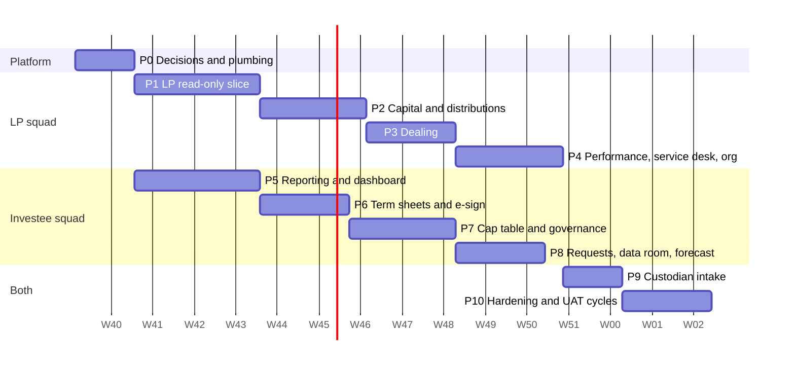

## 13. Assumptions, Constraints & Open Questions

> SRD v2 text (1 Oct 2026), replacing section 13 of v1.0. Evidence labels: **[O]** observed in code or documents, **[I]** inferred, **[P]** proposed. "Register" means `docs/srd/REGISTER.md` (every new FR, NFR, BR, Q and DEF with its final number and source); "BUILD-PLAN" means `docs/BUILD-PLAN.md`.

### 13.1 Assumptions

| ID | Assumption (v2 wording) | Change from v1.0 | Label |
| --- | --- | --- | --- |
| A-01 | The operator is a single asset-management group (single tenant). Clients, LP organisations, investee companies and counterparties are separated by **scope**, never by separate databases: an LP organisation is a `clients` row reached through a `client_users` membership with an optional fund entitlement (`fund_ids`); an investee is a `portfolio_companies` row reached through `company_users`; a custodian is a `counterparties` row reached through `counterparty_users`. | Extended: LP, investee and custodian populations added. | [O] clients, company_users; [P] fund_ids, counterparties |
| A-02 | Primary markets are ZSE and VFEX; currencies USD, ZWG, ZAR; time zone Africa/Harare. The operator now also runs private-capital and open-ended **funds** alongside listed mandates. The API uses ISO `ZWG`; the NVCCZ-derived UIs say `ZIG` and are mapped at the facade (Q-212). LP presentation currencies are USD, ZAR, ZWG (Q-148). | Funds added; currency mapping added. | [I] |
| A-03 | Sample data is illustrative and will be replaced by migrated or real data: the admin prototype arrays, the LP mock store (organisation Horizon Pension Fund LP; funds `growth-fund-i`, private-capital, and `equity-opportunities`, open-ended), the Investee fixtures (Zambezi Pay, Matanho Venture Fund I) and the seeds `CL-00418`, `PC-100`, `PC-101` (Q-220). UAT uses **synthetic data only**; no production personal data. | Mock stores and seeds named. | [O] |
| A-04 | The V56 visual design is approved and preserved for the **admin** workspace (legacy runtime), the onboarding page (V65) and the custodian page (V65). The **LP portal** and the **Investee portal** keep the design language of the NVCCZ-derived UIs, not V56. The new native ops console uses V56 tokens; a look that differs from V56 is accepted for UAT (Q-219). This SRD adds behaviour, not visual changes. | Scope of the design freeze narrowed. | [O] |
| A-05 | The investment team funds and pays out money outside the platform; the platform records and reconciles evidence. Capital calls, distributions and dealing settlements store a bank reference and evidence only. There is **no general-ledger posting** in this scope; outbox events (`capital.call.issued`, `capital.payment.settled`) are emitted for a future ABOR consumer (Q-204). | No-GL decision added. | [P] |
| A-06 | Where the prototype has two implementations of a screen, the one visible in the running portal is canonical. For the external portals the implementation of record is now the **LP portal** (10 screens, replaced the investor V53/V59 pages) and the **Investee portal V8** (13 pages, replaced the native company portal), both swapped in on 30 Sep 2026. The V53 6-item investor skin is retired (Q-08, Q-09 closed). | Investor and company portals replaced. | [O] |
| A-07 | English is the only UI language. | Unchanged. | [O] |
| A-08 | NVCCZ (the sibling PE/VC fund-ERP, also called "Arcus") is a **reference product and contract source**, not a runtime dependency: Nexus owns the data, the audit chain and the identity; no NVCCZ service runs beside Nexus and no NVCCZ data is migrated unless Q-205 says otherwise. Its code is used for rules, contracts, engines (cap-table dilution and waterfall), seeds and UAT scripts as test oracles. | New (BUILD-PLAN 11). | [P] |
| A-09 | Nexus serves `/api/v1/lp-portal/*` and `/api/v1/investee-portal/*` as **contract facades**: paths, envelopes (`{success, message, data, timestamp, meta}`), error codes (`LP_*`) and idempotency semantics follow the UIs' typed contracts. The UIs' mock stores are the executable specification; each domain goes live behind a runtime per-domain flag, never silently falling back to mock. | New (BUILD-PLAN 11). | [P] |

**Working defaults binding for the one-day build (not separate assumptions; each is a question in 13.3):** a fund is a first-class table (Q-202); LP roles `viewer/signatory/manager` replace the four investor roles with a migration (Q-203); NAV per unit and fund metrics are **published by maker/checker, stored and never computed** by the portal (Q-206); the typed-signature, step-up MFA and SHA-256 evidence standard applies until legal review (Q-208); MFA is enforced for signatories, approvers, custodian and staff before UAT sign-off (Q-218); the server in `/opt/matanho-nexus` is UAT until go-live (Q-222).

### 13.2 Constraints

| ID | Constraint (v2 wording) | Label |
| --- | --- | --- |
| C-01 | Ports (fixed): admin 3100, investor (LP portal) 3101, onboarding 3102, company (Investee portal) 3103, **custodian 3104**, API 4100. Hostnames: `nexus`, `investor.nexus`, `onboarding.nexus`, `company.nexus`, `custodian.nexus` and `api.nexus` under `matanho.com` (production hosts are `*.nexus.matanho.com`, not `*.matanho.com`). `COOKIE_DOMAIN` is the parent of all portal hosts (single sign-on); `custodian` must be added to `PORTAL_IDS`, `PORTALS`, `CORS_ORIGINS` and the auth proxy (FR-PLAT-003). | [O] |
| C-02 | Frontends never access MySQL; only the API does. The LP, Investee and custodian UIs call the facades only. | [O] |
| C-03 | No invented business roles; new permission codes need business approval (Q-04, Q-223). The following are **proposed** and need approval, with defaults binding for UAT: LP roles `viewer`, `signatory`, `manager` and the 34 `lp.*` codes (Q-203); investee roles `contributor`, `kpi_owner`, `approver`, `viewer`, `admin` (Q-198); custodian roles `submitter`, `approver` (Q-165); staff codes for funds, capital, dealing, notices, term sheets, cap table (reuse of existing codes plus maker ≠ checker until approved). | [P] |
| C-04 | Passwords are never stored in plaintext and secrets are never committed. No placeholder secret fallbacks; production refuses to start without `FILE_ENCRYPTION_KEY` and `DOWNLOAD_SIGNING_SECRET`; UAT credentials are delivered out of band through `SEED_USERS_FILE`. | [O] |
| C-05 | Node.js ≥ 22.9; TypeScript; Next.js 16 portals; Express 5 API; MySQL 8; Prisma migrate. Migrations are **additive (expand/contract)**; the one-day build uses a single migration authored by WS0. PDFs use `pdfkit`; exactly one worker instance runs until the worker is made idempotent (NFR-AV-005). | [O]/[P] |
| C-06 | Hosting: Docker Compose (`deploy/docker-compose.prod.yml`: mysql, migrate, api, worker, five portals) bound to 127.0.0.1 behind host nginx with certbot certificates, on one server treated as UAT until go-live (Q-222). The legacy Traefik stack on the `lms_lms-network` host network and the GitHub Pages workflow that served the static prototype must not run on the same hostnames and are retired before go-live (Q-19). | [O] |

**Constraint notes (no separate IDs):** the two facades are an exception to the Nexus-native error envelope; flags are read from the portal container's environment at request time (`LP_LIVE_DOMAINS`, `INVESTEE_LIVE_ACTIONS`), so rollback is an environment edit plus restart; the Investee runtime script is patched, never regenerated; every money-adjacent write carries an `Idempotency-Key` and a step-up window of 5 minutes.

### 13.3 Open questions (prioritised)

**How to read this register.** Priority: **High** = blocks the build or UAT; **Medium** = must be settled before go-live or changes rules the user sees; **Low** = can run on the default. Every row carries a proposed default so that no one waits. Numbering: Q-01…Q-25 are the v1.0 questions; **Q-26…Q-201** are the 176 questions in the Register (raised while documenting each page); **Q-202…Q-225** are the BUILD-PLAN's own `Q-NEW-01…24`, renumbered (13.3.3). BUILD-PLAN section 11 proposed "Q-26 onward" for its questions; that is superseded because Q-26…Q-201 were already allocated.

Totals: v1.0 questions 25 (5 answered by build, 4 superseded, 16 still open); Register questions 176 (22 High, 69 Medium, 85 Low); BUILD-PLAN questions 24 (10 High, 8 Medium, 6 Low).

#### 13.3.0 Decisions that block the one-day build

These five must be decided (or their default accepted in writing) at the 07:30 kick-off of the development day; the defaults are binding for the day so nobody waits (BUILD-PLAN 10.2, 12.2). Decisions needed before UAT sign-off but not before coding follow in the second table.

| Q | Was | Decision | Why it blocks | Default (binding) | Owner | If not decided |
| --- | --- | --- | --- | --- | --- | --- |
| Q-202 | Q-NEW-01 | Is a *fund* a first-class vehicle (new `funds` table) or a kind of portfolio/mandate? | The day-one migration (`funds`, `fund_commitments`, `lp_holdings`, `capital_calls`, …) and every LP screen hang on it. | New `funds` table; optional `portfolio_id` added later. | Product owner + fund accounting | WS0 cannot author the migration; all LP domains slip. |
| Q-203 | Q-NEW-02 | Replace the four investor roles with the three LP roles, or keep both? | The 34 `lp.*` permission bundles, `lpPermission` guard, seed personas and IDOR tests need the role set. | Add `viewer/signatory/manager`; migrate rows (`admin`→manager, `finance`→signatory, `investment` and `auditor`→viewer). Supersedes Q-154. | Product owner + security | Role catalogue, seed and guards cannot be finalised. |
| Q-205 | Q-NEW-04 | What is NVCCZ's relationship to Matanho: reference only, or running software with real data, and may its code be reused? | Chooses Option B (port by contract) over Option A (gateway to a running NVCCZ). | Reference and contract source only; no real data to migrate (A-08). | Product owner (executive sponsor) | Plan reverts to the Option A contingency; one-day slice changes. |
| Q-206 | Q-NEW-05 | What is the source of NAV per unit and of fund metrics (NAV module, manual publication, import)? | Dealing estimates, the LP dashboard and valuation-status labelling need a defined source; Nexus has no NAV/IBOR yet. | Manual publication with maker/checker; metrics stored, not computed. | Fund accounting | Dashboard and dealing stay on mock; J2/J4 shrink. |
| Q-208 | Q-NEW-07 | What legal standard applies to e-signatures and term-sheet execution in Zimbabwe; is an external provider needed? | Term-sheet signing (J6) and document signing evidence design. | In-house typed signature + step-up MFA + SHA-256 evidence + certificate PDF; legal review before go-live. | Legal | J6 reduces to issue-and-read; signing shown with a ribbon. |

Also needed before UAT sign-off (defaults binding, no build block): **Q-218** MFA enforced for LP signatories, investee approvers, custodian and all staff (default yes); **Q-221** acceptance criteria and sign-off authority for the cut line (default: journeys J0–J3 and J5 pass, others labelled); **Q-215** data residency and object-storage target (default: encrypted local volume now, S3-compatible later); **Q-223** approve the proposed staff permission codes or keep reuse (default: reuse for UAT); **Q-207** who may receive a term sheet (default: a `portfolio_companies` row in status Prospect).

#### 13.3.1 Questions Q-01…Q-25 (v1.0): status after the build

Status: **Answered by build** = the code or the replaced UI settles it; **Superseded** = overtaken by the new portals or merged into a newer question; **Still open** = unchanged or sharpened.

| ID | Priority (v1.0) | Question (short) | Status | Why, and where it went |
| --- | --- | --- | --- | --- |
| Q-01 | High | Provisioning and scoping of portfolio-company users; roles? | **Superseded** | Nexus has `company_users` links, staff invitation (`POST /private-markets/companies/{ref}/users`), no roles and only the first company reachable (DEF-527) [O]. The Investee portal adds five workspace roles. Now Q-197 (first user), Q-198 (profiles vs roles), Q-169 (company switcher). |
| Q-02 | High | Applicant account or magic-link draft; when invited to the investor portal? | **Answered by build** | The API implements a 30-day draft token with an emailed resume link, and invites an investor administrator on activation (FR-ONB-041, FR-ONB-013) [O]. The V65 UI does not call it yet (DEF-458, DEF-484). |
| Q-03 | High | `onboarding.manage` for investment_director, compliance, client_services | **Answered by build** | Present in the seed catalogue [O]. Residual defect: the prototype "Reset defaults" drops it (DEF-300). |
| Q-04 | High | Approve new permission codes (4.5) | **Still open** | List grew: `financing.manage`, `corporate_actions.elect`, `regulatory.submit`, `models.approve`, `accounting.close`, `investee.review` (Q-32), `recon.signoff` (Q-75), `valuation.maker/release` (Q-80) and the staff codes of BUILD-PLAN 5.2 (Q-223). Default unchanged: reuse existing codes + maker ≠ checker. |
| Q-05 | High | Who creates portfolios, mandates, benchmarks? | **Still open** | No portfolio module exists (FR-PORT-001 not started); funds are now a separate question (Q-202, Q-157). Default kept. |
| Q-06 | High | Which regulatory returns apply? | **Still open** | The four visible obligations (REG-31…34) are treated as the starting catalogue (Q-85); the 13F/N-PORT/EMIR list is unreachable prototype data. |
| Q-07 | Medium | LLM-based copilot? | **Still open** | The copilot is keyword-matched with canned answers, not retrieval [O]; an LLM is removed from LP scope (BUILD-PLAN 11). Default: rule-based. |
| Q-08 | High | Investor MVP scope: V53 simplified or full pages? | **Superseded** | The LP portal (10 screens) replaced the investor portal on 30 Sep 2026; the 6-item skin is retired. |
| Q-09 | Medium | Does the relationship switcher filter all pages? | **Superseded** | The LP fund switcher scopes every screen; a client switcher for multi-client users is FR-LP-004 (Q-23). |
| Q-10 | Medium | Minimum initial investment per relationship type | **Still open** | V65 enforces none; the form defaults to 250,000. Dealing minimums are Q-119. |
| Q-11 | Medium | Company pack: 5 items or 3 upload slots? | **Answered by build** | Nexus keeps 5 items; kept as the mandatory attachments of a period, typed statements are additional (Q-177). |
| Q-12 | Medium | Complaint SLA and escalation | **Still open** | Only a computed 48 h / 8 h request SLA flag exists (FR-INV-004 Partial); no complaint SLA or escalation. |
| Q-13 | High | NAV tolerance and materiality | **Still open** | Refined by Q-79 (stale-price, NAV-movement, override materiality); NAV module not built. |
| Q-14 | Medium | Expected user and data volumes | **Still open** | BUILD-PLAN 9.1 proposes p95 < 500 ms at 200 concurrent LP users [P]; no business figures yet. |
| Q-15 | High | Statutory retention periods | **Still open** | Repeated as Q-61; retention is not enforced (NFR-CMP-001). Default 7 years audit/financial, 5 years KYC post-exit. |
| Q-16 | High | Cyber and Data Protection Act obligations | **Still open** | BUILD-PLAN 9.7 adds notification consent, data-subject export of an LP's own records and a breach register. |
| Q-17 | High | Data residency / hosting location | **Superseded** | Merged into Q-215; interim default: encrypted local volume, S3-compatible target later. |
| Q-18 | Medium | Kubernetes or Docker Compose? | **Answered by build** | Docker Compose behind host nginx and certbot is the deployed target [O]; Traefik is legacy. |
| Q-19 | Low | When to retire the static prototype deployment | **Still open** | Traefik compose and the Pages workflow remain in the repository; default: retire before go-live and never share a hostname with the new stack. |
| Q-20 | Medium | In-house e-signature legally acceptable? | **Still open** | In-house capture exists for investor documents (FR-DOC-006 Partial: MFA time may be null; no verify endpoint) [O]. Legal question now Q-208 (term sheets) and Q-188 (external provider). |
| Q-21 | Medium | MFA methods and enforcement | **Still open** | TOTP enrol/verify built; WebAuthn and SMS not built; enforcement off by default (DEF-519). Decision: Q-218, Q-88. |
| Q-22 | Medium | Market-data licensing and vendors | **Still open** | No market-data integration (FR-DATA-001 not started). |
| Q-23 | Medium | One user, several investor roles or clients? | **Still open** | `client_users` allows several memberships; the LP session takes the first by creation time unless `?client=` names one (FR-LP-004); company users are limited to the first company (DEF-527, Q-169). |
| Q-24 | Medium | Fee calculation rules for NAV | **Still open** | New inputs: subscription fee on top of the amount (Q-115), redemption fee (Q-122), recurring management fee kept out of the dealing estimate (Q-116). |
| Q-25 | Low | Do admin links open the new portal URLs? | **Answered by build** | The applicant links open the configured onboarding URL [O]. Residual: the Private Markets hub still targets the replaced company URL (DEF-072) and the Investor Services button targets a missing `client-portal.html` (DEF-159). |

#### 13.3.2 Questions Q-26…Q-201 (Register), by theme

Each row shows the page where it was raised. Questions that duplicate or fragment each other in the Register are marked in the text (Q-82 repeats Q-49; Q-153 and Q-158 repeat each other; Q-168 is truncated at source).

##### Theme A — Identity, roles & access

| ID | Question | Priority | Proposed default | Owner | Raised in |
| --- | --- | --- | --- | --- | --- |
| Q-32 | Should `research.edit` remain the permission for company-reporting review? | Medium | Introduce a dedicated `investee.review` permission; keep `research.edit` until seeded. | Investment director (private markets) | 5.A.3 |
| Q-36 | Should Compliance and Auditor have read access to research evidence? | Medium | Yes, read-only (`research.view`). | Head of research | 5.A.6 |
| Q-38 | Which approver may activate a draft limit (Compliance, Risk, Investment Director)? | Medium | A user with `risk.manage` who is not the maker. | Compliance / risk | 5.A.7 |
| Q-40 | Which user may lock an official return (new permission code or `reports.create`) and must the locker differ from the preparer? | Medium | `reports.create` plus maker ≠ checker, per existing Q-04. | Investment director (performance) | 5.A.8 |
| Q-43 | Should operations and fund_accountant (prototype approvers) hold `cash.approve`, or is approval limited to investment_director and compliance as seeded? | Medium | Seed stays (investment_director, compliance); prototype approver list is dropped. | Client services | 5.A.9 |
| Q-44 | Should creating a cash account require only `clients.edit` (client_services, compliance, system_admin) or also operations? | Medium | `clients.edit` only. | Client services | 5.A.9 |
| Q-48 | Should *Investment director* and *Portfolio manager* be able to create service requests and reply to messages (they hold `clients.view` only)? | Medium | No; keep `clients.edit` for creation and replies. | Client services | 5.A.10 |
| Q-62 | Which permission and roles may refresh the IBOR and start a holdings reconciliation? | Medium | `operations.view` holders (Operations, Dealer, Fund Accountant, Compliance, Auditor read-only), matching the proposed `POST /ibor/refresh` gate. | Operations | 5.A.14 |
| Q-65 | Is a separate permission needed for committing statement imports (checker) distinct from uploading them (maker)? | Medium | Statement commit requires `cash.journal.approve` and the maker may not commit. | Operations | 5.A.15 |
| Q-66 | Should `cash.approve` (held by `investment_director` and `compliance`) gate any cash-ledger action, or only cash-account lifecycle and capital-event approval? | Medium | Only account lifecycle and capital events. | Operations | 5.A.15 |
| Q-67 | Should expected movements be creatable by roles that cannot post journals (for example `portfolio_manager`, `dealer`)? | Medium | Only holders of `cash.journal.create`. | Operations | 5.A.15 |
| Q-71 | Which roles may complete or block a task, and is maker/checker required for control tasks such as *Prepare NAV close readiness*? | Medium | `operations` and `fund_accountant` may create/complete; control tasks require a different completer than the creator. | Operations | 5.A.16 |
| Q-75 | Which permission codes gate resolve, approve, sign-off and source management? | Medium | Reuse `operations.view` plus maker ≠ checker until `recon.signoff` is approved (Q-04). | Operations | 5.A.17 |
| Q-80 | Is the NAV maker a role (`fund_accountant`) or a permission, and who is the independent NAV checker? | High | Permissions `valuation.maker` and `valuation.release` held by different users. | Fund accounting | 5.A.18 |
| Q-83 | Which roles may create service requests and reply to threads? | Medium | Roles with `clients.edit` (compliance, client_services, system_admin). | Product owner + security | 5.A.10 |
| Q-87 | Should permission-bundle changes require a second administrator's approval (maker-checker on RBAC)? | Medium | Yes for monetary codes. | Security | 5.A.26 |
| Q-88 | Should `mfa_required` default to true for the admin portal, matching the prototype UI? | High | True in production (see Q-218). | Security | 4.5 / backend |
| Q-89 | What should a user with zero fund entitlements see? | Medium | A full-page "No funds are linked to your account" empty state and no navigation other than *Settings*, *Requests* and *Notices*. | Product owner + security | 5.B.0 |
| Q-90 | Is the LP-role badge (viewer, authorised signatory, administrator) shown in the profile menu? | Low | Yes, "Viewer", "Authorised signatory" or "Administrator" under the user name, replacing the Nexus investor-role label. | Product owner + security | 5.B.0 |
| Q-94 | How are LP roles mapped to Nexus investor roles (*VIEWER*, *SIGNATORY*, *MANAGER* versus *admin*, *investment*, *finance*, *auditor*)? | High | *MANAGER* = Investor Admin, *SIGNATORY* = Finance, *VIEWER* = Investment Viewer, all holding the four dashboard permissions listed under Access. | Product owner | 5.B.1 |
| Q-113 | Is a VIEWER allowed to see the full wiring text of a capital call? | Medium | No. | Product owner + security | 5.B.4 |
| Q-131 | Should a VIEWER be allowed to download documents? | Low | Yes (reference rule; both permissions are in the VIEWER set). | Product owner + security | 5.B.6 |
| Q-138 | Is notice acknowledgement recorded per person or per organisation? | Medium | Per person; organisation status is acknowledged once any SIGNATORY or MANAGER has acknowledged. | Product owner + security | 5.B.8 |
| Q-143 | Should an invitation create a pending membership that is activated on first sign-in? | Medium | Yes; status *Invited* until first sign-in, *Active* afterwards. | Product owner + security | 5.B.9 |
| Q-144 | Who may submit a bank-instruction change? | Medium | SIGNATORY and MANAGER (service behaviour); align the UI to it. | Product owner + security | 5.B.9 |
| Q-147 | Nexus today stores investor users as `client_users` with roles `admin`, `investment`, `finance`, `auditor` and a scope string, managed by staff only (`/investor-users`); how do these map to `VIEWER`, `SIGNATORY`, `MANAGER`? | High | `admin` → MANAGER, `finance` → SIGNATORY, `investment` and `auditor` → VIEWER. | Product owner + security | 5.B.9 |
| Q-151 | Does the portal enforce MFA for Signatories and Managers (design: "MFA is mandatory for signatories, administrators and bank-detail changes")? | High | Yes; when `requireMfaForLp` is on, a user without a confirmed factor is taken to MFA enrolment at sign-in (FR-AUTH-010), whereas the current service only checks at bank-change submission. | Security + product owner | 5.B.10 |
| Q-154 | Replace the four Nexus investor roles by VIEWER, SIGNATORY and MANAGER (migration of `user_roles` and `client_users.investor_role`), or keep the four roles and derive `lpRole` by the table above? | High | Derive for the first release (no data migration), then converge on the three roles. | Product owner + security | — |
| Q-155 | Is `fundIds` stored on `client_users` (JSON) or in a join table `client_user_funds`? | High | Join table with a unique (membership, fund) key so that fund deletion and audits are relational. | Tech lead | — |
| Q-165 | Custodian user roles (single submitter, or submitter + approver for day-end packages)? | Medium | Submitter and approver; day-end package requires approver ≠ submitter at the counterparty. | Operations (custody) | 5.E.0 |
| Q-169 | Should the portal support users linked to several companies (company switcher)? | Medium | Yes, the Company drawer becomes a switcher; the API honours `?company=<ref>` for members only. | Product owner + security | 5.D.0 |
| Q-197 | Who provisions the first company user — the fund (Nexus `POST /companies/:ref/users`) — and may the company administrator invite others? | High | Yes, within the same company only. | Investment director | 5.D.12 |
| Q-198 | Are profiles an entitlement list or a replacement for roles (4.4 says no roles)? | High | Scoped profiles on `company_users`, evaluated by the API; no role catalogue entries. | Product owner + security | 5.D.12 |
| Q-201 | Should invitation and reset lifetimes follow the SRD (72 h / 30 min) or the code (7 d / 60 min)? | Medium | SRD values. | Security / tech lead | backend |

##### Theme B — Funds & LP domain (dashboard, performance, activity, valuation)

| ID | Question | Priority | Proposed default | Owner | Raised in |
| --- | --- | --- | --- | --- | --- |
| Q-91 | Does the notification bell total include `unreadCounts.notifications`? | Low | The badge shows `unreadCounts.notifications` (items in the list) and the sidebar badges keep their own counts. | Fund accounting / investor relations | 5.B.0 |
| Q-93 | What is the Nexus API prefix and source of the LP endpoints (the LP UI calls `/lp-portal/*`; the Nexus investor API is `/api/v1/investor/*` backed by published `InvestorSnapshot` records)? | High | Implement `/api/v1/lp-portal/*` as in the NVCCZ contract, backed by the approved investor snapshot tables, and keep `/api/v1/investor/*` for the legacy pages until they are retired. | Tech lead + product owner | 5.B.1 |
| Q-95 | How are amounts of funds in different currencies consolidated on *All Funds*? | Medium | Convert each amount to the presentation currency at the as-of date's approved rate and disclose the rate and date. | Fund accounting / investor relations | 5.B.1 |
| Q-96 | Which treatment applies to a consolidated Net IRR when funds have different currencies and valuation dates? | Medium | Merged dated cash flows converted at their own dates; *—* if any fund's cash flows are missing. | Fund accounting / investor relations | 5.B.1 |
| Q-97 | Does the Nexus API produce period figures (1Y, 3Y, 5Y, YTD) from stored period snapshots or compute them from dated cash flows? | Medium | Compute from approved dated cash flows and NAV snapshots, and mark a window as unavailable when the data does not cover it. | Fund accounting / investor relations | 5.B.2 |
| Q-98 | Where does benchmark index data come from and who approves it? | Medium | A maintained table of approved index points per benchmark id and metric (as in the NVCCZ `lp_benchmark_series_points`), approved by Investor Relations with a four-eyes check. | Fund accounting / investor relations | 5.B.2 |
| Q-100 | Is the report a single PDF per fund or a multi-fund pack for *All Funds*, and who composes it (staff-approved fund report versus generated on demand)? | Medium | Generated on demand from approved snapshots, a consolidated pack for *All Funds*. | Fund accounting / investor relations | 5.B.2 |
| Q-101 | Which benchmark options does the investor see? | Low | Only those with an approved series for the selected metric; the fixed three-item list (*Cambridge Associates U.S. PE Index*, *S&P 500*, *Russell 3000*) is replaced by an API-provided list. | Fund accounting / investor relations | 5.B.2 |
| Q-102 | What is the 3Y, 5Y, 10Y and MAX behaviour for an investor with less history than the window? | Low | Show all available points and label the range with the actual window. | Fund accounting / investor relations | 5.B.2 |
| Q-103 | Which `postedBy` value may an investor see (internal staff names are normally hidden)? | Medium | Show "System" or the role name, never a staff user name. | Fund accounting / investor relations | 5.B.3 |
| Q-104 | Should `?entry=` widen the as-of date to the entry date? | Low | Yes, the entry's detail is shown independently of the date range. | Fund accounting / investor relations | 5.B.3 |
| Q-105 | Should Currency, Structure and Status options be derived from the data? | Low | Yes. | Fund accounting / investor relations | 5.B.3 |
| Q-106 | Keep `/ledger` as an alias of `/account-activity` during migration? | Low | Yes during migration. | Fund accounting / investor relations | 5.B.3 |
| Q-145 | Which bank fields are required per currency for a bank-instruction change? | Low | Bank name, account name, account number, SWIFT/BIC and currency. | Product owner | 5.B.9 |
| Q-146 | Should the organisation profile (e-mail, country, phone, address, status) be shown read-only on Organisation? | Low | Yes, as a read-only card; changes go through a *Profile / Access* request. | Product owner | 5.B.9 |
| Q-148 | Which presentation currencies are offered? | Medium | USD, ZAR, ZWG (the currencies with a published rate in the valuation snapshot), restricted to currencies for which an FX rate exists. | Product owner | 5.B.10 |
| Q-149 | Should capital calls and distributions have separate rows? | Low | Keep merged, and show the switch as on only when both are on (as implemented). | Product owner | 5.B.10 |
| Q-150 | Are notification preferences per user or per organisation? | Low | Per user (as in the service). | Product owner | 5.B.10 |
| Q-157 | Who owns fund master data, share classes and dealing rules in Nexus (Private Markets page, NAV & Valuation page, or a new Funds page)? | High | A new "Funds" administration page under 5.A.3 with maker-checker, because all LP screens depend on it. | Product owner + fund accounting | — |

##### Theme C — Dealing (subscriptions & redemptions)

| ID | Question | Priority | Proposed default | Owner | Raised in |
| --- | --- | --- | --- | --- | --- |
| Q-115 | Are subscription fees paid on top of the invested amount (design example: 2,000,000 + 20,000 + 5,000 = 2,025,000; real backend) or deducted from it (prototype)? | High | On top, units = amount ÷ NAV, matching the design document formula "Units Allocated = Net Subscription Amount / NAV Per Unit". | Fund operations + compliance | 5.B.5 |
| Q-116 | Is the rate labelled *Management Fee (Est.)* a one-off subscription fee or a recurring management fee? The real backend feeds it from the subscription-fee setting (`subscriptionFeeBps`), the prototype from `mgmtFeeRate`. | High | Relabel as *Subscription Fee (Est.)* and keep a separate recurring management fee out of this estimate. | Fund operations + compliance | 5.B.5 |
| Q-117 | Does the notice period run in calendar days from the submission date (as the page text "Calendar Days" and the real backend say) and is there a cut-off time of day on the notice date? | High | Calendar days from submission date, no time-of-day cut-off. | Fund operations + compliance | 5.B.5 |
| Q-118 | May an investor cancel a request that is still `SUBMITTED` from this page? The design lists `CANCELLED` but the page has no cancel action. | Low | No investor-side cancel in this release; cancellation is requested through the Requests screen. | Fund operations + compliance | 5.B.5 |
| Q-119 | What are the minimum initial and additional subscription amounts per share class, and is a subscription document set mandatory (for example a signed subscription agreement and proof of payment) before the request leaves `SUBMITTED`? | Medium | No minimum enforced in this release; documents optional and visible to staff. | Fund operations + compliance | 5.B.5 |
| Q-120 | Which documents are "proof of payment"? The page offers only "Supporting Documents" and the NVCCZ design lists no distinct proof-of-payment field. | Low | Treat all uploads as supporting documents; staff mark funds received. | Fund operations + compliance | 5.B.5 |
| Q-121 | Which maximum file size applies? The prototype shows 10 MB (rules `maxFileMb`), the real backend hard-codes 25 MB and the design example is 25 MB. | Low | Take `maxFileMb` from the fund rules, default 25, enforce it on the client and the server. | Fund operations + compliance | 5.B.5 |
| Q-122 | Is the redemption fee rate (design example 0.208613 %, seed 0.50 %, real backend 0 by default) charged on the gross redemption value, and who may change the fee, notice, minimum balance and suspension flag? | Medium | Gross value; fund rules edited by Fund Operations with maker-checker. | Fund operations + compliance | 5.B.5 |
| Q-123 | Should the redemption minimum balance test use amount, units, or both? The prototype tests amount only; the real backend tests both. | High | Both. | Fund operations + compliance | 5.B.5 |
| Q-124 | Is a fund the investor holds through several share classes redeemable per class on this page? The page supports one class per fund. | Low | One class per fund in this release; additional classes appear as extra options in *Share Class* and the estimate is per class. | Fund operations + compliance | 5.B.5 |
| Q-125 | Should an investor with a pending redemption be allowed to submit another one for the same dealing date? | Low | Yes, provided the sum of pending requests stays within the available position. | Fund operations + compliance | 5.B.5 |
| Q-126 | `termsUrl` — where are the dealing terms hosted, and is the link per fund or per share class? | Low | A document in the Documents vault per fund, opened through the document viewer. | Fund operations + compliance | 5.B.5 |

##### Theme D — Capital calls & distributions

| ID | Question | Priority | Proposed default | Owner | Raised in |
| --- | --- | --- | --- | --- | --- |
| Q-107 | Use one due-soon window? The row highlight uses 7 days and the summary tile 14 days. | Low | A single configurable constant of 14 days shared by the row highlight and the *Upcoming Due Amount* tile. | Fund operations + finance | 5.B.4 |
| Q-108 | Notes length limit and allowed types for payment confirmations (the server allows any type up to 25 MB; the picker offers pdf, png, jpg, jpeg, txt). | Medium | Server enforces the same five types and 25 MB, notes at most 2 000 characters, error 415 `LP_UNSUPPORTED_MEDIA` / 413 `LP_FILE_TOO_LARGE`. | Fund operations + finance | 5.B.4 |
| Q-109 | Should *Total Distributions* be net paid or gross? | High | Net paid to the investor (consistent with the table's *Net Paid*). | Fund operations + finance | 5.B.4 |
| Q-110 | Which five tiles does Capital Activity show, and how is *Paid Calls* defined? | Low | Keep the five shown and label *Paid Calls* "Paid (year to date)" with a year-to-date count. | Fund operations + finance | 5.B.4 |
| Q-111 | What is the sort order of the call register? | Low | Newest first (the service orders by allocation creation time; the demo by call number descending). | Fund operations + finance | 5.B.4 |
| Q-112 | Which canonical timeline steps does a capital call show? | High | ISSUED, ACKNOWLEDGED, PAYMENT_RECEIVED, CLOSED, labelled "Call Issued", "Acknowledged", "Payment Received", "Call Closed". | Fund operations + finance | 5.B.4 |
| Q-114 | Which realtime event name signals a changed call or distribution? | Low | Reuse the notification event and refresh on `lp_notification`. | Fund operations + finance | 5.B.4 |

##### Theme E — Documents, notices, e-signature & service desk

| ID | Question | Priority | Proposed default | Owner | Raised in |
| --- | --- | --- | --- | --- | --- |
| Q-50 | Should publishing a document to several clients at once be supported from this page? | Low | Yes, multi-select audience; the API already accepts a list of client ids. | Client services | 5.A.10 |
| Q-58 | Should document type taxonomy in the UI be the five categories (Client, Investment, Operations, Regulatory, Governance) or the API types/folders (research, ic, clients, compliance, valuations, legal, …)? | Medium | Keep the API types as the stored value and show the five categories as a derived filter. | Compliance / document owner | 5.A.13 |
| Q-59 | Is the *Restricted* download rule (`audit.view` or maker) sufficient, or should it use entitlement groups? | Medium | Keep `audit.view` or maker plus an explicit entitlement list per document. | Compliance / document owner | 5.A.13 |
| Q-60 | Does *Needs signature* / *Expiring* status belong to the lifecycle status or to separate flags? | Low | Separate flags (signature state, expiry date) alongside the lifecycle status. | Compliance / document owner | 5.A.13 |
| Q-127 | How are *Distributions* distinguished from *Other* documents in the target data (the prototype maps both to `MANUAL`)? | Low | A dedicated `DISTRIBUTIONS` category. | Compliance + investor services | 5.B.6 |
| Q-128 | Do SUPERSEDED, RESTATED and WITHDRAWN documents appear in the register? | Low | SUPERSEDED and RESTATED are listed with their label; WITHDRAWN is hidden and its download answers 404. | Compliance + investor services | 5.B.6 |
| Q-130 | Blob streaming or a 5-minute signed URL for download and preview? | Medium | Keep the blob contract in `lpPortalApi`; the API returns file bytes (or a 302 to a signed URL). | Compliance + investor services | 5.B.6 |
| Q-132 | Are threads created automatically one per request, or does the investor see request replies only in *Request Details*? | Medium | Create one thread per request automatically (related type `REQUEST`) and write replies to both the request timeline and the thread. | Compliance + investor services | 5.B.7 |
| Q-133 | Should *Messages (n)* show unread or total threads, and should *Closed / Resolved* be limited to the current month? | Low | *Messages (n)* shows threads with unread messages; *Closed / Resolved* stays all-time. | Compliance + investor services | 5.B.7 |
| Q-134 | Should a request show the related record (capital call, document)? | Low | Show the fund and request type and link to the type's screen. | Compliance + investor services | 5.B.7 |
| Q-135 | Which request-type and priority values may the API accept? | Low | Four types (ACCOUNT_STATEMENT, CAPITAL_ACTIVITY, OPEN_ENDED_ACTIVITY, PROFILE_ACCESS) and priorities LOW, NORMAL, HIGH, URGENT; other values rejected with 422. | Compliance + investor services | 5.B.7 |
| Q-136 | Which request reference format: `SR-…` (reference service) or `REQ-nnnn` (prototype and Nexus staff requests)? | Medium | Keep the Nexus `REQ-` sequence so investor and staff views agree. | Compliance + investor services | 5.B.7 |
| Q-139 | Which notices require acknowledgement? | Medium | A publisher-set flag, true for capital-call and policy notices. | Compliance + investor services | 5.B.8 |
| Q-140 | Do notices expire, and can staff withdraw them? | Low | Yes: `expires_at` and a withdraw action; withdrawn notices disappear from the list and the bell. | Compliance + investor services | 5.B.8 |
| Q-141 | Should notices follow the top-bar fund selector? | Low | Fund notices follow the selector; notices without a fund (ALL, ORG, USER) are always shown. | Compliance + investor services | 5.B.8 |
| Q-142 | Should the portal e-mail or push a notice on publication? | Medium | Yes, honouring the in-app and e-mail notification preferences on Settings. | Compliance + investor services | 5.B.8 |
| Q-156 | Does LP document publication follow the Nexus approval workflow (draft, in review, approved, published) or publish immediately as in the reference backend? | Medium | Nexus workflow (`document_approval` policy). | Compliance + investor services | 5.B.6 (documents) |
| Q-162 | Upload size limit per evidence file? | Low | 25 MB (matches API and nginx). | Compliance + tech lead | 5.C.5 |
| Q-182 | Is the term sheet the same object as the executed SHA (legal documents) shown under *Governing documents*? | Medium | Separate published documents linked to the term sheet. | Compliance + investor services | 5.D.5 |
| Q-188 | Native drawn signature versus an external e-signature provider (Nexus section 12)? | High | Native for internal documents, provider integration for third-party legal documents. | Legal | 5.D.8 |
| Q-189 | Are company-initiated signature requests in scope (the UI offers them) or only fund-initiated? | Medium | Both, company-initiated limited to company-internal approvals. | Legal | 5.D.8 |
| Q-193 | Is the company vault the same store as Nexus `documents` (staff vault, 5.A.13) with a `company_id` scope, or a separate company-owned store? | Medium | Same store, new `company_folders` and `access_profile` fields. | Compliance + investor services | 5.D.10 |
| Q-194 | Maximum file size — 25 MB (current platform) versus 100 MB shown? | Low | 25 MB, correct the copy. | Compliance + investor services | 5.D.10 |
| Q-195 | Messages vs Q&A questions — one thread model? | Medium | One model; questions are threads with `type=question` and a Resolve action. | Compliance + investor services | 5.D.11 |
| Q-196 | Are attachments allowed in threads? | Low | Yes via the vault. | Compliance + investor services | 5.D.11 |

##### Theme F — Investee reporting, term sheets, cap table & governance

| ID | Question | Priority | Proposed default | Owner | Raised in |
| --- | --- | --- | --- | --- | --- |
| Q-31 | Where does the hub live now that the V16 hub is removed and company reporting is the Investee portal's counterpart — keep in Private Markets? | Medium | Keep the hub on this page and always render it (empty state when offline). | Investment director (private markets) | 5.A.3 |
| Q-170 | What is the Help & Support destination (guide document, support thread, external URL)? | Low | Guide = library document; support = new Messages thread to the investment team. | Investment team (portfolio) + legal | 5.D.0 |
| Q-171 | Which five headline metrics are mandatory (Revenue, Gross margin, Cash available, Runway, Burn)? | Medium | Those five, each tied to an investor-agreed KPI key. | Investment team (portfolio) + legal | 5.D.1 |
| Q-172 | Is "Last valuation" shown to the company? | Low | Yes when the fund has published a valuation; otherwise "—". | Investment team (portfolio) + legal | 5.D.1 |
| Q-173 | What is the tolerance for *Watch* (per-KPI or global)? | Low | Per KPI, default 5% adverse. | Investment team (portfolio) + legal | 5.D.2 |
| Q-174 | Are KPIs reported monthly only (Nexus period model) or at the frequencies shown (Weekly, Monthly, Quarterly)? | Medium | Stored per period key with `frequency` metadata; weekly values roll up to the month. | Investment team (portfolio) + legal | 5.D.2 |
| Q-175 | Reconcile the V8 simplified statements (8/11/4 lines) with the canonical NVCCZ schemas (33/23/21 lines)? | Medium | The server stores canonical keys; the builder shows grouped inputs that map onto them, with an "advanced lines" disclosure. | Investment team (portfolio) + legal | 5.D.3 |
| Q-176 | Is the "Quarterly investor report" a separate pack from monthly management accounts or a roll-up? | Low | Separate period type (quarter-end key) with its own request. | Investment team (portfolio) + legal | 5.D.3 |
| Q-177 | Do the existing Nexus five checklist items (Management accounts, Operating KPIs, Debt & cash, Board pack, Compliance certificates) remain? | Medium | Yes as the *mandatory attachments* of a period; typed statements are additional. | Investment team (portfolio) + legal | 5.D.3 |
| Q-178 | Is the forecast model an investor-reviewed deliverable (staff comment/accept like a report) or company-internal? | Medium | Submitted versions are reviewed (accept/return) like reports. | Investment team (portfolio) + legal | 5.D.4 |
| Q-179 | Are scenario definitions (driver overrides) company-defined or fund-defined? | Low | Company-defined, fund may require named Base/Upside/Downside. | Investment team (portfolio) + legal | 5.D.4 |
| Q-180 | Should cells hold formulas (Excel-like) or only values with calculated rows? | Low | Values + fixed calculated rows (as built). | Investment team (portfolio) + legal | 5.D.4 |
| Q-181 | Do Nexus companies have a deal/application pipeline (application → DD → term sheet) or are companies created directly in Private Markets? | High | Companies are created by staff in Private Markets; a term sheet is a record on the company with a signature workflow. | Investment director | 5.D.5 |
| Q-183 | Who maintains the cap table in Nexus — fund staff (legal), the company, or both with approval? | Medium | Company proposes (draft transaction), fund legal approves and executes. | Investment team (portfolio) + legal | 5.D.6 |
| Q-184 | Is the "Verified {date}" attestation a staff sign-off? | Low | Yes, set by the fund at each executed transaction batch. | Investment team (portfolio) + legal | 5.D.6 |
| Q-185 | Where does the Series structure (Seed, Series A, Series B) come from — rounds as first-class records? | Low | Share classes carry round label; add a `rounds` read model. | Investment team (portfolio) + legal | 5.D.6 |
| Q-186 | Who owns the board calendar and board pack — the company secretary (company) or the fund? | Low | Company secretary creates meetings; the fund is invited. | Investment team (portfolio) + legal | 5.D.7 |
| Q-187 | Are consent requests legally binding records or workflow aids (signed resolutions via 5.D.8)? | Low | Workflow aids; a formal written resolution is created as a signature request. | Investment team (portfolio) + legal | 5.D.7 |
| Q-190 | Is a "capital request" a different object from a "procurement requisition"? | Medium | One `requests` table with `type`, capital requests following the investment-committee route and procurement following the VC-CFO/RFQ route. | Investment team (portfolio) + legal | 5.D.9 |
| Q-191 | Currency list (USD, ZAR, ZWG) — are requests allowed in non-commitment currencies with FX at approval? | Low | Yes, converted at the system rate on the decision date. | Investment team (portfolio) + legal | 5.D.9 |
| Q-192 | Does Nexus (investment OS) contain a procurement module, or are requisitions handed to an external procurement system (NVCCZ proxies to `PROCUREMENT_API_BASE_URL`)? | Medium | Requests are staff-reviewed in Nexus; sourcing is out of scope until a procurement module exists. | Investment team (portfolio) + legal | 5.D.9 |
| Q-199 | Which company fields can the company edit versus only the fund (legal name, registration number)? | Low | Contact and descriptive fields editable; legal name and registration changes go through a staff-approved change request. | Investment team (portfolio) + legal | 5.D.13 |
| Q-200 | Reminder schedule (14, 7, 3, 1 days) — configurable per fund? | Low | Fixed as shown, owned by the reporting-request settings. | Investment team (portfolio) + legal | 5.D.13 |

##### Theme G — Custodian

| ID | Question | Priority | Proposed default | Owner | Raised in |
| --- | --- | --- | --- | --- | --- |
| Q-166 | Minimum execution fields (ISIN, venue ZSE/VFEX, gross/net consideration, fees, ClOrdID/ExecID)? | Medium | Add ISIN, venue, gross consideration, fees and optional ClOrdID/ExecID. | Operations (custody) | 5.E.1 |
| Q-167 | Day-end file formats to parse (MT535/MT536, CSV template)? | Medium | CSV template + PDF evidence; MT535/536 later. | Operations (custody) | 5.E.2 |
| Q-168 | Custodian roles and permissions: remove or keep (REGISTER text truncated; custodian has no roles or permissions today; see Q-165). | Low | Add portal `custodian` with roles `submitter` and `approver` (BUILD-PLAN 5.2). | Operations (custody) | 5.E |

##### Theme H — Admin console (staff workspaces)

| ID | Question | Priority | Proposed default | Owner | Raised in |
| --- | --- | --- | --- | --- | --- |
| Q-26 | Should the sidebar section headers hide when empty? | Low | Yes. | Product owner | 5.A.0.1 |
| Q-27 | Should Focus mode default to on? | Low | On, stored per user. | Product owner | 5.A.0.2 |
| Q-28 | Should the Auditor (no `dashboard.view`) have a landing page of their own? | Low | Whole Portfolio. | Product owner | 5.A.1 |
| Q-29 | Which of the two settlement narratives (Zimplats US$ 412k VFEX fail vs private valuation exception) is the canonical top item? | Low | Both appear, ranked by financial impact. | Product owner | 5.A.1 |
| Q-30 | Should ZAR be offered as base currency in the wizard while the SRD baseline is {USD, ZWG}? | Low | Keep ZAR (present in the wizard). | Product owner | 5.A.2 |
| Q-33 | Can short weights be allowed per mandate? | Low | No (slider minimum 0). | Product owner | 5.A.4 |
| Q-34 | Should ZSE buys be allowed from a portfolio with no ZWG dealing account (e.g. USD Equity Fund)? | Low | No (fail). | Head of dealing / investment director | 5.A.5 |
| Q-35 | Which of the two cash estimates (V54 dead, V56 live) is canonical? | Low | V56 (0.65 % buffer). | Head of dealing / investment director | 5.A.5 |
| Q-37 | Is conviction a letter grade (A…C) or a 1–5 score? | Low | Letter grade as implemented. | Head of research | 5.A.6 |
| Q-39 | Is the severe scenario in the banner a fixed preset or the latest saved run? | Low | A fixed preset named *Severe cross-asset*. | Compliance / risk | 5.A.7 |
| Q-41 | Is factor exposure part of the scope of this page? | Low | No; it is mentioned only in the superseded subtitle and is not built. | Investment director (performance) | 5.A.8 |
| Q-42 | Which benchmark and composite apply per portfolio, and how often is the composite membership reviewed? | Medium | One approved composite per portfolio, reviewed monthly. | Investment director (performance) | 5.A.8 |
| Q-45 | Is the full set of account types limited to CLIENT_BANK, CUSTODY_CASH, BROKER_SETTLEMENT, SUSPENSE, or must FX_SETTLEMENT, INCOME_RECEIPT and FEE_COLLECTION (present in the V43 form and original V56 form) remain? | Low | All seven are allowed by the API; the form offers the three used by V49 plus SUSPENSE. | Client services | 5.A.9 |
| Q-46 | Is the omnibus pool account (`POOL-01`) linked to a vehicle record instead of a client? | Low | Yes, a client-type "vehicle" record. | Client services | 5.A.9 |
| Q-47 | Does the weekly/monthly reporting cadence workspace of V61 (see below) replace or extend the V49 page? | Low | Extend as a tab after the cash-account lifecycle is complete. | Client services | 5.A.9 |
| Q-49 | Is Investor Services to be split into the V61 sub-tabs (*Service queue*, *Capital*, *Publications*) in the production build? | Low | Yes, following V61. | Client services | 5.A.10 |
| Q-51 | Should the queue show a SLA-breach indicator and default sort by blockers, risk and SLA (as the V33 header claimed)? | Low | Sort by SLA due ascending, show "Overdue" chip. | Compliance (MLRO) | 5.A.11 |
| Q-52 | Is the "Applicant portal" link intended for staff to demonstrate or to onboard on behalf of a client? | Low | Demonstration only; assisted flow handled by the new form. | Compliance (MLRO) | 5.A.11 |
| Q-53 | Should presets anchor on the system date, the last locked period end, or a user-chosen as-of date? | Low | System date in the Africa/Harare timezone, with an optional as-of override. | Compliance / document owner | 5.A.12 |
| Q-54 | Is "Awaiting review" a single state or the pair In review + Awaiting approval? | Low | Count both as "Awaiting review". | Compliance / document owner | 5.A.12 |
| Q-55 | Which of the four editor templates (client, compliance, investment, management) are in scope for phase 1? | Low | All four, selected from the template catalogue. | Compliance / document owner | 5.A.12 |
| Q-56 | Should the Regulatory report type link to 5.A.22 filings (the V33 link *Regulatory reporting* was dropped)? | Low | Restore a header link to the Regulatory Reporting workspace. | Compliance / document owner | 5.A.12 |
| Q-63 | Should position quantities be shown as numbers with currency columns rather than preformatted strings? | Low | Yes; numeric fields with formatting in the UI. | Operations | 5.A.14 |
| Q-64 | Source for the "Last event" and "Processing lag" values? | Low | The position-event stream metadata. | Operations | 5.A.14 |
| Q-68 | Are minimum buffer and pending-withdrawal amounts configured per account (tolerance profile) or per portfolio mandate? | Low | Per cash account, versioned with the availability rule. | Operations | 5.A.15 |
| Q-69 | Which cash accounts feed order-ticket availability when a portfolio has several accounts in one currency? | Medium | Sum of ACTIVE accounts of that portfolio and currency. | Operations | 5.A.15 |
| Q-70 | Is the runbook per fund/portfolio, per business unit, or firm-wide, and are tasks generated automatically from scheduled events (settlement dates, capital-call due dates, election deadlines) or only created manually? | Low | Firm-wide, mix of system-generated recurring tasks and manual tasks. | Operations | 5.A.16 |
| Q-72 | Should *Service health* come from `GET /api/health?deep=1`, from the integration registry (5.A.23), or both? | Low | Both, as the lowest of the two. | Operations | 5.A.16 |
| Q-73 | Operating-day hours and cut-offs (the workload chart spans 09:00-18:00 CAT; tasks run 15:50-17:30) — are they configurable per calendar and holiday set? | Low | Configurable operating window 08:00-18:00 CAT, ZSE/VFEX holiday calendar. | Operations | 5.A.16 |
| Q-74 | Is a missing counterparty record a break (V61 wording) or a source-completeness exception that blocks matching (V56 behaviour)? | Medium | A source-completeness exception that blocks matching and daily sign-off, shown separately from value breaks. | Operations | 5.A.17 |
| Q-76 | Which families are in scope for the first release? | Medium | The six families present in the running UI (Trades, Settlement, Cash, Holdings, Units, Pricing / NAV); the other six V33 families are deferred. | Operations | 5.A.17 |
| Q-77 | Where do the unit register and valuation book appear as internal sources? | Low | Add internal sources `SRC-UNITS` and `SRC-VAL`. | Operations | 5.A.17 |
| Q-78 | Which value is authoritative for the Growth Equity IV exception (administrator US$ 4.31m or approved valuation US$ 4.46m), and in which direction does resolution move the NAV? | Medium | The maker documents the authoritative value; the resolved value is recorded and the draft NAV recalculated from it. | Fund accounting | 5.A.18 |
| Q-79 | What are the stale-price threshold, NAV-movement tolerance and override materiality per asset class (refines Q-13)? | Medium | 1 % or US$ 50k. | Fund accounting | 5.A.18 |
| Q-81 | Should the valuation currency for *Zimbabwe Opportunities* (ZWG fund) be displayed in ZWG with a USD equivalent? | Low | Show the fund currency with a USD-equivalent line using the valuation-date FX (BR-018). | Fund accounting | 5.A.18 |
| Q-82 | Adopt the V61 three-tab structure of Investor Services (Service queue, Capital, Publications)? | Low | Yes (duplicate of Q-49). | Product owner | 5.A.10 |
| Q-84 | Is collateral posted per facility or per counterparty CSA? | Low | Per counterparty CSA. | Compliance / risk | 5.A.20 |
| Q-86 | Should the Data page connection form and the Settings integration registry be one register? | Low | One `integrations` table; the Data page shows it read-only with lineage, Settings edits it. | Data / product owner | 5.A.23 |

##### Theme I — Platform, API contract & NFR

| ID | Question | Priority | Proposed default | Owner | Raised in |
| --- | --- | --- | --- | --- | --- |
| Q-92 | Which realtime transport does Nexus provide (Socket.IO as in the source product, Server-Sent Events, or polling)? | Low | Polling every 30 s until a transport exists. | Tech lead | 5.B.0 |
| Q-129 | How does the Nexus `documents` / `publications` / `signature_requests` / `document_versions` model supply `period`, `version`, `status` and `accessScope`? | High | `period` from the report period, `version` from the latest version, `status` from publication and signature state, `accessScope` constant `INVESTOR_ORGANISATION`. | Tech lead | 5.B.6 |
| Q-137 | Nexus today exposes `/api/v1/investor/threads` and staff `/service-requests`; the LP contract (`/lp-portal/requests`, `/lp-portal/messages`) must either be implemented as a facade over them or replace them? | High | Implement the LP contract paths on the Nexus API and map them to the existing tables. | Tech lead | 5.B.7 |
| Q-152 | Which notification categories exist in the Nexus notification table (`notification_preferences` exists but is not read or written)? | Medium | Use it with `channel` ∈ {email, in_app} and the four alert types plus digest. | Tech lead | 5.B.10 |
| Q-153 | Keep `/api/v1/investor/*` as an alias for the four legacy routes? (REGISTER text is fragmentary; the reference router has 83 routes: 70 called by the UI, 13 not called, one cron route; every number in `data` is serialised as a string.)? | Low | No alias; legacy routes stay read-only for one release (see Q-217). | Tech lead | 5.B (API) |
| Q-158 | Same question as Q-153 (REGISTER duplicate): the existing `/api/v1/investor/*` routes remain in the API but no UI calls them. | Low | Keep read-only for one release, then remove (Q-217). | Tech lead | 5.B (API) |
| Q-159 | Keep a theme toggle on the public onboarding portal? | Low | No (retire FR-ONB-015). | Product owner | 5.C.0 |
| Q-160 | Should the applicant see the advisory risk badge ("High review risk")? | Low | No; show only completeness. | Compliance | 5.C.0 |

##### Theme J — Compliance, legal & onboarding

| ID | Question | Priority | Proposed default | Owner | Raised in |
| --- | --- | --- | --- | --- | --- |
| Q-57 | What is the retention and versioning policy for generated report PDFs? | Medium | Store each published PDF as a document version in the vault with the vault's default retention (7 years). | Compliance | 5.A.12 |
| Q-61 | Statutory retention periods per class (see Q-15)? | High | 7 years audit/financial, 5 years KYC post-exit. | Compliance | 5.A.13 |
| Q-85 | Are the visible obligations (Quarterly investment return, AML transaction summary, Capital adequacy return, Offshore exposure return) the SECZ/RBZ/FIU catalogue for Q-06? | Medium | Yes, configurable. | Compliance | 5.A.22 |
| Q-99 | Is the GIPS compliance statement correct for Matanho funds? | Medium | Show it only for funds flagged as GIPS-compliant; otherwise show a neutral methodology note. | Compliance / investor relations | 5.B.2 |
| Q-161 | Is suitability (risk profile, liquidity) captured at onboarding or later in mandate setup? | Medium | Later, in mandate setup. | Compliance (MLRO) / legal / DPO | 5.C.1 |
| Q-163 | Which evidence set is mandatory per investor type (7 types)? | Medium | The "Target required set" column above. | Compliance (MLRO) / legal / DPO | 5.C.5 |
| Q-164 | Enhanced-review value threshold? | Medium | 1,000,000 USD equivalent, configurable in policy. | Compliance (MLRO) / legal / DPO | 5.C.6 |
#### 13.3.3 Questions Q-202…Q-225 (BUILD-PLAN `Q-NEW-01…24`, renumbered)

**Mapping note.** `Q-NEW-n` becomes `Q-(201+n)`: Q-NEW-01 → Q-202 … Q-NEW-24 → Q-225. Priorities and defaults are those of BUILD-PLAN 10.2; owners and "needed by" are this editor's proposal. Q-NEW references inside the Register, the per-portal drafts and the BUILD-PLAN text read as the renumbered IDs.

| ID | Was | Priority | Question | Default used in the plan | Owner | Needed by |
| --- | --- | --- | --- | --- | --- | --- |
| Q-202 | Q-NEW-01 | High | Is a *fund* a first-class vehicle in Nexus (new `funds` table) or a kind of portfolio/mandate? | New `funds` table, optional `portfolio_id` later | Product owner + fund accounting | P0 / kick-off |
| Q-203 | Q-NEW-02 | High | Replace the 4 investor roles with the 3 LP roles, or keep both? | Add `viewer/signatory/manager`, migrate existing rows (admin→manager, finance→signatory, investment and auditor→viewer) | Product owner + security | P0 / kick-off |
| Q-204 | Q-NEW-03 | High | Must capital calls and distributions post to a general ledger? | No GL; emit outbox events for a future ABOR consumer; store bank reference and evidence only | Product owner + fund accounting | P0 |
| Q-205 | Q-NEW-04 | High | What is NVCCZ's relationship to Matanho: reference only, or running software with real data? Licence to reuse its code? | Reference and contract source only; no real data to migrate | Product owner (executive sponsor) | P0 / kick-off |
| Q-206 | Q-NEW-05 | High | Source of NAV per unit for dealing and of fund metrics (NAV module, manual publication, import)? | Manual publication with maker/checker; metrics stored, not computed | Fund accounting | P0 / kick-off |
| Q-207 | Q-NEW-06 | High | Who can receive a term sheet: onboarding applicant, prospect company, existing portfolio company? | `portfolio_companies` row with status Prospect; users invited by staff | Investment director | P0 |
| Q-208 | Q-NEW-07 | High | Legal standard for e-signatures and term-sheet execution in Zimbabwe; external provider needed? | In-house typed signature + step-up MFA + SHA-256 evidence + certificate PDF | Legal | P0 / kick-off; legal review before go-live |
| Q-209 | Q-NEW-08 | Medium | Investee Messages: reuse reporting questions, new threads, or drop (NVCCZ options A, B, C)? | New `company_threads` modelled on `message_threads` | Investment director + product owner | P8 |
| Q-210 | Q-NEW-09 | Medium | Investee data room: read-only library, or company uploads reviewed by staff? | Company uploads, visible to staff, versioned | Investment director | P8 |
| Q-211 | Q-NEW-10 | Medium | Who maintains the cap table: staff (maker/checker) or the company? | Staff maintain; company reads and comments | Investment director + legal | P7 |
| Q-212 | Q-NEW-11 | Medium | Currency set and FX source: USD, ZWG, ZAR; NVCCZ uses `ZIG` and its own rate resolver | ISO `ZWG` at the API, `ZIG` mapped at the facade; `fx_rates` table | Fund accounting / finance | P1 |
| Q-213 | Q-NEW-12 | Medium | Is the custodian portal in scope for UAT and for the first release? | UAT stretch; release in P9 | Operations + product owner | P0 (UAT scope) |
| Q-214 | Q-NEW-13 | Low | Is realtime required for UAT? | No; polling; SSE in P1 | Tech lead | P1 |
| Q-215 | Q-NEW-14 | High | Data residency and object-storage target? | Encrypted local volume now, S3-compatible later | Compliance (DPO) + tech lead | P0 (storage), go-live |
| Q-216 | Q-NEW-15 | Low | Branded statement and notice templates (letterhead) required? | Single Matanho template | Product owner | P2 |
| Q-217 | Q-NEW-16 | Medium | Fate of `/investor/*` endpoints and snapshot import after the LP facade? | Keep read-only for one release, then remove | Product owner + tech lead | P1 |
| Q-218 | Q-NEW-17 | High | Enforce MFA for LP signatories, investee approvers, custodian and all staff? | Yes, before UAT sign-off | Security | UAT sign-off |
| Q-219 | Q-NEW-18 | Low | Accept a different visual treatment for ops-console screens until a design pass? | Yes for UAT | Product owner | UAT |
| Q-220 | Q-NEW-19 | Low | Keep demo companies `PC-100` Africa Payments Holdings and add `PC-101` Zambezi Pay (Investee mock), or rename? | Add `PC-101` | Product owner | Seed (WS8) |
| Q-221 | Q-NEW-20 | High | One-day UAT: acceptance criteria and sign-off authority for the section 12 slice? | Journeys J0–J3 and J5 pass; others are labelled | Product owner (name the signer) | Kick-off |
| Q-222 | Q-NEW-21 | Medium | Is the server at `/opt/matanho-nexus` UAT or production? | UAT until go-live | Tech lead / devops | Deploy |
| Q-223 | Q-NEW-22 | Medium | Approve the proposed staff permission codes (BUILD-PLAN 5.2) or keep reuse? (extends Q-04) | Reuse for UAT | Product owner + security | P0 |
| Q-224 | Q-NEW-23 | Low | What does "governance" mean for investees (resolutions, reserved matters, approvals) and who owns the data? | Thin register maintained by staff, read-only for the company | Investment director | P7 |
| Q-225 | Q-NEW-24 | Low | Is the forecast workbook owned by the company (self-service) or by the fund team? | Company-owned, staff read-only | Investment director | P8 |

#### 13.3.4 Defaults that disagree, and how they are reconciled

Several Register defaults were written before the BUILD-PLAN fixed the architecture. Where they differ, the decision below governs the one-day build; the loser is marked superseded in the Register when it is merged.

| Topic | Register default | BUILD-PLAN default | Governing decision |
| --- | --- | --- | --- |
| LP roles | Q-154: derive `lpRole` from the four roles; migrate later | Q-203: add the three roles and migrate rows now | **Q-203.** Q-154 superseded. The mapping is the same as Q-94 and Q-147. |
| Fund entitlement storage | Q-155: join table `client_user_funds` | `client_users.fund_ids` JSON (null = all commitments) | **JSON column for UAT** (day-one migration); join table at hardening (recorded as debt). |
| Company access model | Q-198: scoped profiles on `company_users`, no role-catalogue entries | Five roles in the catalogue, mirrored in `company_users.role` | **Five roles for UAT**; the UI's "access profile" labels map one-to-one to the five roles. Re-open at Q-198. |
| Legacy `/investor/*` | Q-153, Q-158: no alias | Q-217: keep read-only one release | Compatible: no alias, routes kept read-only, then removed. |
| Realtime | Q-92: polling every 30 s until a transport exists | Q-214: polling for UAT, SSE in P1 | Polling for UAT; **SSE, not Socket.IO**. |
| Question numbering | (Register uses Q-26…Q-201) | BUILD-PLAN 11: "renumber as Q-26 onward" | Register numbering stands; BUILD-PLAN questions are Q-202…Q-225. |
| Staff permission codes | Q-32 (`investee.review`), Q-75, Q-80 propose new codes | Q-223: reuse for UAT | Reuse existing codes plus maker ≠ checker for UAT; new codes after approval (Q-04). |

### 13.4 Known defects

The Register lists **532 defects** (DEF-001…DEF-532) found in the prototypes, the replaced portals and the current code, each with the page where it was found. They are **not repeated here**; this section summarises them and lists the ones that must be fixed first. The Register does not carry a severity, so the severity below is this editor's triage using three classes:

- **S1, security or data integrity:** authentication, MFA and step-up gaps; access-scope or tenant leaks; segregation-of-duties or permission enforcement missing; injection; secrets or personal data in clear; lost, duplicated or forgeable records; missing audit, backup or immutability.
- **S2, functional:** a feature is wrong, fake (toast-only), missing, unwired or its contract does not match.
- **S3, cosmetic or accessibility:** labels, colours, static badges, Esc/focus behaviour, dead code.

S1 was assigned item by item (the 44 listed below). S2 versus S3 was assigned by a keyword rule over the defect text, so the S3 figure is a lower bound and S2 an upper bound (±10 %). Defects marked "reference" are in the NVCCZ reference backend or UI that Nexus does **not** port (Option B); they are listed so that the rewrite does not reproduce them. Prototype defects disappear when the page is rebuilt natively; the S1 items below must be closed regardless (target: P0 or the phase that touches the area).

#### 13.4.1 Summary by portal and severity

| Portal / area | DEF range | Total | S1 | S2 | S3 |
| --- | --- | --- | --- | --- | --- |
| Admin workspace (5.A) | DEF-001…318 | 318 | 23 | 251 | 44 |
| LP portal (5.B) | DEF-319…457 | 139 | 4 | 117 | 18 |
| Onboarding V65 (5.C) | DEF-458…484 | 27 | 2 | 24 | 1 |
| Custodian (5.E) | DEF-485…491 | 7 | 3 | 4 | 0 |
| Investee portal (5.D) | DEF-492…508 | 17 | 2 | 15 | 0 |
| Backend and platform | DEF-509…532 | 24 | 10 | 13 | 1 |
| **Total** | DEF-001…532 | **532** | **44** | **424** | **64** |

Register gaps: DEF-136 and DEF-137 contain only "(see Gaps)" and DEF-453…457 are text fragments; they are counted (as S2, except DEF-455 as S1) but should be repaired in the Register.

#### 13.4.2 Fix first: the 44 S1 defects (security first)

| Theme | DEF | Portal | Defect |
| --- | --- | --- | --- |
| Identity, MFA, step-up | DEF-519 | Backend | `mfa_required` is off by default; step-up is skipped for users with no factor (NFR-SEC-008). |
| | DEF-520 | Backend | Invitation acceptance creates a fully verified session and bypasses MFA. |
| | DEF-524 | Backend | Step-up missing on cash-account approve/suspend/reactivate/close, document publish, capital publish, KYC activate. |
| | DEF-438 | LP (reference) | Bank-instruction change claims "requires MFA" but has no step-up, no verification and no approval step (BR-006). |
| Access scope and leaks | DEF-526 | Backend | Investor account scope is not applied to documents, capital events, requests or threads. |
| | DEF-495 | Investee | The portal path performs no company-scope check; an admin-only staff account can open it. |
| | DEF-493 | Investee | Mock mode shows another company's data to real signed-in users as if it were theirs. |
| | DEF-455 | LP (reference) | A list ignores the `fundId` query parameter: cross-investor leakage (Register text fragmentary). |
| | DEF-428 | LP (reference) | Fund-targeted notice visibility has no commitment check and ignores share class. |
| | DEF-485 | Custodian | No authentication or authorisation at all; not a registered portal. |
| | DEF-297 | Admin | Copilot answers are not filtered by the user's entitlements. |
| | DEF-010 | Admin | Global search is not permission-filtered. |
| | DEF-312 | Admin | An unknown record id silently shows another record, so users can act on the wrong record. |
| Segregation of duties and missing enforcement | DEF-530 | Backend | KYC dual control is skipped when no staff member has prepared the case. |
| | DEF-531 | Backend | Funds approval is automatic, so the FR-ONB-010 funds gate never blocks. |
| | DEF-087 | Admin | Orders: no RBAC or SoD; the approver may equal the creator (BR-003, FR-OMS-006). |
| | DEF-114 | Admin | `risk.manage` is never enforced; limits need no approval (FR-RSK-002/004). |
| | DEF-102 | Admin | `research.edit` is not enforced; any `research.view` role can save. |
| | DEF-145 | Admin | Cash-account lifecycle has no permission checks; maker-checker compares the literal name "T. Moyo". |
| | DEF-222 | Admin | Cash maker-checker compares a literal name; BR-001 is not enforced against real users. |
| | DEF-229 | Admin | One permission (`cash.import`) both uploads and commits statements. |
| | DEF-247 | Admin | Reconciliation resolution needs no rationale or evidence; checker approval has no maker ≠ checker test. |
| | DEF-257 | Admin | NAV page has no action-level permission (seven roles hold `valuation.view`). |
| | DEF-258 | Admin | NAV maker and checker are not separated; `navApproval` is stored but never consulted. |
| | DEF-280 | Admin | Financing: no permission or maker-checker on margin disposition or facility creation. |
| | DEF-148 | Admin | The profile editor lets a `clients.edit` user set the KYC state directly, bypassing the KYC workflow. |
| | DEF-192 | Admin | `reports.create` is not enforced on any control. |
| | DEF-199 | Admin | `documents.edit` is not enforced on the vault page controls. |
| | DEF-152 | Admin | Document publish has no optimistic-lock check and no step-up on the server. |
| | DEF-165 | Admin | Capital-notice publish has no optimistic-lock check and no step-up on the server. |
| Injection | DEF-022 | Admin | Toast HTML is unescaped (injection with API-supplied text). |
| | DEF-074 | Admin | Toasts built from API data (company names, e-mails) use unescaped HTML. |
| | DEF-250 | Admin | Registered provider name is inserted unescaped into the "Source registered" toast. |
| | DEF-317 | Admin | Report editor toast messages are unescaped HTML. |
| Personal data in clear | DEF-440 | LP (reference) | The clear account number is persisted unmasked in the bank-change payload (BR-135). |
| | DEF-470 | Onboarding | Tax ID and bank account number are stored in plain text in browser localStorage. |
| Files | DEF-200 | Admin | Server accepts octet-stream, webp and zip, with no malware scan. |
| | DEF-476 | Onboarding | `scanStatus` is stored as "clean" unconditionally (FR-ONB-003 unmet). |
| | DEF-514 | Backend | No malware scan; every file is recorded as clean. |
| Integrity, audit, recovery | DEF-513 | Backend | Idempotency is not implemented; repeated POSTs duplicate capital events, documents and requests. |
| | DEF-525 | Backend | Audit gaps (message post, drafts, uploads, step-up, failed logins, downloads); hash omits role, portal, IP and request id; table not DB-protected from UPDATE/DELETE. |
| | DEF-487 | Custodian | The "immutable" execution record is editable browser storage. |
| | DEF-488 | Custodian | Day-end hash is computed only in the browser; no API, model or object storage. |
| | DEF-515 | Backend | No database or file-store backups in the deployment. |

#### 13.4.3 Next group: S2 blockers and contract mismatches to carry into the build

| DEF | Portal | Defect | Consequence |
| --- | --- | --- | --- |
| DEF-326 | LP | The per-domain flag (`LP_LIVE_DOMAINS`, `isLpDomainLive`) is not consulted by the `lpPortalApi` Proxy. | Flipping a flag does nothing; rollback by flag impossible until fixed (WS5). |
| DEF-328 | LP | The whole dashboard is demo data; All Funds shows one fund; nothing is scoped to the investor. | Live dashboard needs the facade (P1). |
| DEF-529 | Backend | Investor and onboarding bridges are disabled. | The running UIs do not persist to the API (NFR-MNT-003). |
| DEF-458 | Onboarding | Legacy data bridge disabled; wizard persists to browser only. | J1B (public onboarding to KYC) depends on a rewrite. |
| DEF-463 | Onboarding | API `FIELD_MAP` uses V56 keys; V65 keys are not mapped. | Fields lost on submit; map server-side. |
| DEF-462, DEF-480 | Onboarding | 21 collected fields are dropped from the submitted record. | Data loss before KYC. |
| DEF-473, DEF-474 | Onboarding | Required evidence 9 (UI) vs 3–4 (API); 11 UI slots vs `doc1…doc8`. | Submission rejected or incomplete. |
| DEF-305 | Admin | Live Settings save always fails (nested `letterhead` vs a scalar-only schema). | Settings cannot persist. |
| DEF-008 | Admin | Live and demo data are indistinguishable; a failed bridge silently shows demo data. | Hides defects in UAT; "Demo data" ribbon required. |
| DEF-086 | Admin | Submitted orders are written only to localStorage. | No orders exist server-side. |
| DEF-527 | Backend | Company users are limited to their first linked company. | Company switcher (Q-169) needed. |
| DEF-486, DEF-528 | Custodian / backend | `custodian` missing from `PORTAL_IDS`, `PORTALS` and the CORS allow-list. | Custodian cannot authenticate (FR-PLAT-003). |
| DEF-509, DEF-510, DEF-523 | Backend | Step-up returns 401 not 403; `sod_violation` is 409 in some modules and 403 in others. | Inconsistent client handling; unify. |
| DEF-389, DEF-390, DEF-453 | LP (reference) | Dealing upload part name mismatch causes HTTP 500; the redemption payload hash can never match its estimate. | Do not port; build dealing natively (P3). |
| DEF-454, DEF-391, DEF-392 | LP (reference) | Distribution totals always 0; export limited and unquoted; every request row shows "(Est.)". | Do not port; assert in contract harness. |

#### 13.4.4 What happened to the seven v1.0 defect bullets

| v1.0 bullet | Status in v2 | Register entries |
| --- | --- | --- |
| Investor `v53-client-portal.js` MutationObserver loop | **Obsolete**: the investor page was replaced by the LP portal (React). | LP defects DEF-319…457 replace it. |
| Onboarding review counts 4 of 8 slots; fields dropped on submit; inconsistent totals | **Superseded** by the V65 form; the same class of defect remains. | DEF-462, 463, 467, 471, 473, 474, 480 |
| Company *Reporting guide* and *Save draft* have no behaviour | **Superseded**: the company page was replaced by the Investee portal V8. | DEF-492…508 |
| Admin filters rendered but not wired (portfolio strategy/currency, client risk) | **Open** | DEF-050, DEF-146, DEF-197 |
| Regulatory renderer targets a non-existent container (`#v15RegRows`) | **Open**, widened: V15 regulatory, model, financing and data-product screens are unreachable. | DEF-287 |
| Sidebar badge and notification counts are static | **Open** | DEF-001, 012, 036, 077, 156, 178, 214, 232, 249 |
| Cross-portal data sharing through `localStorage` fails across origins | **Open**, now also affects the custodian hand-off. | DEF-256, DEF-490 |

---

## 14. Glossary

> Existing v1.0 terms are kept (updated where the portals changed their meaning). Terms new in v2 are marked **new**. "See" points to the page or section where the term is specified.

| Term | Definition | See |
| --- | --- | --- |
| ABOR | Accounting Book of Record: official accounting positions and journals. | 9 |
| Access profile **new** | A scoped entitlement set on an investee user (reporting, KPIs, signing, team). Proposed to map one-to-one to the five company roles (Q-198). | 5.D.12 |
| Acknowledge **new** | An LP signatory's flag that a capital-call or other notice was read and accepted. It is a flag, not a status, and never marks a call paid. | 5.B.4, 5.B.8 |
| Active return | Portfolio return minus benchmark return. | 5.A.8 |
| ADV | Average daily volume. | 5.A.5 |
| AML / KYC | Anti-money-laundering / Know-your-customer checks. | 5.A.11 |
| Allocation **new** | The pro-rata split of a fund-level event across LPs: by unfunded commitment for calls, by commitment otherwise. One row per LP with amount, paid and status. | 5.A.10, 5.B.4 |
| Applicant **new** | A person or organisation completing the public onboarding form; not a user until activation. | 5.C |
| As-of date **new** | The date a figure refers to. In the LP portal it is limited to dates that have an approved valuation snapshot and is always shown with the valuation status. | 5.B.0 |
| Attribution (Brinson) | Decomposition of active return into allocation, selection and interaction effects by segment; the Performance page also shows an active-return bridge (selection, allocation, currency, trading/implementation). | 5.A.8 |
| Authorised signatory **new** | A person entitled to bind an organisation: the LP role SIGNATORY (acknowledges calls, uploads payment proof, submits dealing and bank changes) or an investee approver inside the authority matrix who signs term sheets. Every signing needs step-up MFA. | 4.3, 5.D.8 |
| Available to redeem **new** | max(0, account value − minimum balance), net of unsettled redemption requests (BR-165). | 5.B.5 |
| Available to trade | Settled quantity less pending sales and reservations. | 5.A.14 |
| Benchmark series **new** | Approved index points per benchmark and metric shown on LP Performance; approved with a four-eyes check (Q-98). | 5.B.2 |
| Blocker | A server-computed reason that prevents approval or activation (missing evidence, screening running, EDD open, sanctions match). | 5.A.11 |
| Break | A proven difference between an internal expected record and an independent counterparty record. | 5.A.17 |
| Bridge **new** | The scripts (`admin-00…99`) that connect the legacy admin runtime to the API; a "bridge shim" is a small script adding a link or dialog to a legacy page. The investor and onboarding bridges are disabled. | 13.4 |
| Called capital **new** | Total capital calls issued to an LP; *paid-in* is the part received. | 5.B.1 |
| CAMT.053 | ISO 20022 bank-to-customer statement message. | 12 |
| Cap table **new** | The register of an investee's share classes, stakeholders, convertibles and transactions with a fully diluted view; maintained by staff, read by the company (Q-211). | 5.D.6 |
| Capital call | Request to an LP to fund part of its commitment. At fund level it has a header and per-LP allocations; lifecycle in Appendix B. | 5.B.4, 7 |
| Capital notice **new** | A per-investor record of a call, distribution, contribution or withdrawal in the client-level event model (`capital_events`). | 5.A.10 |
| Capital request **new** | An investee's request for funds against an approved investment (a drawdown), reviewed by staff; distinct from a procurement requisition (Q-190). | 5.D.9 |
| CAT | Central Africa Time (UTC+2). | 8 |
| Checker | The independent approver in a maker/checker control. | 7 |
| CIS | Collective investment scheme. | 2 |
| Close blocker | A task or control that prevents period close. | 5.A.16 |
| Commitment **new** | The amount an LP has agreed to invest in a fund; the base for allocations and unfunded capital. | 5.B.1 |
| Company role **new** | One of five investee workspace roles: contributor, KPI owner, approver, viewer, admin. | 4.4, 5.D.12 |
| Composite | A group of mandates sharing a strategy, used for official returns. | 5.A.8 |
| Consent request **new** | An investee's governance request to the fund for approval of a reserved matter; a workflow aid, not a binding record (Q-187). | 5.D.7 |
| Contract facade **new** | An API layer serving a UI's typed contract (`/lp-portal/*`, `/investee-portal/*`) with no business logic of its own. | 15.2 |
| Contract harness **new** | A script that compares the mock store with the live API (shape and selected values) per domain; it gates CI for any domain whose flag is on. | 15.2 |
| Control total | A record count, cash or quantity total used to prove completeness of a source. | 5.A.17 |
| Counterparty **new** | An external party (custodian, broker) with its own users and submissions; table `counterparties`. | 5.E |
| Cut-off **new** | The latest time for an action to count for a given date: the valuation cut-off (16:00 or 15:30 CAT) and any dealing-notice cut-off (Q-117). | 5.A.18, 5.B.5 |
| Cut line | See *UAT cut line*. | 15.4 |
| Day-end package **new** | A custodian's end-of-day file submission with a server-computed SHA-256 hash. | 5.E.2 |
| Dealing **new** | The periodic subscription and redemption of an open-ended fund at a dealing NAV on a dealing date, subject to notice period, minimum balance and a compliance gate. | 5.B.5 |
| Dealing date / dealing NAV **new** | The date a request is priced under the fund's dealing frequency, and the approved NAV per unit used to allocate units for it. | 5.B.5 |
| Demo data ribbon **new** | A persistent banner on any domain or page still running on mock data inside a live portal. | 15.4 |
| Digital case | A KYC case sourced from the applicant portal (all live cases). | 5.A.11 |
| Distribution **new** | A payment of proceeds to LPs: a fund-level header with gross, adjustments and net per LP. | 5.B.4 |
| DPI / TVPI / RVPI **new** | Distributions to paid-in; total value to paid-in; residual value (NAV) to paid-in. Stored metrics, not computed by the portal (Q-206). | 5.B.1 |
| Drawdown **new** | The LP-side draw of a commitment through a capital call, or an investee's draw of an approved tranche through a capital request. | 5.B.4, 5.D.9 |
| Draft NAV | A NAV computed but not yet released. | 5.A.18 |
| Drop copy | A FIX copy of execution reports. | 5.A.17 |
| EDD | Enhanced due diligence. | 5.A.11 |
| Estimate snapshot **new** | A stored dealing estimate with a 15-minute expiry; a submit must reference a valid snapshot. Estimates are always flagged `isEstimate` and never commit units. | 5.B.5 |
| Evidence pack **new** | The record kept for a signature or dealing request: signer, authority, consent hash, document SHA-256, user agent, session, time, certificate. | 5.A.13, 5.D.8 |
| Execution **new** | A trade execution record submitted by a custodian. | 5.E.1 |
| Expected cash movement | A projection that never posts to the ledger. | 5.A.15 |
| FATCA / CRS | US and OECD tax-reporting regimes. | 5.C.4 |
| FIX | Financial Information eXchange messaging protocol. | 12 |
| Flip group **new** | A set of LP domains that must go live together so figures do not contradict (G1 session, organisation, settings; G2 dashboard, capital, activity, performance; G3 documents, notices, requests; G4 dealing; G5 reports). | 15.2 |
| Fully diluted **new** | A cap-table view including options and convertibles as if converted. | 5.D.6 |
| Fund **new** | A first-class vehicle (private-capital or open-ended) with share classes, valuation, dealing rules and commitments; table `funds` (Q-202). | 5.B, 10 |
| Funding evidence | Investor-uploaded proof of payment, matched by a different user. | 5.A.10 |
| GP **new** | General partner or fund manager: the operator's staff acting for a fund. | 2 |
| Hand-off | Transfer of a task's output to the next owner; also the custodian-to-reconciliation hand-off. | 5.A.16, 5.E.4 |
| IBOR | Investment Book of Record: intraday positions for investment decisions. | 5.A.14 |
| IC | Investment Committee. | 5.A.6 |
| Idempotency key **new** | A client header (`Idempotency-Key`) on money-adjacent POSTs: the same key within 24 h returns the original response; one key per user intent. | 8, 11 |
| Information ratio | Active return divided by tracking error. | 5.A.8 |
| Investee **new** | A portfolio company that reports to the fund; the user of the Investee portal. | 5.D |
| Investee portal **new** | The company-facing portal (port 3103, 13 pages). | 5.D |
| IPS | Investment policy statement. | 5.A.6 |
| IRR / Net IRR | Internal rate of return; the net form is after fees (consolidated treatment, Q-96). | 5.B.1 |
| Journal reversal | An exact-inverse journal linked to the original. | 5.A.15 |
| Letterhead **new** | A company's branding record (name, logo) used on generated documents. | 5.D.13 |
| LP | Limited partner: an organisation investing in a fund. In Nexus an LP organisation is a `clients` row and its users hold an LP role. | 4.3, 5.B |
| LP role **new** | VIEWER (read), SIGNATORY (adds acknowledge, upload payment proof, subscribe, redeem, create requests, manage own MFA), MANAGER (adds colleague administration); 25, 33 and 34 of the `lp.*` codes. | 4.3 |
| Maker | The person who prepares a record that needs approval. | 7 |
| Mandate | Agreement defining how a client's assets are managed. | 5.A.9 |
| Masked identifier | An account number shown as `**** 1234`. | 5.A.9 |
| Mock oracle **new** | The UI's own mock API and store used as the executable specification and as the parity target for seeds and the contract harness; NVCCZ UAT scripts are further oracles. | 15.2 |
| NAV | Net asset value. | 5.A.18 |
| NAV bridge | Previous NAV → market movement → net subscriptions/redemptions → fees and accruals → draft NAV. | 5.A.18 |
| NAV per unit **new** | NAV of a share class divided by units, held to four decimals; published by maker/checker, not computed by the portal (Q-206). | 5.B.5 |
| Needs attention | A derived list of non-current KYC clients plus accounts with break, blocker, pending or closing state. | 5.A.9 |
| Notice **new** | A targeted publication to LPs (all, fund, class, organisation, user) with per-recipient receipt states: delivered, opened, acknowledged. | 5.B.8 |
| Notice period **new** | Calendar days between a dealing request and its dealing date (Q-117). | 5.B.5 |
| NVCCZ **new** | The sibling PE/VC fund-ERP (also "Arcus") whose LP and Investee UIs were imported; a reference product, not a runtime (A-08). | 13.1 |
| Official return | A locked performance return for a period (states Provisional, Official). | 5.A.8 |
| Open-ended fund / operating model **new** | `OPEN_ENDED` funds hold units priced at NAV per unit and deal periodically; `PRIVATE_CAPITAL` funds have commitments, calls and DPI/RVPI/TVPI. | 5.B.1 |
| Operating day | The 09:00–18:00 CAT window of the operations workload chart. | 5.A.16 |
| Outbox | The transactional table of side effects (email, notifications, screening) processed by the worker. | 9 |
| PBOR | Performance Book of Record: official returns. | 5.A.8 |
| PEP | Politically exposed person. | 5.A.11 |
| Per-domain flag **new** | A runtime flag (`LP_LIVE_DOMAINS`, `INVESTEE_LIVE_ACTIONS`) switching a domain between mock and live without a rebuild. | 15.2 |
| Portal | One of the five web applications: admin, investor (LP portal), onboarding, company (Investee portal), custodian. | 3 |
| Pre-trade check | Automated controls run before an order can be submitted. | 5.A.5 |
| Preparer | The user who last requested evidence, advanced a stage or re-ran screening; barred from deciding under dual control. | 5.A.11 |
| Presentation currency **new** | The currency in which an LP views amounts (display only; USD, ZAR, ZWG). | 5.B.10 |
| Price coverage | Share of a fund's value priced from current sources (BR-013). | 5.A.18 |
| Publication | Per-client visibility of an approved document. The **publication model** for valuation means NAV per unit and metrics are released by maker/checker and only displayed by the portals. | 5.A.13, 15 |
| Redemption **new** | An LP request to sell units back at the dealing NAV, subject to minimum balance, notice period and fee. | 5.B.5 |
| Reporting request / period **new** | A monthly (YYYY-MM) request, with a due date and mandatory attachments, to which an investee responds; reminders at 14, 7, 3 and 1 day (BR-255). | 5.D.3 |
| Requisition **new** | A procurement or drawdown request document (NVCCZ); in Nexus a capital request. | 5.D.9 |
| Reservation | Cash earmarked for a pending use (for example an order) that reduces availability. | 5.A.15 |
| Reserved matter **new** | A decision that needs investor consent under the investment terms (governance). | 5.D.7 |
| Retention hold | A hold that stops a record from being deleted. | 5.A.13 |
| Runbook | The time-ordered list of the operating day's tasks with dependencies and owners. | 5.A.16 |
| RVPI | See DPI / TVPI / RVPI. | 5.B.1 |
| Share class **new** | A class of fund units with its own NAV per unit and dealing rules; or, in a cap table, a class of equity. | 5.B.5, 5.D.6 |
| Signature request | A request for named signatories to sign a locked copy of a document (Pending, Partially signed, Signed, Declined, Cancelled, Expired). | 5.D.8 |
| SLA | Service-level agreement (target time). | 5.A.10 |
| SoD | Segregation of duties. | 4.5 |
| SSI | Standing settlement instructions. | 5.A.17 |
| Staging area | The landing zone for counterparty submissions before matching. | 5.A.17 |
| Step-up MFA **new** | Re-entry of an authenticator code, valid for 5 minutes, before a sensitive action (call approval, signing, dealing submit, bank change, publish). Returns 401 `step_up_required` today (DEF-509). | 6.1 |
| Strangler **new** | The migration technique used in the build plan: facades exist from day one and each domain is replaced by a native implementation behind its flag. | 15.1 |
| Subscription **new** | An LP request to buy units: units = amount ÷ dealing NAV, with fees on top (Q-115). | 5.B.5 |
| Tax lot | A parcel of a security with its own acquisition date and cost. | 5.A.14 |
| Term sheet **new** | A document of proposed investment terms issued by the fund to a prospect company: Draft, Final, Signed; immutable once signed. | 5.D.5 |
| TIF | Time in force. | 5.A.5 |
| Tracking error | Annualised standard deviation of active return. | 5.A.8 |
| Tranche **new** | An instalment of an approved investment released against conditions. | 5.D.9 |
| TWR | Time-weighted return. | 5.A.8 |
| UAT cut line **new** | The scope boundary of the one-day build: journeys J0–J3 and J5 are protected; the rest are built if time allows or shown with the Demo data ribbon. | 15.4 |
| Unfunded commitment **new** | Commitment minus called capital. | 5.B.1 |
| Units **new** | The holding measure of an open-ended fund position. | 5.B.5 |
| Valuation cut-off | The time (16:00 or 15:30 CAT) after which prices or valuations roll to the next date. | 5.A.18 |
| Valuation status **new** | A label on every investor-facing figure: ESTIMATED, PROVISIONAL, FINAL or RESTATED, always shown with the as-of date. | 5.B.0 |
| Vault | The document store with per-document SHA-256 and a verify action. | 5.A.13, 5.B.6 |
| VFEX / ZSE | Victoria Falls Stock Exchange / Zimbabwe Stock Exchange. | 2 |
| Waiting source | A reconciliation case whose counterparty population has not arrived; not a break. | 5.A.17 |
| Waterfall **new** | The allocation of exit proceeds among share classes and holders by preference rules; the engine is ported with its tests. | 5.D.6 |
| Withdrawal | Cancelling a publication so investors lose access. | 5.A.13 |
| Workspace administrator **new** | The investee role that manages team access. | 5.D.12 |
| Workstream (WS0–WS8) **new** | A work package of the one-day plan, each owning directories. | 15.4 |
| ZWG | Zimbabwe Gold currency (ISO `ZWG`; NVCCZ writes `ZIG`). | A-02 |

---

## 15. Build plan & roadmap (summary)

> New in v2. A condensed form of `docs/BUILD-PLAN.md` sections 3–7 and 12 (full analysis, evidence and estimates). The actionable plan for the development branch is `docs/DEV-PLAN-1DAY.md` (**to be written**). Estimates are planning figures, not commitments. **1 pw** (person-week) = one senior full-stack engineer working with an AI assistant for 5 days, with unit and contract tests, excluding UAT cycles and product decisions. Labels: [O] observed, [I] inferred, [P] proposed.

### 15.1 Recommendation and why

**Recommendation: Option B, executed as a strangler with a contract-first method.** Nexus owns `/api/v1/lp-portal/*` and `/api/v1/investee-portal/*` from day one, with the paths, envelopes, error codes and idempotency semantics the imported UIs already speak. Each domain is served by a thin native implementation behind a runtime flag; the UI's mock store is the executable specification; NVCCZ is a reference implementation and a test oracle, not a runtime dependency (A-08, A-09). [P]

| Criterion | A: gateway to a running NVCCZ | **B: port by contract (recommended)** | C: rebuild and adapt the UIs |
| --- | --- | --- | --- |
| Single source of truth, one audit chain, one vault, one RBAC | No (split permanently) | **Yes** | Yes |
| Portal UIs unchanged | Yes | **Yes** | No |
| Effort | 8–12 pw (staff via NVCCZ app) or 13–19 pw | **44–62 pw** | 50–70 pw |
| First LP demo on real data | 3–5 days | **3–4 weeks native slice; 1 day possible as a thin facade (15.4)** | 4–5 weeks |
| Run cost | +25–30 % (second service, schema, backup path) | **Baseline** | Baseline |
| Security posture | Inherits NVCCZ debt | **Nexus controls** | Nexus controls |
| Delivers the six pages that are fixtures upstream | No | **Yes (designed natively)** | Yes |
| Follows NVCCZ UI refreshes | Easy | **Easy (same contract)** | Hard (permanent merge tax) |
| Reversibility | High | **Medium** (additive schema; any domain can flip back by flag) | Low |

**Evidence for B** (all [O] unless stated):

1. The SRD's own principles (one audit chain, maker/checker, published-data boundary, evidence first) need a single data and audit spine; Option A splits it permanently.
2. The contract is fixed and portable: the LP UI calls **69 methods in 12 domains** and the Investee adapter has **30 methods**, all typed; the mock store already answers every method.
3. The reusable value in NVCCZ is rules and contracts, not code. The in-scope own code is about **24k LOC**, 3.6 times the whole Nexus API (6.7k LOC, 52 files, 55 tables); 20 of 21 LP services start with `@ts-nocheck`; capital calls and cap-table postings are coupled to a general ledger; some tables live outside Prisma; the schema has **565 models** and is applied by `db push` and manual SQL.
4. Nexus already covers about **40–60 % of the semantics** (documents, publications, signatures, requests, threads, invitations, KYC, audit) [I]; the native build is mostly additive: about **42 new tables** (range 38–48), roughly 7.5 % of the NVCCZ schema [I].
5. For six of the 13 Investee pages (cap table, governance, forecast, data room, messages, team) upstream has only fixtures, so native design is required whichever option is chosen. For the LP portal the opposite holds: the reference backend (83 routes) was built to the UI contract, which is why contracts and rules are worth porting.

**What would change the recommendation:** (a) Matanho will actually run NVCCZ as a product with the same funds, LP records and daily staff use (Q-205), then choose A with an identity bridge and accept the split; (b) a demonstration for under six weeks with no real investor data, then use A as a throw-away bridge; (c) fewer than two backend engineers for three months, then A for the Investee reporting and term-sheet domains and B only for the LP read slice; (d) capital calls and distributions must post to the NVCCZ ledger (Q-204), then keep that domain on A until Nexus ABOR exists; (e) NVCCZ stops evolving its UIs and Nexus wants its own design language, then C becomes acceptable.

### 15.2 Target architecture in brief

**Modules** (new or changed, under `backend/api/src/modules/*`; existing `admin`, `clients`, `company`, `documents`, `files`, `identity`, `investor`, `kyc`, `notifications` stay) [P]:

| Module | Responsibility |
| --- | --- |
| `funds` | Fund master, share classes, valuation publication (NAV per unit, status, as-of), dealing rules, commitments register |
| `capital` | Calls, per-LP allocations, distributions, notice generation, acknowledge, payment confirmation, settlement, overdue marking |
| `dealing` | Subscription and redemption estimates and requests, compliance gate, ops lifecycle |
| `notices` | Targeted publications to LPs with receipts |
| `service-desk` | Requests and record-linked threads with attachments (LP and company) |
| `lp-portal` | Contract facade `/api/v1/lp-portal/*` (69 methods, GP admin passthrough); `lpContext`, envelope, error codes, idempotency, `lp.*` guard |
| `organisation` | LP colleagues, roles, fund entitlements, bank-instruction changes (dual approval) |
| `statements` | Async jobs and PDF rendering (performance reports, statements, notices, signature certificates) |
| `realtime` | SSE hub and event log (not Socket.IO) |
| `signing`, `term-sheets` | Generalised e-signature (`subject_type`/`subject_id`, evidence pack, certificate); term-sheet draft, issue, sign |
| `company` / reporting | Periods, items, structured statements, KPI definitions and values, covenants, review |
| `investee-portal` | Contract facade `/api/v1/investee-portal/*` (30 applicant methods plus new page endpoints) |
| `cap-table`, `governance`, `capital-requests`, `data-room`, `forecast` | Investee registers and workflows (staff-maintained where stated in Q-211, Q-224) |
| `custodian` | Counterparties, custodian users, executions, day-end packages, intake into reconciliation |
| `platform` | Idempotency, pagination, per-user rate limits, runtime flags, scheduler, AV scan hook, structured logging |

**Data.** About 42 new tables (money `DECIMAL(20,4)`, units `DECIMAL(24,8)`, NAV `DECIMAL(20,8)`), every write in a transaction with a hash-chained audit event: funds and valuations; commitments, holdings, metric snapshots, benchmarks; capital calls, allocations, distributions, ledger; dealing requests and bank-instruction changes; notices and receipts; service-desk messages and attachments; idempotency keys, jobs, realtime events; investee core, term sheets, cap table (seven tables), structured reports, other investee registers; custodian tables. Appendix A lists the entities per page.

**Identity and scope.** One identity (`users` row and the `nexus_session` cookie on `COOKIE_DOMAIN`), default deny (every router starts with `requireAuth` plus `requirePortalAccess`), scope derived server-side from the membership and never from request input (`?client=` and `?company=` select among the caller's memberships), foreign ids answer 404. Roles: LP `viewer/signatory/manager` (34 `lp.*` codes), investee five roles, custodian `submitter/approver`, staff roles unchanged with proposed new codes (Q-223). Step-up MFA (5 minutes) guards money-adjacent actions on every portal; `mfa_required` goes on before UAT sign-off (Q-218).

**Contract-first technique** (applies to every phase) [P]: (1) shared types and zod schemas in `packages/shared/src/lp.ts` and `investee.ts`, with `assertContract` in dev and test; (2) the mock store as executable spec and a **contract harness** comparing mock and live shape and selected values per domain; (3) **seed parity** through a mock-to-seed exporter, so any visual difference is a logic bug; (4) **per-domain runtime flags** read at request time, rollback by environment edit and restart, never a silent fallback to mock; (5) **flip groups** G1…G5 so domains that show the same numbers flip together; (6) NVCCZ UAT scripts and engine tests as black-box oracles; (7) the Investee host adapter (about 1.4k LOC) is reused and the generated runtime is patched, never regenerated.

**Native ops console.** Staff need about 15–20 new screens (BUILD-PLAN S1…S27) that cannot be built reliably as `prompt()` dialogs in the legacy bridge. They go in a new route group `(ops)/ops/*` of the admin app with its own layout and V56 tokens; one small bridge file adds the "Fund operations" sidebar link and queue badges. Small additions on already-live pages stay as bridge shims.

### 15.3 Phases

Effort ranges are pw; total **44–62 pw**, about 4 engineers for **11–16 calendar weeks** plus QA and a product owner, in two squads (LP, Investee) of two engineers after P0. The first LP slice (session, dashboard, documents, notices, organisation read) is about 8–11 pw (3–4 weeks). [I]

| Phase | Goal | Main deliverables | Exit criteria | Effort (pw) | Depends on |
| --- | --- | --- | --- | --- | --- |
| **P0** Decisions and plumbing | Unblock parallel work | Decisions Q-202…Q-209; migration conventions; `idempotency_keys`, `jobs`, `realtime_events`; LP envelope, error mapper, `lpContext`, `lpPermission`, `idempotent()`; stub routers returning contract-valid empty shapes; shared types and zod; runtime flags; real `api-client.ts` for the LP portal; contract harness; CI (typecheck, build, smoke, contract); Mailpit; worker `SKIP LOCKED`; per-user rate limit; LP, investee and custodian role catalogue; mock-seed exporter | CI green; harness runs 69 methods on stubs; flag flip verified without rebuild; deploy script repeatable | 2–3 | none |
| **P1** LP read-only slice | Real LP login and real numbers, no money movement | `funds`, share classes, valuations, commitments, holdings, metric snapshots, notices, receipts, notification preferences; endpoints for session, dashboard, documents, vault verify, notices, notifications, organisation and settings read; SSE basic; staff S1–S6, S27 | LP persona shows mock-equal numbers; IDOR matrix green (LP A cannot read LP B's anything); staff publishes notice and document and the LP sees it within 30 s; audit events written; G1 on in UAT | 6–8 | P0 |
| **P2** Capital calls, distributions, activity | Money-adjacent journey with maker/checker | `capital_calls`, allocations, `distributions`, `fund_ledger_entries`; migration from `capital_events`; capital (10) and activity (4) endpoints; notice PDF; acknowledge; payment confirmation; settle; overdue and metrics jobs; S7–S10; step-up on writes | Unfunded = commitment − called (unit test); acknowledge never marks paid; maker ≠ checker; historic FX immutable; NVCCZ phase-1 UAT script passes against Nexus | 5–7 | P1 |
| **P3** Dealing | Open-ended subscriptions and redemptions | `lp_dealing_rules`, `lp_dealing_requests`, bank instructions with fund scope; overview, rules, requests, export, bank accounts, 2 estimates, 2 submits; compliance gate; units allocation at dealing NAV; S11 | Six hard validations return the documented codes; estimates always `isEstimate` and never commit units; min-balance and notice-period rules; compliance hold | 4–5 | P1, P2 |
| **P4** Performance, reports, service desk, organisation, bank change, settings | Complete the LP surface | `benchmark_series`; performance (5), reports and jobs (4), PDF renderer; request messages and attachments; colleague invite/update/revoke with session kill; bank-instruction changes; display and MFA settings; S12–S16 | All 12 LP domains live; report job completes and downloads; revoked colleague loses access at once | 6–8 | P1, P2 |
| **P5** Investee reporting, dashboard, KPIs, settings, team | Replace fixtures on the highest-value Investee pages | Host adapter; `/investee-portal` dashboard, profile, company, reports, KPIs, templates; structured statements; company roles; S17, S18; reminders | Staff opens a period, investee submits statements and KPIs, staff accepts or returns, investee sees the outcome; KPI series updates | 5–7 | P0 |
| **P6** Term sheets and e-signature | Issue and sign | `term_sheets`, generalised `signing`, evidence pack and certificate; terms and signatures pages; S19 | Issue, view, sign (step-up), countersign, immutable after signature; verify recomputes the hash | 3–4 | P5 |
| **P7** Cap table and governance | Register, simulator, waterfall, read-only investee view | Seven cap-table tables, engines ported with their tests, maker/checker transactions, certificates; `governance_items`; S20, S21 | Dilution and waterfall tests pass unchanged; a transaction needs a second user | 4–6 | P5 |
| **P8** Requests, data room, messages, forecast | Close the remaining pages | `capital_requests`, `company_threads`, `data_room_folders`, `forecast_workbooks`; S22–S24 | Each page's primary action persists and is visible to staff | 4–6 | P5 |
| **P9** Custodian and reconciliation intake | Real custodian portal | `counterparties`, users, executions, day-end packages; custodian auth and proxy; S25 | Authenticated submission with server-side SHA-256; staff sees submissions in Reconciliations | 2–3 | P0 |
| **P10** Hardening, UAT cycles, go-live | Production readiness | Pen-test fixes, load test, backup-restore drill, monitoring and alerts, runbooks, data import, cut-over rehearsal | NFR checklist green (BUILD-PLAN 9); UAT sign-off | 3–5 | all |

Order rationale: the LP read slice exercises identity, scoping, documents and notices with no money movement and unlocks the investor demo; capital movement follows because it has the strongest maker/checker and audit value; Investee reporting runs in parallel from P5 because the existing `company` module is live and only the adapter and structured reports are new; cap table, governance and forecast come last because upstream has no working backend for those pages. Cut Investee P7 and P8 first if capacity falls (risk R1).

### 15.4 One day to UAT: the plan in brief

**Definition.** "Fully functional from A to Z" for UAT means: each journey in the cut line works from the first click in the portal that starts it to the last visible result in the portal that ends it, on real persistence (MySQL, encrypted files), with the staff action in the admin portal, an audit event and the notification, for the seeded personas, in a deployed UAT environment. Everything outside the cut line is hidden or shown with a persistent **Demo data ribbon**; nothing outside the cut line pretends to be live. It cannot mean all 12 LP domains and 13 Investee pages, the whole SRD, production hardening, or legally reviewed e-signatures. Development day is D (Africa/Harare); UAT starts on D+1. [P]

**Cut line.** Value 5 = business-critical. P(live) is the plan's estimate that the journey passes its UAT script at code freeze.

| ID | Journey (portals) | Value | P(live) | If it slips |
| --- | --- | --- | --- | --- |
| **J0** | Access and security baseline: logins per persona, wrong-portal refusal, invitation, reset, MFA enrol and step-up, idle timeout, IDOR checks (all) | 5 | 90 % | Verification, not new build; keep going |
| **J1A** | Staff-assisted onboarding to LP first login (admin, mail, LP) | 5 | 85 % | Seed an activated client and invitation; start UAT from the invite |
| **J1B** | Public V65 onboarding form to a KYC case, 11 evidence slots (onboarding, admin) | 4 | 45 % | Public page stays in demo with ribbon; start J1A |
| **J2** | LP read journey: dashboard, document publish and download, notice and acknowledge, request and message with staff reply (admin, LP) | 5 | 80 % | Drop notices (ribbon) before documents |
| **J3** | Capital call to Paid, plus distribution: draft, second-person approve with step-up, issue, LP acknowledge and proof, settle (matcher ≠ confirmer), unfunded updates (admin, LP) | 5 | 65 % (call to paid 75 %, distribution 55 %) | Ship call to paid; distribution as seeded read-only data |
| **J4** | Dealing: estimate, subscription and redemption with min-balance and notice-period rejections, staff queue (LP, admin) | 4 | 45 % | Mock plus ribbon; estimator unit-tested only |
| **J5** | Investee reporting loop: open period, upload 5 items and KPIs, submit, reviewer ≠ submitter accepts or returns (admin, investee) | 5 | 60 % | Reduce to dashboard and reports; KPI centre in demo |
| **J6** | Term sheet issue to signature with step-up (admin, investee) | 4 | 50 % | Issue and read only; signing flagged demo |
| **J7** | Custodian day-end to reconciliation with server hash (custodian, admin) | 3 | 30 % | Cut; page stays static with ribbon |
| **J8** | Investee capital request (investee, admin) | 2 | 20 % | Cut |
| **J9** | Investee messages and data-room read (investee, admin) | 2 | 35 % | Cut; ribbon |

**Cut order if behind:** J8, J7, J9, J1B, J6, J4; then reduce J3 to call-to-paid and J5 to reports only. **J0, J1A and J2 are protected.** If Checkpoint 1 (09:30) slips beyond 10:00, J4, J6 and J7 are cut automatically.

**Deferred past UAT:** cap table, governance and forecast workbook (no upstream backend; Q-211, Q-224, Q-225); data-room upload and document requests (Q-210); structured income-statement, balance-sheet and cash-flow forms (UAT uses the 5-item pack plus KPI map); performance report jobs, reports centre, benchmarks and activity exports; bank-instruction change workflow and colleague role admin (read-only in UAT); realtime SSE (30 s polling); procurement and goods-received notes; general-ledger posting and ABOR (Q-204); ClamAV, S3, pen test, load test, observability stack; legal sign-off on e-signature (Q-208).

**Parallel workstreams** (one integration branch `uat/d1`; one git worktree, branch, database schema and port range per workstream; each edits only the directories it owns; hot-spot files are single-owner; **one migration for the day, authored by WS0 before 09:30, additive only, columns only after 12:00**):

| WS | Owns | Output |
| --- | --- | --- |
| **WS0** Schema, contracts, plumbing | `backend/api/prisma/**`, `routes/v1.ts`, `src/lib/**`, `src/config/**`, `packages/shared/**`, role catalogue and seed | About 18 tables, shared types and zod, facade helpers, stub routers, role catalogue, flags, `PORTAL_IDS` + custodian, CORS |
| **WS1** LP facade core | `modules/lp-portal/**` (except capital and dealing route files) | Session, dashboard, activity union, documents, notices, notifications, requests and messages, organisation read, settings |
| **WS2** Capital and dealing | `modules/capital/**`, `modules/dealing/**` and their LP route files | Call and distribution lifecycle, one-page notice PDF, estimator and six validations, staff routes, audit and outbox events |
| **WS3** Investee backend and term sheets | `modules/investee-portal/**`, `modules/term-sheets/**`, `modules/company/**` | Investee payload endpoints, term-sheet issue and sign with evidence, company role bundles |
| **WS4** Custodian and onboarding | `modules/custodian/**`, `modules/kyc/public.routes.ts`, `portals/custodian-web/**`, `portals/onboarding-web/**` | Counterparty auth and endpoints; V65 key mapping and 11 evidence slots |
| **WS5** LP frontend wiring | `portals/investor-web/**` | Real `api-client.ts`, flags and ribbon, step-up modal on 401, polling, numeric-string fixes |
| **WS6** Investee frontend wiring | `portals/company-web/**` | Ported adapter and live loaders, action allowlist, ribbon on fixture pages |
| **WS7a / WS7b** Ops console | `portals/admin-web/src/app/(ops)/ops/**` | Funds, capital, notices, dealing, term sheet, counterparty panel, links shim |
| **WS8** Deploy, seed, QA | `deploy/**`, `.github/**`, `scripts/**`, `tools/**`, seeds | Mailpit, deploy and rollback scripts, seed exporter, personas, harness, Playwright journeys, smoke suite, UAT scripts UAT-01…UAT-18 |

**Day-one shortcuts, each recorded in a debt register:** valuation and NAV per unit live on `funds`; dealing rules are a JSON column on `funds`; account activity is a read-time union (no `fund_ledger_entries`); DPI, TVPI and IRR are stored JSON on `fund_commitments`, not computed; request replies reuse `service_request_events`; fund entitlement is `client_users.fund_ids` JSON.

**Schedule (Africa/Harare):**

| Time | Activity | Checkpoint |
| --- | --- | --- |
| 07:30 | Kick-off: confirm scope cut and defaults; commit the dirty working tree to `uat/d1`; per-agent DB and ports; baseline typecheck | Scope frozen |
| 09:30 | Schema v1 and stub routers merged, typecheck green, harness shape-valid | **Checkpoint 1**: go/no-go on the full cut |
| 12:00 | Schema freeze (columns only through WS0) | |
| 12:30 | Merge to `uat/d1`, rebuild, run harness; flip G1 and G3 on the dev stack; hand-test J0, J1A, J2 | **Checkpoint 2** |
| 15:00 | J3 and J5 happy paths green; scratch-stack rehearsal deploy and migration on a UAT copy | **Checkpoint 3**: stay, ribbon or cut per journey |
| 16:00 | Feature freeze: fixes only | |
| 17:00 | Code freeze, tag `uat-d1-rc1` (builds start 16:30) | |
| 18:00 | Deploy to UAT: `migrate deploy`, seed, restart, set flags, verify hosts and certificates | |
| 18:30–19:30 | Smoke suite S1–S12; blocker-only fixes | Go/no-go for UAT at 19:30 |
| D+1 08:00 | UAT starts | |

**Rollback and safety.** Before deploy: `mysqldump --single-transaction`, file-store snapshot, previous image tags recorded. Rollback is flags off for the affected domain plus the previous tags; the schema is additive so no down-migration. One worker instance. `mfa_required` on for approver and signatory roles so step-up is real. No silent fallback to mock on error. Testers receive a known-issues sheet (the deferred list) and personas for staff, LP (viewer, signatory, manager on client A; a second client B for IDOR tests), investee (roles on PC-101; PC-102 for IDOR) and custodian.

**What will probably not be finished (chance it is NOT complete at freeze):** J7 custodian 70 %; J8 80 %; J4 dealing end to end 55 %; J1B 55 %; J6 50 %; performance page live 50 %; J3 distribution 45 %; reports centre, benchmarks, exports 85 %; SSE, ClamAV, S3 and observability 95 %; cap table, governance, forecast, data-room upload and team admin 100 %. UAT tests the integrated slice and its controls (access, scoping, maker/checker, audit), not the whole SRD and not production readiness.

### 15.5 Top ten risks

Ten of the BUILD-PLAN's fourteen, by likelihood times impact; the full table is BUILD-PLAN 10.1. Identifiers R1…R14 are the BUILD-PLAN's.

| Risk | Likelihood / impact | Mitigation | Decision owner |
| --- | --- | --- | --- |
| R1 Scope: about 24k LOC of in-scope NVCCZ own code is 3.6 times the Nexus API; estimate 44–62 pw | High / High | Phase by value; two squads; weekly burn-down; cut Investee P7 and P8 first | Product owner |
| R2 Fund-ops semantics undecided (what is a fund, where NAV and metrics come from); Nexus has no IBOR/NAV | High / High | Decide Q-202, Q-206; publication model with maker/checker; no computation in the portal | Product owner, fund accounting |
| R11 No CI, no tests, manual deploys | High / High | P0 pipeline; contract harness gates; Playwright journeys | DevOps |
| R5 Money-adjacent actions without step-up when users have no factor | High / High | `mfa_required` on for signatories, approvers and staff; 401 handling in the LP UI (Q-218) | Security |
| R6 IDOR across LP clients and companies | Medium / Critical | Server-derived scope, 404 for foreign ids, CI matrix with a second client and company | Security |
| R4 The 200 KB generated Investee runtime is fragile; regeneration wipes patches | Medium / High | Patch script, never regenerate; action allowlist; Playwright per page | Frontend lead |
| R3 Porting by copy imports NVCCZ debt (`@ts-nocheck`, GL coupling, raw SQL) | Medium / High | Port rules and contracts, not files; typecheck on; oracle tests | Tech lead |
| R12 Legal standing of e-signature and term-sheet execution | Medium / High | Evidence pack and certificate; legal review before go-live; external provider hook (Q-208, Q-188) | Legal |
| R13 Data protection and residency of investor data and files | Medium / High | Decide Q-215; encryption at rest exists; S3-compatible abstraction | Compliance |
| R7 Legacy admin bridge brittleness (35 timer layers, `prompt()`) | High / Medium | Native ops console; bridge only for small shims | Frontend lead |

Day-specific technical risks (BUILD-PLAN 12.5) include: Investee runtime `liveOnly` branches expecting fields not supplied (40 % chance of losing more than 4 hours), first-run migration failing on UAT data (20 %), merge conflicts in `schema.prisma`, `routes/v1.ts` and `package.json` (40 %), no step-up UI in the LP portal (certain unless WS5 builds it in Block 1), email not delivered (50 %; Mailpit first), seed and mock disagreeing (50 %), and decisions arriving mid-day (50 %; the defaults in 13.3.0 are binding).

### 15.6 Where the detail lives

| Document | Content | Status |
| --- | --- | --- |
| `docs/BUILD-PLAN.md` | Full analysis: fit with the core, options, target architecture, identity, staff screens S1–S27, phases, migration and seed, NFRs, risks, questions, SRD impact, one-day plan, UAT checklist, smoke suite | Written (1 Oct 2026) |
| `docs/DEV-PLAN-1DAY.md` | The actionable plan for the development branch: workstream briefs, per-workstream acceptance, commands, checkpoint scripts | **To be written** |
| `docs/srd/REGISTER.md` | Every new FR, NFR, BR, Q and DEF with final number and source | Written |
| `docs/srd/5A…5E-*.md` | Per-portal section 5 drafts | Written |

---

## Appendix A: Traceability matrix

> Covers every page heading of sections 5.A.0–5.A.30 (admin), 5.B.0–5.B.10 (LP portal), 5.C.0–5.C.7 (onboarding V65), 5.D.0–5.D.13 (Investee portal) and 5.E.0–5.E.4 (custodian). Requirement IDs: the v1.0 IDs are shown first; **new** IDs come from `docs/srd/REGISTER.md`, assigned to the page named in its "Source" column. Business rules, questions and defects per page are in A.2; IDs with no page are in A.3.
>
> **Reading the Build status column.** API: **Built** (route and tables exist and are tested), **Partial** (some requirements built, gaps named), **None** (nothing in the API); status words follow the per-requirement status in the backend audit (`backend__6-status`). UI: **Live** (calls the API, through the bridge or natively), **Prototype** (admin arrays, `localStorage`), **Mock** (LP React mock store), **Fixtures** (Investee runtime constants), **Static** (custodian page). **[P]** marks proposed endpoints and tables; unmarked resources exist today. `Sn` is the staff workflow of BUILD-PLAN 6.2 that supplies the page's data; `P1…P9` is the build phase of section 15.

### A.1 Matrix

| Page (section) | Requirement IDs (existing; **new**) | API resources | Main entities | Build status |
| --- | --- | --- | --- | --- |
| Login (all portals) | FR-AUTH-001…017; **new:** FR-AUTH-019…020 (step-up endpoint, invitation preview) | `/api/auth/*` (login, logout, me, register, MFA, step-up, password reset, invitations) | users, sessions, user_mfa_factors, invitations | API Built/Partial (FR-AUTH-011/013/015 contradicted, 016/017 not started); UI Live (portal-kit) |
| Admin shell: frame and sidebar (5.A.0.1) | FR-RBAC-001; **new:** FR-UI-001…003, FR-RBAC-016 | `/auth/me`, `/admin/access-context`, `/health` | users, roles, role_permissions | API Partial; UI Prototype (static badges and health text, DEF-001…008) |
| Admin shell: topbar, search, bell (5.A.0.2) | FR-NOT-001/002; **new:** FR-UI-004…006, FR-NOT-003 | `/notifications`, `/search` [P] | notifications | API Partial (notifications built, search not started); UI Prototype |
| Admin shell: command palette (5.A.0.3) | (none); **new:** FR-UI-007 | (client-side; navigation only) | (none) | UI Prototype |
| Admin shell: global overlays (5.A.0.4) | (none); **new:** FR-UI-008…009 | (client-side) | (none) | UI Prototype (unescaped toast HTML, DEF-022) |
| Admin shell: second-layer pages (5.A.0.5) | (parent page); **new:** FR-UI-010…011 | (parent page resources) | (parent page) | UI Prototype |
| Command Centre (5.A.1) | FR-PORT-002, FR-NOT-001; **new:** FR-DASH-001…005 | `/dashboard/summary`, `/performance/series`, `/work-items` [P] | portfolios, positions | API None; UI Prototype |
| Whole Portfolio (5.A.2) | FR-PORT-001/002; **new:** FR-PORT-009…011 | `/portfolios`, `/users/me/saved-views` [P] | portfolios, saved_views | API None; UI Prototype |
| Private Markets (5.A.3) | FR-PORT-008, FR-CMP-005; **new:** FR-PM-001…005, FR-CMP-047 | `/private-markets/*` (company hub, live); `/private/*`, `/companies/*` [P]; staff S1–S4 funds and valuation, S17–S22 term sheets, cap table, governance, capital requests [P] | private_investments, private_cashflows, reporting_periods; [P] funds, fund_commitments, fund_valuations, term_sheets, cap_table_*, governance_items, capital_requests | API Partial (company review hub built; FR-PORT-008 not started); UI Partial (hub live, rest prototype) |
| Portfolio Construction (5.A.4) | FR-PORT-005/006/007; **new:** FR-PORT-012…015 | `/construction/scenarios` [P] | construction_scenarios, orders | API None; UI Prototype (optimiser computes nothing, DEF-078…085) |
| Orders (5.A.5) | FR-OMS-001…012; **new:** FR-OMS-013…021 | `/orders`, `/securities`, `/brokers`, `/cash/balances` [P] | orders, order_fills, cash_reservations, broker_instructions | API None; UI Prototype (orders kept in localStorage, DEF-086) |
| Research (5.A.6) | FR-RES-001…005; **new:** FR-RES-006…010 | `/research/*` [P] | research_issuers, research_models, research_notes, investment_cases | API None; UI Prototype |
| Risk (5.A.7) | FR-RSK-001…005; **new:** FR-RSK-006…013 | `/risk/*` [P] | risk_limits, risk_breaches, risk_scenarios, risk_cases | API None; UI Prototype |
| Performance (5.A.8) | FR-VAL-007; **new:** FR-PERF-001…007 | `/performance/returns`, `/performance/attribution`, `/performance/periods/{id}` [P]; staff S12 benchmarks and performance publication (phase P4) | performance_periods, attribution_results, performance_controls, benchmark_series | API None; UI Prototype |
| Clients & Cash Accounts (5.A.9) | FR-CLI-001…007, BR-001, BR-010; **new:** FR-CLI-008…021 | `/clients`, `/clients/{id}`, `/clients/{id}/360`, `/clients/{id}/mandates`, `/cash-accounts/{id}/{action}`, `/cash-accounts/{id}/reveal-identifier`; staff S2 fund holdings tab, S16 bank-change approval [P] | clients, mandates, cash_accounts, audit_events; [P] fund_commitments, lp_holdings, bank_instruction_changes | API Built/Partial (FR-CLI-007 not started); UI Live (bridge) |
| Investor Services (5.A.10) | FR-DOC-005, FR-DOC-003/006, FR-INV-003/004/005/006; **new:** FR-INV-011…018, FR-CLI-022, FR-INV-020…021 | `/capital-events` (+`allocate`, `approve`, `publish`, `settle`, evidence download), `/documents`, `/service-requests`, `/message-threads`, `/clients`; `/investor-users` (backend only); target S5 notices, S7–S9 capital run and distribution, S11 dealing queue, S14 service desk, S15 portal access [P] | capital_events, publications, client_users, funding_evidence, signature_requests, message_threads, messages; [P] capital_calls, capital_call_allocations, distributions, lp_notices, lp_dealing_requests | API Built/Partial for the client-level event model; fund-level capital, dealing and notices not started; UI Live (bridge) |
| Onboarding & KYC (5.A.11) | FR-ONB-006…014; **new:** FR-ONB-016…026, FR-ONB-042…047 | `/kyc/cases` (+`legacy`, `{id}/messages`, `{id}/screening/refresh`, `{id}/evidence/{slot}/review`, `{id}/evidence/{slot}/download-url`), `/api/auth/mfa/step-up` | kyc_cases, kyc_case_events, kyc_evidence, screening_results, beneficial_owners, clients, mandates, cash_accounts, invitations | API Built (FR-ONB-007/010/014 Partial); UI Live (bridge; DEF-173/174) |
| Reports (5.A.12) | FR-DOC-003/004/005; **new:** FR-DOC-007…013 | `/reports`, `/report-templates`, `/report-schedules` [P]; staff S13 jobs monitor (P4) | reports, report_templates, report_schedules, jobs | API None (FR-DOC-003 Partial, FR-DOC-004 not started); UI Prototype |
| Vault (5.A.13) | FR-DOC-001/002, FR-DOC-005/006; **new:** FR-DOC-014…022, FR-DOC-024…025 | `/documents`, `/uploads`; staff S6 LP document publication (category, fund, period), S23 data room admin [P] | documents, document_versions, publications, signature_requests; [P] documents.category/fund_id/period/company_id | API Built/Partial (FR-DOC-001 Partial); UI Partial (table static, DEF-195) |
| IBOR (5.A.14) | FR-PORT-003/004; **new:** FR-IBOR-001…008 | `/ibor/positions`, `/ibor/positions/{id}`, `/ibor/summary`, `/ibor/settlement-ladder`, `/ibor/health`, `/ibor/refresh` [P] | positions, position_lots, position_events, transactions | API None; UI Prototype |
| Cash (5.A.15) | FR-CASH-001…008; **new:** FR-CASH-009…019 | `/cash/*` [P] (cash-account master is built, see 5.A.9); staff S10 ledger and FX view (P2) | cash_journals, cash_journal_lines, cash_reservations, cash_expectations, statement_imports, cash_holds, cash_availability_rules, cash_period_closes; [P] fund_ledger_entries | API None (ledger); UI Prototype |
| Operations (5.A.16) | FR-OPS-001; **new:** FR-OPS-007…013 | `/operations/tasks`, `/operations/status`, `/operations/calendar` [P] | ops_tasks, ops_task_events, ops_status_snapshots | API None; UI Prototype |
| Reconciliations (5.A.17) | FR-OPS-002…005; **new:** FR-REC-001…011 | `/recon/*`, `/custodian/*` [P]; staff S25 counterparty submissions panel (P9) | recon_runs, recon_breaks, recon_sources, recon_rules, recon_break_events, counterpart_imports, recon_signoffs, custodian_submissions | API None; UI Prototype (V61 staging area absent, DEF-491) |
| NAV (5.A.18) | FR-VAL-001…005; **new:** FR-VAL-008…016 | `/nav/runs`, `/nav/runs/{id}/exceptions`, `/nav/history`, `/nav/policy` [P]; staff S4 interim valuation publication `/funds/{id}/valuations` (P1) | nav_runs, nav_exceptions, nav_input_sources; [P] fund_valuations | API None; UI Prototype |
| Accounting (5.A.19) | FR-VAL-006; **new:** FR-VAL-017…019 | `/accounting/*` [P] | accounting_periods, gl_mappings | API None; UI Prototype |
| Financing (5.A.20) | FR-FIN-001…003; **new:** FR-FIN-004…005 | `/financing/*` [P] | financing_facilities, margin_calls, margin_statement_imports | API None; UI Prototype |
| Corporate Actions (5.A.21) | FR-OPS-006; **new:** FR-OPS-014…015 | `/corporate-actions` [P] | corporate_actions, ca_entitlements, ca_elections | API None; UI Prototype |
| Regulatory (5.A.22) | FR-REG-001; **new:** FR-REG-002 | `/regulatory/*` [P] | regulatory_obligations, regulatory_filings | API None; UI Prototype |
| Data Fabric (5.A.23) | FR-DATA-001/002; **new:** FR-DATA-003 | `/data-quality`, `/lineage` [P] (`/integrations` moved to Settings) | integrations (read-only here) | API None; UI Prototype |
| Model Governance (5.A.24) | FR-MOD-001; **new:** FR-MOD-002…003 | `/models` [P] | models, model_versions, model_validations | API None; UI Prototype |
| Copilot (5.A.25) | FR-COP-001; **new:** FR-COP-002 | `/copilot/*` [P] | (conversation store) | API None; UI Prototype (keyword-matched canned answers) |
| RBAC (5.A.26) | FR-RBAC-002…008; **new:** FR-RBAC-009…010, FR-RBAC-011…015 | `/admin/users`, `/admin/roles`, `/admin/roles/{key}/permissions`, `/admin/policy`, `/admin/sod-scan`, `/admin/access-context`, `/admin/users/{id}/mfa-reset`, `/admin/access-review.csv` | users, roles, role_permissions, user_roles, policies, invitations, user_mfa_factors | API Built/Partial (FR-RBAC-003 contradicted: 403 not 409); UI Live |
| Settings (5.A.27) | FR-SET-001, FR-DATA-001; **new:** FR-DATA-004, FR-SET-002 | `/admin/settings`, `/integrations` | settings, integrations | API Partial; UI Live but every save fails (DEF-305) |
| Audit (5.A.28) | FR-AUD-001/002; **new:** FR-AUD-003…004, FR-AUD-005…006 | `/admin/audit-events`, `/admin/audit-events.csv`, `/admin/audit-events/verify`; staff S27 portal and objectType filters (P1) | audit_events | API Partial (hash chain built; not DB-protected, DEF-525); UI Live |
| Record detail page (5.A.29) | (parent page); **new:** FR-PLAT-001 | (parent page resources) | (parent page entities) | UI Prototype (unknown id shows first record, DEF-312) |
| Shared overlays (5.A.30) | FR-DOC-001/003/005; **new:** FR-DOC-023, FR-PLAT-002 | `/documents/*`, `/reports/*`, `/orders/{id}/route` [P] | documents, document_versions, reports, broker_instructions | API Partial; UI Prototype (editor persists nothing, DEF-314) |
| LP shell (5.B.0) | FR-INV-001, FR-INV-007; **new:** FR-LP-001…006 | `/lp-portal/session`, `/notifications`, `/realtime` (phase P1) | client_users, clients, funds, fund_commitments, notifications | API facade None (reference NVCCZ backend exists, not ported); UI Mock (React mock store); session error invisible (DEF-322) |
| LP Dashboard (5.B.1) | FR-INV-001/002; **new:** FR-LP-007…015 | `/lp-portal/dashboard`, `/dashboard/actions`, `/dashboard/activity/recent` (P1) | funds, fund_commitments, lp_holdings, fund_metric_snapshots, fund_valuations | API facade None (reference NVCCZ backend exists, not ported); UI Mock (React mock store); whole dashboard is demo data (DEF-328) |
| LP Performance (5.B.2) | FR-INV-002, FR-INV-009; **new:** FR-LP-016…027 | `/lp-portal/performance`, `/performance/history`, `/performance/by-fund`, `/performance/benchmarks`, `/jobs/performance-report`, `/jobs/{id}`, `/performance/report/download` (P4) | benchmark_series, fund_metric_snapshots, jobs, files | API facade None (reference NVCCZ backend exists, not ported); UI Mock (React mock store); UAT slice: stored metrics or ribbon |
| LP Account Activity (5.B.3) | FR-INV-009; **new:** FR-LP-028…037 | `/lp-portal/account-activity`, `/account-activity/export`, `/ledger`, `/ledger/{id}` (P2) | fund_ledger_entries (UAT: read-time union over allocations, distributions, dealing, snapshot_transactions) | API facade None (reference NVCCZ backend exists, not ported); UI Mock (React mock store) |
| LP Capital Activity (5.B.4) | FR-INV-003; **new:** FR-LP-038…056 | `/lp-portal/capital-calls*` (list, summary, detail, documents, acknowledge, payment-confirmations, notice/download), `/distributions*` (P2) | capital_calls, capital_call_allocations, distributions, distribution_allocations, funding_evidence; legacy capital_events | API facade None (reference NVCCZ backend exists, not ported); UI Mock (React mock store) |
| LP Subscriptions & Redemptions (5.B.5) | (none in v1.0); **new:** FR-LP-057…066 | `/lp-portal/dealing/*` (overview, rules, requests, export, bank-accounts, 2 estimates, 2 submits) (P3) | lp_dealing_requests, funds.rules (UAT JSON) / lp_dealing_rules, fund_valuations, bank_instructions | API facade None (reference NVCCZ backend exists, not ported); UI Mock (React mock store); reference redemption hash defect (DEF-390) |
| LP Documents (5.B.6) | FR-DOC-005, FR-DOC-006; **new:** FR-LP-067…073 | `/lp-portal/documents*` (list, summary, detail, download, preview), `/vault*`, `/reports` (P1) | documents (+category, fund_id, period), publications, signature_requests, signatures, document_versions | API facade None (reference NVCCZ backend exists, not ported); UI Mock (React mock store) |
| LP Requests & Messages (5.B.7) | FR-INV-004, FR-INV-005; **new:** FR-LP-074…082 | `/lp-portal/requests*`, `/messages*` (P4; UAT J2 uses basic requests over existing tables) | service_requests, service_request_messages, request_attachments, message_threads | API facade None (reference NVCCZ backend exists, not ported); UI Mock (React mock store) |
| LP Notices (5.B.8) | (none in v1.0); **new:** FR-LP-083…089 | `/lp-portal/notices*` (list, detail, acknowledge) (P1) | lp_notices, lp_notice_receipts | API facade None (reference NVCCZ backend exists, not ported); UI Mock (React mock store) |
| LP Organisation (5.B.9) | FR-INV-006, FR-INV-008, BR-006; **new:** FR-LP-090…100 | `/lp-portal/organisation`, `/colleagues*`, `/bank-instructions/changes` (P1 read, P4 write) | client_users (+fund_ids), invitations, bank_instructions, bank_instruction_changes | API facade None (reference NVCCZ backend exists, not ported); UI Mock (React mock store); bank change has no step-up (DEF-438) |
| LP Settings (5.B.10) | FR-INV-007; **new:** FR-LP-101…105 | `/lp-portal/settings`, `/settings/mfa`, `/settings/notifications`, `/settings/display` (P1 read, P4 write) | notification_preferences, policies, user_mfa_factors | API facade None (reference NVCCZ backend exists, not ported); UI Mock (React mock store) |
| LP cross-cutting (all 5.B pages; legacy `/investor/*` API) | FR-INV-001…010; **new:** FR-LP-106…113, FR-INV-019, FR-INV-022…023 | `/api/v1/investor/*` (legacy, read-only for one release, Q-217), `/api/v1/lp-portal/*` conventions (envelope, idempotency) | investor_snapshots, snapshot_investments, snapshot_transactions, idempotency_keys | Legacy API Built/Partial, no UI calls it (DEF-529) |
| Onboarding shell, step rail, readiness panel (5.C.0) | FR-ONB-015 (retire, Q-159); **new:** FR-ONB-027…028, FR-ONB-041 | `/public/applications` (create draft, `X-Draft-Token`) | onboarding_applications | API Built (`/public/applications/*`, FR-ONB-004/005/006 Built); UI V65 on browser storage only (bridge disabled, DEF-458) |
| Onboarding: Investor profile (5.C.1) | FR-ONB-001; **new:** FR-ONB-029 | `/public/applications/{id}` (PATCH autosave) | onboarding_applications | API Built (`/public/applications/*`, FR-ONB-004/005/006 Built); UI V65 on browser storage only (bridge disabled, DEF-458); fields dropped on submit (DEF-462, 463) |
| Onboarding: Ownership and authority (5.C.2) | FR-ONB-001; **new:** FR-ONB-030 | `/public/applications/{id}` | onboarding_applications, onboarding_signatories, beneficial_owners | API Built (`/public/applications/*`, FR-ONB-004/005/006 Built); UI V65 on browser storage only (bridge disabled, DEF-458); owner shape mismatch (DEF-465) |
| Onboarding: KYC/AML declarations (5.C.3) | FR-ONB-001; **new:** FR-ONB-031 | `/public/applications/{id}` | onboarding_applications | API Built (`/public/applications/*`, FR-ONB-004/005/006 Built); UI V65 on browser storage only (bridge disabled, DEF-458); only `pep` stored (DEF-468) |
| Onboarding: Tax and bank (5.C.4) | FR-ONB-001; **new:** FR-ONB-032 | `/public/applications/{id}` | onboarding_applications | API Built (`/public/applications/*`, FR-ONB-004/005/006 Built); UI V65 on browser storage only (bridge disabled, DEF-458); tax ID and bank in browser localStorage (DEF-470) |
| Onboarding: Supporting evidence (5.C.5) | FR-ONB-003, FR-ONB-004; **new:** FR-ONB-033…034 | `/public/applications/{id}/evidence/{slot}`, `/public/evidence-catalogue` | kyc_evidence, files | API Built (`/public/applications/*`, FR-ONB-004/005/006 Built); UI V65 on browser storage only (bridge disabled, DEF-458); 11 UI slots vs doc1…doc8 (DEF-474), no malware scan (DEF-476) |
| Onboarding: Review and submit (5.C.6) | FR-ONB-005, FR-ONB-006, FR-ONB-007; **new:** FR-ONB-035…038 | `/public/applications/{id}/submit` | onboarding_applications, kyc_cases | API Built (`/public/applications/*`, FR-ONB-004/005/006 Built); UI V65 on browser storage only (bridge disabled, DEF-458) |
| Onboarding: Submission result and resume (5.C.7) | FR-ONB-002, FR-ONB-006; **new:** FR-ONB-039…040 | `/public/applications/{id}` via `/?resume=<id>.<token>` | onboarding_applications | API Built (`/public/applications/*`, FR-ONB-004/005/006 Built); UI V65 on browser storage only (bridge disabled, DEF-458); magic-link resume not wired (DEF-484) |
| Investee shell (5.D.0) | FR-CMP-001; **new:** FR-CMP-008…011 | `/auth/me`, `/investee-portal/profile`; `?company=` switcher [P] (P5) | users, company_users, portfolio_companies, notifications | API Partial (first company only, DEF-527); UI Fixtures (V8 runtime; live branches dormant); mock data shown as the company's own (DEF-493) |
| Investee Overview (5.D.1) | FR-CMP-006; **new:** FR-CMP-012 | `/investee-portal/dashboard` (`/company/overview` [P]) (P5) | reporting_periods, kpi values, term_sheets, covenants | API Partial; UI Fixtures (V8 runtime; live branches dormant) |
| Investee KPI Centre (5.D.2) | FR-CMP-003; **new:** FR-CMP-013…014 | `/investee-portal/kpis`; existing `PUT /company/periods/{period}` (kpis) (P5) | kpi_definitions, reporting_kpi_values (today company_kpis) | API Partial; UI Fixtures (V8 runtime; live branches dormant); Submit-KPIs has no handler |
| Investee Reporting Centre (5.D.3) | FR-CMP-002/003/004/005; **new:** FR-CMP-015…019, FR-CMP-048 | `/investee-portal/reports`; existing `/company/periods/*` (checklist files); staff S17–S18 (P5) | reporting_periods, reporting_items, reporting_submissions, reporting_questions; [P] financial_reports, financial_report_files | API Built for the 5-item pack (FR-CMP-003/004/005 Built); typed statements not started; UI Fixtures (V8 runtime; live branches dormant) |
| Investee Actuals & Forecast (5.D.4) | (none in v1.0); **new:** FR-CMP-020…022 | `/investee-portal/forecast` (P8) | forecast_workbooks | API None; UI Fixtures (V8 runtime; live branches dormant) (state in localStorage) |
| Investee Term Sheet (5.D.5) | (none in v1.0); **new:** FR-CMP-023…025 | `/investee-portal/terms`; staff S19 (P6) | term_sheets, documents | API None; UI Fixtures (V8 runtime; live branches dormant) |
| Investee Cap Table (5.D.6) | (none in v1.0); **new:** FR-CMP-026…028 | `/investee-portal/cap-table`; staff S20 (P7) | cap_table_registries, cap_table_share_classes, cap_table_stakeholders, cap_table_convertibles, cap_table_transactions, cap_table_transaction_lines, cap_table_option_grants | API None; UI Fixtures (V8 runtime; live branches dormant) |
| Investee Governance (5.D.7) | (none in v1.0); **new:** FR-CMP-029…030 | `/investee-portal/governance`; staff S21 (P7) | governance_items | API None; UI Fixtures (V8 runtime; live branches dormant) (static) |
| Investee Signatures (5.D.8) | FR-DOC-006; **new:** FR-CMP-031…033 | `/investee-portal/signatures` (generalised `signing`) (P6) | signature_requests (subject_type, subject_id), signatures (evidence columns) | API Partial (client-scoped signing exists); UI Fixtures (V8 runtime; live branches dormant) |
| Investee Capital & Procurement Requests (5.D.9) | (none in v1.0); **new:** FR-CMP-034…037 | `/investee-portal/capital-requests`; staff S22 (P8) | capital_requests, capital_request_lines | API None; UI Fixtures (V8 runtime; live branches dormant) |
| Investee Document Vault / data room (5.D.10) | FR-CMP-007; **new:** FR-CMP-038…040 | `/company/library` (download); `/investee-portal/documents` [P]; staff S23 (P8) | documents (+company_id, folder, access_profile), data_room_folders | API Partial (library download built); UI Fixtures (V8 runtime; live branches dormant) |
| Investee Messages (5.D.11) | FR-CMP-005 (question threads); **new:** FR-CMP-041…042 | `/investee-portal/messages` (reuse `reporting_questions` or `company_threads`, Q-209); staff S24 (P8) | reporting_questions, company_threads, company_messages | API Partial (question threads built); UI Fixtures (V8 runtime; live branches dormant) |
| Investee Team & Access (5.D.12) | FR-CMP-001; **new:** FR-CMP-043…044 | `/investee-portal/team`; staff `POST /private-markets/companies/{ref}/users` (P5) | company_users (+role, status, invited_by), invitations | API Partial (staff invite built, no roles, DEF-527); UI Fixtures (V8 runtime; live branches dormant) |
| Investee Settings (5.D.13) | (none in v1.0); **new:** FR-CMP-045…046 | `/investee-portal/settings`, `/investee-portal/company` (P5) | portfolio_companies (letterhead JSON), notification_preferences | API None (no company update endpoint); UI Fixtures (V8 runtime; live branches dormant) |
| Investee cross-cutting (all 5.D pages) | FR-CMP-001…007; **new:** FR-CMP-047…048 | `/api/v1/investee-portal/*` facade [P]; existing `/api/v1/company/*` | company_users, portfolio_companies | API Partial; UI Fixtures |
| Custodian shell (5.E.0) | (none in v1.0); **new:** FR-AUTH-018, FR-PLAT-003 | `/api/auth/*`, `/custodian/session` [P] (P9) | users, counterparty_users, counterparties | API None; UI Static prototype (browser storage, no auth, DEF-485/487) |
| Custodian Trade execution (5.E.1) | FR-OPS-002/004; **new:** FR-REC-012 | `POST /custodian/executions` [P] | counterparty_executions | API None; UI Static prototype (browser storage, no auth, DEF-485/487) |
| Custodian Day-end package (5.E.2) | FR-OPS-002/004; **new:** FR-REC-013 | `POST /custodian/day-end` (multipart, server SHA-256) [P] | counterparty_day_end_packages, files | API None; UI Static prototype (browser storage, no auth, DEF-485/487) |
| Custodian Submission status (5.E.3) | (none in v1.0); **new:** FR-REC-014…015 | `GET /custodian/submissions` [P] | counterparty_executions, counterparty_day_end_packages | API None; UI Static prototype (browser storage, no auth, DEF-485/487); display-string timestamps (DEF-489) |
| Custodian hand-off to Reconciliations (5.E.4, process) | FR-OPS-002/004; **new:** FR-REC-016…017 | `/recon/imports`, `/custodian/*` [P]; staff S25 (P9) | counterpart_imports, recon_sources, counterparty_* | API None; UI Static prototype (browser storage, no auth, DEF-485/487); localStorage hand-off cannot work across origins (DEF-490) |

### A.2 Business rules, open questions and defects per page

Counts and IDs come from the Register (BR = new business rules, Q = open questions, DEF = defects). Existing business rules BR-001…BR-020 are cited in A.1 where a page applies them.

| Page | New business rules | Open questions | Defects |
| --- | --- | --- | --- |
| Admin shell: frame and sidebar (5.A.0.1) | — | Q-26 | 8 |
| Admin shell: topbar, search, bell (5.A.0.2) | — | Q-27 | 9 |
| Admin shell: command palette (5.A.0.3) | — | — | 4 |
| Admin shell: global overlays (5.A.0.4) | — | — | 7 |
| Admin shell: second-layer pages (5.A.0.5) | — | — | 3 |
| Command Centre (5.A.1) | BR-021 | Q-28…29 | 18 |
| Whole Portfolio (5.A.2) | BR-022 | Q-30 | 13 |
| Private Markets (5.A.3) | BR-023 | Q-31…32 | 15 |
| Portfolio Construction (5.A.4) | BR-024 | Q-33 | 8 |
| Orders (5.A.5) | BR-025…026 | Q-34…35 | 16 |
| Research (5.A.6) | BR-027 | Q-36…37 | 12 |
| Risk (5.A.7) | BR-028…029 | Q-38…39 | 12 |
| Performance (5.A.8) | BR-030…032 | Q-40…42 | 10 |
| Clients & Cash Accounts (5.A.9) | BR-033…035 | Q-43…47 | 15 |
| Investor Services (5.A.10) | BR-036…037 | Q-48…50, Q-82…83 | 18 |
| Onboarding & KYC (5.A.11) | BR-038…039 | Q-51…52 | 14 |
| Reports (5.A.12) | BR-040…045 | Q-53…57 | 12 |
| Vault (5.A.13) | BR-046…054 | Q-58…61 | 11 |
| IBOR (5.A.14) | BR-055…057 | Q-62…64 | 10 |
| Cash (5.A.15) | BR-058…060 | Q-65…69 | 17 |
| Operations (5.A.16) | BR-061…064 | Q-70…73 | 9 |
| Reconciliations (5.A.17) | BR-065…067 | Q-74…77 | 15 |
| NAV (5.A.18) | BR-068…069 | Q-78…81 | 15 |
| Accounting (5.A.19) | — | — | 4 |
| Financing (5.A.20) | BR-070 | Q-84 | 5 |
| Corporate Actions (5.A.21) | BR-071 | — | 4 |
| Regulatory (5.A.22) | BR-072 | Q-85 | 4 |
| Data Fabric (5.A.23) | BR-073 | Q-86 | 3 |
| Model Governance (5.A.24) | BR-074 | — | 5 |
| Copilot (5.A.25) | BR-075 | — | 3 |
| RBAC (5.A.26) | — | Q-87, Q-88 | 5 |
| Settings (5.A.27) | BR-076 | — | 5 |
| Audit (5.A.28) | BR-077 | — | 1 |
| Record detail page (5.A.29) | — | — | 3 |
| Shared overlays (5.A.30) | — | — | 5 |
| LP shell (5.B.0) | BR-078…079 | Q-89…92 | 9 |
| LP Dashboard (5.B.1) | BR-080…087 | Q-93…96 | 15 |
| LP Performance (5.B.2) | BR-088…097 | Q-97…102 | 13 |
| LP Account Activity (5.B.3) | BR-098…099 | Q-103…106 | 9 |
| LP Capital Activity (5.B.4) | BR-100…101 | Q-107…114 | 13 |
| LP Subscriptions & Redemptions (5.B.5) | BR-102…114 | Q-115…126 | 15 |
| LP Documents (5.B.6) | BR-115…124 | Q-127…131 | 13 |
| LP Requests & Messages (5.B.7) | BR-125…126 | Q-132…137 | 15 |
| LP Notices (5.B.8) | BR-127…134 | Q-138…142 | 10 |
| LP Organisation (5.B.9) | BR-135 | Q-143…147 | 14 |
| LP Settings (5.B.10) | BR-136 | Q-148…152 | 8 |
| Onboarding shell, step rail, readiness panel (5.C.0) | BR-190 | Q-159…160 | 4 |
| Onboarding: Investor profile (5.C.1) | — | Q-161 | 3 |
| Onboarding: Ownership and authority (5.C.2) | BR-191 | — | 2 |
| Onboarding: KYC/AML declarations (5.C.3) | BR-192 | — | 3 |
| Onboarding: Tax and bank (5.C.4) | — | — | 3 |
| Onboarding: Supporting evidence (5.C.5) | — | Q-162…163 | 6 |
| Onboarding: Review and submit (5.C.6) | — | Q-164 | 5 |
| Onboarding: Submission result and resume (5.C.7) | — | — | 1 |
| Investee shell (5.D.0) | BR-196…197 | Q-169…170 | 4 |
| Investee Overview (5.D.1) | BR-198…200 | Q-171…172 | 1 |
| Investee KPI Centre (5.D.2) | BR-201…205 | Q-173…174 | 1 |
| Investee Reporting Centre (5.D.3) | BR-206 | Q-175…177 | 1 |
| Investee Actuals & Forecast (5.D.4) | BR-207…211 | Q-178…180 | 1 |
| Investee Term Sheet (5.D.5) | BR-212…215 | Q-181…182 | 1 |
| Investee Cap Table (5.D.6) | BR-216 | Q-183…185 | 1 |
| Investee Governance (5.D.7) | BR-217…221 | Q-186…187 | 1 |
| Investee Signatures (5.D.8) | BR-222…225 | Q-188…189 | 1 |
| Investee Capital & Procurement Requests (5.D.9) | BR-226…231 | Q-190…192 | 1 |
| Investee Document Vault / data room (5.D.10) | BR-232…236 | Q-193…194 | 1 |
| Investee Messages (5.D.11) | BR-237…238 | Q-195…196 | 1 |
| Investee Team & Access (5.D.12) | BR-239…242 | Q-197…198 | 1 |
| Investee Settings (5.D.13) | BR-243…245 | Q-199…200 | 1 |
| Custodian shell (5.E.0) | — | Q-165, Q-168 | 2 |
| Custodian Trade execution (5.E.1) | BR-193 | Q-166 | 1 |
| Custodian Day-end package (5.E.2) | BR-194…195 | Q-167 | 1 |
| Custodian Submission status (5.E.3) | — | — | 1 |
| Custodian hand-off to Reconciliations (5.E.4) | — | — | 2 |

### A.3 IDs not tied to a single page

| Area | IDs | Applies to |
| --- | --- | --- |
| LP cross-cutting domain rules (resolution chain user → membership → client → fund → resource, pro-rata allocation, available to redeem, rate limits, response conventions) | BR-137…BR-189 | All LP pages |
| Investee cross-cutting rules (open reporting request, reminders 14/7/3/1, month stages, invitations, MFA coverage) | BR-246…BR-276 | All Investee pages |
| LP contract, permission and projection requirements | FR-LP-106…113 | All LP pages and the facade |
| Legacy investor API requirements | FR-INV-019, FR-INV-022, FR-INV-023 | `/api/v1/investor/*` (read-only for one release, Q-217) |
| Platform foundations | FR-PLAT-004 (transactional outbox), FR-PLAT-005 (atomic references) | All portals and the worker |
| Non-functional requirements added | NFR-OPS-006 (`X-Request-Id`), NFR-OPS-007 (structured logs and metrics), NFR-SEC-012 (`If-Match` concurrency), NFR-SEC-013 (portal security headers), NFR-SEC-014 (rate limits), NFR-PERF-005 (pagination), NFR-AV-005 (idempotent single-delivery worker) | Platform |
| Questions without a page | Q-153 and Q-158 (legacy routes, duplicates), Q-156 (document workflow), Q-201 (token lifetimes) | LP API, identity |
| Defects without a page | DEF-453…DEF-457 (fragments of LP reference notes, see 13.4); DEF-509…DEF-532 (backend and platform, 13.4) | LP reference, backend |

### A.4 Role to page coverage

- **Admin:** every admin page's permission (the 5.A.x headers) exists in the matrix in 4.2. The Auditor lacks `dashboard.view`, so has no Command Centre or Copilot (Q-28); `cash.approve`, `admin.rbac` and `admin.settings` are not editable in the RBAC screen UI.
- **LP portal:** every LP page's `lp.*` permission exists in the matrix in 4.3 (34 codes: VIEWER 25, SIGNATORY 33, MANAGER 34). The server gate is the permission and the minimum role; the UI mirrors it (FR-LP-106, FR-LP-107). A user with no fund entitlements sees only Settings, Requests and Notices (Q-89).
- **Investee portal:** company scope plus the company role (4.4): contributor, KPI owner, approver, viewer, admin (Q-198). Approver and admin need step-up for submit and sign actions.
- **Custodian portal:** counterparty scope plus the roles `submitter` and `approver` (Q-165); the approver is a different person from the submitter for day-end packages.
- **Onboarding portal:** public, protected by the draft token (`X-Draft-Token`), not by a role.

### A.5 Staff workflows to admin pages

The LP and Investee pages depend on staff screens that supply their data (BUILD-PLAN 6.2). **N** = native screen in the ops console, **B** = bridge shim in a legacy page.

| Staff workflow | Admin page | Build | Phase | Feeds |
| --- | --- | --- | --- | --- |
| S1 Fund master, share classes, dealing rules | 5.A.3 (or 5.A.2) | N | P1 | 5.B.1, 5.B.5 |
| S2 LP commitments register and LP 360 | 5.A.9 | N+B | P1 | 5.B.1, 5.B.9 |
| S3 Import funds, commitments, valuations from CSV | new | N | P1 | 5.B.1 |
| S4 Valuation publication (maker/checker) | 5.A.18 | N | P1 | 5.B.1, 5.B.5 |
| S5 Notice composer and publisher | 5.A.10 | N+B | P1 | 5.B.8 |
| S6 LP document publication | 5.A.13 | B | P1 | 5.B.6 |
| S7 Capital call run | 5.A.10 | N+B | P2 | 5.B.4 |
| S8 Payment settlement queue | 5.A.10, 5.A.15 | N+B | P2 | 5.B.4 |
| S9 Distribution run | 5.A.10 | N | P2 | 5.B.4 |
| S10 Ledger and FX stamping view | 5.A.15 | N | P2 | 5.B.3 |
| S11 Dealing queue | 5.A.10 | N+B | P3 | 5.B.5 |
| S12 Benchmarks and performance publication | 5.A.8 | N | P4 | 5.B.2 |
| S13 Statements and report jobs monitor | 5.A.12 | N | P4 | 5.B.2, 5.B.6 |
| S14 Service desk with attachments and SLA | 5.A.10 | B | P4 | 5.B.7 |
| S15 Portal access admin (LP and investee users) | 5.A.10, 5.A.26 | B+N | P4 | 5.B.9, 5.D.12 |
| S16 Bank-instruction change approval (dual) | 5.A.9 | N | P4 | 5.B.9 |
| S17 Company master, reporting calendar, KPI definitions | 5.A.3 | N+B | P5 | 5.D.1–5.D.3 |
| S18 Structured report review | 5.A.3 | N | P5 | 5.D.3 |
| S19 Term sheet builder and signature tracker | 5.A.3 | N | P6 | 5.D.5, 5.D.8 |
| S20 Cap table administration | new | N | P7 | 5.D.6 |
| S21 Governance register | new | N | P7 | 5.D.7 |
| S22 Capital request review | new | N | P8 | 5.D.9 |
| S23 Data room administration | 5.A.13 | B | P8 | 5.D.10 |
| S24 Company message desk | 5.A.3 | B | P8 | 5.D.11 |
| S25 Counterparty registry and submissions panel | 5.A.17 | N+B | P9 | 5.E.1–5.E.4 |
| S26 Portal flags and demo-mode switches | 5.A.27 | N | P0 | all flagged domains |
| S27 Audit view of LP, investee and custodian events | 5.A.28 | B | P1 | audit of all portals |

---

## Appendix B: Status vocabularies

> Merged from v1.0, the as-built backend (`backend__7-state-machines`), the per-portal drafts and the BUILD-PLAN. Origin: **[O]** implemented or observed in a running UI or the API today; **[Proto]** prototype-only value (admin arrays, no server); **[P]** target vocabulary to build; **[Ref]** the NVCCZ reference backend, listed so it is not copied. Where [O] and [P] differ, the [P] vocabulary is the contract for the new modules.

### B.1 Staff workspace objects (admin portal)

| Object | Statuses | Origin and notes |
| --- | --- | --- |
| Order | Draft, Validated (= *Pre-trade checked*), Awaiting approval, Approved, Rejected, Routing, Partially filled, Filled, Settled, Cancelled; prototype subsets *Working*, *Pre-trade checked* | [Proto]; no orders module (7.2 not built) |
| Pre-trade result | Within, Review, Blocked; per control: Pass, Review, Fail | [Proto] |
| Portfolio | Setup (new portfolio); risk status Within, Amber | [Proto] |
| Research | Recommendation Buy, Accumulate, Hold, Reduce, Sell (seed *Review*); conviction A, A-, B+, B, C | [Proto]; conviction scale open (Q-37) |
| Scenario decision state | Within, Review, Escalate | [Proto] |
| Risk limit | Draft, Pending approval, Active, Retired; prototype values Tight, Within, Draft (Within green, others amber) | [P]/[Proto] |
| Onboarding application (applicant view) | Draft, Submitted | [O]; created by `POST /public/applications` |
| Triage risk (advisory, applicant side) | Pending, Low, Medium, High | [O]; never a decision (BR-190) |
| Onboarding / KYC case | Screening, Compliance review, Client action, Enhanced review, Approved, Rejected, Activation, Active; *Submitted* exists but is never used | [O]; the case starts at Screening. v1.0 list (Draft, Submitted, …) kept as the application view above |
| Onboarding SLA | Stage SLA hours: Screening 4, Compliance review 48, Client action 120, Enhanced review 72, Approved 24, Activation 72; display values New, Within SLA, Review open, Client action, Escalated, Ready, Activated, Complete | [O] hours; no breach detection and no Escalated state yet (FR-ONB-014); display values [Proto] |
| Client KYC | Pending, Current, Review due, Enhanced review | [O]; no scheduler to Review due (FR-CLI-006) |
| Client risk; cash-account ownership | Low, Medium, High; SEGREGATED, OMNIBUS, HYBRID | [O] |
| Cash account | DRAFT, PENDING_APPROVAL, ACTIVE, SUSPENDED, CLOSING, CLOSED; actions submit, approve, return (UI *Reject*), suspend, reactivate, close | [O]; close does not check a zero balance |
| Cash journal | DRAFT, PENDING_APPROVAL, POSTED | [P] |
| Reservation | ACTIVE, PARTIALLY_CONSUMED, CONSUMED, RELEASED | [P] |
| Expectation | EXPECTED, DUE, POSTED, CANCELLED | [P] |
| Statement import | RECEIVED, VALIDATED, PENDING_APPROVAL, COMMITTED | [P] |
| IBOR position data state; settlement ladder dot | Current, Review; positive (green), warning (amber) | [Proto] |
| Reconciliation break | New, Assigned, Investigating, Awaiting counterparty, Candidate selected, Pending checker, Matched, Closed (flags Critical, Overdue) | [P]; recon module not built |
| NAV run | Draft, ExceptionsOpen, MakerReviewed, Released, Superseded | [P] |
| Performance control; official return | Done, Pending (explorer readiness Pass); Provisional, Official | [Proto] |
| Margin call; financing facility | Disputed, Due, Funded (transition Disputed → Due → Funded); Current, Review | [Proto] |
| Corporate action (control state; type) | Election required, Review, Projected; Voluntary, Choice, Mandatory | [Proto] |
| Regulatory filing; obligation chip | In preparation, Validated, Attested, Filed; Draft, Review, Ready | [Proto] |
| Model | Draft, Independent validation, Validation due, Production | [Proto] |
| Integration; data connection | not_connected, configured, testing, healthy [O]; degraded, failed [P]; Live, Sandbox; data product Certified | [O]/[P] |
| Staff user access; SoD finding severity | Active, Privileged, Read only, Invited, Disabled; block, warn, ok | [O] |
| Report / document | Draft, In review, Awaiting approval, Approved, Published, Restricted, Superseded; as built: Draft → In review → Approved → Published, Return goes to Draft, withdrawal returns to Approved; *Awaiting approval* and *Superseded* are never set; Restricted is a classification | [O] subset. Classifications: Public, Client, Internal, Restricted (NFR-CMP-003) |
| Investor snapshot | Draft, Published, Superseded | [O]; publish needs a different user and step-up |
| Capital event (client-level) | Draft, Approved, Expected, Due, Processing, Funded, Paid | [O]; Draft → Approved (checker) → Due (call) or Expected (other) → Processing (evidence) → Funded (incoming) or Paid (outgoing) |
| Service request (staff view) | Open, In progress, Waiting on you, Closed | [O]; staff may move any to any, Closed reopens unguarded |
| Signature request (document) | Pending, Signed, Cancelled | [O] |

### B.2 Identity and platform

| Object | Statuses | Origin and notes |
| --- | --- | --- |
| Invitation | Pending, Accepted, Revoked, Expired | [O]; token valid 7 days today (SRD 72 h, Q-201) |
| Session | MfaPending, Active, StepUpValid (5 min), Ended | [O] |
| MFA factor | Unverified, Verified (at most one verified factor) | [O] |
| Membership (LP colleague) | INVITED, ACTIVE, SUSPENDED (EXPIRED on a lapsed invite) | [P]; the reference creates ACTIVE at once (DEF-437) |
| LP role; company role; custodian role | VIEWER, SIGNATORY, MANAGER; contributor, KPI owner, approver, viewer, admin; submitter, approver | [P] |
| Job | QUEUED, RUNNING, READY (UI waits for COMPLETED), FAILED, CANCELLED | [P]; reference has QUEUED and READY only |
| Document access action | VIEW, PREVIEW, DOWNLOAD | [Ref]/[P] |

### B.3 LP portal objects

| Object | Statuses | Origin and notes |
| --- | --- | --- |
| Fund operating model | PRIVATE_CAPITAL, OPEN_ENDED | [P] |
| Valuation status | ESTIMATED, PROVISIONAL, FINAL, RESTATED | [P]; every investor-facing figure shows it with the as-of date |
| Capital call (header) | DRAFT, PENDING_APPROVAL, APPROVED, ISSUED, PARTIALLY_PAID, PAID, CANCELLED | [P]; maker ≠ checker with step-up from PENDING_APPROVAL to APPROVED. [Ref]: INITIATED, NOTICES_SENT, PARTIALLY_PAID, FULLY_PAID |
| Capital call (investor view, derived on read) | ISSUED, ACKNOWLEDGED, OVERDUE, PARTIALLY_PAID, PAID, CANCELLED; precedence CANCELLED > PAID > PARTIALLY_PAID > OVERDUE > ACKNOWLEDGED > ISSUED; the UI collapses to Issued, Paid, Overdue | [P]; acknowledgement is a flag. [Ref] stored allocation: PENDING, PARTIALLY_PAID, PAID |
| Capital-call timeline step | ISSUED, ACKNOWLEDGED, PAYMENT_RECEIVED, CLOSED (labels Call Issued, Acknowledged, Payment Received, Call Closed) | [P] Q-112 |
| Distribution | DRAFT, APPROVED, ISSUED, PARTIALLY_PAID, PAID, CANCELLED; allocation PENDING, PARTIALLY_PAID, PAID | [P]. [Ref]: DECLARED, NOTICES_SENT, PARTIALLY_PAID, PAID |
| Dealing request | SUBMITTED, COMPLIANCE_REVIEW, AWAITING_FUNDS (subscription), UNDER_REVIEW (redemption), FUNDS_RECEIVED, AWAITING_NAV, ALLOCATED, SETTLED (redemption), REJECTED, CANCELLED | [P]. [Ref] writes only SUBMITTED; its vocabulary has eight values (no SETTLED) and reads UNDER_REVIEW |
| Dealing request type; mode | SUBSCRIPTION, REDEMPTION; redemption FULL, PARTIAL | [P] |
| Estimate snapshot | Valid 15 minutes; consumed on submit; not a status column | [P] |
| Notice (stored) | DRAFT, PUBLISHED, RECALLED, EXPIRED | [P]. [Ref] stores PUBLISHED only |
| Notice (per-recipient receipt) | DELIVERED, OPENED, ACKNOWLEDGED (first acknowledgement timestamp kept) | [P]; displayed LP status PUBLISHED, OPENED, ACKNOWLEDGED |
| LP service request | SUBMITTED, OPEN, ASSIGNED, UNDER_REVIEW, AWAITING_INVESTOR, AWAITING_INTERNAL, RESOLVED, CLOSED; priorities LOW, NORMAL, HIGH, URGENT; types ACCOUNT_STATEMENT, CAPITAL_ACTIVITY, OPEN_ENDED_ACTIVITY, PROFILE_ACCESS | [P]; replaces the staff *Service request* row for LP-raised requests (Q-135). Reference allows any-to-any staff moves |
| Message thread | OPEN, CLOSED (staff close; LP reply reopens) | [P]; the reference writes OPEN only |
| Bank-instruction change | DRAFT, SUBMITTED, UNDER_VERIFICATION, APPROVED, REJECTED, ACTIVATED (previous instruction ARCHIVED on activation) | [P]; verifier ≠ approver, step-up on submit. [Ref]: SUBMITTED only |
| Document (LP publication) | PUBLISHED, SUPERSEDED, RESTATED listed; WITHDRAWN hidden (download 404); DRAFT and REQUIRES_SIGNATURE not shown | [P] Q-128 |
| Dashboard action | Severity HIGH, MEDIUM, LOW (UI also maps CRITICAL, WARNING); types CAPITAL_CALL, KYC_UPDATE, NOTICE_REQUIRES_ACK, SUBSCRIPTION_AWAITING_FUNDS, REDEMPTION_UNDER_REVIEW, DOCUMENT_REQUIRES_SIGNATURE | [P] |
| Recent-activity type; benchmark availability | CAPITAL_CALL, DISTRIBUTION, SUBSCRIPTION, REDEMPTION, DOCUMENT, NOTICE; FINAL, UNAVAILABLE | [P] |
| As-of preference (display setting) | LATEST, LATEST_ANY, PRIOR_MONTH_END (BR-136); the mock's `LATEST_FINAL` is read as `LATEST` | [P] |

### B.4 Investee portal objects

| Object | Statuses | Origin and notes |
| --- | --- | --- |
| Reporting period | open, submitted, returned, accepted | [O]; accept needs reviewer ≠ submitter; return needs a note |
| Reporting item | Due, Complete (Expiring is never set) | [O] |
| Submission | Draft, Submitted, Accepted, Returned | [O]; an Accepted file cannot be deleted |
| Question | open, resolved (no reopen) | [O]; the `overdue` chip used by the prototype is not defined by the backend |
| Financial report (typed statement) | DRAFT, PENDING, ACCEPTED, REJECTED, NEEDS_REVISION | [P] (NVCCZ vocabulary, rewritten natively) |
| KPI status | On track, Above target, Watch, Submitted | [P] Q-173 |
| Term sheet | DRAFT, FINAL, SIGNED; Nexus adds Issued (visible to the company) and Expired/Withdrawn | [P]; immutable once a signature exists |
| Signature request (generalised) | Pending, Partially signed, Signed, Declined, Cancelled, Expired | [P] |
| Consent request (governance) | Draft, Submitted, Information requested, Investor review, Board review, Approved, Rejected, Withdrawn | [P] |
| Capital request (requisition) | DRAFT, PENDING_VC_EXECUTIVE_REVIEW, PENDING_APPROVAL, APPROVED, REJECTED, RETURNED, CANCELLED, RFQ_SENT, CONVERTED_TO_PO; V8 board columns Draft, Under review, Approved, Fulfilled | [P]; procurement states RFQ_SENT and CONVERTED_TO_PO stay out of scope (Q-192) |
| Forecast version | draft, submitted, accepted, returned, superseded; month cell forecast, actual-open, actual-locked | [P] |
| Cap-table transaction | DRAFT, PENDING_APPROVAL, EXECUTED, REJECTED | [P]; approver ≠ maker |
| Message thread (company) | open, resolved | [P] Q-195 |
| Applicant pipeline (NVCCZ) | SCREENING_PENDING … PORTFOLIO_MANAGEMENT; the company sees a progress percentage | [Ref]; Nexus scope decided by Q-181 and Q-207 |

### B.5 Custodian objects

| Object | Statuses | Origin and notes |
| --- | --- | --- |
| Custodian execution | Submitted [Proto]; target Received, Matched, Exception, Queried, Superseded | [P] |
| Day-end package | Submitted [Proto]; target Received, Approved, Superseded (approver at the counterparty ≠ submitter) | [P] Q-165 |

---

## Appendix C: Prototype persistence to replace

> Browser keys and in-memory stores that the portals use today, and the table or endpoint that replaces each. Status words: **Ignored live** (the key is not used once the bridge is live), **Dead** (written, never read), **Write-only**, **In memory** (lost on reload). Rows marked **new** or **changed** differ from v1.0. The LP and Investee in-memory stores become test oracles, not deleted code.

### C.1 Admin portal

| Browser key / store | Today | Replaced by |
| --- | --- | --- |
| `matanho-rbac-v8` | Ignored live | `roles`, `role_permissions`, `user_roles`, `policies`, `settings.access_policy_extra` |
| `matanho-settings-v8` | Ignored live, but live save currently fails (DEF-305) | `settings.workspace` plus a letterhead record with a logo asset |
| `matanho-scenarios-v8` | Dead V8 code; the final Construction page is in memory | `construction_scenarios` |
| `matanho-portfolio-view-v8` | Stores only `{search, at}`, never read | `saved_views` (per user) |
| `matanho-v34-portfolio-drafts`, `matanho-v34-portfolio-configs` | Wizard; configs write-only | `portfolios` |
| `matanho-client-profiles-v10` | Prototype clients | `clients` |
| `matanho-onboarding-v10` | Case store shared with onboarding (V65 record shape) | `onboarding_applications`, `kyc_cases` |
| `matanho-cash-accounts-v43` | Prototype accounts | `cash_accounts` |
| `matanho-recon-v12`, v13 sign-off keys | Settlement layer | `recon_breaks`, `recon_signoffs` |
| `matanho-v37-orders`, `matanho-v37-order-draft`, `matanho-v37-imported-orders`, `matanho-v44-order-draft`, `matanho-v53-order-draft`, `matanho-v53-submitted-orders` (50), `matanho-v56-order-draft` (write-only), `matanho-v56-submitted-orders` (100, never read) | **Changed**: full key list | `orders`, `order_drafts` |
| `matanho-v52-financing` | Includes `imports` (staged statement metadata with SHA-256) | `financing_facilities`, `margin_calls`, `margin_statement_imports` |
| `matanho-v53-counterpart-imports` | Counterpart uploads | `counterpart_imports` |
| `matanho-v53-evidence-requests` **new** | Evidence-tab requests stored locally while the toast claims they were sent (DEF-169) | `kyc_case_events` plus an e-mail through the outbox (FR-ONB-043) |
| `matanho-v37-models` | **Changed**: the correct key; `matanho-models-v37` does not exist; `matanho-model-register.csv` is an export file name | `models`, `model_versions` |
| `matanho-v55-integrations` | Secrets are never stored | `integrations` (`secret_ref`) |
| IndexedDB `matanho-v35-evidence` | Admin V56 still reads it; onboarding V65 no longer writes it | Object storage plus `kyc_evidence` |
| `matanhoFocus`, `matanho-v39-orders-metrics` (hidden toggle) | Per browser origin, not per user (DEF-014) | UI preferences: may stay in the browser or move to `settings` (user scope) |
| In memory, no key **new**: research models and notes, risk limits and imports, private-markets drafts, construction targets, Data page connections, regulatory workflow flags, model wizard draft, settings configuration-audit list, Copilot conversation, report editor drafts, corporate-action elections | Lost on reload | `research_models`, `research_notes`, `risk_limits`, `risk_sources`, `private_investments`, `construction_scenarios`, `integrations`, `regulatory_filings`, `model_versions`, `audit_events`, copilot conversations, `reports`, `ca_elections` |
| UI-only values **new**: Digital KYC policy card (auto pre-screen, 35 threshold, 1,000,000 EDD threshold) | Never saved or used; the KYC engine hard-codes them (DEF-308) | `settings` (KYC policy) consumed by the KYC engine |
| In-memory seed arrays (`portfolios`, `orders`, `clients`, `research`, …) | Prototype data | The respective API resources (Appendix A) |

### C.2 Onboarding portal (V65)

| Browser key / store | Today | Replaced by |
| --- | --- | --- |
| `matanho-public-onboarding-draft-v57` | **Changed** (was `-v19`): V65 draft holding tax ID and bank account in plain text (DEF-470) | `onboarding_applications` draft (token `X-Draft-Token`, 30-day expiry); stop storing sensitive fields locally |
| `matanho-onboarding-v10` | V65 record shape; shared with admin | `onboarding_applications` then `kyc_cases` on submit |
| IndexedDB `matanho-v35-evidence` | No longer written by V65 | Object storage plus `kyc_evidence` |
| `mx-onboarding-draft` **new** | Bridge draft pointer `{id, token}`; only if the bridge is rewritten | May stay in the browser (not sensitive) |
| `matanho-theme-v19` | **Retired** in onboarding (theme toggle removed, Q-159) | n/a |

### C.3 Custodian portal

| Browser key / store | Today | Replaced by |
| --- | --- | --- |
| `matanho-v61-custodian-submissions` **new** | Holds `executions[]` and `dayEnd[]` in the custodian origin's localStorage with an in-memory fallback; file content is never stored; no admin code reads it and it cannot cross origins (DEF-490) | `counterparty_executions` (`POST /custodian/executions`), `counterparty_day_end_packages` (`POST /custodian/day-end`, multipart, server SHA-256), `files`, `counterpart_imports`; read through `GET /custodian/submissions` |

### C.4 Investor portal (LP) mock store

| Store | Today | Replaced by |
| --- | --- | --- |
| **Changed**: `lib/lp-portal/mock-store.ts` (2,288 LOC) and `mock-api.ts`: session, funds, dashboards, calls, distributions, dealing, performance, ledger, documents, notices, requests, threads, organisation, settings; resets on every page load | Replaces the v1.0 row "in-memory seed arrays (investor `investments`, `holdings`, `capitalActivity`, `documents`, `requests`, `threads`, `portalUsers`)", now obsolete | `funds`, `fund_share_classes`, `fund_valuations`, `fund_commitments`, `lp_holdings`, `fund_metric_snapshots`, `benchmark_series`, `capital_calls` and allocations, `distributions` and allocations, `fund_ledger_entries`, `lp_dealing_requests`, `documents` with publications, `lp_notices` and receipts, `service_requests`, `message_threads`, `client_users`, `invitations`. The mock stays as the **contract oracle**; `tools/export-mock-seed.ts` emits `prisma/seed/lp-demo.json` |
| `LP_LIVE_DOMAINS` in `lib/lp-portal/config.ts` (12 booleans, all false) | Compile-time; not consulted by the API proxy (DEF-326) | Runtime flags read from the container environment and injected as `window.__MX_FLAGS__` |
| `lib/api/api-client.ts` | Stub that rejects | Credentialed fetch to `/api/v1/lp-portal` with `Idempotency-Key` and error `.response` |
| Sidebar-collapsed state, last selected fund | Browser only | Per user in `display` settings or browser storage (FR-LP-005) |
| Realtime hooks | No-ops | SSE `GET /api/v1/realtime/stream`; polling every 30 s until then |

### C.5 Investee portal runtime

| Browser key / store | Today | Replaced by |
| --- | --- | --- |
| `matanho-investee-theme` **new** | Read and written | User preference (`settings`, user scope) or browser |
| `matanho-investee-collapsed` **new** | Written, never read | User preference |
| `matanho-forecast-close-day`, `matanho-forecast-lock-past` **new** | Read, never written | Forecast policy settings on `forecast_workbooks` (close-day lock) |
| `matanho-report-actuals` **new** | Written on report submit and replayed into the forecast workbook; the report row and KPI changes do not survive reload | Actuals posted from accepted `financial_reports` into the forecast |
| `matanho-report-draft` **new** | Written, never restored | Server-side report draft (`financial_reports` status DRAFT) |
| Runtime fixtures (company, KPIs, reports, term sheet, cap table, governance, requests, vault, messages, team, settings), 200 KB generated script `matanho-investee-portal-runtime.js` | **Changed**: the v1.0 row "Company portal data file … replaced" is obsolete because the native store was itself replaced on 30 Sep 2026; fixtures reset on every load | `/api/v1/investee-portal/*` through the host adapter (`livePayload`), per-action allowlist `INVESTEE_LIVE_ACTIONS`; tables per page in Appendix A. The runtime is patched, never regenerated |

