<!-- SRD v2 core text for sections 6, 7 and 8. Generated for the editor; sources: docs/SRD.md v1.0, docs/srd/REGISTER.md, docs/srd/appendix/*, docs/BUILD-PLAN.md. -->

## 6. Functional Requirements

Each requirement is testable via its acceptance criterion (AC). All state-changing requirements implicitly include **FR-AUD-001** (an audit event is written) and **BR-001** (maker ≠ checker) where an approval exists. Section 6 keeps the 16 subsections and every FR-ID of SRD v1.0 (134 requirements, corrected to the as-built system) and adds 377 new requirements in the area subsections and in four new subsections: 6.17 LP portal, 6.18 Investee portal, 6.19 Custodian / counterparty portal, 6.20 Admin console shell and dashboard. Every new FR in `docs/srd/REGISTER.md` appears exactly once, with its register text and acceptance criterion; the register's source page is shown in the last column.

### 6.0 How to read this section

**Columns.** *Pri*: **M** = must (UAT-critical journeys J0, J1A, J2, J3, J5 of BUILD-PLAN 12.1, and every security or audit control), **S** = should (rest of the core), **C** = could (polish, exports, realtime). *Label*: **[O]** observed in the running system, **[I]** implemented only as prototype/mock behaviour, **[P]** proposed. *Build*: **Built** = working in the API and reachable from its UI or script; **Partial** = part of the behaviour exists (typically API built, UI not wired, or a gap named in the note); **Mock** = a UI exists but only on prototype, fixture or mock-store data, with nothing persisted on the server; **Not started** = no implementation anywhere; **Contradicted** = the code does the opposite or something incompatible with the AC (the note and a DEF item say which). The last column holds the journey tag (**J0** … **J5**) when the row is on a UAT-critical journey, then either the as-built note (v1.0 rows) or the source page in the page sections (new rows).

**Rules used to assign Pri, Label and Build to the 377 new rows** (the register carries only ID, text, AC and source). Pri: M when the row is on J0, J1A, J2, J3 or J5, or is a security or audit control; C for exports, polish, realtime, accessibility and reminders; S otherwise. J1B (public form to case) and J4 (dealing) are S because BUILD-PLAN 12.1 cuts them before J0, J1A, J2, J3 and J5; promote them to M if UAT scope keeps them. Label: [O] for rows that describe behaviour already built (source "backend" and two RBAC rows), [O]/[P] for FR-AUD-003, otherwise [P] (a requirement to build). Build: Built for the backend-sourced rows; Partial where an API exists and the page does not use it (KYC case, client 360, vault, company workspace, notifications); Mock where the page exists on prototype, fixture or mock-store data (all admin prototype pages, the LP portal, the Investee portal); Not started where the server behaviour does not exist (jobs, exports, realtime, scanning, idempotency, custodian, LP access gates, the LP facade contract). Priorities of the 134 v1.0 rows are unchanged except FR-CMP-005 (S to M, J5) and FR-ONB-015 (C, retired in V65).

### 6.0.1 Requirement coverage

By subsection (existing v1.0 rows, new v2 rows, priority and build):

| Subsection | Existing (v1.0) | New (v2) | Total | M | S | C | Built | Partial | Mock | Not started | Contradicted |
| --- | ---: | ---: | ---: | ---: | ---: | ---: | ---: | ---: | ---: | ---: | ---: |
| 6.1 Identity, access and sessions (AUTH) | 17 | 2 | 19 | 17 | 1 | 1 | 11 | 3 | 0 | 2 | 3 |
| 6.2 RBAC administration (RBAC) | 8 | 8 | 16 | 12 | 4 | 0 | 11 | 4 | 0 | 1 | 0 |
| 6.3 Onboarding and KYC (ONB) | 15 | 32 | 47 | 22 | 20 | 5 | 16 | 24 | 2 | 5 | 0 |
| 6.4 Clients, mandates and cash accounts (CLI) | 7 | 15 | 22 | 10 | 9 | 3 | 3 | 15 | 0 | 4 | 0 |
| 6.5 Portfolios, construction, IBOR, private markets (PORT, IBOR, PM) | 8 | 20 | 28 | 4 | 21 | 3 | 0 | 1 | 19 | 8 | 0 |
| 6.6 Orders and trading (OMS) | 12 | 9 | 21 | 10 | 9 | 2 | 0 | 0 | 9 | 12 | 0 |
| 6.7 Research (RES) | 5 | 5 | 10 | 3 | 7 | 0 | 0 | 0 | 5 | 5 | 0 |
| 6.8 Risk and compliance (RSK) | 5 | 8 | 13 | 4 | 7 | 2 | 0 | 0 | 8 | 5 | 0 |
| 6.9 Cash sub-ledger (CASH) | 8 | 11 | 19 | 8 | 10 | 1 | 0 | 0 | 11 | 8 | 0 |
| 6.10 Operations, reconciliations, corporate actions (OPS, REC) | 6 | 19 | 25 | 5 | 16 | 4 | 0 | 0 | 19 | 6 | 0 |
| 6.11 Valuation, accounting, performance (VAL, PERF) | 7 | 19 | 26 | 6 | 15 | 5 | 0 | 0 | 19 | 7 | 0 |
| 6.12 Financing (FIN) | 3 | 2 | 5 | 0 | 3 | 2 | 0 | 0 | 2 | 3 | 0 |
| 6.13 Reports, documents, publications (DOC) | 6 | 19 | 25 | 11 | 7 | 7 | 4 | 10 | 7 | 4 | 0 |
| 6.14 Investor self-service and investor services (INV) | 10 | 13 | 23 | 17 | 5 | 1 | 5 | 12 | 0 | 6 | 0 |
| 6.15 Portfolio-company reporting core (CMP) | 7 | 2 | 9 | 6 | 2 | 1 | 6 | 3 | 0 | 0 | 0 |
| 6.16 Regulatory, data, models, copilot, settings, audit, notifications (PLAT) | 10 | 16 | 26 | 11 | 9 | 6 | 5 | 5 | 5 | 11 | 0 |
| 6.17 LP portal (LP) | 0 | 113 | 113 | 38 | 49 | 26 | 0 | 0 | 81 | 32 | 0 |
| 6.18 Investee portal (CMP) | 0 | 39 | 39 | 5 | 28 | 6 | 0 | 11 | 21 | 7 | 0 |
| 6.19 Custodian / counterparty portal (AUTH, REC, PLAT) | 0 | 9 | 9 | 2 | 6 | 1 | 0 | 0 | 1 | 8 | 0 |
| 6.20 Admin console shell and dashboard (UI, DASH) | 0 | 16 | 16 | 1 | 10 | 5 | 0 | 2 | 5 | 9 | 0 |
| **Total** | **134** | **377** | **511** | **192** | **238** | **81** | **61** | **90** | **214** | **143** | **3** |

Priority by build, all 511 requirements:

| Pri | Built | Partial | Mock | Not started | Contradicted | Total |
| --- | ---: | ---: | ---: | ---: | ---: | ---: |
| M | 50 | 49 | 22 | 68 | 3 | 192 |
| S | 9 | 34 | 148 | 47 | 0 | 238 |
| C | 2 | 7 | 44 | 28 | 0 | 81 |
| **Total** | **61** | **90** | **214** | **143** | **3** | **511** |

New requirements only (377):

| Pri (new FRs only) | Built | Partial | Mock | Not started | Contradicted | Total |
| --- | ---: | ---: | ---: | ---: | ---: | ---: |
| M | 23 | 20 | 22 | 25 | 0 | 90 |
| S | 7 | 30 | 148 | 30 | 0 | 215 |
| C | 0 | 7 | 44 | 21 | 0 | 72 |
| **Total** | **30** | **57** | **214** | **76** | **0** | **377** |

New requirements by source:

| Source of new FR | Count | M | S | C | Built | Partial | Mock | Not started |
| --- | ---: | ---: | ---: | ---: | ---: | ---: | ---: | ---: |
| Admin console (5.A) | 195 | 45 | 114 | 36 | 23 | 39 | 109 | 24 |
| LP portal (5.B) | 113 | 38 | 49 | 26 | 0 | 0 | 81 | 32 |
| Onboarding portal (5.C) | 14 | 0 | 11 | 3 | 0 | 7 | 2 | 5 |
| Investee portal (5.D) | 39 | 5 | 28 | 6 | 0 | 11 | 21 | 7 |
| Custodian / counterparty (5.E) | 9 | 2 | 6 | 1 | 0 | 0 | 1 | 8 |
| Backend-built behaviour | 7 | 0 | 7 | 0 | 7 | 0 | 0 | 0 |
| **Total** | **377** | **90** | **215** | **72** | **30** | **57** | **214** | **76** |

UAT-critical journeys: requirement rows tagged J0, J1A, J2, J3 or J5 (all have Pri M):

| Journey (BUILD-PLAN 12.1) | Tagged FRs | Built | Partial | Mock | Not started | Contradicted |
| --- | ---: | ---: | ---: | ---: | ---: | ---: |
| J0 Access and security baseline | 48 | 25 | 9 | 0 | 11 | 3 |
| J1A Staff-assisted onboarding to LP first login | 28 | 11 | 15 | 2 | 0 | 0 |
| J2 LP read journey (documents, notices, requests, messages) | 34 | 5 | 11 | 14 | 4 | 0 |
| J3 Capital call to paid | 18 | 2 | 3 | 5 | 8 | 0 |
| J5 Investee reporting loop | 11 | 4 | 4 | 1 | 2 | 0 |
| **Total tagged** | **139** | **47** | **42** | **22** | **25** | **3** |

**Reading the coverage.** Of 511 requirements, 61 are Built, 90 Partial, 214 Mock, 143 Not started and 3 Contradicted. The M rows that are Not started and tagged to a journey are the UAT build list: FR-AUTH-018 and FR-PLAT-003 (custodian gate), FR-AUD-004, FR-DOC-016 (malware scan), FR-UI-009, FR-INV-017, FR-CMP-008 and FR-CMP-009 (investee access and no fixtures), and the LP server contract and gates (FR-LP-042 to FR-LP-044, FR-LP-052, FR-LP-054, FR-LP-081, FR-LP-089, FR-LP-096, FR-LP-102, FR-LP-106 to FR-LP-113). Of these, FR-DOC-016, FR-LP-042 (scan part) and FR-AUD-004 are production hardening that BUILD-PLAN 12.1 defers past UAT; they stay M because they are security controls, so the UAT release must carry a documented waiver or a compensating control. M rows not tagged to a journey are v1.0 priorities for modules that are not in the UAT cut (orders, cash ledger, risk, NAV and similar); they stay M as product targets.

**Cross-cutting rules for every row.** Each state-changing requirement writes an audit event (FR-AUD-001) and, where an approval exists, enforces BR-001; step-up MFA applies as stated in 7 and FR-AUTH-011; list endpoints paginate (NFR-PERF-005); POSTs that create records accept `Idempotency-Key` (DEF-513). Section 6.20 explains where the admin pages are covered.


### 6.1 Identity, access and sessions (AUTH)

Sign-in, sessions, TOTP enrolment, step-up, invitations and password reset are built in the API and used by the admin, LP and investee shells. Gaps: MFA is off by default, step-up is incomplete and returns 401, lockout and session list do not exist, token lifetimes differ from the SRD (DEF-519 to DEF-524, Q-201). Custodian sign-in is requirement FR-AUTH-018 in 6.19.

#### 6.1.1 Core requirements (v1.0 IDs, corrected)

| ID | Requirement | Acceptance criterion | Pri | Label | Build | Source / as-built note |
| --- | --- | --- | --- | --- | --- | --- |
| FR-AUTH-001 | Users sign in with email + password on each portal's `/login`. | Valid credentials → 200, session cookie set, redirected to `next` (same-site path only). | M | [O] | Built | **J0** As built: Login sets the session cookie; the portal login form redirects to a same-site `next` path. |
| FR-AUTH-002 | Invalid email or password returns a generic error. | Wrong password and unknown email both → 401 "Invalid email or password"; response time difference < 50 ms. | M | [O] | Built | **J0** As built: Unknown email, wrong password and disabled account all return 401 `invalid_credentials`; a dummy bcrypt compare equalises timing (not measured). |
| FR-AUTH-003 | Portal login is refused without a role on that portal. | Investor-only user on admin → 403 `portal_access_denied`, no cookie, no session row. | M | [O] | Built | **J0** As built: 403 `portal_access_denied` is returned before any session is created; company and onboarding logins skip the portal check because those portals have no roles. |
| FR-AUTH-004 | Passwords are hashed with bcrypt (cost ≥12) and never returned. | DB value starts `$2`; no API response contains `password`/`hash`. | M | [O] | Built | **J0** As built: bcrypt with cost 12 by default (configurable 10–15); password hashes are never selected into responses. |
| FR-AUTH-005 | Password policy: ≥10 chars. | 9-char password → 400. **[P]** also reject top-10k breached passwords. | M | [O]/[P] | Partial | **J0** As built: Minimum 10 characters is enforced; there is no breached-password check. |
| FR-AUTH-006 | Logout deletes the session server-side. | After logout, `/me` with the old cookie → 401 on every portal. | M | [O] | Built | **J0** As built: Logout deletes the session row and clears the cookie. |
| FR-AUTH-007 | `GET /me` returns id, email, name, roles, permissions. | Response matches `AuthUser`; no secrets. | M | [O] | Built | **J0** As built: `/me` returns the `AuthUser` fields only. |
| FR-AUTH-008 | Credential endpoints are rate limited. | >20 attempts / 15 min / IP in production → 429. | M | [O] | Built | **J0** As built: Login and register allow 20 per 15 min per IP in production; the identity endpoints allow 30 per 15 min. |
| FR-AUTH-009 | Protected portals redirect anonymous users to `/login?next=`. | Anonymous `GET /` → 307 to login; after login lands on `next`. | M | [O] | Partial | **J0** As built: redirect works but is opt-in per portal via `REQUIRE_AUTH_PORTALS`; the custodian portal has no gate (FR-AUTH-018, DEF-528). |
| FR-AUTH-010 | MFA (TOTP) enrolment and verification for admin, LP, investee and custodian users; production policy `mfa_required` defaults to true (Q-88, DEF-519). | Login without second factor for an enrolled user (or any user when `mfa_required=true`) → session in `mfa_pending` state, only `/auth/mfa/*` allowed. A step-up-protected action by an unenrolled user returns `mfa_enrolment_required`. | M | [O] TOTP / [P] mandatory by default | Partial | **J0** As built: TOTP enrol and verify are built, and a pending session can call only the MFA routes; MFA is not mandatory by default (`mfa_required=false`). |
| FR-AUTH-011 | Step-up MFA for approvals, signatures, bank-instruction changes. | Approving without MFA in last 5 min → 403 `step_up_required` (as built: 401, DEF-523). Required on cash-account approve/suspend/reactivate/close, document publish, capital publish and KYC activate (DEF-524). Q-NEW: which status code is canonical (SRD 9.6, API, legacy bridge, LP client)? — default: 403 as in this row. | M | [P] | Contradicted | **J0** As built: Step-up exists (5-minute window) but returns 401, not 403; it is missing on cash-account approve, document publish, capital publish and KYC activate, and is skipped for users with no factor. |
| FR-AUTH-012 | Idle timeout per policy (default 30 min) and absolute timeout (12 h). | Idle 31 min → next request 401. | M | [O] policy UI/[P] | Built | **J0** As built: Idle timeout = the policy value (default 30 min) capped by the `SESSION_IDLE_MINUTES` ceiling; absolute timeout is `SESSION_TTL_HOURS` (default 12 h). |
| FR-AUTH-013 | Password reset by emailed single-use token (30 min). | Token reuse → 400; all sessions revoked on reset. | M | [P] | Contradicted | **J0** As built: token valid 60 min and forgot returns 200 (DEF-521). Q-201 default keeps the SRD values (30 min, 202). |
| FR-AUTH-014 | Self-registration disabled in production; users are invited. | `POST /auth/register` in prod → 403 `registration_disabled`. | M | [O] | Built | **J0** As built: Self-registration is off by default in production; `POST /auth/register` returns 403 `registration_disabled`. |
| FR-AUTH-015 | Invitation flow sets password and MFA on first use. | Invite link valid 72 h, single use; acceptance sets the password and, when MFA is required for the portal, leaves the session `mfa_pending` with `mfa=enroll` (DEF-520). | M | [P] | Contradicted | **J0** As built: 7 days and acceptance opens a fully verified session (DEF-520, DEF-521). Q-201 default: SRD values. |
| FR-AUTH-016 | Account lockout after 10 consecutive failures for 15 min. | 11th attempt → 423 even with correct password. | S | [P] | Not started | As built: no lockout; the auth rate limit (FR-AUTH-008) is the only brake. |
| FR-AUTH-017 | Session list and "sign out other devices". | User sees active sessions (UA, IP, created) and can revoke. | C | [P] | Not started | As built: No session list or revoke endpoint. |

#### 6.1.2 Platform identity and step-up (built behaviour)

| ID | Requirement | Acceptance criterion | Pri | Label | Build | Source / as-built note |
| --- | --- | --- | --- | --- | --- | --- |
| FR-AUTH-019 | Step-up confirmation endpoint re-verifies a TOTP code and marks the session step-up valid for 5 minutes; `GET /auth/mfa/status` reports enrolment. | approval call after a code more than 5 minutes old returns `step_up_required`; after `POST /auth/mfa/step-up` with a valid code the same call succeeds. | M | [O] | Built | **J0** Backend (built) |
| FR-AUTH-020 | Invitation preview shows email, portal, expiry and whether an account already exists; an existing account accepts with its current password. | expired, revoked or used token returns 404; wrong password for an existing account returns 401. | M | [O] | Built | **J0** Backend (built) |

### 6.2 RBAC administration (RBAC)

The RBAC console is live (users, roles, matrix, policy, SoD scan, access-review CSV, MFA reset). The admin UI does not yet expose disable/enable, revoke invitation or the `cash.approve`, `admin.rbac`, `admin.settings` matrix rows. BR-004 as written (two `admin.rbac` holders, confirmation flag) is not what the code enforces (DEF-522; see 7.9.2).

#### 6.2.1 Core requirements (v1.0 IDs, corrected)

| ID | Requirement | Acceptance criterion | Pri | Label | Build | Source / as-built note |
| --- | --- | --- | --- | --- | --- | --- |
| FR-RBAC-001 | Every API route declares required permission(s); UI hides/disables controls accordingly. | Calling any route without permission → 403 `permission_denied`. | M | [O] | Partial | **J0** As built: Every route checks portal access plus a permission or scope; read-only `GET /admin/policy`, `GET /admin/settings`, `GET /admin/access-context` and `GET /investor/users` check portal membership only. Exceptions that check portal membership only: `GET /admin/policy`, `/admin/settings`, `/admin/access-context`, `/investor/users`. Research, Risk and Orders permissions (`research.edit`, `risk.manage`, `orders.*`) are seeded but not checked by the admin UI [P]. |
| FR-RBAC-002 | System admin invites staff users (invitation flow) and assigns/removes roles; step-up MFA required. | Role change effective on next request; audit events `staff_user.invited` / `staff_user.roles_changed` written. Invitations show as *Invited* rows. | M | [O] | Built | **J0** As built: Users are created by invitation and roles are replaced via `PUT /admin/users/{id}/roles`; the change takes effect on the next request and is audited. |
| FR-RBAC-003 | Toggle role permissions; `system_admin` bundle is locked. | Toggling or editing the `system_admin` bundle → 403 `role_locked` (SRD v1 said 409; as-built code adopted). `cash.approve`, `admin.rbac` and `admin.settings` are listed in the matrix (FR-RBAC-010). | M | [O] | Built | **J0** As built: The `system_admin` bundle is locked, but the API returns 403 `role_locked`, not 409. AC changed from 409 to 403 `role_locked` per as-built; the UI renders no `system_admin` column. |
| FR-RBAC-004 | Create custom roles from template or blank. | New role key = unique slug of the label (2–120 characters); starts from a template copy or from `dashboard.view` (blank); `system_admin` cannot be a template; appears in the matrix. | S | [O] | Built | As built: Custom roles can be created blank or from a template; the key is a unique slug of the label. |
| FR-RBAC-005 | Policy settings: order, cash, document, client-publish and NAV/bank approvals, KYC dual control, session idle timeout, MFA. | Saved values enforced by FR-AUTH-012 and the approval routes for `cash_approval`, `document_approval`, `client_publish_approval`, `kyc_dual_control`, `session_idle_minutes`, `mfa_required`; NAV and bank approval are stored only until those modules exist; `order_approval` has nothing to enforce yet. | M | [O] | Partial | **J0** As built: All toggles are stored; cash, document, publish, KYC dual control, session and MFA are enforced; NAV and bank approval are stored only; order approval has nothing to enforce yet. |
| FR-RBAC-006 | SoD scan lists violations of BR-002/BR-004/BR-005. | Granting `orders.create` (or `cash.approve`) to `system_admin` produces a finding. (v1 example `cash.view` was wrong: it is not monetary.) Findings: relaxed order/cash/document approval, > 2 system admins, monetary permissions on system_admin, `admin.rbac` combined with money movement, privileged users without MFA. | M | [O] | Built | **J0** As built: The SoD scan flags relaxed order/cash/document approval, more than 2 system admins, monetary permissions on system_admin, admin.rbac combined with money movement, and privileged users without MFA. |
| FR-RBAC-007 | Access review export (users × roles × permissions × last login). | CSV `matanho-access-review-YYYY-MM-DD.csv` (Name, Email, Roles, Permissions, Active, MFA, Last sign-in) downloads with all users including inactive; export audited as `access_review.exported`. | S | [O] | Built | As built: CSV of admin users with roles, permissions, active flag, MFA and last sign-in; the export is audited. |
| FR-RBAC-008 | Effective-permission preview for a user without granting rights. | Preview is read-only and audited. | S | [O] UI / [P] audit | Partial | As built: Preview exists only in the prototype UI; there is no API and it is not audited. Prototype changes the client-side role context only; no API, not audited. |

#### 6.2.2 RBAC & Controls console (5.A.26) and administration controls

| ID | Requirement | Acceptance criterion | Pri | Label | Build | Source / as-built note |
| --- | --- | --- | --- | --- | --- | --- |
| FR-RBAC-009 | *Disable / enable user* and *Revoke invitation* controls on the users table (the API already supports `PATCH /api/v1/admin/users/{id} {isActive}`). | a disabled user's sessions are revoked; you cannot disable yourself (409). | M | [P] | Partial | **J0** 5.A.26 RBAC & Controls |
| FR-RBAC-010 | Matrix rows for `cash.approve` (and read-only rows for `admin.rbac` / `admin.settings`). | `cash.approve` can be granted to Compliance and appears in the access review. | S | [P] | Not started | 5.A.26 RBAC & Controls |
| FR-RBAC-011 | MFA reset by another administrator with a reason (implemented: `POST /api/v1/admin/users/{id}/mfa-reset`). | An administrator resets another user's MFA with a reason of 3–500 characters and step-up: the user's factors and sessions are removed and `staff_user.mfa_reset` is audited; self-reset → 409 `self_reset`. (AC supplied by editor; same behaviour as FR-RBAC-013.) | M | [O] | Built | **J0** 5.A.26 RBAC & Controls (built) Duplicate of FR-RBAC-013; keep one at the next renumbering (Q-NEW: merge? default: keep FR-RBAC-013). |
| FR-RBAC-012 | step-up MFA on all RBAC mutations (implemented). | Each RBAC mutation (invite user, change roles, disable/enable, create role, change permissions, update policy) without a step-up in the last 5 minutes returns `step_up_required`. (AC supplied by editor.) | M | [O] | Built | **J0** 5.A.26 RBAC & Controls (built) |

#### 6.2.3 Administration controls (built behaviour)

| ID | Requirement | Acceptance criterion | Pri | Label | Build | Source / as-built note |
| --- | --- | --- | --- | --- | --- | --- |
| FR-RBAC-013 | Administrator lost-device MFA reset removes the user's factors and sessions, with a reason, step-up and audit; self-reset is refused. | after reset the user's next login returns `mfa='enroll'` (when MFA is required); self-reset returns 409. | M | [O] | Built | **J0** Backend (built) |
| FR-RBAC-014 | Enable/disable user; disabling revokes all sessions; self-disable is refused. | disabled user's next request returns 401. | M | [O] | Built | **J0** Backend (built) |
| FR-RBAC-015 | Guards against self-lockout (removing your own `admin.rbac`) and against removing the last active System Administrator. | 409 `self_lockout` / 409 `last_admin`. | M | [O] | Built | **J0** Backend (built) |
| FR-RBAC-016 | Access context endpoint returns the caller's admin roles, permissions and role labels/bundles, used to drive UI visibility. | matches the caller's `/me` permissions. | M | [O] | Built | **J0** Backend (built) |

### 6.3 Onboarding and KYC (ONB)

The KYC case workflow, evidence review, decisions with dual control and step-up, and activation are built in the API. The admin UI chains approval and activation in one click; the public onboarding UI (V65) is not wired to the API (bridge disabled), drops 21 fields and uses a different evidence set from the API (DEF-529). J1A (staff-assisted case to LP first login) is the protected path; J1B (public form to case) is the first to be cut.

#### 6.3.1 Core requirements (v1.0 IDs, corrected)

| ID | Requirement | Acceptance criterion | Pri | Label | Build | Source / as-built note |
| --- | --- | --- | --- | --- | --- | --- |
| FR-ONB-001 | Public six-step application (fields in 5.C.1–5.C.6), including signatories and the 21 fields the V65 prototype drops. | All fields persisted server-side in typed columns (FR-ONB-029 to FR-ONB-032), tax ID and account number encrypted. | M | [O]/[P] | Partial | As built: The API persists every wizard field (tax ID encrypted); the running onboarding UI does not call it. |
| FR-ONB-002 | Draft auto-save and resume via verified email link. | Reload/resume restores all fields and uploaded files. | M | [O] API save/resume / [P] UI wiring | Partial | As built: The API supports auto-save and a 30-day `?resume=` link that marks the email verified; the running UI does not use it. Draft token and 30-day `?resume=` link exist in the API; the running UI does not use them (FR-ONB-027). |
| FR-ONB-003 | Evidence upload to encrypted storage with scan. | Infected file rejected with message; clean file shows name + size. | M | [P] | Partial | As built: Files are encrypted at rest and checked against a type allow-list; no malware scan. Scan status is hard-coded "clean" and `octet-stream` is accepted (DEF-514). |
| FR-ONB-004 | Required evidence by applicant type enforced at submit. | Required slots per the single evidence catalogue (FR-ONB-033; as built: doc1–doc3 for Individual, doc1–doc4 for other types) and legal name, email, country present; otherwise 400 `incomplete_application` listing missing fields and evidence labels. The UI currently requires 9 slots (mismatch). | M | [P] | Built | As built: Individuals need doc1–doc3, other types doc1–doc4; missing items return 400 `incomplete_application` with the list. |
| FR-ONB-005 | Consent required to submit. | Consent unticked, or signatory name and capacity missing → submit disabled / 400; `consent` must be literally `true`. | M | [O] | Built | As built: `consent` must be literally `true`. |
| FR-ONB-006 | Submission returns reference `ONB-######` and creates a KYC case. | Submission returns reference `ONB-######` (the V65 UI shows `LP-YYYY-NNNNN`, FR-ONB-035) and creates the KYC case in stage Screening with SLA state "Digital submission"; case visible in admin Onboarding within 5 s. | M | [O] | Built | **J1A** As built: Submission creates the ONB- reference and the KYC case in one transaction. |
| FR-ONB-007 | Automated pre-screen (sanctions, PEP, adverse media, document checks) queued on submit. | Result stored as advisory with exceptions (sanctions, PEP, adverse media, document check); case in Screening moves to ComplianceReview when the run completes. Stub rules: watch-list names, PEP answer starting "yes" or any PEP owner, high-risk countries, document check Clear with ≥ 3 files, risk High / Medium (expected investment ≥ 5,000,000) / Low. The client-side triage in V65 is advisory only (BR-190). | M | [O] stub / [P] provider | Partial | **J1A** As built: Pre-screen is queued via the outbox and run by a stub provider; the case starts at Screening and moves to ComplianceReview automatically. |
| FR-ONB-008 | Assisted onboarding by staff (`onboarding.manage`). | Channel = Assisted. | M | API [O] / admin UI [P] | Built | **J1A** As built: Assisted onboarding via `POST /kyc/cases` with channel Assisted. `POST /kyc/cases` exists; the admin "+ New application" opens the public portal instead (FR-ONB-017). |
| FR-ONB-009 | Case stage advance follows the state machine in 7.1. | Invalid transition → 409 `invalid_transition`. Allowed manual advances: Submitted→Screening, Screening→ComplianceReview, ComplianceReview→ClientAction, ClientAction→ComplianceReview, EnhancedReview→ComplianceReview (see 7.1). | M | API [O] / admin UI [P] | Built | **J1A** As built: Manual transitions come from an allow-list; anything else returns 409 `invalid_transition`. |
| FR-ONB-010 | Activation blocked if risk High without enhanced-review approval or funds unapproved. | Approval blocked by: missing required evidence, pre-screen running, waiting for applicant, EDD open, High risk without completed enhanced review, potential sanctions match → 409 `approval_blocked` with the list. Activation additionally requires stage Approved, funds approved (explicit step, DEF-531) and, for High risk, enhanced review done → 409 `activation_blocked`. | M | [O] | Partial | **J1A** As built: High risk without EDD returns 409 `activation_blocked`; the source-of-funds gate is ineffective because approval sets `fundsApproved` automatically. |
| FR-ONB-011 | Request additional evidence from applicant. | Allowed from Screening, ComplianceReview, ClientAction, EnhancedReview; applicant receives an emailed 14-day upload link (subject "Matanho onboarding <ref>: information requested"); case SLA = Client action (120 h). | M | [O] | Built | **J1A** As built: Sends an emailed 14-day upload link; case stage and SLA become Client action. |
| FR-ONB-012 | Decision (approve / reject / enhanced review) by compliance, with rationale. | Decision (approve / reject / enhanced review) requires the `compliance` role, step-up MFA, rationale 5–4000 characters, `If-Match` version; decider ≠ preparer under policy `kyc_dual_control` (a case with no preparer cannot be decided, DEF-530); reject allowed from Screening, ComplianceReview, ClientAction, EnhancedReview; `enhanced_review` from ComplianceReview only; applicant emailed on reject. | M | [O] | Built | **J1A** As built: Decider must hold the compliance role, supply a rationale of at least 5 characters, differ from the preparer (policy `kyc_dual_control`) and pass step-up. |
| FR-ONB-013 | Activation creates client, mandate shell and investor-portal invitation. | Activation creates client `CL-#####` (KYC Current, next review +365 days if High risk else +3 years), mandate shell `MND-####`, DRAFT cash account `CCA-####`, beneficial owners copied, investor-admin invitation; notification to `cash.approve` holders. Step-up on activation (DEF-524). | M | [O] | Built | **J1A** As built: Activation creates CL- (KYC Current), a mandate shell, a DRAFT cash account and an investor-admin invitation. |
| FR-ONB-014 | SLA tracking per stage with escalation. | SLA hours per stage: Screening 4, ComplianceReview 48, ClientAction 120, EnhancedReview 72, Approved 24, Activation 72. Breach flags the case Escalated and notifies the owner. | S | SLA data [O] / escalation and display [P] | Partial | As built: Per-stage SLA due dates are stored; no breach detection, no Escalated state, no notification. |
| FR-ONB-015 | Theme toggle persists per browser. | Reload keeps theme. | C | [O] V56 only (retired in V65) | Built | As built: Theme preference stays in the browser (prototype behaviour). No theme toggle in the V65 onboarding portal. |

#### 6.3.2 Staff onboarding workspace (5.A.11) and intake bridge

| ID | Requirement | Acceptance criterion | Pri | Label | Build | Source / as-built note |
| --- | --- | --- | --- | --- | --- | --- |
| FR-ONB-016 | Hide or disable every mutating control for users without `onboarding.manage`, and hide *Decline* and *Approve & activate* for users without the `compliance` role | a client_services user sees no *Approve & activate*; an auditor sees no mutating control. | M | [P] | Partial | **J1A** 5.A.11 Onboarding & KYC |
| FR-ONB-017 | Provide an assisted (staff-captured) application form from *+ New application* using `POST /api/v1/kyc/cases` (applicant type, legal name, email, phone, country, expected investment) | created case shows channel "Assisted", stage Screening, owner = creator. | M | [P] | Partial | **J1A** 5.A.11 Onboarding & KYC |
| FR-ONB-018 | Route all evidence requests (including Evidence-tab *Request* / *Ask question*) to `POST /api/v1/kyc/cases/{id}/request-evidence` and show the request on the timeline | request creates a timeline event and applicant email; toast only after server success. | M | [P] | Partial | **J1A** 5.A.11 Onboarding & KYC |
| FR-ONB-019 | Preview the original uploaded file via the signed download URL (images, PDF, text) and show Accept / Reject controls using `POST .../evidence/{slot}/review` | reviewer opens the exact uploaded file; reject marks the slot rejected and the case blocker "Missing evidence" returns. | M | [P] | Partial | **J1A** 5.A.11 Onboarding & KYC |
| FR-ONB-020 | Show blocker reasons list, risk, SLA state and due time, channel, and the AI/screening exception list (per check: sanctions, PEP, adverse media, document, with outcome and score) in the case detail | every blocker string returned by the API is visible next to the disabled *Approve & activate*. | M | [P] | Partial | **J1A** 5.A.11 Onboarding & KYC |
| FR-ONB-021 | Add *Open enhanced review*, *Complete enhanced review* (advance EnhancedReview → ComplianceReview), *Return to review* and *Activate* (retry) actions | a High-risk case can reach Approved and Activation entirely from the UI. | M | [P] | Partial | **J1A** 5.A.11 Onboarding & KYC |
| FR-ONB-022 | Persist due date, escalation and message channel and honour them in the applicant email and SLA | stored values appear on the timeline entry. | S | [P] | Partial | 5.A.11 Onboarding & KYC |
| FR-ONB-023 | Persist suitability inputs to the application and drive the *Mandate* donut from mandate state | reload shows saved values. | S | [P] | Partial | 5.A.11 Onboarding & KYC |
| FR-ONB-024 | Warn before an action that makes the user the case preparer when dual control is on | confirm text "You will not be able to record the decision on this case." | S | [P] | Partial | 5.A.11 Onboarding & KYC |
| FR-ONB-025 | Compute evidence % over required slots only, treat uploaded-unreviewed as "Under review", and make screening % case-insensitive | complete 4-required application shows 100 %. | S | [P] | Partial | 5.A.11 Onboarding & KYC |
| FR-ONB-026 | Pre-select the matching case when arriving from Clients or notifications; compute the sidebar badge from open cases; produce a real case-pack export (evidence manifest, hashes, screening references, decision rationale, audit events) | export downloads a file. | C | [P] | Partial | 5.A.11 Onboarding & KYC |
| FR-ONB-027 | Rewrite the onboarding bridge (or native React form) for the V65 DOM so that draft create/save/resume, evidence upload and submit call `/api/v1/public/applications/*` | with the API running, a draft typed in one browser is restored field-for-field (including files) from the emailed resume link in another browser. | S | [P] | Not started | 5.C.0 Onboarding shell |

#### 6.3.3 Applicant portal (5.C) data capture, evidence and resume

| ID | Requirement | Acceptance criterion | Pri | Label | Build | Source / as-built note |
| --- | --- | --- | --- | --- | --- | --- |
| FR-ONB-028 | Forward rail click validates every intervening step and reports the first error | clicking step 6 from step 1 with an empty legal name focuses *Legal name* with its message. | S | [P] | Mock | 5.C.0 Onboarding shell |
| FR-ONB-029 | Persist every step-1 field server-side in typed columns (legal name, registration ref, jurisdiction, incorporation date, regulatory status, regulator, licence ref, website, registered address, relationship, mandate, expected investment, base currency, classification, primary contact name/email/phone, purpose) | resume restores all 19 values; admin case shows all 19. | S | [P] | Partial | 5.C.1 Investor profile |
| FR-ONB-030 | Store signatories (name, role, email) and owner nationality server-side | resume restores all rows; admin case lists signatories. | S | [P] | Partial | 5.C.2 Ownership |
| FR-ONB-031 | Persist all four declarations (with follow-up details) and all funds/activity fields server-side | admin case shows each declaration value and narrative. | S | [P] | Partial | 5.C.3 KYC/AML declarations |
| FR-ONB-032 | Persist tax (residence, TIN encrypted, FATCA, GIIN, CRS, US indicia) and funding-account fields (bank, holder, jurisdiction, account encrypted, SWIFT, currency) server-side; the funding account becomes a DRAFT bank instruction on activation | activation creates a bank instruction requiring maker/checker approval (BR-001). | S | [P] | Partial | 5.C.4 Tax & bank |
| FR-ONB-033 | Single evidence-slot catalogue (key, label, help, accepted types, required-by-investor-type) served by the API and used by UI and submit check | UI stars, readiness count, review count and server `incomplete_application` list agree for every investor type. | S | [P] | Partial | 5.C.5 Evidence |
| FR-ONB-034 | Server-side OCR with candidate suggestions, never auto-applied | candidates shown only after upload succeeds; applying writes via `PATCH`. | C | [P] | Not started | 5.C.5 Evidence |
| FR-ONB-035 | Display only the server-issued `ONB-######` | success panel reference equals the admin case reference. | S | [P] | Not started | 5.C.6 Review & submit |
| FR-ONB-036 | completeness = uploaded required ÷ required | never > 100 %. | C | [P] | Mock | 5.C.6 Review & submit |
| FR-ONB-037 | server runs pre-screen on submit from stored data only | changing PEP after a client triage run changes the case risk. | S | [P] | Partial | 5.C.6 Review & submit |
| FR-ONB-038 | Electronic declaration stores signatory name, capacity, consent text version, timestamp, IP and user agent | admin case shows all six. | S | [P] | Not started | 5.C.6 Review & submit |
| FR-ONB-039 | Resume via emailed link restores all fields and uploaded evidence names on any device and marks the email verified | `email_verified_at` set on first link use; files listed with name and size. | S | [P] | Partial | 5.C.7 Submission & resume |
| FR-ONB-040 | Submission receipt email and success panel show the same `ONB-######` | identical strings. | C | [P] | Not started | 5.C.7 Submission & resume |

#### 6.3.4 Onboarding platform behaviour (built)

| ID | Requirement | Acceptance criterion | Pri | Label | Build | Source / as-built note |
| --- | --- | --- | --- | --- | --- | --- |
| FR-ONB-041 | An onboarding draft is owned by a draft token (header `X-Draft-Token`, SHA-256 stored, 30-day expiry), delivered to the creating browser and in an emailed resume link. Staff evidence requests re-issue a 14-day token. | missing or wrong token returns 404; a submitted draft cannot be edited (409 `already_submitted`) except evidence upload while the case is in Client action. | S | [O] | Built | Backend (built) |
| FR-ONB-042 | Per-slot evidence review (Accepted / Rejected with note); rejected evidence counts as missing for approval. | approval blocked while a required slot is Rejected. | M | [O] | Built | **J1A** Backend (built) |
| FR-ONB-043 | Staff can message the applicant by email from the case, recorded on the case timeline. | timeline event, audit event and queued email. | S | [O] | Built | Backend (built) |
| FR-ONB-044 | Screening re-run on undecided cases. | on Approved, Rejected, Activation or Active returns 409. | S | [O] | Built | Backend (built) |
| FR-ONB-045 | A case in Client action returns automatically to Compliance review when every requested slot has a file, and reviewers are notified. | last requested upload changes the stage. | S | [O] | Built | Backend (built) |
| FR-ONB-046 | Activation completes automatically (Activation → Active) once the client has an ACTIVE cash account and at least one accepted investor user. | whichever of the two events happens second moves the case to Active. | M | [O] | Built | **J1A** Backend (built) |
| FR-ONB-047 | Approval blockers are computed server-side and returned with the case: missing evidence, screening running, waiting on applicant, EDD open, High risk without EDD, potential sanctions match. | approve with any blocker returns 409 `approval_blocked` with the list. | M | [O] | Built | **J1A** Backend (built) |

### 6.4 Clients, mandates and cash accounts (CLI)

Client create/PATCH, 360 view, cash-account lifecycle (maker ≠ checker), identifier masking and reveal are built in the API. The admin pages mostly render constants and do not call `GET /clients/{id}/360`.

#### 6.4.1 Core requirements (v1.0 IDs, corrected)

| ID | Requirement | Acceptance criterion | Pri | Label | Build | Source / as-built note |
| --- | --- | --- | --- | --- | --- | --- |
| FR-CLI-001 | Maintain client master (fields in 5.A.9, plus email, phone, registration, address, notes, logo). | Edit requires `clients.edit`; optimistic `version` and audit event `client.updated` with before/after. Logo is held in the browser only (not sent to the API); KYC state is not directly editable in production (FR-CLI-018). | M | [O] | Partial | **J1A** As built: Create/PATCH with `clients.edit`, version check and audited before/after; no logo, no archive endpoint, no history view. |
| FR-CLI-002 | Search/filter clients by name, id, risk, KYC state. | Filters return correct subset. | M | [O]/[P] | Built | As built: Filters by name/ref/owner (`q`), risk and KYC status. API supports `q`, `risk`, `kyc`; the UI searches name, id, type, owner only (FR-CLI-017). |
| FR-CLI-003 | Client 360 shows mandates, portfolios, cash accounts, documents, KYC, requests. | All linked entities render. | M | [O]/[P] | Partial | **J1A** As built: Client 360 has mandates, cash accounts, KYC cases, documents, requests and portal users; no portfolios. `GET /clients/{id}/360` exists; the UI shows constants (FR-CLI-016). |
| FR-CLI-004 | Cash-account lifecycle DRAFT→PENDING_APPROVAL→ACTIVE→SUSPENDED/CLOSING→CLOSED (7.6). | submit (`clients.edit` or `cash.approve`, DRAFT only) → approve (`cash.approve`, ≠ maker) → ACTIVE; return needs a reason; suspend, reactivate and close need `cash.approve` and ≠ maker; close is two calls (ACTIVE→CLOSING→CLOSED); CLOSING→CLOSED refused with blocker list unless BR-033 holds (as built: no zero-balance check). | M | [O] | Partial | **J1A** As built: Full lifecycle with checker ≠ maker; no zero-balance check on close; no PATCH to complete a DRAFT account. |
| FR-CLI-005 | Account numbers stored encrypted and displayed masked. | API never returns full identifier except to `cash.approve` in an audited reveal. | M | [O]/[P] | Built | **J1A** As built: Identifiers are encrypted and masked; the full value is revealed only to `cash.approve` holders with step-up, and the reveal is audited. [O] storage, masking and audited API reveal; [P] UI reveal control (FR-CLI-019). |
| FR-CLI-006 | Periodic KYC review dates; "Review due" state. | Client moves to Review due at date. | S | [I]/[P] | Partial | As built: `nextReviewDate` is set at activation; no scheduler moves clients to Review due. `nextReviewDate` is stored at activation; no scheduler moves clients to Review due. |
| FR-CLI-007 | Client report generation. | PDF generated from template with client data. | S | [I]/[P] | Not started | As built: No client report generation. Prototype opens the report editor with a static template; no PDF generation. |

#### 6.4.2 Clients & Cash Accounts console (5.A.9)

| ID | Requirement | Acceptance criterion | Pri | Label | Build | Source / as-built note |
| --- | --- | --- | --- | --- | --- | --- |
| FR-CLI-008 | The Relationships KPI shows the real count of non-archived clients, and the *Needs attention* KPI uses the same rule as the *Needs attention* tab | with 6 clients and 2 not Current the tile equals the number of attention items listed in the tab; the count matches the API total. | S | [P] | Not started | 5.A.9 Clients & Cash Accounts |
| FR-CLI-009 | Client creation assigns the reference only on the server (`CL-#####`) and the UI shows the server record once, without a local duplicate | creating two clients in one session yields two distinct references and two rows. | M | [P] | Partial | **J1A** 5.A.9 Clients & Cash Accounts |
| FR-CLI-010 | Cash-account creation assigns the reference only on the server (`CCA-####`) and refuses a second active or draft account with the same provider, identifier and currency | duplicate request returns 409 and the form shows the message. | M | [P] | Partial | **J1A** 5.A.9 Clients & Cash Accounts |
| FR-CLI-011 | The cash-account drawer offers *Reactivate* for SUSPENDED accounts to `cash.approve` holders (≠ maker) and offers *Submit for approval* only for DRAFT | SUSPENDED account shows *Reactivate*; no submit control for SUSPENDED/CLOSED. | S | [P] | Partial | 5.A.9 Clients & Cash Accounts |
| FR-CLI-012 | The client detail account rows and the registry show the account state badge next to the reconciliation text | a DRAFT account shows "DRAFT" and an amber badge. | S | [P] | Partial | 5.A.9 Clients & Cash Accounts |
| FR-CLI-013 | The cash-account list supports state filters for SUSPENDED and CLOSED and the CSV export honours the active search and state filter | exporting with filter ACTIVE yields only ACTIVE rows; the file name carries the export date. | C | [P] | Partial | 5.A.9 Clients & Cash Accounts |
| FR-CLI-014 | The cash-account list refreshes after any lifecycle action and after returning to the page | after *Approve account* the row shows ACTIVE without any further click. | M | [P] | Partial | **J1A** 5.A.9 Clients & Cash Accounts |
| FR-CLI-015 | The relationship documents list reads the client's documents from `GET /api/v1/clients/{id}/360` (Document Vault) and previews the stored document | a document uploaded in the Vault for the client appears with its real date; generated placeholders are not shown. | S | [P] | Partial | 5.A.9 Clients & Cash Accounts |
| FR-CLI-016 | The Client second layer and Client 360 read live data (mandates, KYC cases, requests, portal users, pending invitations) from `GET /api/v1/clients/{id}/360` and drop the hard-coded constants | no constant metric remains; every value traces to a record. | M | [P] | Partial | **J1A** 5.A.9 Clients & Cash Accounts |
| FR-CLI-017 | The relationship list gains a KYC / risk filter and server-side `q` search | filter "Enhanced review" lists only those clients. | S | [P] | Partial | 5.A.9 Clients & Cash Accounts |
| FR-CLI-018 | The client profile editor does not change KYC state; KYC state changes only through the KYC case workflow and relationship owner is chosen from staff users | no KYC select in the editor; owner is a user reference. | S | [P] | Partial | 5.A.9 Clients & Cash Accounts |
| FR-CLI-019 | The cash-account create form includes ownership model (SEGREGATED, OMNIBUS, HYBRID), portfolio list limited to the client's portfolios, and a reveal control for the identifier for `cash.approve` holders with step-up | reveal writes the audit event `cash_account.identifier_revealed`. | S | [P] | Partial | 5.A.9 Clients & Cash Accounts |
| FR-CLI-020 | A "Client portal" action opens the investor portal for the client on the correct host or is removed | the link never opens a not-found page. | C | [P] | Not started | 5.A.9 Clients & Cash Accounts |
| FR-CLI-021 | Sidebar and notification links open the Clients page directly (URL routing, `/#clients`) | following the notification link lands on Clients. | C | [P] | Not started | 5.A.9 Clients & Cash Accounts |

#### 6.4.3 Investor portal access per client (built)

| ID | Requirement | Acceptance criterion | Pri | Label | Build | Source / as-built note |
| --- | --- | --- | --- | --- | --- | --- |
| FR-CLI-022 | Staff management of investor portal access per client: list members and pending invitations, invite with role and scope, remove a member or revoke an invitation. | removed member loses the investor role when they have no other client. | M | [O] | Built | **J1A** Backend (built) |

### 6.5 Portfolios, construction, IBOR, private markets (PORT, IBOR, PM)

Nothing in this subsection has an API. The Whole Portfolio, Private Markets (except the live company-reporting hub), Construction and IBOR pages run on prototype data in the browser.

#### 6.5.1 Core requirements (v1.0 IDs, corrected)

| ID | Requirement | Acceptance criterion | Pri | Label | Build | Source / as-built note |
| --- | --- | --- | --- | --- | --- | --- |
| FR-PORT-001 | Portfolio registry with search and saved views. | Saved view restores filters. | M | [O]/[I] | Not started | As built: No portfolio registry. Saved view stores the search text only and is never restored. |
| FR-PORT-002 | Portfolio 360 (holdings, exposures, performance, orders, cash, limits). | Values reconcile to IBOR as-of. | M | [O] | Not started | As built: No Portfolio 360. |
| FR-PORT-003 | IBOR positions with settled/unsettled, accrued, available-to-trade, as-of snapshots. | Positions list shows settled/unsettled, accrued, available-to-trade; historical as-of returns positions at that time and the page is labelled historical (FR-IBOR-001, FR-IBOR-003). | M | [O] list / [I] as-of | Not started | As built: No IBOR. |
| FR-PORT-004 | Settlement ladder T..T+3. | Sum per day equals pending settlements; each bucket in base currency with a currency breakdown (FR-IBOR-008). | M | [O] display / [P] derivation | Not started | As built: No settlement ladder. |
| FR-PORT-005 | Construction scenarios with targets and constraints; save/list/delete. | Weights must sum to 100 ± 0.01 (BR-024); save, list and delete by owner. Prototype: toast-only save, no list/delete, tolerance < 0.1. | S | [I] | Not started | As built: No construction scenarios. |
| FR-PORT-006 | Optimiser run as async job with result diff vs current. | Job status visible; result persisted. | C | [I] | Not started | As built: No optimiser jobs. No computation and no job exist. |
| FR-PORT-007 | Promote scenario to draft orders (`orders.create`). | Draft orders created per trade line. | S | [I] | Not started | As built: No scenario-to-order promotion. No permission check; no draft orders are created in the final UI. |
| FR-PORT-008 | Private-markets investments, pipeline, cash-flow forecast, valuations. | IRR/TVPI/DPI computed from cash flows (7.x formulas). | S | [I] | Not started | As built: Private-markets metrics are imported into investor snapshots, not computed. Inventory shows hard-coded IRR and Multiple only; no called, TVPI or DPI. |

#### 6.5.2 Whole Portfolio and Portfolio Construction (5.A.2, 5.A.4)

| ID | Requirement | Acceptance criterion | Pri | Label | Build | Source / as-built note |
| --- | --- | --- | --- | --- | --- | --- |
| FR-PORT-009 | portfolios are served by `GET /api/v1/portfolios` with search, strategy, currency, risk and manager filters and saved views per user | strategy and currency selects filter the table; the count equals the number of rows shown; a saved view restores filters for the same user. | S | [P] | Mock | 5.A.2 Whole Portfolio |
| FR-PORT-010 | summary KPIs are computed from the rows | Total AUM equals Σ AUM in the base currency; Weighted TWR equals the AUM-weighted return; Open breaches equals the number of open breaches. | S | [P] | Mock | 5.A.2 Whole Portfolio |
| FR-PORT-011 | portfolio creation requires a named permission and persists the wizard fields | unauthorised users do not see *+ New portfolio*; the evidence file is stored in the vault; a created portfolio survives reload with state *Setup* and creates real activation tasks. | S | [P] | Mock | 5.A.2 Whole Portfolio |
| FR-PORT-012 | constraints are bound to effective limits and used by the optimiser | changing *Single issuer maximum* changes the proposed trades; violating a hard constraint blocks promotion. | S | [P] | Mock | 5.A.4 Portfolio Construction |
| FR-PORT-013 | KPIs and scenario table are produced by the optimiser job | after a run, every KPI equals the job result with its as-of time. | S | [P] | Mock | 5.A.4 Portfolio Construction |
| FR-PORT-014 | *Promote to Orders* requires `orders.create`, creates one Draft order per trade line and is idempotent | promoting twice does not create duplicates; success toast shows the number of drafts; users without `orders.create` see the button disabled with a tooltip. | S | [P] | Mock | 5.A.4 Portfolio Construction |
| FR-PORT-015 | *Save scenario* asks for a name, persists weights and constraints and lists saved scenarios | reload shows the scenario in a list; delete is available to the owner. | S | [P] | Mock | 5.A.4 Portfolio Construction |

#### 6.5.3 IBOR & Positions (5.A.14)

| ID | Requirement | Acceptance criterion | Pri | Label | Build | Source / as-built note |
| --- | --- | --- | --- | --- | --- | --- |
| FR-IBOR-001 | As-of control in the *Historical snapshot* drawer with date and time | choosing a past business timestamp reloads the table, KPIs, ladder and control bar from effective-time records and labels the page "As-was" **[P]**. | S | [P] | Mock | 5.A.14 IBOR & Positions |
| FR-IBOR-002 | Position list from `GET /api/v1/ibor/positions` with server-side search (ticker, name, portfolio, asset class, ISIN), filters, sorting and paging | a 50 000-position book returns the first page in the response-time target of section 8.1; filters AND-combine; the count label shows the total matching rows. | S | [P] | Mock | 5.A.14 IBOR & Positions |
| FR-IBOR-003 | As-of snapshot | choosing a past timestamp returns the positions, cash, unsettled activity and prices at that time, and the page is labelled as a historical view. | S | [P] | Mock | 5.A.14 IBOR & Positions |
| FR-IBOR-004 | *Refresh IBOR* as an asynchronous job with visible status | the button shows queued / running / complete / failed; on completion the table, KPIs, as-of and ladder reload; an operations permission is required. | S | [P] | Mock | 5.A.14 IBOR & Positions |
| FR-IBOR-005 | KPI tiles and chip computed from the position aggregates | Positions, Market value, Available cash, Unsettled buys, Accrued income and Exceptions equal the aggregates of the data in scope. | S | [P] | Mock | 5.A.14 IBOR & Positions |
| FR-IBOR-006 | Position detail with real tax lots, reconciliation difference and event history per position | the Lots tab quantities sum to the position quantity; the Reconciliation tab shows the actual custodian difference; the History tab lists the sequenced events for that position. | S | [P] | Mock | 5.A.14 IBOR & Positions |
| FR-IBOR-007 | Column chooser | selected column groups persist per user and the table shows exactly the chosen groups. | C | [P] | Mock | 5.A.14 IBOR & Positions |
| FR-IBOR-008 | Settlement ladder in base currency with a currency breakdown | each bucket total equals the sum of pending settlements for that date. | S | [P] | Mock | 5.A.14 IBOR & Positions |

#### 6.5.4 Private Markets hub (5.A.3)

| ID | Requirement | Acceptance criterion | Pri | Label | Build | Source / as-built note |
| --- | --- | --- | --- | --- | --- | --- |
| FR-PM-001 | private investments, pipeline, cash flows and valuations are served from the API (`/v1/private/*` do not exist today) | inventory totals equal the KPI tiles; IRR/TVPI/DPI computed from cash flows. | S | [P] | Mock | 5.A.3 Private Markets |
| FR-PM-002 | the *New investment*, *Diligence case* and *Cashflow scenario* drawers persist records and validate (name required, amount > 0, vintage 1990–current, valuation date ≤ today, fair-value level 1–3, currency incl. ZWG) | invalid input shows an inline error; saved record appears in the inventory. | S | [P] | Mock | 5.A.3 Private Markets |
| FR-PM-003 | *Export look-through* downloads a CSV of underlying exposures | file rows equal look-through table rows. | C | [P] | Mock | 5.A.3 Private Markets |
| FR-PM-004 | the hub is wired to the Investee portal: *Open company portal* opens the Investee portal and the hub exposes *open period* (`POST …/companies/{ref}/periods`) and *update covenant* (`PATCH …/companies/{ref}/covenants/{key}`) | a staff user with `research.edit` can open a period and update a covenant; both actions are audited. | S | [P] | Partial | 5.A.3 Private Markets |
| FR-PM-005 | hub review actions use proper dialogs with inline validation instead of `prompt()` | return note required inline; empty reply rejected inline. | S | [P] | Mock | 5.A.3 Private Markets |

### 6.6 Orders and trading (OMS)

No orders module. The Orders page is a prototype; submitted orders are written to localStorage and shown nowhere.

#### 6.6.1 Core requirements (v1.0 IDs, corrected)

| ID | Requirement | Acceptance criterion | Pri | Label | Build | Source / as-built note |
| --- | --- | --- | --- | --- | --- | --- |
| FR-OMS-001 | Create order with ticket fields (5.A.5). | Missing portfolio/qty/price → 400 field errors. | M | [I] | Not started | As built: No orders module. Client toasts only; submitted orders are written to localStorage and shown nowhere. |
| FR-OMS-002 | Save draft. | Draft retrievable by creator; not visible in approvals. | M | [I] | Not started | As built: No orders module. |
| FR-OMS-003 | Pre-trade check (mandate, cash/position, concentration, liquidity). | Returns per-check result and overall Within/Review/Blocked; Blocked cannot be submitted. | M | [I] | Not started | As built: No orders module. Final UI uses per-control Pass/Review/Fail (FR-OMS-017) with hard-coded balances; blocks only a buy that overdraws. |
| FR-OMS-004 | Submit requires passed check and rationale. | Submit without check → 409. | M | [I] | Not started | As built: No orders module. |
| FR-OMS-005 | Cash reservation created on submit for buys. | Available cash reduced by notional + fees estimate. | M | [I] | Not started | As built: No orders module. |
| FR-OMS-006 | Approve/reject by `orders.approve`, not the creator. | Creator approval → 403. | M | [I] | Not started | As built: No orders module. |
| FR-OMS-007 | Route approved order to broker by approved email/FIX with preview. | Only Approved orders; only `orders.route`; instruction stored. | M | [I] | Not started | As built: No orders module. |
| FR-OMS-008 | Record fills (manual or broker feed), partial fills, average price. | Filled qty ≤ order qty; status updates. | M | [I] | Not started | As built: No orders module. |
| FR-OMS-009 | Cancel before full fill with reason. | Reservation released. | M | [I] | Not started | As built: No orders module. |
| FR-OMS-010 | Import orders from CSV/JSON with preview and per-row validation before staging. | Invalid rows reported; nothing staged until confirm. | S | [I] | Not started | As built: No orders module. |
| FR-OMS-011 | Post-trade: allocation, contract-note match, settlement status, slippage. | Slippage = (avg − decision price)/decision price. | S | [I] | Not started | As built: No orders module. |
| FR-OMS-012 | Blotter filters (status, portfolio, security, date) and export. | CSV export matches filter. | M | [I] | Not started | As built: No orders module. |

#### 6.6.2 Orders & Execution (5.A.5)

| ID | Requirement | Acceptance criterion | Pri | Label | Build | Source / as-built note |
| --- | --- | --- | --- | --- | --- | --- |
| FR-OMS-013 | submitted orders are created through `POST /api/v1/orders` (+ `/validate`, `/submit`) and appear in the blotter, Approvals tab and *Working orders* | reload keeps the order; creator, time and snapshot of controls are stored. | S | [P] | Mock | 5.A.5 Orders |
| FR-OMS-014 | `orders.create`, `orders.approve` and `orders.route` are enforced in the UI and API; the approver must differ from the creator | a creator pressing *Approve* gets 403 "Maker-checker conflict"; Compliance cannot create orders. | S | [P] | Mock | 5.A.5 Orders |
| FR-OMS-015 | *Reject* with required reason and *Cancel* with reason | cancel releases the cash reservation; rejected orders show the reason in Order 360. | S | [P] | Mock | 5.A.5 Orders |
| FR-OMS-016 | securities with status *Suspended* or *Delisting review* cannot be ordered | *New order* is disabled with tooltip naming the status. | S | [P] | Mock | 5.A.5 Orders |
| FR-OMS-017 | pre-trade result per control is *Pass* / *Review* / *Fail* with an overall *Within* / *Review* / *Blocked*; Review items require a documented reason before submit | Blocked cannot be submitted; Review needs reason text. | S | [P] | Mock | 5.A.5 Orders |
| FR-OMS-018 | ticket validation — quantity integer and multiple of board lot; price within ±10 % of last unless an override reason is given; stop price required for *Stop limit* | violations show inline field errors. | S | [P] | Mock | 5.A.5 Orders |
| FR-OMS-019 | saved drafts are listed and restorable by their creator | reopening the ticket offers "Resume draft". | C | [P] | Mock | 5.A.5 Orders |
| FR-OMS-020 | the blotter has status, portfolio, security and date filters, sort and CSV export | export matches the filters. | C | [P] | Mock | 5.A.5 Orders |
| FR-OMS-021 | broker routing is reachable from an *Approved* order in the blotter and requires `orders.route` | the preview shows the stored instruction; send changes status to *Routing* and records delivery. | S | [P] | Mock | 5.A.5 Orders |

### 6.7 Research (RES)

No research module; the Research & IC page is in-memory only.

#### 6.7.1 Core requirements (v1.0 IDs, corrected)

| ID | Requirement | Acceptance criterion | Pri | Label | Build | Source / as-built note |
| --- | --- | --- | --- | --- | --- | --- |
| FR-RES-001 | Issuer universe with price history, financials, filings. | Data sourced from market/reference feeds with as-of. | M | [O]/[I] | Not started | As built: No research module. Price history for 2 of 4 issuers only. |
| FR-RES-002 | Valuation model inputs and derived target price saved (`research.edit`). | Version history of models. | M | [I] | Not started | As built: No research module. |
| FR-RES-003 | Analyst notes, catalysts, risks. | Notes are time-stamped and attributed. | M | [I] | Not started | As built: No research module. |
| FR-RES-004 | Import filing document into issuer record. | File stored in vault, linked. | S | [I] | Not started | As built: No research module. |
| FR-RES-005 | Investment case workflow and IC pack export. | IC pack PDF generated. | S | [I] | Not started | As built: No research module. |

#### 6.7.2 Research & IC (5.A.6)

| ID | Requirement | Acceptance criterion | Pri | Label | Build | Source / as-built note |
| --- | --- | --- | --- | --- | --- | --- |
| FR-RES-006 | the issuer universe, prices, financials and filings are served from `/v1/research/issuers*` with an as-of and source on every value | the Orders security master and this page show the same last price for the same security and timestamp. | S | [P] | Mock | 5.A.6 Research & IC |
| FR-RES-007 | saving a model requires `research.edit`, validates ranges (growth −100…500 %, margin −100…100 %, discount 0–50 %, target > 0 in the quote unit), keeps a version history and updates the hero target and upside | a role without `research.edit` sees *Save model assumptions* disabled; each save creates a version with author and time. | S | [P] | Mock | 5.A.6 Research & IC |
| FR-RES-008 | analyst notes are a timestamped, attributed list with catalysts and risks as structured entries | *+ Catalyst* adds a catalyst record with date and trigger; history lists all entries newest first. | S | [P] | Mock | 5.A.6 Research & IC |
| FR-RES-009 | *Import filing* collects issuer, document type and period, stores the file in the vault and lists it in the filings tab | the document appears in the list and in Document Vault with the same version. | S | [P] | Mock | 5.A.6 Research & IC |
| FR-RES-010 | *New investment case* opens a creation form and an IC workflow with vote, dissent and decision lock | a case has quorum, votes and a decision record; the layer title always matches the ticker. | S | [P] | Mock | 5.A.6 Research & IC |

### 6.8 Risk and compliance (RSK)

No risk module; limits, scenarios and cases are in-memory prototype data.

#### 6.8.1 Core requirements (v1.0 IDs, corrected)

| ID | Requirement | Acceptance criterion | Pri | Label | Build | Source / as-built note |
| --- | --- | --- | --- | --- | --- | --- |
| FR-RSK-001 | Stress scenarios with four shocks and presets; persisted results. | Result = deterministic function of positions + shocks (7.9). | M | [O]/[I] | Not started | As built: No risk module. Shocks exist; presets and persistence were removed by V37. |
| FR-RSK-002 | Limit definitions (metric, scope, threshold, unit, action, owner) with approval. | New limit starts Draft; active only after approval. | M | [I] | Not started | As built: No risk module. |
| FR-RSK-003 | Limit monitoring daily and pre-trade; breaches create cases. | Breach → case + notification to owner. | M | [I] | Not started | As built: No risk module. |
| FR-RSK-004 | Risk/compliance cases (`risk.manage`). | Description required; states Open→Investigating→Resolved/Closed. | M | [I] | Not started | As built: No risk module. |
| FR-RSK-005 | Early-warning indicators list. | Rules configurable. | C | [I] | Not started | As built: No risk module. |

#### 6.8.2 Risk & Compliance (5.A.7)

| ID | Requirement | Acceptance criterion | Pri | Label | Build | Source / as-built note |
| --- | --- | --- | --- | --- | --- | --- |
| FR-RSK-006 | limits are served and managed by `/v1/risk/limits` with states *Draft*, *Pending approval*, *Active*, *Retired*, require `risk.manage` to draft and a different user to approve, and are versioned with an effective date | amending a limit creates a new version and keeps the effective rule until the new version is approved. | S | [P] | Mock | 5.A.7 Risk & Compliance |
| FR-RSK-007 | limit evaluation distinguishes maxima and minima | *30d liquidity cover* with current 1.84× and floor 1.25× shows usage ≤ 100 % and headroom 0.59×. | S | [P] | Mock | 5.A.7 Risk & Compliance |
| FR-RSK-008 | the limit form validates metric from a catalogue, scope from existing portfolios, threshold > 0, unit, action, owner and effective date | invalid input shows inline errors; effective date is stored. | S | [P] | Mock | 5.A.7 Risk & Compliance |
| FR-RSK-009 | compliance cases can be created, assigned and tracked (*Open*, *Investigating*, *Resolved*, *Closed*) from the page | *+ Case* modal has *Create case* and *Cancel*; the description is required ("Record the issue before creating a controlled case."); the case appears in the queue and opens its case layer; only `risk.manage` can create. | S | [P] | Mock | 5.A.7 Risk & Compliance |
| FR-RSK-010 | scenario runs are persisted and listed with presets (*liquidity*, *equity*, *fx*) and deterministic results from positions and shocks | *Save scenario* adds a named entry; *Run scenario* returns the same result for the same inputs. | S | [P] | Mock | 5.A.7 Risk & Compliance |
| FR-RSK-011 | the banner, KPIs, budget and signals are computed from the same source as the limit book and scenario lab | banner *Severe stress* equals the latest saved severe scenario result; *Closest limit* equals the highest usage. | S | [P] | Mock | 5.A.7 Risk & Compliance |
| FR-RSK-012 | imports validate columns, reject invalid rows and update the risk numbers | importing a positions file changes the position count and the exposures; duplicates in a limits file are rejected. | S | [P] | Mock | 5.A.7 Risk & Compliance |
| FR-RSK-013 | the compliance report is generated from live data and can be printed or downloaded | report values equal the limit book at the as-of time. | C | [P] | Mock | 5.A.7 Risk & Compliance |

### 6.9 Cash sub-ledger (CASH)

No cash ledger exists. Only the cash-account routes are built; balances are stored display strings. The Cash & Ledgers page is an in-memory prototype with journals, reservations, expectations and statement imports.

#### 6.9.1 Core requirements (v1.0 IDs, corrected)

| ID | Requirement | Acceptance criterion | Pri | Label | Build | Source / as-built note |
| --- | --- | --- | --- | --- | --- | --- |
| FR-CASH-001 | Balances POSTED, RESERVED, BLOCKED, EXPECTED, AVAILABLE, WITHDRAWABLE are derived (7.10). | Explain shows the contributing journals/reservations/holds (formula and rule version in 7.9 BR-010). Tile labels: POSTED_SETTLED, RESERVED, BLOCKED / HOLDS, EXPECTED NET, AVAILABLE TRADING CASH, WITHDRAWABLE CASH. | M | [I] | Not started | As built: Cash-account balances are display strings in account metadata; nothing is derived. Balances are stored display strings (default "0.00"), not derived; the Explain subtotal is a stored field. v1 cross-reference "(7.10)" corrected to 7.9. |
| FR-CASH-002 | Double-entry journals; debits = credits. | Unbalanced → 400. Amount > 0, at most 2 decimals, currency = account currency, two or more lines; compared in integer minor units per currency (BR-011). | M | [O] | Not started | As built: No journals. |
| FR-CASH-003 | Journal approval by different user → POSTED; posted journals immutable. | PATCH on posted → 409. | M | [O]/[P] | Not started | As built: No journals. Immutability is by UI omission only; there is no API. |
| FR-CASH-004 | Reversal creates inverse journal pending approval. | Reversal creates an inverse journal pending approval; one reversal per journal; original linked; corrected-journal step available. | M | [O]/[P] | Not started | As built: No journals. |
| FR-CASH-005 | Reservations ≤ available; consume/release. | Reservations ≤ live available cash (atomic, row-locked); consume/release; over-reservation → 409; *Release remainder* moves ACTIVE/PARTIALLY_CONSUMED → RELEASED. | M | [O]/[P] | Not started | As built: No reservations. |
| FR-CASH-006 | Expectations (inflow/outflow) do not affect POSTED. | Expectations (inflow/outflow) do not affect POSTED; only EXPECTED NET changes; creation gated by `cash.journal.create` (FR-CASH-016). | M | [I]/[P] | Not started | As built: No expectations. |
| FR-CASH-007 | Bank statement import (CAMT.053/CSV): Received→Validated→Pending approval→Committed. | Duplicate file hash → 409. | M | [O]/[P] | Not started | As built: No statement import. Prototype flow RECEIVED→VALIDATED→PENDING_APPROVAL→COMMITTED on demo data; file is not parsed (FR-CASH-017). |
| FR-CASH-008 | Day/period close (`cash.close`) locks value dates. | Journals dated in closed period → 409. | M | [I]/[P] | Not started | As built: No period close. No close control; only an unreachable pre-check handler exists (FR-CASH-018). |

#### 6.9.2 Cash & Ledgers (5.A.15)

| ID | Requirement | Acceptance criterion | Pri | Label | Build | Source / as-built note |
| --- | --- | --- | --- | --- | --- | --- |
| FR-CASH-009 | The context bar filters balances, tiles, proof card and all four tables by client, portfolio, cash account and currency, and the *As of* control reconstructs balances at a past time | changing any selector refreshes every number from `GET /api/v1/cash/balances` within 2 seconds and an as-of in the past reproduces the figures reported at that time. | S | [P] | Mock | 5.A.15 Cash & Ledgers |
| FR-CASH-010 | Each tile's *Explain* shows the exact journals, reservations, holds and policy lines contributing to that state, and the available figure equals the displayed formula | for every state the sum of displayed contributing lines equals the tile value to the minor unit. | S | [P] | Mock | 5.A.15 Cash & Ledgers |
| FR-CASH-011 | Journal entry supports two or more lines, a mandatory reason and evidence reference, value date picker, currency locked to the account currency, amount greater than 0, and records direction from the lines instead of always as an outflow | a three-line journal that balances is accepted; a journal with currency different from the account is rejected with 400. | S | [P] | Mock | 5.A.15 Cash & Ledgers |
| FR-CASH-012 | Journal *Reject* requires a reason and moves the journal to REJECTED with an audit entry | rejecting without a reason returns 400; the rejected journal is read-only and shows the reason. | S | [P] | Mock | 5.A.15 Cash & Ledgers |
| FR-CASH-013 | Maker-checker for journals, reversals, reservations released on behalf of others, account lifecycle and statement commits is enforced on the authenticated user id | the same user approving their own journal or committing their own import receives 403 `sod_violation`. | S | [P] | Mock | 5.A.15 Cash & Ledgers |
| FR-CASH-014 | Reservation creation checks live available cash atomically, saves account, currency, required date and expiry, and updates all tiles | two concurrent reservations that together exceed available cash result in exactly one success and one 409. | S | [P] | Mock | 5.A.15 Cash & Ledgers |
| FR-CASH-015 | Submitting a buy order creates a linked cash reservation and the order ticket reads availability from the same service as the cash page | after submission the cash page RESERVED tile increases by notional plus estimated fees and the ticket shows the same available figure as the cash page for that account. | S | [P] | Mock | 5.A.15 Cash & Ledgers |
| FR-CASH-016 | Expected movements are persisted, gated by `cash.journal.create`, listed in the table and transition EXPECTED → DUE → POSTED when the linked journal posts | creating an expectation adds a row and changes only EXPECTED NET. | S | [P] | Mock | 5.A.15 Cash & Ledgers |
| FR-CASH-017 | Statement import parses CAMT.053 and CSV, maps the account and currency, normalises signs (positive = Matanho cash increased), checks opening + movements = closing within the account's tolerance profile, rejects duplicate file hash, statement and line, and freezes the reviewed staging version before commit | a file whose arithmetic is outside tolerance cannot reach PENDING_APPROVAL; re-uploading the same file returns 409. | S | [P] | Mock | 5.A.15 Cash & Ledgers |
| FR-CASH-018 | A close day / close period control with a blockers pre-check (statement coverage, balance variance, suspense, aged open items, sub-ledger-to-GL, checker approval) available to `cash.close` holders | close is refused with every blocker itemised until all pass; after close a journal dated in the period returns 409. | S | [P] | Mock | 5.A.15 Cash & Ledgers |
| FR-CASH-019 | Table filters, search and column sort on all four tabs, an empty-state message, and keyboard-accessible tabs with `aria-selected` | each tab filters by status and account and shows "No records" when empty. | C | [P] | Mock | 5.A.15 Cash & Ledgers |

### 6.10 Operations, reconciliations, corporate actions (OPS, REC)

No operations or reconciliation module. Operations Control and Reconciliations are prototype pages; the custodian hand-off is in 6.19.

#### 6.10.1 Core requirements (v1.0 IDs, corrected)

| ID | Requirement | Acceptance criterion | Pri | Label | Build | Source / as-built note |
| --- | --- | --- | --- | --- | --- | --- |
| FR-OPS-001 | Daily runbook shows time-ordered tasks (time, area, title, dependency, owner, state) with filters All / Due / Blocked / Scheduled and a detail modal; tasks can be created, assigned, blocked (note), completed (note/evidence), reassigned and audited. | Filters work; every transition is audited; no Done without note/evidence. The prototype has no Done state, note entry or audit (FR-OPS-007 to FR-OPS-013). | M | [I]/[P] | Not started | As built: No operations module. |
| FR-OPS-002 | Reconciliation runs per family matching internal vs counterpart records with tolerances. | Breaks created for unmatched/out-of-tolerance items. Trade match = exact reference, else ticker + side + quantity; quantity exact; execution price ±0.01 (configurable per family, Q-13). | M | [I] | Not started | As built: No reconciliation module. |
| FR-OPS-003 | Break workflow (7.7) with evidence. | Resolve requires cause, rationale and ≥ 1 evidence reference; checker sign-off ≠ maker; actions assign, attach evidence, accept candidate, query source, escalate, return to maker (FR-REC-004 to FR-REC-006). | M | [O]/[I] | Not started | As built: No reconciliation module. |
| FR-OPS-004 | Counterpart source registry, health and manual upload with hash. | Counterpart source registry, health and manual upload with hash; a missing scheduled source is flagged as a source-completeness exception and blocks matching and sign-off for the family; the custodian portal is a counterpart source (FR-REC-016). | M | [O]/[I] | Not started | As built: No reconciliation module. |
| FR-OPS-005 | Daily sign-off per family by checker. | Daily sign-off per family by an independent checker, blocked while any Critical or High break is open or a scheduled source is missing (BR-067). | M | [I] | Not started | As built: No reconciliation module. |
| FR-OPS-006 | Corporate-action event book, entitlement projection, elections with maker/checker. | Projected entitlement = holding on record date × ratio. | S | [O] | Not started | As built: No corporate-actions module. |

#### 6.10.2 Operations Control (5.A.16)

| ID | Requirement | Acceptance criterion | Pri | Label | Build | Source / as-built note |
| --- | --- | --- | --- | --- | --- | --- |
| FR-OPS-007 | Operations task register — create, view, filter, assign, schedule, block, unblock and complete tasks with owner, deadline (CAT), area, dependency and evidence | every transition is an explicit sub-resource call, requires the stated note/evidence, writes an audit event, and the runbook reflects the new state without reload. | S | [P] | Mock | 5.A.16 Operations Control |
| FR-OPS-008 | Runbook filters and search — state (*All / Due / Blocked / Scheduled / Done*), owner, area and free-text search with deadline sort | filters combine with AND; the empty state reads "No tasks match this filter." | S | [P] | Mock | 5.A.16 Operations Control |
| FR-OPS-009 | Live status panel — KPI tiles, dependency percentages, link counts, workload and cash-deadline charts computed from live task, settlement, cash, valuation and accounting data | figures equal the source workspaces' counts at the same as-of time; changing a source updates the panel within one refresh. | S | [P] | Mock | 5.A.16 Operations Control |
| FR-OPS-010 | Task dependency and hand-off — a task may depend on other tasks or controls and hands off to a downstream owner | dependants of an incomplete task cannot be completed; completing a task notifies the next owner and moves cleared dependants from *Blocked* to *Due*. | S | [P] | Mock | 5.A.16 Operations Control |
| FR-OPS-011 | Runbook calendar and export — operating-day, month-end, quarter-end and event-driven deadlines in a calendar view, and CSV/XLSX export of the runbook | the export file contains exactly the rows visible under the active filter and records an audit event. | C | [P] | Mock | 5.A.16 Operations Control |
| FR-OPS-012 | Add an action-level permission `operations.task.manage` (create, assign, block, complete) for `operations` and `fund_accountant`, keeping `auditor` read-only | users without it see tasks read-only and the task endpoints return 403. | S | [P] | Mock | 5.A.16 Operations Control |
| FR-OPS-013 | Chart interactions — tooltips with exact values, click-through from a workload hour or cash event to the filtered tasks | hover shows the value and series name; click filters the runbook. | C | [P] | Mock | 5.A.16 Operations Control |

#### 6.10.3 Reconciliations (5.A.17)

| ID | Requirement | Acceptance criterion | Pri | Label | Build | Source / as-built note |
| --- | --- | --- | --- | --- | --- | --- |
| FR-REC-001 | **[P]** an as-of date picker and a family selector scope every KPI, queue and run | changing the as-of date reloads the break list for that date and the KPI values are recomputed from it. | S | [P] | Mock | 5.A.17 Reconciliations |
| FR-REC-002 | Provide a persisted reconciliation engine (runs, breaks, sources, imports, sign-offs) behind the `/api/v1/recon/*` endpoints | a run for a family and as-of date creates one break per unmatched or out-of-tolerance item, matched items create no queue entry, and a run record stores matched count and break count. | S | [P] | Mock | 5.A.17 Reconciliations |
| FR-REC-003 | Compute every KPI from persisted data, including a match rate = matched items ÷ total items in the run population, expressed as a percentage with two decimals | the value equals the ratio of the run statistics for the selected as-of date and family. | S | [P] | Mock | 5.A.17 Reconciliations |
| FR-REC-004 | Maker resolution must require a cause, a rationale and at least one evidence reference | the *Submit maker resolution* request is rejected with a validation error when any of the three is missing. | S | [P] | Mock | 5.A.17 Reconciliations |
| FR-REC-005 | Checker approval must be refused when the approver equals the maker (BR-001) and must require a distinct permission | the same user receives a "Segregation of duties" error; a user without the checker permission cannot see the button. | S | [P] | Mock | 5.A.17 Reconciliations |
| FR-REC-006 | Add *Assign*, *Attach evidence*, *Accept candidate match*, *Query source*, *Escalate* and *Return to maker* actions with audit events | each action records user, time and reason and appears in the case history. | S | [P] | Mock | 5.A.17 Reconciliations |
| FR-REC-007 | Add a *Daily sign-off* per family and as-of date, blocked while any Critical or High break is open or any scheduled source is missing | the sign-off is recorded with the checker identity and freezes the evidence population. | S | [P] | Mock | 5.A.17 Reconciliations |
| FR-REC-008 | Keep closed and matched cases out of the default queue and provide a status filter | the default list contains no case with status *Closed*. | S | [P] | Mock | 5.A.17 Reconciliations |
| FR-REC-009 | Show a running state for long-running actions (*Run matching*, *Fetch now*) | the button is disabled with a progress indicator until the job completes and an error toast is shown on failure. | C | [P] | Mock | 5.A.17 Reconciliations |
| FR-REC-010 | Close modals on Escape and trap focus; label the search input | Escape closes the modal and focus returns to the opener. | C | [P] | Mock | 5.A.17 Reconciliations |

#### 6.10.4 Corporate Actions (5.A.21)

| ID | Requirement | Acceptance criterion | Pri | Label | Build | Source / as-built note |
| --- | --- | --- | --- | --- | --- | --- |
| FR-OPS-014 | Event book shows ex, record, pay and election-deadline dates as separate columns, with cash/position impact. | CA-26091 shows four dates and the projected cash outflow. | S | [P] | Mock | 5.A.21 Corporate Actions |
| FR-OPS-015 | Corporate action status vocabulary Announced → Entitlement projected → Election required → Election submitted → Instructed → Posted → Reconciled. | each transition is audited. | S | [P] | Mock | 5.A.21 Corporate Actions |

### 6.11 Valuation, accounting, performance (VAL, PERF)

No NAV, accounting or performance module. The pages are prototypes with literal data.

#### 6.11.1 Core requirements (v1.0 IDs, corrected)

| ID | Requirement | Acceptance criterion | Pri | Label | Build | Source / as-built note |
| --- | --- | --- | --- | --- | --- | --- |
| FR-VAL-001 | NAV run through stages (7.8); versioned recalculation. | Each recalc increments version. | M | [O] | Not started | As built: No NAV module. |
| FR-VAL-002 | Price/FX exceptions (stale, missing, tolerance) block maker review when material. | Material exception open → maker 409. | M | [O]/[P] | Not started | As built: No NAV module. Block works only on the Maker button via a toast; no stale/missing/tolerance detection. |
| FR-VAL-003 | Exception resolution with rationale and evidence. | Rationale required (non-blank, minimum length); evidence persisted and linked; material overrides routed to an independent approver (FR-VAL-011). | M | [O] | Not started | As built: No NAV module. |
| FR-VAL-004 | Maker review then independent checker release. | Same user → 403. | M | [I] | Not started | As built: No NAV module. Prototype lets maker and releaser be the same user. |
| FR-VAL-005 | Released NAV immutable; corrections via new version with reason. | Released run PATCH → 409. | M | [I] | Not started | As built: No NAV module. Superseded and correction versions do not exist in the UI. |
| FR-VAL-006 | Accounting close pre-check and close. | Close blocked while checklist items open. | M | [P] | Not started | As built: No accounting module. Close buttons open a read-only workspace; nothing is closed. |
| FR-VAL-007 | Performance returns (TWR) and Brinson attribution; official-return lock. | Returns (TWR) and Brinson attribution displayed; official-return lock is a checker action: refused naming open controls, preparer gets 403, status Provisional → Official (FR-PERF-004). | S | [O] display / [P] lock | Not started | As built: No performance module. |

#### 6.11.2 NAV & Valuation (5.A.18)

| ID | Requirement | Acceptance criterion | Pri | Label | Build | Source / as-built note |
| --- | --- | --- | --- | --- | --- | --- |
| FR-VAL-008 | minimum length and non-blank validation with an inline error | blank or whitespace-only rationale shows an inline error and does not submit | S | [P] | Mock | 5.A.18 NAV & Valuation |
| FR-VAL-009 | Gate *Recalculate* / *Resolve exception* with `valuation.run`, *Submit maker review* with `valuation.maker` and *Release NAV* with `valuation.release` (Q-04), and enforce checker ≠ maker honouring the `navApproval` policy | a same-user release returns 403 and `auditor` sees all action buttons disabled with tooltip "Not permitted for `<Role>`". | S | [P] | Mock | 5.A.18 NAV & Valuation |
| FR-VAL-010 | Compute Draft NAV, NAV/unit (4 dp, rounded) and price coverage from governed positions, cash, prices/FX, fees and units | NAV/unit = Draft NAV ÷ units; bridge components sum exactly to Draft NAV, including an override adjustment line. | S | [P] | Mock | 5.A.18 NAV & Valuation |
| FR-VAL-011 | Persist each exception with rationale, evidence document, resolver and timestamp, and route a material override to an independent approver | resolving without rationale returns validation error "Resolution rationale is required."; evidence upload accepts pdf, csv, xlsx, xls, png, jpg, jpeg and is linked to the exception. | S | [P] | Mock | 5.A.18 NAV & Valuation |
| FR-VAL-012 | Recalculation after maker review or release creates a new calculation version and clears the maker review (released runs are superseded, FR-VAL-005) | after *Recalculate*, *Maker reviewed* returns to *Submit maker review* and *Release NAV* is disabled. | S | [P] | Mock | 5.A.18 NAV & Valuation |
| FR-VAL-013 | Show the release state as *Blocked*, *Ready for maker*, *Ready for checker* or *Released* | a fund with no unresolved exception and no maker review shows *Ready for maker*. | S | [P] | Mock | 5.A.18 NAV & Valuation |
| FR-VAL-014 | Link the exception to its reconciliation break and the Operations runbook task, and add outbound links to Reconciliations and Accounting | resolving the NAV exception updates the break status and the runbook row. | S | [P] | Mock | 5.A.18 NAV & Valuation |
| FR-VAL-015 | Reinstate *NAV history* (prior official NAVs, re-runs, release evidence) and *Valuation policy* (price hierarchy, stale-price thresholds, override governance) | both open from the page head and show data from the API. | C | [P] | Mock | 5.A.18 NAV & Valuation |
| FR-VAL-016 | Replace the preview documents with generated evidence from source snapshots (position snapshot, cash certificate, ZSE/VFEX closes, FX rates with numeric values, fee/unit control, private valuation statement, NAV pack) with source timestamps and version | each *Preview* shows real values and a version-stamped footer. | C | [P] | Mock | 5.A.18 NAV & Valuation |

#### 6.11.3 Accounting & Close (5.A.19)

| ID | Requirement | Acceptance criterion | Pri | Label | Build | Source / as-built note |
| --- | --- | --- | --- | --- | --- | --- |
| FR-VAL-017 | Variance = External NAV − ABOR value, and State = Agree when \|Variance\| ≤ tolerance (Q-13). | a fund with ABOR 9.558M and external 9.552M shows variance US$ 6k and a non-Agree state. | S | [P] | Mock | 5.A.19 Accounting & Close |
| FR-VAL-018 | *Close period* enabled only when every checklist gate passes and the user holds the close permission (Q-04 `accounting.close`). | with one "!" gate the button is disabled, with tooltip naming the blocker. | S | [P] | Mock | 5.A.19 Accounting & Close |
| FR-VAL-019 | Accounting journal control drawer lists pending journals with *Approve* / *Reject (reason)* for a checker ≠ maker. | the maker gets 403 on approve; the audit event is written. | S | [P] | Mock | 5.A.19 Accounting & Close |

#### 6.11.4 Performance & Attribution (5.A.8)

| ID | Requirement | Acceptance criterion | Pri | Label | Build | Source / as-built note |
| --- | --- | --- | --- | --- | --- | --- |
| FR-PERF-001 | Portfolio, period and return-basis selectors on the control bar | changing any selector reloads every tile, chart, table and checklist for the selection and updates the *Period* and *State* values **[P]**. | S | [P] | Mock | 5.A.8 Performance & Attribution |
| FR-PERF-002 | Returns and attribution served from the API (`GET /api/v1/performance/returns`, `/attribution`) with range, portfolio and benchmark parameters | every tile, table row and chart point equals the API response; Active return equals Portfolio − Benchmark; bridge components and Brinson rows sum to the active return within 0.01 percentage points. | S | [P] | Mock | 5.A.8 Performance & Attribution |
| FR-PERF-003 | Governance checklist driven by live validations (IBOR reconciliation, cash reconciliation, valuation sources, composite membership, fees and flows) | the chip count equals the number of controls not done; the checklist and the explorer *Return quality* tab show the same states. | S | [P] | Mock | 5.A.8 Performance & Attribution |
| FR-PERF-004 | *Lock official return* as a checker action | the call returns a refusal naming the open controls while any control is not done; a user who prepared the period receives 403; on success the period status is Official and the control-bar *State* and KPI *Official state* update. | S | [P] | Mock | 5.A.8 Performance & Attribution |
| FR-PERF-005 | Export attribution in CSV and XLSX from the displayed period | file rows equal the table rows for the selected period including weights; an audit event is written. | C | [P] | Mock | 5.A.8 Performance & Attribution |
| FR-PERF-006 | Chart event markers (*Cash flow*, *Rebalance*, *IC decision*) labelled and clickable | hovering shows the label and date; clicking opens the linked record. | C | [P] | Mock | 5.A.8 Performance & Attribution |
| FR-PERF-007 | Keyboard operation of the chart (arrow keys move the crosshair, Enter opens the drill drawer) | all drawers reachable without a mouse. | C | [P] | Mock | 5.A.8 Performance & Attribution |

### 6.12 Financing (FIN)

No financing module (localStorage prototype).

#### 6.12.1 Core requirements (v1.0 IDs, corrected)

| ID | Requirement | Acceptance criterion | Pri | Label | Build | Source / as-built note |
| --- | --- | --- | --- | --- | --- | --- |
| FR-FIN-001 | Facilities register. | Drawn ≤ committed. | S | [O] UI / [P] rule | Not started | As built: No financing module. localStorage only (`matanho-v52-financing`); drawn ≤ committed is not validated. |
| FR-FIN-002 | Margin calls Disputed → Due → Funded. | Funding creates cash expectation/journal and needs reason and independent checker (FR-FIN-004). | S | [O] UI / [P] AC | Not started | As built: No financing module. |
| FR-FIN-003 | Margin statement import. | Parsed rows create/update calls. | C | [O] UI / [P] AC | Not started | As built: No financing module. Import only hashes and stages the file; parsing is FR-FIN-005. |

#### 6.12.2 Collateral & Financing (5.A.20)

| ID | Requirement | Acceptance criterion | Pri | Label | Build | Source / as-built note |
| --- | --- | --- | --- | --- | --- | --- |
| FR-FIN-004 | Margin disposition (resolve dispute / mark funded) requires `financing.manage` (Q-04), a reason, and an independent checker. | the maker cannot fund their own proposed disposition (403); an audit event with before/after state is written. | S | [P] | Mock | 5.A.20 Collateral & Financing |
| FR-FIN-005 | Statement import parses rows into margin calls after schema and control-total validation. | a CSV with a mismatched control total is rejected and no call changes. | C | [P] | Mock | 5.A.20 Collateral & Financing |

### 6.13 Reports, documents, publications (DOC)

The document vault API is built (versions with SHA-256, lifecycle with return/withdraw, publications, signature requests, signed URLs, encrypted storage). The vault, reports and report-editor pages do not render API data; reports have no API.

#### 6.13.1 Core requirements (v1.0 IDs, corrected)

| ID | Requirement | Acceptance criterion | Pri | Label | Build | Source / as-built note |
| --- | --- | --- | --- | --- | --- | --- |
| FR-DOC-001 | Document vault with metadata, classification, versions, retention. | New upload of same doc creates version n+1. | M | [O] | Partial | **J2** As built: Vault has metadata, classification, versions n+1 with sha256 and a `retentionYears` field; retention is not enforced. Retention policies and legal holds are [P] (FR-DOC-017). |
| FR-DOC-002 | Downloads via short-lived signed URLs after entitlement check. | URL expires in 5 min (300 s); audited as `document.downloaded`; Restricted documents only to `audit.view` holders or the maker. | M | [O] | Built | **J2** As built: Signed URLs expire in 5 min and are issued after an entitlement check; the capital-evidence and company-own-file URLs are not audited. |
| FR-DOC-003 | Report authoring from templates with approval route and publish. | Publish only from Approved. | M | [I]/[P] | Partial | **J2** As built: Uploaded documents go Draft → In review → Approved → Published; no templates or report authoring. Publish-only-from-Approved is [O] for documents (classification Client/Public, file attached); report authoring has no persistence or API. |
| FR-DOC-004 | Scheduled reports. | Cron-like schedule produces draft for review. | S | [I] | Not started | As built: No scheduled reports. "Schedules" is a toast only (FR-DOC-010). |
| FR-DOC-005 | Publication to investor portal only after approval. | Unpublished items invisible to the investor API; only Client/Public documents in Approved/Published status with a file can be published (`POST /documents/{id}/publish`). | M | [O] documents / [P] reports | Built | **J2** As built: The investor API returns only Published documents with an active publication for the caller's client. |
| FR-DOC-006 | E-signature with identity, step-up MFA, timestamp, document hash, authority. | Signature record verifiable against hash; a Pending signature request per client is created on publish when `requiresSignature` is set and cancelled on withdraw. | M | [O] copy / [P] | Partial | **J2** As built: Captures signer, authority, consent time, IP, document sha256 and MFA time with step-up; the MFA time can be null for users with no factor; no verify endpoint. |

#### 6.13.2 Reports & BI (5.A.12)

| ID | Requirement | Acceptance criterion | Pri | Label | Build | Source / as-built note |
| --- | --- | --- | --- | --- | --- | --- |
| FR-DOC-007 | *+ Report* opens a definition form requiring title, type, audience, frequency, reporting period and data products, and creates a report in status Draft owned by the current user | submitting with any required field empty shows the field error and creates nothing; a valid submit adds the row to the library with status *Draft* and an audit event. | S | [P] | Mock | 5.A.12 Reports & BI |
| FR-DOC-008 | report editor reachable from a report row (Edit/Open) for Draft reports and from Clients for a client report; Save persists content and increments a version; Submit moves Draft → In review | reopening a saved draft shows the saved content; Submit disabled without `reports.create`. | S | [P] | Mock | 5.A.12 Reports & BI |
| FR-DOC-009 | report approval enforces maker ≠ checker and the approval route (Review · Compliance, Approve · Investment Director, Publish · Client Services) | the maker cannot approve their own report; a published report cannot return to Draft without a new version. | S | [P] | Mock | 5.A.12 Reports & BI |
| FR-DOC-010 | *Schedules* opens a schedule manager (report/template, frequency, run time, reviewer, due offset, recipients) producing a Draft report for review on each run | a schedule due today creates one Draft and no Published output. | C | [P] | Mock | 5.A.12 Reports & BI |
| FR-DOC-011 | report previews render per report type (Investor, Investment committee, Risk, Management, Regulatory) with report-specific data and explicit source lineage | two reports of different types show different sections; every metric shows its source. | S | [P] | Mock | 5.A.12 Reports & BI |
| FR-DOC-012 | *Export register* and *Export PDF package* produce the filtered CSV and an approved PDF with evidence manifest from the API | PDF generated only for an Approved or Published report and audited. | C | [P] | Mock | 5.A.12 Reports & BI |
| FR-DOC-013 | `reports.create` gates +Report, Save draft, Submit; Auditor is view-only | with only `reports.view` these controls are disabled with title "Not permitted for <role>". | S | [P] | Mock | 5.A.12 Reports & BI |

#### 6.13.3 Document Vault (5.A.13)

| ID | Requirement | Acceptance criterion | Pri | Label | Build | Source / as-built note |
| --- | --- | --- | --- | --- | --- | --- |
| FR-DOC-014 | row click opens the document modal (metadata, access, version history, lifecycle) over the live document list | clicking any row loads the document by reference and shows its API metadata and versions. | M | [P] | Partial | **J2** 5.A.13 Document Vault |
| FR-DOC-015 | *Upload document* opens a form capturing name, type, classification (required), client, related record, document date, requires-signature, retention years and file | submit with a missing required field shows the field error and sends nothing; a valid submit creates a Draft with version 1, an audit event and a toast "Document uploaded". | M | [P] | Partial | **J2** 5.A.13 Document Vault |
| FR-DOC-016 | upload validation allows pdf, docx, xlsx, csv, png, jpg up to 25 MB, requires a malware scan result of clean before the file is available for preview or download | an infected or unscanned file is held and cannot be downloaded. | M | [P] | Not started | **J0** 5.A.13 Document Vault |
| FR-DOC-017 | *Retention policy* opens a screen listing retention schedules and legal holds with create/edit and a hold flag that blocks deletion/expiry | a document under hold cannot be purged; schedule changes are audited. | S | [P] | Not started | 5.A.13 Document Vault |
| FR-DOC-018 | wire Updated from, Signature state and a classification filter, add a filter reset and an empty-state message "No documents match the selected filters." | each filter changes the result set; clearing restores all rows. | C | [P] | Partial | 5.A.13 Document Vault |
| FR-DOC-019 | compute KPI tiles from data (documents, needs signature, expiring in 30 days, restricted, evidence packs, retention holds) | tile values equal the corresponding counts of the filtered or total register as specified. | C | [P] | Partial | 5.A.13 Document Vault |
| FR-DOC-020 | preview renders the original file (PDF/image) alongside metadata for uploaded documents and business-specific templates for system-generated records, with access logging | opening a document records an audit event; an uploaded PDF displays its own pages. | C | [P] | Partial | 5.A.13 Document Vault |
| FR-DOC-021 | enforce `documents.edit` on Upload, Create new version, Edit and lifecycle actions in the UI, disabled with title "Not permitted for <role>" | Dealer and Auditor see these controls disabled. | M | [P] | Partial | **J2** 5.A.13 Document Vault |
| FR-DOC-022 | replace `prompt()` dialogs with modal forms (reason min 3 characters; client picker for publish) | submit disabled until the reason has at least 3 characters. | C | [P] | Partial | 5.A.13 Document Vault |

#### 6.13.4 Report editor (5.A.30)

| ID | Requirement | Acceptance criterion | Pri | Label | Build | Source / as-built note |
| --- | --- | --- | --- | --- | --- | --- |
| FR-DOC-023 | Report editor persists versions, binds numeric fields to approved data for the chosen period and currency, and flags manual overrides. | changing *Reporting currency* to USD re-renders the bound values; an edited bound number shows an "override" marker and is audited. | C | [P] | Not started | 5.A.30 Shared overlays |

#### 6.13.5 Document platform behaviour (built)

| ID | Requirement | Acceptance criterion | Pri | Label | Build | Source / as-built note |
| --- | --- | --- | --- | --- | --- | --- |
| FR-DOC-024 | Documents can be returned (with reason) from In review or Approved, and withdrawn per client or globally (cancelling pending signature requests). A new version resets the document to Draft and withdraws its publications. | investor loses access immediately after withdrawal or after a new version. | M | [O] | Built | **J2** Backend (built) |
| FR-DOC-025 | All binaries are stored AES-256-GCM encrypted with a SHA-256 of the plaintext, and downloaded only through HMAC-signed URLs (5 min) issued after an entitlement check. | a tampered or expired signature returns 403 `invalid_signature`. | M | [O] | Built | **J0** Backend (built) |

### 6.14 Investor self-service and investor services (INV)

The investor API (bootstrap, snapshot, capital-event lifecycle, requests, threads, users, documents) is built and used by the end-to-end scripts, but the LP portal UI does not call it (it runs on a mock store; see 6.17). The staff Investor Services page is partly wired.

#### 6.14.1 Core requirements (v1.0 IDs, corrected)

| ID | Requirement | Acceptance criterion | Pri | Label | Build | Source / as-built note |
| --- | --- | --- | --- | --- | --- | --- |
| FR-INV-001 | All LP data scoped to the user's organisation (client) and fund entitlement. | Cross-organisation or non-entitled-fund id → 404 (generic). Account scope applies to documents, capital events, requests and threads (DEF-526). | M | [I] | Partial | **J2** As built: Scoped by client membership (other clients return 404); account scope filters investments, holdings and transactions but not documents, capital, requests or threads; UI not wired. |
| FR-INV-002 | Display in the presentation currency (display only) with the FX as-of disclosed per ledger row. | Each ledger row shows historic `exchangeRate` and `fxDate` or "No FX required" (BR-018, BR-152, BR-170). | M | [P] | Partial | As built: FX map and valuation date come from the imported snapshot, not an approved rate source; no `currency` parameter; UI not wired. |
| FR-INV-003 | Payment-confirmation upload on a capital call (file, claimed amount, idempotent); capital-event funding evidence in the built model. | Evidence stored with SHA-256 and a staff matching notification; confirmation and acknowledgement never change `paid` (BR-154, BR-155); in the built capital-event model status becomes Processing. | M | [O]/[P] | Partial | **J3** As built: API sets Processing and notifies `cash.approve` holders (no ops task); investor UI not wired. |
| FR-INV-004 | Service requests (LP vocabulary SUBMITTED … CLOSED) with type, priority, fund link, attachments, timeline and SLA. | Investor sees status changes; priority High/Urgent stored as "Time sensitive" in the built API; SLA 48 h Normal, 8 h Time sensitive. | M | [O]/[P] | Partial | **J2** As built: API has create, reply, timeline and SLA; staff can set any status; no templates or complaint SLA; UI not wired. |
| FR-INV-005 | Record-linked secure messaging threads with participants, attachments and per-user unread counts. | New staff reply increments the badge for each participant; read state is per user and per message. | M | [O]/[P] | Partial | **J2** As built: API threads with per-user unread counts; investor message posts are not audited; UI not wired. |
| FR-INV-006 | An LP administrator invites, changes and revokes colleagues with role VIEWER, SIGNATORY or MANAGER and a fund subset. | Invitee can only see entitled funds; last-manager guard. | M | [O]/[P] | Partial | As built: API invite with role and scope (`users.invite`); scope enforcement is incomplete; UI not wired. |
| FR-INV-007 | Notification preferences persisted. | Toggle survives reload. | M | [O] UI / [P] behaviour | Not started | As built: The `notification_preferences` table exists but has no API. |
| FR-INV-008 | Bank-instruction change request with MFA, verification (callback) and dual approval; old details stay active until activation. | Request → UNDER_VERIFICATION → APPROVED (checker ≠ verifier) → ACTIVATED; previous instruction archived (7.17, BR-185). | M | [P] | Partial | As built: Profile change creates a service request; no dual approval and no bank-instruction change flow. |
| FR-INV-009 | Exports: account activity (csv, xlsx, pdf), dealing history (csv, xlsx), distribution statement, capital-call notice, performance report (async job). | Files contain only entitled data and open in their native application. | M | [P] | Not started | As built: No export endpoints. |
| FR-INV-010 | Rule-based assistant limited to published data. | Questions outside scope return guidance, never other clients' data. | C | [P] | Not started | As built: The assistant exists only in the prototype. Not present in the LP portal (BUILD-PLAN 11); retained as a possible later feature. |

#### 6.14.2 Investor Services console (5.A.10)

| ID | Requirement | Acceptance criterion | Pri | Label | Build | Source / as-built note |
| --- | --- | --- | --- | --- | --- | --- |
| FR-INV-011 | The page shall provide a portal-access management panel (list members and pending invitations per client; invite with email, name, role admin, investment, finance or auditor, and scope; revoke) for users with `clients.edit` | inviting creates a pending invitation visible in the list; revoking removes access and the user can no longer sign in to that client's data; each action is audited. | S | [P] | Partial | 5.A.10 Investor Services |
| FR-INV-012 | The capital event form shall let the maker choose the vehicle from the private-investment register and show the calculated per-investor allocation before the drafts are created | preview rows sum exactly to the gross amount; the preview shows an error when no investor holds an open commitment. | M | [P] | Partial | **J3** 5.A.10 Investor Services |
| FR-INV-013 | The notice date and an optional notice document shall be stored on every capital event | the investor portal shows the notice date and can download the attached notice. | S | [P] | Not started | 5.A.10 Investor Services |
| FR-INV-014 | The service desk KPI tiles shall be computed from live data | each tile equals the count or amount of the rows it summarises, and the sidebar badge equals the count of open work items for the signed-in role. | S | [P] | Partial | 5.A.10 Investor Services |
| FR-INV-015 | *New secure message* shall create a thread through `POST /api/v1/message-threads` and show "Message sent" | the thread appears in the investor portal messages with an unread badge and in the staff queue after the investor replies. | M | [P] | Partial | **J2** 5.A.10 Investor Services |
| FR-INV-016 | The workspace shall include a capital-event list with status filter and history (including `Funded` and `Paid`) | a settled notice remains listed with approver, matcher and evidence file. | M | [P] | Partial | **J3** 5.A.10 Investor Services |
| FR-INV-017 | Action buttons shall be hidden or disabled when the user lacks the required permission, with a tooltip stating the permission | a user without `clients.edit` does not see *+ Service request*, or sees it disabled with a tooltip. | M | [P] | Not started | **J0** 5.A.10 Investor Services |
| FR-INV-018 | The Investor portal button shall open the investor portal at the configured portal URL | the button opens a working login page in a new tab in every environment. | S | [P] | Not started | 5.A.10 Investor Services |

#### 6.14.3 Investor data and capital notices (built behaviour)

| ID | Requirement | Acceptance criterion | Pri | Label | Build | Source / as-built note |
| --- | --- | --- | --- | --- | --- | --- |
| FR-INV-019 | Investor portfolio data is served from a **published investor snapshot** (valuation-dated import of investments, holdings, transactions, performance, allocation, FX, metrics). A different user (policy `client_publish_approval`) publishes it with step-up; publishing supersedes the previous snapshot. | investors see only the latest Published snapshot; the importer publishing their own snapshot gets 403 `sod_violation`. | M | [O] | Built | **J2** Backend (built) |
| FR-INV-020 | Fund-level capital event allocation creates one Draft notice per investor holding the vehicle, pro-rata to unfunded commitment (calls) or commitment (other types). | allocations sum exactly to the fund amount. | M | [O] | Built | **J3** Backend (built) |
| FR-INV-021 | Capital notice lifecycle: staff create → independent approve (step-up) → publish (email to investors) → settle/match (step-up; matcher ≠ evidence submitter). | A Draft notice cannot reach investors before an independent approval with step-up (approver = creator → 403 `sod_violation`); publish emails the entitled investors; settle by the user who submitted the evidence → 403 `sod_violation`; every step writes an audit event (state machines 7.3 and 7.13). (AC supplied by editor; register said "see 7.3".) | M | [O] | Built | **J3** Backend (built) |
| FR-INV-022 | A single investor bootstrap endpoint returns all entitled portal data in one call, with sections empty where the role lacks the permission. | an auditor role receives no capital or requests data. | M | [O] | Built | **J2** Backend (built) |
| FR-INV-023 | Document read receipts and unread flags per investor user. | after download or mark-read the document is no longer unread. | S | [O] | Built | Backend (built) |

### 6.15 Portfolio-company reporting core (CMP)

The company reporting module (periods, five-item pack, files, questions, covenants, library, staff review) is built and is the basis of journey J5. The Investee portal V8 UI (6.18) does not call it yet.

#### 6.15.1 Core requirements (v1.0 IDs, corrected)

| ID | Requirement | Acceptance criterion | Pri | Label | Build | Source / as-built note |
| --- | --- | --- | --- | --- | --- | --- |
| FR-CMP-001 | Company users see only the active company among their links (several allowed) and the periods open to them. | Other company → 404; a user linked to two companies can switch (DEF-527; Q-01 default: scope + access profile). | M | [P] | Partial | **J5** As built: Scoped by company membership (other companies return 404), but only the user's first company is reachable and every period is visible. |
| FR-CMP-002 | Reporting checklist per period = the mandatory attachments of the open reporting request, with status Due, Complete, Expiring. | Status derived from submissions and expiry dates; "Expiring" requires expiry dates to be captured. | M | [O] | Partial | **J5** As built: Due and Complete are derived from uploads; Expiring and expiry dates are never set. |
| FR-CMP-003 | Upload submissions per checklist item; save server-side report drafts. | Draft survives reload; two editors get 409 `version_conflict` (FR-CMP-016). | M | [O]/[P] | Built | **J5** As built: Per-item uploads and a saved draft (KPIs, notes) that survives reload. |
| FR-CMP-004 | Submit pack (bundle) when mandatory items are present; balance-sheet, variance and numeric validations; confirmation toast. | Missing item → 400; balance difference > 0.02 or unexplained revenue fall > 50 % → blocked (BR-251, BR-252, FR-CMP-019). | M | [O] | Built | **J5** As built: Submit is blocked with 400 when a required item has no file. |
| FR-CMP-005 | Investment team reviews, raises questions and accepts or returns the pack in admin; questions run as company ↔ fund Messages threads. | Company sees open questions count and threads. | M | [O] | Built | **J5** As built: Staff review queue, accept or return (note required), question threads, reviewer ≠ submitter. |
| FR-CMP-006 | Covenant tracking with evidence currency. | "4 / 4" derived from covenant records. | S | [O] | Partial | As built: Covenant records and a staff update; evidence currency is set manually, not derived. No V8 page; placement is a Q-NEW decision (5.D corrections). Evidence currency is set manually, not derived. |
| FR-CMP-007 | Reporting guide document opens from Help & Support. | Opens PDF guide. | C | [O] | Built | As built: Library documents can be downloaded (entitlement-checked and audited). Stub in V8; library documents download today. |

#### 6.15.2 Reporting periods (built behaviour)

| ID | Requirement | Acceptance criterion | Pri | Label | Build | Source / as-built note |
| --- | --- | --- | --- | --- | --- | --- |
| FR-CMP-047 | Staff open a reporting period (YYYY-MM, due date) from the 5-item template, invite company users, update covenants and download submitted files (audited). | duplicate period returns 409 `duplicate`. | M | [O] | Built | **J5** Backend (built) |
| FR-CMP-048 | Company users can remove non-accepted files while a pack is open or returned, and resolve question threads. | removing an Accepted file returns 409. | S | [O] | Built | Backend (built) |

### 6.16 Regulatory, data, models, copilot, settings, audit, notifications (PLAT)

Audit (hash chain, search, CSV, verify), notifications via the outbox and the settings blob are built. The regulatory, data, model, copilot and global-search pages are prototypes.

#### 6.16.1 Core requirements (v1.0 IDs, corrected)

| ID | Requirement | Acceptance criterion | Pri | Label | Build | Source / as-built note |
| --- | --- | --- | --- | --- | --- | --- |
| FR-REG-001 | Regulatory obligations calendar, validation, attestation, submission record. | Submit requires validation pass + attestation. | S | [I] | Not started | As built: No regulatory module. In-memory button disabling only; no attester identity. Visible obligations REG-31 to REG-34. |
| FR-DATA-001 | Integration registry with test connection and health. | Test result stored with timestamp. | M | [O]/[I] | Not started | As built: No integration registry. Registry lives on Settings in localStorage `matanho-v55-integrations`; tests always pass after 650 ms. |
| FR-DATA-002 | Data-quality checks and lineage per data product. | Failed check visible on dashboard. | S | [I] | Not started | As built: No data-quality or lineage. Static tables. |
| FR-MOD-001 | Model registry, versions, validation schedule, approval. | Overdue validation flagged. | C | [I] | Not started | As built: No model registry. Registry and wizard in localStorage; no approval or overdue flag. |
| FR-COP-001 | Copilot answers with citations from entitled data; cannot perform financial actions. | Requests to approve/move cash refused. | C | [I] | Not started | As built: The copilot exists only in the prototype. Keyword-matched canned answers; no entitlement filtering. |
| FR-SET-001 | Platform settings persisted and applied. | Default order type pre-fills ticket. | M | [O]/[I] | Partial | As built: Workspace settings are persisted as a JSON blob but not applied server-side. Live save is rejected by the API (nested `letterhead` payload vs scalar-only schema); 13 settings have no consumer. |
| FR-AUD-001 | Append-only audit event for every state change (who, role, action, object, before, after, reason, IP, request id). | No update/delete path exists (including at the database: the application DB user holds no UPDATE/DELETE on `audit_events`); the hash covers every column including actor role, portal, IP and request id; chain verifies (DEF-525, FR-AUD-005). | M | [O] | Partial | **J0** As built: Hash-chained audit rows are written in the same transaction; some state changes are not audited, append-only is not enforced in the DB, and actor role, portal, IP and request id are outside the hash. |
| FR-AUD-002 | Audit search and export. | Filters (search, user, action prefix, object type, object id, from, to) + CSV (14 columns, ≤ 10 000 rows, per-row hash) + signed hash manifest (FR-AUD-004); the export is itself audited (FR-AUD-006). | M | [O] filters/CSV / [P] manifest | Partial | **J0** As built: Search, CSV (10k rows, per-row hash) and a chain-verify endpoint exist; no signed hash manifest. |
| FR-NOT-001 | Notifications (in-app + email) for approvals awaiting, breaches, capital calls, publications, request updates, KYC actions. | Event → notification within 60 s; KYC events notify `onboarding.manage` holders and cash-account drafts notify `cash.approve` holders; user preferences honoured (FR-INV-007). | M | [I] | Partial | **J2** As built: In-app and email notifications via the outbox for KYC, capital, publication, request, message and reporting events; no preferences. |
| FR-NOT-002 | Global search across entities within entitlement. | Results only include permitted objects. | S | [I] | Not started | As built: No global search. Drawer searches prototype arrays; results are not entitlement-filtered (FR-UI-004). |

#### 6.16.2 Regulatory Reporting (5.A.22)

| ID | Requirement | Acceptance criterion | Pri | Label | Build | Source / as-built note |
| --- | --- | --- | --- | --- | --- | --- |
| FR-REG-002 | Record the regulator acknowledgement reference as stage 05 separately from submission. | *Receipt* stays active until an acknowledgement reference is entered. | S | [P] | Mock | 5.A.22 Regulatory Reporting |

#### 6.16.3 Data Fabric and integrations (5.A.23, 5.A.27)

| ID | Requirement | Acceptance criterion | Pri | Label | Build | Source / as-built note |
| --- | --- | --- | --- | --- | --- | --- |
| FR-DATA-003 | Connection register persisted with test result, timestamp and owner (FR-DATA-001). | after reload the saved connection shows its last test time. | S | [P] | Mock | 5.A.23 Data Fabric |
| FR-DATA-004 | Integration registry persisted server-side with secret references, test history and health (FR-DATA-001). | the secret never appears in any API response; *Test* records a timestamp and outcome. | S | [P] | Mock | 5.A.27 Settings |

#### 6.16.4 Model Governance (5.A.24)

| ID | Requirement | Acceptance criterion | Pri | Label | Build | Source / as-built note |
| --- | --- | --- | --- | --- | --- | --- |
| FR-MOD-002 | Model lifecycle actions *Record validation findings*, *Approve for production* (committee, `models.approve`) and *Retire*. | a model with an open high-severity finding cannot be approved (409). | S | [P] | Mock | 5.A.24 Model Governance |
| FR-MOD-003 | Overdue validation is flagged in the registry and on the Command Centre (FR-MOD-001). | a model with a validation date in the past shows an amber "Validation due" chip. | C | [P] | Mock | 5.A.24 Model Governance |

#### 6.16.5 Copilot (5.A.25)

| ID | Requirement | Acceptance criterion | Pri | Label | Build | Source / as-built note |
| --- | --- | --- | --- | --- | --- | --- |
| FR-COP-002 | Conversations persisted with question, answer, cited object IDs, model version and the user's entitlement snapshot. | reopening history shows the same citations; a citation outside current entitlement renders as "restricted". | C | [P] | Not started | 5.A.25 Copilot |

#### 6.16.6 Settings (5.A.27)

| ID | Requirement | Acceptance criterion | Pri | Label | Build | Source / as-built note |
| --- | --- | --- | --- | --- | --- | --- |
| FR-SET-002 | Letterhead stored as a structured setting with the logo as an uploaded asset reference. | saving a 500 KB logo succeeds and the report editor shows it after reload. | C | [P] | Not started | 5.A.27 Settings |

#### 6.16.7 Audit Trail (5.A.28) and audit integrity

| ID | Requirement | Acceptance criterion | Pri | Label | Build | Source / as-built note |
| --- | --- | --- | --- | --- | --- | --- |
| FR-AUD-003 | Filters for role and approval state, and a *Portal* select. | filtering "Portal = investor" returns only investor-portal events. | M | [O]/[P] | Partial | **J0** 5.A.28 Audit Trail |
| FR-AUD-004 | Export includes a signed hash manifest (FR-AUD-002). | the manifest hash matches the CSV SHA-256 and the chain head. | M | [P] | Not started | **J0** 5.A.28 Audit Trail |
| FR-AUD-005 | Audit chain verification endpoint recomputes the hash chain and returns rows checked and the first broken id. | altering any hashed field of a row makes `brokenAt` equal that row's id. | M | [O] | Built | **J0** Backend (built) |
| FR-AUD-006 | Audit and access-review exports are themselves audited, and CSV cells are escaped against formula injection. | the export creates an `audit.exported` / `access_review.exported` event. | M | [O] | Built | **J0** Backend (built) |

#### 6.16.8 Notifications

| ID | Requirement | Acceptance criterion | Pri | Label | Build | Source / as-built note |
| --- | --- | --- | --- | --- | --- | --- |
| FR-NOT-003 | Mark all notifications read. | unread count becomes 0. | S | [O] | Built | Backend (built) |

#### 6.16.9 Platform behaviour

| ID | Requirement | Acceptance criterion | Pri | Label | Build | Source / as-built note |
| --- | --- | --- | --- | --- | --- | --- |
| FR-PLAT-001 | Second-level pages are addressable URLs (`/{parent}/{type}/{id}`) with a 404 state for unknown IDs. | opening an unknown ID shows "Record not found" with a link back to the parent page. | S | [P] | Not started | 5.A.29 Record detail |
| FR-PLAT-002 | Drawers and modals trap focus, close on Escape, restore focus to the opener, and announce their title to screen readers. | keyboard-only users can open, operate and close every drawer. | C | [P] | Not started | 5.A.30 Shared overlays |
| FR-PLAT-004 | Transactional outbox. Side effects (email, notifications, screening) are enqueued in the business transaction and delivered by a worker with retry (exponential back-off, max 8 attempts, last error kept). | a rolled-back transaction sends nothing; a failed handler is retried. | M | [O] | Built | **J0** Backend (built) |
| FR-PLAT-005 | Human references are allocated atomically per kind from a sequence table (CL-, MND-, CCA-, ONB-, KYC-, DOC-, REQ-, CAP-, Q-). | concurrent creates never duplicate a reference. | M | [O] | Built | **J0** Backend (built) |

### 6.17 LP portal (LP)

The LP portal (10 screens under `/lp-portal`, imported 30 Sep 2026 from the sibling fund ERP) runs entirely on an in-memory mock store and calls only sign-in, `GET /api/auth/me` and logout. The contract to implement is the `lp-portal` facade (70 methods, BUILD-PLAN 1.3). Build = Mock means the screen exists on mock data only; Not started means the server behaviour does not exist anywhere.

#### 6.17.1 5.B.0 Shell, session and entitlement

`/lp-portal/*`, sign-in gate only. Journey J1A (LP first login) and J2.

| ID | Requirement | Acceptance criterion | Pri | Label | Build | Source / as-built note |
| --- | --- | --- | --- | --- | --- | --- |
| FR-LP-001 | the as-of date is limited to dates that have an approved valuation snapshot, no later than the latest approved `asOfDate` | a future or unsnapshotted date shows an inline message and is not sent | S | [P] | Mock | 5.B.0 LP shell |
| FR-LP-002 | the LP session (`GET /lp-portal/session`) is derived from the signed-in Nexus user (`client_users` membership → client, LP role, entitled funds, unread counts), never from a constant | two users of two clients receive disjoint `client` and `funds`; a user with no membership receives 403 `no_client_access` and the shell shows an access-denied page. | M | [P] | Mock | **J1A** 5.B.0 LP shell |
| FR-LP-003 | show a full-width error banner with a *Retry* action when the session load fails, and a skeleton while it loads | with the API stopped the shell shows "Unable to load your portal session" and *Retry* refetches. | M | [P] | Mock | **J1A** 5.B.0 LP shell |
| FR-LP-004 | a user who belongs to several clients (Q-23) gets a client switcher in the identity block; the selected client is sent as `?client=`/header and revalidated on the server | switching client reloads every screen with disjoint data. | S | [P] | Mock | 5.B.0 LP shell |
| FR-LP-005 | persist sidebar collapsed state and last selected fund per user (browser storage or `display` settings) | after reload the same fund is selected. | S | [P] | Mock | 5.B.0 LP shell |
| FR-LP-006 | realtime or polling — the shell refreshes `unreadCounts` and notifications at least every `pollingIntervalMs` (default 30 000 ms) when the tab is visible | a staff reply raises the *Messages* badge within 30 s without reload. | S | [P] | Mock | 5.B.0 LP shell |

#### 6.17.2 5.B.1 Dashboard

`/lp-portal`, `lp.dashboard.view`. Journey J2.

| ID | Requirement | Acceptance criterion | Pri | Label | Build | Source / as-built note |
| --- | --- | --- | --- | --- | --- | --- |
| FR-LP-007 | The dashboard KPI payload is computed from approved, immutable investor snapshots for the investor's entitled funds, with the formulas of Business rules | for a seeded investor with commitment 5 000 000, called 3 900 000, paid-in 3 750 000, distributions 1 820 000 and NAV 4 420 000 the API returns unfunded 1 100 000, outstandingCalled 150 000, DPI 0.49, RVPI 1.18 and TVPI 1.66. | M | [P] | Mock | **J2** 5.B.1 LP Dashboard |
| FR-LP-008 | The consolidated dashboard (*All Funds*) sums the amounts across entitled funds and recomputes the multiples from the sums | with two PRIVATE_CAPITAL funds the tile values equal the sum of the two single-fund dashboards and TVPI equals (Σ distributions + Σ NAV) ÷ Σ paid-in. | S | [P] | Mock | 5.B.1 LP Dashboard |
| FR-LP-009 | The KPI strip and the history subtitle show the as-of date and the valuation status of the figures, with a distinct badge for ESTIMATED, PROVISIONAL and RESTATED | a fund whose latest snapshot is PROVISIONAL shows *PROVISIONAL* next to every value derived from it. | M | [P] | Mock | **J2** 5.B.1 LP Dashboard |
| FR-LP-010 | Each KPI and chart info control opens a popover with the definition and formula of the measure (commitment, paid-in, unfunded, NAV, distributions, DPI, RVPI, TVPI, Net IRR) and the as-of date | activating the control by mouse or keyboard shows the text and Escape closes it. | C | [P] | Mock | 5.B.1 LP Dashboard |
| FR-LP-011 | The dashboard shows the operating-model-specific KPI set (see Business rules) | selecting an OPEN_ENDED fund hides commitment, DPI, RVPI and TVPI and shows Account Value, Units Held, NAV Per Unit and YTD Return. | M | [P] | Mock | **J2** 5.B.1 LP Dashboard |
| FR-LP-012 | Recent-activity rows show the item title, status and a link to the specific record, and omit the amount for non-monetary items | a published document row shows its title, status *PUBLISHED* and no amount, and opens `/lp-portal/documents?document={id}`. | S | [P] | Mock | 5.B.1 LP Dashboard |
| FR-LP-013 | Actions Required is empty-state aware, shows overdue items distinctly from upcoming ones and respects the fund selector when a fund is selected | with no open items the panel shows *No actions required*; with a fund selected only that fund's items and fund-less items show. | M | [P] | Mock | **J2** 5.B.1 LP Dashboard |
| FR-LP-014 | The document download shows a toast on failure and saves the file with its extension | a failed request shows an error toast; a PDF is saved as `{name}.pdf`. | C | [P] | Mock | 5.B.1 LP Dashboard |
| FR-LP-015 | Latest Documents & Notices lists the most recent documents and notices together, newest first | a notice published after the newest document appears at the top with a link to `/lp-portal/notices?id={id}`. | S | [P] | Mock | 5.B.1 LP Dashboard |

#### 6.17.3 5.B.2 Performance

`/lp-portal/performance`, `lp.performance.view`. Report jobs, benchmarks and by-fund view are deferred past UAT (BUILD-PLAN 12.1).

| ID | Requirement | Acceptance criterion | Pri | Label | Build | Source / as-built note |
| --- | --- | --- | --- | --- | --- | --- |
| FR-LP-016 | The Performance page loads the performance, history, by-fund and benchmark data from approved snapshots with period, as-of date and fund filters honoured by the API | changing *Period* from *Since Inception* to *1 Year* changes the KPI values and the history window; changing the as-of date to a prior quarter-end returns the figures of the snapshot at that date. | S | [P] | Mock | 5.B.2 LP Performance |
| FR-LP-017 | The KPI row shows the measure set of the selected fund's operating model, and shows *—* for any measure that is null | selecting an OPEN_ENDED fund shows Account Value, Units Held, NAV Per Unit and YTD Return and no IRR, TVPI, DPI or RVPI; a null Net IRR on a private-capital fund shows *—*. | S | [P] | Mock | 5.B.2 LP Performance |
| FR-LP-018 | Each KPI and chart info popover shows the definition, formula, period and as-of date of the measure | the TVPI popover reads "(Distributions + residual NAV) ÷ Paid-In capital" and the as-of date. | C | [P] | Mock | 5.B.2 LP Performance |
| FR-LP-019 | The trend arrow on a KPI shows the direction of change against the previous approved snapshot (up, down, none) or is removed | a Net IRR lower than the previous snapshot shows a red down arrow; no previous snapshot shows no arrow. | C | [P] | Mock | 5.B.2 LP Performance |
| FR-LP-020 | The valuation status card shows the real status with a colour per status, and the page shows the snapshot's calculation date, version, source module and approver | a PROVISIONAL snapshot shows an amber *PROVISIONAL* card and the approver is displayed for a FINAL snapshot. | S | [P] | Mock | 5.B.2 LP Performance |
| FR-LP-021 | The Benchmark Comparison panel plots the investor's value and the benchmark value of the chosen metric for the as-of date and the series over time, with an axis that follows the metric, and states when no approved series exists | with an approved Cambridge series the fund bar and the benchmark bar for the same date are shown; without a series the message *No approved CAMBRIDGE series is configured for NET_IRR.* is shown and no bars. | S | [P] | Mock | 5.B.2 LP Performance |
| FR-LP-022 | The Benchmark column of the fund table shows the benchmark value per fund for the as-of date, or *—* | two funds with different benchmarks show different values; a fund without an approved series shows *—*. | S | [P] | Mock | 5.B.2 LP Performance |
| FR-LP-023 | The Capital Activity chart shows called capital (capital calls) and paid-in separately, using the called amount as the calls bar | for called 3 900 000 and paid-in 3 750 000 the bars read *($3.90M)* and *($3.75M)*. | S | [P] | Mock | 5.B.2 LP Performance |
| FR-LP-024 | The performance report is generated as an asynchronous job with the selected fund, period, benchmark and as-of date, and one status vocabulary (QUEUED, RUNNING, COMPLETED, FAILED, CANCELLED) | *Download Report* with Period *1 Year* produces a PDF whose period is 1 year; FAILED shows the job's error text in a toast; CANCELLED shows "Report generation was cancelled"; after the timeout a toast states the report is still being prepared. | C | [P] | Not started | 5.B.2 LP Performance |
| FR-LP-025 | The *Download Report* button shows progress while the job runs | label changes to *Preparing report…* and the button is disabled until a terminal state. | C | [P] | Not started | 5.B.2 LP Performance |
| FR-LP-026 | The downloaded file uses the server file name | the saved file is named `fund-performance-{fund}-{as-of date}.pdf`. | C | [P] | Not started | 5.B.2 LP Performance |
| FR-LP-027 | Performance report generation and download write audit events | an audit record exists for each download with the user, client, fund, period and job id. | S | [P] | Not started | 5.B.2 LP Performance |

#### 6.17.4 5.B.3 Account Activity

`/lp-portal/account-activity`, `lp.activity.view`; export `lp.activity.export`. Journey J3 (ledger entry); exports deferred.

| ID | Requirement | Acceptance criterion | Pri | Label | Build | Source / as-built note |
| --- | --- | --- | --- | --- | --- | --- |
| FR-LP-028 | Define one status vocabulary for ledger entries and give every value a badge colour per the design legend (green completed / paid / posted, blue active / issued / allocated, amber pending, red cancelled / rejected, purple under review) and a filter option. | no row renders an unstyled badge; every status returned by the API appears in the Status filter; an unknown status renders a neutral grey badge with its text. | M | [P] | Mock | **J3** 5.B.3 LP Account Activity |
| FR-LP-029 | The activity API returns `entryId`, business `reference`, controlled `entryType`, `transactionDate`, `effectiveDate`, `originalAmount` + `originalCurrency`, `reportingAmount` + `reportingCurrency`, historic `exchangeRate` + `fxDate`, `status`, `postedDate`, `postedBy` (display name or "System"), `notes` and `documents[]`; the UI shows them without derivation. | a multi-currency entry shows distinct original and reporting amounts and its historic rate; changing the display currency never changes the stored rate. | M | [P] | Mock | **J3** 5.B.3 LP Account Activity |
| FR-LP-030 | Entries of type other than the five tile kinds are not counted as contributions; tiles list only the five kinds; an "Other" line is not added to the net. | txn-1000 ("OTHER", 0.00) is excluded from every tile's count. | S | [P] | Mock | 5.B.3 LP Account Activity |
| FR-LP-031 | The KPI tiles, the transactions count and the exports respect the same filters as the table (or the tiles state "All entries in scope"). | after selecting Status "Posted" the tile counts equal the number of Posted rows, or the tile caption reads "{n} in scope"; an export after filtering contains exactly the rows shown. | S | [P] | Mock | 5.B.3 LP Account Activity |
| FR-LP-032 | The activity list is sorted by transaction date descending (then entry id descending) by the API, accepts `sortBy`, `sortDirection`, `type`, `status`, `currency`, `structure`, `search` and `page` / `pageSize`, and the UI pages server side with the real `total`. | with more than 100 entries every entry is reachable; the *Transaction Date ↓* header matches the order. | S | [P] | Mock | 5.B.3 LP Account Activity |
| FR-LP-033 | Export returns real files: CSV (`text/csv`), XLSX (`application/vnd.openxmlformats-officedocument.spreadsheetml.sheet`) and PDF (`application/pdf`) with the columns of the table (Transaction Date, Effective Date, Fund, Type, Reference, Currency, Original Amount, Reporting Amount, Exchange Rate, Status); error body `LP_EXPORT_FAILED`. | each file opens in its native application; the CSV header names match the column titles. (The real NVCCZ endpoint returns a CSV with blank id and type columns and JSON for xlsx / pdf.) | C | [P] | Not started | 5.B.3 LP Account Activity |
| FR-LP-034 | closing the drawer keeps it closed until another row is chosen; `?entry=` selects that entry (loading it by id even when it is outside the current filter) and scrolls it into view. | closing leaves no drawer; a shared link opens with the entry selected. | C | [P] | Mock | 5.B.3 LP Account Activity |
| FR-LP-035 | compact money places the sign before the symbol (`-$666.4K`); min / max compare absolute amounts. | `-666400` -> `-$666.4K`; Min 100 000 shows the 490 000 distribution. | C | [P] | Mock | 5.B.3 LP Account Activity |
| FR-LP-036 | the detail response has a typed shape per entry type (capital call: allocation, payments, notice; payment; distribution: allocation, payments, statement; subscription / redemption: request summary) and the drawer titles the block by type and formats money. | every entry type opens without error; subscription and redemption entries no longer answer 404. | S | [P] | Mock | 5.B.3 LP Account Activity |
| FR-LP-037 | ignore responses for a row that is no longer selected. | rapid row changes always show the last-selected row's detail. | C | [P] | Mock | 5.B.3 LP Account Activity |

#### 6.17.5 5.B.4 Capital Activity

`/lp-portal/capital-activity`, `lp.capital_calls.view`, `lp.distributions.view`. Journey J3 (call to paid; distribution read-only if time is short).

| ID | Requirement | Acceptance criterion | Pri | Label | Build | Source / as-built note |
| --- | --- | --- | --- | --- | --- | --- |
| FR-LP-038 | the call badge supports ISSUED (blue), ACKNOWLEDGED (blue), PARTIALLY_PAID (amber), PAID (green), OVERDUE (red) and CANCELLED (grey), and OVERDUE is evaluated before ACKNOWLEDGED (any unpaid past-due call is OVERDUE). | an acknowledged, unpaid call past its due date shows *Overdue* in red and counts in the *Overdue Calls* tile. | M | [P] | Mock | **J3** 5.B.4 LP Capital Activity |
| FR-LP-039 | the line reads "(in {n} days)" for 2 or more days, "(in 1 day)", "(due today)", "({n} days overdue)" / "(1 day overdue)" for unpaid past-due calls, and nothing for paid calls. | due 20 Jul with today 1 Oct and unpaid -> "(73 days overdue)". | S | [P] | Mock | 5.B.4 LP Capital Activity |
| FR-LP-040 | closing the panel keeps it closed until a row is selected; the first call is auto-selected only on the first load. | clicking X leaves no panel. | C | [P] | Mock | 5.B.4 LP Capital Activity |
| FR-LP-041 | *Submit Payment Confirmation* opens a dialog with the file (required), *Amount claimed* (optional, greater than 0, at most 2 decimals, not above the outstanding amount) and *Notes* (optional), a file summary (name, size), a progress state and the validations "File too large (maximum 25 MB)", "Unsupported file type", "Enter an amount greater than 0 and not above the outstanding amount". | oversized or wrong-type files are rejected before upload; the sent form contains `file`, `amountClaimed`, `notes`. | M | [P] | Mock | **J3** 5.B.4 LP Capital Activity |
| FR-LP-042 | reject oversize with 413 `LP_FILE_TOO_LARGE`, hash the file content into the idempotency check, virus-scan and audit the SHA-256. | a 26 MB file returns 413 with `fieldErrors.file`. | M | [P] | Not started | **J3** 5.B.4 LP Capital Activity |
| FR-LP-043 | The call detail lists previous payment confirmations (file name, amount claimed, uploaded at, SHA-256 prefix) so the investor sees what was sent; a confirmation changes no status. | after an upload the confirmation is listed in the panel and the timeline is unchanged. | M | [P] | Not started | **J3** 5.B.4 LP Capital Activity |
| FR-LP-044 | the notice endpoint streams the published call-notice PDF (`application/pdf`) and the UI names files from the response's `Content-Disposition`. | the saved file opens as a PDF with the correct name. | M | [P] | Not started | **J3** 5.B.4 LP Capital Activity |
| FR-LP-045 | Distribution detail drawer (required by the design: fund, reference, gross, adjustments, net, payment date, currency, masked bank destination, supporting document) opened by clicking a row, backed by `GET /lp-portal/distributions/{id}`. | clicking DIST-008 shows all eight fields and the masked bank "•••• 7719"; account numbers are never shown in full. | S | [P] | Mock | 5.B.4 LP Capital Activity |
| FR-LP-046 | Distribution type and status: show *Return of Capital*, *Realisation Proceeds*, *Dividend*, *Interest*, *Income*, *Other* as sent by the API and a status badge (PENDING amber, PAID green). | an `INTEREST` distribution does not display "Return of Capital". | S | [P] | Mock | 5.B.4 LP Capital Activity |
| FR-LP-047 | compute from `gross`/`netPaid`, currency from the fund, and *Paid Calls* by payment date. | the *Total Distributions* tile equals the sum of the listed net-paid amounts. | S | [P] | Mock | 5.B.4 LP Capital Activity |
| FR-LP-048 | "All Funds" aggregates every entitled fund; empty tables show "No capital calls for the selected scope." and "No distributions for the selected scope." | the tiles equal the sum over the funds in scope. | S | [P] | Mock | 5.B.4 LP Capital Activity |
| FR-LP-049 | Loading and empty states for both tables (skeleton rows) and a visible error for a partial failure ("Could not load distributions" with *Try Again*). | a failed distributions request is visible while calls still display. | S | [P] | Mock | 5.B.4 LP Capital Activity |
| FR-LP-050 | Paging: the UI requests `page` / `pageSize` and the *View all* control loads further pages; `status` filter (Issued, Acknowledged, Partially Paid, Paid, Overdue) on the calls table; default sort by issue date descending, then call number descending; distributions by payment date descending. | more than 50 calls are reachable; the order is stable. | S | [P] | Mock | 5.B.4 LP Capital Activity |
| FR-LP-051 | the line shows the document's real file type and a formatted date. | "PDF · Jul 1, 2026". | C | [P] | Mock | 5.B.4 LP Capital Activity |
| FR-LP-052 | one key per user intent, reused for automatic retries. | a retried acknowledgement never produces a duplicate record. | M | [P] | Not started | **J3** 5.B.4 LP Capital Activity |
| FR-LP-053 | Disabled controls for a VIEWER carry a tooltip "Only authorised signatories can acknowledge capital calls" / "...submit payment confirmations", and write controls stay disabled until the session has loaded. | a VIEWER sees the explanation; no write control is enabled while the role is unknown. | M | [P] | Mock | **J3** 5.B.4 LP Capital Activity |
| FR-LP-054 | the service returns structured wiring fields plus a display text in which the account number is masked, and the unmasked number only on an explicit reveal. | the preview never contains more than the last four digits. | M | [P] | Not started | **J3** 5.B.4 LP Capital Activity |
| FR-LP-055 | Refresh when new capital activity is published (a new call, a status change, a new distribution) — a realtime event or a refresh interval; today nothing refreshes the page. Q-114: Which event name? — default: reuse the notification event and refresh on `lp_notification`. | After staff publish a new call, change a call status or record a distribution, the open Capital Activity page shows the change within 30 s without reload (realtime event or polling). (AC supplied by editor.) Q-114 proposes the event name. | C | [P] | Not started | 5.B.4 LP Capital Activity |
| FR-LP-056 | amounts use the call's or distribution's currency with the currency symbol and 2 decimals. | a EUR call shows "€150,000.00". | S | [P] | Mock | 5.B.4 LP Capital Activity |

#### 6.17.6 5.B.5 Subscriptions & Redemptions

`/lp-portal/subscriptions-redemptions`, `lp.dealing.view`; submit `lp.dealing.subscribe` / `lp.dealing.redeem`. Journey J4 (cut-able).

| ID | Requirement | Acceptance criterion | Pri | Label | Build | Source / as-built note |
| --- | --- | --- | --- | --- | --- | --- |
| FR-LP-057 | The compliance block is computed at request time from the client's accreditation, KYC status, open capital calls past due and legal holds, and the same checks are enforced on estimate and submit. | for a client with an unmet check the estimate and submit calls fail with `LP_COMPLIANCE_HOLD` and the page shows each failed check, the hold reason and disables both submit buttons. | S | [P] | Not started | 5.B.5 LP Subscriptions & Redemptions |
| FR-LP-058 | Staff-side endpoints (not part of the investor portal) move a dealing request through its statuses with a recorded actor, timestamp and reason, enforce maker-checker where the actor who allocates units is not the actor who submitted the request on the investor's behalf, and write the allocated units, final NAV and settlement date back to the request. | an investor-visible status changes only through those endpoints; each change appears in the audit log and raises the investor notification "Redemption {reference} {status}" and, for `AWAITING_FUNDS`, an action on the investor dashboard. | S | [P] | Not started | 5.B.5 LP Subscriptions & Redemptions |
| FR-LP-059 | The export honours all three filters (fund, type, status), quotes and escapes CSV values, returns an `.xlsx` workbook when `format=xlsx`, and is not truncated to the first page. | the file for "Subscriptions + Allocated" contains exactly the rows the table shows with those filters, in the same order, and opens in a spreadsheet without column shifts. | C | [P] | Not started | 5.B.5 LP Subscriptions & Redemptions |
| FR-LP-060 | The page applies the investor's role: for *VIEWER* the two forms stay usable for estimates but both submit buttons and the document upload are disabled with the text "Your role can view and estimate. Submitting requests requires an Authorised Signatory." | a *VIEWER* session cannot trigger a submit call from the UI and a forced call returns 403. | S | [P] | Mock | 5.B.5 LP Subscriptions & Redemptions |
| FR-LP-061 | The page keeps the selected fund in the URL (`?fund=`), honours the topbar fund selector when it holds an open-ended fund, and applies `?type=` also to the history type filter. | opening `?type=redemptions` pre-selects *Redemptions* in the type filter and scrolls the redemption card into view. | C | [P] | Mock | 5.B.5 LP Subscriptions & Redemptions |
| FR-LP-062 | The history is paginated (page size 25, page controls, total count) and sortable by *Submitted On*, *Amount / Units* and *Status*; the status filter is applied on the server and passed to the export. | a client with 120 requests can reach every request; filter and export produce the same rows. | S | [P] | Mock | 5.B.5 LP Subscriptions & Redemptions |
| FR-LP-063 | The request detail shows the request reference, type, fund, share class, requested amount or units and mode, estimate (with the estimate date and "indicative" label), bank account (masked), dealing date, expected funding date, expected settlement date, allocated units and final NAV once known, status history with timestamps, uploaded documents with download links, and the investor notes. | every field is present for a request in each status and read from the request API, not from the list row. | S | [P] | Mock | 5.B.5 LP Subscriptions & Redemptions |
| FR-LP-064 | The page refreshes when a request changes status (real-time event `lp_dealing_updated` or polling every 60 seconds), updating the KPIs, the table and an open dialog. | a status change made by staff is visible within 60 seconds without reloading. | C | [P] | Not started | 5.B.5 LP Subscriptions & Redemptions |
| FR-LP-065 | An investor note field is offered on both forms and sent as `investorNotes` (subscription) / `notes` (redemption). | the note appears in the request detail. | C | [P] | Mock | 5.B.5 LP Subscriptions & Redemptions |
| FR-LP-066 | A human-readable request reference (for example `SUB-000024`, `RDM-000016`) is generated per request and used in the table, the notifications and Account Activity. | the reference in the notification text equals the ID column. | S | [P] | Mock | 5.B.5 LP Subscriptions & Redemptions |

#### 6.17.7 5.B.6 Documents

`/lp-portal/documents`, `lp.documents.view`. Journey J2.

| ID | Requirement | Acceptance criterion | Pri | Label | Build | Source / as-built note |
| --- | --- | --- | --- | --- | --- | --- |
| FR-LP-067 | the register is paged on the server with the same page size for fetch and display, and the range text is built from the response's `page`, `pageSize` and `total` | with 45 documents and pageSize 20, page 2 reads "Showing 21 to 40 of 45 documents"; a search with no hits reads "Showing 0 to 0 of 0 documents". | M | [P] | Mock | **J2** 5.B.6 LP Documents |
| FR-LP-068 | `?document={id}` selects and loads the requested document even when it is not on page 1 | opening `/lp-portal/documents?document=doc-104` highlights doc-104 and shows its checksum; an unknown id shows the toast "Document not found" and selects the first row. | S | [P] | Mock | 5.B.6 LP Documents |
| FR-LP-069 | the close button closes the detail column and keeps it closed until a row is clicked | after *Close details* no row is highlighted and the grid is a single column. | C | [P] | Mock | 5.B.6 LP Documents |
| FR-LP-070 | *Verify checksum* action in the *Details* tab | *Verify integrity* calls `GET /lp-portal/vault/{id}/verify`; on `verified: true` it shows the toast "Checksum verified"; on false it shows "Checksum mismatch — contact Investor Relations"; with no stored hash it shows "No checksum on file". Texts are proposed. **[P]** | S | [P] | Not started | 5.B.6 LP Documents |
| FR-LP-071 | *Sign document* for REQUIRES_SIGNATURE rows, SIGNATORY/MANAGER only, with step-up MFA (FR-DOC-006) | the row leaves *Requires Signature* and the KPI decrements after a successful signature; a VIEWER sees the status but no sign control. | M | [P] | Mock | **J2** 5.B.6 LP Documents |
| FR-LP-072 | `GET /lp-portal/documents` supports `sortBy` (`publishedAt`, `name`, `fundName`), `sortDirection` and the response includes `version`, `period`, `status`, `accessScope`, `mimeType`, `fileSizeBytes`, `pageCount` | sorting by name orders all pages, not only the current one. | S | [P] | Mock | 5.B.6 LP Documents |
| FR-LP-073 | realtime event `lp_document_published` (or the shared `lp_notification`) bumps the `documents` refresh key so a newly published document appears without a reload | a document published by staff appears in the open register within the polling interval. | C | [P] | Not started | 5.B.6 LP Documents |

#### 6.17.8 5.B.7 Requests & Messages

`/lp-portal/requests`, `lp.requests.view` + `lp.messages.view`. Journey J2.

| ID | Requirement | Acceptance criterion | Pri | Label | Build | Source / as-built note |
| --- | --- | --- | --- | --- | --- | --- |
| FR-LP-074 | *Export* downloads the filtered request list as CSV with the visible columns | file contains exactly the filtered rows; *Filters* opens a panel with type, fund, priority and date range | C | [P] | Mock | 5.B.7 LP Requests & Messages |
| FR-LP-075 | enforce the allowed types (PDF, DOC, DOCX, XLS, XLSX, PNG) and the 20 MB limit before upload, support drop, show each file with size and a remove button | a 21 MB file is rejected with a visible message and is never sent. | M | [P] | Mock | **J2** 5.B.7 LP Requests & Messages |
| FR-LP-076 | show subject, description, created date and a chronological timeline of request messages (investor and staff) in *Request Details* | a staff reply posted through the staff API appears in the investor's *Request Details* without opening a thread. | M | [P] | Mock | **J2** 5.B.7 LP Requests & Messages |
| FR-LP-077 | mark a thread read only when it is visible and opened, then update the thread row, KPI and session counter | badge decrements by the number of messages marked. | M | [P] | Mock | **J2** 5.B.7 LP Requests & Messages |
| FR-LP-078 | server-side pagination (`page`, `pageSize` up to 200) with a footer "Showing a to b of total" using the server total | with 120 requests the footer reads "Showing 1 to 50 of 120 requests" and next/previous pages are reachable. | S | [P] | Mock | 5.B.7 LP Requests & Messages |
| FR-LP-079 | disable *Submit Request*, *Send*, the attachment controls and *Add participant* for `VIEWER`, with the hint "Viewers cannot submit requests or send messages" | no 403 can be triggered from the UI by a VIEWER. | M | [P] | Mock | **J2** 5.B.7 LP Requests & Messages |
| FR-LP-080 | show the author's real name and role; label own messages "You" only when `authorId` equals the signed-in user | a colleague's message shows the colleague's name. | S | [P] | Mock | 5.B.7 LP Requests & Messages |
| FR-LP-081 | attachment download is an authenticated, client-scoped endpoint (`GET /lp-portal/attachments/{id}/download`) that works with the portal session | another organisation's attachment id answers 404. | M | [P] | Not started | **J2** 5.B.7 LP Requests & Messages |
| FR-LP-082 | implement the Socket.IO contract above | a staff reply raises the unread pill without reloading. | C | [P] | Not started | 5.B.7 LP Requests & Messages |

#### 6.17.9 5.B.8 Notices

`/lp-portal/notices`, `lp.notices.view`. Journey J2.

| ID | Requirement | Acceptance criterion | Pri | Label | Build | Source / as-built note |
| --- | --- | --- | --- | --- | --- | --- |
| FR-LP-083 | row selection switches the detail pane, records the open of the clicked notice, updates the row badge and sets `?id=` in the URL | clicking notice B shows B within one render, B's row badge becomes *Opened*, and reloading the URL reopens B. | M | [P] | Mock | **J2** 5.B.8 LP Notices |
| FR-LP-084 | *Acknowledge Notice* is shown enabled only to SIGNATORY and MANAGER; a VIEWER sees the notice and a disabled control with the hint "Only authorised signatories can acknowledge notices" (proposed text) | a VIEWER session cannot trigger the request. | M | [P] | Mock | **J2** 5.B.8 LP Notices |
| FR-LP-085 | after acknowledging, the screen refreshes the session counts, the bell and the dashboard actions (`refreshSession`, `bumpRefresh(["notices","notifications","dashboard"])`) without a spinner flash | the sidebar badge decrements immediately. | S | [P] | Mock | 5.B.8 LP Notices |
| FR-LP-086 | paginate notices (`page`, `pageSize` 20, `totalPages`) and send the status, type, fund, date and search filters to the API so counts and filters cover every notice | the *All Notices* tile equals `total` of the list response. | M | [P] | Mock | **J2** 5.B.8 LP Notices |
| FR-LP-087 | `GET /lp-portal/notices` returns `requiresAcknowledgement`, `kind`, `category`, `audience` (a text such as "All investors", "Matanho Growth Fund I investors", "Your organisation"), `openedAt`, `acknowledgedAt`, `shareClass`, `fundName` | the detail line shows the real audience instead of "Fund investors". | M | [P] | Mock | **J2** 5.B.8 LP Notices |
| FR-LP-088 | a notice may link to a document (`documentId`) so *Open in Documents* opens that document (`/lp-portal/documents?document={id}`) | the link opens the exact document, not the generic category. | S | [P] | Mock | 5.B.8 LP Notices |
| FR-LP-089 | notice publication, targeting and receipts exist in Nexus (staff create/list/withdraw endpoints, investor list/get/acknowledge, receipts per organisation and user, delivered/opened/acknowledged counts, `lp_notice_updated` realtime event) | a staff-published FUND notice appears for entitled investors only and the staff counts match the receipts. | M | [P] | Not started | **J2** 5.B.8 LP Notices |

#### 6.17.10 5.B.9 Organisation

`/lp-portal/organisation`, `lp.organisation.view`; colleague and bank changes `lp.organisation.manage_colleagues`. Colleague role admin and bank-change workflow are read-only in UAT.

| ID | Requirement | Acceptance criterion | Pri | Label | Build | Source / as-built note |
| --- | --- | --- | --- | --- | --- | --- |
| FR-LP-090 | map API membership states to *Active*, *Invited*, *Suspended*, *Revoked* and exclude *Suspended* and *Revoked* from "active" | after revoking, the row shows *Revoked* (or *Suspended*) and the active count falls by one. | S | [P] | Mock | 5.B.9 LP Organisation |
| FR-LP-091 | show "All funds" when the restriction is null | Funds column and details aside read "All funds". | S | [P] | Mock | 5.B.9 LP Organisation |
| FR-LP-092 | value = number of distinct funds the organisation is entitled to | with funds A and B and three colleagues the card shows 2. | S | [P] | Mock | 5.B.9 LP Organisation |
| FR-LP-093 | confirm dialog "Revoke access for {name}? They will be signed out immediately." and hide the action for the signed-in user and for Managers | no revoke request is sent before confirmation. | S | [P] | Mock | 5.B.9 LP Organisation |
| FR-LP-094 | invitation dialog with Role (*Viewer*, *Signatory*), Fund access (multi-select within the inviter's scope) and, per colleague, an *Edit access* action calling the update endpoint | an invited Signatory with fund A only can see only fund A. | S | [P] | Mock | 5.B.9 LP Organisation |
| FR-LP-095 | return `activationEmailSent` and offer *Resend invitation* for colleagues who have not signed in | when delivery fails the manager sees a warning toast and a resend action. | S | [P] | Not started | 5.B.9 LP Organisation |
| FR-LP-096 | bank instruction submission requires a fresh TOTP code (step-up, FR-AUTH-011) and creates a staff verification task with maker–checker approval | submission without a valid code is refused; approval by the requester is refused; activation archives the old instruction. | M | [P] | Not started | **J0** 5.B.9 LP Organisation |
| FR-LP-097 | list returns `{id, fundId, fundName, bankName, accountNumberMasked, requestedBy, submittedAt, status}` | table renders without blank cells. | S | [P] | Mock | 5.B.9 LP Organisation |
| FR-LP-098 | add status labels *Draft* and *Activated* | each design status has its own label and colour. | C | [P] | Mock | 5.B.9 LP Organisation |
| FR-LP-099 | bank form adds Currency, SWIFT/BIC or routing number, IBAN where applicable, supporting letter upload, and a confirm-account-number field | mismatching confirmations block submission. Q-145: required bank fields per currency — default: Bank name, Account name, Account number, SWIFT/BIC, Currency. | S | [P] | Mock | 5.B.9 LP Organisation |
| FR-LP-100 | for non-Managers hide the colleague table and show "Only Managers can view colleagues." | no empty-table message for non-Managers. | C | [P] | Mock | 5.B.9 LP Organisation |

#### 6.17.11 5.B.10 Settings

`/lp-portal/settings`, `lp.settings.view`.

| ID | Requirement | Acceptance criterion | Pri | Label | Build | Source / as-built note |
| --- | --- | --- | --- | --- | --- | --- |
| FR-LP-101 | align the contract — `GET /lp-portal/settings` returns `notifications.digest` as `daily`, `weekly` or `off` and an `mfa` object with `manageUrl`, `sessionsUrl`, `passwordUrl` pointing at portal pages | saving digest *Off* and reloading shows *Off*; the three buttons are enabled. | S | [P] | Mock | 5.B.10 LP Settings |
| FR-LP-102 | provide pages (or an in-portal drawer) for MFA enrolment (QR code, code confirmation, backup codes), active sessions with *Sign out other devices* (FR-AUTH-017) and password change | *Manage* opens MFA enrolment and a confirmed factor flips *MFA Status* to *Enabled*. | M | [P] | Not started | **J0** 5.B.10 LP Settings |
| FR-LP-103 | the session returns the saved presentation currency and default as-of date, the portal context reloads after saving, and amounts and the as-of date follow the preference | choosing ZAR and saving shows ZAR amounts on the dashboard without a manual reload. | S | [P] | Not started | 5.B.10 LP Settings |
| FR-LP-104 | *Save Changes* is enabled only when something changed, with a *Discard* action and a leave-page warning | with no edits *Save Changes* is disabled. | C | [P] | Mock | 5.B.10 LP Settings |
| FR-LP-105 | save as one atomic request or report which part failed | a failed display save shows "Display preferences not saved" while notification changes remain saved. | C | [P] | Mock | 5.B.10 LP Settings |

#### 6.17.12 Access control and API contract (cross-cutting)

Server-side role gates (VIEWER < SIGNATORY < MANAGER), the response adapter for `/api/v1/lp-portal/*`, and the Nexus tables the LP screens need.

| ID | Requirement | Acceptance criterion | Pri | Label | Build | Source / as-built note |
| --- | --- | --- | --- | --- | --- | --- |
| FR-LP-106 | every LP route declares one permission code and one minimum role; the matrix in section E of the reference contract is the acceptance test | for every route, a VIEWER session receives 403 on SIGNATORY routes and a SIGNATORY session receives 403 on MANAGER routes, with the same error body as other permission failures. | M | [P] | Not started | **J0** 5.B cross-cutting (access and contract) |
| FR-LP-107 | the LP UI disables or hides every control whose server gate the current role fails, including *Acknowledge* (notices), submit buttons (dealing), reply and new request (requests, messages), and *Request Change* (bank instructions) for roles below SIGNATORY | with a VIEWER session no write request is ever sent. | M | [P] | Not started | **J0** 5.B cross-cutting (access and contract) |
| FR-LP-108 | while the LP session is loading, write controls are disabled (`lpRole` null is treated as no rights) | no write control is enabled before `lpRole` is known. | M | [P] | Not started | **J0** 5.B cross-cutting (access and contract) |
| FR-LP-109 | add a response adapter for `/api/v1/lp-portal/*` | every route returns the envelope. | M | [P] | Not started | **J3** 5.B cross-cutting (access and contract) |
| FR-LP-110 | publishing a call or distribution to LPs requires the approver permission (`cash.approve`) and step-up | a user who is neither approver nor holder of the publish permission receives 403. | M | [P] | Not started | **J3** 5.B cross-cutting (access and contract) |
| FR-LP-111 | introduce `capital_calls` and `capital_call_allocations` and keep `capital_events` as the investor-facing projection (Q-NEW) | two investors of one call see the same call number and different amounts. | M | [P] | Not started | **J3** 5.B cross-cutting (access and contract) |
| FR-LP-112 | store the LP vocabulary and map the Nexus labels for the legacy investor routes | a staff PATCH to `AWAITING_INVESTOR` shows "Awaiting Investor" in the LP table. | M | [P] | Not started | **J2** 5.B cross-cutting (access and contract) |
| FR-LP-113 | add `fund_id`, `category`, `period` to `documents` (or a view) | the LP document list filters by category and fund. | M | [P] | Not started | **J2** 5.B cross-cutting (access and contract) |

### 6.18 Investee portal (CMP)

The Investee portal V8 (13 pages, imported 30 Sep 2026) runs the vendored runtime on fixture data (`liveOnly:false`). Only the company reporting module in 6.15 exists on the server. Priorities follow BUILD-PLAN 12.1: J5 (reporting loop) is protected; J6 (term sheet and signature), J8 (capital requests) and J9 (messages and data room) are cut-able; cap table, governance and forecast are deferred past UAT.

#### 6.18.1 5.D.0 Shell

all routes, company scope. Journey J5.

| ID | Requirement | Acceptance criterion | Pri | Label | Build | Source / as-built note |
| --- | --- | --- | --- | --- | --- | --- |
| FR-CMP-008 | Every investee page loads only data of the active company and returns 403 `no_company_access` otherwise | a user without a `company_users` link sees an access screen, never fixtures. | M | [P] | Not started | **J5** 5.D.0 Investee shell |
| FR-CMP-009 | Remove the mock mode from production builds | `liveOnly:false` cannot be enabled when `NODE_ENV=production`; a visible "Demo data" ribbon is shown whenever any fixture is rendered. | M | [P] | Not started | **J5** 5.D.0 Investee shell |
| FR-CMP-010 | Notifications drawer lists the user's in-app notifications with read state and an unread badge | a staff action that notifies company users (e.g. period opened, report accepted/returned, term sheet issued, request decision) appears within 60 s. | S | [P] | Partial | 5.D.0 Investee shell |
| FR-CMP-011 | Global search is company-scoped and live | results contain only the company's reports, requests, vault documents, term-sheet sections and threads. | S | [P] | Mock | 5.D.0 Investee shell |

#### 6.18.2 5.D.1 Overview

`/` (dashboard). Journey J5.

| ID | Requirement | Acceptance criterion | Pri | Label | Build | Source / as-built note |
| --- | --- | --- | --- | --- | --- | --- |
| FR-CMP-012 | Overview aggregates are served by one company-scoped endpoint | response contains metrics, readiness, upcoming submissions, investment snapshot, action items and the last six activities for the selected period, all derived from stored records. | M | [P] | Partial | **J5** 5.D.1 Investee Overview |

#### 6.18.3 5.D.2 KPI Centre

`/kpis`. KPI centre may stay in demo mode in UAT.

| ID | Requirement | Acceptance criterion | Pri | Label | Build | Source / as-built note |
| --- | --- | --- | --- | --- | --- | --- |
| FR-CMP-013 | KPI register is built from staff-maintained KPI definitions plus accepted period values | each row shows value, target, direction-aware variance, owner, frequency, status (On track / Above target / Watch) and evidence flag; changing a definition is rejected for company users with `permission_denied`. | S | [P] | Partial | 5.D.2 KPI Centre |
| FR-CMP-014 | *Submit period KPIs* stores revenue, net profit and cash flow net for a period that has an open request and recomputes derived KPIs | success toast "Period KPIs submitted"; no open request → 409 with message "No open reporting request found for reportingPeriod {date}. Matanho must open a request before KPI/file submission." | M | [P] | Partial | **J5** 5.D.2 KPI Centre |

#### 6.18.4 5.D.3 Reporting Centre

`/reports`. UAT uses the five-item pack plus KPI map; structured statements are deferred.

| ID | Requirement | Acceptance criterion | Pri | Label | Build | Source / as-built note |
| --- | --- | --- | --- | --- | --- | --- |
| FR-CMP-015 | Typed statement reports (income statement, balance sheet, cash flow, operational KPIs, narrative) belong to a reporting period | each has status Draft → Submitted → Accepted / Returned (+ Needs revision), line items stored as numeric JSON with per-line notes, and the period's pack status is derived from them. | S | [P] | Mock | 5.D.3 Reporting Centre |
| FR-CMP-016 | Report builder saves server-side drafts and restores them | reload shows the saved values, owner and notes; two members editing the same draft see "version conflict" (409 `version_conflict`). | S | [P] | Mock | 5.D.3 Reporting Centre |
| FR-CMP-017 | Evidence files upload through a real file control with extension/size validation before submit | invalid extension or size shows the error inline; accepted files appear in the report drawer after submit. | M | [P] | Mock | **J5** 5.D.3 Reporting Centre |
| FR-CMP-018 | Template downloads serve the correct `.xlsx` file for each report type via a signed URL | the downloaded workbook opens in Excel and carries the template version. | S | [P] | Not started | 5.D.3 Reporting Centre |
| FR-CMP-019 | Submit is blocked client- and server-side for balance-sheet imbalance, missing mandatory attachments and unexplained > 50% revenue falls | error text as in Business rules. | S | [P] | Not started | 5.D.3 Reporting Centre |

#### 6.18.5 5.D.4 Actuals & Forecast Model

`/forecasts`. Deferred past UAT (no upstream backend).

| ID | Requirement | Acceptance criterion | Pri | Label | Build | Source / as-built note |
| --- | --- | --- | --- | --- | --- | --- |
| FR-CMP-020 | Forecast model is persisted per company with versions, scenarios (Base, Upside, Downside, custom), sheets and cells | reload restores the last working version; submitted versions are read-only and visible to staff in Private Markets. | S | [P] | Mock | 5.D.4 Actuals & Forecast |
| FR-CMP-021 | Actuals months are populated only from accepted reports and are locked | editing a locked cell is refused server-side with `locked`. | S | [P] | Not started | 5.D.4 Actuals & Forecast |
| FR-CMP-022 | Export produces an `.xlsx` with all sheets and formulas | file downloads from a signed URL. | C | [P] | Not started | 5.D.4 Actuals & Forecast |

#### 6.18.6 5.D.5 Term Sheet

`/terms`. Journey J6 (cut-able).

| ID | Requirement | Acceptance criterion | Pri | Label | Build | Source / as-built note |
| --- | --- | --- | --- | --- | --- | --- |
| FR-CMP-023 | Term sheet view shows structured terms (security, liquidation preference, participation, conversion, anti-dilution, dividend, vesting, information rights, reserved matters, board rights, ESG) and key dates from stored records | each section renders only the fields the fund published; unpublished sections are hidden. | S | [P] | Mock | 5.D.5 Term Sheet |
| FR-CMP-024 | The company can download the executed term sheet and governing documents via signed URLs | URL expires in 300 s; download is audited. | S | [P] | Partial | 5.D.5 Term Sheet |
| FR-CMP-025 | A clarification question creates a Messages thread to the fund legal team | thread visible to both sides; toast "Question sent". | C | [P] | Mock | 5.D.5 Term Sheet |

#### 6.18.7 5.D.6 Cap Table

`/cap-table`. Deferred past UAT.

| ID | Requirement | Acceptance criterion | Pri | Label | Build | Source / as-built note |
| --- | --- | --- | --- | --- | --- | --- |
| FR-CMP-026 | Cap table page renders the published register | holders, classes, FD %, option pool and "as at" date come from the registry; shares × price reconcile to the register; unpublished registries show an empty state. | S | [P] | Mock | 5.D.6 Cap Table |
| FR-CMP-027 | Dilution simulator uses the server simulator with the company's actual FD count, notes and pool top-up | result equals the NVCCZ formulas above for identical inputs. | S | [P] | Mock | 5.D.6 Cap Table |
| FR-CMP-028 | Cap-table export (xlsx) and stock-certificate download (signed URL) | certificate hash (SHA-256) is verifiable. | C | [P] | Mock | 5.D.6 Cap Table |

#### 6.18.8 5.D.7 Governance

`/governance`. Deferred past UAT.

| ID | Requirement | Acceptance criterion | Pri | Label | Build | Source / as-built note |
| --- | --- | --- | --- | --- | --- | --- |
| FR-CMP-029 | Governance register stores consent requests, decisions, actions and the board calendar | a submitted request is visible to fund staff in Private Markets with the company, matter, memo and papers, and the decision returns to the company page and notifies the requester. | S | [P] | Mock | 5.D.7 Governance |
| FR-CMP-030 | Reserved-matter definitions (name, threshold, basis, notice period) are maintained by fund staff per company | the Approval category list and the guide are generated from them. | S | [P] | Mock | 5.D.7 Governance |

#### 6.18.9 5.D.8 Signatures

`/signatures`. Journey J6 (cut-able).

| ID | Requirement | Acceptance criterion | Pri | Label | Build | Source / as-built note |
| --- | --- | --- | --- | --- | --- | --- |
| FR-CMP-031 | General signature requests (funding documents, written resolutions, acknowledgements) are created by fund staff or company authority holders and signed natively | each signatory signs once; the last signature locks the document and issues a certificate; both sides see the audit trail. | S | [P] | Mock | 5.D.8 Signatures |
| FR-CMP-032 | Decline requires a reason and notifies the requester | status Declined; request can be voided and re-issued. | S | [P] | Mock | 5.D.8 Signatures |
| FR-CMP-033 | Signing authorities per company are configurable by fund staff | a user outside the authority sees the request but no *Review & sign* button. | S | [P] | Mock | 5.D.8 Signatures |

#### 6.18.10 5.D.9 Capital & Procurement Requests

`/requests`. Journey J8 (cut first).

| ID | Requirement | Acceptance criterion | Pri | Label | Build | Source / as-built note |
| --- | --- | --- | --- | --- | --- | --- |
| FR-CMP-034 | Requests persist as Draft, Submitted, Under review, Approved, Fulfilled, Returned/Rejected with reason | refresh shows the same state; rejection reason is visible on the card and drawer; resubmission requires an edit. | S | [P] | Mock | 5.D.9 Capital & Procurement Requests |
| FR-CMP-035 | Tranche panel shows committed, reserved, available and approved-to-date and blocks over-draw | submitting an amount above *available* is refused with "Drawdown Request Exceeds Available Investment Tranche." | S | [P] | Mock | 5.D.9 Capital & Procurement Requests |
| FR-CMP-036 | Drill-down thread — fund staff ask for evidence (quotations, budgets), the company answers with files, each answer audited | card shows "Drill-down requested" while a question is open. | S | [P] | Mock | 5.D.9 Capital & Procurement Requests |
| FR-CMP-037 | Search, type and priority filters work client- or server-side | filtering by *Procurement requests* hides capital cards and updates counts. | C | [P] | Mock | 5.D.9 Capital & Procurement Requests |

#### 6.18.11 5.D.10 Document Vault (data room)

`/data-room`. Journey J9 (read of published library); upload deferred.

| ID | Requirement | Acceptance criterion | Pri | Label | Build | Source / as-built note |
| --- | --- | --- | --- | --- | --- | --- |
| FR-CMP-038 | Company users upload, version, share and download documents with access profiles | uploaded file appears in the folder with version, owner and size; fund staff see it only when the access profile permits; each upload/download/share is an audit event. | S | [P] | Partial | 5.D.10 Document Vault (data room) |
| FR-CMP-039 | Staff-published documents (term sheet, SHA, board packs, guides, templates) appear in the vault read-only | documents published to the company (Nexus `documents.companyId`, status Published) show with Final version and signature state. | S | [P] | Partial | 5.D.10 Document Vault (data room) |
| FR-CMP-040 | Folder search and access filter operate on name, folder, owner, version and access | typing filters rows within 200 ms. | C | [P] | Mock | 5.D.10 Document Vault (data room) |

#### 6.18.12 5.D.11 Messages

`/messages`. Journey J9.

| ID | Requirement | Acceptance criterion | Pri | Label | Build | Source / as-built note |
| --- | --- | --- | --- | --- | --- | --- |
| FR-CMP-041 | Company ↔ fund-team threads persist with participants, read state and notifications | a message posted by staff appears for company members within 60 s with an unread count; reload preserves history. | S | [P] | Partial | 5.D.11 Messages |
| FR-CMP-042 | Search filters threads by subject, participant and text | matching threads only. | C | [P] | Partial | 5.D.11 Messages |

#### 6.18.13 5.D.12 Team & Access

`/team`.

| ID | Requirement | Acceptance criterion | Pri | Label | Build | Source / as-built note |
| --- | --- | --- | --- | --- | --- | --- |
| FR-CMP-043 | Members list, invite, profile change, disable and removal for company administrators | invited user receives a link; accepting adds a `company_users` row with the chosen profile; removal revokes access immediately and invalidates sessions of that company context. | S | [P] | Partial | 5.D.12 Team & Access |
| FR-CMP-044 | External-access log shows fund-side users who viewed or downloaded company data | derived from audit events (`document.downloaded`, `reporting.file.downloaded`). | S | [P] | Partial | 5.D.12 Team & Access |

#### 6.18.14 5.D.13 Settings

`/settings`.

| ID | Requirement | Acceptance criterion | Pri | Label | Build | Source / as-built note |
| --- | --- | --- | --- | --- | --- | --- |
| FR-CMP-045 | Settings load and save the company profile, user profile, letterhead (with logo) and notification preferences | reload shows the saved values; invalid e-mail/URL are rejected with field messages; a non-administrator cannot change company fields (403). | S | [P] | Not started | 5.D.13 Investee Settings |
| FR-CMP-046 | Security card shows the real MFA state and session timeout of the account | values equal the platform policy and the user's factor status. | S | [P] | Mock | 5.D.13 Investee Settings |

### 6.19 Custodian / counterparty portal (AUTH, REC, PLAT)

The custodian portal (port 3104) is a static V65 prototype with no authentication, API, model or registry entry; submissions are written to localStorage that nothing reads (DEF-487, DEF-488, DEF-528). J7 (custodian day-end to reconciliation) is cut first if time is short, but an unauthenticated portal must not stay deployed (FR-AUTH-018, FR-PLAT-003).

#### 6.19.1 Custodian / counterparty portal (5.E) and hand-off to Reconciliations

| ID | Requirement | Acceptance criterion | Pri | Label | Build | Source / as-built note |
| --- | --- | --- | --- | --- | --- | --- |
| FR-PLAT-003 | register `custodian` in `PORTAL_IDS`, `PORTALS`, `CUSTODIAN_PORTAL_URL` and CORS. | `custodian` appears in `PORTAL_IDS` and `PORTALS`; an origin of the custodian host is accepted by the credentialed CORS allow-list; `CUSTODIAN_PORTAL_URL` is documented in `.env.example`; a user with no `custodian` portal role gets 403 `portal_access_denied`. (AC supplied by editor.) | M | [P] | Not started | **J0** 5.E.0 Custodian shell |
| FR-REC-011 | Replace the browser-storage hand-off with a server-side staging channel | a custodian submission made on the custodian portal is visible to the reconciliation staging area of the admin portal after authentication, with the submitting user, timestamp and file hash stored. | S | [P] | Not started | 5.A.17 Reconciliations |
| FR-REC-012 | Counterparty execution submission API with server validation (unique reference per counterparty, account scope, security master, positive qty/price, settlement ≥ trade date) and audit | duplicate reference → 409; out-of-scope account → 403; each accepted record appears in admin Reconciliations as a counterpart Trades record within 5 s. | S | [P] | Not started | 5.E.1 Trade execution |
| FR-REC-013 | Day-end package submission API — store the original file encrypted, compute SHA-256 server-side, validate control totals, register the package as a counterpart source import | returned hash equals `sha256sum` of the uploaded file; package appears in admin Reconciliations source health for that account and date. | S | [P] | Not started | 5.E.2 Day-end package |
| FR-REC-014 | store ISO-8601 UTC and display Africa/Harare | newest first across month boundaries. | C | [P] | Mock | 5.E.3 Submission status |
| FR-REC-015 | Status round-trip — manager match result and queries visible to the counterparty | a break raised on an execution shows "Exception" with the query text in the custodian portal. | S | [P] | Not started | 5.E.3 Submission status |
| FR-REC-016 | Custodian submissions reach admin Reconciliations through the API (steps 1–4 above) | an execution submitted in the custodian portal is visible as a counterpart record in admin Reconciliations within 5 s and is matched on the next run. | S | [P] | Not started | 5.E.4 Hand-off to Reconciliations |
| FR-REC-017 | Manual file import and broker/counterparty API connector routes [V61] share the same `counterpart_imports` pipeline | each import creates a batch with source, account, filename, record count, import time and SHA-256. | S | [P] | Not started | 5.E.4 Hand-off to Reconciliations |
| FR-AUTH-018 | Custodian portal access — `custodian` portal id, counterparty-scoped users invited by operations, MFA, `/login`, `/invite`, `/reset-password` | an unauthenticated request to `/` redirects to `/login?next=/`; a user of counterparty A cannot see or submit for accounts of counterparty B. | M | [P] | Not started | **J0** 5.E.0 Custodian shell |

### 6.20 Admin console shell and dashboard (UI, DASH)

The admin shell and Command Centre render hard-coded badges, health text and KPIs. The area-specific admin requirements live in 6.2 to 6.16; this subsection holds the shell and dashboard requirements.

#### 6.20.1 Command Centre (5.A.1)

| ID | Requirement | Acceptance criterion | Pri | Label | Build | Source / as-built note |
| --- | --- | --- | --- | --- | --- | --- |
| FR-DASH-001 | KPI tiles, scope chips and chart come from `GET /api/v1/dashboard/summary?scope=` and `GET /api/v1/performance/series?range=&scope=` | changing scope changes every scope-dependent number including the sub-text; no scope uses a client-side scale factor. | S | [P] | Mock | 5.A.1 Command Centre |
| FR-DASH-002 | chart ranges 1M/3M/YTD/1Y show period returns | the 1M end value equals the 1-month return, not the YTD level. | S | [P] | Mock | 5.A.1 Command Centre |
| FR-DASH-003 | a KPI tile changes colour when its control is within 15 % of the limit (amber) or breached (red) | liquidity cover below 1.25× turns the tile red. | C | [P] | Mock | 5.A.1 Command Centre |
| FR-DASH-004 | worklist and decision queue are served per user from the work-item API and show "Nothing needs your decision" when empty | items open an existing screen; no item opens a fallback screen. | S | [P] | Mock | 5.A.1 Command Centre |
| FR-DASH-005 | the *Investment pack* button generates and downloads a PDF using the Investment Committee Pack template | file is produced for users with `reports.create`; others see the button disabled with a tooltip. | C | [P] | Mock | 5.A.1 Command Centre |

#### 6.20.2 Shell, search, notifications and overlays (5.A.0)

| ID | Requirement | Acceptance criterion | Pri | Label | Build | Source / as-built note |
| --- | --- | --- | --- | --- | --- | --- |
| FR-UI-001 | nav badges show live counts of the user's open work items per page | each badge equals the count returned by the work-item API for that page and is hidden when 0. | S | [P] | Not started | 5.A.0.1 Admin shell and sidebar |
| FR-UI-002 | collapse state and focused/all workspace mode are stored per user | reload restores both for the same user and not for another user. | S | [P] | Not started | 5.A.0.1 Admin shell and sidebar |
| FR-UI-003 | the health line reflects integration status | shows *Degraded* with the failing integration name when any integration is `degraded` or `failed`; last-sync time equals the latest successful sync. | S | [P] | Not started | 5.A.0.1 Admin shell and sidebar |
| FR-UI-004 | global search queries a server endpoint and returns only entities the user can view, with working *Open →* navigation | a user without `orders.view` never receives order results; clicking a result opens the entity's page or drawer. | S | [P] | Not started | 5.A.0.2 Topbar |
| FR-UI-005 | the bell shows the count and list of the user's unread notifications with links and mark-as-read | badge equals unread count; clicking an item navigates and marks it read; honours the user's notification settings. | S | [P] | Partial | 5.A.0.2 Topbar |
| FR-UI-006 | the profile button shows the signed-in user's name, initials and roles | no static name remains in markup. | S | [P] | Partial | 5.A.0.2 Topbar |
| FR-UI-007 | palette lists only commands the user may run and also searches securities, portfolios and orders | a command for a forbidden page is not offered; typing "DLTA" lists the security and its position. | S | [P] | Not started | 5.A.0.3 Command palette |
| FR-UI-008 | a single accessible dialog/drawer component with focus trap, Esc, `aria-live` toasts and a maximum of 4 visible toasts | keyboard-only user can open, operate and close any dialog; screen reader announces toasts. | C | [P] | Not started | 5.A.0.4 Global overlays |
| FR-UI-009 | toast and drawer content are HTML-escaped | a company name containing `<script>` renders as text. | M | [P] | Not started | **J0** 5.A.0.4 Global overlays |
| FR-UI-010 | second-layer pages have URLs | `/?layer=<type>&id=<id>` restores the layer after reload and respects permissions. | C | [P] | Not started | 5.A.0.5 Second-layer pages |
| FR-UI-011 | unknown layer names are rejected with an error toast | no fallback screen is shown. | C | [P] | Not started | 5.A.0.5 Second-layer pages |


#### 6.20.3 Admin page traceability

The admin console requirements are filed under the area they belong to. This table maps each admin page (5.A.x) to the subsections that hold its requirements.

| Admin page | Requirements in |
| --- | --- |
| 5.A.0 Shell, topbar, palette, overlays, second-layer pages | 6.20, 6.16 (FR-PLAT-001, FR-PLAT-002), 6.14 (FR-NOT-001) |
| 5.A.1 Command Centre | 6.20 |
| 5.A.2 Whole Portfolio, 5.A.4 Portfolio Construction | 6.5 |
| 5.A.3 Private Markets | 6.5 (FR-PM-*), 6.15 (reporting periods) |
| 5.A.5 Orders | 6.6 |
| 5.A.6 Research & IC | 6.7 |
| 5.A.7 Risk & Compliance | 6.8 |
| 5.A.8 Performance & Attribution | 6.11 (FR-PERF-*) |
| 5.A.9 Clients & Cash Accounts | 6.4 |
| 5.A.10 Investor Services | 6.14 |
| 5.A.11 Onboarding & KYC | 6.3 |
| 5.A.12 Reports & BI, 5.A.13 Document Vault, 5.A.30 Shared overlays | 6.13 |
| 5.A.14 IBOR & Positions | 6.5 (FR-IBOR-*) |
| 5.A.15 Cash & Ledgers | 6.9 |
| 5.A.16 Operations Control, 5.A.21 Corporate Actions | 6.10 (FR-OPS-*) |
| 5.A.17 Reconciliations | 6.10 (FR-REC-001 to FR-REC-010), 6.19 (custodian hand-off) |
| 5.A.18 NAV & Valuation, 5.A.19 Accounting & Close | 6.11 (FR-VAL-*) |
| 5.A.20 Collateral & Financing | 6.12 |
| 5.A.22 Regulatory, 5.A.23 Data Fabric, 5.A.24 Model Governance, 5.A.25 Copilot, 5.A.27 Settings, 5.A.28 Audit Trail | 6.16 |
| 5.A.26 RBAC & Controls | 6.2 |

---


## 7. User Workflows & State Diagrams

Labels: **[O]** observed in the running system, **[I]** implemented only as prototype/mock behaviour or in the reference backend, **[P]** proposed. Each machine carries a *Build* statement. State names are the stored values unless a UI vocabulary differs, in which case the mapping is shown. "Step-up" means a TOTP confirmation within the last 5 minutes (FR-AUTH-011, FR-AUTH-019); while `mfa_required` is off, step-up is skipped for users without a factor (DEF-519). Actors: **Staff** = admin-portal user holding the stated permission; **LP** = LP-portal user with the stated minimum role (VIEWER < SIGNATORY < MANAGER); **Company** = investee-portal user; **System** = worker, scheduler or derived on read.

| § | Workflow | Build | Basis |
| --- | --- | --- | --- |
| 7.1 | Onboarding application and KYC case | Built (API); admin UI Partial; public UI not wired | as-built, backend |
| 7.2 | Order lifecycle | Not started (prototype only) | target [P] |
| 7.3 | Capital event (built model) | Built (API); LP UI not wired | as-built |
| 7.4 | Document and publication | Built (API) | as-built |
| 7.5 | Investor service request (built model) | Built (API, any-to-any) | as-built |
| 7.6 | Cash account | Built (API) | as-built |
| 7.7 | Reconciliation break | Not started (prototype) | [I] |
| 7.8 | NAV run | Not started (prototype) | [I]/[P] |
| 7.9 | Calculations and business rules | Mixed (see Build per rule) | register |
| 7.10 | UAT journeys J1A, J2, J3, J5 | Partial | BUILD-PLAN 12.1 |
| 7.11 | Investor snapshot | Built | as-built |
| 7.12 | Invitation, session and MFA | Built (gaps DEF-519 to DEF-521) | as-built |
| 7.13 to 7.19 | LP: capital call, distribution, dealing, notice, service request and thread, bank-instruction change, colleague membership | Not started in Nexus (UI runs on mock) | target [P] |
| 7.20 | Reporting period and pack (company) | Built | as-built |
| 7.21 to 7.25 | Investee: financial report, term sheet and signing, capital/procurement request, signature and consent, forecast and cap-table | Not started (fixtures) | target [P] |
| 7.26 | Custodian execution and day-end package | Not started | target [P] |
| 7.27 | Admin-console prototype machines (cash journal, reservation, statement import, ops task, regulatory filing, margin call, model, integration) | Mock | [I] |

Cross-cutting guards that apply to every transition below unless a row says otherwise: the actor holds the permission at request time (BR-019); maker ≠ checker where an approval exists (BR-001); `If-Match` or `version` is compared on transitions and a mismatch returns 409 `version_conflict` (NFR-SEC-012); an audit event is written in the same transaction (FR-AUD-001); side effects (email, notification, screening) are enqueued in the outbox (FR-PLAT-004).

### 7.1 Onboarding → KYC → activation

**Build:** API Built; admin UI Partial (case list, decision and activation are wired; assisted form, evidence review, enhanced-review and activate-retry controls are not); public UI not wired to the API (FR-ONB-027, DEF-529).

**7.1a Onboarding application (applicant view)**

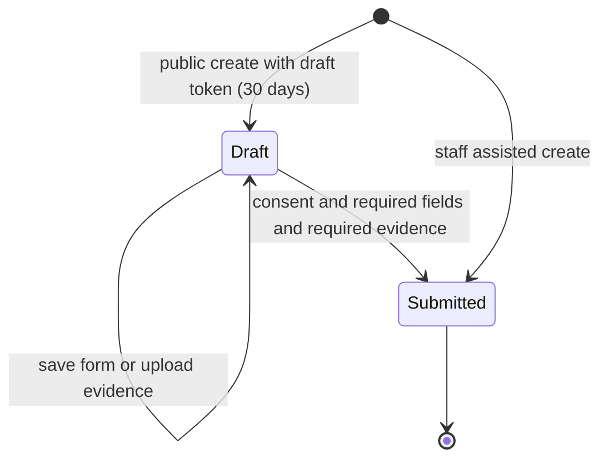

| From | To | Trigger | Guard |
| --- | --- | --- | --- |
| none | Draft | `POST /public/applications` | rate limit 20 per hour per IP in production |
| Draft | Submitted | `POST …/submit` | `consent=true`; legal name, email, country present; required evidence slots have files (FR-ONB-004) |
| none | Submitted | `POST /kyc/cases` (channel Assisted) | `onboarding.manage` |

Differences from SRD v1.0: `Draft` is an application state, not a case stage; there is no separate email-verification step (`emailVerifiedAt` is set when the resume link is opened, FR-ONB-039); applicant uploads after submission are allowed only while the case is in Client action (FR-ONB-041, FR-ONB-045).

**7.1b KYC case (as built)**

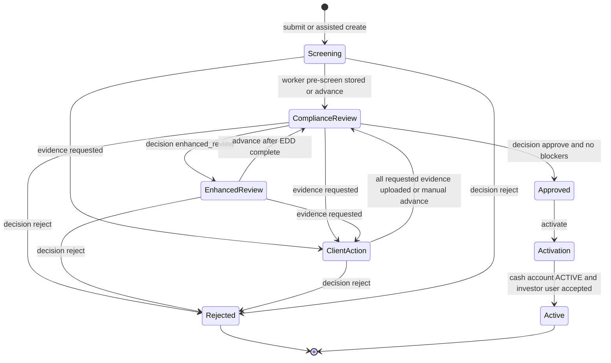

| From | To | Trigger | Actor / guards | Side effects |
| --- | --- | --- | --- | --- |
| none | Screening | submit or assisted create | public applicant or `onboarding.manage` | pre-screen queued via outbox; notification to `onboarding.manage` holders |
| Screening | ComplianceReview | worker result, or `advance` | worker automatic; `advance` needs `onboarding.manage` and `If-Match` | advisory result stored (FR-ONB-007) |
| Screening / ComplianceReview / EnhancedReview | ClientAction | `request-evidence` | `onboarding.manage`; new 14-day draft token emailed | SLA state Client action (120 h); timeline event |
| ClientAction | ComplianceReview | last requested upload (automatic) or `advance` | none | reviewers notified (FR-ONB-045) |
| EnhancedReview | ComplianceReview | `advance` | sets the EDD-complete timestamp | |
| ComplianceReview | Approved | `decision=approve` | `compliance` role; step-up; rationale 5–4000 characters; decider ≠ preparer under policy `kyc_dual_control`; no blockers (FR-ONB-047); `If-Match` | audit; notification |
| ComplianceReview | EnhancedReview | `decision=enhanced_review` | as approve, except blockers | |
| ComplianceReview / EnhancedReview / ClientAction / Screening | Rejected | `decision=reject` | as approve, except blockers | applicant emailed |
| Approved | Activation | `activate` | `onboarding.manage`; not (High risk without EDD); funds approved (DEF-531); **step-up missing today** (DEF-524) | creates client `CL-#####`, mandate shell, DRAFT cash account, investor-admin invitation (FR-ONB-013) |
| Activation | Active | automatic | client has an ACTIVE cash account and at least one accepted investor user | whichever of the two events happens second moves the case (FR-ONB-046) |

SLA hours per stage: Screening 4, ComplianceReview 48, ClientAction 120, EnhancedReview 72, Approved 24, Activation 72. SLA data is stored; escalation, an *Escalated* state and notification are not built (FR-ONB-014).

**Journey.** Applicant (onboarding portal) or staff-assisted create → worker pre-screen (stub provider today) → client services checks evidence (accept/reject per slot, FR-ONB-042) → compliance decides with dual control and step-up → activation creates client, mandate shell and DRAFT cash account → operations/compliance approve the cash account (7.6) → investor-admin invitation accepted (7.12) → case becomes Active → LP administrator invites colleagues (7.19). The admin UI chains approval and activation in one *Approve & activate* click by a Compliance user; if activation fails the case stays Approved with no retry control (FR-ONB-021).

Differences from SRD v1.0 (as built):

- Stage `Submitted` exists but is never entered; the case starts in Screening.
- Reject is allowed from Screening, ClientAction and EnhancedReview as well as ComplianceReview; evidence can be requested from Screening and EnhancedReview.
- Entering EnhancedReview is a manual compliance decision. High risk (including PEP = Yes) blocks approval until enhanced review is complete; it does not move the case automatically. BR-192 (5.C.3) asks for automatic routing of PEP Yes/Unsure and sanctions ≠ No; Q-NEW: should these route automatically to EnhancedReview? — default: block approval and show the blocker (as built), automatic routing deferred.
- The v10 stage names (Identity & Documents, Compliance Review) and the v11 AI stages are not the admin stage set. The final admin UI shows a seven-step display: Application, Ownership, Identity, Financial crime, Suitability, Mandate, Approval (stage index: Submitted 0, ClientAction 2, Screening 3, EnhancedReview 3, ComplianceReview 4, Approved/Rejected/Activation/Active 6). ClientAction is not "Identity & Documents". AI results are advisory; a human decision is always required (FR-ONB-007).
- No SLA escalation; the preparer ≠ decider check is skipped when no staff member has prepared the case (DEF-530).

### 7.2 Order lifecycle

**Build:** Not started. The state machine below is the target [P]. The implemented prototype subset is *Working*, *Awaiting approval*, *Approved*, *Filled* (blotter seed) plus *Routing*, *Partially filled*, *Rejected*, *Cancelled* in the legacy drawer; there is no *Validated* or *Settled* state, no *Reject*/*Cancel* transition on the Orders page, and the only transition is *Awaiting approval → Approved* [I]. The ticket toggles *Draft ↔ Pre-trade checked*, and *Pre-trade checked* corresponds to *Validated* (BR-025).

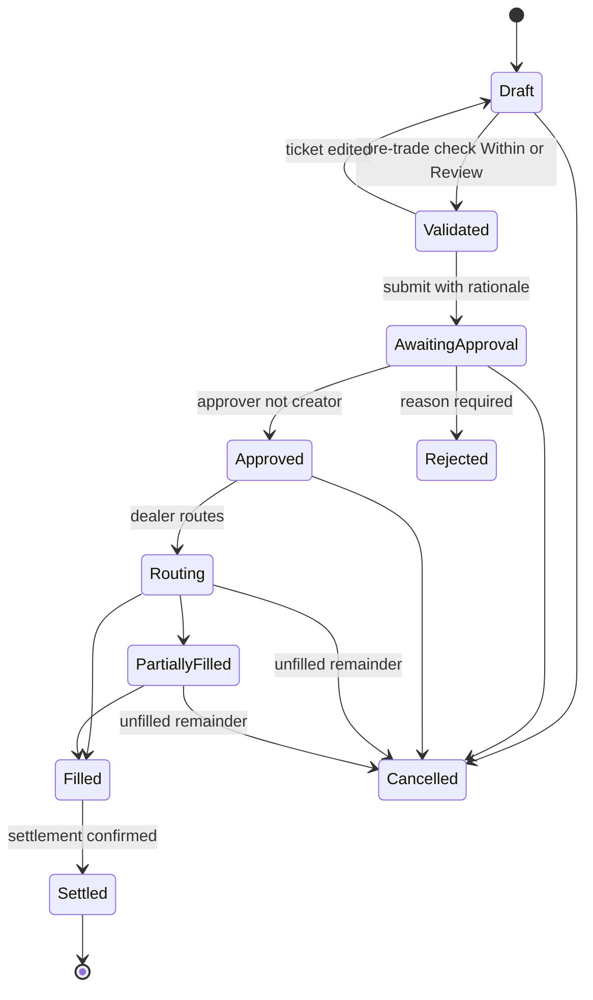

| Transition | Actor / permission | Guard |
| --- | --- | --- |
| Draft → Validated | `orders.create` | pre-trade result per control Pass/Review/Fail, overall Within/Review/Blocked (FR-OMS-017); Blocked cannot proceed |
| Validated → AwaitingApproval | `orders.create` | rationale; Review items need a documented reason; cash reservation created for buys (FR-OMS-005) |
| AwaitingApproval → Approved / Rejected | `orders.approve` | approver ≠ creator (BR-001, FR-OMS-014); reject needs a reason |
| Approved → Routing | `orders.route` | approver ≠ router (BR-003); stored instruction preview (FR-OMS-021) |
| Routing / PartiallyFilled → Filled | `orders.route` or broker feed | filled quantity ≤ order quantity (FR-OMS-008) |
| any → Cancelled | creator or `orders.approve` | reason; reservation released (FR-OMS-015) |

### 7.3 Capital event (built model) and mapping to the LP capital call

**Build:** API Built (`capital_events` per client); the LP UI does not call it. The target fund-level model is 7.13 and 7.14.

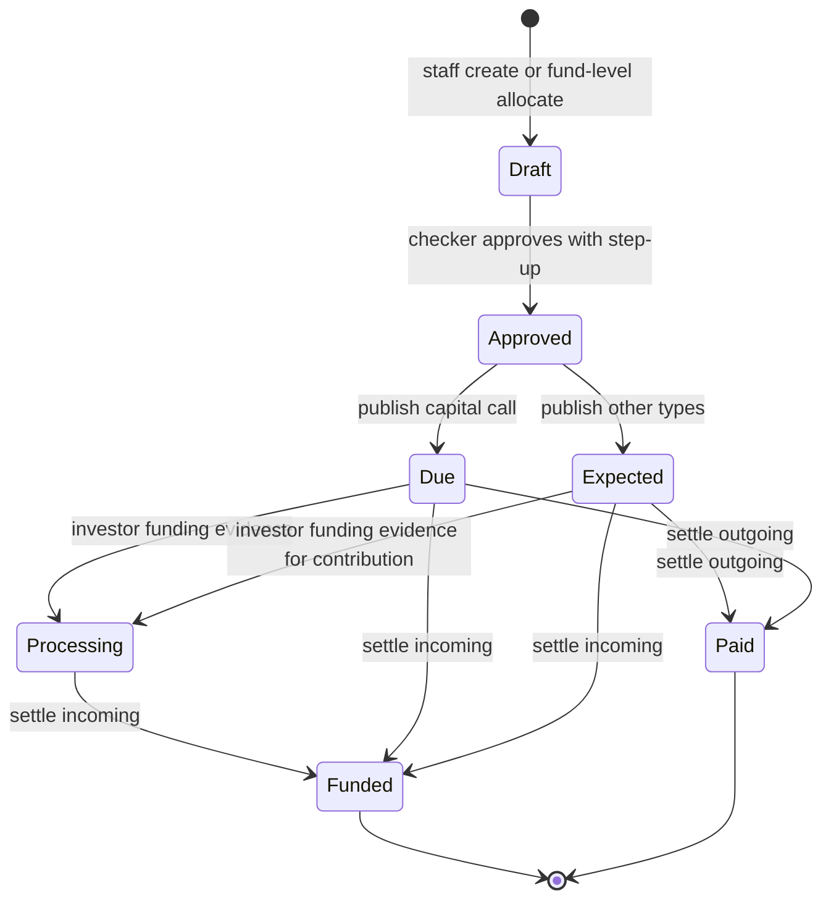

| From | To | Trigger | Actor / guards |
| --- | --- | --- | --- |
| none | Draft | create or `POST /capital-events/allocate` | `clients.edit` or `cash.journal.create`; allocation breakdown sums exactly to the fund amount (FR-INV-020) |
| Draft | Approved | approve | `cash.approve`; step-up; `If-Match`; checker ≠ maker (policy `cash_approval`) |
| Approved | Due / Expected | publish | `clients.edit` or `cash.approve`; investors emailed; **no step-up and no maker/checker check of its own** (DEF-524) |
| Due / Expected / Processing | Processing | investor funding evidence | investor role admin or finance; file plus confirmation (FR-INV-003) |
| Due / Expected / Processing | Funded (call, contribution) / Paid (distribution, withdrawal) | settle | `cash.approve` or `cash.journal.approve`; step-up; matcher ≠ evidence submitter |

Differences from SRD v1.0: Draft and Approved exist before investors see the notice; `settle` replaces the bank-statement match because no cash ledger exists. The built set cannot express acknowledgement or partial payment, so the LP design vocabulary maps as follows (Q-NEW: keep the mapping or migrate the stored values? — default: store the LP vocabulary natively in the new tables and map the old vocabulary at read time during the transition):

| Built status | LP call status (7.13) |
| --- | --- |
| Draft | DRAFT (PENDING_APPROVAL has no equivalent) |
| Approved | APPROVED |
| Due | ISSUED (ACKNOWLEDGED and OVERDUE are flag/derived) |
| Processing | ISSUED with a payment confirmation on file |
| Funded | PAID |
| Expected / Paid | distribution ISSUED / PAID (7.14) |

### 7.4 Report / document publication

**Build:** Documents Built (API); the vault and report pages do not call it. Reports are [P].

**Documents (implemented).**

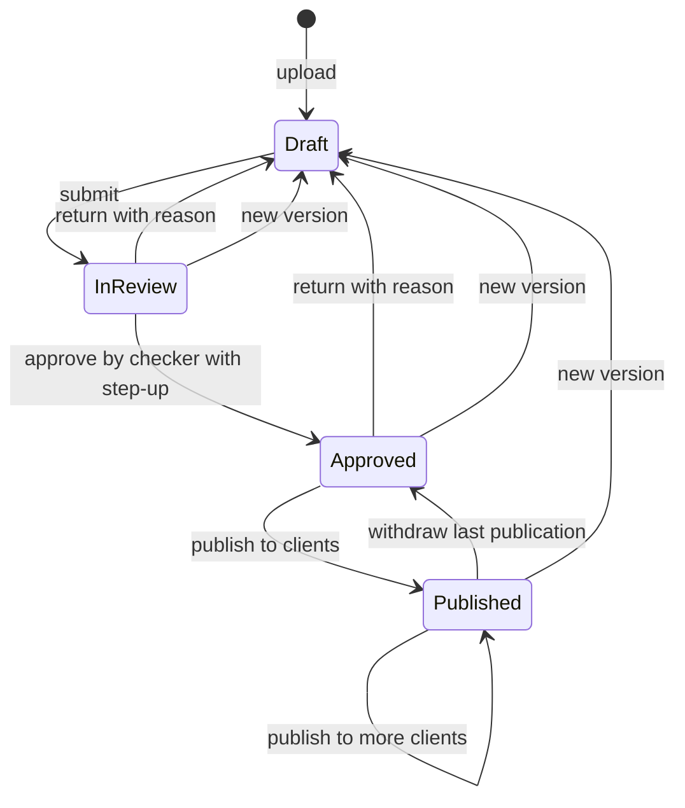

| From | To | Trigger | Guards |
| --- | --- | --- | --- |
| Draft | In review | submit | `documents.edit`; `If-Match` |
| In review | Approved | approve | `documents.edit`; step-up; `If-Match`; checker ≠ maker (policy `document_approval`) |
| In review / Approved | Draft | return | reason 3–1000 characters |
| Approved / Published | Published | publish | classification Client or Public; a file exists; at least one client; creates a Pending signature request per client when `requiresSignature`; **no step-up, no `If-Match`** (DEF-524) |
| Published | Approved | withdraw | reason 3–1000; applies when no active publication remains; cancels pending signature requests |
| any except Superseded | Draft | new version | clears approval; withdraws publications (investor loses access immediately, FR-DOC-024) |

Signature request: Pending → Signed (signatory signs with step-up, FR-DOC-006) or Cancelled (withdrawal). `Superseded` exists in the data model and in the new-version guard but no endpoint sets it. Restricted is a classification, not a status; Restricted documents never publish externally (BR-047).

**Reports (running UI, [I]).** Draft, Review, Published only. Target chain [P]: Draft → In review → Awaiting approval → Approved → Published → (Superseded), with maker ≠ checker and the route Review · Compliance, Approve · Investment Director, Publish · Client Services (FR-DOC-009, BR-045).

**LP document categories and read states (5.B.6).** Categories: Statements, Capital Calls, Distributions, Fund Reports, Tax, Legal, Governance, Other (API enum `QUARTERLY_STATEMENT`, `CALL_NOTICE`, `PERFORMANCE_REPORT`, `TAX`, `LEGAL`, `GOVERNANCE`, `MANUAL`, BR-116). Each view, preview and download is audited with user and IP (BR-174); the SHA-256 is verified on request (FR-LP-070).

### 7.5 Service request (investor) — built model

**Build:** API Built; staff transitions are not restricted to the diagram.

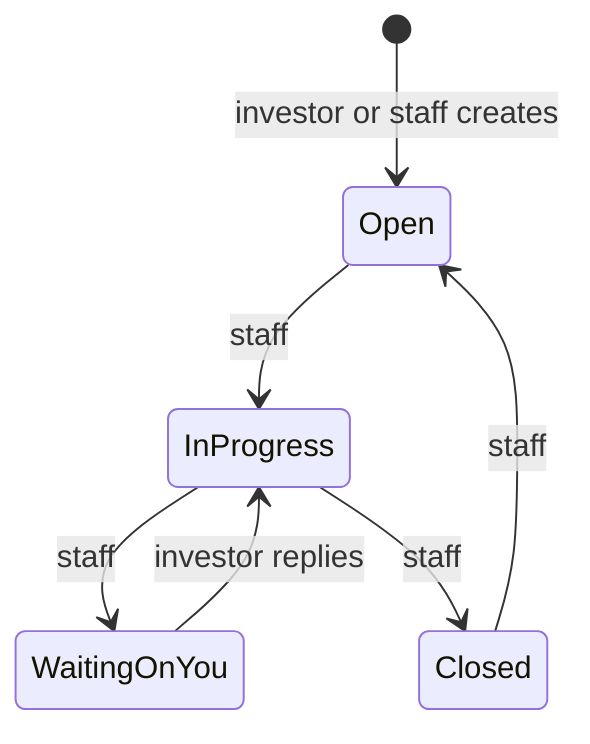

| From | To | Trigger | Guards |
| --- | --- | --- | --- |
| none | Open | investor `POST /investor/requests`, staff `POST /service-requests`, or profile-change request | investor `requests.view` or `profile.view`; staff `clients.edit`; SLA 48 h Normal or 8 h Time sensitive (High and Urgent both stored as Time sensitive) |
| any | Open / In progress / Waiting on you / Closed | staff PATCH | `clients.edit`; `If-Match`; Closed sets progress to 100; Waiting on you and Closed also email the client |
| Waiting on you | In progress | investor reply | none |

Complaints carry a separate SLA and escalation (Q-12, not built). An SLA breach is only a computed flag. The LP vocabulary (SUBMITTED … CLOSED, 8 values) is in 7.17.

### 7.6 Cash account

**Build:** API Built; the admin UI offers *Submit for approval* on SUSPENDED/CLOSED accounts and has no *Reactivate* control (FR-CLI-011); the prototype jumps ACTIVE → CLOSED in one step with client-side blockers.

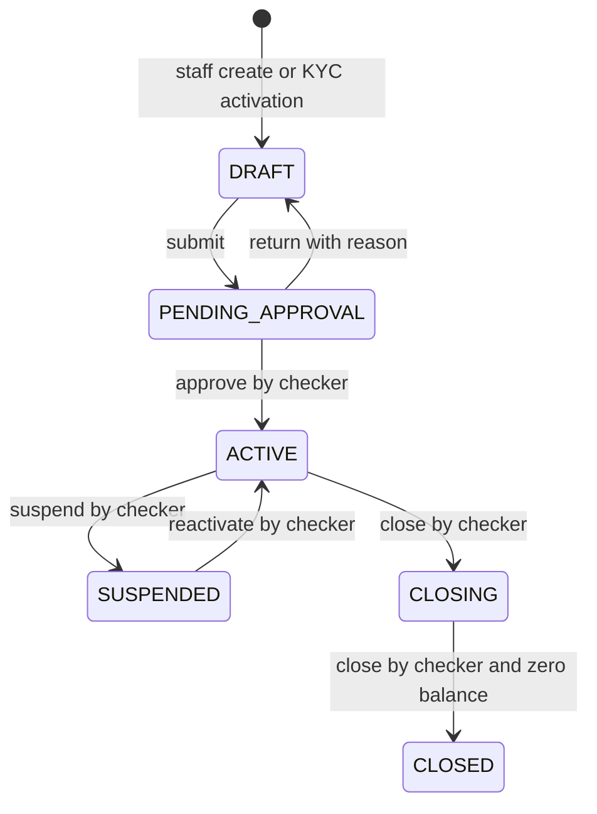

| Action | Permission | Checker ≠ maker (policy `cash_approval`) | Notes |
| --- | --- | --- | --- |
| submit | `clients.edit` or `cash.approve` | no | DRAFT only; a DRAFT account cannot be edited, so the KYC-created draft keeps provider and identifier "Pending" |
| approve | `cash.approve` | yes | step-up missing today (DEF-524) |
| return | `cash.approve` | no | reason required; the UI label "Reject" is the API action `return` |
| suspend / reactivate / close | `cash.approve` | yes | close is two calls (ACTIVE → CLOSING → CLOSED); the zero-balance, no-reservation, no-open-break, no-suspense blockers of BR-033 are not enforced yet |

All actions accept `If-Match`. A cash account in DRAFT or PENDING_APPROVAL cannot post journals, reserve cash or commit imports; SUSPENDED, CLOSING, CLOSED accept no new reservations or manual journals (BR-034, BR-060).

### 7.7 Reconciliation break

**Build:** Not started (prototype). The running prototype groups breaks as **Waiting source → Needs action → Ready checker → Matched (Closed)** with statuses *Waiting source*, *Source received*, *Investigating*, *Pending checker*, *Closed* and severities critical, high, waiting, ready, matched; there is no *New*, *Assigned*, *Awaiting counterparty* or *Overdue* state and no return transition [I]. Target state machine [P]:

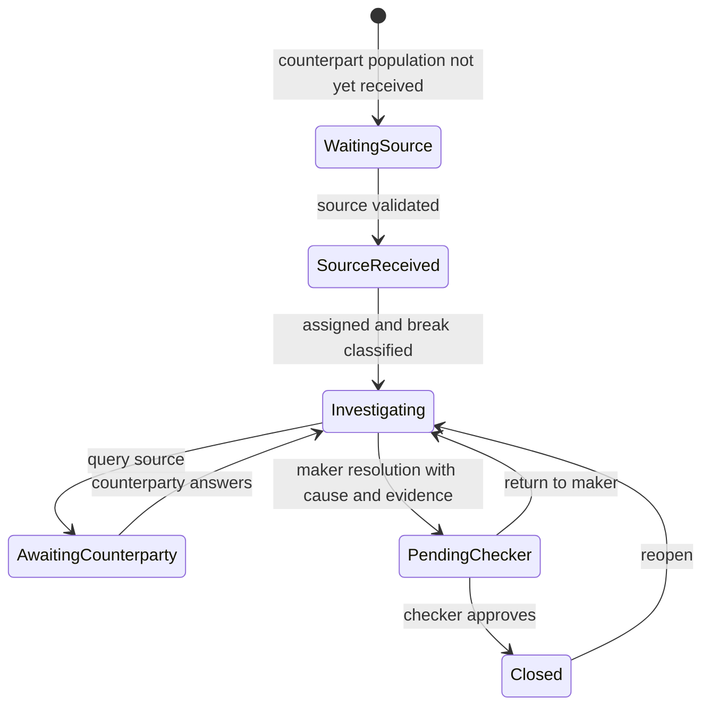

Guards: a case may not be classified as a break until the independent counterparty population has been received and validated (BR-065); maker resolution needs cause, rationale and at least one evidence reference (FR-REC-004); checker ≠ maker and holds a distinct permission (FR-REC-005); Critical breaks and breaks older than the SLA are flagged Overdue; daily sign-off is blocked while a Critical or High break is open or a scheduled source is missing (FR-REC-007, BR-067). Origins of a break: reconciliation run, order post-trade linkage, custodian portal submission (7.26). A settlement-fail break (REC-66091) appears as an Operations runbook task and gates the NAV-close-readiness task.

### 7.8 NAV run

**Build:** Not started. The prototype states are derived, not stored: Blocked (exception open) → Ready for maker (the UI still labels it "Blocked") → Ready for checker → Released; there are no ExceptionsOpen, Draft or Superseded states in the UI; Recalculate is allowed in every state and only increments the version [I]. Target [P]:

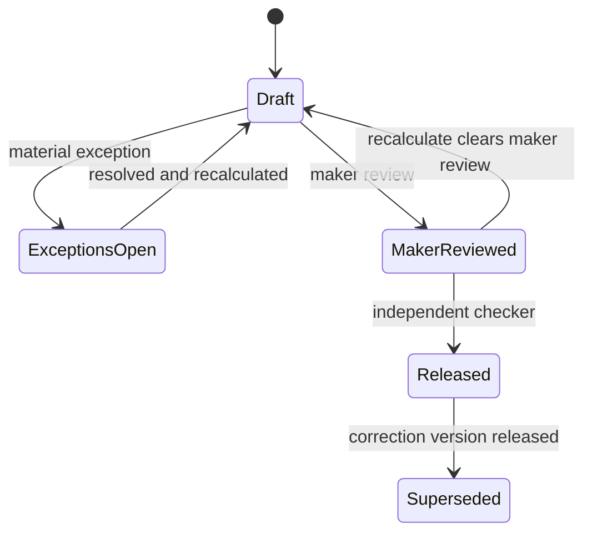

Guards: resolution requires a rationale and evidence (FR-VAL-003, FR-VAL-011); maker review is blocked while a material exception is open (FR-VAL-002); release needs maker review done and checker ≠ maker (FR-VAL-004, FR-VAL-009); recalculation after maker review or release creates a new calculation version and clears the maker review (BR-068, FR-VAL-012); a released run is immutable and corrected only by a superseding version (FR-VAL-005). Release state shown as Blocked, Ready for maker, Ready for checker, Released (FR-VAL-013).

### 7.9 Calculations and business rules

Rules are grouped by the area that owns them. IDs are never reused. The label is as stated in the register row; where a row states none it is a target rule **[P]**. *Build* is given for the v1.0 rules and for the SoD rules defined in 4.5; new rules are built or not as the requirements that reference them (6.x).

#### 7.9.1 Rules from SRD v1.0 (corrected)

| ID | Rule | Label | Build | As-built note / correction |
| --- | --- | --- | --- | --- |
| BR-010 | AVAILABLE = POSTED − RESERVED − BLOCKED; WITHDRAWABLE = AVAILABLE − pending outflows − minimum balance; EXPECTED is shown separately and never added to AVAILABLE. **Cash page formula (5.A.15, default):** AVAILABLE = max(0, POSTED SETTLED + reusable cleared proceeds or approved credit − active reservations − holds − pending withdrawals − minimum buffer); WITHDRAWABLE = POSTED SETTLED − reservations − holds − buffer; rule version tag `AVAIL-<ccy>-vN` (page uses v4). Q-NEW: which AVAILABLE formula is canonical? — default: the Cash page formula. | [O] copy / [P] formula | Not started | No cash ledger. Worked example (CCA-1188): posted 882,114.00 − reserved 0.00 − blocked 25,000.00 = available 857,114.00; withdrawable 832,114.00. WITHDRAWABLE and EXPECTED are stored text in the prototype; seed violates "EXPECTED never added" (CCA-1042); the page KPI *Available cash* sums all USD accounts including omnibus, DRAFT and CLOSING (to fix). |
| BR-011 | Journal: Σ debits = Σ credits per currency, per cash-account currency, compared in integer minor units. | [O] | Not started | The prototype does not compare journal currency with the account currency (FR-CASH-011). |
| BR-012 | NAV = market value of positions + cash + accruals − fees/liabilities; NAV/unit = NAV ÷ units outstanding (4 dp, rounded, not truncated); the bridge (previous + market movement + net subscriptions/redemptions + fees and accruals + override adjustment) sums exactly to Draft NAV. | [I] | Not started | NAV page values are hard-coded; displayed NAV/unit is wrong for *Zimbabwe Opportunities* (4.2281 vs 7.870 ÷ 1.861 = 4.2289) and truncates (FR-VAL-010). |
| BR-013 | Price coverage = valued positions ÷ total positions by market value; material exception if difference > tolerance (default 1 % of position or US$ 50k; Q-13, Q-79). | [I]/[P] | Not started | Hard-coded on the NAV page. |
| BR-014 | Stress loss = Σ exposure × shock by factor (equity, FX, rates duration × Δy); liquidity coverage = liquid assets ÷ (redemption shock × NAV). Status Escalate if a limit is breached, Review if within 10 % of limit, else Within; scenario state thresholds are configurable (BR-029). | [O]/[P] | Not started | |
| BR-015 | Private markets: called ≤ commitment; **unfunded = commitment − called (not paid-in)**; outstanding called = max(0, called − paid-in); DPI = distributions ÷ paid-in; RVPI = NAV ÷ paid-in; TVPI = (distributions + NAV) ÷ paid-in; IRR from dated cash flows. LP formulas in BR-146 to BR-148. | [O] | Not started | Figures are imported into investor snapshots, not computed. Inventory shows hard-coded IRR and Multiple only. |
| BR-016 | Returns: daily TWR chain-linked; Brinson allocation/selection/interaction per sector vs benchmark; active return = portfolio − benchmark; bridge and Brinson rows sum to active return within 0.01 percentage points; Total = allocation + selection + interaction. | [O] copy / [P] calculation | Not started | The series is synthetic (anchors plus a sine wave) and the Brinson table is a literal. |
| BR-017 | Slippage (bp) = (avg fill − decision price) ÷ decision price × 10 000 (sign by side). | [I] | Not started | No orders module. |
| BR-018 | Presentation-currency conversion uses the valuation-date FX rate of the approved rate source; the rate and its date are stored with each ledger row and never restated (BR-152, BR-170, BR-171). | [O] fx map / [P] | Partial | The snapshot carries an FX map but it is not linked to an approved rate source. |
| BR-019 | Every approval requires the approver to hold the permission at approval time and differ from the maker (BR-001). | [O] | Built | Permissions are resolved per request for existing approvals. |
| BR-020 | Onboarding required evidence per type (single catalogue, FR-ONB-033); PEP = Yes rates the case High risk, which blocks approval until enhanced due diligence is complete (see 7.1 and BR-192). | [P] | Built | Individuals need doc1–doc3, other types doc1–doc4 (API); UI needs 9 slots. |

#### 7.9.2 Segregation-of-duties rules defined in 4.5 (build status)

| ID | Rule (4.5) | Build | Note |
| --- | --- | --- | --- |
| BR-001 | A user may not approve an item they created. | Partial | Enforced for KYC decisions, cash accounts, capital approve and settle, snapshot publish, document approve and reporting-pack review; the other listed objects (orders, journals, imports, NAV, elections, recon sign-off, reports) do not exist yet. |
| BR-002 | `system_admin` must never hold a monetary permission. | Built | Bundle locked; SoD scan flags violations. |
| BR-003 | Order approval and routing are held by different people. | Not started | Seeded roles already keep `orders.approve` and `orders.route` apart. |
| BR-004 | At least two active users hold `admin.rbac`; assigning/removing `system_admin` requires confirmation. | **Contradicted** | The code requires at least one active System Administrator and flags more than two; it checks neither two `admin.rbac` holders nor a confirmation flag (DEF-522). AC: removing a role that would leave fewer than two active `admin.rbac` holders returns 409; the SoD scan flags fewer than two. |
| BR-005 | Policy toggles are configurable and relaxing any is flagged by the SoD scan. | Partial | All toggles are stored; the SoD scan flags relaxed order, cash and document approval only. |
| BR-006 | Changes to bank instructions require dual approval and out-of-band verification. | Not started | No bank-instruction change API; `bankApproval` is stored but not enforced. LP path: BR-185, FR-LP-096, FR-INV-008. |

#### 7.9.3 New business rules

The rules below are all rules added in v2 (BR-021 to BR-276), each exactly once, in the order of the area that owns them. Rules marked **[P]** in their text are targets.

##### 7.9.3.1 Admin shell, Command Centre, portfolio, construction, orders, research, risk (5.A.0 to 5.A.7)

Rules from the prototype pages; the page permission and vocabulary rules mostly describe targets. (9 rules, BR-021 to BR-029.)

| ID | Rule | Label | Source |
| --- | --- | --- | --- |
| BR-021 | a page jump is permission-checked once; a refusal produces exactly one "Access restricted" toast. | [P] | 5.A.1 |
| BR-022 | a portfolio cannot receive orders while in state *Setup*. | [P] | 5.A.2 |
| BR-023 | house liquidity floor is a policy parameter, not a constant, and "cover" is defined as liquid assets ÷ stressed outflows over the horizon. | [P] | 5.A.3 |
| BR-024 | a scenario whose weights do not sum to 100 ± 0.01 cannot be saved, optimised or promoted. | [P] | 5.A.4 |
| BR-025 | the displayed order-state vocabulary is the one in Appendix B (*Draft*, *Validated*, *Awaiting approval*, *Approved*, *Rejected*, *Routing*, *Partially filled*, *Filled*, *Settled*, *Cancelled*); *Pre-trade checked* maps to *Validated*. | [P] | 5.A.5 |
| BR-026 | the dealing cost buffer (0.65 %), residual-cash warning (15 %), ADV advisory (25 %) and review thresholds (12 %, 450k/1.2m, 9.5 %) are configurable policy parameters. | [P] | 5.A.5 |
| BR-027 | recommendation list is *Buy*, *Accumulate*, *Hold*, *Reduce*, *Sell*, plus *Review* as an explicit status if kept; conviction scale is defined once (letters or 1–5). | [P] | 5.A.6 |
| BR-028 | usage ≥ 85 % of a maximum limit (or ≤ 115 % of a minimum limit) is *Tight*; a breach creates a case and notifies the limit owner. | [P] | 5.A.7 |
| BR-029 | the scenario state thresholds (liquidity 1.25× / 1.5×, loss −8 % / −5 %) are configurable policy parameters. | [P] | 5.A.7 |

##### 7.9.3.2 Performance, clients, investor services, onboarding, reports, vault, IBOR, cash, operations, reconciliations, NAV (5.A.8 to 5.A.18)

Rules marked **[O]** (server) are enforced by the built API (documents, cash accounts); the rest are targets or prototype behaviour. (40 rules, BR-030 to BR-069.)

| ID | Rule | Label | Source |
| --- | --- | --- | --- |
| BR-030 | A performance period may be locked only when all five controls (IBOR positions reconciled, cash reconciled, valuation sources approved, composite membership review, fees and flows validated) are done, and only by a user other than the preparer; once Official the period is immutable and corrections create a new version with a reason **[P]**. | [P] | 5.A.8 |
| BR-031 | Locking, export and methodology-version changes each write an audit event with user, time, period and result **[P]**. | [P] | 5.A.8 |
| BR-032 | Period, return basis and State shown on the control bar must come from the same record as the KPI *Official state* **[P]**. | [P] | 5.A.8 |
| BR-033 | Cash-account closure requires zero posted balance, no active reservations, no open reconciliation break and no suspense on the account, enforced by the server for the CLOSING → CLOSED step — AC: closing an account with posted 5.00 returns 409 with the blocker list. | [P] | 5.A.9 |
| BR-034 | A cash account in DRAFT or PENDING_APPROVAL cannot post journals, reserve cash or commit statement imports — AC: such calls return 409. | [P] | 5.A.9 |
| BR-035 | The cash-account maker is the signed-in user (not a fixed text) and the SoD check compares user ids — AC: a maker cannot approve, suspend, reactivate or close their own account; the drawer shows the maker's name. | [P] | 5.A.9 |
| BR-036 | A capital notice, once `Funded` or `Paid`, must stay visible to staff in a capital history list with its evidence and approver names. | [P] | 5.A.10 |
| BR-037 | KPI tiles must be calculated from the same queue data the page lists, so that each tile count equals the number of rows it summarises. | [P] | 5.A.10 |
| BR-038 | Cases in Activation and Active must not count as "Ready to approve". | [P] | 5.A.11 |
| BR-039 | The production UI must not store applicant PII in browser storage. | [P] | 5.A.11 |
| BR-040 | KPI tiles, chart counts, the result count and the CSV export are all derived from the same filtered set so they always agree. **[O]** | [O] | 5.A.12 |
| BR-041 | date presets are anchored to the period end (fixed 2026-08-31 in the prototype), not the system clock. **[O]** Production anchor is a decision (see Q-NEW below). | [O] | 5.A.12 |
| BR-042 | a report whose status is *Review* is counted as "Awaiting review" and requires a human sign-off before release; client and regulatory outputs need a human reviewer. **[I]** (text only) | [I] | 5.A.12 |
| BR-043 | the official NAV / performance period must be locked before a report is published; one material data exception blocks a report. **[I]** (text only; ties to 5.A.8 *Lock official return* and 5.A.18) | [I] | 5.A.12 |
| BR-044 | numeric fields in a report are bound to approved source data; manual edits are flagged as overrides; every save creates an audit checkpoint. **[I]** (editor copy only) | [I] | 5.A.12 |
| BR-045 | workflow vocabulary for reports is Draft, In review, Awaiting approval, Approved, Published (Appendix B); the running UI uses Draft, Review, Published only. The target must map *Review* → *In review* (or *Awaiting approval*) and render the full chain. | [P] | 5.A.12 |
| BR-046 | document lifecycle is Draft → In review → Approved → Published; *Return* sends In review or Approved back to Draft with a reason; *Withdraw* removes publications and reverts to Approved; a new version always resets to Draft (and withdraws a Published document from investors until re-approved). **[O]** (server) | [O] | 5.A.13 |
| BR-047 | only documents classified *Client* or *Public* can be published to investors; *Internal* and *Restricted* cannot (error "<classification> documents cannot be published to investors"). **[O]** (server) | [O] | 5.A.13 |
| BR-048 | a *Restricted* document can be downloaded only by a user holding `audit.view` or by its maker; every download is audited. **[O]** (server) | [O] | 5.A.13 |
| BR-049 | download links are short-lived signed URLs (expiry 300 seconds). **[O]** (server) | [O] | 5.A.13 |
| BR-050 | documents are never deleted through the API; retention years per document default to 7 (range 1–50). **[O]**; legal-hold blocking is | [O] | 5.A.13 |
| BR-051 | file storage is encrypted at rest with a recorded SHA-256 per version. **[O]** | [O] | 5.A.13 |
| BR-052 | optimistic locking — a lifecycle call supplying a stale version returns "This record was changed by someone else. Reload and try again." **[O]** | [O] | 5.A.13 |
| BR-053 | publish creates a Pending signature request per client when the document requires a signature. **[O]** | [O] | 5.A.13 |
| BR-054 | allowed upload types pdf, docx, xlsx, csv, png, jpg; ≤ 25 MB; malware scan before availability; classification required. **[P]** (the server accepts a wider MIME list and performs no scan) | [P] | 5.A.13 |
| BR-055 | Position quantity must equal settled + unsettled quantity, and the Position count, Market value and Available cash KPIs must equal the aggregates of the positions in scope **[P]**. | [P] | 5.A.14 |
| BR-056 | A position whose custodian quantity differs from the IBOR quantity is shown as *Review* and appears in the Exceptions count until the break is resolved; the reconciliation tab shows the actual difference **[P]**. | [P] | 5.A.14 |
| BR-057 | Historical snapshots are read-only reconstructions from effective-time records; they never change current positions **[P]**. | [P] | 5.A.14 |
| BR-058 | Order-eligible available cash is a single server-calculated value shared by the cash page, the order ticket, reservations and withdrawals (rule version recorded with every result). | [P] | 5.A.15 |
| BR-059 | Journal posting, reservation creation and statement commit are atomic with row-level locking of the cash account so concurrent requests cannot over-reserve or double-post. | [P] | 5.A.15 |
| BR-060 | A cash account in status SUSPENDED, CLOSING or CLOSED accepts no new reservations or manual journals; reconciliation postings remain allowed. | [P] | 5.A.15 |
| BR-061 | A task is **overdue** when the current CAT time is later than its deadline and its state is not *Done*; overdue tasks show a red *Overdue* flag and count towards *Due today*. | [P] | 5.A.16 |
| BR-062 | A task whose dependency is not *Done* cannot be marked *Done*; completing a task re-evaluates dependants and automatically moves *Blocked* tasks whose blockers have cleared to *Due*. | [P] | 5.A.16 |
| BR-063 | A task creator may not mark their own task *Done* when the task is flagged as a control task (extends BR-001). | [P] | 5.A.16 |
| BR-064 | KPI and dependency values are computed server-side from live data: *Due today* = tasks due today with state ≠ *Done*; *Close blockers* = tasks and controls with state *Blocked* that gate period close; *Settlement* readiness % = settled or matched instructions ÷ total instructions for today; *Cash* % = share of bank feeds received within their schedule; *Valuation* % = priced positions ÷ total positions; *Accounting* % = completed close-checklist items ÷ total items. | [P] | 5.A.16 |
| BR-065 | a reconciliation case may not be classified as a break until the independent counterparty population has been received and validated. | [P] | 5.A.17 |
| BR-066 | the prototype assumes the broker price is always the instruction price plus 0.01, so a trade break is always created at stage 8; production must create a break only when a real difference exists. | [P] | 5.A.17 |
| BR-067 | Quantity and order-reference matching are exact; price tolerance, amount tolerance, as-of tolerance and NAV materiality are effective-dated configuration per family, not constants in code. | [P] | 5.A.17 |
| BR-068 | recalculating a run after maker review or after release invalidates the maker review, and a released run may only be corrected by a new superseding version (FR-VAL-005) **[P]**. | [P] | 5.A.18 |
| BR-069 | the NAV exception list, price coverage and release gates (*Source evidence current*, *Cash reconciled*, *Material exceptions*, *Maker review*) are computed from live source status, reconciliation sign-off and exception state, not static labels **[P]**. | [P] | 5.A.18 |

##### 7.9.3.3 Financing, corporate actions, regulatory, data, models, copilot, settings, audit (5.A.20 to 5.A.28)

Targets for modules that have no API yet, except BR-076 and BR-077 which the server already implements. (8 rules, BR-070 to BR-077.)

| ID | Rule | Label | Source |
| --- | --- | --- | --- |
| BR-070 | A margin dispute resolution records reason, counterparty evidence and the house calculation; funding a call requires maker ≠ checker and creates a cash expectation (FR-FIN-002). | [P] | 5.A.20 |
| BR-071 | An election can be submitted only before the election deadline and only by `corporate_actions.elect` (Q-04). Approval by a different user moves the event to *Instructed*. | [P] | 5.A.21 |
| BR-072 | Attestation must be recorded by two distinct users (Compliance and Finance); the filer must hold `regulatory.submit` (Q-04) and differ from the preparer. | [P] | 5.A.22 |
| BR-073 | A source is authoritative only after connectivity, authentication, schema and quality checks pass and the named owner approves. | [P] | 5.A.23 |
| BR-074 | The validator and the approval committee must be independent of the model owner. Production promotion requires closed high-severity findings and committee approval recorded by `models.approve` (Q-04). | [P] | 5.A.24 |
| BR-075 | Copilot answers may cite only objects the requesting user is entitled to read. A question whose sources are all out of entitlement returns guidance without data. | [P] | 5.A.25 |
| BR-076 | A setting change is audited with before/after values (the server already writes `settings.updated`); settings with no consumer must be removed or wired before release. | [P] | 5.A.27 |
| BR-077 | Exporting audit evidence is itself an audited event (implemented as `audit.exported`). | [P] | 5.A.28 |

##### 7.9.3.4 LP portal: page rules (5.B.0 to 5.B.10)

Rules from the LP screens. The reference backend (NVCCZ) is the oracle for behaviour; where it is known to be wrong the rule states the Nexus behaviour to build. (59 rules, BR-078 to BR-136.)

| ID | Rule | Label | Source |
| --- | --- | --- | --- |
| BR-078 | every monetary figure on every screen carries the as-of date and valuation status of the snapshot it was read from; PROVISIONAL, ESTIMATED and RESTATED must be visually distinct from FINAL (amber, amber, purple) and may never be shown without the label. | [P] | 5.B.0 |
| BR-079 | fund, share class and as-of parameters sent by the browser are advisory; the API recomputes the allowed set from the user's entitlements and returns a generic 404 for anything outside it. | [P] | 5.B.0 |
| BR-080 | a null or unavailable rate (Net IRR on a fund with no cash flows) is shown as *—*, never as 0.0 %; rates are always sent as fractions so the heuristic can be removed. | [P] | 5.B.1 |
| BR-081 | *Total Commitment* = sum of the investor's contractual commitments (status ACTIVE or PENDING) in scope. *Paid-In Capital* = cash contributions received and posted. *Called* = capital formally called and visible to the investor (calls at ISSUED or later). *Unfunded Commitment* = Total Commitment − Called (never − Paid-In). *Outstanding called* = Called − Paid-In (floored at 0). So Paid-In + Outstanding called + Unfunded = Total Commitment. **[I]** | [I] | 5.B.1 |
| BR-082 | the consolidated Net IRR is computed from the merged dated cash flows of all in-scope funds, or shown as *—* when it cannot be computed. **[P]** | [P] | 5.B.1 |
| BR-083 | the Capital Position donut shows a partition of the commitment (Paid-In, Called Not Yet Paid, Unfunded) so the shares sum to 100 %; distributions and residual value are shown as separate figures, not as extra slices of the commitment. **[P]** | [P] | 5.B.1 |
| BR-084 | the toggle windows are time based (YTD = from 1 January of the as-of year; 1Y = 12 months; 3Y = 36 months, each ending at the as-of date), applied to dated points, and the subtitle shows the active window instead of the static *Since Inception*. **[P]** | [P] | 5.B.1 |
| BR-085 | the figures are those of the latest approved snapshot dated on or before the selected as-of date for each fund; the response `asOfDate` and `valuationStatus` are displayed, and for *All Funds* the status shown is the weakest status among the funds (ESTIMATED weaker than PROVISIONAL weaker than RESTATED weaker than FINAL) with the oldest snapshot date. **[P]** The real service currently picks the latest snapshot regardless of the requested as-of date. **[I]** | [P]/[I] | 5.B.1 |
| BR-086 | for a selected OPEN_ENDED fund the KPI strip shows Account Value, Units Held, NAV Per Unit, YTD Return and net contributions and redemptions instead of commitment, called, DPI, RVPI and TVPI; the Capital Position panel is hidden; for a PRIVATE_CAPITAL fund the open-ended panel is absent; for *All Funds* with both models both blocks show. The API returns `openEndedSummary: null` (not zeros) when no OPEN_ENDED fund is in scope. **[P]** (design guardrail: never show commitment, DPI or TVPI for an open-ended fund unless configured). **[I]** | [P]/[I] | 5.B.1 |
| BR-087 | the presentation currency (USD or ZIG) is applied by the API to every amount of the dashboard payload using the exchange rate of the as-of date, and the screen formats with the returned currency; the compact formats use the currency symbol or code, and chart axes show the currency. **[P]** | [P] | 5.B.1 |
| BR-088 | when a single OPEN_ENDED fund is selected the KPI row shows the open-ended measures (Account Value, Units Held, NAV Per Unit, YTD Return, and 1M, 3M, 1Y, SI returns) instead of Net IRR, TVPI, DPI and RVPI; with *All Funds* and both models the private-capital KPIs cover the PRIVATE_CAPITAL funds only and the open-ended panel covers the OPEN_ENDED funds. **[P]** | [P] | 5.B.2 |
| BR-089 | the *Period* select changes the figures: Net IRR, TVPI, DPI, RVPI and NAV change reflect the chosen window from approved period snapshots (or are marked as unavailable for that window), and the helper under each tile names the active period instead of the static *Since Inception*. **[P]** | [P] | 5.B.2 |
| BR-090 | the range buttons are time windows ending at the as-of date and are the single period control of the history chart; selecting *Period* in the filter bar sets the same window. **[P]** | [P] | 5.B.2 |
| BR-091 | a benchmark series exists only when approved points are stored for the pair (benchmark id, metric); the API then returns `configured: true`, `valuationStatus: FINAL`, the points with their date and label, the source and approval date; otherwise `configured: false`, `valuationStatus: UNAVAILABLE`, an empty series and the note *No approved {BENCHMARK} series is configured for {METRIC}.* The platform never generates a benchmark series. **[I]** | [I] | 5.B.2 |
| BR-092 | the column shows the benchmark value for the fund's own benchmark and as-of date, per row. **[P]** | [P] | 5.B.2 |
| BR-093 | the *Benchmark Comparison* panel compares the investor's (or selected fund's) value of the chosen metric with the selected benchmark's value for the same as-of date, in one chart, and the axis scale follows the metric (percent or multiple). **[P]** | [P] | 5.B.2 |
| BR-094 | the card shows the real status of the snapshot (weakest status among the funds for *All Funds*) with a colour per status (green FINAL, amber PROVISIONAL or ESTIMATED, purple RESTATED), and the page shows the snapshot's calculation date, version, source module and approver (for example in the Valuation Notes card or a popover). **[P]** Historic approved figures remain visible and unchanged after later valuations. **[I]** | [P]/[I] | 5.B.2 |
| BR-095 | the chart axis titles and money symbols follow the reporting currency. **[P]** | [P] | 5.B.2 |
| BR-096 | *Download Report* creates a server-side report job that captures the selected fund, period, benchmark and as-of date; job states are QUEUED, RUNNING, COMPLETED, FAILED, CANCELLED; the screen polls until a terminal state or a timeout and treats every terminal state explicitly (COMPLETED downloads; FAILED shows the job error; CANCELLED shows a cancellation message; timeout shows a "still preparing" message and keeps the job id so the file can be fetched later). **[P]** | [P] | 5.B.2 |
| BR-097 | one job vocabulary is used by the API and the screen (QUEUED, RUNNING, COMPLETED, FAILED, CANCELLED), and a COMPLETED performance-report job is downloadable by `GET /lp-portal/jobs/{jobId}/download` (or the `downloadUrl` returned by the job), with `Content-Type: application/pdf` and `Content-Disposition: attachment; filename="fund-performance-{fund or consolidated}-{as-of date}.pdf"`. **[P]** | [P] | 5.B.2 |
| BR-098 | the API returns every ledger amount as a positive magnitude and the kind carries the direction; the demo data returns outflows as negative numbers, which makes the net formula add them. **[O] / [P]** | [O]/[P] | 5.B.3 |
| BR-099 | Ledger amounts are positive magnitudes; the type determines direction; Net Cash Flow = contributions + subscriptions - distributions - redemptions - fees over settled (posted) rows only. — AC: for the demo data the net equals contributions + subscriptions minus the absolute distributions, redemptions and fees. | [P] | 5.B.3 |
| BR-100 | all dates in the register are shown in UTC date form `MMM d, yyyy`. — AC: the step date equals the date stored. | [P] | 5.B.4 |
| BR-101 | The full account number in the wiring dialog is shown only to roles that may pay (SIGNATORY, MANAGER) and each reveal is audited; VIEWER sees only the masked number. Q-113: Is a VIEWER allowed to see the full wiring text? — default: no. | [P] | 5.B.4 |
| BR-102 | a snapshot binds the fund, share class, amount (subscription) or mode/amount/units/earliest dealing date (redemption) and currency; the hash must be computed over a fixed canonical field list that excludes `estimateSnapshotId` and unrelated keys, so that the same request produces the same hash at estimate time and at submit time. The real backend hashes the whole redemption body (including `estimateSnapshotId` at submit time), which can never match; the Nexus implementation must not copy that. | [P] | 5.B.5 |
| BR-103 | a snapshot is single-use: after a successful submit it is marked consumed and cannot back a second request. (The real backend leaves it reusable for 15 minutes.) | [P] | 5.B.5 |
| BR-104 | on submit the server re-checks every rule that the estimate checked (notice period, minimum balance, units available net of pending redemptions, compliance gate), because the position and the rules can change within the 15-minute life of a snapshot. (The real backend re-checks only the compliance gate.) | [P] | 5.B.5 |
| BR-105 | the estimate never allocates units; units are confirmed only after funds are received and the dealing-date NAV is approved; every pre-dealing figure is labelled as an estimate (`isEstimate` true on estimates, and rows created from an estimate stay labelled "(Est.)" until the units are allocated). **[I]** | [I] | 5.B.5 |
| BR-106 | "available to redeem" and the insufficient-units check use units held minus units of redemption requests not yet settled, so that several pending requests cannot together exceed the position. | [P] | 5.B.5 |
| BR-107 | the next eligible dealing date is the first dealing date of the fund's frequency that is on or after (submission date + notice days), computed on the fund's business-day calendar and cut-off time zone; the earliest-dealing-date field accepts only dealing dates on or after it. | [P] | 5.B.5 |
| BR-108 | estimated settlement date = dealing date + `settlementLagDays` business days (seed 2; design example 3; real backend hard-codes 3 calendar days). | [P] | 5.B.5 |
| BR-109 | the `kycStatus` value set and the strings in `blockers` are a closed list with human-readable text (for example "Compliance hold", "Dealing suspended for this fund", "Investor not accredited", "KYC update required", "Unsettled capital call"); the page prints the text, not codes. | [P] | 5.B.5 |
| BR-110 | the UI keeps one idempotency key per submit attempt (reused when the same attempt is retried after a timeout) and discards it after a response; the hash for multipart requests covers the form fields and the file hashes (the real backend hashes an empty body for multipart because its middleware runs before the file parser). | [P] | 5.B.5 |
| BR-111 | transitions allowed: `SUBMITTED` → `COMPLIANCE_REVIEW` \| `REJECTED` \| `CANCELLED`; `COMPLIANCE_REVIEW` → `AWAITING_FUNDS` (subscription) \| `UNDER_REVIEW` (redemption) \| `REJECTED`; `AWAITING_FUNDS` → `FUNDS_RECEIVED` \| `REJECTED` \| `CANCELLED`; `FUNDS_RECEIVED` → `AWAITING_NAV`; `UNDER_REVIEW` → `AWAITING_NAV` \| `REJECTED`; `AWAITING_NAV` → `ALLOCATED`; `ALLOCATED` → `SETTLED`. No transition leaves `REJECTED`, `CANCELLED` or `SETTLED`. | [P] | 5.B.5 |
| BR-112 | the history exposes separate `requestedDealingDate`, `expectedFundingDate` (subscriptions) and `expectedSettlementDate`, and the column *Expected Settlement* shows the settlement date once known and otherwise the estimate. | [P] | 5.B.5 |
| BR-113 | the source bank account must be an ACTIVE account of the same client (and fund scope) or the submit fails with 422 and a field error on `sourceBankAccountId`. | [P] | 5.B.5 |
| BR-114 | Currency of a request is one of the fund's dealing currencies; the estimate converts nothing and the history shows the request's own currency. — AC: a request in GBP is shown in GBP. | [P] | 5.B.5 |
| BR-115 | unpublished (draft) and withdrawn documents are never returned by list, summary, detail, preview or download. The reference list query does not filter `publishedAt` today. **[P]** | [P] | 5.B.6 |
| BR-116 | one canonical category enum is used by the API, the filter and the counts: `STATEMENTS`, `CAPITAL_CALLS`, `DISTRIBUTIONS`, `FUND_REPORTS`, `TAX`, `LEGAL`, `GOVERNANCE`, `FINANCIAL_STATEMENTS`, `NOTICES`, `SUBSCRIPTION`, `REDEMPTION`, `DEALING`, `OTHER` (the first eleven are the reference design list, `FINANCIAL_STATEMENTS` and `DEALING` are present in the seed data); the UI label is a lookup; *Distributions* must not share `MANUAL` with *Other*; every More item maps to a category (`SUBSCRIPTION` for *Subscription Documents*, `NOTICES`, `OTHER`). **[P]** | [P] | 5.B.6 |
| BR-117 | the summary accepts the same `fundId` and (for tab counts) ignores `category` and `q`, so tiles and counts follow the fund selector. **[P]** | [P] | 5.B.6 |
| BR-118 | the count of visible documents that have an open (Pending) signature request for the signed-in user's organisation (Nexus `signature_requests` status Pending); status REQUIRES_SIGNATURE for the same documents; the tile helper "Awaiting your signature" stays. **[P]** | [P] | 5.B.6 |
| BR-119 | only downloads that completed and were audited are counted, and the figure refreshes after a download. **[P]** | [P] | 5.B.6 |
| BR-120 | the history card shows DOWNLOAD events only (heading *Download History*), user shown as display name, and VIEW/PREVIEW remain in the audit log (SRDUI events `DOCUMENT_VIEWED`, `DOCUMENT_DOWNLOADED`); audit rows are append-only with a retention of at least 7 years. **[P]** | [P] | 5.B.6 |
| BR-121 | the download endpoint either streams the bytes or answers a 5-minute HMAC-signed URL, always after the entitlement check and always writing the audit event; failures are not counted in *Secure Downloads YTD*; a download rate limit of N per minute per user returns 429 `rate_limited` (default N = 30). **[P]** | [P] | 5.B.6 |
| BR-122 | the register shows the latest published version; SUPERSEDED versions stay reachable and labelled (SRDUI §19) and RESTATED documents show "Restated". **[P]** | [P] | 5.B.6 |
| BR-123 | allowed values are `INVESTOR_ORGANISATION` and `INVESTOR_ACCOUNT`; the badge text is Title-Cased ("Investor organisation", "Investor account"). **[P]** | [P] | 5.B.6 |
| BR-124 | the topbar search, dashboard panel and Capital/Account Activity links use the same document ids as this screen. **[P]** | [P] | 5.B.6 |
| BR-125 | a thread's `relatedId` for type `REQUEST` is the request `reference`, and the screen matches by reference. | [P] | 5.B.7 |
| BR-126 | an empty description is stored empty and creates no first message. | [P] | 5.B.7 |
| BR-127 | a FUND-targeted notice is visible only to organisations with an active or pending commitment in that fund, and a share-class notice only to holders of that class. **[P]** | [P] | 5.B.8 |
| BR-128 | one category enum (`CAPITAL_CALL`, `DISTRIBUTION`, `REPORT`, `VALUATION`, `NAV`, `AGM`, `POLICY`, `DEALING`, `REDEMPTION_SUSPENSION`, `SYSTEM`, `GENERAL`) with Title-Case labels, and `kind` (INFO / ACTION_REQUIRED) is a separate field that never replaces the category. **[P]** | [P] | 5.B.8 |
| BR-129 | the open is recorded only when the user has the detail visible for at least one selection made by a click or a deep link, not by auto-selection. **[P]** | [P] | 5.B.8 |
| BR-130 | acknowledgement keeps the first `acknowledgedAt`; a repeat answers 200 with the original timestamp; the organisation is *Acknowledged* when any SIGNATORY or MANAGER of the organisation has acknowledged; an `NOTICE_ACKNOWLEDGED` audit event records user, time and IP. **[P]** | [P] | 5.B.8 |
| BR-131 | `requires_acknowledgement` is a stored boolean set by the publisher (default false); capital-call and policy notices default true. **[P]** | [P] | 5.B.8 |
| BR-132 | the session `unreadCounts.notices` equals the number of visible notices with status *Unread* (not opened), and a separate count of notices awaiting acknowledgement drives dashboard actions and the bell. **[P]** | [P] | 5.B.8 |
| BR-133 | add edit-before-open, withdraw and `expires_at`. **[P]** | [P] | 5.B.8 |
| BR-134 | acknowledgement is audited (`NOTICE_ACKNOWLEDGED`) and opens are recorded per user. **[P]** | [P] | 5.B.8 |
| BR-135 | store the account number encrypted, expose only the last four characters, and never return it. | [P] | 5.B.9 |
| BR-136 | valid codes are `LATEST`, `LATEST_ANY`, `PRIOR_MONTH_END`; `LATEST_FINAL` is read as `LATEST`. | [P] | 5.B.10 |

##### 7.9.3.5 LP portal: consolidated normative rules

**[I]** = implemented only in the reference backend or stated by the design documents, not in Nexus; **[P]** = proposed. Entitlement, formulas, capital, dealing, documents, notices, requests, colleagues and realtime. (53 rules, BR-137 to BR-189.)

| ID | Rule | Label | Source |
| --- | --- | --- | --- |
| BR-137 | Every LP request is resolved as user → active membership → organisation (client) → fund entitlement → resource. Client and fund identifiers sent by the browser are advisory; the server recomputes the allowed set and answers a generic 404 for anything outside it (403 `LP_FORBIDDEN` only for an explicit fund filter the user is not entitled to). **[I]** (reference: 403 for explicit `fundId`, silent filtering for lists, no check on ledger detail, vault list, request replies — Nexus must apply it uniformly) | [I] | 5.B consolidated |
| BR-138 | A membership's `fundIds` is an explicit subset of the organisation's fund commitments; an empty or null list means no fund access in Nexus (the reference treats empty as all funds, which lets a scoped manager create an unscoped colleague). **[P]** | [P] | 5.B consolidated |
| BR-139 | The funds in the session are the organisation's commitments in status ACTIVE or PENDING, filtered by the membership scope, one row per fund (the reference returns only the first commitment amount when a fund has several). **[I]** | [I] | 5.B consolidated |
| BR-140 | Each fund carries an operating model, PRIVATE_CAPITAL or OPEN_ENDED. Private-capital funds show commitment, called, paid-in, unfunded, distributions, NAV, net IRR, TVPI, DPI and RVPI; open-ended funds show account value, units held, NAV per unit, YTD return and dealing, and their IRR, TVPI, DPI and RVPI are null (shown "—", never 0). **[I]** The Nexus UI shows the private-capital tiles for open-ended funds as well. DEFECT in 5.B.1. | [I] | 5.B consolidated |
| BR-141 | A consolidated view ("All Funds") sums money across funds and recomputes TVPI, DPI and RVPI from the sums; net IRR is computed from the merged dated cash flows, not taken from one fund or averaged. **[P]** (reference: last fund's IRR) | [P] | 5.B consolidated |
| BR-142 | Every valuation figure is read from an approved, immutable snapshot (client, fund, as-of date, valuation status, calculation date, version, source module, approver). The requested as-of date selects the latest approved snapshot dated on or before it; a published snapshot is never recalculated, and a restatement is a new snapshot that supersedes the original while the original stays visible. **[I]** (reference: performance honours `asOfDate`; dashboard always takes the latest snapshot) | [I] | 5.B consolidated |
| BR-143 | Valuation status vocabulary ESTIMATED, PROVISIONAL, FINAL, RESTATED; a figure is never shown without its status and as-of date; PROVISIONAL and ESTIMATED are visually distinct from FINAL. **[I]** (the reference only ever emits FINAL, plus UNAVAILABLE for benchmarks) | [I] | 5.B consolidated |
| BR-144 | The default status of a mixed set of funds is the least certain status among them (ESTIMATED, then PROVISIONAL, then FINAL), not FINAL. **[P]** (reference: FINAL unless all funds agree) | [P] | 5.B consolidated |
| BR-145 | The default as-of date is the latest approved as-of date among the in-scope funds; the user's `defaultAsOfPreference` (LATEST, LATEST_FINAL, a fixed month-end) is applied when the session is built. **[P]** | [P] | 5.B consolidated |
| BR-146 | Unfunded commitment = total commitment − called capital (never − paid-in). Outstanding called = max(0, called − paid-in). Paid-in = Σ received payments on the investor's allocations. Called counts only calls visible to the investor. **[I]** | [I] | 5.B consolidated |
| BR-147 | DPI = distributions ÷ paid-in; RVPI = NAV ÷ paid-in; TVPI = (distributions + NAV) ÷ paid-in; each is null when paid-in ≤ 0 or the fund is open-ended; ratios are decimal strings to 4 dp. **[I]** | [I] | 5.B consolidated |
| BR-148 | Net IRR is computed from the investor's dated cash flows with the ending NAV as terminal value, stored as a decimal fraction (0.1840 = 18.4 %) to 4 dp; the UI multiplies by 100 only for display. The reference stores a percent number for computed values (16.7) and a fraction for seeded values; Nexus must use one convention. **[P]** | [P] | 5.B consolidated |
| BR-149 | Open-ended account value = Σ over share classes of units × NAV per unit (never summed before pricing); YTD return = NAV per unit now ÷ NAV per unit at the prior 31 December − 1 (1M, 3M, 1Y and since-inception analogously); distributions use the fund-approved total-return method. **[I]** (reference: always 0) | [I] | 5.B consolidated |
| BR-150 | Capital-call allocation is pro-rata by commitment: call amount = min(round2(commitment × call percent ÷ 100), commitment − Σ prior calls), rounded half-up to 2 dp, skipped when ≤ 0; the sum of allocations equals the call total or the remainder goes to the last investor. **[I]** | [I] | 5.B consolidated |
| BR-151 | Distribution split: net to investors = gross − carry (carry = (gross − hurdle) × carry rate); each investor's share is pro-rata by paid-in (by commitment when no paid-in), rounded half-up, last investor takes the remainder. The investor sees gross (their share before adjustments), adjustments (withholding or fees, stored, not derived) and net paid. **[I]**/[P] (reference derives "adjustments" from unpaid remainder) | [I]/[P] | 5.B consolidated |
| BR-152 | The investor ledger is read from posted records (calls, payments, distributions, payouts, subscriptions, redemptions, fees); amounts keep their original currency and amount, the historical conversion rate and its date, and the reporting amount; ledger rows are never restated by later FX. **[I]** (reference: no FX fields) | [I] | 5.B consolidated |
| BR-153 | A call or distribution is visible to investors only after staff approval and issue; drafts and cancelled records never appear in lists, summaries, notifications, activity or the ledger. **[I]** (reference applies this to calls only, and not to the ledger and activity feeds) | [I] | 5.B consolidated |
| BR-154 | Acknowledging a call records who and when; it needs the SIGNATORY or MANAGER role and the call must be issued and not cancelled; it never changes `paid` or the status other than the acknowledged marker; a second acknowledgement returns 409 `LP_CALL_ALREADY_ACKNOWLEDGED` (per allocation, by anyone in the organisation). **[I]** | [I] | 5.B consolidated |
| BR-155 | A payment confirmation is evidence only (file, claimed amount, notes, SHA-256, uploader, time). It does not change `paid`; staff matching does. Accepted file types and size are limited (default 25 MB; PDF, image, CSV, XLSX), the file is scanned before it is available, and a second confirmation for the same call is allowed. **[P]** (reference: no type check, no scan, no staff queue) | [P] | 5.B consolidated |
| BR-156 | Derived call status order (target): CANCELLED, then PAID (paid ≥ amount > 0), then PARTIALLY_PAID (paid > 0), then OVERDUE (due date before today and unpaid), then ACKNOWLEDGED, then ISSUED. Acknowledgement must not hide an overdue call. **[P]** (reference puts ACKNOWLEDGED above OVERDUE) | [P] | 5.B consolidated |
| BR-157 | "Due soon" is a configured window (default 7 days) used identically by the row highlight and by the summary (the UI uses 7, the reference summary 14). **[P]** | [P] | 5.B consolidated |
| BR-158 | A call number is a sequential, per-fund number (CC-013). **[P]** (reference: derived from the date; no column) | [P] | 5.B consolidated |
| BR-159 | Notice and statement downloads are real documents (PDF) generated or attached by staff; the reference returns text stubs. **[P]** | [P] | 5.B consolidated |
| BR-160 | A request is created only from a valid estimate: estimate → snapshot (id, client, fund, type, canonical payload hash, result, expiry 15 minutes) → submit with `estimateSnapshotId`. The hash is computed over a fixed canonical field list that excludes `estimateSnapshotId`; a snapshot is single-use; the server repeats every check at submit time. **[I]**/[P] (reference: redemption hash can never match; snapshot reusable) | [I]/[P] | 5.B consolidated |
| BR-161 | Estimates never allocate units, never change the ledger and always carry `isEstimate: true`; units and settlement become final only after funds are received and the dealing-date NAV is approved. **[I]** | [I] | 5.B consolidated |
| BR-162 | Subscription estimate: management or subscription fee = amount × fee rate; other fees = flat fee; units = amount ÷ NAV per unit (fees are added on top, total investment = amount + fees); NAV per unit has 8 dp, units 6 dp, money 2 dp; NAV comes from the fund and share class dealing NAV, never a constant. **[I]** (the mock deducts fees from units; the reference uses NAV 1 when there is no holding) Q-NEW in 5.B.5. | [I] | 5.B consolidated |
| BR-163 | Redemption estimate: mode AMOUNT (units = amount ÷ NAV), UNITS (value = units × NAV) or FULL (all units and the whole account value); fee = value × redemption fee rate; settlement amount = value − fee; settlement date = earliest dealing date + settlement lag business days (seed 2, design 3; the reference hard-codes 3 calendar days). **[I]**/ | [I] | 5.B consolidated |
| BR-164 | Minimum balance: unless the redemption is FULL, the remaining account value must be at least the minimum balance amount and the remaining units at least the minimum balance units (defaults 1,000,000.00 and 100,000 units in the reference; both must hold). Breach returns 422 `LP_MIN_BALANCE_BREACH`. **[I]** | [I] | 5.B consolidated |
| BR-165 | Available to redeem = max(0, account value − minimum balance amount), net of unsettled redemption requests, so that several pending requests cannot together exceed the position; available units = that value ÷ NAV. **[P]** | [P] | 5.B consolidated |
| BR-166 | Notice period and dealing windows: the earliest dealing date must be on or after the first dealing date of the fund's frequency (default MONTHLY_LAST_BUSINESS_DAY) that falls on or after submission date + notice days (default 30 calendar days), evaluated on the fund calendar and cut-off time zone; otherwise 422 `LP_NOTICE_PERIOD`. **[P]** (reference: only today + notice days; frequency is informational; no cut-off time) | [P] | 5.B consolidated |
| BR-167 | Compliance gate on estimate and submit: legal hold → 403 `LP_COMPLIANCE_HOLD`; dealing suspended → 403 `LP_DEALING_SUSPENDED`; inactive investor account → 409 `LP_ACCOUNT_INACTIVE`; not accredited, KYC not current and past-due unsettled capital calls are also enforced. **[P]** (reference: only the first three; KYC, accreditation and unsettled calls are display-only; unsettled calls always "true") | [P] | 5.B consolidated |
| BR-168 | A submit for a source or destination bank account requires an ACTIVE account of the same client and fund scope. **[P]** | [P] | 5.B consolidated |
| BR-169 | The dealing status workflow is staff-driven: SUBMITTED → COMPLIANCE_REVIEW → AWAITING_FUNDS → FUNDS_RECEIVED → AWAITING_NAV → ALLOCATED (subscription); SUBMITTED → COMPLIANCE_REVIEW → UNDER_REVIEW → AWAITING_NAV → ALLOCATED → SETTLED (redemption); REJECTED and CANCELLED terminal. **[I]**/[P] (reference: only SUBMITTED exists) | [I]/[P] | 5.B consolidated |
| BR-170 | Four currencies are kept apart: transaction currency, fund base currency, investor reporting currency and the temporary display currency (`presentationCurrency`). Display currency changes presentation only, never records. **[I]** | [I] | 5.B consolidated |
| BR-171 | Conversion uses the FX rate of the snapshot or transaction date, stored with the record; a missing rate shows the original currency with a note, never a silent USD value. **[P]** (reference: ZIG falls back to USD with "FX rate unavailable") | [P] | 5.B consolidated |
| BR-172 | Money formatting uses the row's currency symbol; the compact format must not hard-code "$". **[P]** DEFECT in the mock formatter. | [P] | 5.B consolidated |
| BR-173 | `Idempotency-Key` (8 to 200 printable ASCII characters) is required on: acknowledge call, upload payment confirmation, submit subscription, submit redemption, request performance report, acknowledge notice, create request, submit bank-instruction change, invite colleague. Scope = client + action + method + path + key; the same key and the same canonical payload (for multipart: fields plus file SHA-256) replays the first 2xx response with `Idempotent-Replay: true`; the same key with a different payload returns 409 `LP_IDEMPOTENCY_KEY_REUSED`; keys expire after a configured TTL (default 24 hours | [P] | 5.B consolidated |
| BR-174 | Every document view, preview and download is audited (user, action VIEW, PREVIEW or DOWNLOAD, time, IP, user agent) after the file has been served successfully; the detail shows the last 20 entries with user names, not ids. `secureDownloadsYtd` counts DOWNLOAD rows of the calendar year. **[I]** | [I] | 5.B consolidated |
| BR-175 | Downloads are entitlement-checked at issue time and either streamed or served by a user-bound, short-lived (≤ 300 s) signed URL; file name and `Content-Type` come from the stored name and MIME type (the reference names every file `.bin` because MIME is never stored). Preview is limited to PDF and image types and returns 415 `LP_UNSUPPORTED_MEDIA` otherwise. **[P]** | [P] | 5.B consolidated |
| BR-176 | Each document stores SHA-256, MIME type, size and page count at publication; the vault `verify` call recomputes the hash of the stored bytes and returns `verified`, `expectedSha256`, `actualSha256`. **[I]** | [I] | 5.B consolidated |
| BR-177 | Uploads (payment confirmation, request attachment, subscription documents) are limited to 25 MB by default, validated against an allow-list and scanned for malware before they become available; oversize returns 413 `LP_FILE_TOO_LARGE`, wrong type 415. **[P]** (reference: 500 on oversize, no allow-list, no scan) | [P] | 5.B consolidated |
| BR-178 | The following LP actions write an audit event in the same transaction: capital-call acknowledgement, payment-confirmation upload (with SHA-256), dealing submit (payload hash and estimate snapshot id), document view/preview/download, notice open and acknowledge, request create and reply, thread reply, colleague invite/update/revoke, bank-instruction change request, settings changes that affect security, fund switch. Investor financial artefacts are retained at least 7 years. **[I]**/[P] (reference: only document access rows and notice receipts) | [I]/[P] | 5.B consolidated |
| BR-179 | A notice targets ALL investors with a live commitment, a FUND (investors with ACTIVE or PENDING commitment in it), a SHARE CLASS (enforced), an ORG or a USER; recipients are materialised as receipts at publication; a FUND notice is never visible to an organisation without a commitment in that fund. **[P]** (reference leaks FUND notices to unscoped clients and stores but ignores share class) | [P] | 5.B consolidated |
| BR-180 | Notice status per user is derived from that user's receipt: PUBLISHED → OPENED (first detail read) → ACKNOWLEDGED (SIGNATORY or MANAGER); organisation-level display shows the strongest status among colleagues only where the notice is addressed to the organisation; re-acknowledging does not overwrite the first timestamp. **[P]** (reference: any colleague's acknowledgement acknowledges for everyone and is overwritten on repeat) | [P] | 5.B consolidated |
| BR-181 | A request has a reference "SR-" + 10 characters (reference) or a sequential "REQ-nnnn" in Nexus; types and priorities are closed lists; status vocabulary SUBMITTED, OPEN, ASSIGNED, UNDER_REVIEW, AWAITING_INVESTOR, AWAITING_INTERNAL, RESOLVED, CLOSED; an investor reply to a RESOLVED or CLOSED request reopens it to AWAITING_INTERNAL (the reference sets AWAITING_INVESTOR, which hands the turn back to the wrong party). **[I]**/ | [I] | 5.B consolidated |
| BR-182 | Message read state is per user and per message; the unread count of the sidebar badge is the number of staff messages the current user has not read; threads are created by staff or by the investor from a record. **[P]** (reference: per message, organisation-wide, no creation path) | [P] | 5.B consolidated |
| BR-183 | Attachments use upload-then-attach: `POST /requests/attachments` returns an id owned by the client; `attachmentIds` on create or reply must all belong to the client; unlinked uploads are purged after 24 hours. **[I]**/ | [I] | 5.B consolidated |
| BR-184 | Only a MANAGER (and staff) may invite, change or revoke colleagues; a MANAGER may grant VIEWER or SIGNATORY only; MANAGER is granted by staff; the last active MANAGER can neither be demoted nor revoked; granted `fundIds` must be a subset of the actor's own scope; revocation invalidates all of the user's sessions at once; an invitation e-mail carries a one-time activation link only (never a password) and expires after 7 days; a pending invitation shows status INVITED. **[I]**/[P] (reference: temporary password e-mailed in clear, no last-manager guard, INVITED never shown) | [I]/[P] | 5.B consolidated |
| BR-185 | A bank-instruction change never replaces the active instruction on submission. Flow: SUBMITTED → UNDER_VERIFICATION (callback to a number on file) → APPROVED → ACTIVATED (old instruction ARCHIVED) or REJECTED; submission requires SIGNATORY or MANAGER and a verified MFA factor when `requireMfaForLp` is on; the account number is encrypted at rest and returned masked (last 4) in every response. **[I]**/[P] (reference: raw body stored and returned in clear, only SUBMITTED) | [I]/[P] | 5.B consolidated |
| BR-186 | `requireMfaForLp` makes enrolment mandatory at first sign-in for every LP user and adds a 5-minute step-up for bank-instruction changes and colleague changes. **[P]** (reference: challenge only for already-enrolled users) | [P] | 5.B consolidated |
| BR-187 | The session endpoint returns `unreadCounts` {requests, messages, notices, notifications}; `notifications` = the number of items the bell can list; counts are numbers. **[I]** | [I] | 5.B consolidated |
| BR-188 | Realtime events `lp_notification`, `lp_notice_updated`, `lp_request_created`, `lp_request_updated`, `lp_request_message`, `lp_thread_message`, `lp_thread_read`, `lp_thread_updated` are delivered to authenticated sockets only, with room joins authorised against the client; where no socket transport exists the UI polls every 30 s. **[I]**/[P] (reference: unauthenticated sockets and unauthorised detail rooms) | [I]/[P] | 5.B consolidated |
| BR-189 | Rate limits (per user and per IP): 60 requests per minute on read routes, 20 per minute on write routes and 10 per minute on uploads and report jobs; list pages are capped at 200 rows; JSON bodies at 100 kB. **[P]** (reference: none) | [P] | 5.B consolidated |

##### 7.9.3.6 Onboarding and custodian portals (5.C, 5.E)

BR-190 to BR-192 belong to the onboarding portal; BR-193 to BR-195 to the custodian portal (7.26). (6 rules, BR-190 to BR-195.)

| ID | Rule | Label | Source |
| --- | --- | --- | --- |
| BR-190 | The applicant-side triage is advisory and must never set or display a case decision; the authoritative pre-screen runs server-side after submit (FR-ONB-007) and its result is not shown to the applicant. | [P] | 5.C.0 |
| BR-191 | Every natural person holding ≥ 25 % (directly or indirectly) and at least one controller must be listed; Σ ownership ≤ 100 %. | [P] | 5.C.2 |
| BR-192 | PEP = Yes or Unsure, or sanctions ≠ No, routes the case to EnhancedReview before any approval. | [P] | 5.C.3 |
| BR-193 | A submitted execution is immutable; corrections are new versions that supersede the earlier one with a reason, both retained. | [P] | 5.E.1 |
| BR-194 | Day-end trade count must equal the number of executions received for the same account and statement date; a difference opens a Trades control exception. | [P] | 5.E.2 |
| BR-195 | A day-end package, once submitted, can only be superseded by a newer package for the same (account, date, currency) with a reason; the earlier one is retained. | [P] | 5.E.2 |

##### 7.9.3.7 Investee portal: page rules (5.D.0 to 5.D.13)

Rules from the Investee V8 pages. (50 rules, BR-196 to BR-245.)

| ID | Rule | Label | Source |
| --- | --- | --- | --- |
| BR-196 | every page and drawer is scoped to one *active company*; changing company reloads all data and clears client state (drafts excluded). | [P] | 5.D.0 |
| BR-197 | the period selector defines the *reporting period in focus* for every period-aware page (YYYY-MM keys as in the Nexus API). | [P] | 5.D.0 |
| BR-198 | Overview metrics are read from the **latest accepted** period (not drafts); a metric without an accepted value shows "—" and never a sample value. | [P] | 5.D.1 |
| BR-199 | Reporting readiness = sections opened / sections required for the selected report type, as defined in 5.D.3. | [P] | 5.D.1 |
| BR-200 | Action-centre items: (a) period items with status Due and due date within 14 days or overdue; (b) drill-down questions awaiting company response; (c) signature requests awaiting this user; (d) governance requests in status "Information requested". | [P] | 5.D.1 |
| BR-201 | KPI definitions (name, category, unit, frequency, owner, target, direction higher/lower-is-better, evidence requirement) are **investor-agreed**: staff-managed, locked for the company; a change requires CFO (company) and portfolio-lead (fund) approval (as the UI copy states). Variance sign must respect direction (Nexus `company_kpis.invert`). | [P] | 5.D.2 |
| BR-202 | Derived KPIs computed server-side from accepted statements (NVCCZ ref `utils/reportingDerivedKpis.ts`, formulas version 1): `TOTAL_REVENUE_COMPUTED = grossSales − returns + otherRevenue`; `COGS = goodsPurchased + materials + labour + overhead`; `GROSS_PROFIT = revenue − COGS`; `GROSS_PROFIT_MARGIN = GP/revenue`; `NET_PROFIT_MARGIN = net income / revenue` where `net income = operating income + non-operating − interest − \|income tax\| + below-the-line`; `EBITDA = operating income + D&A`, `EBITDA_MARGIN = EBITDA/revenue`; `CURRENT_RATIO = current assets / current liabilities`; `QUICK_RATIO = (ca | [P] | 5.D.2 |
| BR-203 | Churn entered above 1 is interpreted as a percentage (5 → 0.05). | [P] | 5.D.2 |
| BR-204 | The latest-period live view excludes `manualEntries`, `derived` and object-valued entries and flattens `AUTO_KPI_FLAT`; derived rows are tagged "Financial (derived)". | [P] | 5.D.2 |
| BR-205 | KPI status vocabulary — *On track* (value within tolerance of target), *Above target* (beats target in the favourable direction), *Watch* (adverse variance beyond tolerance), *Submitted* (value present, no target). | [P] | 5.D.2 |
| BR-206 | staff open a period with a due date and a mandatory-attachment list (name + allowed formats); a period can be on the calendar only once; opening notifies the company users. | [P] | 5.D.3 |
| BR-207 | A month locks when the previous month's actuals are accepted (reporting request closed) or on the *close day* (day 5 of the following month, the unused `forecastCloseDay` default) — whichever is later; the lock can be lifted only by staff. | [P] | 5.D.4 |
| BR-208 | Forecast versions are immutable once submitted; a new working version is created from the latest submitted one; the fund sees only submitted versions. | [P] | 5.D.4 |
| BR-209 | Opening cash of month *n+1* equals closing cash of month *n* (the mock treats opening cash as an independent input). | [P] | 5.D.4 |
| BR-210 | Accepted income-statement and cash-flow actuals (5.D.3) post to the matching month's input rows; month status becomes *actual-locked*. | [P] | 5.D.4 |
| BR-211 | Liquidity alert when forecast closing cash < minimum cash threshold; runway = closing cash / average monthly net burn of the next three forecast months. | [P] | 5.D.4 |
| BR-212 | when both parties have signed while the deal is still at stage TERM_SHEET or TERM_SHEET_NEGOTIATION the deal advances to UNDER_BOARD_REVIEW (never regress a deal that already moved on); e-mail and in-app notification to the company; provisioning of the investment memo and deal execution pack. | [P] | 5.D.5 |
| BR-213 | required term-sheet fields: title, investment amount, equity %, valuation (staff-entered); optional key terms, conditions, timeline text and a document (≤ 50 MB; PDF, DOC, DOCX, XLS, XLSX, JPG, JPEG, PNG). | [P] | 5.D.5 |
| BR-214 | pre-money value = valuation field (NVCCZ labels `valuation` as pre-money without a stated rule); post-money = pre-money + investment; ownership % shown to the company = equity % of the term sheet until a cap table exists. | [P] | 5.D.5 |
| BR-215 | the "3 pending" reserved-matters badge counts open governance consent requests (5.D.7). | [P] | 5.D.5 |
| BR-216 | Only the fund's legal/corporate-secretary and administrator users can configure share classes and stakeholders; only CIO/CFO/administrator roles can approve and execute transactions (NVCCZ matrix). | [P] | 5.D.6 |
| BR-217 | A consent request lifecycle Draft → Submitted → Information requested ↔ Submitted → Investor review / Board review → Approved \| Rejected \| Withdrawn; decision recorded by fund staff with reason and decision date; the company cannot change a submitted request except to withdraw or respond to an information request. | [P] | 5.D.7 |
| BR-218 | Decision due defaults to submission date + the contractual notice period of the matter (Q-NEW). | [P] | 5.D.7 |
| BR-219 | "Next board meeting" days = meeting date − today; "Materials due" = meeting date − 8 days (28 Aug vs 05 Sep in the fixture). | [P] | 5.D.7 |
| BR-220 | Board actions closed = actions with status Complete / all actions of the latest meeting; completion % = rounded ratio. | [P] | 5.D.7 |
| BR-221 | Compliance health = obligations satisfied on time / obligations due in the last 12 months (definition to confirm). | [P] | 5.D.7 |
| BR-222 | signature images accepted as PNG, JPEG, JPG, GIF or WEBP; a signature once applied is immutable; a party cannot sign twice. | [P] | 5.D.8 |
| BR-223 | authority matrix — Funding documents: CEO + CFO; Board resolutions: Chair + Company Secretary; Investor acknowledgements: CEO or CFO (display values; enforcement by named-signatory records). | [P] | 5.D.8 |
| BR-224 | signing requires step-up MFA within 5 minutes (Nexus `requireStepUp` semantics) and a verified company account. | [P] | 5.D.8 |
| BR-225 | term-sheet signing by the fund uses an investor-side signatory with permission (NVCCZ: admin or Fund Manager role). | [P] | 5.D.8 |
| BR-226 | Procurement/drawdown requisition lifecycle (NVCCZ): DRAFT → (submit) PENDING_VC_EXECUTIVE_REVIEW → APPROVED (VC CFO or SYSADMIN final gate, auto-RFQ to the top five eligible vendors by rating) → RFQ_SENT → CONVERTED_TO_PO; REJECTED/RETURNED can be resubmitted only by the requester and only after the content changed (content fingerprint); the investee may cancel a DRAFT or PENDING_VC_EXECUTIVE_REVIEW request, which returns it to DRAFT and releases the reservation. | [P] | 5.D.9 |
| BR-227 | required for create: title; ≥ 1 line item with a name and quantity > 0; drawdown amount > 0; use-of-funds / business-case attachment before submit; only the company's portal user may submit (portfolio-owner check); an item estimate may not be negative. | [P] | 5.D.9 |
| BR-228 | status mapping for the Kanban — Draft (DRAFT, REJECTED, RETURNED with a visible reason badge, CANCELLED), Under review (PENDING_VC_EXECUTIVE_REVIEW, PENDING_APPROVAL), Approved (APPROVED, RFQ_SENT), Fulfilled (CONVERTED_TO_PO with goods received / completed); amounts always in the commitment currency, FX shown when different. | [P] | 5.D.9 |
| BR-229 | "Approved this quarter" = Σ `drawdownRequestAmount` where `approvedAt` falls in the current calendar quarter or status is APPROVED/RFQ_SENT/CONVERTED_TO_PO (ledger rule `isApprovedForLedger`). | [P] | 5.D.9 |
| BR-230 | SLA — requests pending fund executive review for more than 48 hours appear in the staff SLA-breached queue. | [P] | 5.D.9 |
| BR-231 | company-side approval (CFO then CEO) is a displayed route; Q-NEW whether it is enforced. | [P] | 5.D.9 |
| BR-232 | documents are versioned (a new upload to the same name adds version n+1) with SHA-256 per version; classification maps to Nexus Document classification (Public, Client, Internal, Restricted) and to the V8 access profiles (Investor Reporting → Client; Executive & Board and Board → Restricted-to-named-members; Company only → Internal to company, invisible to fund staff). | [P] | 5.D.10 |
| BR-233 | download links are HMAC-signed with 300 s expiry and audited (Nexus FR-DOC-002); share links expire in seven days and respect the access profile. | [P] | 5.D.10 |
| BR-234 | allowed types and size per BR in 5.D.3 (platform cap 25 MB; the UI copy "100 MB" must be corrected or the cap raised for the vault). | [P] | 5.D.10 |
| BR-235 | signed documents are immutable; a signed copy and certificate are added to the same folder automatically. | [P] | 5.D.10 |
| BR-236 | the application documents in NVCCZ live mode are read-only deal documents (type, submitted flag, uploaded date) and are not part of the vault. | [P] | 5.D.10 |
| BR-237 | a thread has a subject, a fund team, participants, status Open/Resolved, optional related object (period, request, term sheet); staff and company users post; messages are immutable; unread counts per user via read markers. | [P] | 5.D.11 |
| BR-238 | a staff post notifies company members (in-app and e-mail); a company post notifies the owning staff role. | [P] | 5.D.11 |
| BR-239 | access profiles (no admin roles are created, section 4.4): *Workspace administrator* (manage members, all pages), *Executive approver* (approve reports, forecast, requests, sign), *Report contributor* (prepare and submit reports), *KPI owner* (submit KPIs), *Finance editor* (statements, forecast, requests drafts), *Read only* (view). Stored as `company_users.profile`. | [P] | 5.D.12 |
| BR-240 | segregation of duties inside the company — report preparer ≠ approver; forecast owner = CFO; board submission = Company Secretary + CEO; the approval route is configurable by the fund. | [P] | 5.D.12 |
| BR-241 | invitation e-mail contains a one-time link (7 days); new members must enrol MFA before accessing company data when the MFA policy is on; at least one *Workspace administrator* must remain. | [P] | 5.D.12 |
| BR-242 | MFA coverage = members with a verified factor / active members; access review certifies the member list at least every 90 days (Q-NEW). | [P] | 5.D.12 |
| BR-243 | the letterhead (legal name, registration, tax number, e-mail, phone, website, logo, address lines, city, state, postal code, country, social links) is used on generated documents (board packs, certificates, signed copies); one letterhead per company; replaced as a whole. | [P] | 5.D.13 |
| BR-244 | logo upload types and sizes per BR above; the stored URL is signed. | [P] | 5.D.13 |
| BR-245 | notification preferences cover at least: reporting deadline reminders at 14, 7, 3 and 1 day before the due date, new investor requests/questions, decisions on requests and consents, signature requests; channels e-mail and in-app. | [P] | 5.D.13 |

##### 7.9.3.8 Investee portal: consolidated rules, formulas and thresholds

Quantified rules for reporting, KPIs, forecast, cap table, drawdown, signatures and team. NVCCZ references are for formula provenance only. (31 rules, BR-246 to BR-276.)

| ID | Rule | Label | Source |
| --- | --- | --- | --- |
| BR-246 | A report, KPI save or file upload is allowed only for a period with an **open reporting request** (exact period key). Message: "No open reporting request found for reportingPeriod {YYYY-MM-DD}. {Organisation} must open a request before KPI/file submission." The period list in the portal is the set of open requests (not free calendar months). | [P] | 5.D consolidated |
| BR-247 | One reporting calendar per period; opening requires `reportingPeriod`, `dueDate` and a non-empty mandatory-attachment list (`{name, formats[]}` or catalogue ids); duplicates → 409. | [P] | 5.D consolidated |
| BR-248 | Bundle submit moves every DRAFT, NEEDS_REVISION and REJECTED report of the company+period to PENDING in one transaction; nothing eligible → "No draft, needs-revision, or rejected reports found to submit". | [P] | 5.D consolidated |
| BR-249 | Editable only in DRAFT, NEEDS_REVISION, REJECTED; the owner (portfolio owner or original submitter) only; others → "Report does not belong to you". | [P] | 5.D consolidated |
| BR-250 | Numeric strictness — blank = 0 (default per field), non-numeric = reject "Invalid Input: Please enter a numerical value for this KPI."; churn above 1 is treated as percent (÷100). | [P] | 5.D consolidated |
| BR-251 | Balance sheet equation \|Σ assets − (Σ liabilities + equity)\| ≤ 0.02, checked for the current period and (if any prior value is non-zero) the prior period; message "Accounting Error: Balance Sheet is out of balance by $x.xx. ({period label})". | [P] | 5.D consolidated |
| BR-252 | Revenue variance — if current revenue < 50% of the prior posted period revenue, submit requires a variance note ≥ 20 characters (`varianceExplanationNote` in `manualEntries`) or a PDF whose title contains "variance" or "explanation" or a VARIANCE_EXPLANATION report; else "Variance validation: Revenue is more than 50% below the prior reporting period. …". Prior period = the previous `YYYY-MM-DD` key in the company's KPI values; prior revenue from `TOTAL_REVENUE`, `TOTAL_REVENUE_COMPUTED` or `derived.financial.TOTAL_REVENUE_COMPUTED`, ignored when ≤ 0. | [P] | 5.D consolidated |
| BR-253 | Review actions ACCEPT, REJECT, NEEDS_REVISION; reviewer ≠ submitter; return/reject needs a comment; ACCEPT (core statements) must carry accounting automation (valuation adjustment and/or dividend) in NVCCZ; operational and document types skip it; ACCEPT writes `TOTAL_REVENUE`, `NET_PROFIT`, `CASH_FLOW_NET` into the period's KPI values and `latestKpiValues`, recomputes derived KPIs, notifies the company; on failure → NEEDS_REVISION with the error in the reviewer comment. | [P] | 5.D consolidated |
| BR-254 | Notifications — submit notifies Investments staff (roles BOARD_CHAIR, CIO, INV_ANALYST in NVCCZ; `research.edit` holders in Nexus); outcome e-mails the company contact; read receipts (`VIEWED_BY_INVESTEE`) are logged at most once per 15 minutes per period. | [P] | 5.D consolidated |
| BR-255 | Reminders — scheduled reminders at 14, 7, 3 and 1 day before the due date plus manual nudges with a mandatory message (UI copy "14, 7, 3 and 1 day reminders"). | [P] | 5.D consolidated |
| BR-256 | Statement/report uploads accept `.xlsx .xls .csv .pdf`; core statements (income statement, balance sheet, cash flow) must be `.xlsx`/`.xls`; PDF allowed for narrative/compliance types; stored name `{YYYY-MM}_{Company}_{ReportType-id8}_v01.{ext}`; up to 25 files per request; applicant-route cap 10 MB (NVCCZ) / platform `MAX_UPLOAD_MB` 25 (Nexus). Term sheet document ≤ 50 MB, types PDF, DOC, DOCX, XLS, XLSX, JPG, JPEG, PNG. Signature image PNG/JPEG/JPG/GIF/WEBP. Letterhead logo ≤ 10 MB (NVCCZ) → ≤ 2 MB image (proposed). V8 copy "50 MB per file" (reports) and "100 MB" (vault) conflict and must fo | [P] | 5.D consolidated |
| BR-257 | Income lines: revenue = grossSales − returnsRefundsAndAllowances + otherRevenue; COGS = goodsPurchased + materials + labour + overhead; gross profit = revenue − COGS; operating expenses = Σ the 20 operating-expense lines (advertisingAndPromotion … depreciationAndAmortisation, including D&A); operating income = GP − opex; EBITDA = operating income + D&A; net income ≈ operating income + nonOperatingRevenuesAndExpenses − lessInterestExpense − \|lessIncomeTaxExpense\| + (discontinued + accounting changes + extraordinary); S&M proxy = advertisingAndPromotion + researchAndDevelopment. | [P] | 5.D consolidated |
| BR-258 | Balance sheet: current assets = cash + AR + inventory + prepaid + short-term investments; fixed = long-term investments + PP&E + (less) accumulated depreciation + intangibles; other assets = deferred tax + other; total assets = current + fixed + other; current liabilities = AP + short-term loans + income taxes payable + accrued salaries + unearned revenue + current portion of LT debt; total liabilities = current + long-term debt + deferred tax + other LT; equity = owner's investment + retained earnings + other. | [P] | 5.D consolidated |
| BR-259 | Cash flow: operating receipts = customers + other operations; payments = inventory + G&A + wages + interest + income taxes; operating net ≈ receipts − payments. | [P] | 5.D consolidated |
| BR-260 | Ratios: GROSS_PROFIT_MARGIN = GP/revenue; NET_PROFIT_MARGIN = net income/revenue; EBITDA_MARGIN = EBITDA/revenue; CURRENT_RATIO = current assets/current liabilities; QUICK_RATIO = (cash + AR)/current liabilities; DEBT_TO_EQUITY = total liabilities/equity; INTEREST_COVERAGE = EBIT/\|interest\| (interest > 0); ROA = net income/total assets; ROE = net income/equity; WORKING_CAPITAL = current assets − current liabilities; MONTHLY_BURN_OPERATING = \|operating net\|/months when operating net < 0 with months = max(1, (end − start + 1 day)/30); CASH_RUNWAY_MONTHS = (balance-sheet cash if > 0 else | [P] | 5.D consolidated |
| BR-261 | Operational: CUSTOMER_RETENTION_RATE = 1 − churn; LTV = ARPU/churn; CAC = S&M spend/new customers; LTV_CAC_RATIO = LTV/CAC; CONVERSION_RATE = customersFromLeads/leads; UNIT_CONTRIBUTION = price − variable cost; NET_DOLLAR_RETENTION = revenue from existing customers this period / same cohort prior period. | [P] | 5.D consolidated |
| BR-262 | KPI card variance (UI) = (value − target)/max(target, 1) × 100; status vocabulary On track / Above target / Watch / Submitted; direction-aware (`invert`) in Nexus. | [P] | 5.D consolidated |
| BR-263 | Total revenue = merchant + enterprise + other; gross profit = total revenue − processing costs − support/fraud losses; EBITDA = gross profit − S&M − P&E − G&A; EBITDA margin = EBITDA / max(total revenue, 1); closing cash = opening + operating − capex + financing; liquidity headroom = closing − minimum cash; total headcount = Σ four groups; cost per employee = payroll / max(total headcount, 1); annual column = sum (flows), last (balances, headcount, runway, minimum cash, headroom) or average (rates, FX, cost per employee). | [P] | 5.D consolidated |
| BR-264 | Month stage: before the current calendar month → actual-locked; current month → actual-open; after → forecast; window = current − 3 … current + 8 months; percent inputs accept "x" or "x%" (÷100 when percent); inputs that are not numeric are rejected (the prototype coerces to 0). Report-builder cash movement = operating − capex + financing; closing = opening + movement (the NVCCZ host's `operating + capex + financing` is wrong). | [P] | 5.D consolidated |
| BR-265 | Scenario summary fields (rolling revenue, rolling EBITDA, runway months, financing need) are computed from the version's cells under that scenario's overrides; Base case = board-approved. | [P] | 5.D consolidated |
| BR-266 | FD shares = Σ issued (ACTIVE classes) + Σ authorised shares of OPTION_POOL classes; holder FD % = (shares + options granted − exercised − cancelled)/FD × 100; option pool granted = Σ granted − cancelled; unallocated = authorised − granted (+ cancelled). | [P] | 5.D consolidated |
| BR-267 | Dilution simulator = NVCCZ `CapTableDilutionEngine` (formulas in 5.D.6); UI simplified model `post = pre + amount; new% = amount/post; existing × pre/post` is acceptable only for holders whose holdings are known (no hard-coded constants). | [P] | 5.D consolidated |
| BR-268 | Waterfall = NVCCZ `CapTableWaterfallEngine` (seniority order, `min(remaining, issued × cost × multiple)`, pro-rata over common + participating preferred; add the non-participating "greater of preference or as-converted" test before Nexus relies on it). | [P] | 5.D consolidated |
| BR-269 | Cap-table writes follow DRAFT → PENDING_APPROVAL → EXECUTED with CIO/CFO/administrator approval; seller balance and authorised-share checks at create and execute; creator ≠ approver (to add). | [P] | 5.D consolidated |
| BR-270 | committed = `totalCommittedAmount` (> 0) else Σ APPROVED + DISBURSED disbursements; reserved = Σ drawdown of PENDING_VC_EXECUTIVE_REVIEW, PENDING_APPROVAL, APPROVED, RFQ_SENT, CONVERTED_TO_PO (excluding the request being checked); available = max(committed − reserved, 0); create/submit require reserved + amount ≤ committed; message "Drawdown Request Exceeds Available Investment Tranche." | [P] | 5.D consolidated |
| BR-271 | A request requires a title, ≥ 1 item with a name and quantity > 0 (unit estimate ≥ 0), `drawdownRequestAmount` > 0 and an attachment explaining use of funds before submit; only the company's portal user submits; the VC CFO (or SYSADMIN) is the final approval gate for investee requests regardless of amount (no threshold table exists for investee requisitions: Q-NEW); SLA 48 h for the fund executive review. | [P] | 5.D consolidated |
| BR-272 | Ledger approval — a request counts as approved when `approvedAt` is set or status ∈ {APPROVED, RFQ_SENT, CONVERTED_TO_PO}; `totalApprovedDrawdownAmount` = Σ their drawdown amounts. | [P] | 5.D consolidated |
| BR-273 | Resubmission after REJECTED/RETURNED needs a changed content fingerprint (header + items) and only the requester may resubmit. | [P] | 5.D consolidated |
| BR-274 | Term-sheet signature requires FINAL status; each party signs once; image types PNG, JPEG, JPG, GIF, WEBP; the term sheet is SIGNED only with both signatures. General signatures require named signatories, consent, step-up MFA ≤ 5 minutes and record document SHA-256, IP and timestamps; the final signature locks the document and issues a certificate. | [P] | 5.D consolidated |
| BR-275 | Authority matrix (display): funding documents CEO + CFO; board resolutions Chair + Company Secretary; investor acknowledgements CEO or CFO. | [P] | 5.D consolidated |
| BR-276 | Invitation token valid 7 days; one pending invitation per e-mail per company; at least one administrator per company; MFA coverage = verified factors / active members; access review certification interval 90 days (to confirm). | [P] | 5.D consolidated |


### 7.10 End-to-end UAT journeys

The journeys below are the UAT-critical slice of BUILD-PLAN 12.1. A journey passes when each step works from the first click in the starting portal to the last visible result in the ending portal, on real persistence, with the staff action in the admin portal, an audit event and the email or in-app notification. Requirements tagged **J0**, **J1A**, **J2**, **J3**, **J5** in section 6 trace to these journeys. J1B (public form to case), J4 (dealing), J6 (term sheet), J7 (custodian), J8 (capital request), J9 (messages and data room) are cut-able and are described by their state machines (7.15, 7.22, 7.26, 7.23, 7.17) rather than by a protected journey.

#### 7.10.1 J0 Access and security baseline (all portals)

| Step | Check | Expected result | Requirements |
| --- | --- | --- | --- |
| 1 | Log in per persona on each portal | 200, session cookie, redirect to `next` | FR-AUTH-001, FR-AUTH-009 |
| 2 | Wrong-portal login | 403 `portal_access_denied`, no session row | FR-AUTH-003 |
| 3 | Invitation accept and password reset | single-use token; reset revokes sessions; with MFA required acceptance leaves `mfa_pending` | FR-AUTH-013, FR-AUTH-015, FR-AUTH-020 |
| 4 | MFA enrol and step-up on a money action | action without a recent code returns `step_up_required`; after `POST /auth/mfa/step-up` it succeeds | FR-AUTH-010, FR-AUTH-011, FR-AUTH-019 |
| 5 | Idle timeout | idle past policy minutes → 401 | FR-AUTH-012 |
| 6 | IDOR spot checks | another client's or company's id → 404 on every list and detail route | FR-INV-001, FR-CMP-001, FR-LP-106, FR-LP-107 |
| 7 | Audit | every state change above has an audit row; chain verifies | FR-AUD-001, FR-AUD-005 |

#### 7.10.2 J1A Staff-assisted onboarding to LP first login

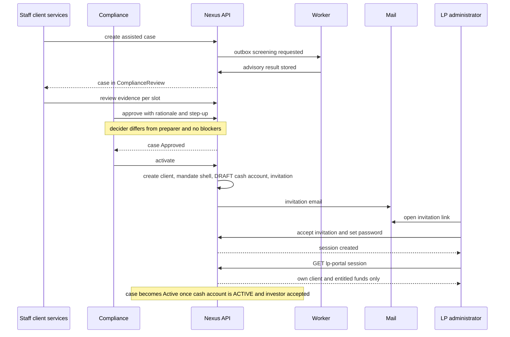

| Step | Pass criterion | Requirements |
| --- | --- | --- |
| Create case | case visible in admin Onboarding within 5 s, channel Assisted, stage Screening | FR-ONB-008, FR-ONB-017, FR-ONB-006 |
| Screening | worker runs; stage ComplianceReview; advisory exceptions listed | FR-ONB-007, FR-ONB-020, FR-PLAT-004 |
| Evidence | per-slot accept/reject; rejected slot blocks approval | FR-ONB-019, FR-ONB-042 |
| Decision | step-up required; same user as preparer refused | FR-ONB-012, FR-ONB-047, FR-AUTH-011 |
| Activation | client `CL-#####` KYC Current, mandate shell, DRAFT cash account, invitation emailed | FR-ONB-013, FR-CLI-009, FR-CLI-010 |
| Cash account | different user with `cash.approve` approves the account | FR-CLI-004, BR-035 |
| First login | LP user sees own client and funds, never another's; a user with no membership gets 403 `no_client_access` | FR-LP-002, FR-LP-003, FR-INV-001 |
| Completion | case becomes Active when both conditions hold | FR-ONB-046 |

Fallback from BUILD-PLAN: seed an activated client and invitation and start UAT from the invitation.

#### 7.10.3 J2 LP read journey (documents, notices, requests, messages)

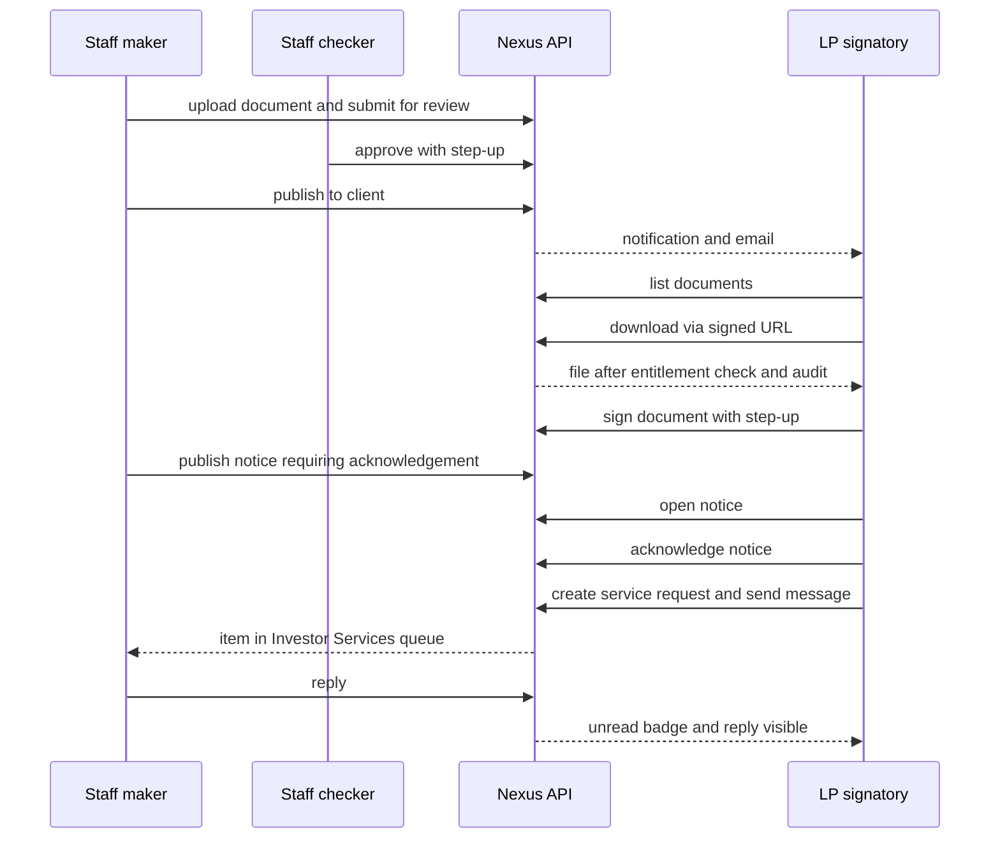

| Step | Pass criterion | Requirements |
| --- | --- | --- |
| Publish | Client or Public classification only; checker ≠ maker; withdrawal removes access immediately | FR-DOC-014, FR-DOC-015, FR-DOC-024, BR-046, BR-047 |
| Download | URL signed, 5 minutes, audited; tampered URL returns 403 `invalid_signature` | FR-DOC-002, FR-DOC-025, BR-175 |
| Sign | requires SIGNATORY or MANAGER and step-up; document leaves *Requires Signature* | FR-LP-071, FR-DOC-006 |
| Notice | published notice reaches entitled investors only; open and acknowledge recorded; VIEWER cannot acknowledge | FR-LP-083, FR-LP-084, FR-LP-089, BR-127 |
| Request and message | attachments validated (type, 20 MB UI / 25 MB platform); reply visible to the requester's colleagues only | FR-LP-075, FR-LP-076, FR-LP-081, FR-INV-015 |
| Dashboard | seeded fund KPIs match approved snapshot with as-of and valuation status | FR-LP-007, FR-LP-009, FR-INV-019 |

Drop notices (ribbon) before documents if behind.

#### 7.10.4 J3 Capital call to paid (and distribution)

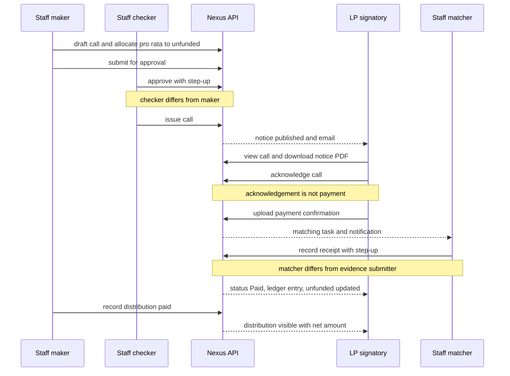

| Step | Pass criterion | Requirements |
| --- | --- | --- |
| Allocate | allocations sum exactly to the call total; one draft per investor | FR-INV-012, FR-INV-020, BR-150 |
| Approve and issue | checker ≠ maker; step-up; investors cannot see DRAFT or APPROVED | FR-INV-021, FR-LP-110, BR-153 |
| Acknowledge | SIGNATORY/MANAGER only; never changes `paid`; second acknowledgement returns 409 | FR-LP-038, FR-LP-053, BR-154 |
| Confirm | file type/size checked, SHA-256 stored, idempotent retry returns the same record | FR-LP-041, FR-LP-042, FR-LP-043, FR-LP-052, BR-155 |
| Settle | receipt ≤ remaining; status PARTIALLY_PAID or PAID; matcher ≠ submitter | FR-INV-021, BR-156 |
| Ledger and unfunded | ledger row with original and reporting currency and historic FX; unfunded = commitment − called | FR-LP-028, FR-LP-029, FR-LP-007, BR-146 |
| Distribution | read-only seeded data is acceptable if the lifecycle slips | FR-LP-045, FR-LP-046 |

#### 7.10.5 J5 Investee reporting loop

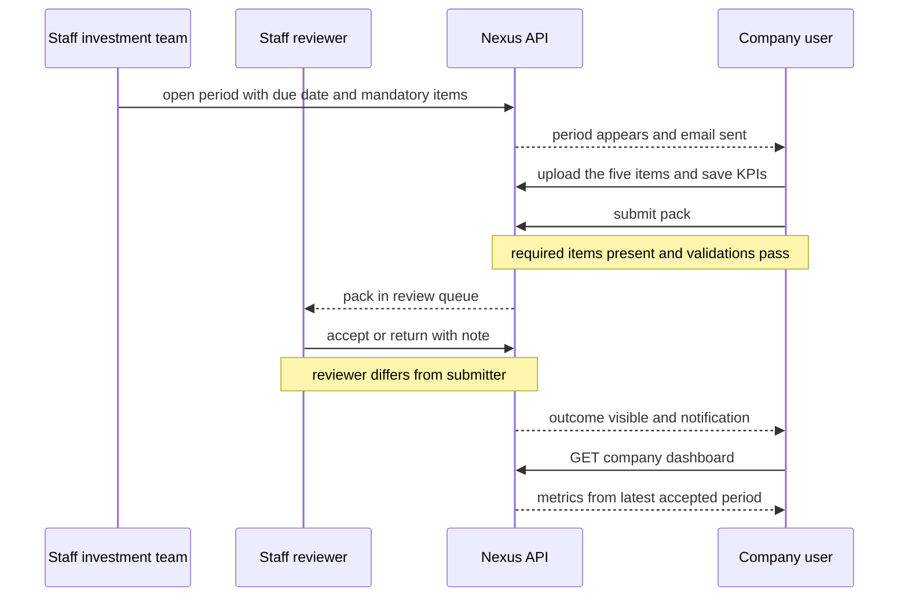

| Step | Pass criterion | Requirements |
| --- | --- | --- |
| Open period | `YYYY-MM` unique per company (409 `duplicate`); due date and mandatory list required | FR-CMP-047, BR-206, BR-247 |
| Upload and KPIs | allowed only for an open request; extension and size validated | FR-CMP-003, FR-CMP-014, FR-CMP-017, BR-246 |
| Submit | missing item → 400; balance and variance rules enforced | FR-CMP-004, BR-248, BR-251, BR-252 |
| Review | accept or return (note required); reviewer ≠ submitter; accepted files cannot be removed | FR-CMP-005, FR-CMP-048, BR-253 |
| Dashboard | values only from accepted periods; no fixture shown to a signed-in user | FR-CMP-008, FR-CMP-009, FR-CMP-012, BR-198 |

### 7.11 Investor snapshot

**Build:** Built. The snapshot is the interim source for the LP dashboard (FR-INV-019).

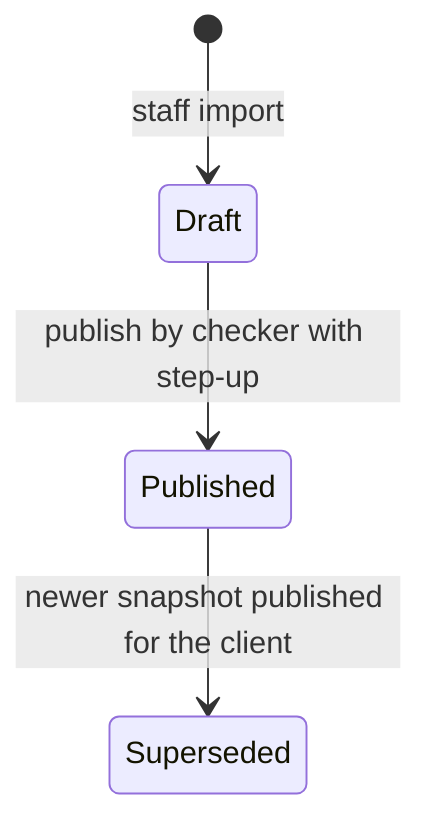

Guards: import requires `reports.create`; publish requires `reports.create`, step-up and `If-Match`, and the publisher must differ from the importer (policy `client_publish_approval`, 403 `sod_violation`). Investors see only the latest Published snapshot.

### 7.12 Invitation, session and MFA

**Build:** Built, with gaps DEF-519 to DEF-521.

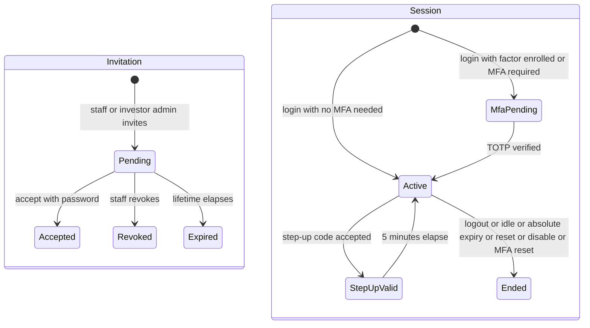

| Object | Rules |
| --- | --- |
| Invitation | single-use hashed token; acceptance creates or links the user, grants portal roles, links client or company and **opens a fully verified session** (target: `mfa_pending` when MFA is required, DEF-520); lifetime 7 days (target 72 h, Q-201) |
| Session | idle timeout = min(policy `session_idle_minutes`, deployment ceiling); absolute timeout = session TTL (12 h); a new login rotates any session the browser already held; an MFA-pending session may call only the MFA routes |
| MFA factor | unverified → verified on first valid code; at most one verified factor; re-enrolment replaces an unverified factor, an already-verified factor blocks re-enrolment (409); administrator reset deletes the factors (FR-RBAC-013) |
| Password reset | single-use token valid 60 min (target 30 min); success revokes all sessions |

### 7.13 LP capital call (fund level)

**Build:** Not started in Nexus. The LP UI shows this vocabulary on mock data; the built per-client model is 7.3. Target [P].

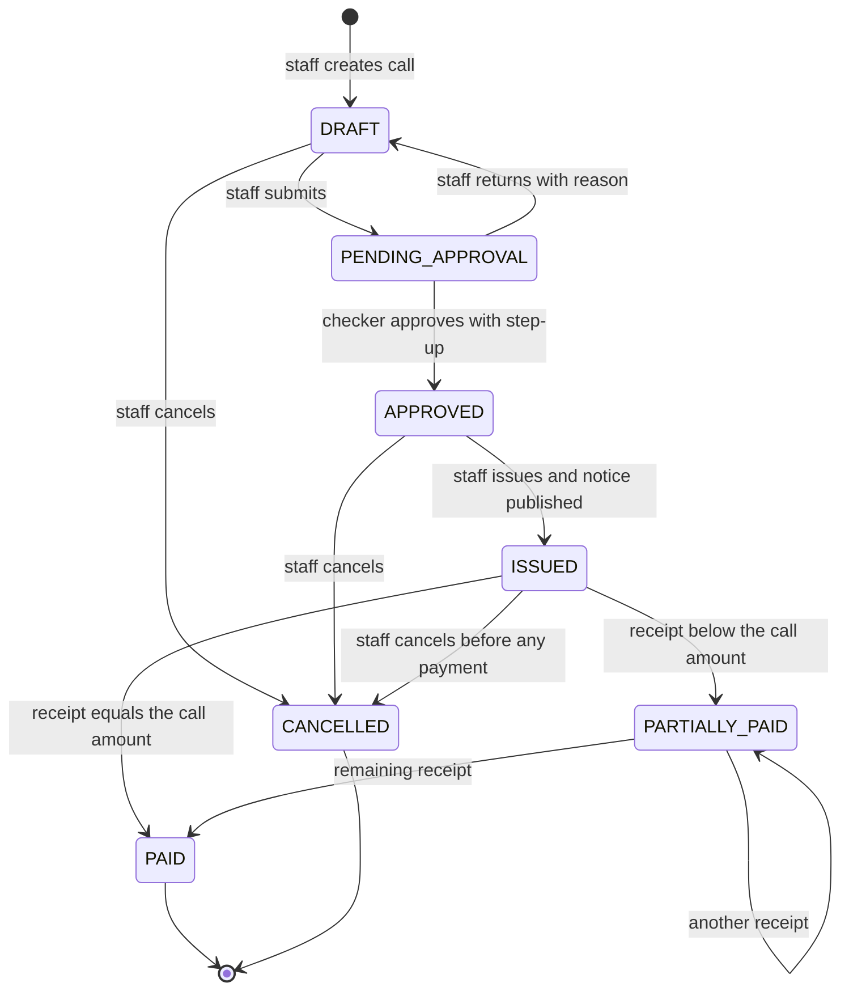

Investor-facing status per allocation, derived on read with precedence CANCELLED, PAID, PARTIALLY_PAID, OVERDUE, ACKNOWLEDGED, ISSUED (BR-156); acknowledgement is a flag, not a status:

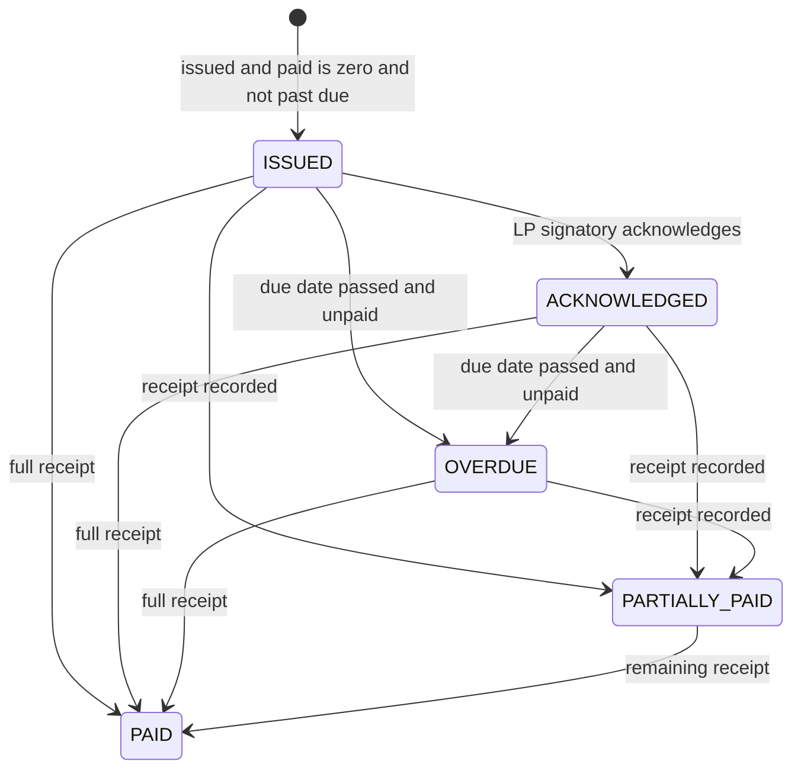

| Transition | Trigger | Actor / permission | Guards | Side effects |
| --- | --- | --- | --- | --- |
| DRAFT → ISSUED (via PENDING_APPROVAL, APPROVED) | staff create, submit, approve, issue | Staff `clients.edit`; then `cash.approve` with step-up (checker ≠ maker); then issue permission (FR-LP-110) | allocation total equals call total; every investor has an active commitment with uncalled capital; single currency per fund | one allocation per investor; notice document generated and linked; notification `capital.published`; LP event; audit |
| ISSUED → ACKNOWLEDGED (flag) | `POST /capital-calls/:id/acknowledge` + `Idempotency-Key` | LP SIGNATORY or MANAGER (`lp.capital_calls.acknowledge`) | allocation belongs to the client and fund scope; call issued and not cancelled; not already acknowledged (409 `LP_CALL_ALREADY_ACKNOWLEDGED`) | `acknowledged_at`, `acknowledged_by`; audit; never touches `paid` |
| Payment confirmation | `POST /capital-calls/:id/payment-confirmations` | LP SIGNATORY or MANAGER (`lp.capital_calls.upload_payment_confirmation`) | file present, type and size allowed, scanned (413 `LP_FILE_TOO_LARGE`) | confirmation row with SHA-256; staff queue item; notification to `cash.approve` holders; audit; no change to `paid` |
| Receipt recorded | staff records or matches a receipt per allocation | Staff `cash.approve` or `cash.journal.approve` with step-up (matcher ≠ confirming user) | amount > 0 and ≤ remaining balance; rounding half-up | `amount_paid`, allocation and header status; LP event and notification |
| → CANCELLED | staff cancels | Staff `cash.approve` | no receipts recorded (reverse first) | LP notice of cancellation; allocation hidden from lists |
| ISSUED → OVERDUE | derived on read | System | due date before today (UTC) and paid below amount | none persisted; optional reminder |

Differences in the reference backend (NVCCZ), not to be copied: header states INITIATED → NOTICES_SENT → PARTIALLY_PAID/FULLY_PAID; no approval step and no maker/checker; a call is LP-visible only after notices were sent; no cancel writer; ACKNOWLEDGED ranks above OVERDUE; payment confirmation creates no staff queue item; the call number is derived from the date, not sequential (BR-158).

### 7.14 LP distribution

**Build:** Not started in Nexus (built model: capital event type Distribution, 7.3). Target [P].

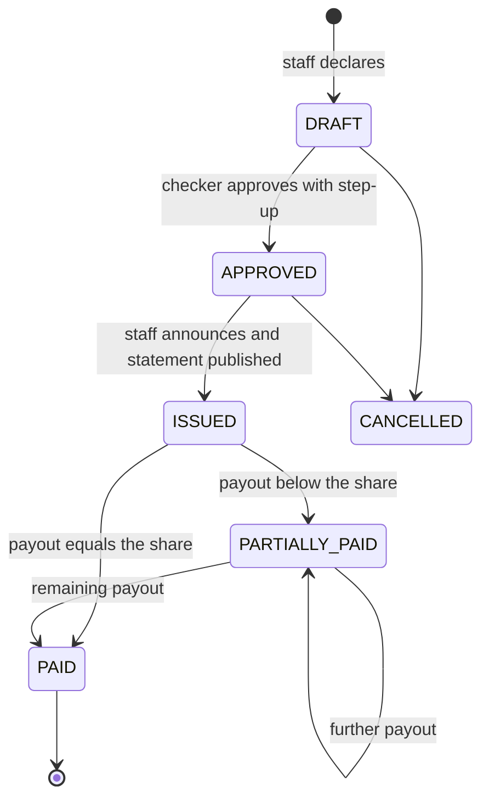

| Transition | Actor / permission | Guards |
| --- | --- | --- |
| declare | Staff `clients.edit` | gross > 0; net to investors > 0; split sums to net (BR-151); one currency per fund |
| approve | `cash.approve` + step-up | checker ≠ maker |
| announce | publish permission (FR-LP-110) | statement document generated (BR-159) |
| payout | `cash.approve` or `cash.journal.approve` + step-up | payout ≤ remaining share; matcher ≠ confirmer |

Visible to LPs from ISSUED (BR-153). In the reference backend the allocation is visible from DECLARED, the status set is DECLARED → NOTICES_SENT → PARTIALLY_PAID/PAID and no writer exists for CANCELLED. LP statuses: PENDING (amber), PAID (green) per FR-LP-046.

### 7.15 LP dealing request (subscription and redemption)

**Build:** Not started. In the reference backend only `[*] → SUBMITTED` exists; no staff route writes the later states (DEF-453: the redemption payload-hash check cannot pass). UI vocabulary: Submitted, Awaiting Funds, Allocated, Under Review, Settled, Rejected.

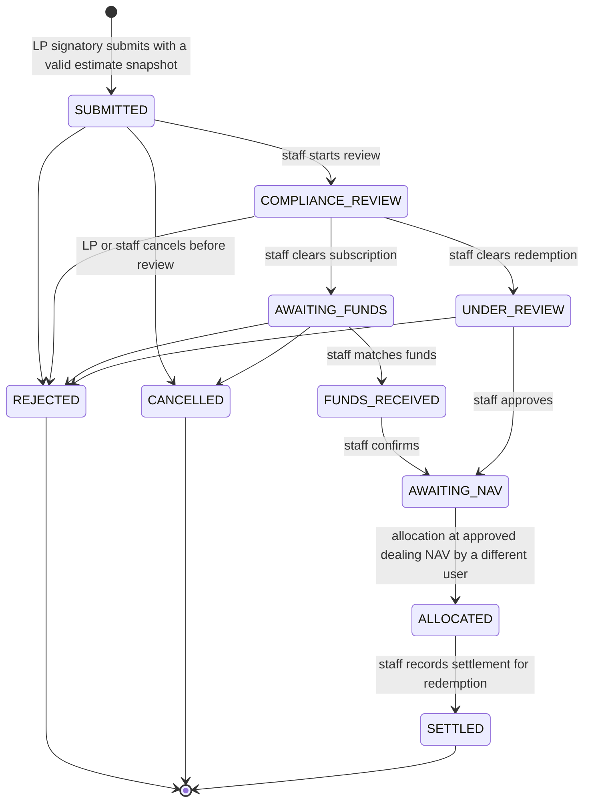

| Transition | Trigger | Actor / permission | Guards | Side effects |
| --- | --- | --- | --- | --- |
| Estimate → snapshot | `POST /dealing/{subscriptions,redemptions}/estimate` | any LP role (`lp.dealing.estimate`) | fund in scope; no compliance hold (`LP_COMPLIANCE_HOLD`); dealing not suspended (`LP_DEALING_SUSPENDED`); units and minimum balance (`LP_INSUFFICIENT_UNITS`, `LP_MIN_BALANCE_BREACH`); notice date (`LP_NOTICE_PERIOD`) | snapshot row with 15-minute expiry (`LP_ESTIMATE_EXPIRED`); nothing committed; always `isEstimate: true` |
| → SUBMITTED | `POST /dealing/{subscriptions,redemptions}` + `Idempotency-Key` | LP SIGNATORY or MANAGER (`lp.dealing.subscribe`, `lp.dealing.redeem`) | snapshot valid, unexpired, same client, type, fund and canonical payload hash; all rules re-checked; source bank account ACTIVE and in scope | request row with units and dates from the snapshot; snapshot consumed (single use, BR-103); files stored; audit with payload hash; staff queue |
| Review, funds, NAV, allocation, settlement | staff actions in the dealing desk | Staff with a dealing permission (Q-NEW: permission codes — default: `dealing.review`, `dealing.allocate`); allocator ≠ reviewer | transition list above (BR-111, BR-169) | ledger entries, holding update (units, account value), investor notification and dashboard action (FR-LP-058) |

Estimates never allocate units; units are confirmed only after funds are received and the dealing-date NAV is approved (BR-105, BR-161).

### 7.16 LP notice

**Build:** Not started in Nexus (notifications are per user and untargeted). Target [P].

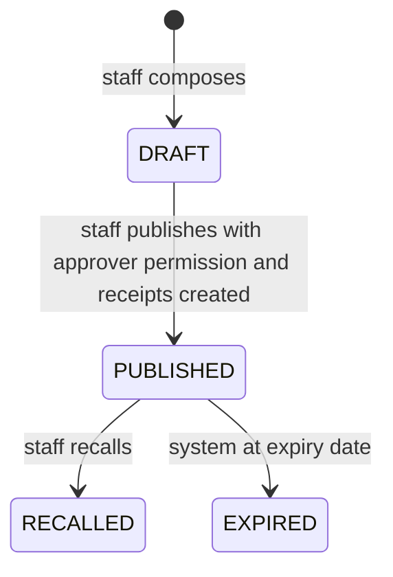

Per-recipient receipt: DELIVERED, then OPENED (first detail read by a user who has the notice visible), then ACKNOWLEDGED (SIGNATORY or MANAGER; the first timestamp is kept, BR-130, BR-134).

| Transition | Actor / permission | Guards | Side effects |
| --- | --- | --- | --- |
| DRAFT → PUBLISHED | Staff with notice-publish permission (FR-LP-089) | title and body; targeting ALL, FUND (active or pending commitment), SHARE CLASS, ORG or USER (BR-179) | receipts per entitled client; notification and email; realtime `lp_notice_updated` |
| PUBLISHED → OPENED | LP any role (`lp.notices.view`) | notice visible to the caller | receipt `openedAt`; open recorded per user (BR-129) |
| OPENED → ACKNOWLEDGED | LP SIGNATORY or MANAGER (`lp.notices.acknowledge`) + `Idempotency-Key` | notice visible and `requires_acknowledgement` | receipt `acknowledgedAt`; audit `NOTICE_ACKNOWLEDGED`; organisation counts as acknowledged when any signatory acknowledged (BR-180) |
| PUBLISHED → RECALLED / EXPIRED | Staff / System | `expires_at` for expiry (BR-133) | notice disappears from lists |

The reference backend stores only PUBLISHED, overwrites `acknowledgedAt` on repeat acknowledgement and has no withdraw, expire or draft.

### 7.17 LP service request and message thread

**Build:** Built model in 7.5 (any-to-any). LP vocabulary and attachments Not started. Target [P].

```mermaid
stateDiagram-v2
  [*] --> SUBMITTED: LP signatory creates
  SUBMITTED --> ASSIGNED: staff assigns
  ASSIGNED --> UNDER_REVIEW: staff starts
  UNDER_REVIEW --> AWAITING_INVESTOR: staff asks the investor
  AWAITING_INVESTOR --> UNDER_REVIEW: LP replies
  UNDER_REVIEW --> AWAITING_INTERNAL: staff waits for another team
  AWAITING_INTERNAL --> UNDER_REVIEW
  UNDER_REVIEW --> RESOLVED: staff resolves
  RESOLVED --> CLOSED: staff closes or auto after 7 days
  RESOLVED --> UNDER_REVIEW: LP replies and reopens
  CLOSED --> UNDER_REVIEW: LP replies within 30 days
```

Guards: staff transitions are explicit sub-resources requiring `clients.edit`; SLA due date at creation (priority HIGH 8 h, others 48 h); a reply by the investor on AWAITING_INVESTOR moves the request to UNDER_REVIEW (the reference backend leaves it unchanged); attachments use upload-then-attach and must belong to the client (BR-183). Side effects: realtime `lp_request_updated`, notification and email to the investor, audit. Reference backend: staff may set any of the eight states from any state, no event or history row is written, and assignment forces ASSIGNED (also from RESOLVED/CLOSED).

```mermaid
stateDiagram-v2
  [*] --> OPEN: staff or LP signatory creates with optional linked record
  OPEN --> OPEN: either side replies
  OPEN --> CLOSED: staff closes
  CLOSED --> OPEN: LP signatory replies
```

Read state is per user and per message (BR-182); `lp_thread_read` is emitted when a user marks a thread read. Staff create threads with the existing `POST /message-threads`; the reference backend has no operation that creates a thread. Staff and LP replies on the investee side follow 7.20.

### 7.18 LP bank-instruction change

**Build:** Not started (the reference backend stores a raw payload in status SUBMITTED and nothing else). Satisfies BR-006 and BR-185.

```mermaid
stateDiagram-v2
  [*] --> SUBMITTED: LP signatory or manager submits with MFA and idempotency key
  SUBMITTED --> UNDER_VERIFICATION: staff starts verification
  UNDER_VERIFICATION --> APPROVED: staff approves after callback by a different user
  UNDER_VERIFICATION --> REJECTED: staff rejects with reason
  SUBMITTED --> REJECTED
  APPROVED --> ACTIVATED: effective date reached and previous instruction ARCHIVED
  REJECTED --> [*]
  ACTIVATED --> [*]
```

Guards: submission needs a fresh TOTP step-up (FR-LP-096; reference: 403 `LP_MFA_REQUIRED` when policy `requireMfaForLp`), account number stored encrypted and shown masked (BR-135); verification is a callback to a number on file; approver ≠ verifier ≠ requester; until ACTIVATED the previous instruction stays active for every dealing and payout. Q-NEW: merge `requireMfaForLp` with the Nexus `mfa_required` policy? — default: merge into `mfa_required` per portal (Q-151 default).

### 7.19 LP colleague invitation and membership

**Build:** API partly Built (`/investor/users` invite, staff revoke); LP administrator update/revoke and session revocation Not started.

```mermaid
stateDiagram-v2
  [*] --> INVITED: LP manager or staff invites with role and fund subset
  INVITED --> ACTIVE: invitee accepts the one-time link and sets a password
  INVITED --> EXPIRED: lifetime elapses
  EXPIRED --> INVITED: resend
  ACTIVE --> ACTIVE: role or fund scope changed with last-manager guard
  ACTIVE --> SUSPENDED: LP manager or staff revokes and sessions invalidated
  SUSPENDED --> INVITED: re-invite
```

| Transition | Actor / permission | Guards |
| --- | --- | --- |
| invite | LP MANAGER or staff (`lp.organisation.manage_colleagues`) + `Idempotency-Key` | a MANAGER may grant VIEWER or SIGNATORY only; MANAGER is granted by staff; fund subset ⊆ inviter scope; empty list means no fund access (BR-138); invitation email failure surfaces a resend action (FR-LP-095) |
| accept | invitee | token unused and unexpired; password set; MFA enrolment when required |
| change role / funds | LP MANAGER or staff | last-manager guard (BR-184); audited |
| revoke | LP MANAGER or staff | target not MANAGER via the colleague API; all sessions of the user invalidated |

Reference backend: no INVITED state (the invitee shows ACTIVE before first login), no last-manager guard, no audit, `resendInvite` exists but is not routed. Nexus status mapping per Q-143 (default: *Invited* until first sign-in).

### 7.20 Reporting period and pack (company)

**Build:** Built (company module); the Investee UI does not call it yet (FR-CMP-008 to FR-CMP-014).

```mermaid
stateDiagram-v2
  [*] --> open: staff opens period with due date and mandatory attachments
  open --> submitted: company submits with required items present
  returned --> submitted: company resubmits
  submitted --> accepted: staff accepts
  submitted --> returned: staff returns with note
  accepted --> [*]
```

| Object | Transitions / guards |
| --- | --- |
| Period | company may edit only while open or returned; accept and return require `research.edit`; the reviewer must differ from the submitter (always enforced, not policy driven, BR-253); one period per `YYYY-MM` (409 `duplicate`) |
| Item | Due ↔ Complete (first upload / last file removed); *Expiring* is never set today (FR-CMP-002) |
| Submission | Draft → Submitted (pack submit) → Accepted / Returned (review); an Accepted file cannot be deleted (409) |
| Question / thread | open → resolved, by the company or staff; no reopen (replies blocked when resolved, 409 `invalid_state`; Q-NEW: allow reopen? — default: no reopen); the V8 Messages page maps to these threads and a company-started thread is a 20-line endpoint (FR-CMP-041) |

Reminders at 14, 7, 3 and 1 day before the due date plus manual nudges (BR-255); submit notifies `research.edit` holders and the outcome emails the company contact (BR-254).

### 7.21 Financial report (typed statement)

**Build:** Not started (fixtures; upstream uses raw-SQL tables outside the Prisma schema). Target [P]. UAT uses the five-item pack.

```mermaid
stateDiagram-v2
  [*] --> DRAFT: company creates draft with an open reporting request
  DRAFT --> DRAFT: company edits data or attaches file
  DRAFT --> PENDING: company submits bundle
  NEEDS_REVISION --> PENDING: company resubmits
  REJECTED --> PENDING: company resubmits
  PENDING --> ACCEPTED: staff accepts
  PENDING --> REJECTED: staff rejects with comment
  PENDING --> NEEDS_REVISION: staff requests revision
  ACCEPTED --> NEEDS_REVISION: system post-accept sync failure
```

Guards: edits and file replacement only in DRAFT, NEEDS_REVISION, REJECTED and only by the owner (BR-249); submit validates the open request, numeric strictness, balance equation and variance rule (BR-246, BR-250 to BR-252); the bundle submit moves every eligible report of the company and period in one transaction (BR-248); review: reviewer ≠ submitter, comment required for reject/revision, ACCEPT writes `TOTAL_REVENUE`, `NET_PROFIT`, `CASH_FLOW_NET` and recomputes derived KPIs (BR-253, BR-257 to BR-262). Statuses map to the pack states in 7.20.

### 7.22 Term sheet and signing

**Build:** Not started. Target [P]; J6 is cut-able.

```mermaid
stateDiagram-v2
  [*] --> DRAFT: staff creates
  DRAFT --> DRAFT: staff edits
  DRAFT --> FINAL: staff finalises and company notified
  FINAL --> FINAL: company signs or fund signs once each
  FINAL --> SIGNED: second party signs
  SIGNED --> [*]
```

Guards: signing requires FINAL; a party cannot sign twice; no update or finalise once any signature exists; the company signs as `applicant` (signatory with step-up MFA ≤ 5 minutes and a verified account), the fund signs as `investor` (administrator or fund manager); the term sheet is SIGNED only with both signatures; signature images PNG, JPEG, JPG, GIF, WEBP (BR-274, BR-225). On SIGNED while the deal is at TERM_SHEET or TERM_SHEET_NEGOTIATION the deal moves to UNDER_BOARD_REVIEW (never regress). Nexus adds states Issued (visible to the company) and Expired/Withdrawn [P]. Required fields: title, investment amount, equity %, valuation (BR-213); executed copy downloads via a 300-second signed URL (FR-CMP-024).

Applicant pipeline (NVCCZ, reference only; Nexus scope is Q-NEW — default: not ported, BUILD-PLAN 2.1 C3): SCREENING_PENDING → SCREENING → SHORTLISTED → ACTIVE_DD → DUE_DILIGENCE_COMPLETED → TERM_SHEET ⇄ TERM_SHEET_NEGOTIATION → UNDER_BOARD_REVIEW → BOARD_APPROVED / BOARD_CONDITIONAL / BOARD_REJECTED → INVESTMENT_IMPLEMENTATION → DISBURSED → FUNDED → PORTFOLIO_MANAGEMENT. The company-facing progress percentage maps SUBMITTED 5 to PORTFOLIO_MANAGEMENT 100 and DISBURSED 85 + 15 × (Σ disbursed ÷ requested).

### 7.23 Capital and procurement (drawdown) request

**Build:** Not started. Target [P]; J8 is cut first.

```mermaid
stateDiagram-v2
  [*] --> DRAFT: company creates within tranche
  DRAFT --> PENDING_REVIEW: company submits with use-of-funds attached
  PENDING_REVIEW --> DRAFT: company cancels
  PENDING_REVIEW --> APPROVED: fund executive approves
  PENDING_REVIEW --> REJECTED: staff rejects with reason
  PENDING_REVIEW --> RETURNED: staff returns for information
  REJECTED --> PENDING_REVIEW: company resubmits with changed content
  RETURNED --> PENDING_REVIEW: company resubmits with changed content
  APPROVED --> RFQ_SENT: system sends RFQ to top vendors
  RFQ_SENT --> CONVERTED_TO_PO: staff awards and raises PO
  CONVERTED_TO_PO --> [*]: goods received and paid
```

`PENDING_REVIEW` is `PENDING_VC_EXECUTIVE_REVIEW` in the reference product. Reservation: PENDING, APPROVED, RFQ_SENT and CONVERTED_TO_PO hold the drawdown; DRAFT, REJECTED, CANCELLED, RETURNED release it. Guards: reserved + amount ≤ committed (message "Drawdown Request Exceeds Available Investment Tranche.", BR-270, FR-CMP-035); required fields (BR-271); resubmission needs a changed content fingerprint and only the requester (BR-273); fund CFO or sysadmin is the final gate (no threshold table: Q-NEW — default: all investee requests go to the fund executive review, SLA 48 h, BR-230). V8 columns: Draft = DRAFT/REJECTED/RETURNED/CANCELLED; Under review = PENDING_*; Approved = APPROVED/RFQ_SENT; Fulfilled = CONVERTED_TO_PO and received (BR-228). Procurement (RFQ, PO, goods-received notes) is out of scope.

### 7.24 Signature request and consent request

**Build:** Document signature requests Partial (hash, MFA time, IP, authority are captured; staff and LP flows exist for documents); general signature requests and consent requests Not started. Target [P].

```mermaid
stateDiagram-v2
  [*] --> Pending: company or staff requests with locked document copy
  Pending --> PartiallySigned: first signatory signs
  PartiallySigned --> Signed: last signatory signs and certificate issued and document locked
  Pending --> Declined: signatory declines with reason
  PartiallySigned --> Declined: signatory declines
  Pending --> Cancelled: requester voids
  Pending --> Expired: system after due date and grace
  Declined --> [*]
```

Guards: the signatory is named and within the authority matrix (BR-223, BR-275); step-up MFA ≤ 5 minutes; consent ticked; signature image present; sequential order when selected; reminders only while Pending or PartiallySigned; each signatory signs once; a signature once applied is immutable (BR-222, BR-224). A declined request can be voided and re-issued (FR-CMP-032).

```mermaid
stateDiagram-v2
  [*] --> Draft: company
  Draft --> Submitted: company submits memo and category and decision date
  Submitted --> InformationRequested: staff asks questions
  InformationRequested --> Submitted: company responds
  Submitted --> InvestorReview: staff assigns
  InvestorReview --> BoardReview: staff escalates
  InvestorReview --> Approved: staff decision
  BoardReview --> Approved: staff decision
  InvestorReview --> Rejected: staff decision with reason
  BoardReview --> Rejected: staff decision with reason
  Submitted --> Withdrawn: company withdraws
```

Guards: a decision requires a reason and notifies the requester; the company cannot edit after submit; decision due defaults to submission date + the matter's notice period (BR-217, BR-218, FR-CMP-029).

### 7.25 Forecast version and cap-table transaction

**Build:** Not started; deferred past UAT (no upstream backend, fixtures).

```mermaid
stateDiagram-v2
  [*] --> draft: company creates working version from latest submitted
  draft --> submitted: approver submits and approver differs from preparer
  submitted --> accepted: staff accepts
  submitted --> returned: staff returns with note
  returned --> draft: company edits
  accepted --> superseded: next version accepted
```

Month cell lifecycle: forecast → actual-open (current month) → actual-locked (after acceptance or close day); window = current − 3 … current + 8 months (BR-207, BR-264). Submitted versions are immutable and the fund sees only submitted versions (BR-208, FR-CMP-020, FR-CMP-021).

```mermaid
stateDiagram-v2
  [*] --> DRAFT: staff creates issuance or transfer
  DRAFT --> PENDING_APPROVAL: staff submits
  PENDING_APPROVAL --> EXECUTED: approver executes with certificate
  DRAFT --> REJECTED: staff
  PENDING_APPROVAL --> REJECTED: staff
  EXECUTED --> PENDING_APPROVAL: system rollback after post-execution failure
```

Guards: creator ≠ approver (BR-269, to add), seller balance and authorised-share checks at create and execute; approval by CIO, CFO or administrator roles (BR-216); the investee page only reads the published register (FR-CMP-026).

### 7.26 Custodian execution and day-end package

**Build:** Not started. Today both records are written to browser storage with status Submitted that nothing reads (DEF-487, DEF-488). Target [P]; J7 is cut-able.

```mermaid
stateDiagram-v2
  [*] --> Received: counterparty submits and server validates
  Received --> Matched: matching run finds a counterpart within tolerance
  Received --> Exception: no counterpart or out of tolerance
  Exception --> Queried: reconciliation raises a query
  Queried --> Received: counterparty submits a corrected version
  Exception --> Matched: break resolved by maker and checker
  Received --> Superseded: newer version with reason
  Exception --> Superseded: newer version with reason
  Matched --> [*]
  Superseded --> [*]
```

```mermaid
stateDiagram-v2
  [*] --> Received: counterparty uploads file and control totals
  Received --> Approved: control totals validated and approver accepts
  Received --> Exception: trade count differs from executions received
  Exception --> Received: counterparty supersedes
  Received --> Superseded: newer package for same account and date and currency
  Approved --> Superseded: newer package with reason
  Approved --> [*]
```

| Object | Actor | Guards | Side effects |
| --- | --- | --- | --- |
| Execution submit | counterparty user (scope: counterparty and accounts) | unique reference per counterparty (409); account in scope (403); security in master; quantity and price > 0; settlement ≥ trade date (FR-REC-012) | counterpart Trades record in admin Reconciliations within 5 s; audit; `custodian.execution.submitted` event |
| Execution correction | counterparty user | a submitted execution is immutable; a correction is a new version superseding the earlier one with a reason, both retained (BR-193) | status round-trip: match result and queries visible in the custodian portal (FR-REC-015) |
| Day-end submit | counterparty user | original file stored encrypted; SHA-256 computed server-side; control totals (closing cash, holdings market value, trade count) validated; trade count must equal executions received for the account and date, else a Trades control exception (BR-194); approver rule is Q-NEW (default: operations user approves, ≠ submitter) | package appears in source health for the account and date (FR-REC-013, FR-REC-017) |
| Day-end correction | counterparty user | superseded only by a newer package for the same (account, date, currency) with a reason, earlier retained (BR-195) | |

Matching rule (manager side, [V61]): exact reference preferred, else ticker + side + quantity; quantity exact; execution price ±0.01 (configurable per family, BR-067). Timestamps are stored as ISO-8601 UTC and displayed in Africa/Harare (FR-REC-014).

### 7.27 Admin-console machines (prototype)

**Build:** Mock for all of 7.27 (in-memory or localStorage); targets below are [P].

```mermaid
stateDiagram-v2
  [*] --> PENDING_APPROVAL: journal drafted
  PENDING_APPROVAL --> POSTED: approved by different user
  PENDING_APPROVAL --> REJECTED: rejected with reason
  POSTED --> POSTED: reversal creates a new journal in PENDING_APPROVAL
```

```mermaid
stateDiagram-v2
  [*] --> ACTIVE: reservation created within available cash
  ACTIVE --> PARTIALLY_CONSUMED: part consumed
  PARTIALLY_CONSUMED --> CONSUMED: remainder consumed
  ACTIVE --> CONSUMED
  ACTIVE --> RELEASED: release remainder
  PARTIALLY_CONSUMED --> RELEASED: release remainder
```

```mermaid
stateDiagram-v2
  [*] --> RECEIVED: statement file uploaded
  RECEIVED --> VALIDATED: parsed and arithmetic within tolerance
  VALIDATED --> PENDING_APPROVAL: reviewed staging version frozen
  PENDING_APPROVAL --> COMMITTED: checker commits
  RECEIVED --> REJECTED
  VALIDATED --> REJECTED
  PENDING_APPROVAL --> REJECTED
```

```mermaid
stateDiagram-v2
  [*] --> Scheduled
  Scheduled --> Due: time reached
  Due --> Blocked: block with note
  Blocked --> Due: unblock or dependency done
  Due --> Done: complete with note or evidence
```

Operations task rules: overdue flag when CAT time > deadline and not Done; dependants of an incomplete task cannot be completed; completing a task moves cleared dependants Blocked → Due and notifies the next owner (BR-061 to BR-063, FR-OPS-010).

```mermaid
stateDiagram-v2
  [*] --> InPreparation
  InPreparation --> Validated: validation passes
  Validated --> Attested: two distinct attesters
  Attested --> Filed: filer submits
  Filed --> Acknowledged: regulator reference recorded
```

*Acknowledged* is [P] (FR-REG-002); selecting another obligation resets the state in the prototype; attestation by two distinct users and the filer ≠ preparer (BR-072).

```mermaid
stateDiagram-v2
  [*] --> Disputed: prototype entry
  Disputed --> Due: resolve dispute
  Due --> Funded: mark funded
```

Margin call target [P]: Due → Disputed → Resolved → Funded with reason and an independent checker (FR-FIN-004, BR-070). Model lifecycle: Draft (wizard) → Independent validation [O] → Validation due or Production [P] → Retired; approval by the committee requires closed high-severity findings (FR-MOD-002, BR-074). Integration: not_connected → configured → testing → healthy; disconnect → not_connected [O] (FR-DATA-004, BR-073). Corporate action: Announced → Entitlement projected → Election required → Election submitted → Instructed → Posted → Reconciled, each transition audited (FR-OPS-015, BR-071).

---


## 8. Non-Functional Requirements

Targets are **[P]** unless marked; they are sized for an institutional manager (≈500 internal users, ≈5 000 investor/LP and investee users, ≈200 portfolios, ≈50 000 positions) and must be confirmed (Q-14). Every v1.0 NFR keeps its ID. *Build* uses the same scale as section 6 (Built, Partial, Mock, Not started, Contradicted) and is taken from the backend audit. *Gap / reference* names the defect (DEF-5xx) or requirement that closes the gap; DEF items are collected with acceptance criteria in 8.8. Seven new NFRs from the register are marked **new** (NFR-PERF-005, NFR-AV-005, NFR-SEC-012, NFR-SEC-013, NFR-SEC-014, NFR-OPS-006, NFR-OPS-007). Needs that have no NFR ID yet are folded into the nearest existing ID and listed in 8.9 as `Q-NEW` items.

**UAT priority (BUILD-PLAN 12.1).** The one-day UAT cut needs only: the J0 security baseline (NFR-SEC-001, NFR-SEC-002, NFR-SEC-008 for money actions, NFR-SEC-009 auth limit), NFR-SEC-006 for the upload types used in J2, J3 and J5, NFR-OPS-004 health check and a DB dump before migration (DEF-515 minimum). Production hardening (pen test, load test, ClamAV, object storage, observability stack, SSE) is deferred past UAT and is marked as such below.

### 8.1 Performance

| ID | Requirement | Label | Build | Gap / reference |
| --- | --- | --- | --- | --- |
| NFR-PERF-001 | API p95 < 300 ms and p99 < 1 s for reads; p95 < 500 ms for writes, at 200 req/s sustained. | [P] | Not started | No load testing or latency measurement; deferred past UAT. |
| NFR-PERF-002 | Portal first contentful paint < 2.0 s, interaction-ready < 3.5 s on 20 Mbps desktop; list pages paginate at 50 rows (max 500). Targets added in v2: the first page of the IBOR positions list for a 50 000-position book answers in the NFR-PERF-001 read target with server-side search, filter and sort (FR-IBOR-002); the 170-point daily performance series renders within the page budget. | [P] | Partial | Lists are hard-capped at 200–500 rows with no pagination (NFR-PERF-005); portal paint not measured; the prototype filters client-side on eight rows. |
| NFR-PERF-003 | Long jobs (NAV run, optimiser, recon matching, report rendering, LP performance report, imports, IBOR refresh) are asynchronous with a single status vocabulary (QUEUED, RUNNING, COMPLETED, FAILED, CANCELLED, FR-LP-024); UI polls job status; NAV run for one fund < 2 min. | [P] | Partial | Screening and email run asynchronously via the outbox; there is no jobs table or status API; no NAV job exists (the NAV run is a synchronous in-memory toggle). |
| NFR-PERF-004 | Exports up to 100 000 rows stream within 30 s. | [P] | Partial | Audit CSV builds up to 10 000 rows in memory; no streaming. |
| NFR-PERF-005 **new** | **Pagination** on every list endpoint (`page`, `pageSize` ≤ 500, default 50; response `{data, page, pageSize, total}` where `total` is the full count). LP facade lists use `{items, page, pageSize, total, totalPages}` with default 50 and cap 200 (BUILD-PLAN 11.1; one envelope per facade). | [P] | Not started | Today lists are silently capped at 200–500 rows and `total` equals the returned length. AC: a list with 600 rows returns total 600 and pages through all of them. |

### 8.2 Availability, resilience, recovery

| ID | Requirement | Label | Build | Gap / reference |
| --- | --- | --- | --- | --- |
| NFR-AV-001 | 99.9 % monthly availability for API and portals during 06:00–22:00 CAT; planned maintenance outside this window. | [P] | Not started | No availability monitoring. |
| NFR-AV-002 | RPO ≤ 15 min (binlog/PITR), RTO ≤ 4 h; daily full backup retained 35 days, monthly 7 years; quarterly restore test. | [P] | Not started | DEF-515: no database or file-store backups in the deployment. UAT minimum: a MySQL dump before each migration plus a file-volume backup. |
| NFR-AV-003 | Stateless API/portal instances (≥ 2 each in production) behind a load balancer; workers restart safely (idempotent jobs). | [P] | Contradicted | One instance per service; the worker is neither idempotent nor safe to run as more than one instance (NFR-AV-005). |
| NFR-AV-004 | Integration failures degrade gracefully: stale-data banners with as-of time, never silent. | [P] | Not started | No integrations yet. LP and investee UIs must never fall back silently to mock data on a failed call: explicit error states and a persistent "Demo data" ribbon wherever a fixture is shown (FR-CMP-009, BUILD-PLAN 12.4). |
| NFR-AV-005 **new** | **Idempotent, single-delivery worker.** Claim outbox rows with locking so several workers can run; handlers are idempotent (notifications are not duplicated on retry). | [P] | Not started | AC: two workers processing the same queue produce each notification exactly once. DEF-518: the worker is not started by `npm run dev`. |

### 8.3 Security

| ID | Requirement | Label | Build | Gap / reference |
| --- | --- | --- | --- | --- |
| NFR-SEC-001 | TLS 1.2+ everywhere; HSTS; secure, httpOnly, SameSite=Lax cookies. | [O]/[P] | Built | certbot TLS with HTTP→HTTPS redirect; HSTS from the API in production; cookie flags as stated. The custodian host must be included (DEF-528). |
| NFR-SEC-002 | CSRF: origin allow-list on state-changing requests; credentialed CORS allow-list covering every portal id including `custodian`. | [O] | Built | Origin allow-list on state-changing `/api` requests plus credentialed CORS; `custodian` is not in it (DEF-528, FR-PLAT-003). |
| NFR-SEC-003 | Encryption at rest (DB, backups, object storage); field-level encryption for account numbers, tax IDs, ID numbers, bank-instruction account numbers. Applicant PII (email, phone, registration reference, owners) must not be written to browser storage in production (BR-039). | [P] | Partial | Files, tax IDs, ID numbers, account identifiers and TOTP secrets are encrypted; DB and backup encryption not addressed; no HMAC search columns. |
| NFR-SEC-004 | Secrets in a vault/secret manager; none in code or images. | [O] policy | Partial | Secrets live in a `chmod 600` env file and a users file on the host; no secret manager. DEF-532: `.env.example` is stale (AC: every variable the API reads is documented). |
| NFR-SEC-005 | OWASP ASVS L2; input validation with shared zod schemas; parameterised queries (Prisma); output encoding: toast, drawer and legacy markup content is rendered as text, never interpolated HTML (FR-UI-009). | [P] | Partial | zod validates bodies and most queries (some staff list filters unvalidated); Prisma parameterised; prototype toasts render unescaped HTML. |
| NFR-SEC-006 | Uploads: type allow-list, size limits, malware scan, stored outside web root, served by signed URL. Allow-list aligned across surfaces: pdf, docx, xlsx, csv, png, jpg (accounting statements also xls) with one platform limit (default 25 MB, `MAX_UPLOAD_MB`) and UI copy that matches it (the V8 UI states 50 MB and 100 MB, the LP UI 20 MB); `application/octet-stream` is refused; signed download links are HMAC-signed, user-bound and expire in ≤ 300 s; each upload and download is audited with SHA-256; previews carry a watermark where the product requires it. | [P] | Partial | Type allow-list includes `octet-stream`; 25 MB limit; encrypted outside web root; signed URLs. DEF-514: every file is recorded "clean". DEF-517: orphan uploads. UAT: scanning deferred (ClamAV is production hardening). |
| NFR-SEC-007 | Least privilege and SoD per section 4 (BR-001 to BR-006 and the rules in 7.9); quarterly access review export; server-side entitlement on every route and an automated IDOR test per resource type (a second client's, company's or counterparty's id returns 404). | [O] | Partial | Seeded role catalogue follows SoD; SoD scan and access-review CSV exist; no scheduled review process. DEF-526: investor account scope not applied to documents, capital events, requests or threads. DEF-527: company users are limited to their first company. DEF-522: BR-004 contradiction (AC: removing a role that would leave fewer than two active `admin.rbac` holders returns 409; the SoD scan flags fewer than two). DEF-530, DEF-531: KYC dual-control gap and automatic funds approval. |
| NFR-SEC-008 | MFA for all internal, LP, investee and custodian users; step-up for sensitive actions (approvals, signatures, bank-instruction changes, publishing, activation). Production default `mfa_required=true` (Q-88). | [P] | Partial | MFA is optional by default and step-up applies only to enrolled users (DEF-519); invitation acceptance bypasses MFA (DEF-520); step-up is missing on listed actions (DEF-524) and its status code is inconsistent (DEF-523). |
| NFR-SEC-009 | Rate limits: auth 20/15 min/IP, general 600/min/user, uploads 30/min/user; the sign endpoints are limited as uploads. LP facade targets (BR-189): reads 60/min, writes 20/min, uploads and report jobs 10/min per user and IP (Q-NEW: reconcile with 600/min — default: 600/min per user overall, the BR-189 values as per-route caps on LP writes). | [O]/[P] | Partial | Auth limit (20 per 15 min) built; no general per-user limit or upload limit (NFR-SEC-014). |
| NFR-SEC-010 | Security headers (CSP, frame-ancestors none, referrer policy, permissions policy). | [O] helmet/nginx | Partial | helmet headers on the API only; see NFR-SEC-013 for the portals. |
| NFR-SEC-011 | Annual penetration test; dependency scanning in CI; critical CVEs fixed within 7 days. | [P] | Not started | DEF-516: no CI pipeline. Pen test deferred past UAT. |
| NFR-SEC-012 **new** | **Optimistic concurrency:** `If-Match` (or `version` in the body) is compared to the row version on transitions, and a mismatch returns 409 `version_conflict`. | [O] | Built | AC: a stale version returns 409. Not applied to document publish and some capital transitions (DEF-524 list). |
| NFR-SEC-013 **new** | **Portal security headers** (CSP, frame-ancestors none, referrer policy, permissions policy) at nginx or in Next.js. | [P] | Not started | Today only the API sends helmet headers. AC: every portal response carries the headers. |
| NFR-SEC-014 **new** | **General rate limits:** 600 requests per minute per user and 30 uploads per minute per user (NFR-SEC-009). | [P] | Not started | AC: exceeding either returns 429. |

### 8.4 Compliance and data governance

| ID | Requirement | Label | Build | Gap / reference |
| --- | --- | --- | --- | --- |
| NFR-CMP-001 | Immutable audit trail retained ≥ 7 years (Q-15 confirms statutory period). The application database user has no UPDATE/DELETE on `audit_events`; the hash covers every column. | [P] | Partial | Audit rows have no delete path; retention not configured; append-only not DB-enforced; actor role, portal, IP and request id are outside the hash (DEF-525). |
| NFR-CMP-002 | KYC/AML records retained ≥ 5 years after relationship end; data-subject rights per Zimbabwe Cyber and Data Protection Act (Q-16). | [P] | Not started | No KYC retention or data-subject tooling. |
| NFR-CMP-003 | Data classification labels enforced on documents and exports. Q-NEW: one label list — default: API enum canonical (Public, Client, Internal, Restricted) shown as Public, Client Confidential, Internal, Regulatory Confidential (v1.0 names). | [P] | Contradicted | Built labels are Public / Client / Internal / Restricted; the editor offers Client confidential, Internal, Regulatory confidential; enforced only for publishing and Restricted downloads. |
| NFR-CMP-004 | Data residency per regulator/client contracts (Q-17). | [P] | Not started | Not addressed. |
| NFR-CMP-005 | Maker/checker evidence exportable per transaction for auditors. | [P] | Partial | Maker and checker ids are stored and audit is searchable per object; no per-transaction evidence export; audit export manifest is FR-AUD-004. |

### 8.5 Usability, accessibility, compatibility

| ID | Requirement | Label | Build | Gap / reference |
| --- | --- | --- | --- | --- |
| NFR-UX-001 | Preserve the approved visual design of each portal (admin V56; LP portal and Investee portal V8 as imported; onboarding and custodian V65); changes need design sign-off. | [O] | Contradicted | v1.0 said "preserve the V56 visual design": the investor, company and onboarding portals now render different designs (LP portal, Investee V8, V65). |
| NFR-UX-002 | WCAG 2.1 AA for new components; keyboard access to navigation, modals (Esc closes, focus trapped and restored to the opener), drawers, runbook rows and charts (data-table alternative); toasts announced with `aria-live` (FR-PLAT-002, FR-UI-008). | [P] | Not started | No accessibility testing; V34/V37/V44 modals do not close on Esc; no overlay traps focus. |
| NFR-UX-003 | Responsive: admin ≥ 1280 px primary (usable to 390 px with drawer nav); LP, investee (breakpoint ≤ 760 px), onboarding and custodian fully responsive at 390, 820, 1440 px. | [O] | Partial | Responsiveness inherited from the prototypes; not verified. |
| NFR-UX-004 | Browsers: latest two versions of Chrome, Edge, Safari, Firefox. | [P] | Not started | No browser test matrix. |
| NFR-UX-005 | Localisation: English; CAT time zone (stored UTC, displayed Africa/Harare); currency formats USD/ZWG/ZAR (the LP prototype hard-codes `$` and the label ZIG: map ZIG to ZWG at the facade edge, BR-172). | [O] | Built | English only; API display dates formatted in Africa/Harare. |

### 8.6 Observability and operations

| ID | Requirement | Label | Build | Gap / reference |
| --- | --- | --- | --- | --- |
| NFR-OPS-001 | Structured JSON logs with request id, user id, portal, route, latency; no secrets/PII in logs. | [P] | Not started | Plain console output; mail tokens appear in logs when SMTP is unset (NFR-OPS-007). |
| NFR-OPS-002 | Metrics (RED per route, job queue depth/age, integration freshness) and traces (OpenTelemetry). | [P] | Not started | None; observability stack deferred past UAT. |
| NFR-OPS-003 | Alerts: error rate > 2 % for 5 min, p95 > 1 s, job age > 15 min, integration stale beyond SLA, DB replication lag > 60 s, failed backups. | [P] | Not started | UAT minimum: an uptime and error alert script (BUILD-PLAN 12.2). |
| NFR-OPS-004 | Health endpoints: `/api/health` (liveness) and `/api/health?deep=1` (DB + queue + storage) returning 503 `degraded` on dependency failure. | [O] | Partial | The deep check covers the database only. |
| NFR-OPS-005 | Zero-downtime deploys (rolling); DB migrations backward-compatible (expand/contract). | [P] | Partial | Migrations run in a pre-start container; `docker compose up` is not a rolling deploy. UAT: additive-only migration, one per day (BUILD-PLAN 12.2). |
| NFR-OPS-006 **new** | Every response carries an `X-Request-Id` (a caller value is accepted when it matches `[\w.-]{8,64}`), and the id is stored on audit events. | [O] | Built | AC: an audit row links to the response header value. |
| NFR-OPS-007 **new** | **Structured request logging and metrics.** JSON log line per request (request id, user id, portal, route, status, latency) with no secrets or PII; RED metrics; worker queue depth and age. | [P] | Not started | Today logs are plain console output and mail tokens appear in logs when SMTP is unset. AC: every request produces one JSON log line; no token appears in any log. |

### 8.7 Maintainability

| ID | Requirement | Label | Build | Gap / reference |
| --- | --- | --- | --- | --- |
| NFR-MNT-001 | TypeScript strict across API and portals; shared DTO/zod schemas in `packages/shared` (including the LP and investee facade contracts). | [P] | Built | Strict mode on; shared zod auth schemas and typed client; domain schemas are defined inline in the API. |
| NFR-MNT-002 | ≥ 80 % unit coverage on domain services; contract tests for every endpoint (the LP facade is checked against the mock store as oracle, BUILD-PLAN 12.4); E2E browser tests for each workflow in section 7; an IDOR test per resource type; a test that a production build contains no fixture data and that `liveOnly:false` cannot be enabled when `NODE_ENV=production` (FR-CMP-009). | [P] | Not started | No unit or contract tests; two scripted journeys only. DEF-516: no CI (AC: every push runs install, typecheck, smoke and e2e against an ephemeral database and builds the images). |
| NFR-MNT-003 | Legacy prototype screens are replaced workflow-by-workflow; each migrated slice removes its `localStorage` usage (Appendix C); every portal domain flipped to live has a runtime flag and rollback by environment (no silent fallback to mock). | [P] | Partial | Admin slices replaced their `localStorage`; the investor and onboarding bridges are disabled (DEF-529). |

### 8.8 Defect-derived requirements (gaps against 8.1–8.7)

Each row is a defect found in the current code with the acceptance criterion that closes it. Build is Not started unless stated.

| Defect | Gap | Acceptance criterion | Closes / relates to |
| --- | --- | --- | --- |
| DEF-513 | **Idempotency not implemented.** `Idempotency-Key` is accepted by CORS but ignored, so repeated POSTs create duplicate capital events, documents and requests. | A repeat POST with the same key within 24 h returns the original response and creates no new row. The LP facade requires the key (8–200 printable ASCII characters) on acknowledge, payment confirmation, subscription, redemption, request create, notice acknowledge, colleague invite, bank-instruction change and performance report (BR-173, FR-LP-052). | NFR-SEC-012, FR-LP-052 |
| DEF-514 | **No malware scan.** Every file is recorded as "clean" and `application/octet-stream` is accepted. | An EICAR test file is rejected or quarantined; quarantined files cannot be downloaded. | NFR-SEC-006, FR-DOC-016, FR-LP-042 |
| DEF-515 | **No database or file-store backups** in the deployment. | A scheduled MySQL dump or binlog backup plus a file-volume backup with 35-day retention, and a documented restore test. | NFR-AV-002 |
| DEF-516 | **No CI pipeline** (only a GitHub Pages workflow for the legacy static site). | Every push runs install, typecheck, smoke and e2e against an ephemeral database and builds the images. | NFR-MNT-002, NFR-SEC-011 |
| DEF-517 | **Orphan uploads.** `POST /api/v1/uploads` stores encrypted files whose ids no endpoint consumes; they can never be downloaded or cleaned up. | Either domain endpoints accept `uploadId`, or the route is removed; unreferenced files older than 24 h are purged. | NFR-SEC-006 |
| DEF-518 | **Worker not started in development.** `npm run dev` does not run the outbox worker and there is no script for it, so local email, notifications and screening never fire. | `npm run dev` (or a documented `dev:worker`) starts the worker. | NFR-AV-005, FR-PLAT-004 |
| DEF-519 | **MFA is off by default** (`mfa_required=false`). Step-up is skipped for users without a factor, so approvals can run without a second factor. | Production default `mfa_required=true`; a step-up-protected action by an unenrolled user returns `mfa_enrolment_required`. | NFR-SEC-008, FR-AUTH-010, Q-88 |
| DEF-520 | **Invitation acceptance bypasses MFA** (creates a fully verified session). | When MFA is required for the portal, acceptance leaves the session MFA-pending with `mfa='enroll'`. | FR-AUTH-015 |
| DEF-521 | **Token TTL mismatches:** password reset 60 min (FR-AUTH-013 says 30), invitation 7 days (FR-AUTH-015 says 72 h). | TTLs match the SRD, or the SRD is updated after the Q-201 decision. Q-201 default: SRD values (72 h / 30 min). | FR-AUTH-013, FR-AUTH-015 |
| DEF-522 | **BR-004 contradiction.** The code enforces at least one active System Administrator and flags more than two; BR-004 requires at least two `admin.rbac` holders and confirmation on system_admin changes. | Removing a role that would leave fewer than two active `admin.rbac` holders returns 409; the SoD scan flags fewer than two. | BR-004, FR-RBAC-015 |
| DEF-523 | **Step-up status code**: 401 vs 403. | One status, used consistently by the API, the bridge, the LP and investee clients and the SRD. Q-NEW default: 403 `step_up_required`. | FR-AUTH-011 |
| DEF-524 | **Step-up missing** on cash-account approve, suspend, reactivate and close; document publish; capital publish; KYC activate. | Each returns `step_up_required` without a recent code. | FR-AUTH-011, NFR-SEC-008 |
| DEF-525 | **Audit gaps**: investor message post, public draft create/save, pre-case evidence upload, `/uploads`, step-up, failed logins, capital-evidence and company-file download URLs are not audited. The hash excludes actor role, portal, IP and request id. The table is not DB-protected against UPDATE/DELETE. | Every state change listed writes an audit row; the hash covers every column; the application DB user has no UPDATE/DELETE on `audit_events`. | FR-AUD-001, NFR-CMP-001 |
| DEF-526 | **Investor account scope** is not applied to documents, capital events, requests or threads. | A user with scope "documents" sees no capital events; a user with scope "managed" sees no private-fund documents. | FR-INV-001, NFR-SEC-007 |
| DEF-527 | **Company users are limited to their first linked company.** | A user linked to two companies can switch between them (Q-01). | FR-CMP-001 |
| DEF-528 | **Custodian portal** is deployed without auth, API or registry entry. | The custodian portal is registered as a portal id, is in the CORS allow-list and has an auth gate before go-live, or is removed from the deployment. | FR-AUTH-018, FR-PLAT-003 |
| DEF-529 | **Investor and onboarding bridges are disabled.** The running UIs do not persist to the API. | Both portals load their bridge and the e2e journey passes through the UI. | NFR-MNT-003, FR-ONB-027 |
| DEF-530 | **Dual-control gap on KYC decisions**: when no staff member has prepared a case, the preparer ≠ decider check is skipped. | A case with no preparer cannot be decided until a different user has prepared it (or the submission counts as the preparer). | FR-ONB-012 |
| DEF-531 | **Funds approval is automatic.** Approval sets `fundsApproved`, so the FR-ONB-010 funds gate never blocks. | Source-of-funds approval is an explicit, separately audited step. | FR-ONB-010 |
| DEF-532 | **`.env.example` is stale** (missing file encryption, signing secret, SMTP, storage, idle-timeout and demo-seed variables). | Every variable the API reads is documented. | NFR-SEC-004 |

### 8.9 Open questions raised by section 8

| Q | Question | Default |
| --- | --- | --- |
| Q-14 | Confirm the sizing and targets in 8.1–8.2. | as stated |
| Q-88 | Should `mfa_required` default to true in production? | true |
| Q-92 | Which realtime transport does Nexus provide (Socket.IO, Server-Sent Events, polling)? | polling every 30 s until a transport exists |
| Q-201 | Should invitation and reset lifetimes follow the SRD (72 h / 30 min) or the code (7 d / 60 min)? | SRD values |
| Q-NEW | Which status code does `step_up_required` use? | 403 |
| Q-NEW | Which data-classification label list is canonical (NFR-CMP-003)? | API enum with v1.0 display names |
| Q-NEW | Reconcile the LP facade rate limits (BR-189) with NFR-SEC-009. | 600/min per user overall; BR-189 values as per-route caps |
| Q-NEW | Promote the needs folded into existing rows to their own NFR IDs: idempotency (DEF-513), per-resource IDOR test (NFR-SEC-007, NFR-MNT-002), no fixtures in production builds (NFR-MNT-002), valuation-status labelling on every figure (BR-078, BR-143), e-signature evidence (FR-DOC-006, BR-274), signed-link lifetime and watermark (NFR-SEC-006), explicit-error-never-silent-mock (NFR-AV-004). | keep folded; assign IDs when the register owner next renumbers |

---

