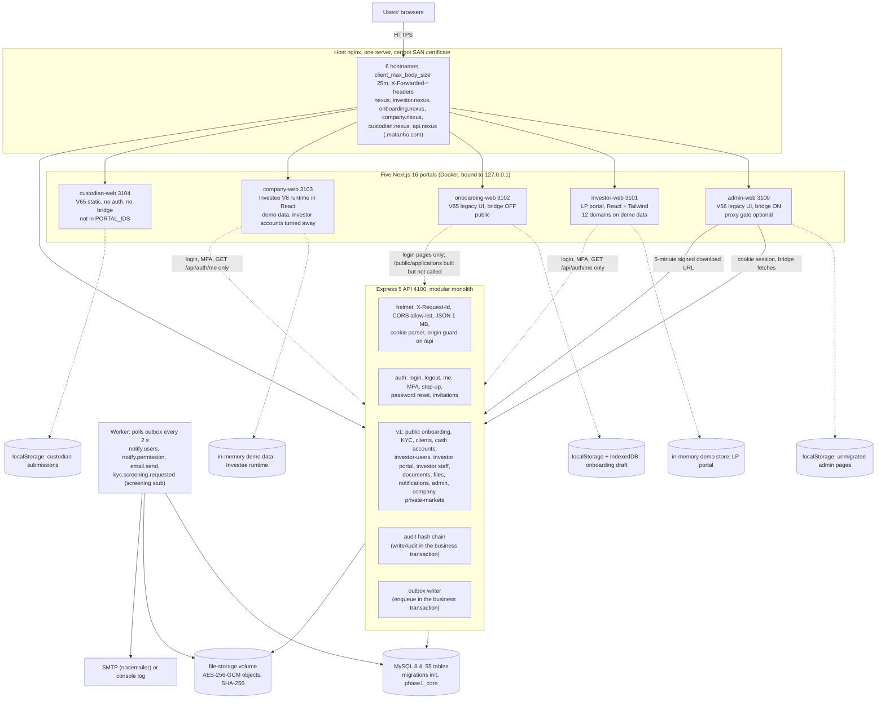
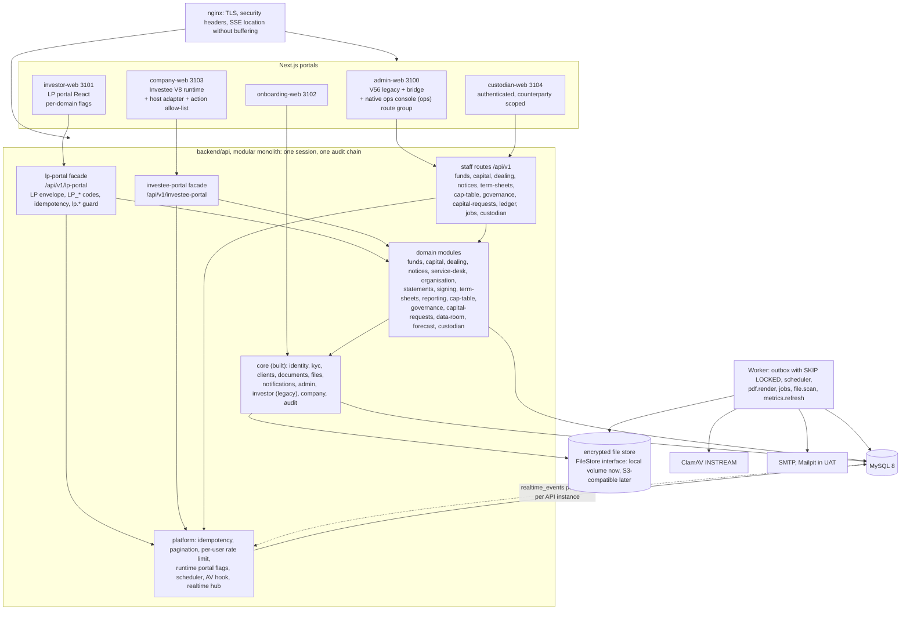
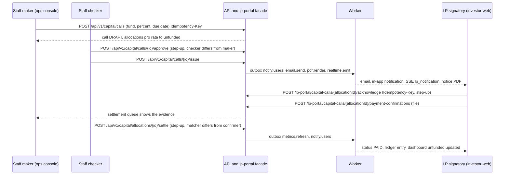
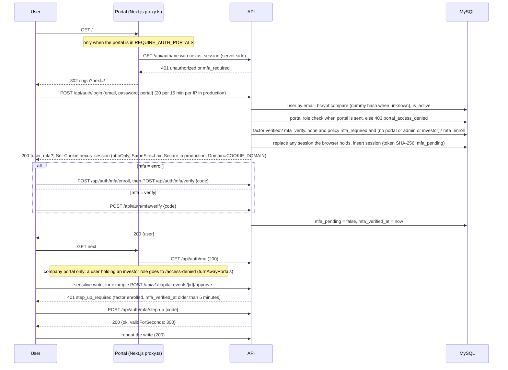
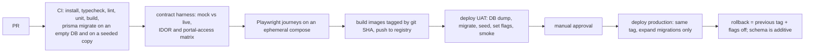

## 9. System architecture and diagrams

Labels: **[O]** observed in code or deployment files, **[I]** inferred from a UI or from the NVCCZ reference backend, **[P]** proposed. **Build status** (Built, Partial, Mock, Not started, Contradicted) is used in tables where the state of the code matters. Section references to BUILD-PLAN mean `docs/BUILD-PLAN.md`.

### 9.1 Current architecture as built **[O]** (1 Oct 2026)



The API serves downloads from `GET /api/v1/files/:id/download` (HMAC-signed, 5 minutes). Every portal serves `/login`, `/invite` and `/reset-password` from the shared `@matanho/portal-kit`; these call `/api/auth/*`. Portal route protection is opt-in per portal through `REQUIRE_AUTH_PORTALS` and is enforced by each portal's `proxy.ts` (`createPortalProxy`), which asks the API `GET /api/auth/me`; **the API enforces authorisation on every request and the proxy only decides where to send the browser** [O].

#### 9.1.1 Portal state table

| Portal (port, host) | UI source and bridge | Gate in `proxy.ts` | What reaches the API today | Build status |
| --- | --- | --- | --- | --- |
| Admin workspace (3100, `nexus.matanho.com`) | V56 `index.html` extracted into `public/legacy`; **bridge ON** (8 bridge files, about 1.8k lines). A single route `/`; no URL deep links, no history. | `requirePortalRole: true` when `admin` is in `REQUIRE_AUTH_PORTALS`. | Bridge loads `GET /api/auth/me`, `/api/v1/admin/access-context`, `/policy`, `/settings` before the prototype scripts, then calls the `/api/v1` families for KYC and onboarding, clients and cash accounts, investor services, documents, the company-reporting hub (`/private-markets/*`), RBAC, policy, settings, audit. If a call fails the bridge **falls back silently to the demo literals** (`window.__mxData && … \|\| literal`). | Partial. Performance, IBOR, Cash ledger, Operations, Reconciliations, NAV, Accounting, Financing, Corporate actions, Regulatory, Data fabric, Models and Copilot have no bridge and no API route (figures are literals or client-side data). |
| LP portal (3101, `investor.nexus.matanho.com`) | Native React + Tailwind v4 + shadcn/Radix; 10 screens under `/lp-portal`; **no bridge**. `LP_LIVE_DOMAINS` has 12 keys, all `false`; `api-client.ts` is a stub that rejects; `mock-api.ts` answers every `lpPortalApi` method from `mock-store.ts`. | `requirePortalRole: true` (needs a role on the `investor` portal; the LP role is not read). | Login, MFA and `GET /api/auth/me` only. `/api/v1/investor/*` is built and tested but not called (DEF-529). | Mock |
| Onboarding (3102, `onboarding.nexus.matanho.com`) | V65 `public-onboarding.html`, six steps; **bridge disabled** (`DISABLED` set in `tools/legacy-bridge.mjs`). | `/login`, `/invite`, `/reset-password` exist with `enforcePortalAccess=false` (Q-168). The page is public by design (draft token). | Nothing. The wizard writes browser storage (`matanho-public-onboarding-draft-v57`, holding tax ID and bank account in clear). OCR runs client-side from public CDNs (Tesseract.js 5, pdf.js 3.11.174). `/api/v1/public/applications/*` is built but not called. | Mock |
| Investee portal (3103, `company.nexus.matanho.com`) | React shell around the vendored runtime `matanho-investee-portal-runtime.js` (200 KB, generated) and `investee-portal-v8.css`; `liveOnly:false`; `matanho:before-action` extension point; 13 routes. | `requirePortalRole: false`; accounts holding an `investor` role go to `/access-denied` (`turnAwayPortals: ['investor']`); staff accounts can open it. | Login, MFA and `GET /api/auth/me` only. `/api/v1/company/*` is built but not called by this portal; the admin hub still calls `/api/v1/private-markets/*`. | Mock |
| Custodian (3104, `custodian.nexus.matanho.com`) | V65 `custodian-portal.html`; **no bridge**; no `(auth)` routes, no `proxy.ts`, no `portal-kit` dependency. | None (public). | Nothing. Hand-off through `localStorage["matanho-v61-custodian-submissions"]` cannot work across origins and no admin code reads it (DEF-485 to DEF-491, DEF-528). `custodian` is absent from `PORTAL_IDS`, `PORTALS`, `.env.example` and the default CORS allow-list (FR-PLAT-003). | Mock |

Other observed facts that the earlier 9.1 did not state **[O]**: the admin Orders page requests logos from third-party hosts (`logos.hunter.io`, Google favicons); `.env.example` is stale (DEF-532); the legacy static stack (`docker-compose.yml` behind Traefik, `nginx.conf`, `vercel.json`, `.github/workflows/pages.yml`) is still in the repository and conflicts with the new stack on the hostname `nexus.matanho.com` (Q-19).

#### 9.1.2 API as built **[O]**

Request pipeline (`backend/api/src/app.ts`), in order: `helmet` (HSTS only in production) → `requestId` (accepts `[\w.-]{8,64}`, echoes `X-Request-Id`) → CORS (credentialed allow-list; allowed headers `Content-Type, Accept, If-Match, Idempotency-Key, X-Request-Id, X-Draft-Token`; exposed `X-Request-Id, ETag`) → `express.json({limit: '1mb'})` → `cookieParser` → on `/api`: `originGuard` (rejects a state-changing request only when it carries an `Origin` header outside the allow-list; requests with no `Origin` pass) → router → `notFoundHandler` → `errorHandler`. `trust proxy` is 1 in production.

| Mount | Handlers | Guard family | Module |
| --- | ---: | --- | --- |
| `GET /api/health` | 1 | none | `controllers/healthController` |
| `/api/auth` (register, login, logout, me) | 4 | rate limit on credential routes (20 per 15 min per IP in production, 200 otherwise) | `routes/authRoutes` |
| `/api/auth` and `/api/v1/auth` (MFA, step-up, reset, invitations; mounted twice) | 8 | session, rate limit | `modules/identity` |
| `/api/v1` uploads, files, notifications | 5 | session or HMAC signature | `modules/files`, `modules/notifications` |
| `/api/v1/public` | 5 | draft token, rate limit | `modules/kyc/public.routes` |
| `/api/v1/kyc` | 12 | session, portal `admin`, `onboarding.*` | `modules/kyc` |
| `/api/v1` clients, mandates, cash accounts, investor-users | 13 (18 method and path pairs; one `/:action` handler serves six cash-account verbs) | `clients.*`, `cash.*` | `modules/clients` |
| `/api/v1` capital events, snapshots, service requests, message threads (staff) | 18 | `clients.*`, `cash.*`, `reports.*` | `modules/investor/staff.routes` |
| `/api/v1/documents` | 10 | `documents.*` | `modules/documents` |
| `/api/v1/admin` | 19 | `admin.rbac`, `admin.settings`, `audit.view` | `modules/admin` |
| `/api/v1/company` | 10 | session, company membership | `modules/company` |
| `/api/v1/private-markets` | 12 | `portfolio.view`, `research.edit` | `modules/company/company.staff.routes` |
| `/api/v1/investor` | 22 | session, portal `investor`, client membership | `modules/investor/investor.routes` |
| **Total** | **139** | | The backend audit reports 140 route handlers; the difference is the `GET /` service-info route. |

Cross-cutting libraries **[O]**: `lib/audit.ts` (`writeAudit`: hash-chained row in the same transaction), `lib/outbox.ts` (`enqueue` inside the business transaction), `lib/policy.ts` (cached policy reads), `lib/refs.ts` (human references from `sequences`), `lib/storage.ts` (AES-256-GCM, SHA-256, HMAC-signed URLs), `lib/mailer.ts` (nodemailer or console), `lib/totp.ts` (RFC 6238). There is no unit-test runner and no CI (DEF-516); `npm run smoke` and `npm run e2e` are the only automated checks.

Worker (`dist/worker.js`) **[O]**: polls `outbox_events` every 2 s, takes 25 rows, skips a failed row until `2^attempts` seconds after its creation, gives up after 8 attempts (`last_error` kept), delivers at least once and is not idempotent; one instance only; no health check; not started by `npm run dev` (DEF-518).

### 9.2 Target architecture (Option B) **[P]**

Decision (AD-09): keep one Nexus session, one audit chain, one document store and one database. The two imported UIs keep their contracts through **contract facades** inside `backend/api`; business logic lives in new Nexus modules. NVCCZ is a reference and an oracle, not a runtime dependency (BUILD-PLAN 3.6).



#### 9.2.1 Module boundaries

All modules are folders in `backend/api/src/modules/*` with a route file, a service file and zod schemas. A module may call another module's service, never its tables (except `core` read models).

| Module | Responsibility | Depends on | Phase | Build status |
| --- | --- | --- | --- | --- |
| `identity` | Sessions, MFA, step-up, invitations, reset; gains LP, Investee and custodian role bundles and `fund_ids` / company role on invitations | `admin` (policy) | P0 | Built (extend) |
| `clients`, `kyc`, `documents`, `files`, `notifications`, `admin`, `investor` (legacy), `company` + `private-markets` | As in 9.1.2 | | | Built |
| `funds` | Fund master, share classes, valuation publication (NAV per unit, valuation status, as-of) with maker and checker, dealing rules, commitments register | `clients`, audit, outbox | P1 | Not started |
| `capital` | Capital calls, per-LP allocations, distributions, notice generation, acknowledgement, payment confirmation (reuses funding evidence), settlement matching, overdue marking | `funds`, `files`, `documents`, `statements`, outbox | P2 | Not started (the existing `capital_events` flow stays for non-fund events) |
| `dealing` | Subscription and redemption estimates and requests, compliance gate, staff lifecycle | `funds`, `kyc`, `capital`, `clients` | P3 | Not started |
| `notices` | Targeted publications with per-person receipts | `clients`, `funds`, `notifications`, `realtime` | P1 | Not started |
| `service-desk` | Requests and record-linked threads with attachments and assignee for LP and company (generalises `service_requests` and `message_threads`) | `files`, `notifications`, `realtime` | P4 | Partial (tables exist) |
| `organisation` | LP colleagues, roles, fund entitlements, bank-instruction changes with dual approval | `identity`, `clients`, `funds` | P4 | Partial (invite and staff revoke exist) |
| `statements` | Jobs and PDF rendering: performance reports, account statements, call and distribution notices, signature certificates | worker, `files`, `settings` | P2 and P4 | Not started |
| `realtime` | Event log and SSE hub (AD-12) | outbox | P1 | Not started |
| `signing` | Generalised e-signature (`subject_type`, `subject_id`), evidence pack, certificate, verify | `documents`, `files`, `identity` (step-up), audit | P6 | Partial (document signing built) |
| `term-sheets` | Draft, issue, version, track to fully signed | `signing`, `company`, `documents` | P6 | Not started |
| `reporting` (extends `company`) | Periods, items, structured statements, KPI definitions and values, covenants, review | `documents`, `files`, `service-desk` | P5 | Partial (5-item pack built) |
| `cap-table` | Registry, share classes, stakeholders, convertibles, transactions with maker and checker, dilution and waterfall engines, certificates | `company`, `documents`, `statements` | P7 | Not started (deferred past UAT) |
| `governance` | Consent requests, reserved matters, board calendar, actions, packs (thin) | `company`, `signing` | P7 | Not started (deferred) |
| `capital-requests` | Investee requests for funds with lines, attachments, drill-down questions, staff review (no procurement suite) | `company`, `funds`, `files` | P8 | Not started |
| `data-room` | Company folders, versions, access profiles on `documents` | `documents`, `files` | P8 | Not started |
| `forecast` | Forecast workbooks (JSON sheets, scenarios, close-day lock) | `company` | P8 | Not started (deferred) |
| `custodian` | Counterparties, users, accounts, executions, day-end packages, intake into reconciliation | `identity`, `files`, audit, later `recon` | P9 | Not started |
| `lp-portal` | **Contract facade** `/api/v1/lp-portal/*` (70 methods plus the attachment download route B1; the GP-admin routes are native staff routes, 11.3.4). No business logic: `lpContext`, `lpPermission`, envelope, error mapper, `idempotent()`, number serialisation | all LP-facing modules | P0 stubs, P1 to P4 live | Not started |
| `investee-portal` | **Contract facade** `/api/v1/investee-portal/*` (30 applicant methods plus the page endpoints of 11.6) | `company`, `reporting`, `term-sheets`, `signing`, later `cap-table`, `governance`, `capital-requests`, `data-room`, `forecast` | P5 to P8 | Not started |
| `platform` (in `lib/` and `middleware/`) | `idempotent(scope)`, `paginate`, per-user rate limiter, `flags`, `scheduler`, AV scan hook, structured JSON logging | | P0 | Not started |
| Ops console | Native React route group `portals/admin-web/src/app/(ops)/ops/*`, own root layout (no legacy CSS), `@matanho/shared` client, `@matanho/portal-kit` session and proxy, one bridge link shim `admin-70-ops-links.js` (AD-11) | staff routes | P0 to P9 | Not started |
| SRD v1.0 domains outside this build plan: portfolios and IBOR, OMS, risk, cash ledger, reconciliation, valuation and accounting, regulatory | Unchanged from v1.0 AD-02; they attach later through the same module rules | | After P10 | Not started (prototype only) |

#### 9.2.2 Facade pipeline (LP and Investee)

Order of middleware on `/api/v1/lp-portal/*` **[P]**:

1. `requestId` → 2. `requireAuth` (session, MFA complete) → 3. `requirePortalAccess('investor')` → 4. `lpContext`: resolve the membership among the caller's own `client_users` rows (`?client=<ref>` may select only among them; default first by `created_at`), the LP role (VIEWER, SIGNATORY, MANAGER) and the fund scope (`fund_ids`; null means all) from the database on every request, never from the request or a token → 5. `lpPermission(code)` (reads `req.user.permissions`, so the RBAC screen governs it) → 6. role gate (Gate S or Gate M of 11.5) → 7. `requireIdempotencyKey(action)` on the nine write routes (after the permission checks, so an unauthorised caller gets 403 before any key error) → 8. step-up where 9.4 requires it → 9. handler (calls a module service; never a table) → 10. LP serialiser (envelope, number rules) → 11. LP error mapper (9.6.3).

Not-yet-live stubs return contract-valid empty shapes and the header `X-Mx-Stub: 1`, so a contract test cannot mistake a stub for live behaviour **[P]**. The Investee facade follows the same pipeline with `requirePortalAccess('company')`, `companyContext` (explicit `?company=<ref>` among the caller's `company_users` links) and the company role bundle.

#### 9.2.3 Runtime flags **[P]**

| Flag | Where read | Content | Effect | Rollback |
| --- | --- | --- | --- | --- |
| `LP_LIVE_DOMAINS` | investor-web container environment, read at request time by the root layout and injected as `window.__MX_FLAGS__`; `isLpDomainLive(domain)` reads it | comma list of `session, dashboard, capital, activity, dealing, performance, documents, notices, requests, organisation, settings, reports` | a listed domain is served by the live API; others by the mock store and show a persistent "Demo data" ribbon | edit the variable and restart the container (seconds, no rebuild) |
| `INVESTEE_LIVE_ACTIONS` | company-web container environment, same mechanism | allow-list of host-adapter action ids (the NVCCZ `API_ACTIONS` allow-list pattern) | listed actions persist through `/api/v1/investee-portal`; fixture pages show the ribbon and write controls are disabled | same |
| `REQUIRE_AUTH_PORTALS` | each portal container | `admin, investor, onboarding, company, custodian` | proxy gate on or off | same |
| Portal flags panel (staff S26) | `GET /api/v1/admin/portal-flags` | read-only view of the flags above and of the demo-mode hosts | visibility only | none |

Flip groups (domains that show the same numbers must flip together): **G1** `session + organisation + settings`; **G2** `dashboard + capital + activity + performance`; **G3** `documents + notices + requests`; **G4** `dealing`; **G5** `reports`. A domain left in mock inside a live portal shows the ribbon. There is **no silent fallback to mock on an error** (AD-16): a failed live call shows an error toast with the `X-Request-Id`. The existing admin bridge's silent fallback to literals is retained for the legacy pages **[O]** and is a known exception (Q-NEW: should the bridge show a banner when it serves fallback data? — default: yes, a "Demo data" banner per page).

LP domains and method counts (the 70-method list of 11.5; BUILD-PLAN 1.3 counts 69 in `LP_METHOD_DOMAIN` with `capital` = 10, so one method is unmapped there and the harness uses the 70-method list): session 2, dashboard 3, capital 11, activity 4, dealing 9, performance 7, documents 8, notices 4, requests 9, organisation 7, settings 4, reports 2.

#### 9.2.4 Jobs and scheduler **[P]**

All jobs run in the worker (single instance until `SKIP LOCKED` and idempotent consumers land, NFR-AV-005). Time zone Africa/Harare for schedules.

| Job | Trigger | NVCCZ origin | Behaviour |
| --- | --- | --- | --- |
| `metrics.refresh` | nightly 01:00 CAT; events `valuation.published`, `capital.payment.settled`, `distribution.paid` | `POST /api/cron/lp-portal/snapshot-refresh` (shared secret) | recompute or copy `fund_metric_snapshots` per (client, fund, as-of); never at request time |
| `capital_call.mark_overdue` | daily | computed on read | set OVERDUE where due date has passed and unpaid; emit notice and event |
| `reporting.remind` | 3 days before and on the due date; escalation to the relationship owner | `reporting_notification_logs` | `notify.users` and `email.send` to company users |
| `pdf.render`, `report.generate` | `jobs` row | `LpPortalReportsService` | render with `pdfkit`, store a `files` row, set `jobs.status` READY or FAILED; UI polls `GET /jobs/{id}` |
| `file.scan` | on upload | none | ClamAV INSTREAM; `files.scan_status` pending, clean, infected; downloads blocked until clean |
| `kyc.review_due`, `signature.expire` | daily | none | notify owners; expire unsigned requests |
| `idempotency.purge`, `realtime.purge`, `dealing_estimates.purge`, `uploads.purge` | hourly | none | delete idempotency keys older than 24 h, realtime events older than 24 h, expired estimates, unreferenced uploads older than 24 h (DEF-517) |
| `outbox` | continuous | n/a | existing; add `FOR UPDATE SKIP LOCKED` and idempotent consumers |

#### 9.2.5 Realtime and polling **[P]**

- Transport: Server-Sent Events, `GET /api/v1/realtime/stream`, authenticated by the session cookie; channels `user:<id>`, `client:<id>`, `company:<id>` derived server-side from memberships; `Last-Event-ID` replay from `realtime_events`; 25 s heartbeat; nginx `proxy_buffering off` on that location (AD-12). Each API instance polls `realtime_events` (`id > last`) every second and fans out in memory, which works with the worker in a separate process and needs no Redis.
- Events: the eight NVCCZ names `lp_notice_updated, lp_request_created, lp_request_updated, lp_request_message, lp_thread_message, lp_thread_read, lp_thread_updated, lp_notification`, plus Nexus domain events (11.4).
- `GET /lp-portal/realtime` returns the UI type `LpRealtimeInfo` `{enabled, wsUrl?, namespace?, events?, pollingIntervalMs}` extended with `streamUrl`; it does **not** return the NVCCZ Socket.IO descriptor (the UI never read it).
- Until SSE ships the LP UI polls every 30 s per active query in `useLpQuery` (Q-92 default). SSE is not required for UAT (BUILD-PLAN Q-NEW-13).
- The LP UI's join and leave room functions become no-ops because membership is derived server-side. This closes the NVCCZ gap where any authenticated socket could join any thread or request room.

#### 9.2.6 Cross-portal flow: capital call **[P]**



#### 9.2.7 Day-one slice deviations (UAT on D+1) **[P]**

BUILD-PLAN 12.2 permits these shortcuts, each recorded in a debt register. They change the shape of 10.3 for the first release only.

| Shortcut | Target design | Removal phase |
| --- | --- | --- |
| Valuation, NAV per unit and dealing rules live as columns and a JSON column on `funds` | `fund_valuations` and `lp_dealing_rules` | P1 and P3 |
| Account activity is a read-time union over allocations, distributions, dealing requests and `snapshot_transactions` | immutable `fund_ledger_entries` with original and reporting amounts and FX stamping | P2 |
| DPI, TVPI, IRR are stored JSON on `fund_commitments`, never computed in the portal | `fund_metric_snapshots` refreshed by the worker | P1 |
| Request replies reuse `service_request_events` | `service_request_messages` and `request_attachments` | P4 |
| `client_users.fund_ids` JSON | join table `client_user_funds` (Q-155) | P4 |
| Realtime by polling | SSE | P1 |
| Unscanned uploads with synthetic data only | ClamAV | P10 |
| One migration file for the day, authored by the schema owner before 09:30 on day D, additive only; after 12:00 only column additions | normal expand and contract migrations | n/a |

### 9.3 Architectural decisions

Status uses the build vocabulary. "Revised" means the decision stands in spirit but the mechanism changed.

| ID | Decision | Status | Rationale | Alternatives | Label |
| --- | --- | --- | --- | --- | --- |
| AD-01 | Keep one Next.js app per portal on ports 3100 to 3104 (five portals). | **Built**, extended | Independent deploy and scale; matches the repository. The custodian port 3104 exists but `custodian` is not yet in `PORTAL_IDS` (FR-PLAT-003). | Single multi-tenant Next app. | [O] |
| AD-02 | One shared API as a **modular monolith**. Modules in code today: identity, kyc (public and staff), clients and cash accounts, documents, files, notifications, investor (portal and staff), company (portal and private-markets), admin; target additions in 9.2.1. The SRD v1.0 domain list (portfolio and IBOR, OMS, risk, cash ledger, reconciliation, valuation and accounting) remains the long-term shape. | **Built**, partial | Strong consistency across financial workflows; small team; split later along module boundaries. | Microservices from day one. | [O]/[P] |
| AD-03 | Express 5.1 + TypeScript 5.9 + zod 4 + Prisma 6.19 on MySQL 8.4. | **Built** | Typed end to end; already in place. | NestJS, PostgreSQL. | [O] |
| AD-04 | Background work through the **MySQL transactional outbox** polled by one worker (2 s poll, 25 per batch, back-off, 8 attempts). BullMQ on Redis is deferred; the worker gains `SKIP LOCKED` and idempotent consumers, a scheduler and a `jobs` table (9.2.4). | **Revised** (was BullMQ and Redis) | The outbox already guarantees that side effects commit with the business change; SSE and jobs work without Redis (BUILD-PLAN 4.6). Redis stays an option when queue volume or latency requires it. | BullMQ, RabbitMQ, SQS. | [O]/[P] |
| AD-05 | Encrypted, versioned object storage behind a `FileStore` interface: local volume with AES-256-GCM and HMAC-signed 5-minute URLs now; S3-compatible later. Signed URLs gain a user-bound claim; every download path is audited. | **Partial** (local store Built; S3 Not started) | Keeps files out of the database; the interface lets S3 replace the volume without API change. Data residency is open (BUILD-PLAN Q-NEW-14). | DB BLOBs. | [O]/[P] |
| AD-06 | Audit events in an append-only table with hash chaining; daily export to WORM storage. | **Partial**: chain Built; WORM export and database-level append-only protection Not started (DEF-525: the hash excludes actor role, portal, IP and request id, and the application user can UPDATE and DELETE). | Tamper evidence without extra infrastructure. | Dedicated ledger DB. | [O]/[P] |
| AD-07 | Keep the **legacy prototype UIs** for the admin workspace through the data bridge; replace pages gradually with React that keeps identical markup and CSS. Investor and company portals are **no longer legacy**: they are the native-React LP and Investee portals (AD-09). Onboarding and custodian bridges are disabled (DEF-529). New staff screens for fund operations are native React in an ops console (AD-11). | **Revised** | UI must stay identical for the legacy admin; risk managed per workflow. | Big-bang rewrite. | [O]/[P] |
| AD-08 | Money as DECIMAL(20,4) with a `CHAR(3)` currency; percentages DECIMAL(9,4); units DECIMAL(24,8); NAV per unit DECIMAL(20,8); never floats. | **Partial**: money and percentages Built; units and NAV per unit Not started (no table holds them); several snapshot values are display strings (balances in `cash_accounts.meta`, `snapshot_*` fields). | Financial precision. | Integer minor units. | [O]/[P] |
| AD-09 | **Option B: port natively behind contract facades.** `/api/v1/lp-portal/*` and `/api/v1/investee-portal/*` keep the NVCCZ paths, success and error envelopes, `LP_*` codes and idempotency semantics so the two UIs stay unchanged; everything behind them is Nexus services and tables. NVCCZ is a reference and oracle, not a runtime. The facade envelope is the only exception to the Nexus-native envelope (AD-22). | **Not started** | One source of truth, one audit chain, one RBAC, one vault. Port rules and contracts, not files: about 24k lines of NVCCZ own code are `@ts-nocheck`, coupled to a general ledger and use tables outside Prisma. Effort 44 to 62 person-weeks against 8 to 12 (A) or 50 to 70 (C). | **A** run NVCCZ behind a gateway (two sources of truth); **C** rebuild on Nexus conventions and adapt the UIs (permanent merge tax). Would change if Matanho runs NVCCZ as a product (BUILD-PLAN Q-NEW-04). | [P] |
| AD-10 | **Per-domain runtime flags** (`LP_LIVE_DOMAINS`, `INVESTEE_LIVE_ACTIONS`), flipped in groups G1 to G5, rolled back by environment edit and container restart (9.2.3). | **Not started** | Domains go live one at a time against a verified contract; rollback takes seconds. | One boolean for the whole portal (all-or-nothing, the earlier LP design). | [P] |
| AD-11 | **Native React ops console** in `admin-web` route group `(ops)`, beside the legacy bridge, for fund-operations screens S1 to S27 (BUILD-PLAN 6.2); the bridge keeps small shims only (document categories, service-desk fields, portal-access rows, audit filters, company hub) and one link file `admin-70-ops-links.js`. | **Not started** | A capital-call run or a cap-table transaction cannot be built reliably in the bridge style (`prompt()` dialogs, 35 timer-driven patch layers) and the bridge risks the pixel-identical guarantee. | Bridge-only; a separate staff app (NVCCZ `nvccz-new`). | [P] |
| AD-12 | **SSE, not Socket.IO**, with 30 s polling as the interim (9.2.5). | **Not started** | No Redis; works with a separate worker; membership derived server-side. | Socket.IO (NVCCZ), WebSocket hub, polling only. | [P] |
| AD-13 | **Valuation and fund metrics by publication.** NAV per unit, valuation status and fund metrics are published by staff with maker and checker (`valuation.publish`) and stored; portals never compute NAV, IRR or multi-fund aggregates at request time. | **Not started** | Authority for numbers stays with fund accounting (NVCCZ rule 3 and 28); avoids a 2,184-line dashboard service. Source of NAV is open (BUILD-PLAN Q-NEW-05). | Compute in the API from ledger and positions; import from a NAV module. | [P] |
| AD-14 | **No general-ledger posting** for capital calls, distributions or cap-table transactions in this scope. Domain events (`capital.call.issued`, `capital.payment.settled`, `distribution.paid`) are emitted for a future ABOR consumer; settlement stores a bank reference and evidence only. | **Not started** | NVCCZ coupling to the chart of accounts is the main reason a lift drags 35k lines. Nexus ABOR does not exist yet (BUILD-PLAN Q-NEW-03). | Post journals into a new Nexus ledger. | [P] |
| AD-15 | **Contract-first with a mock oracle.** `lp-portal-api.ts` (about 1,400 lines) and `application-portal-api.ts` (about 824 lines) move to `packages/shared/src/lp.ts` and `investee.ts` with zod schemas; the server validates its own responses in dev and test (`assertContract`); a harness runs every method on `mock-api.ts` (in process) and on the live API (seeded persona) and compares shape and selected values; a seed exporter makes live data equal demo data. | **Not started** | The mock store (876 + 2,288 lines) already answers every method; any visual difference after a flip is a logic bug. | Hand-written API tests only. | [P] |
| AD-16 | **No silent mock fallback** in the new portals. A domain that is not live shows the ribbon; a live call that fails shows an error with the request id. | **Not started** | A silent fallback hides defects during UAT. | Fallback to mock on any error. | [P] |
| AD-17 | **A fund is a first-class entity** (`funds` with share classes, valuations, dealing rules), distinct from `portfolios` and `private_investments`; an optional `portfolio_id` link can follow. | **Not started** | Everything fund-scoped in the LP portal needs it; `capital_events.investment_name` and `snapshot_investments.name` are free text today. Owner of fund master data: Q-157. | A fund is a portfolio or mandate type (BUILD-PLAN Q-NEW-01). | [P] |
| AD-18 | **Idempotency keys** on the nine LP write routes and on every Nexus POST that creates a financial record: header `Idempotency-Key` (8 to 200 printable ASCII), table `idempotency_keys` unique on (user, scope, key), 24 h expiry, atomic claim, same key and same hash replays the stored response with `Idempotent-Replay: true`, same key and different hash returns 409 `LP_IDEMPOTENCY_KEY_REUSED` (Nexus code `idempotency_key_reused`). The hash is taken after multipart parsing and ignores volatile fields. | **Not started** (DEF-513) | Closes DEF-513; fixes three NVCCZ defects (non-atomic check, hash of an empty body for multipart routes, no expiry). | Natural-key uniqueness only. | [P] |
| AD-19 | **Step-up for money and signing actions** (5-minute window) and `mfa_required` on for LP signatories and managers, Investee approvers and administrators, custodian approvers and all staff roles before UAT sign-off; no-factor users receive `mfa_enrolment_required`; the 401 versus 403 status is decided once (9.6.2). | **Partial** (step-up Built on KYC decision, capital approve and settle, document approve, snapshot publish, identifier reveal, admin writes; missing on cash-account approve, suspend, reactivate, close, document publish, capital publish, KYC activate: DEF-524) | A user without an enrolled factor skips step-up while `mfa_required` is false (DEF-519). | Step-up only for enrolled users (as built). | [O]/[P] |
| AD-20 | **One identity, default deny, server-derived scope.** The Nexus `users` row and the `nexus_session` cookie are the only identity (no NVCCZ JWT, `tokenVersion` or per-portal `aud`); every router starts with `requireAuth` and `requirePortalAccess(<portal>)`; scope comes from memberships, never from request input; out-of-scope identifiers answer 404. A test matrix of account types by portal by endpoint family must return 403 everywhere except the owning portal. | **Partial** (cookie and portal guard Built; `company` takes only the first link, DEF-527; investor scope not applied to documents and capital events, DEF-526) | The NVCCZ default-allow branch let INVESTEE accounts into the staff portal; that failure must not recur. | Per-portal JWT audiences. | [O]/[P] |
| AD-21 | **Additive, expand-and-contract migrations** only; `prisma migrate deploy` in the `migrate` container; statuses are `VARCHAR` with service-enforced vocabularies (current convention); rollback is previous image tags plus flags off, no down-migration. | **Built** (convention), **Not started** (rehearsal on a copy of UAT data) | Safe repeated deploys with the seed running on every deploy. | DB enums and check constraints. | [O]/[P] |
| AD-22 | **Two envelopes.** Nexus-native routes keep `{error:{code,message,details}}` and raw bodies; the two facades emit the NVCCZ envelope `{success, message, data, timestamp, meta:{requestId}}` and `{success:false, message, error:{code, message, fieldErrors, details, retryable}, timestamp, meta}`. A single mapper converts Nexus errors to `LP_*` codes (9.6.3). `meta.requestId` equals the `X-Request-Id` header (NVCCZ generated a different random id). | **Not started** | UIs unchanged; staff routes unaffected. FR-LP-109. | Nexus envelope everywhere (changes hundreds of call sites). | [P] |

### 9.4 Authentication sequence **[O]**, with proposed changes **[P]**



Rules as built **[O]**:

1. **Session.** 256-bit random token; only its SHA-256 is stored (`sessions.token_hash`). Absolute lifetime `SESSION_TTL_HOURS` (default 12); idle lifetime is the stricter of the `session_idle_minutes` policy (default 30) and `SESSION_IDLE_MINUTES` (default 240); `last_used_at` is touched at most once a minute. A disabled account resolves to no session.
2. **Portal gate.** `requirePortalAccess(portal)` passes when the user holds a role whose `portal` equals the portal id. `portal` in the login body is optional (`admin, investor, onboarding, company`); when sent and the user lacks a role there, the answer is 403 `portal_access_denied`. The company portal's login form omits `portal`, so company users need no role and investor-role accounts are refused only by the Next proxy (`turnAwayPortals`), not by the API.
3. **MFA.** Enrolment is forced at sign-in only when the policy `mfa_required` is on **and** the login carries no `portal` or one of `admin`, `investor` (`MFA_PORTALS`). It is off by default (DEF-519). Invitation acceptance creates a fully verified session and bypasses MFA (DEF-520).
4. **Step-up.** `requireStepUp`: a user with a verified factor must have verified a code within 5 minutes (`401 step_up_required`); a user without a factor passes when `mfa_required` is off and gets `401 mfa_enrolment_required` when it is on.
5. **Revocation.** Password reset revokes every session of the user; staff removal of an investor membership (`DELETE /investor-users/:id`) does **not** revoke sessions; disabling a staff user revokes them.
6. **Cookie sharing.** `COOKIE_DOMAIN` on the parent domain of all portal hosts lets one cookie serve every portal; ports are ignored on `localhost`.

Proposed changes **[P]**: (a) turn `mfa_required` on in production and set `MFA_PORTALS` to include `company` and `custodian` (Q-NEW: should company login send `portal: 'company'` so the API, not only the proxy, enforces turn-away of investor accounts? — default: yes, add a portal role `viewer` and the API check); (b) `custodian` becomes a portal id with `/login`, `/invite`, `/reset-password` and the same proxy (FR-AUTH-018); (c) step-up is required on every action in 9.2.2 step 8, listed per portal in the table below; (d) removal or revocation of an LP colleague deletes that user's sessions immediately; (e) the SSE endpoint is authenticated by the same cookie, uses the origin allow-list, and puts no token in a URL; (f) a staff "view as" mode (`portal.view_as`: read-only, audited, banner, time-boxed) replaces NVCCZ's `?clientId=` impersonation.

| Action | Portal | Step-up (5 minutes) | Also |
| --- | --- | --- | --- |
| Acknowledge a capital call, confirm payment, submit a dealing request, request a bank change, invite or change a colleague, sign a document or term sheet | LP | Yes | Idempotency-Key; audit with payload hash |
| Sign a term sheet, submit a report pack, submit a capital request, change team | Investee | Yes (approver and administrator profiles) | role check |
| Approve or issue a call, publish a valuation, approve dealing, approve a bank change, execute a cap-table transaction, issue a term sheet | Staff | Yes | maker differs from checker |
| Day-end submission approval | Custodian | Yes (approver role) | file hash |

### 9.5 Deployment topology

#### 9.5.1 As built **[O]**

One host runs Docker Compose (`deploy/docker-compose.prod.yml`, project `matanho-nexus`).

| Service | Image | Host bind | Volumes | Notes |
| --- | --- | --- | --- | --- |
| `mysql` | `mysql:8.4` | none (internal) | `mysql-data` | utf8mb4_unicode_ci; healthcheck `mysqladmin ping` |
| `migrate` | `matanho-nexus-api` (`Dockerfile.api`) | none | `file-storage`; `secrets/users.json` read-only | `prisma migrate deploy` then `tsx prisma/seed.ts` (roles, users file, optional demo) on **every deploy**; waits for MySQL healthy; runs once |
| `api` | `matanho-nexus-api` | `127.0.0.1:4100` | `file-storage` | after `migrate` succeeds; HTTP healthcheck on `/api/health` |
| `worker` | `matanho-nexus-api` | none | `file-storage` | `node dist/worker.js`; no healthcheck; single instance |
| `admin`, `investor`, `onboarding`, `company`, `custodian` | `matanho-nexus-<portal>` (`Dockerfile.portal`, build arg `PORTAL`; `NEXT_PUBLIC_API_URL` inlined at build) | `127.0.0.1:3100` to `3104` | none | `next start`; server-side calls use `API_INTERNAL_URL` |

| Host | Target |
| --- | --- |
| `nexus.matanho.com` | admin, `127.0.0.1:3100` |
| `investor.nexus.matanho.com` | `127.0.0.1:3101` |
| `onboarding.nexus.matanho.com` | `127.0.0.1:3102` |
| `company.nexus.matanho.com` | `127.0.0.1:3103` |
| `custodian.nexus.matanho.com` | `127.0.0.1:3104` |
| `api.nexus.matanho.com` | `127.0.0.1:4100` |

- **Images**: `node:22-bookworm-slim`; `npm ci` over the whole workspace, then each workspace builds; images contain source and dev dependencies. Network: the Compose default bridge; MySQL is not exposed to the host.
- **Configuration**: `.env.production` on the host (`chmod 600`) and `secrets/users.json`; `.env.example` is stale (DEF-532).
- **Reverse proxy**: host nginx, one server block per hostname (`deploy/nginx/matanho-nexus.conf`), port 80 in the repository file; certbot rewrites the live copy in place (HTTP to HTTPS redirect). All blocks set `client_max_body_size 25m` and `X-Forwarded-*`; portal blocks add WebSocket upgrade headers; no security headers at nginx (NFR-SEC-013); HSTS comes from the API only.
- **TLS**: `issue-certs.sh` checks that each of the six hostnames resolves to the host IP, then runs `certbot --nginx --redirect` for one SAN certificate named `nexus.matanho.com`.
- **Session sharing**: `COOKIE_DOMAIN` on the parent domain.
- **Legacy**: the static-prototype stack (`docker-compose.yml` with Traefik on `lms_lms-network`, root `Dockerfile`, `nginx.conf`, `vercel.json`, Pages workflow) is still in the repository and conflicts with the new stack on `nexus.matanho.com` (Q-19). Q-18 is answered in practice (Compose behind host nginx, not Traefik, not Kubernetes) and the hostnames differ from the v1.0 proposal (`app.`, `onboard.`, `companies.`); confirm the as-built names (Q-NEW: confirm `*.nexus.matanho.com` as the production naming — default: yes).

Gaps **[O]**: no CI (DEF-516); no database or file backups (DEF-515); one instance per service; the worker is not health-checked; no slim images; no dev or staging environment; no security headers at nginx; no log shipping (NFR-OPS-007).

#### 9.5.2 Proposed repeatable pipeline and environments **[P]**



| Environment | Purpose | Data |
| --- | --- | --- |
| local | developer machines (`npm run dev`, ports 3100 to 3104 and 4100, worker started by a documented `dev:worker`, DEF-518) | seeded dev data, Mailpit |
| ci | ephemeral compose per pull request | synthetic |
| uat | the existing server (`/opt/matanho-nexus`) is treated as UAT until go-live (BUILD-PLAN Q-NEW-21) | synthetic only; no personal data from production |
| production | live | real |

- Deploy kit `deploy/deploy.sh` (dump DB and snapshot the file store, pull tag, `docker compose up -d`, `migrate`, smoke, tag the release) and `rollback.sh` (previous tag, flags off). Keep the previous image tags for API, worker and portals; keep the worker at one instance until NFR-AV-005 is met.
- Registry images instead of on-host builds; slim production images (no dev dependencies, no source).
- Public demo mode beside live: a second container per portal from the same image with empty flags, auth proxy off and the "Demo data" ribbon, on extra hosts (`demo.investor…`, `demo.company…`: nginx blocks, DNS, certificates). No demo data is written to a live database except by `SEED_DEMO=1` in non-production environments.
- Optional hosts: `mail.nexus.matanho.com` (Mailpit behind basic auth) in UAT. New environment variables: `LP_LIVE_DOMAINS`, `INVESTEE_LIVE_ACTIONS`, `CUSTODIAN_PORTAL_URL`, `CLAMAV_HOST`, `CLAMAV_PORT`, `SMTP_*` (UAT points to Mailpit), `PDF_LETTERHEAD_*`.
- Backups: nightly `mysqldump --single-transaction` plus binary logging for point-in-time recovery, copy of `file-storage` (the AES key backed up separately), 35-day retention, quarterly restore drill verified by `GET /api/v1/admin/audit-events/verify` and the contract harness (NFR-AV-002, DEF-515).
- nginx: CSP, `frame-ancestors none`, referrer and permissions policy on portal responses; SSE location with `proxy_buffering off`; HSTS; the custodian host added to `CORS_ORIGINS`.
- Retire the Traefik compose and the Pages workflow at production go-live (Q-19).

### 9.6 Error handling

#### 9.6.1 Envelope and codes as built **[O]**

- Envelope: `{ "error": { "code": "snake_case", "message": "Human readable", "details"?: … } }`; list bodies `{data, total}`.
- Validation failures: 400 `bad_request`, message "Validation failed", `details: [{ path, message }]` (zod issues mapped by `validate.ts`). Two routes (investor create-request and document upload) return raw zod issues instead (DEF-512). Malformed JSON: 400 `invalid_json`; oversize JSON body: 413 `payload_too_large`.
- 5xx responses never carry a stack trace in production; outside production they include `details.stack`. Every response carries `X-Request-Id`. Rate-limited responses: 429 `rate_limited` with IETF draft-7 `RateLimit` headers.

| Status | Codes in use |
| --- | --- |
| 400 | `bad_request` (includes validation), `invalid_json`, `incomplete_application` |
| 401 | `unauthorized`, `invalid_credentials`, `mfa_required`, `invalid_mfa_code`, **`step_up_required`**, **`mfa_enrolment_required`** |
| 403 | `forbidden`, `permission_denied`, `portal_access_denied`, `origin_not_allowed`, `registration_disabled`, `compliance_role_required`, `role_locked`, `invalid_signature`, `no_client_access`, `no_company_access`, `sod_violation` (capital, snapshot, document, reporting pack) |
| 404 | `not_found` (also for out-of-scope investor and company ids and for bad or expired draft tokens) |
| 409 | `conflict`, `email_taken`, `version_conflict`, `invalid_transition`, `invalid_state`, `approval_blocked`, `activation_blocked`, `sod_violation` (KYC, cash account), `already_submitted`, `already_member`, `mfa_already_enrolled`, `self_lockout`, `self_reset`, `last_admin`, `duplicate` |
| 413 | `payload_too_large` |
| 429 | `rate_limited` |
| 500 | `internal_error` |
| 503 | health check only (`status: degraded`) |

Specified in v1.0 but **not implemented** (**Contradicted**, DEF-511): `validation_failed`, `locked` (423), `dependency_unavailable` (503), `maker_checker_violation`. v1.0 listed `step_up_required` under 403; the code returns 401.

#### 9.6.2 Decisions needed

| Item | As built | v1.0 text | Proposal |
| --- | --- | --- | --- |
| **Step-up and MFA-enrolment status (DEF-509, DEF-523)** | **401** `step_up_required` and `mfa_enrolment_required`; the admin bridge already reacts to 401; the LP UI has no handler yet (the LP front-end work adds a 401 handler and modal) | 403 (FR-AUTH-011) | Q-NEW: canonical status for step-up — default: **401** (the client must re-authenticate), update FR-AUTH-011 and this table, and keep it unchanged through the LP facade so the LP modal and the bridge share one rule. |
| **`sod_violation` status (DEF-510)** | 409 in KYC and cash accounts; 403 in capital, snapshot, document, reporting pack | `maker_checker_violation` 409 | Q-NEW: unify the code `sod_violation` and the status — default: **403** for all new modules (BUILD-PLAN C12), and migrate KYC and cash-account responses at the next major version. |
| **Validation code (DEF-511)** | 400 `bad_request` | `validation_failed` 400 | Keep `bad_request` for Nexus routes; the LP facade maps validation errors to 422 `LP_VALIDATION` (9.6.3). Update the code list. |
| **Details shape (DEF-512)** | two routes leak raw zod issues | `{path, message}` | Normalise through `validate.ts`; add a contract test per route. |
| **Not-implemented codes** | none | `locked` 423, `dependency_unavailable` 503 | Implement `locked` (period locked, signed term sheet immutable) and `dependency_unavailable` (screening, SMTP, ClamAV down) with the integrations they report on, or drop them. |

#### 9.6.3 LP and Investee facades: envelope and mapping **[P]**

Success (facade routes only): `{ "success": true, "message"?: string, "data": …, "timestamp": ISO-8601, "meta": { "requestId": string } }` where `meta.requestId` equals the `X-Request-Id` response header. Lists: `data = {items, page, pageSize, total, totalPages}`; `pageSize` defaults to 50 and is capped at 200; `fundId=all` means no filter. Binary routes return no envelope. **Number rule** (differs from the NVCCZ serialiser that turned every number into a string): money, units, rates and multiples are decimal **strings** (money 2 dp, units up to 6 dp trimmed, NAV and rates up to 8 dp trimmed, ratios 4 dp); fields typed `number` in the UI view-model (`page, pageSize, total, totalPages, callNo, noticeDays, settlementLagDays, counts, sizes`) are JSON **numbers**. The UI keeps its `coerceLpCounts` defence.

Error: HTTP status plus `{ "success": false, "message": string, "error": { "code": string, "message": string, "fieldErrors"?: {field: message}, "details"?: object, "retryable": false }, "timestamp": ISO-8601, "meta": { "requestId": string } }`. The UI client reads `error.*`.

| Nexus condition (native error) | Facade status and code | Notes |
| --- | --- | --- |
| 401 `unauthorized`, `mfa_required` | 401 `LP_UNAUTHORIZED` | |
| 401 `step_up_required`, `mfa_enrolment_required` | 401, code unchanged | the LP modal handles `step_up_required` (Q-NEW above) |
| 403 `permission_denied`, role gate, `no_client_access`, out-of-scope fund | 403 `LP_FORBIDDEN` | message "Missing permission <code>", "Authorised Signatory access required", "LP Manager access required", "Not entitled to this fund" |
| 404 `not_found` (also foreign and out-of-scope ids) | 404 `LP_NOT_FOUND` | never reveals existence |
| 400 `bad_request` (validation) | 422 `LP_VALIDATION` with `fieldErrors` built from `details[{path,message}]` | Idempotency-Key missing or malformed and "file is required" stay 400 `LP_VALIDATION` |
| 409 `invalid_state`, `invalid_transition` | 409 with the specific code: `LP_CALL_NOT_ISSUED`, `LP_CALL_ALREADY_ACKNOWLEDGED`, `LP_ESTIMATE_EXPIRED`, `LP_ACCOUNT_INACTIVE`, or `LP_VALIDATION` | |
| 409 `version_conflict` | 409 `LP_VERSION_CONFLICT` | NVCCZ also used this code for "user already has active access"; Nexus uses `already_member` mapped to `LP_VERSION_CONFLICT` only for that case |
| 409 idempotency key reused | 409 `LP_IDEMPOTENCY_KEY_REUSED` | |
| 413 `payload_too_large` | 413 `LP_FILE_TOO_LARGE` | not mapped in NVCCZ (it returned 500) |
| 415 unsupported file or preview type | 415 `LP_UNSUPPORTED_MEDIA` | |
| 422 dealing rules | 422 `LP_INSUFFICIENT_UNITS`, `LP_MIN_BALANCE_BREACH`, `LP_NOTICE_PERIOD` | |
| 403 dealing gates | 403 `LP_COMPLIANCE_HOLD`, `LP_DEALING_SUSPENDED`, `LP_MFA_REQUIRED` | `LP_MFA_REQUIRED` only for the bank-instruction rule when the LP MFA policy is on and the user has no factor |
| 429 `rate_limited` | 429 `rate_limited` | no LP-specific code |
| 500 `internal_error`, any unexpected error | 500 `internal_error` with a generic message | **Deliberate deviation**: NVCCZ returned `LP_EXPORT_FAILED` with the raw `err.message` for any unexpected error |
| 503 | 503 `dependency_unavailable` | when implemented |

Errors that the NVCCZ router returned **without** the LP body (plain `{success:false, message}`: authentication 401, `requireLpPortalAccess`, `requireGpAdmin`, cron) all use the LP error body in Nexus. The full code list with HTTP statuses is in 11.5.3.

---

## 10. Database schema

Source of truth for [O] rows: `backend/api/prisma/schema.prisma` (Prisma 6, 55 models) and the two migrations `init` and `phase1_core`. Build status vocabulary as in 9. A table is **Built** when it exists in the schema, **Built differently** when it exists with different columns from the v1.0 proposal (the difference is stated), **Not started** otherwise.

### 10.1 Conventions

| Topic | v1.0 text | As built **[O]** | v2 decision **[P]** |
| --- | --- | --- | --- |
| Engine | MySQL 8, InnoDB, utf8mb4 | `mysql:8.4`, utf8mb4_unicode_ci | Unchanged. |
| Table names | snake_case plural | snake_case, mostly plural (`client_users`); exceptions exist (`snapshot_allocation`, `sequences`, `policies`) | snake_case plural for new tables. |
| Primary key | `CHAR(36)` UUIDv7 | `CHAR(36)` UUID **v4**; `audit_events` and `outbox_events` use BIGINT autoincrement (serialised as strings in JSON); link tables use composite keys (`role_permissions`, `user_roles`, `message_reads`, `document_reads`, `company_users`, `notification_preferences`) | New tables use `CHAR(36)` UUID v4 for consistency with the built schema; UUIDv7 only if index locality is measured to matter (Q-NEW: UUID version — default: v4). `idempotency_keys` and `realtime_events` use BIGINT where noted. |
| Human references | separate unique `ref` column | unique `ref` from the `sequences` table, allocated atomically (FR-PLAT-005): `CL-` 5 digits from 00419, `MND-` 4 from 1001, `CCA-` 4 from 2001, `ONB-` 6 digits set at submit, `KYC-` 4 from 1001, `DOC-`, `REQ-` 4 from 2052, `CAP-` 4 from 1001, `Q-` (company questions), `PC-` | New kinds (the UIs only display `reference` strings): `FND-` fund; `CALL-` capital call (the integer `call_no` is per fund); `DIST-` distribution; `SUB-` subscription; `RDM-` redemption; `NTC-` notice; `TS-` term sheet; `ENV-` signature envelope; `CRQ-` capital request; `CPY-` counterparty; `EXE-` execution; `DAY-` day-end package. Q-NEW: confirm reference prefixes and the `SR-` format of NVCCZ requests — default: prefixes as listed; investor requests keep `REQ-` (Q-136). |
| Audit columns | `created_at, created_by, updated_at, updated_by, version` on every business table | `created_at`, `updated_at` on most tables; `created_by` and `updated_by` only on `clients` and `documents`, `created_by` on `mandates`, `updated_by` on `policies`; `version INT` (optimistic lock) on `clients`, `mandates`, `cash_accounts`, `kyc_cases`, `documents`, `capital_events`, `service_requests`, `investor_snapshots`, `portfolio_companies`, `reporting_periods` (`bank_instructions.version` is the instruction's own version number, not a lock) | New tables: `created_at`, `updated_at` always; `created_by` and `updated_by` on staff-written tables; `version INT` on every table that has a transition or an edit. |
| Approvable records | `status, maker_id, checker_id, submitted_at, approved_at`; CHECK maker differs from checker in the service layer | `maker_id`, `checker_id`, `approved_at` on `documents`, `cash_accounts`, `capital_events`, `investor_snapshots`; KYC uses `prepared_by_id` and `decided_by_id`; SoD is enforced in services, not in the database | Same pattern for `capital_calls`, `distributions`, `fund_valuations`, `lp_dealing_requests`, `bank_instruction_changes`, `cap_table_transactions`, `term_sheets` (issue). |
| Money | `DECIMAL(20,4)` + `CHAR(3)` | `DECIMAL(20,4)` + `CHAR(3)` currency; percentages `DECIMAL(9,4)`; `beneficial_owners.ownership_pct` `DECIMAL(7,4)`; some display values are `VARCHAR` (cash-account balances in `meta`, `snapshot_*` values) | Money `DECIMAL(20,4)`; units `DECIMAL(24,8)`; NAV per unit `DECIMAL(20,8)`; FX rate `DECIMAL(20,10)`; fee rates in basis points `DECIMAL(10,4)`; percentages `DECIMAL(9,4)`. Facade responses render money at 2 dp, units up to 6 dp, NAV and rates up to 8 dp as strings (9.6.3). NVCCZ used `DECIMAL(15,2)`; the platform standard applies. |
| Timestamps | not stated | `DATETIME(3)` UTC; dates as `DATE` | Unchanged; display time zone Africa/Harare. |
| Statuses | `status` columns | **`VARCHAR` with no database enum or check**; vocabularies enforced in services | Unchanged (AD-21). A vocabulary registry `packages/shared/src/vocab.ts` is the single source for zod schemas and contract tests. |
| Sensitive columns | encrypted at application level; searchable via an HMAC column | AES-256-GCM columns `tax_id_enc`, `id_number_enc`, `identifier_enc` (cash accounts), `secret_enc` (MFA factor); no HMAC search column | New encrypted columns: bank account numbers in `bank_instruction_changes`, wiring account numbers in `capital_calls.wire_enc`, counterparty account identifiers when they are bank accounts. Masked read-back everywhere ("••••" plus the last 3 or 4 characters). |
| Delete | soft delete for master data (`archived_at`); financial records never deleted | `clients.archived_at`; **foreign keys cascade on delete** and many logical references (file ids, maker and checker ids, `client_id` on documents and invitations) have no FK | New financial and ledger tables use `ON DELETE RESTRICT`; cascade only for pure child rows (messages, lines). Append-only tables (`audit_events`, `fund_ledger_entries`, `capital_call_payments`, `distribution_payouts`, `realtime_events`) receive no UPDATE or DELETE grant for the application database user (DEF-525). |
| JSON columns | not stated | used for payloads and display data (`form_data`, `meta`, `kpi_values`, `relationship`) | JSON is allowed for snapshots of a request or estimate and for display payloads; never for a column that is filtered, sorted or joined (exception: the day-one shortcuts of 9.2.7). |
| Migrations | Prisma migrate | two migrations; no triggers, no grants; seed runs on every deploy | Additive, expand and contract (AD-21); one migration file for the first release slice, authored by the schema owner. |

### 10.2 Built tables **[O]**

55 tables. Conventions specific to the built schema: primary keys `CHAR(36)` UUID v4 (BIGINT for `audit_events`, `outbox_events`); human `ref` columns are unique; timestamps `DATETIME(3)`; statuses are `VARCHAR` and the vocabularies below are enforced in services; foreign keys cascade on delete; many logical references have no FK. The earlier SRD and some drafts call `files` "file_objects"; the table is `files`.

#### 10.2.1 Identity (8)

| Table | Key fields | Relations | Unique and indexes | Status vocabulary |
| --- | --- | --- | --- | --- |
| `users` | id, email VARCHAR(254), password_hash, name, is_active, last_login_at | roles, sessions, factors, resets, notifications, client and company links | UQ email | `is_active` true or false |
| `sessions` | id, user_id, token_hash CHAR(64) (SHA-256), expires_at, last_used_at, user_agent, ip_address, mfa_pending, mfa_verified_at | → users | UQ token_hash; idx user_id; idx expires_at | none |
| `roles` | id, portal, key, label, locked, custom | permissions, users | UQ (portal, key) | portal: `admin` or `investor` (the role catalogue holds 14 roles: 10 admin, 4 investor) |
| `role_permissions` | role_id, permission VARCHAR(80) | → roles | PK (role_id, permission) | none |
| `user_roles` | user_id, role_id, assigned_at | → users, → roles | PK (user_id, role_id); idx role_id | none |
| `user_mfa_factors` | id, user_id, type (`totp`), secret_enc (encrypted), verified_at | → users | idx user_id | unverified or verified |
| `invitations` | id, email, name, portal, role_keys JSON, client_id?, company_id?, scope, token_hash, expires_at, accepted_at, revoked_at, invited_by_id | logical: client, company | UQ token_hash; idx email | pending, accepted, revoked, expired (derived); lifetime 7 days (DEF-521) |
| `password_resets` | id, user_id, token_hash, expires_at, used_at | → users | UQ token_hash | pending, used, expired; lifetime 60 minutes (DEF-521) |

#### 10.2.2 Platform (8)

| Table | Key fields | Relations | Unique and indexes | Status vocabulary and notes |
| --- | --- | --- | --- | --- |
| `policies` | key PK, value JSON, updated_by | none | PK key | keys: `order_approval`, `cash_approval`, `document_approval`, `client_publish_approval`, `mfa_required`, `kyc_dual_control`, `session_idle_minutes` |
| `settings` | owner_id, key, value JSON | none | PK (owner_id, key) | platform keys: `workspace`, `access_policy_extra` (holds `navApproval` and `bankApproval`), `role_catalog_applied` |
| `notifications` | id, user_id, type, title, body, link, read_at | → users | idx (user_id, read_at) | read or unread |
| `notification_preferences` | user_id, channel, type, enabled | none | PK (user_id, channel, type) | **unused** by any code |
| `audit_events` | id BIGINT, occurred_at DATETIME(3), actor_id, actor_role, portal, action, object_type, object_id, before JSON, after JSON, reason, ip, request_id, prev_hash, hash | none | idx (object_type, object_id); idx (actor_id, occurred_at); idx (occurred_at) | append-only by convention; the hash excludes actor role, portal, ip and request id; no database enforcement (DEF-525) |
| `outbox_events` | id BIGINT, type, payload JSON, created_at, published_at, attempts, last_error | none | idx (published_at, id) | pending, published, failed after 8 attempts |
| `sequences` | name PK, value INT | none | PK name | reference counters |
| `files` | id, storage_key, name, mime, size, sha256, scan_status, uploaded_by_id, application_id | referenced by document versions, evidence, submissions (no FK) | UQ storage_key; idx application_id | `scan_status` is always `clean` (DEF-514) |

#### 10.2.3 Documents (6)

| Table | Key fields | Relations | Unique and indexes | Status vocabulary |
| --- | --- | --- | --- | --- |
| `documents` | id, ref (`DOC-…`), name ≤255, type (13 values), label ≤120, classification, status, owner_name, related_type, related_id, related_label, client_id, company_id, year, document_date, requires_signature, retention_years (1 to 50, default 7), maker_id, checker_id, approved_at, audit columns, version | versions, publications, reads, signature requests | UQ ref; idx client_id; idx company_id; idx (related_type, related_id) | status: Draft, In review, Approved, Published (Superseded reserved, never set); classification: Public, Client, Internal, Restricted |
| `document_versions` | id, document_id, version, file_id, sha256, uploaded_by_id | → documents | UQ (document_id, version) | none |
| `publications` | id, document_id, client_id, published_at, published_by_id, withdrawn_at | → documents | UQ (document_id, client_id); idx client_id | active or withdrawn; no `audience_scope` |
| `document_reads` | document_id, user_id, read_at | → documents | PK (document_id, user_id) | none |
| `signature_requests` | id, document_id, client_id, status, requested_by_id, due_date | → documents | idx (client_id, status) | Pending, Signed, Cancelled |
| `signatures` | id, request_id, signer_user_id, signer_name, authority, consent_at, mfa_at, doc_sha256, ip, signed_at | → signature_requests | none | none |

#### 10.2.4 Parties (4)

| Table | Key fields | Relations | Unique and indexes | Status vocabulary |
| --- | --- | --- | --- | --- |
| `clients` | id, ref (`CL-#####`), name, type, base_currency, risk_rating, kyc_status, mandate_label, owner_name (free text), email, phone, registration_ref, address, notes, value_label, accounts_count, next_review_date, portal_enabled, archived_at, created_by, updated_by, version | client_users, mandates, cash accounts, capital events, requests, threads, snapshots, bank instructions | UQ ref | kyc_status: Pending, Current, Review due, Enhanced review; risk: Low, Medium, High |
| `client_users` | id, client_id, user_id, investor_role, account_scope | → clients, → users | UQ (client_id, user_id) | role: admin, investment, finance, auditor; scope: all, managed, private, documents (scope filters only investments and holdings, DEF-526) |
| `mandates` | id, ref (`MND-####`), client_id, name, type, status, version | → clients | UQ ref | type: discretionary, cis, private_markets, treasury, advisory; status: Shell (Active and Closed reserved) |
| `cash_accounts` | id, ref (`CCA-####`), client_id, mandate_id?, legal_entity, ownership, money_class, type VARCHAR(40), provider, identifier_enc, masked, currency, meta JSON (display balances posted, reserved, blocked, expected, available, withdrawable; GL, calendar, tolerance, portfolio text, effective date, `recon` text, statement, maker name), status, maker_id, checker_id, submitted_at, approved_at, version | → clients | UQ ref; idx client_id | DRAFT, PENDING_APPROVAL, ACTIVE, SUSPENDED, CLOSING, CLOSED; ownership SEGREGATED, OMNIBUS, HYBRID; the omnibus account uses a pseudo client `POOL-01`; `portfolio_id` and a real `mandate_id` are not implemented |

#### 10.2.5 Onboarding and KYC (6)

| Table | Key fields | Relations | Unique and indexes | Status vocabulary |
| --- | --- | --- | --- | --- |
| `onboarding_applications` | id, ref (`ONB-######`, set at submit), channel, applicant_type, legal_name, email, email_verified_at, the 5.C fields (`tax_id_enc` encrypted, masked read-back "••••" plus the last 3 characters), registration_ref, pep (free text), expected_investment DECIMAL, form_data JSON, consent_at, status, submitted_at, draft_token_hash, draft_token_expires_at (14-day resume token), client_id (set on activation) | owners, kyc_case (1:1) | UQ ref; UQ draft_token_hash; idx email | Draft, Submitted; channel: Investor portal, Assisted |
| `beneficial_owners` | id, application_id?, client_id?, full_name, id_number_enc, ownership_pct DECIMAL(7,4), is_controller, pep | → applications; copied to the client on activation with the id number re-encrypted | none | none |
| `kyc_cases` | id, ref (`KYC-####`), application_id, client_id (set on activation), stage, risk, sla_state, sla_due_at, owner_id, owner_name, prepared_by_id, decision, decision_reason, decided_by_id, decided_at, enhanced_review_done_at, funds_approved, version | → applications (1:1); evidence, screening, events | UQ ref; UQ application_id; idx stage | stage: see 7.1b; risk: Pending, Low, Medium, High; decision: approve, reject, enhanced_review |
| `kyc_evidence` | id, case_id?, application_id, slot (`doc1` to `doc8`: Identity or legal existence, Address evidence, Source of funds, Ownership structure, Bank verification, Tax / FATCA / CRS, Authority to invest, Investment mandate), label, file_id, status, reviewer_id, reviewed_at | → kyc_cases | UQ (application_id, slot) | Missing, Received, Accepted, Rejected; there is no `other` slot; the V65 prototype needs the 11-slot catalogue (5.C.5) |
| `screening_results` | id, case_id, provider, type, outcome, score, raw_ref (`SCR-<digits>-<4 digits>`, shared by the four rows of one run), received_at | → kyc_cases | none | type: sanctions, pep, adverse_media, document; outcome: Clear, Review, Match |
| `kyc_case_events` | id, case_id, at, title, detail, actor_id | → kyc_cases | idx (case_id, at) | none |

#### 10.2.6 Investor services (8)

| Table | Key fields | Relations | Unique and indexes | Status vocabulary |
| --- | --- | --- | --- | --- |
| `capital_events` | id, ref (`CAP-####` from 1001), client_id, investment_name (free text), type, amount DECIMAL, currency, due_date, status, purpose, breakdown JSON, bank_text, evidence_name, maker_id, checker_id, approved_at, published_at, version | → clients; funding evidence | UQ ref; idx (client_id, status) | type: Capital call, Distribution, Contribution, Withdrawal; status: Draft, Approved, Expected, Due, Processing, Funded, Paid. `notice_document_id` and `bank_instruction_id` of v1.0 are not used (the notice is text only) |
| `funding_evidence` | id, capital_event_id, file_id, confirmed_by_id, confirmed_at, matched_at, matched_by_id | → capital_events | none | confirmed or matched |
| `bank_instructions` | id, client_id, version, bank, account_name, identifier_enc, masked, verified_at, status | → clients | none | Active, Superseded (seed only; no write API) |
| `service_requests` | id, ref (`REQ-####` from 2052), client_id, type, priority, title (equals the type for staff-created requests), detail, status, owner_name, owner_id, progress 0 to 100, sla_due_at, file_id, opened_by_id, version | → clients; events | UQ ref; idx (client_id, status) | Open, In progress, Waiting on you, Closed; priority Normal, Time sensitive |
| `service_request_events` | id, request_id, at, title, detail, actor_id | → service_requests | none | none |
| `message_threads` | id, client_id, title, owner_name, owner_role | → clients; messages, reads | idx client_id | none |
| `messages` | id, thread_id, author_id, author_name, from_client, body | → threads | idx (thread_id, created_at) | none |
| `message_reads` | thread_id, user_id, read_at | → threads | PK (thread_id, user_id) | per-user read state |

#### 10.2.7 Published investor snapshots (IBOR and PBOR stand-in) (6)

| Table | Key fields | Relations | Unique and indexes | Status vocabulary |
| --- | --- | --- | --- | --- |
| `investor_snapshots` | id, client_id, valuation_date DATE, status, reporting_currency, fx JSON, metrics JSON, activity JSON, maker_id, checker_id, published_at, version | → clients; child tables | idx (client_id, status) | Draft, Published, Superseded |
| `snapshot_investments` | snapshot_id, key, name, kind, value, return and benchmark pct, currency, status, commitment, called, unfunded, distributions, irr, tvpi, dpi, sort | → snapshot | none | none |
| `snapshot_holdings` | snapshot_id, key, security, account, asset, quantity, price, value, weight_pct, ytd_pct, sort | → snapshot | none | none |
| `snapshot_transactions` | snapshot_id, key, trade_date, type, account, description, quantity, amount, status, sort | → snapshot | none | none |
| `snapshot_performance_points` | snapshot_id, range, idx, portfolio_pct, benchmark_pct | → snapshot | idx (snapshot_id, range) | range: 1M, 3M, YTD, 1Y, 3Y |
| `snapshot_allocation` | snapshot_id, label, pct, sort | → snapshot | none | none |

#### 10.2.8 Company reporting (9)

| Table | Key fields | Relations | Unique and indexes | Status vocabulary |
| --- | --- | --- | --- | --- |
| `portfolio_companies` | id, ref (`PC-…`), name, legal_name, ticker, sector, country, founded, employees, website, address, relationship JSON, contacts JSON, cash_runway JSON, volume_series JSON, version | users, periods, kpis, covenants, questions | UQ ref | seed only; no create or update API (BUILD-PLAN C3) |
| `company_users` | company_id, user_id | → companies, → users | PK (company_id, user_id) | no role, status or last-active columns |
| `company_kpis` | id, company_id, key, label, unit, invert, prev, budget, series JSON, sort | → companies | UQ (company_id, key) | none |
| `reporting_periods` | id, company_id, period (YYYY-MM), label, due_date, status, kpi_values JSON, notes, submitted_at, submitted_by, reviewed_at, reviewed_by, reviewer_name, review_note, version | → companies; items | UQ (company_id, period) | open, submitted, accepted, returned |
| `reporting_items` | id, period_id, key, title, detail, required, accept, status, expires_at, sort | → periods; submissions | UQ (period_id, key) | key: accounts, kpis, debt, board, compliance; status: Due, Complete (Expiring reserved) |
| `reporting_submissions` | id, item_id, file_id, name, size, status, uploaded_by_id | → items | none | Draft, Submitted, Accepted, Returned |
| `reporting_questions` | id, ref (`Q-####`), company_id, period_id?, title, from_name, from_role, status | → companies; messages | UQ ref; idx (company_id, status) | open, resolved |
| `reporting_question_messages` | id, question_id, author_id, author_name, from_company, body | → questions | none | none |
| `covenants` | id, company_id, key, name, threshold, actual, limit, unit, headroom, evidence, note, sort | → companies | UQ (company_id, key) | evidence: current, expiring; no `evidence_due` |

Migrations: `init` creates the five identity tables; `phase1_core` adds MFA columns to `sessions`, `locked` and `custom` to `roles`, 50 new tables and 40 cascading foreign keys. There are no triggers or grants. Reference sequences and facts that older SRD text got wrong are in 10.1 and in the notes of 10.2.4 to 10.2.6.

### 10.3 Proposed tables **[P]**

#### 10.3.1 Reconciliation of the v1.0 proposal

Tables proposed in v1.0 that now exist (pruned from the proposal; the live definition is in 10.2):

| v1.0 proposed table | Status | How the built table differs |
| --- | --- | --- |
| `user_mfa_factors` | Built | TOTP only |
| `invitations` | Built differently | `role_keys` instead of `role_ids`; adds `name`, `revoked_at`, `invited_by_id` |
| `password_resets` | Built | none |
| `policies` | Built differently | different key set (10.2.2); `nav_approval`, `dual_bank_approval` and `session_timeout_min` of v1.0 do not exist as keys: NAV and bank approval live in `settings` (`access_policy_extra`), the timeout is `session_idle_minutes` |
| `settings` | Built differently | PK (owner_id, key); no `scope` or `user_id` columns |
| `notifications` | Built | none |
| `notification_preferences` | Built | unused |
| `audit_events` | Built | none (see DEF-525) |
| `outbox_events` | Built differently | adds `attempts`, `last_error` |
| `clients` | Built differently | no `logo_document_id`; no `relationship_owner_id` (owner is text); adds display, portal and archive columns |
| `client_users` | Built differently | `investor_role` key instead of a role id; own `id` |
| `mandates` | Built differently | adds `ref`; no `ips_document_id` |
| `onboarding_applications` | Built differently | `purpose` instead of `objective`; `tax_status` instead of `fatca_crs_status`; adds `form_data` and draft-token columns |
| `beneficial_owners` | Built | none |
| `kyc_cases` | Built differently | adds `ref`, `prepared_by_id`, EDD timestamp, `funds_approved`, `owner_name`, `version` |
| `kyc_evidence` | Built differently | slots `doc1` to `doc8`; `file_id` instead of `document_id`; adds `application_id`, `label` |
| `screening_results`, `kyc_case_events` | Built | none |
| `portfolio_companies` | Built differently | full company profile; no `private_investment_id` |
| `cash_accounts` | Built differently | no `portfolio_id` or `effective_date`; calendar, tolerance and GL in `meta` JSON; balances are display strings |
| `documents` | Built differently | adds `ref`, client and company ids, dates, signature flag, `retention_years`, maker and checker; `owner_name` instead of `owner_id` |
| `document_versions` | Built differently | `file_id` to `files` (storage key, size, mime and scan status live there) |
| `publications` | Built differently | no `audience_scope`; adds `withdrawn_at` |
| `capital_events` | Built differently | `investment_name` text; `bank_text` instead of `bank_instruction_id`; Draft and Approved states; maker and checker; breakdown |
| `funding_evidence` | Built differently | `file_id`; `matched_at` and `matched_by_id` instead of `matched_journal_id` |
| `bank_instructions` | Built differently | `verified_at` instead of `verified_by`; adds `account_name` |
| `signature_requests`, `signatures` | Built differently | split into two tables as proposed, with the columns in 10.2.3 |
| `service_requests` | Built | plus `owner_name`, `progress`, `file_id`, `version` |
| `service_request_events` | Built | none |
| `message_threads`, `messages` | Built differently | owner name and role; `from_client`; read state in `message_reads` |
| `company_users` | Built | no role or status (extended in 10.3.6) |
| `reporting_periods` | Built differently | adds `label`, KPI values, notes, review fields |
| `reporting_items` | Built differently | keys accounts, kpis, debt, board, compliance; adds title, detail, required, accept |
| `reporting_submissions` | Built differently | `file_id`, name, size |
| `reporting_questions` | Built differently | thread model plus `reporting_question_messages`; no question or answer columns |
| `covenants` | Built differently | threshold, actual, limit, headroom, evidence, note; no `evidence_due` or `status` |

Built tables that v1.0 did not list (added to 10.2): `sequences`, `files`, `document_reads`, `message_reads`, `reporting_question_messages`, `company_kpis`, `investor_snapshots`, `snapshot_investments`, `snapshot_holdings`, `snapshot_transactions`, `snapshot_performance_points`, `snapshot_allocation`.

#### 10.3.2 Still proposed: core investment-operating-system tables (Not started)

Unchanged from v1.0 except for the column additions that the section 5.A drafts require (marked "adds"). None of these exists in the schema or has a route (11.3). They are outside the BUILD-PLAN scope and follow the SRD v1.0 module order.

**Platform**

| Table | Fields | Relations and notes |
| --- | --- | --- |
| `saved_views` | id, user_id, page, name, filters JSON | users 1 to n |
| `jobs` | id, type, status (QUEUED, RUNNING, READY, FAILED), owner user_id, client_id?, params JSON, result JSON, file_id?, error, attempts, created_at, started_at, finished_at, expires_at | needed first by the LP report jobs (10.3.3); also IBOR refresh, NAV runs, imports |
| `integrations` | id, key, name, purpose, transport, auth_type, endpoint, secret_ref (a vault reference, never a secret), status (not_connected, configured, testing, healthy; degraded and failed as [P]), last_tested_at, last_success_at; adds group, code, schedule, username, last_test | owned by Settings (5.A.27) |

**Portfolio, reference data, IBOR**

| Table | Fields | Notes |
| --- | --- | --- |
| `portfolios` | id, ref, name, type, base_currency, client_id?, mandate_id?, benchmark_id, manager_id, status; adds state `Setup` | Q-05 for who creates |
| `securities` | id, ticker, isin? (must be populated for ISIN search), name, market (ZSE, VFEX, OTC), asset_class, currency, board_lot, sector, logo_url | |
| `prices` | security_id, price_date, price, source, status (valid, stale, overridden) | UQ (security_id, price_date, source) |
| `fx_rates` | base, quote, rate_date, rate DECIMAL(20,10), source, approved_by, approved_at | **needed earlier by the LP portal** (presentation currency, immutable FX stamping on ledger rows; `ZIG` is mapped to ISO `ZWG` at the facade, BUILD-PLAN Q-NEW-11) |
| `benchmarks`, `benchmark_levels` | id, name; benchmark_id, date, level | index levels for performance; distinct from the LP `benchmark_series` (approved metric series, 10.3.3) |
| `positions` (snapshot) | portfolio_id, security_id, as_of, quantity, settled_qty, unsettled_qty, cost, market_value, accrued, available_to_trade; adds state (Current, Review), source, local_currency, local_market_value, price_ref, lot_count, restricted flag; as-of in Africa/Harare | |
| `position_lots`, `position_events` | lot: position_id, lot_ref, trade_date, settlement_status, quantity, cost, available_qty; event: position_id, seq_no, type, ref, occurred_at, recorded_at (effective time for as-of reconstruction) | `settlement_ladder` is a derived view (bucket Today, T+1, T+2, T+3, currency, net amount, status); `ibor_exceptions` or a Holdings-family link to recon breaks |
| `transactions` | id, portfolio_id, security_id?, type (buy, sell, dividend, fee, contribution, withdrawal, transfer, corporate_action), trade_date, settle_date, quantity, price, amount, currency, status, source_ref | `snapshot_transactions` is the stand-in |
| `construction_scenarios` | id, portfolio_id, name, targets JSON, constraints JSON, result JSON, status; adds optimised_at, promoted_at | |
| `private_investments` | id, portfolio_id, name, vintage, strategy, commitment, currency, called, distributed, nav, nav_date, fair_value_level; adds unfunded (derived), irr, multiple; no `tvpi` or `dpi` columns assumed | what a **fund owns**; do not overload with `funds` (AD-17) |
| `private_cashflows` | id, investment_id, type (call, distribution, fee), date, amount, status | |

**Research and risk**

| Table | Fields |
| --- | --- |
| `research_issuers` | security_id, thesis, view, score, target_price, owner_id, next_review |
| `research_models` | id, security_id, version, inputs JSON (growth, margin, discount), target_price, recommendation (Accumulate, Buy, Hold, Reduce, Sell), conviction (A, A-, B+, B, C), author_id |
| `research_notes` | id, security_id, type (note, catalyst, risk), body, author_id |
| `investment_cases` | id, security_id?, private_investment_id?, title, stage, ic_date, decision |
| `risk_limits` | id, metric, scope_type, scope_id, threshold, unit, breach_action, owner_id, status (Draft, Pending approval, Active, Retired), maker and checker; adds effective_from, version |
| `risk_breaches` | id, limit_id, detected_at, value, status, case_id |
| `risk_scenarios`, `risk_scenario_runs` | id, name, shocks JSON; id, scenario_id, as_of, results JSON |
| `risk_cases` | id, ref, type, description, severity, status, owner_id |
| `models`, `model_versions`, `model_validations` | registry, tier, owner, state, validation dates |

**Orders**

| Table | Fields |
| --- | --- |
| `orders` | id, ref `ORD-…`, portfolio_id, security_id, side, quantity, order_type, limit_price, tif, urgency, broker_id, allocation JSON, rationale, decision_price, status, precheck_result JSON, precheck_at, maker_id, approver_id, approved_at, router_id, routed_at, filled_qty, avg_price, cancel_reason |
| `order_drafts`, `order_check_results` | draft persistence; per-control Pass, Review, Fail with a fingerprint |
| `order_fills` | id, order_id, quantity, price, executed_at, source (manual, fix, contract_note), source_ref |
| `order_imports` | id, file_id, rows JSON, status, staged_by |
| `brokers` | id, name, email, fix_session?, status |
| `broker_instructions` | id, order_id, channel, payload, sent_at, delivery_status |

**Cash ledger**

| Table | Fields |
| --- | --- |
| `cash_journals` | id, ref `JRN-…`, purpose (BUY_SETTLEMENT, CLIENT_DEPOSIT, CLIENT_WITHDRAWAL, EXTERNAL_FEE, REVERSAL, MANUAL_CORRECTION, TRANSFER, …), value_date, posting_date, status (DRAFT, PENDING_APPROVAL, POSTED, REJECTED), reversal_of_id, maker and checker; adds reason, source_event, source_ref, evidence_document_id, posting_time, signed_amount, recon_status |
| `cash_journal_lines` | id, journal_id, cash_account_id, debit, credit, currency; adds ledger_account, line_no |
| `cash_reservations` | id, ref `RSV-###`, cash_account_id, order_id?, purpose (BUY_SETTLEMENT, WITHDRAWAL, TRANSFER), amount, consumed, status (ACTIVE, PARTIALLY_CONSUMED, CONSUMED, RELEASED); adds original_amount, remaining_amount, required_date, expiry_date, owner, source_event, released_at, released_by, release_reason |
| `cash_expectations` | id, ref `EXP-###`, cash_account_id, direction (INFLOW, OUTFLOW), amount, expected_date, status (EXPECTED, DUE, POSTED, CANCELLED), source; adds event, reservation_id |
| `cash_holds`, `cash_availability_rules` | hold: cash_account_id, reason class (compliance, legal, operational), amount, status, created_by, released_by; rule: version label, minimum buffer, effective dates |
| `statement_imports` | id, ref `IMP-…`, cash_account_id, format (CAMT053, CSV), file_id, file_hash (unique), status (adds REJECTED), maker and checker; adds provider, period, line_count, opening_balance, movement, closing_balance, checks, file_name, staging_version, reject_reason |
| `statement_lines` | id, import_id, value_date, amount, reference, matched_journal_id?; adds raw date, raw sign, raw reference, canonical cash_signed_amount |
| `cash_period_closes` | cash_account_id, period_end, closed_by, closed_at |

The derived cash-account balances (`posted`, `reserved`, `blocked`, `expected`, `available`, `withdrawable`) replace the display strings in `cash_accounts.meta`; the free-text `recon` label becomes a status derived from `recon_breaks`.

**Operations, reconciliation, corporate actions, NAV, accounting, financing, regulatory**

| Table | Fields |
| --- | --- |
| `ops_tasks` | id `OPS-#####`, area (Settlement, Cash, Corporate actions, Valuation, Close, Reporting, Manual), title, due_at, status (Scheduled, Due, Blocked, Done), dependency_text, depends_on_task_id?, owner user or team, blocked_reason, completion_note, completed_by, completed_at, evidence_document_id?, source (manual or system), source_ref, created_by, created_at, version |
| `ops_task_events`, `ops_status_snapshots` | task_id, event, from_status, to_status, actor_id, note, at; as_of, due_today, settlement_exposure, cash_deadline_count, corporate_actions, close_blockers, readiness per area |
| `recon_sources` | id, kind (Internal, Counterparty), provider, role, channel, transport and endpoint, schedule, auth_ref, schema_id, status (Current, Waiting, Configured; Failed and Late as [P]), latest_artifact, received_at, record_count, control_total, integration_id; the family is a many-to-many link (the custodian feeds Holdings and Settlement) |
| `recon_runs` | id, family, as_of, status, matched, breaks; adds started_at, finished_at, population counts, matched_pct |
| `recon_breaks` | id, ref `REC-#####`, run_id, family, item, internal_value, external_value, difference, cause, severity, status, owner_id, counterparty, maker and checker; adds group (Waiting source, Needs action, Ready checker, Matched), internal and external source ids and raw records, refs, why, next_action, confidence, matching_keys, age, rationale, evidence links |
| `recon_rules`, `recon_break_events`, `recon_break_evidence` | family, key, tolerance, effective dates; audit history; evidence |
| `counterpart_imports` | id, source_id, file_id, hash, status, maker and checker; adds account, file_name, size, record_count, imported_at, source route (connector, manual, custodian portal), sha256, and a normalised-record table |
| `recon_signoffs` | family, as_of, signed_by, signed_at; adds maker, checker, blocking_break_count; UQ (family, as_of) |
| `corporate_actions` | id, security_id, type (Voluntary, Choice, Mandatory), ex_date, record_date, pay_date, election_deadline, ratio, status |
| `ca_entitlements`, `ca_elections` | portfolio_id, quantity, entitlement; election option, maker and checker |
| `nav_runs` | id, fund_portfolio_id, nav_date, version, stage (Inputs, Exceptions, Maker review, Release), market_value, cash, accruals, fees, nav, units, nav_per_unit, price_coverage, status (Draft, ExceptionsOpen, MakerReviewed, Released, Superseded), maker and checker; adds calculation_version (`NAV-<date>.<n>`), cut_off_time, valuation_date, bridge components, released_at, superseded_by |
| `nav_exceptions`, `nav_input_sources` | id, run_id, type, security_id?, current_value, reference_value, difference, material, resolution, evidence_document_id, resolved_by; adds status, severity, source, difference_pct, rationale, resolved_at, approved_by, link to `recon_breaks`; input sources by kind (ibor, cash, zse, vfex, fx, fees_units, private) |
| `accounting_periods`, `gl_mappings` | id, period_end, status (Open, PreCheck, Closed), checklist JSON, closed_by; source_type, gl_account |
| `performance_periods` | id, portfolio_id, period, twr, benchmark_return, status (Provisional, Official), locked_by; adds tracking_error, information_ratio, return_basis (Net TWR), composite_id, methodology_version, locked_at, state_note |
| `attribution_results`, `attribution_effects`, `performance_controls` | period_id, sector, allocation, selection, interaction; adds segment, avg_weight, benchmark_weight, total_active; effect rows; control keys ibor_reconciled, cash_reconciled, valuation_approved, composite_review, fees_flows_validated with state and evidence |
| `financing_facilities`, `margin_calls` | id `FAC-###`, provider, committed, drawn, cost, collateral, state (Current, Review); id `MC-####`, facility_id, amount, house, due_at, state (Disputed, Due, Funded; target Due, Disputed, Resolved, Funded) |
| `regulatory_obligations`, `regulatory_filings` | regulator, return, frequency, due; period, validation JSON, attested_by, submitted_at, ack_ref; adds receipt_ref (for example `REG-RCPT-28491`); states In preparation, Validated, Attested, Filed |

**Documents and reports**

| Table | Fields |
| --- | --- |
| `retention_policies` | id, name, years, trigger (today a `retention_years` integer on `documents`) |
| `reports` | id, template_id, name, type, period, status (Draft, In review, Awaiting approval, Approved, Published), content JSON, maker and checker, published_document_id |
| `report_templates`, `report_schedules` | layout, bindings; cron, recipients |

#### 10.3.3 New: fund-operations tables for the LP portal (Not started)

"D1" marks the tables in the day-one migration of 10.3.7. All new tables follow 10.1. Source models: NVCCZ `Fund`, `InvestmentCommitment`, `LpHoldingPosition`, `CapitalCall*`, `Distribution*`, `Lp*` (5B domain model parts A to D). Dropped from NVCCZ: `journalEntryId` and currency FKs, fee periods, the GL, `LpPortalMfaPolicy` (use `policies`), duplicate `Lp*` request and thread tables, Firebase fields.

**A. Funds, valuation, commitments, holdings**

| Table | Fields | Keys and rules | Vocabularies |
| --- | --- | --- | --- |
| `funds` **(D1)** | id, ref `FND-####`, name, short_name, public_reference, operating_model, currency CHAR(3), vintage SMALLINT, status, portal_visible, default_share_class, portfolio_id? (optional later link); **day-one only**: valuation_status, as_of_date, nav_per_unit DECIMAL(20,8), total_nav DECIMAL(20,4), dealing_rules_json JSON; maker_id, checker_id, version | UQ ref; 16 of the 63 NVCCZ `Fund` columns are carried; owner of fund master data: Q-157 | operating_model: PRIVATE_CAPITAL, OPEN_ENDED (a "Credit" label exists in the NVCCZ performance service only); status: Draft, Active, Closed |
| `fund_share_classes` | id, fund_id, code VARCHAR(32), name, currency, is_default, status | UQ (fund_id, code) | Active, Closed |
| `fund_valuations` | id, fund_id, share_class_id?, as_of_date, nav_per_unit DECIMAL(20,8), total_nav DECIMAL(20,4), units_outstanding DECIMAL(24,8), valuation_status, source (manual, import, fund_admin), restates_id?, status, maker_id, checker_id, published_at, version | UQ (fund_id, share_class_id, as_of_date, valuation_status); maker differs from checker; step-up on publish; no update after Published (restate creates a new row) | valuation_status: ESTIMATED, PROVISIONAL, FINAL, RESTATED; status: Draft, Pending approval, Published, Superseded |
| `lp_dealing_rules` | id, fund_id UQ, min_balance_amount DECIMAL(20,4) default 1,000,000, min_balance_units DECIMAL(24,8) default 100,000, notice_days INT default 30, dealing_frequency VARCHAR(40) default `MONTHLY_LAST_BUSINESS_DAY`, next_dealing_date DATE, settlement_lag_days INT default 3, subscription_fee_bps DECIMAL(10,4), redemption_fee_bps DECIMAL(10,4), max_file_mb INT default 25 (Q-121), dealing_suspended BOOL, terms_document_id? (Q-126), maker_id, checker_id, version | edited with maker and checker (Q-122); day-one: JSON on `funds` | none |
| `fund_commitments` **(D1)** | id, client_id, fund_id, commitment_amount DECIMAL(20,4), currency, status, effective_date DATE, metrics_json (day-one stored DPI, TVPI, IRR, never computed in the portal), notes, version | UQ (client_id, fund_id); drives session funds and notice recipients | PENDING, ACTIVE (both eligible), CLOSED |
| `lp_holdings` **(D1)** | id, client_id, fund_id, share_class_code VARCHAR(32) NOT NULL default `DEFAULT`, units DECIMAL(24,8), nav_per_unit DECIMAL(20,8), account_value DECIMAL(20,4), currency, account_ref VARCHAR(64) (investorAccountReference), as_of_date, valuation_status, is_active | UQ (client_id, fund_id, share_class_code); the `NOT NULL` default avoids the MySQL NULL-uniqueness defect of NVCCZ | FINAL, PROVISIONAL, ESTIMATED, RESTATED |
| `fund_metric_snapshots` | id, client_id, fund_id, as_of_date, metrics JSON (total commitment, paid-in, called, NAV, distributions, net IRR, TVPI, DPI, RVPI), source_valuation_id?, refreshed_at | UQ (client_id, fund_id, as_of_date); refreshed by `metrics.refresh` | none |
| `benchmark_series` | id, benchmark_id VARCHAR(64), metric VARCHAR(32), as_of_date, value DECIMAL(18,6), label, source, maker_id, approved_by, approved_at | UQ (benchmark_id, metric, as_of_date); four-eyes approval (Q-98) | metric: NET_IRR (default), TVPI; benchmark default `CAMBRIDGE`; valuation status FINAL or UNAVAILABLE when no points |

**B. Capital calls, distributions, ledger**

| Table | Fields | Keys and rules | Vocabularies |
| --- | --- | --- | --- |
| `capital_calls` **(D1)** | id, ref `CALL-####`, fund_id, call_no INT, call_percent DECIMAL(12,6), total_amount DECIMAL(20,4), currency, due_date DATE, transaction_date DATE, wire_enc (bank, account name, account number, ABA or SWIFT, reference; account number encrypted), wire_text (free text fallback), notice_document_id?, status, maker_id, checker_id, approved_at, issued_at, cancelled_at, cancel_reason, version | UQ (fund_id, call_no); an LP sees a call only when status is not DRAFT or CANCELLED **and** `issued_at` is set; approve needs a checker, step-up; no GL posting (AD-14) | DRAFT, PENDING_APPROVAL, APPROVED, ISSUED, PARTIALLY_PAID, PAID, CANCELLED |
| `capital_call_allocations` **(D1)** | id, call_id, client_id, commitment_id, lp_legal_name_snapshot, total_commitment_snapshot, uncalled_before_snapshot, call_amount DECIMAL(20,4), amount_paid DECIMAL(20,4) default 0, status, acknowledged_at, acknowledged_by_id, version | UQ (call_id, client_id); **the LP-facing "capital call id" is this allocation id**; acknowledgement never changes `amount_paid` or status; `amount_paid` equals the sum of its payments | PENDING, PARTIALLY_PAID, PAID, CANCELLED. Portal-derived status: ISSUED, ACKNOWLEDGED, PARTIALLY_PAID, PAID, OVERDUE, CANCELLED (rule in 10.5; precedence is Q-NEW) |
| `capital_call_payments` | id, allocation_id, amount DECIMAL(20,4), recorded_at, recorded_by_id, bank_reference, confirmation_id?, matched_by_id | append-only; matcher differs from the confirmer of the proof | none |
| `distributions` **(D1)** | id, ref `DIST-###`, fund_id, distribution_date, type, currency, gross_amount, carry_amount default 0, adjustments_amount default 0, net_to_lps, hurdle_applied?, status, notes, maker_id, checker_id, issued_at, version | publish needs `cash.approve` and step-up (FR-LP-110) | type: RETURN_OF_CAPITAL, REALISATION_PROCEEDS (NVCCZ EXIT_PROCEEDS maps here), DIVIDEND, INTEREST, INCOME, OTHER (a `DISTRIBUTIONS` document category: Q-127); status: DRAFT, PENDING_APPROVAL, APPROVED, ISSUED, PARTIALLY_PAID, PAID, CANCELLED |
| `distribution_allocations` **(D1)** | id, distribution_id, client_id, commitment_id, lp_legal_name_snapshot, commitment_snapshot, paid_in_snapshot, share_amount (net, pro rata), adjustments, amount_paid, status, destination_bank_account_id?, document_id?, version | UQ (distribution_id, client_id); hidden from LPs while DRAFT or CANCELLED | PENDING, PARTIALLY_PAID, PAID, CANCELLED |
| `distribution_payouts` | id, allocation_id, amount, recorded_at, recorded_by_id, bank_reference | append-only | none |
| `fund_ledger_entries` | id, client_id, fund_id, entry_type, effective_date, posted_at, reference, source_type, source_id, original_amount, original_currency, reporting_amount, reporting_currency, fx_rate DECIMAL(20,10), fx_date, description, status, document_ids JSON | immutable; UQ (source_type, source_id, entry_type); **day-one: a read-time union, no table** | CAPITAL_CALL, CAPITAL_CALL_PAYMENT, DISTRIBUTION, DISTRIBUTION_PAYMENT, SUBSCRIPTION, REDEMPTION; status POSTED, or the source status |

**C. Dealing and bank instructions**

| Table | Fields | Keys and rules | Vocabularies |
| --- | --- | --- | --- |
| `lp_dealing_requests` **(D1)** | id, ref (`SUB-####` or `RDM-####`), client_id, fund_id, share_class_code, request_type, input_mode, redemption_mode, amount, units, currency, requested_dealing_date, status, estimate_id?, estimate_json, payload_hash CHAR(64), bank_account_id?, submitted_by_id, notes, processed_by_id, approved_by_id, dealing_nav_per_unit?, units_allocated?, rejection_reason, version | idx (client_id, fund_id), idx status; an estimate backs at most one request (the NVCCZ gap where one snapshot backed several requests is closed); compliance override needs the `compliance` role | request_type: SUBSCRIPTION, REDEMPTION; input_mode: AMOUNT, UNITS, FULL; redemption_mode: FULL, PARTIAL; status (8): SUBMITTED, COMPLIANCE_REVIEW, AWAITING_FUNDS, AWAITING_NAV, UNDER_REVIEW, COMPLETED, REJECTED, CANCELLED (the last three terminal; investor cancel is not offered, Q-118) |
| `dealing_estimates` | id (uuid), client_id, fund_id, estimate_type, estimate_json, payload_hash, created_at, expires_at (15 minutes), consumed_by_request_id? | purged by `dealing_estimates.purge`; Q-NEW: persist estimate snapshots in a short-lived table — default: yes (the request row does not exist yet when the estimate is validated; BUILD-PLAN 4.2 kept it as a JSON column on the request) | none |
| `bank_instruction_changes` | id, client_id, fund_id?, status, payload_enc (encrypted JSON: bank, account name, account number, SWIFT or BIC, currency, reference), masked, requested_by_id, verified_by_id (out-of-band callback), approved_by_id, approved_at, applied_at, reject_reason, version | dual approval and out-of-band verification (BR-006); step-up and MFA on submit; the account number is never echoed; NVCCZ stored it in clear | SUBMITTED, VERIFICATION_PENDING, APPROVED, REJECTED, APPLIED |
| `bank_instructions` (extend) | adds fund_id?, label, currency, is_default, status (Active, Superseded, Pending verification) | write path only through an approved change | none |
| `clients` (extend) | adds accredited_investor BOOL, dealing_hold BOOL, hold_reason VARCHAR(255), country VARCHAR(80) | the dealing compliance gate reads `kyc_status`, `risk_rating`, `accredited_investor`, `dealing_hold`; blockers COMPLIANCE_HOLD, DEALING_SUSPENDED, NOT_ACCREDITED | none |

**D. Notices, documents, service desk**

| Table | Fields | Keys and rules | Vocabularies |
| --- | --- | --- | --- |
| `lp_notices` **(D1)** | id, ref `NTC-####`, title VARCHAR(512), body TEXT, category, target_type, fund_id?, client_id?, user_id?, share_class_code?, requires_acknowledgement BOOL (Q-139), status, published_at, expires_at (Q-140), published_by_id, approved_by_id, version | idx (status, published_at); publication follows the `document_approval` policy (Q-156); per-class targeting | category: CAPITAL_CALL, REPORT, POLICY, GENERAL; target_type: ALL, FUND, ORG, USER; status: DRAFT, PUBLISHED, WITHDRAWN, EXPIRED |
| `lp_notice_receipts` **(D1)** | id, notice_id, client_id, user_id (NOT NULL), delivered_at, opened_at, acknowledged_at | UQ (notice_id, user_id); acknowledgement per person, organisation acknowledged once any SIGNATORY or MANAGER has (Q-138) | delivered, opened, acknowledged |
| `document_access_log` | id, document_id, user_id, client_id, action, ip, user_agent, at | high volume, not hash-chained; `secureDownloadsYtd` counts DOWNLOAD rows; Q-NEW: VIEW and PREVIEW in a log table rather than `audit_events` — default: log table, DOWNLOAD also audited | VIEW, PREVIEW, DOWNLOAD |
| `documents` (extend) | adds category, fund_id?, period VARCHAR(16), source_type, source_ref_id | LP document list filters by category and fund (FR-LP-113) | category: QUARTERLY_STATEMENT, CALL_NOTICE, PERFORMANCE_REPORT, TAX, LEGAL, GOVERNANCE, MANUAL, DISTRIBUTIONS (Q-127); source_type: GP_UPLOAD, CAPITAL_CALL, CAPITAL_CALL_ALLOCATION, FUND_REPORT_SYNC, QUARTERLY_STATEMENT_SYNC, TAX_RETURN_PACK_SYNC |
| `service_request_messages` | id, request_id, author_type, author_id, body, created_at | day-one: `service_request_events` is reused (9.2.7) | INVESTOR, OPS (and COMPANY for the Investee service desk) |
| `request_attachments` | id (`att_` plus 12 hex), client_id?, company_id?, file_id, name, size, mime, sha256, request_id?, message_id?, thread_message_id?, uploaded_by_id, created_at | upload-then-attach; closes DEF-517 for these flows | none |
| `service_requests` (extend) | adds fund_id?, assignee_id | LP status vocabulary stored (FR-LP-112): SUBMITTED, OPEN, ASSIGNED, UNDER_REVIEW, AWAITING_INVESTOR, AWAITING_INTERNAL, RESOLVED, CLOSED; priority LOW, NORMAL, HIGH, URGENT (Q-135); reference stays `REQ-####` (Q-136); the four Nexus labels are mapped at read time for the legacy routes | see left |
| `message_threads` (extend) | adds linked_type, linked_id, fund_id?, status (OPEN), last_message_at | one thread per request automatically (Q-132); participants derived | none |

**E. Platform tables**

| Table | Fields | Keys and rules |
| --- | --- | --- |
| `idempotency_keys` **(D1)** | id BIGINT, user_id, client_id?, scope VARCHAR(512) (`<action>:<METHOD>:<path>`), idem_key VARCHAR(200), request_hash CHAR(64), state (IN_PROGRESS, COMPLETED), response_status INT, response_body LONGTEXT, created_at, expires_at (24 h) | UQ (user_id, scope, idem_key); claimed atomically before the handler runs; only 2xx responses are stored for replay; purged hourly |
| `jobs` | see 10.3.2 | LP report and statement jobs use type `performance_report`, `statement`, `notice_pdf`, `export` |
| `realtime_events` | id BIGINT autoincrement, channel VARCHAR(80), type VARCHAR(60), payload JSON, created_at | idx (channel, id); retention 24 hours; written in the business transaction |
| `notification_preferences` | existing table, now used: user_id, channel (email, in_app), type (capital_calls, distributions, documents, messages, notices; digest) , enabled | per user (Q-150); the display preferences `presentationCurrency`, `defaultAsOfPreference` live in `settings` (owner = user, key `lp_display`); digest daily, weekly or off |
| `policies` (new keys) | `capital_call_approval`, `distribution_approval`, `valuation_approval`, `dealing_approval`, `term_sheet_approval`, `bank_change_dual` | extend the SoD scan |

**F. Memberships**

| Table | Change | Notes |
| --- | --- | --- |
| `client_users` (extend) | adds fund_ids JSON NULL (null means all commitments) **(D1)**, lp_role VARCHAR(16) (VIEWER, SIGNATORY, MANAGER; derived from `investor_role` in the first release), status (ACTIVE, INVITED, SUSPENDED), revoked_at, invited_by_id | Q-154: derive for the first release (admin to MANAGER, finance to SIGNATORY, investment and auditor to VIEWER), then converge on the three roles; Q-155: a join table `client_user_funds` (UQ membership, fund) replaces the JSON column in P4; MANAGER cannot be granted through the portal; a last-manager guard; revoke deletes sessions |

#### 10.3.4 New: Investee portal tables (Not started)

Derived from 5D domain model. Source: **NV** NVCCZ, **P** proposed. Deferred tables (cap table, governance, forecast) belong to phases P7 and P8 and are outside the UAT slice; they are listed so that the schema owner can reserve names. Each company-owned row carries `company_id` and is returned only for the caller's active company (an out-of-scope id answers 404).

| Table | Fields | Keys and rules | Vocabularies | Phase |
| --- | --- | --- | --- | --- |
| `portfolio_companies` (extend) | adds status, fund_id?, registration_number (unique), industry, description, contact_person, contact_email, contact_phone, funding_stage, company_size, annual_revenue, reporting_currency, investment_date, start_date, end_date, logo_file_id | staff create in Private Markets; no one-user-per-company rule; ref `PC-###` | status: Prospect, Pending, Approved, Active, Inactive, Closed, Exited (NVCCZ: PENDING, APPROVED, ACTIVE, INACTIVE, CLOSED; BUILD-PLAN adds Prospect and Exited) | P5 |
| `company_users` (extend) | adds profile, status, invited_by_id, last_active_at, signing_authority JSON, title | at least one `workspace_administrator` per company; explicit company selection when a user has several links (DEF-527) | profile: workspace_administrator, executive_approver, report_contributor, kpi_owner, finance_editor, read_only; status: active, disabled | P5 |
| `company_letterheads` | company_id UQ, legal_name, registration_number, tax_number, email, phone, website, logo_file_id, line1, line2, city, state, postal_code, country, address_label, twitter, facebook, linkedin, instagram | replaced as a whole; no IDOR (NVCCZ letterhead routes had none) | none | P5 |
| `company_notification_prefs` | company_id, user_id, deadline_reminders, investor_requests, decisions, signatures, channel_email, channel_in_app | UQ (user_id, company_id); the existing `notification_preferences` may serve instead (Q-NEW: reuse `notification_preferences` with type values — default: reuse) | none | P5 |
| `term_sheets` **(D1)** | id, ref `TS-###`, company_id, created_by_id, title, version, status, investment_amount, valuation, equity_percentage DECIMAL(5,2), key_terms (JSON), conditions, timeline, document_id?, issued_at, issued_by_id, approved_by_id, signed_at, version_no | one per company deal; **immutable after the first signature**; maker differs from checker on issue (step-up); NVCCZ per-party signature url columns dropped in favour of `signatures` | status: DRAFT, ISSUED, VIEWED, SIGNED_BY_COMPANY, COUNTERSIGNED, EXECUTED (NVCCZ: DRAFT, FINAL, SIGNED) | P6 |
| `term_sheet_terms` | term_sheet_id, key (security, liquidation_preference, participation, conversion, anti_dilution, dividend, founder_vesting, information_rights, pro_rata, reserved_matters, board_rights, esg_compliance), label, summary, detail, status, sort, published | UQ (term_sheet_id, key) | status: Current, Active, Pending, Effective | P6 |
| `term_sheet_dates` | term_sheet_id, kind (executed, closed, covenant_review), date, label, description | none | none | P6 |
| `reporting_periods` (extend) | adds period_type, period_start, period_end, requested_at, mandatory_attachments JSON, closed_at | unique (company_id, period); one reporting calendar per period per company | period_type: WEEKLY, MONTHLY, QUARTERLY, ANNUAL | P5 |
| `reporting_reports` | id, period_id, company_id, report_type, period_type, period_start, period_end, title, description, template_version, status, data JSON (canonical line items), report_file_id?, submitted_by_id, submitted_at, reviewer_id, reviewed_at, reviewer_comment, total_revenue, net_profit, cash_flow_net, version | UQ (period_id, report_type) for non-superseded rows; edits only in DRAFT, NEEDS_REVISION, REJECTED; balance-sheet equation and variance rules (BR in 5.D); rewrite of the NVCCZ raw-SQL `financial_reports`, not a port | report_type: INCOME_STATEMENTS, STATEMENT_OF_FINANCIAL_POSITION, CASHFLOW_STATEMENTS, NON_FINANCIAL_KPIS, OPERATIONAL_KPIS, BANK_STATEMENTS, TAX_COMPLIANCE, MANAGEMENT_ACCOUNTS, BUSINESS_PLAN, VARIANCE_EXPLANATION (legacy BALANCE_SHEET, INCOME_STATEMENT, CASHFLOW_STATEMENT); status: DRAFT, PENDING, ACCEPTED, REJECTED, NEEDS_REVISION | P5 |
| `reporting_request_events` | id, company_id, reporting_period, event_type, channel (EMAIL, PORTAL), recipient_email, status, meta JSON (due date, mandatory attachments), created_at | maps NVCCZ `reporting_notification_logs` | event_type: REQUEST, VIEWED_BY_INVESTEE, reminder phases (14, 7, 3, 1 days), MANUAL_NUDGE | P5 |
| `reporting_operational_kpis` | company_id, period_end, payload JSON (15 keys: churn rate, customer counts, lost and new customers, monthly recurring revenue, ARPU, sales and marketing spend, lead count, customers from leads, average selling price, variable cost per unit, average inventory, revenue from existing customers this and the prior period) | UQ (company_id, period_end) | none | P5 |
| `kpi_definitions` (extends `company_kpis`) | adds category, frequency, owner_title, target_value, target_period, tolerance_pct, definition, source, evidence_required, approved_at, approved_by_id, locked | UQ (company_id, key) | category: Financial, Commercial, Customer, Operations, People, ESG; frequency: Weekly, Monthly, Quarterly (Q-174) | P5 |
| `kpi_values` | company_id, kpi_key, period_end, value, source (submitted, derived), report_id?, evidence_file_id?, status | UQ (company_id, kpi_key, period_end) | status: On track, Above target, Watch, Submitted | P5 |
| `signature_requests` (extend) | adds subject_type, subject_id, company_id?, category, signing_order (parallel, sequential), message, certificate_file_id | document locked after the final signature; replaces the document-only scope | status: Pending, Partially signed, Signed, Declined, Cancelled, Expired | P6 |
| `signature_signatories` | request_id, user_id, role, sequence, status, signature_image_file_id?, decline_reason | | pending, signed, declined | P6 |
| `signatures` (extend) | adds consent_text_version, consent_hash, user_agent, session_id, certificate_document_id | evidence pack (9.4, 12) | none | P6 |
| `company_folders`, `document_share_links` | folder: company_id, name, access_default, system; link: document_id, token_hash, expires_at (7 days), created_by_id | with `documents.folder_id` and `documents.access_profile` (investor_reporting, executive_board, board, company_only) mapped to classification | none | P8 |
| `company_threads`, `company_thread_messages`, `company_thread_reads` | thread: company_id, team (portfolio, legal_governance, value_creation, fund_finance), subject, related_type, related_id, type (conversation, question), status; message: author, body, attachments; read per user | Q-NEW: company messages as new tables, extend `message_threads`, or unify with `reporting_questions` — default: new tables modelled on `message_threads` (BUILD-PLAN Q-NEW-08) | status: open, resolved | P8 (stretch D1) |
| `capital_requests` | id, ref `CRQ-###`, company_id, type (capital, procurement), title, description, priority (LOW, MEDIUM, HIGH, URGENT), justification, drawdown_request_amount, currency, sourcing_category, preferred_supplier, needed_by, use_of_funds_document_id?, status, submitted_by_id, submitted_at, decided_by_id, decided_at, rejection_reason, resubmission_count, version | requested amount must not exceed the available tranche; staff approval (SLA 48 h); NVCCZ procurement suite (RFQ, PO, GRN) out of scope | status: DRAFT, PENDING_REVIEW, PENDING_APPROVAL, APPROVED, REJECTED, RETURNED, CANCELLED (NVCCZ adds RFQ_SENT, CONVERTED_TO_PO) | P8 (stretch D1) |
| `capital_request_items`, `capital_request_documents`, `capital_request_drilldowns` | item: request_id, item_name, description, quantity, unit, unit_price, specifications JSON; document: kind (use_of_funds, specification, quotation, response), file_id; drill-down: question, asked_by, response, responded_by, status | | drill-down status: open, answered, closed | P8 |
| `company_investments`, `company_disbursements` | company_id, fund_id, total_committed, currency, disbursement_mode (ONE_TIME, MILESTONE_BASED), status; investment_id, amount, date, type, status (PENDING, APPROVED, DISBURSED) | named `investment_commitments` in the 5D draft; renamed here to avoid confusion with the LP `fund_commitments`; tranche: committed, reserved, available | none | P8 |
| `forecast_versions`, `forecast_sheets`, `forecast_rows`, `forecast_cells`, `forecast_scenarios` | version: company_id, name, status, base_version_id, owner_id, approved_by_id, submitted_at, change_note, model_file_id, current_period; sheet, row (key, label, kind section/input/formula, format, aggregate, formula_key, custom), cell (version_id, row_id, period_key, value, stage actual-locked, actual-open, forecast; source manual or report); scenario (name, purpose, revenue, ebitda, runway_months, financing_need, driver_overrides, is_board_approved) | UQ (company_id, name); UQ (version_id, row_id, period_key) | status: draft, submitted, accepted, returned, superseded | Deferred (P8) |
| `consent_requests`, `reserved_matter_definitions`, `board_meetings`, `board_actions`, `board_packs` | consent: ref `GOV-nnn`, matter, category (new_debt, budget_variance, share_capital, executive, material_contract, acquisition), approval_basis, memo, requested_by, submitted_at, decision_due, status, owner, decided_by, decided_at, decision_reason; definition: key, name, basis, threshold_amount, threshold_currency, notice_days; meeting, action, pack fields per 5D | UQ (company_id, ref); UQ (company_id, key) | consent status: Draft, Submitted, Information requested, Investor review, Board review, Approved, Rejected, Withdrawn | Deferred (P7) |
| `cap_table_registries`, `cap_table_share_classes`, `cap_table_stakeholders`, `cap_table_convertibles`, `cap_table_transactions`, `cap_table_transaction_lines`, `cap_table_option_grants`, `cap_table_rounds` (read model) | registry: company_id UQ, base_currency, status; class: registry_id, class_code (UQ per registry, upper-case), class_name, class_type, par_value, voting_multiplier, seniority_index, liquidation_multiplier, is_participating, authorized_shares, conversion_ratio, round_label; stakeholder: display_name, stakeholder_type, client_id (link to an LP client), email, is_active; convertible: principal, annual_interest_rate, valuation_cap, discount_rate, issue_date, maturity_date, status; transaction: type, status, class, quantity DECIMAL(20,4), price_per_share, issuance_date, board_resolution_file_id, from and to stakeholders, certificate_sha256, certificate_file_id, created_by, approved_by, executed_at; lines: signed quantity delta; holdings = sum of lines of EXECUTED transactions per (stakeholder, class); grants: granted, vested, exercised, cancelled shares | UQ (registry_id, class_code); creator differs from approver; the NVCCZ GL mapping and LP-snapshot hook are dropped (`valuation.published` event replaces the hook) | transaction type: ISSUANCE, TRANSFER, CONVERSION, REPURCHASE, CANCELLATION, OPTION_EXERCISE, IMPORT; status: DRAFT, PENDING_APPROVAL, EXECUTED, REJECTED | Deferred (P7) |
| `covenants` | built (10.2.8); no V8 page uses it | keep; Q-NEW: where covenants appear in the Investee UI — default: Term Sheet page | none | n/a |

Not carried from NVCCZ: the `applications` deal pipeline and `application_documents`, procurement tables (requisitions beyond the thin `capital_requests`, purchase orders, GRN), `FundraisingAgreementSignatory`, the one-user-per-company rule.

#### 10.3.5 New: custodian and counterparty tables (Not started)

From 5.E and the 5C5E corrections. The staging table `custodian_submissions` proposed in the 5.A.17 corrections is **replaced** by the two submission tables below plus `counterpart_imports` (10.3.2).

| Table | Fields | Keys and rules | Vocabularies | Phase |
| --- | --- | --- | --- | --- |
| `counterparties` **(D1)** | id, ref `CPY-###`, name, type, status | | type: CUSTODIAN, BROKER, OTHER; status: ACTIVE, SUSPENDED | P9 |
| `counterparty_users` **(D1)** | counterparty_id, user_id, role, status, invited_by_id | PK (counterparty_id, user_id); the portal `custodian` roles `submitter` and `approver` (Q-165) | role: submitter, approver | P9 |
| `counterparty_accounts` | counterparty_id, account_ref, cash_account_id?, portfolio_id?, status | defines the accounts a counterparty may submit for; submitting for an out-of-scope account answers 403 | none | P9 |
| `counterparty_executions` **(D1)** | id, ref `EXE-…`, counterparty_id, trade_ref VARCHAR(64), execution_at DATETIME(3) UTC, account_id, security_id, ticker, isin? (Q-166), side, quantity DECIMAL(24,8), price DECIMAL(20,8), currency, gross_consideration?, fees?, venue? (ZSE, VFEX), cl_ord_id?, exec_id?, settlement_date, broker_id?, note, status, supersedes_id?, supersede_reason, submitted_by_id, submitted_at | UQ (counterparty_id, trade_ref); immutable once submitted (BR-193); a correction is a new row that supersedes the earlier one with a reason, both retained | Received, Matched, Exception, Queried, Superseded (today `Submitted` in the prototype) | P9 |
| `counterparty_day_end_packages` **(D1)** | id, ref `DAY-…`, counterparty_id, account_id, statement_date, currency, closing_cash DECIMAL(20,2), holdings_mv DECIMAL(20,2), trade_count INT, file_id, sha256 CHAR(64) (server computed), note, status, supersedes_id?, supersede_reason, submitted_by_id, approved_by_id, approved_at, submitted_at | active package unique per (account_id, statement_date, currency) among non-superseded rows (BR-195); trade count must equal the executions received for the same account and date or a Trades control exception opens (BR-194); approver differs from submitter at the counterparty (Q-165) | Received, Approved, Superseded | P9 |
| `counterpart_imports` (link) | the worker registers a batch per submission, source "Custodian portal · <counterparty>", and updates `recon_sources.last_received_at` | FR-REC-016 | see 10.3.2 | P9 (needs `recon`) |

#### 10.3.6 Changes to existing tables (column additions, expand only)

| Table | Additions | Used by |
| --- | --- | --- |
| `clients` | `accredited_investor`, `dealing_hold`, `hold_reason`, `country` | LP dealing gate, organisation |
| `client_users` | `fund_ids`, `lp_role`, `status`, `revoked_at`, `invited_by_id` | LP session, colleagues |
| `company_users` | `profile`, `status`, `invited_by_id`, `last_active_at`, `signing_authority`, `title` | Investee team |
| `portfolio_companies` | see 10.3.4 | Investee settings, term sheets |
| `documents` | `category`, `fund_id`, `period`, `source_type`, `source_ref_id`, `folder_id`, `access_profile` | LP documents, data room |
| `files` | `scan_status` takes real values (pending, clean, infected), `scan_engine`, `scanned_at` | ClamAV (DEF-514) |
| `funding_evidence` | `allocation_id`, `amount_claimed`, `notes`, `sha256` | LP payment confirmations |
| `service_requests`, `message_threads` | see 10.3.3 D | LP and Investee service desk |
| `signature_requests`, `signatures` | see 10.3.4 | term sheets, company signatures |
| `reporting_periods`, `company_kpis` | see 10.3.4 | Investee reporting |
| `bank_instructions` | see 10.3.3 C | dealing, distributions |
| `policies` and `settings` | new keys (10.3.3 E) | approvals, LP display settings |
| `sequences` | new kinds (10.1) | references |

#### 10.3.7 Day-one migration (first release slice) **[P]**

BUILD-PLAN 12.2: one additive migration authored before 09:30 on day D, applied on an empty database and on a copy of the UAT database, about 18 tables:

`funds`, `fund_commitments`, `lp_holdings`, `capital_calls`, `capital_call_allocations`, `distributions`, `distribution_allocations`, `lp_notices`, `lp_notice_receipts`, `lp_dealing_requests`, `idempotency_keys`, `term_sheets`, `counterparties`, `counterparty_users`, `counterparty_executions`, `counterparty_day_end_packages`, `capital_requests` (stretch), `company_threads` (stretch).

Column additions in the same migration: `client_users.fund_ids`; `company_users.role` (as `profile`) and `status`; `documents.category`, `fund_id`, `period`; `service_requests.fund_id`; `message_threads.linked_type`, `linked_id`; `signature_requests.subject_type`, `subject_id`; evidence columns on `signatures`. Shortcuts: 9.2.7. After 12:00 on day D only column additions, no new tables.

Total new tables across the plan: about 42 (range 38 to 48) for P0 to P6 and P9, plus the deferred Investee tables of P7 and P8 listed above; the existing schema has 55.

#### 10.3.8 Status vocabularies introduced by 10.3 (Appendix B carries the colours)

| Entity | Vocabulary |
| --- | --- |
| Capital call | DRAFT, PENDING_APPROVAL, APPROVED, ISSUED, PARTIALLY_PAID, PAID, CANCELLED |
| Call allocation (stored) | PENDING, PARTIALLY_PAID, PAID, CANCELLED |
| Call allocation (portal-derived) | ISSUED, ACKNOWLEDGED, PARTIALLY_PAID, PAID, OVERDUE, CANCELLED; timeline codes ISSUED, ACKNOWLEDGED, PAYMENT_RECEIVED, CLOSED (Q-112) |
| Distribution | DRAFT, PENDING_APPROVAL, APPROVED, ISSUED, PARTIALLY_PAID, PAID, CANCELLED; allocation PENDING, PARTIALLY_PAID, PAID, CANCELLED |
| Dealing request | SUBMITTED, COMPLIANCE_REVIEW, AWAITING_FUNDS, AWAITING_NAV, UNDER_REVIEW, COMPLETED, REJECTED, CANCELLED |
| Notice | DRAFT, PUBLISHED, WITHDRAWN, EXPIRED; receipt delivered, opened, acknowledged |
| Valuation | Draft, Pending approval, Published, Superseded; status of figures ESTIMATED, PROVISIONAL, FINAL, RESTATED |
| Bank-instruction change | SUBMITTED, VERIFICATION_PENDING, APPROVED, REJECTED, APPLIED |
| Service request (LP) | SUBMITTED, OPEN, ASSIGNED, UNDER_REVIEW, AWAITING_INVESTOR, AWAITING_INTERNAL, RESOLVED, CLOSED |
| Term sheet | DRAFT, ISSUED, VIEWED, SIGNED_BY_COMPANY, COUNTERSIGNED, EXECUTED |
| Signature request | Pending, Partially signed, Signed, Declined, Cancelled, Expired |
| Capital request | DRAFT, PENDING_REVIEW, PENDING_APPROVAL, APPROVED, REJECTED, RETURNED, CANCELLED |
| Cap-table transaction | DRAFT, PENDING_APPROVAL, EXECUTED, REJECTED |
| Counterparty execution | Received, Matched, Exception, Queried, Superseded |
| Day-end package | Received, Approved, Superseded |
| Job | QUEUED, RUNNING, READY, FAILED |

### 10.4 Core relationships

The diagram covers the built core and the proposed fund-operations, Investee, custodian and (in its last block) core investment-operating-system entities. Relationships that exist only logically today (no foreign key) are listed in the notes below the diagram.

```mermaid
erDiagram
  users ||--o{ user_roles : has
  roles ||--o{ user_roles : assigned
  roles ||--o{ role_permissions : grants
  users ||--o{ sessions : opens
  users ||--o{ user_mfa_factors : enrols
  users ||--o{ notifications : receives
  clients ||--o{ client_users : grants
  users ||--o{ client_users : member
  clients ||--o{ mandates : has
  clients ||--o{ cash_accounts : owns
  clients ||--o{ capital_events : receives
  capital_events ||--o{ funding_evidence : evidenced_by
  clients ||--o{ service_requests : raises
  service_requests ||--o{ service_request_events : logs
  clients ||--o{ message_threads : has
  message_threads ||--o{ messages : contains
  clients ||--o{ investor_snapshots : valued_in
  investor_snapshots ||--o{ snapshot_investments : lists
  onboarding_applications ||--o| kyc_cases : creates
  onboarding_applications ||--o{ beneficial_owners : lists
  kyc_cases ||--o{ kyc_evidence : requires
  kyc_cases ||--o{ screening_results : screened_by
  kyc_cases }o--o| clients : activates
  documents ||--o{ document_versions : versions
  documents ||--o{ publications : published_as
  documents ||--o{ signature_requests : needs
  signature_requests ||--o{ signatures : signed_by
  files ||--o{ document_versions : stores
  funds ||--o{ fund_share_classes : has
  funds ||--o{ fund_valuations : valued_by
  funds ||--o| lp_dealing_rules : governed_by
  funds ||--o{ fund_commitments : receives
  clients ||--o{ fund_commitments : commits
  fund_commitments ||--o{ lp_holdings : holds
  funds ||--o{ capital_calls : calls
  capital_calls ||--o{ capital_call_allocations : allocates
  clients ||--o{ capital_call_allocations : owes
  capital_call_allocations ||--o{ capital_call_payments : paid_by
  capital_call_allocations ||--o{ funding_evidence : confirmed_by
  funds ||--o{ distributions : declares
  distributions ||--o{ distribution_allocations : splits
  clients ||--o{ distribution_allocations : receives
  distribution_allocations ||--o{ distribution_payouts : paid_by
  clients ||--o{ fund_ledger_entries : ledger
  funds ||--o{ fund_ledger_entries : ledger
  clients ||--o{ lp_dealing_requests : requests
  funds ||--o{ lp_dealing_requests : dealt_in
  lp_dealing_requests }o--o| dealing_estimates : based_on
  clients ||--o{ bank_instruction_changes : submits
  funds ||--o{ lp_notices : targets
  lp_notices ||--o{ lp_notice_receipts : delivered_as
  users ||--o{ lp_notice_receipts : acknowledges
  service_requests ||--o{ service_request_messages : thread
  service_requests ||--o{ request_attachments : attaches
  documents ||--o{ document_access_log : accessed
  funds ||--o{ fund_metric_snapshots : measured
  clients ||--o{ fund_metric_snapshots : measured
  users ||--o{ idempotency_keys : keyed
  users ||--o{ jobs : requests
  portfolio_companies ||--o{ company_users : staffed_by
  users ||--o{ company_users : member
  portfolio_companies ||--o{ reporting_periods : reports
  reporting_periods ||--o{ reporting_items : contains
  reporting_items ||--o{ reporting_submissions : files
  reporting_periods ||--o{ reporting_reports : statements
  portfolio_companies ||--o{ kpi_definitions : defines
  portfolio_companies ||--o{ reporting_questions : asked
  reporting_questions ||--o{ reporting_question_messages : thread
  portfolio_companies ||--o{ covenants : tracked
  portfolio_companies ||--o{ term_sheets : receives
  term_sheets ||--o{ term_sheet_terms : states
  term_sheets ||--o{ term_sheet_dates : dates
  portfolio_companies ||--o{ capital_requests : makes
  capital_requests ||--o{ capital_request_items : lines
  portfolio_companies ||--o{ company_threads : converses
  portfolio_companies ||--o{ cap_table_registries : registers
  cap_table_registries ||--o{ cap_table_share_classes : classes
  cap_table_registries ||--o{ cap_table_transactions : transacts
  counterparties ||--o{ counterparty_users : staffed_by
  users ||--o{ counterparty_users : member
  counterparties ||--o{ counterparty_accounts : services
  counterparties ||--o{ counterparty_executions : submits
  counterparties ||--o{ counterparty_day_end_packages : submits
  counterparty_executions }o--o| counterparty_executions : supersedes
  counterparty_day_end_packages }o--o| counterparty_day_end_packages : supersedes
  portfolios ||--o{ positions : holds
  portfolios ||--o{ orders : receives
  orders ||--o{ order_fills : fills
  cash_accounts ||--o{ cash_journal_lines : posts
  cash_journals ||--|{ cash_journal_lines : contains
  cash_accounts ||--o{ cash_reservations : reserves
  cash_accounts ||--o{ cash_expectations : expects
  cash_journals ||--o| cash_journals : reverses
  cash_accounts ||--o{ statement_imports : evidences
  portfolios ||--o{ nav_runs : valued
  nav_runs ||--o{ nav_exceptions : raises
  recon_runs ||--o{ recon_breaks : raises
  counterpart_imports }o--|| recon_sources : feeds
  ops_tasks }o--o| ops_tasks : depends_on
```



Notes: `funds` to `portfolios` is an optional later link (AD-17); `capital_events` remains for non-fund events and compatibility until its rows are migrated (BUILD-PLAN 8.4); `kyc_cases.client_id` and `onboarding_applications.client_id` are set on activation; logical references with no FK today include `files` ids in `document_versions`, `kyc_evidence`, `reporting_submissions`, `service_requests.file_id`, `capital_events` and `funding_evidence` makers, and `documents.client_id`.

### 10.5 Indexes, uniqueness and consistency

#### 10.5.1 Unique constraints

| Constraint | Status |
| --- | --- |
| every `ref` | Built for built tables; required for new ones |
| `statement_imports.file_hash` | Not started |
| `prices (security_id, price_date, source)` | Not started |
| `client_users (client_id, user_id)`; `company_users (company_id, user_id)`; `reporting_periods (company_id, period)`; `reporting_items (period_id, key)`; `kyc_evidence (application_id, slot)`; `document_versions (document_id, version)`; `publications (document_id, client_id)` | Built |
| `fund_commitments (client_id, fund_id)`; `lp_holdings (client_id, fund_id, share_class_code)`; `capital_calls (fund_id, call_no)`; `capital_call_allocations (call_id, client_id)`; `distribution_allocations (distribution_id, client_id)`; `fund_share_classes (fund_id, code)`; `lp_dealing_rules (fund_id)`; `fund_valuations (fund_id, share_class_id, as_of_date, valuation_status)`; `fund_metric_snapshots (client_id, fund_id, as_of_date)`; `benchmark_series (benchmark_id, metric, as_of_date)`; `lp_notice_receipts (notice_id, user_id)`; `idempotency_keys (user_id, scope, idem_key)`; `fund_ledger_entries (source_type, source_id, entry_type)` | Not started |
| `portfolio_companies (registration_number)`; `reporting_reports (period_id, report_type)` for non-superseded rows; `reporting_operational_kpis (company_id, period_end)`; `kpi_definitions (company_id, key)`; `term_sheets (company_id)` per deal; `capital_requests (ref)`; `cap_table_share_classes (registry_id, class_code)`; `forecast_versions (company_id, name)`; `consent_requests (company_id, ref)` | Not started |
| `counterparty_executions (counterparty_id, trade_ref)`; one active `counterparty_day_end_packages` per (account_id, statement_date, currency) | Not started |
| `nav_runs (fund_portfolio_id, nav_date, calculation_version)`; `recon_signoffs (family, as_of)` | Not started |

#### 10.5.2 Indexes

- Foreign keys; `status` plus `created_at` on queue tables.
- Built: `audit_events (object_type, object_id)`, `(actor_id, occurred_at)`, `(occurred_at)`; `outbox_events (published_at, id)`; `sessions (user_id)`, `(expires_at)`; `notifications (user_id, read_at)`.
- Proposed composites for the LP and Investee read paths (EXPLAIN-checked): `(client_id, fund_id, status)` on `capital_call_allocations`, `lp_dealing_requests`; `(client_id, status, due_date)` on `capital_call_allocations`; `(client_id, effective_date)` on `fund_ledger_entries`; `(company_id, period)` on `reporting_reports`; `(channel, id)` on `realtime_events`; `(status, published_at)` on `lp_notices`; `(document_id, at)` on `document_access_log`; `(status, nav_date)` on `nav_runs` (dependency tile counts).
- Pagination: every list endpoint pages in the database (`skip` and `take` or keyset); in-memory pagination (NVCCZ loaded all rows then sliced) is not permitted (NFR-PERF-005).

#### 10.5.3 Transactions and event consistency

- A journal, its lines and its audit event commit in one database transaction. Every write of a new module appends a hash-chained `audit_events` row (`writeAudit`) and, for side effects, an `outbox_events` or `realtime_events` row in the same transaction; external calls go through the outbox.
- Transitions use the `version` column (`If-Match` or `version` in the body); a mismatch returns 409 `version_conflict`.
- A capital-call allocation payment and its roll-up (`amount_paid`, call status) update in one transaction; settlement and its `fund_ledger_entries` row likewise.

#### 10.5.4 Invariants (each is a test) **[P]**

| No. | Invariant (each is a BR-NEW; the editor numbers them in REGISTER.md) |
| --- | --- |
| 1 | `unfunded = max(0, commitment - called)` per commitment, where `called` sums only calls visible to the investor (not DRAFT or CANCELLED and `issued_at` set); `outstanding_called = max(0, called - paid_in)`. |
| 2 | Acknowledging a call never changes `amount_paid` or the allocation status. |
| 3 | `capital_call_allocations.amount_paid` equals the sum of its `capital_call_payments`; `distribution_allocations.amount_paid` likewise for payouts. |
| 4 | Portal call status, computed in this order: call CANCELLED then CANCELLED; `paid >= amount > 0` then PAID; `paid > 0` then PARTIALLY_PAID; due date before today and unpaid then OVERDUE; acknowledged then ACKNOWLEDGED; else ISSUED. NVCCZ put ACKNOWLEDGED before OVERDUE, so an acknowledged overdue call showed ACKNOWLEDGED; Q-NEW: precedence of OVERDUE and ACKNOWLEDGED — default: OVERDUE outranks ACKNOWLEDGED (acknowledgement is not payment). |
| 5 | A draft or cancelled call or distribution is invisible to LPs in every LP endpoint, including the ledger and the recent-activity feed (NVCCZ leaked unissued calls into those two). |
| 6 | Maker differs from checker on capital calls, distributions, valuations, dealing approval, bank-instruction changes, cap-table transactions and term-sheet issue; the settlement matcher differs from the proof confirmer. |
| 7 | `fund_ledger_entries` rows are never updated or deleted; a correction is a new row. |
| 8 | A signed term sheet is immutable; no edit is accepted after the first signature. |
| 9 | A dealing estimate is never a commitment: `isEstimate` is always true, units are never allocated by an estimate, an estimate expires after 15 minutes and backs at most one request. |
| 10 | Every row of a company-owned or client-owned table returned by a portal belongs to the caller's membership; a foreign id answers 404 (IDOR matrix in CI). |
| 11 | Figures shown to investors carry a valuation status and an as-of date. |
| 12 | A counterparty execution and a day-end package are immutable once submitted; corrections supersede with a reason and both rows remain. |

#### 10.5.5 Retention and purge

Audit events and financial records: 7 years (NFR-CMP-001); KYC records: 5 years after the relationship ends (Q-15 default); idempotency keys 24 hours; realtime events 24 hours; dealing estimates 24 hours after expiry; unreferenced uploads 24 hours (DEF-517); `jobs` results 30 days; `document_access_log` follows the audit retention.

---

## 11. API specification

Labels: **[O]** observed in code, **[I]** inferred from the NVCCZ reference backend or a UI contract, **[P]** proposed. The **Build status** column or the status words **Built**, **Exists differently**, **Not started** say what exists. Guards use the abbreviations of 11.2. Permission codes come from section 4; "reuse" means an existing code is used until the business approves new ones (Q-04, BUILD-PLAN Q-NEW-22).

### 11.1 Conventions

| Topic | v1.0 text | As built **[O]** | v2 decision **[P]** |
| --- | --- | --- | --- |
| Base URL and prefixes | `https://api.matanho.com`; routes under `/api` and `/api/v1` | `https://api.nexus.matanho.com` (dev `http://localhost:4100`); authentication under `/api/auth`; domain routes under `/api/v1`; the identity routes (MFA, reset, invitations) are mounted at both `/api/auth` and `/api/v1/auth` | Two contract facades: `/api/v1/lp-portal/*` and `/api/v1/investee-portal/*`; custodian `/api/v1/custodian/*`; staff and native families stay under `/api/v1/*`. |
| Format | JSON only; camelCase; ISO-8601 UTC timestamps and dates; money as strings with `currency` | JSON; camelCase; ISO timestamps; BIGINT ids as strings; money representation is per endpoint (display strings in snapshots and cash-account balances, numeric request amounts validated `> 0` for capital events) | New Nexus-native endpoints return money as decimal strings with `currency`; requests accept numeric strings or numbers and reject more decimals than the column scale. The LP facade follows 9.6.3 (strings for money, units, rates and multiples; numbers for counts, pages and sizes). |
| Authentication | `nexus_session` cookie with `credentials: 'include'`; state-changing requests must carry an allowed `Origin` | Same; a state-changing request **without** an `Origin` header passes the guard (curl and server-to-server calls cannot carry a browser session; `SameSite=Lax` covers browser CSRF) | Unchanged. The custodian origin is added to `CORS_ORIGINS` (FR-PLAT-003). |
| Lists | `?page=1&pageSize=50&sort=-createdAt&q=&<filters>` returns `{data, page, pageSize, total}` | `{data, total}` capped at 200 to 500 rows with **no pagination** and `total` equal to the returned length (NFR-PERF-005); other shapes: notifications `{items, unread}`; audit `{data, nextBefore}` (cursor); KYC `{data: CaseSummary[], total}` | Native: `?page&pageSize&sort&q&filters` returns `{data, page, pageSize, total}`; default 50, maximum 500; `total` is the full count. LP facade: `{items, page, pageSize, total, totalPages}`, default 50, maximum 200, `pageSize` or `limit`; `fundId=all` means no filter. |
| Idempotency | `Idempotency-Key` required on POSTs that create financial records | **Not implemented** (the header is allowed by CORS and ignored, DEF-513) | AD-18: required on every POST that creates a financial record and on the nine LP write routes (11.5.2); 8 to 200 printable ASCII characters; 24 h; replay returns the stored 2xx with `Idempotent-Replay: true`; a different payload returns 409. |
| Concurrency | `If-Match: <version>` on PATCH and transitions; mismatch returns 409 | `version` in the body or `If-Match`, both optional; when sent and different, 409 `version_conflict` (message "This record was changed by someone else. Reload and try again."); `ETag` is exposed by CORS but not set | Unchanged for built routes; new PATCH and PUT of versioned rows honour `If-Match` and the facade maps a mismatch to 409 `LP_VERSION_CONFLICT` only where NVCCZ did. |
| Uploads | `POST /api/v1/uploads` returns `{uploadId, url, fields}` for direct-to-storage upload; the domain call references `uploadId` | `POST /api/v1/uploads` (multipart `file` 1 to 10) returns `{files:[{id,name,size,mime,sha256}]}` whose ids **no endpoint consumes** (DEF-517); domain routes accept multipart directly (KYC evidence, documents, funding evidence, reporting files, one service-request file); cap `MAX_UPLOAD_MB` (25) | Domain routes accept multipart with fields (payment confirmation, subscription) or upload-then-attach (`POST /lp-portal/requests/attachments` then `attachmentIds`); a MIME allow-list (no `application/octet-stream`); `/uploads` is either wired to a consumer or removed; direct-to-storage pre-signed uploads arrive with S3. |
| Downloads | `GET …/download-url` returns `{url, expiresAt}` | `{url, expiresIn: 300}` (KYC returns `expiresAt`); the file route `GET /api/v1/files/:id/download` is HMAC-signed and sends `Content-Disposition: attachment`, `no-store` | Native routes keep signed URLs, bound to the user (`uid` claim) and audited on every path. The LP facade keeps the UI's blob contract: the API streams bytes with `Content-Disposition` (or 302 to a signed URL), Q-130. |
| Transitions | explicit sub-resources, never a free `status` PATCH | Same, except `PATCH /service-requests/:ref` which sets `status` | Unchanged; new modules use explicit sub-resources, the dealing queue uses `POST …/transition {to, reason}` with a transition table. |
| Permission and scope | every endpoint lists its permission; investor and company endpoints enforce scope; out-of-scope ids return 404 | Permission guards on staff routes; investor scope is **not** applied to documents, capital events, requests and threads (DEF-526); company users reach only their first linked company (DEF-527) | `lpContext` and `companyContext` (AD-20, 9.2.2); 404 for foreign ids; IDOR matrix in CI. |
| Rate limits | auth 20 per 15 min per IP; general 600 per min per user; uploads 30 per min per user | credential routes 20 per 15 min per IP (200 outside production); MFA, reset and invitation routes and public onboarding (20 per hour per IP) are limited; **no general limit** (NFR-SEC-014) | Add per-user limits: general 600 per minute, uploads 30 per minute, money writes 20 per minute. |
| Body sizes | not stated | JSON 1 MB; multipart 25 MB (nginx `client_max_body_size 25m`) | Unchanged; payment confirmations and subscription attachments take their cap from the fund rule `max_file_mb`, default 25. |
| Errors | `{error:{code,message,details}}` | 9.6.1 | Native unchanged; facades use the LP envelope (9.6.3). |
| Request id | `x-request-id` | accepted when it matches `[\w.-]{8,64}`; echoed; stored on audit events | LP `meta.requestId` equals the header. |
| Realtime | none | none | `GET /api/v1/realtime/stream` (SSE) and polling (9.2.5). |
| Versioning and deprecation | `/api/v1` | `/api/v1` | `/api/v1/investor/*` stays callable read-only for one release after the LP facade is live, then is removed (BUILD-PLAN Q-NEW-16); no alias inside `/lp-portal` (Q-153, Q-158 default). |
| Content types | JSON | `application/json`, `multipart/form-data`, CSV for exports | LP downloads: `application/pdf`, `text/csv`, the document's real MIME (not forced to PDF). CSV cells are escaped against formula injection (FR-AUD-006). |
| Time | UTC ISO-8601 | UTC | Display in Africa/Harare; `asOf` parameters are `YYYY-MM-DD` and invalid values return 422 `LP_VALIDATION` (NVCCZ produced an Invalid Date). |

### 11.2 Existing endpoints as built **[O]** (Build status: Built)

139 route handlers (11.2 lists 144 method and path pairs because one `/:action` handler serves the six cash-account verbs; the eight identity routes mounted twice are listed once). Every table below is **Built** unless a defect is cited after the tables.

Guard abbreviations:

| Abbreviation | Meaning |
| --- | --- |
| anon | No session |
| draft | Valid `X-Draft-Token` |
| session | Signed in, MFA complete |
| session~ | Signed in, MFA may be pending |
| portal(x) | User holds a role in portal x |
| perm(a) | Holds permission a |
| perm(a\|b) | Holds either a or b |
| step-up | TOTP verified within 5 minutes (when the user has a factor or MFA is required) |
| inv(c) | Investor membership of a client whose investor role grants c |
| co | Company membership |
| sig | HMAC-signed URL |

Conventions that apply to every table below:
- `version` in a request body and `If-Match` are optional; when either is sent and does not match, the response is 409 `version_conflict`.
- Lists return `{data, total}`, capped at 200–500 rows, with no pagination.
- Download URL routes return `{url, expiresIn: 300}` (KYC returns `expiresAt`).

**Health and auth** (`/api`)

| Method | Path | Guard | Request | Response | Errors |
| --- | --- | --- | --- | --- | --- |
| GET | /api/health | anon | `?deep=1` | `{status, service, environment, uptimeSeconds, timestamp, database?}` | 503 `degraded` (database down) |
| POST | /api/auth/register | anon, rate limit | email (≤254, lowercased), password (10–128), name? (1–120) | 201 `{user}` (no session) | 403 registration_disabled, 409 email_taken, 400 |
| POST | /api/auth/login | anon, rate limit | email, password (1–128), portal? (admin\|investor\|onboarding\|company) | `{user, mfa?: verify\|enroll}` plus session cookie | 401 invalid_credentials, 403 portal_access_denied, 429 |
| POST | /api/auth/logout | anon (reads cookie) | — | `{ok}` | — |
| GET | /api/auth/me | session | — | `{user: {id, email, name, roles[], permissions[], createdAt}}` | 401 unauthorized / mfa_required |
| POST | /api/auth/mfa/enroll | session~, rate limit | — | `{secret, otpauthUri}` | 409 mfa_already_enrolled |
| POST | /api/auth/mfa/verify | session~, rate limit | code (6 digits) | `{user}`; session verified | 401 invalid_mfa_code |
| POST | /api/auth/mfa/step-up | session, rate limit | code | `{ok, validForSeconds: 300}` | 401 invalid_mfa_code |
| GET | /api/auth/mfa/status | session | — | `{enrolled, enrolledAt}` | — |
| POST | /api/auth/password/forgot | anon, rate limit | email, portal? | `{ok}` (always) | — |
| POST | /api/auth/password/reset | anon, rate limit | token (20–200), password (10–128) | `{ok}`; all sessions revoked | 400 invalid/expired |
| GET | /api/auth/invitations/:token | anon, rate limit | — | `{email, name, portal, existingAccount, expiresAt}` | 404 |
| POST | /api/auth/invitations/accept | anon, rate limit | token, name? (1–120), password (10–128) | `{user}` plus session cookie | 404, 401 invalid_credentials (existing account) |

The same eight MFA/password/invitation routes are also mounted under `/api/v1/auth/*`.

**Files and notifications** (`/api/v1`)

| Method | Path | Guard | Request | Response | Errors |
| --- | --- | --- | --- | --- | --- |
| POST | /uploads | session | multipart `file` ×1–10 | 201 `{files: [{id, name, size, mime, sha256}]}` | 400 type not accepted, 413 |
| GET | /files/:id/download | sig | exp, sig | File bytes (attachment, no-store) | 403 invalid_signature, 404 |
| GET | /notifications | session | — | `{items (50), unread}` | — |
| POST | /notifications/:id/read | session | — | `{ok}` | — |
| POST | /notifications/read-all | session | — | `{ok}` | — |

**Public onboarding** (`/api/v1/public`; every route rate-limited)

| Method | Path | Guard | Request | Response | Errors |
| --- | --- | --- | --- | --- | --- |
| POST | /applications | anon (20 per hour per IP) | email, applicantType? (≤64), name? (≤200), sendLink (default true) | 201 `{id, token}` | 400, 429 |
| GET | /applications/:id | draft (submitted allowed) | `?verified=1` | `{application: {id, ref, status, email, form, taxIdOnFile, owners, evidence[], requiredSlots, requestedSlots, caseStage}}` | 404 |
| PATCH | /applications/:id | draft (Draft only) | form: map of strings (≤4000 each); owners?: ≤20 × [name, id, pct] | `{ok, savedAt}` | 404, 409 already_submitted |
| POST | /applications/:id/evidence | draft (Draft, or case in ClientAction) | multipart `file` plus slot (doc1–doc8) | 201 `{slot, label, name, size, mime}` | 400, 409, 413 |
| POST | /applications/:id/submit | draft (Draft only) | consent: true, form? | `{ref, status: Submitted, screening: Queued}` | 400 incomplete_application `{fields[], evidence[]}` |

**KYC** (`/api/v1/kyc`; session + portal(admin))

| Method | Path | Guard | Request | Response | Errors |
| --- | --- | --- | --- | --- | --- |
| GET | /cases | perm(onboarding.view) | stage?, risk?, q? (≤120) | `{data: CaseSummary[], total}` | — |
| GET | /cases/legacy | perm(onboarding.view) | — | `{data}` (prototype shape) | — |
| GET | /cases/:id (uuid, KYC- or ONB- ref) | perm(onboarding.view) | — | `{case: CaseDetail}` | 404 |
| POST | /cases | perm(onboarding.manage) | applicantType (1–64), legalName (1–200), email, phone? (≤40), country? (≤80), expectedInvestment? (≥0) | 201 `{case}` | 400 |
| POST | /cases/:id/advance | perm(onboarding.manage) | toStage, reason? (≤2000), version? | `{case}` | 409 invalid_transition / version_conflict |
| POST | /cases/:id/request-evidence | perm(onboarding.manage) | slots[] (doc1–8), message (1–4000) | `{case}` | 409 invalid_transition |
| POST | /cases/:id/messages | perm(onboarding.manage) | message (1–4000), topic? (≤80) | `{ok}` | — |
| POST | /cases/:id/screening/refresh | perm(onboarding.manage) | — | 202 `{ok}` | 409 |
| POST | /cases/:id/evidence/:slot/review | perm(onboarding.manage) | status (Accepted\|Rejected), note? (≤1000) | `{case}` | 404 |
| GET | /cases/:id/evidence/:slot/download-url | perm(onboarding.view) | — | `{url, expiresAt}` | 404 |
| POST | /cases/:id/decision | perm(onboarding.manage) + compliance role + step-up | decision (approve\|reject\|enhanced_review), reason (5–4000), version? | `{case}` | 403 compliance_role_required, 401 step_up_required, 409 sod_violation / approval_blocked / invalid_transition / version_conflict |
| POST | /cases/:id/activate | perm(onboarding.manage) | — | `{clientId, clientRef, mandateRef, accountRef, case}` | 409 invalid_transition / activation_blocked |

**Clients, cash accounts, investor access** (`/api/v1`; session + portal(admin))

| Method | Path | Guard | Request | Response | Errors |
| --- | --- | --- | --- | --- | --- |
| GET | /clients | perm(clients.view) | q?, risk?, kyc? | `{data: Client[], total}` | — |
| POST | /clients | perm(clients.edit) | name (1–200), type (1–64), ccy (3, default USD), risk (Low\|Medium\|High), mandate?, owner?, email?, phone?, registration?, address? (≤255), notes? (≤4000), kyc? | 201 `{client}` | 400 |
| PATCH | /clients/:id | perm(clients.edit) | Same fields, all optional, plus version? | `{client}` | 404, 409 |
| GET | /clients/:id/360 | perm(clients.view) | — | `{client, mandates, cashAccounts, kycCases, documents, requests, portalUsers, pendingInvitations}` | 404 |
| GET | /clients/:id/mandates | perm(clients.view) | — | `{data}` | 404 |
| POST | /clients/:id/mandates | perm(clients.edit) | name (1–160), type (discretionary\|cis\|private_markets\|treasury\|advisory) | 201 `{mandate}` | — |
| GET | /cash-accounts | perm(cash.view\|clients.view) | — | `{data (masked), total}` | — |
| POST | /cash-accounts | perm(clients.edit) | clientId, provider (1–120), identifier (2–64), currency (3), portfolio?, type (default CLIENT_BANK), ownership (SEGREGATED\|OMNIBUS\|HYBRID) | 201 `{account}` (DRAFT) | 404 |
| POST | /cash-accounts/:id/{submit\|approve\|return\|suspend\|reactivate\|close} | Per 7.6a (checked in handler) | reason? (≤2000; required for return), version? | `{account}` | 403, 409 invalid_transition / sod_violation / version_conflict |
| POST | /cash-accounts/:id/reveal-identifier | perm(cash.approve) + step-up | — | `{identifier}` | 401, 403 |
| GET | /investor-users | perm(clients.view) | clientId? | `{data: members, invitations}` | — |
| POST | /investor-users | perm(clients.edit) | clientId, email, name?, role (admin\|investment\|finance\|auditor), scope (≤32) | 201 `{invitation}` | 404 |
| DELETE | /investor-users/:id (membership or invitation id) | perm(clients.edit) | — | `{ok}` | 404 |

**Investor services, staff** (`/api/v1`; session + portal(admin))

| Method | Path | Guard | Request | Response | Errors |
| --- | --- | --- | --- | --- | --- |
| GET | /capital-events | perm(cash.view\|clients.view) | clientId?, status? | `{data, total}` | — |
| POST | /capital-events | perm(clients.edit\|cash.journal.create) | clientId, investment (1–160), type (Capital call\|Distribution\|Contribution\|Withdrawal), amount (>0), currency (3), due (date), purpose? (≤2000), breakdown (≤20 × [label, amount], must sum to amount), bank? (≤255) | 201 `{capital}` | 400 |
| POST | /capital-events/allocate | perm(clients.edit\|cash.journal.create) | Same as create, minus clientId and breakdown | 201 `{refs[], investors}` | 400 no holders |
| POST | /capital-events/:id/approve | perm(cash.approve) + step-up | version? | `{capital}` | 403 sod_violation, 409 invalid_state |
| POST | /capital-events/:id/publish | perm(clients.edit\|cash.approve) | — | `{capital}` | 409 |
| POST | /capital-events/:id/settle | perm(cash.approve\|cash.journal.approve) + step-up | — | `{capital}` | 403 sod_violation, 409 |
| GET | /capital-events/:id/evidence/:evidenceId/download-url | perm(cash.view\|clients.view) | — | `{url, expiresIn}` | 404 |
| GET | /snapshots | perm(reports.view) | clientId? | `{data}` | — |
| GET | /snapshots/:id | perm(reports.view) | — | `{snapshot}` | 404 |
| POST | /snapshots | perm(reports.create) | clientId, valuationDate, reportingCurrency, fx, metrics, activity?, investments ≤200, holdings ≤2000, transactions ≤5000, performance, benchmark, allocation ≤50 | 201 `{snapshot: {id, status}}` | 400 |
| POST | /snapshots/:id/publish | perm(reports.create) + step-up | version? | `{ok}` | 403 sod_violation, 409 |
| GET | /service-requests | perm(clients.view) | clientId?, status? | `{data (with breached flag)}` | — |
| POST | /service-requests | perm(clients.edit) | clientId, type (1–64), priority, detail (1–4000), due? | 201 `{request}` | — |
| PATCH | /service-requests/:ref | perm(clients.edit) | status?, owner? (≤120), progress? (0–100), note? (≤4000), version? | `{request}` | 404, 409 |
| GET | /message-threads | perm(clients.view) | clientId? | `{data}` | — |
| POST | /message-threads | perm(clients.edit) | clientId, title (1–200), text (1–4000) | 201 `{thread}` | — |
| POST | /message-threads/:id/read | perm(clients.view) | — | `{ok}` | 404 |
| POST | /message-threads/:id/messages | perm(clients.edit) | text (1–4000) | `{thread}` | 404 |

**Documents** (`/api/v1/documents`; session + portal(admin))

| Method | Path | Guard | Request | Response | Errors |
| --- | --- | --- | --- | --- | --- |
| GET | / | perm(documents.view) | q?, status?, clientId? | `{data, total}` | — |
| GET | /:id | perm(documents.view) | — | `{document}` | 404 |
| POST | / | perm(documents.edit) | multipart `file` plus name (1–255), type (13 values), label?, classification (Public\|Client\|Internal\|Restricted), clientId?, relatedLabel?, documentDate?, requiresSignature, retentionYears (1–50) | 201 `{document}` (Draft) | 400, 413 |
| POST | /:id/versions | perm(documents.edit) | multipart `file` | `{document}` (back to Draft) | 409 |
| POST | /:id/submit | perm(documents.edit) | version? | `{document}` | 409 |
| POST | /:id/approve | perm(documents.edit) + step-up | version? | `{document}` | 403 sod_violation, 409 |
| POST | /:id/return | perm(documents.edit) | reason (3–1000) | `{document}` | 409 |
| POST | /:id/publish | perm(documents.edit) | clientIds? (≤500), signatureDueDate? | `{document}` | 400, 409 |
| POST | /:id/withdraw | perm(documents.edit) | clientId?, reason (3–1000) | `{document}` | — |
| GET | /:id/download-url | perm(documents.view) (Restricted: audit.view or maker) | version? | `{url, expiresIn}` | 403, 404 |

**Admin** (`/api/v1/admin`; session + portal(admin))

| Method | Path | Guard | Request | Response | Errors |
| --- | --- | --- | --- | --- | --- |
| GET | /access-context | session + portal(admin) | — | `{role, roles, permissions, roleLabels, rolePermissions}` | — |
| GET | /users | perm(admin.rbac) | — | `{data: staff users + pending invitations}` | — |
| POST | /users | perm(admin.rbac) + step-up | name (1–120), email, role (key) | 201 `{data}` (invitation sent) | 400, 409 already_member |
| PUT | /users/:id/roles | perm(admin.rbac) + step-up | roles: 1–10 keys | `{data}` | 404, 409 self_lockout / last_admin |
| PATCH | /users/:id | perm(admin.rbac) + step-up | isActive | `{data}` | 409 self_lockout |
| POST | /users/:id/mfa-reset | perm(admin.rbac) + step-up | reason (3–500) | `{data}` | 409 self_reset |
| GET | /roles | perm(admin.rbac) | — | `{data: [{key, label, locked, custom, users, permissions}]}` | — |
| GET | /permissions | perm(admin.rbac) | — | `{data: codes, protected: monetary codes}` | — |
| POST | /roles | perm(admin.rbac) + step-up | label (2–120), template (default blank) | 201 `{role}` | 400 |
| PUT | /roles/:key/permissions | perm(admin.rbac) + step-up | permissions ≤200 (pattern `a.b`) | `{role}` | 403 role_locked, 409 self_lockout |
| GET | /policy | session + portal(admin) | — | `{orderApproval, cashApproval, navApproval, bankApproval, sessionTimeout, mfa, policies}` | — |
| PUT | /policy | perm(admin.rbac) + step-up | orderApproval?, cashApproval? (independent\|threshold), navApproval?, bankApproval?, sessionTimeout? (5–240), mfa?, policies? {document_approval, client_publish_approval, kyc_dual_control} | Same shape as GET | — |
| GET | /sod-scan | perm(admin.rbac) | — | `{findings[], blocking, scannedAt}` | — |
| GET | /access-review.csv | perm(admin.rbac) | — | CSV | — |
| GET | /settings | session + portal(admin) | — | `{settings, updatedAt}` | — |
| PUT | /settings | perm(admin.settings) | settings: map of scalar values | `{settings, updatedAt}` | — |
| GET | /audit-events | perm(audit.view) | q?, actor?, action? (prefix), objectType?, objectId?, portal?, from?, to?, before? (cursor), limit (1–500, default 100) | `{data, nextBefore}` | — |
| GET | /audit-events.csv | perm(audit.view) | Same filters (≤10,000 rows) | CSV with hash column | — |
| GET | /audit-events/verify | perm(audit.view) | — | `{checked, brokenAt}` | — |

**Company portal** (`/api/v1/company`; session + co)

| Method | Path | Guard | Request | Response | Errors |
| --- | --- | --- | --- | --- | --- |
| GET | /workspace | co | — | `{company, periods, kpiDefs, covenants, cashRunway, volumeSeries, threads, history, activity, deadlines, library, currentPeriod, user}` | 403 no_company_access |
| GET | /periods/:period (YYYY-MM) | co | — | `{period}` | 404 |
| POST | /periods/:period/items/:key/files | co | multipart `files` ×≤10 (extension must be in the item's accept list) | 201 `{period}` | 400, 404, 409 |
| DELETE | /periods/:period/items/:key/files/:id | co | — | `{period}` | 404, 409 |
| GET | /periods/:period/files/:id/download-url | co | — | `{url, expiresIn, name}` | 404 |
| PUT | /periods/:period | co | kpis? (map to number or ''), notes? (≤10,000), version? | `{period}` | 409 |
| POST | /periods/:period/submit | co | Same as PUT | `{period}` | 400 still needed, 409 |
| POST | /questions/:ref/messages | co | text (1–5000) | `{thread}` | 404, 409 |
| POST | /questions/:ref/resolve | co | — | `{thread}` | 404 |
| GET | /library/:ref/download-url | co | — | `{url, expiresIn, name}` | 404 |

**Private markets review** (`/api/v1/private-markets`; session + portal(admin))

| Method | Path | Guard | Request | Response | Errors |
| --- | --- | --- | --- | --- | --- |
| GET | /companies | perm(portfolio.view) | — | `{data}` | — |
| GET | /reporting-packs | perm(portfolio.view) | status? (default submitted, or all) | `{data}` | — |
| GET | /companies/:ref | perm(portfolio.view) | — | Workspace plus periodDetails | 404 |
| POST | /companies/:ref/periods | perm(research.edit) | period (YYYY-MM), due (date) | 201 `{period}` | 409 duplicate |
| POST | /reporting-packs/:id/accept | perm(research.edit) | note? (≤5000) | `{period}` | 403 sod_violation, 409 |
| POST | /reporting-packs/:id/return | perm(research.edit) | note (required) | `{period}` | 400, 403, 409 |
| GET | /reporting-packs/:id/files/:fileId/download-url | perm(portfolio.view) | — | `{url, expiresIn, name}` | 404 |
| POST | /companies/:ref/questions | perm(research.edit) | title (1–200), text (1–5000), period?, role? | 201 `{thread}` | 404 |
| POST | /questions/:ref/messages | perm(research.edit) | text (1–5000) | `{thread}` | 409 |
| POST | /questions/:ref/resolve | perm(research.edit) | — | `{thread}` | 404 |
| PATCH | /companies/:ref/covenants/:key | perm(research.edit) | actual?, headroom? (≤40), evidence? (current\|expiring), note? (≤255) | `{covenant}` | 404 |
| POST | /companies/:ref/users | perm(research.edit) | name (1–120), email | 201 `{ok}` | 409 already_member |

**Investor portal** (`/api/v1/investor`; session + portal(investor) + membership; `?client=<ref>` selects among memberships)

| Method | Path | Guard | Request | Response | Errors |
| --- | --- | --- | --- | --- | --- |
| GET | /bootstrap | membership | — | Client, relationships, role, scope, permissions, canSign, snapshot data, capital, documents, requests, threads, portalUsers, bankInstruction (each section gated by permission) | 403 no_client_access |
| GET | /overview | inv(overview.view) | — | `{valuationDate, metrics, activity}` | 403 |
| GET | /investments | inv(investments.view) | — | `{data}` (scope-filtered) | 403 |
| GET | /performance | inv(performance.view) | — | `{sets, bench, allocation}` | 403 |
| GET | /holdings | inv(holdings.view) | — | `{data, transactions}` | 403 |
| GET | /capital-events | inv(capital.view) | — | `{data}` | 403 |
| GET | /documents | inv(documents.view) | — | `{data}` | 403 |
| GET | /requests | inv(requests.view) | — | `{data}` | 403 |
| GET | /threads | inv(messages.view) | — | `{data}` | 403 |
| GET | /users | membership | — | `{data}` | — |
| GET | /bank-instructions | inv(capital.view) or role admin | — | `{instruction}` | 403 |
| POST | /capital-events/:ref/funding-evidence | inv(capital.view), role admin or finance | multipart `file` plus confirm=true | `{capital}` | 400, 403, 404, 409 invalid_state |
| POST | /documents/:ref/read | inv(documents.view) | — | `{ok}` | 404 |
| GET | /documents/:ref/download-url | inv(documents.view) | — | `{url, expiresIn, name}` | 404 |
| POST | /documents/:ref/sign | step-up, role admin or finance | name (1–120), authority (1–160), consent: true | `{ok}` | 401, 403, 404, 409 |
| POST | /requests | inv(requests.view) | type (7 values), priority (Normal\|Time sensitive), detail (1–4000), title? (≤200), optional `file` | 201 `{request}` | 400 |
| POST | /profile-change-requests | inv(profile.view) | detail (1–4000), field? (≤80) | 201 `{request}` | — |
| POST | /requests/:ref/reply | inv(requests.view) | text (1–4000) | `{request}` | 404 |
| POST | /threads | inv(messages.view) | title (1–200), text? (≤4000) | 201 `{thread}` | — |
| POST | /threads/:id/messages | inv(messages.view) | text (1–4000) | `{thread}` | 404 |
| POST | /threads/:id/read | membership | — | `{ok}` | 404 |
| POST | /users/invite | inv(users.invite) | name (1–120), email, role (key or label), scope (all\|managed\|private\|documents) | 201 `{data}` | 409 already_member |

**Defects and notes on the built endpoints [O]**

| Endpoint or family | Note | Reference |
| --- | --- | --- |
| `POST /api/v1/uploads` | stores encrypted files whose ids no endpoint consumes; cannot be downloaded or cleaned up | DEF-517 |
| `POST /api/v1/cash-accounts/:id/{approve, suspend, reactivate, close}` | no step-up; `submit` is also allowed with `cash.approve`; maker differs from actor for approve, suspend, reactivate and close | DEF-524 |
| `POST /api/v1/capital-events/:id/publish`, `POST /api/v1/documents/:id/publish`, `POST /api/v1/kyc/cases/:id/activate` | no step-up; capital publish and snapshot publish have no optimistic-lock check | DEF-524, DEF-152, DEF-165 |
| `POST /api/v1/capital-events/:id/approve` and `/settle`, `POST /api/v1/documents/:id/approve`, `POST /api/v1/snapshots/:id/publish`, `POST /api/v1/kyc/cases/:id/decision`, `POST /api/v1/cash-accounts/:id/reveal-identifier`, admin writes | step-up with a 5-minute window; a user without a factor passes while `mfa_required` is off | DEF-519 |
| `POST /api/auth/invitations/accept` | creates a fully verified session and bypasses MFA | DEF-520 |
| `POST /api/auth/password/reset`, invitations | lifetimes 60 minutes and 7 days differ from FR-AUTH-013 and FR-AUTH-015 | DEF-521, Q-201 |
| `DELETE /api/v1/investor-users/:id` | does not revoke the removed user's sessions | BUILD-PLAN 4.3 |
| `/api/v1/investor/*` | `account_scope` is not applied to documents, capital events, requests or threads; all 22 routes remain callable but the LP UI no longer calls them | DEF-526, DEF-529 |
| `/api/v1/company/*` | the user's first linked company only; the Investee UI no longer calls these routes | DEF-527 |
| `GET /api/v1/files/:id/download`, capital-evidence and company-file download URLs | downloads of capital evidence and own-company files are not audited | DEF-525 |
| `POST /api/v1/investor/threads/:id/messages`, public draft create and save, pre-case evidence upload, step-up, failed logins | not audited | DEF-525 |
| lists of 11.2 | capped at 200 to 500 rows, no pagination, `total` equals the returned length | NFR-PERF-005 |
| `POST /api/v1/investor/requests`, `POST /api/v1/documents` | return raw zod issues in `details` | DEF-512 |
| `POST /api/auth/register` | disabled in production unless `ALLOW_SELF_REGISTRATION`; grants no portal access | |
| `GET /api/v1/kyc/cases` | filters are `stage`, `risk`, `q` only (no `sla`); `GET /cases/legacy` returns the prototype shape (200 newest first) | |
| `POST /api/v1/capital-events/allocate` | permission `clients.edit` or `cash.journal.create`, so `operations` (holding `cash.journal.create`) can create capital events although it lacks `clients.edit` | Q-NEW: intended or tighten — default: keep |
| `PUT /api/v1/admin/settings` | rejects nested objects, so the prototype's `letterhead` payload always fails | DEFECT in 5.A.27 |

Admin policy fields `navApproval` and `bankApproval` are stored in `settings` and returned by `GET /api/v1/admin/policy`; the NAV release check must read `navApproval` (`independent` or `dual`) when it exists.

### 11.3 Proposed endpoints

#### 11.3.1 Reconciliation of the v1.0 proposal

Status words: **Exists as proposed**, **Exists differently** (the actual path or the difference is given), **Not started**. Rows that now exist are pruned from the proposal and live in 11.2.

**Identity and admin**

| Proposed row | Status | Actual path / difference |
| --- | --- | --- |
| POST /api/auth/mfa/enroll, /verify | Exists as proposed | Plus /mfa/step-up and /mfa/status |
| POST /api/auth/password/forgot, /reset | Exists differently | Forgot returns 200, not 202 |
| POST /api/auth/invitations/{token}/accept | Exists differently | POST /api/auth/invitations/accept (token in body) plus GET /api/auth/invitations/:token |
| GET/DELETE /api/auth/sessions[/{id}] | Not started | — |
| GET/POST/PATCH /api/v1/admin/users[/{id}] | Exists differently | No GET by id; POST sends an invitation; PATCH `{isActive}` only; plus POST /users/:id/mfa-reset |
| PUT /api/v1/admin/users/{id}/roles | Exists differently | Body `{roles: [key]}`; no `confirm` flag (step-up instead) |
| GET/POST/PATCH /api/v1/admin/roles[/{id}] | Exists differently | GET, POST; PUT /roles/:key/permissions instead of PATCH |
| GET /api/v1/admin/permissions | Exists differently | Returns codes in use, not a catalogue |
| GET/PUT /api/v1/admin/policy | Exists differently | GET needs no permission; PUT adds step-up |
| GET /api/v1/admin/sod-scan | Exists as proposed | — |
| GET /api/v1/admin/access-review.csv | Exists as proposed | — |
| GET/PUT /api/v1/admin/settings | Exists differently | GET needs no permission |
| GET/PUT /api/v1/users/me/saved-views, /notification-preferences | Not started | — |
| GET/POST /api/v1/notifications, /{id}/read | Exists as proposed | Plus /read-all |
| GET /api/v1/search | Not started | — |
| GET /api/v1/audit-events | Exists differently | /api/v1/admin/audit-events (+ .csv, /verify) |
| GET /api/v1/jobs/{id} | Not started | — |

**Onboarding and KYC**

| Proposed row | Status | Actual path / difference |
| --- | --- | --- |
| POST /api/v1/public/applications | Exists differently | 201 `{id, token}`; no captcha |
| GET/PATCH /api/v1/public/applications/{id} | Exists as proposed | — |
| POST …/evidence | Exists differently | Multipart file plus slot (no uploadId) |
| POST …/submit | Exists as proposed | — |
| GET /api/v1/kyc/cases | Exists differently | No `sla` filter; plus /cases/legacy |
| GET /api/v1/kyc/cases/{id} | Exists as proposed | — |
| POST /api/v1/kyc/cases | Exists as proposed | — |
| POST …/advance | Exists as proposed | — |
| POST …/request-evidence | Exists as proposed | — |
| POST …/decision | Exists as proposed | Plus step-up |
| POST …/activate | Exists as proposed | — |
| POST /api/v1/webhooks/screening | Not started | — |

**Clients and cash accounts**

| Proposed row | Status | Actual path / difference |
| --- | --- | --- |
| GET/POST/PATCH /api/v1/clients[/{id}] | Exists differently | No GET by id |
| GET /api/v1/clients/{id}/360 | Exists as proposed | — |
| GET/POST /api/v1/clients/{id}/mandates | Exists as proposed | — |
| GET/POST/PATCH /api/v1/cash-accounts[/{id}] | Exists differently | No GET by id, no PATCH |
| POST /api/v1/cash-accounts/{id}/{action} | Exists differently | No step-up; submit also allowed with cash.approve |
| POST /api/v1/cash-accounts/{id}/reveal-identifier | Exists as proposed | — |

**Portfolio, IBOR, construction, private markets, research, risk, performance**

| Proposed row | Status |
| --- | --- |
| /dashboard/summary | Not started |
| /portfolios | Not started |
| /ibor/positions | Not started |
| /ibor/settlement-ladder | Not started |
| /ibor/refresh | Not started |
| /construction/scenarios (all) | Not started |
| /construction/scenarios/{id}/optimise | Not started |
| /construction/scenarios/{id}/promote | Not started |
| /private/* | Not started |
| /securities | Not started |
| /research/issuers | Not started |
| /research/cases | Not started |
| /risk/scenarios | Not started |
| /risk/limits | Not started |
| /risk/breaches | Not started |
| /risk/cases | Not started |
| /performance/returns, /attribution | Not started |
| /performance/periods/{id}/lock | Not started |

**Orders, cash, operations and later modules**

| Proposed rows | Status |
| --- | --- |
| Orders: all rows | Not started |
| Cash: all rows | Not started |
| Operations, recon, corporate actions, NAV, accounting, financing, regulatory: all rows | Not started |

**Documents, reports, investor services**

| Proposed row | Status | Actual path / difference |
| --- | --- | --- |
| POST /api/v1/uploads | Exists differently | Direct multipart upload; returned ids are not consumed anywhere |
| /api/v1/documents[/{id}], /versions, /download-url | Exists differently | No PATCH; plus submit/approve/return/publish/withdraw |
| /api/v1/reports… | Not started | — |
| /api/v1/report-templates | Not started | — |
| /api/v1/report-schedules | Not started | — |
| /api/v1/capital-events + approve/publish/match | Exists differently | `/settle` instead of `/match`; plus `/allocate`; different permissions (see 11.2) |
| /api/v1/publications | Not started | Via POST /documents/:id/publish |
| /api/v1/investor-users | Exists as proposed | — |
| /api/v1/service-requests | Exists differently | Writes need clients.edit |
| /api/v1/threads (staff) | Exists differently | /api/v1/message-threads |

**Investor portal**

| Proposed row | Status | Actual path / difference |
| --- | --- | --- |
| /investor/overview | Exists differently | No `currency` parameter |
| /investor/investments | Exists as proposed | — |
| /investor/performance | Exists differently | No parameters |
| /investor/capital-events | Exists differently | No filters |
| /investor/capital-events/{id}/funding-evidence | Exists differently | By ref; multipart file plus confirm |
| /investor/bank-instructions | Exists as proposed | — |
| /investor/holdings, /transactions | Exists differently | /holdings returns both |
| /investor/documents, /download-url, /bulk-download | Exists differently | No filters, no bulk-download; plus /read |
| /investor/documents/{id}/sign | Exists differently | Body `{name, authority, consent}` |
| /investor/requests | Exists as proposed | Plus /reply |
| /investor/threads, /messages | Exists as proposed | Plus /read |
| /investor/profile | Not started | Data comes from /bootstrap |
| /investor/profile/change-requests | Exists differently | /investor/profile-change-requests |
| /investor/users | Exists differently | Invite is POST /users/invite |

**Company portal and staff review**

| Proposed row | Status | Actual path / difference |
| --- | --- | --- |
| /company/companies | Not started | Replaced by /company/workspace |
| /company/companies/{id}/periods/current | Exists differently | /company/workspace (currentPeriod) and /company/periods/:period |
| /company/periods/{id}/items/{key}/draft | Exists differently | POST/DELETE …/items/:key/files and PUT /company/periods/:period |
| /company/periods/{id}/submit | Exists as proposed | — |
| /company/periods/{id}/questions | Exists differently | /company/questions/:ref/{messages,resolve} |
| Admin /companies/{id}/periods, accept/return, questions | Exists differently | /api/v1/private-markets/*; writes need research.edit |

**Platform**

| Proposed rows | Status |
| --- | --- |
| /integrations | Not started |
| /data-quality | Not started |
| /models | Not started |
| /copilot | Not started |

#### 11.3.2 Still proposed: core investment-operating-system endpoints (Not started)

None of the endpoints in this subsection exists. They are unchanged from v1.0 except for the amendments of 11.3.3, which come from the section 5.A drafts. Permission codes are from section 4 (`inv:` was the investor-portal prefix; `scope` meant client or company scope). The v1.0 investor-portal and company-portal tables are **superseded** by 11.5 and 11.6 and are not repeated.

**Portfolio, IBOR, construction, private markets, research, risk**

| Method | Path | Permission |
| --- | --- | --- |
| GET | `/api/v1/dashboard/summary?scope=` | `dashboard.view` |
| GET/POST/PATCH | `/api/v1/portfolios[/{id}]` | `portfolio.view` (write Q-05) |
| GET | `/api/v1/ibor/positions?portfolioId=&asOf=&assetClass=&state=` | `portfolio.view` |
| GET | `/api/v1/ibor/settlement-ladder` | `portfolio.view` |
| POST | `/api/v1/ibor/refresh` | `operations.view` → job |
| GET/POST/PATCH/DELETE | `/api/v1/construction/scenarios[/{id}]` | `portfolio.view` |
| POST | `/api/v1/construction/scenarios/{id}/optimise` | `portfolio.view` → job |
| POST | `/api/v1/construction/scenarios/{id}/promote` | `orders.create` |
| GET/POST | `/api/v1/private/investments`, `/pipeline`, `/cashflows`, `/valuations` | `portfolio.view` |
| GET | `/api/v1/securities?q=`, `/api/v1/securities/{id}/prices` | `research.view` or `orders.view` |
| GET/PUT | `/api/v1/research/issuers/{id}[/model\|/notes\|/financials\|/filings]` | view `research.view`, write `research.edit` |
| GET/POST | `/api/v1/research/cases` | `research.edit` |
| GET/POST | `/api/v1/risk/scenarios`, `POST /{id}/run` | `risk.view` |
| GET/POST/PATCH | `/api/v1/risk/limits`, `POST /{id}/approve` | `risk.manage` |
| GET | `/api/v1/risk/breaches` | `risk.view` |
| GET/POST/PATCH | `/api/v1/risk/cases` | view `risk.view`, write `risk.manage` |
| GET | `/api/v1/performance/returns`, `/attribution` | `reports.view` |
| POST | `/api/v1/performance/periods/{id}/lock` | `reports.create` + checker (Q-04) |

**Orders**

| Method | Path | Permission | Notes |
| --- | --- | --- | --- |
| GET | `/api/v1/orders` | `orders.view` | filters status, portfolioId, securityId, from, to |
| POST | `/api/v1/orders` | `orders.create` | status Draft |
| PATCH | `/api/v1/orders/{id}` | `orders.create` (maker, Draft/Validated only) | |
| POST | `/api/v1/orders/{id}/validate` | `orders.create` | returns checks |
| POST | `/api/v1/orders/{id}/submit` | `orders.create` | rationale required |
| POST | `/api/v1/orders/{id}/approve` \| `/reject` | `orders.approve` (≠ maker) | reject reason required |
| GET | `/api/v1/orders/{id}/broker-instruction/preview` | `orders.route` | |
| POST | `/api/v1/orders/{id}/route` | `orders.route` | Approved only |
| POST | `/api/v1/orders/{id}/fills` | `orders.route` | |
| POST | `/api/v1/orders/{id}/cancel` | `orders.create` or `orders.approve` | reason |
| POST | `/api/v1/orders/imports`, `/imports/{id}/confirm` | `orders.create` | preview then stage |

**Cash**

| Method | Path | Permission |
| --- | --- | --- |
| GET | `/api/v1/cash/balances?clientId=&portfolioId=&accountId=&currency=&asOf=` | `cash.view` |
| GET | `/api/v1/cash/balances/explain?state=AVAILABLE&…` | `cash.view` |
| GET/POST | `/api/v1/cash/journals` | view `cash.view`; create `cash.journal.create` |
| POST | `/api/v1/cash/journals/{id}/{submit\|approve\|reject\|reverse}` | approve `cash.journal.approve` (≠ maker) |
| GET/POST | `/api/v1/cash/reservations`, `POST /{id}/{consume\|release}` | `cash.reservation` |
| GET/POST | `/api/v1/cash/expectations` | `cash.view` / `cash.journal.create` |
| GET/POST | `/api/v1/cash/statement-imports`, `POST /{id}/{validate\|submit\|commit}` | `cash.import`; commit by checker `cash.journal.approve` |
| POST | `/api/v1/cash/period-closes` | `cash.close` |

**Operations, recon, corporate actions, valuation, accounting, financing, regulatory**

| Method | Path | Permission |
| --- | --- | --- |
| GET/POST/PATCH | `/api/v1/operations/tasks` | `operations.view` |
| GET | `/api/v1/operations/status` | `operations.view` |
| GET/POST | `/api/v1/recon/runs` (POST → job) | `operations.view` |
| GET/PATCH | `/api/v1/recon/breaks[/{id}]`, `POST /{id}/{assign\|resolve\|accept-match\|query-source}` | `operations.view` |
| POST | `/api/v1/recon/signoffs` | `operations.view` + checker (Q-04) |
| GET/POST | `/api/v1/recon/sources`, `/recon/imports` | `operations.view` |
| GET/POST | `/api/v1/corporate-actions`, `/{id}/entitlements`, `/{id}/elections`, `/elections/{id}/approve` | `operations.view` |
| GET/POST | `/api/v1/nav/runs`, `POST /{id}/{recalculate\|maker-review\|release}` | `valuation.view`; release by different user |
| PATCH | `/api/v1/nav/runs/{id}/exceptions/{exId}` | `valuation.view` (resolution + evidence) |
| GET | `/api/v1/accounting/periods`, `POST /{id}/{precheck\|close}` | `valuation.view` (close Q-04) |
| GET/POST/PATCH | `/api/v1/financing/facilities`, `/financing/margin-calls` | `risk.view` |
| GET/POST | `/api/v1/regulatory/obligations`, `/regulatory/filings`, `POST /filings/{id}/{validate\|attest\|submit}` | `reports.view` / `reports.create` |

**Platform**

| Method | Path | Permission |
| --- | --- | --- |
| GET/POST/PATCH | `/api/v1/integrations`, `POST /{id}/test` | `admin.settings` (Q-04) |
| GET | `/api/v1/data-quality/checks`, `/lineage` | `operations.view` |
| GET/POST | `/api/v1/models`, `/models/{id}/versions`, `/validations`, `/approve` | `risk.view` |
| GET/POST | `/api/v1/copilot/conversations`, `/{id}/messages` | `dashboard.view` |


**Documents and reports (Not started)**

| Method | Path | Permission | Notes |
| --- | --- | --- | --- |
| GET/POST/PATCH | `/api/v1/reports[/{id}]`, `POST /{id}/{submit\|approve\|publish}`, `GET /{id}/render?format=pdf` | `reports.view` / `reports.create`; approve differs from maker | the report editor has no persistence today (FR-DOC-003) |
| GET/POST | `/api/v1/report-templates`, `/api/v1/report-schedules` | `reports.create` | |
| GET/POST/PATCH | `/api/v1/retention-policies` | `documents.edit` | `retention_years` is an integer on `documents` today |

#### 11.3.3 Amendments to 11.3.2 from the section 5.A drafts

| Block | Amendment |
| --- | --- |
| Portfolio and IBOR | add `GET /api/v1/ibor/positions/{id}` (+ `/lots`, `/events`, `/reconciliation`), `GET /api/v1/ibor/summary` (KPI aggregates, as-of, lag, last event), `GET /api/v1/ibor/health` (book-health checks); `/ibor/positions` takes `q`, `sort`, `page`, `pageSize`; `POST /api/v1/recon/runs` with family `Holdings` is the target of *Reconcile positions* (`operations.view`). `POST /api/v1/ibor/refresh` keeps `operations.view` as [P] (the prototype applies no gate); Q-NEW: confirm the refresh and reconcile permissions — default: `operations.view`. |
| Performance | `GET /api/v1/performance/returns?portfolioId=&range=&basis=` (series incl. active and drawdown); `GET /api/v1/performance/attribution?period=&format=json\|csv\|xlsx` (Brinson rows and bridge); `GET /api/v1/performance/periods/{id}` (governance controls); `POST /api/v1/performance/periods/{id}/lock` (`reports.create` plus a checker, Q-04) returns 409 listing open controls; export and lock are audited. |
| Private markets | replace the v1.0 `/api/v1/private/*` and `/companies/*` rows for the company hub by the **built** `/api/v1/private-markets/*` (11.2); keep `/api/v1/private/*` [P] for investments, pipeline, cashflows and valuations. `/v1/dashboard/summary`, `/v1/performance/series`, `/v1/work-items`, `/v1/portfolios`, `/v1/construction/*`, `/v1/research/*`, `/v1/risk/*`, `/v1/orders`, `/v1/securities`, `/v1/brokers` stay [P]. Add `GET /api/v1/search` and the shell notification endpoints. |
| Cash | `POST /api/v1/cash/journals/{id}/reject {reason}` (reason mandatory); `POST /api/v1/cash/statement-imports/{id}/reject {reason}`; `GET/POST /api/v1/cash/holds` and `POST /{id}/release`; `POST /api/v1/cash/expectations/{id}/cancel`; `POST /api/v1/cash/period-closes/precheck` (itemised blockers); journal fields `reason`, `evidenceDocumentId`, `sourceEvent`; reservation fields `cashAccountId`, `requiredDate`, `expiryDate`, `sourceEvent`. Commit permission for imports: current text says `cash.journal.approve`, the prototype uses `cash.import` (Q-NEW in 5.A.15). |
| Operations | the v1.0 rows `GET/POST/PATCH /api/v1/operations/tasks` and `GET /api/v1/operations/status` are replaced by an explicit [P] list (none exists): `GET/POST /api/v1/operations/tasks` (`?state=&owner=&area=&date=&q=`), `GET/PATCH /api/v1/operations/tasks/{id}`, `POST /api/v1/operations/tasks/{id}/{block\|unblock\|complete\|reassign}` (note required; `If-Match`), `GET /api/v1/operations/status` (KPI tiles, dependency readiness, hourly workload, cash-deadline events), `GET /api/v1/operations/calendar`, `GET /api/v1/operations/tasks?format=csv\|xlsx`. Read `operations.view`; writes `operations.task.manage` (proposed); completion of a control task by a different user (BR-001). |
| Reconciliation | keep `GET/POST /api/v1/recon/runs`, `GET/PATCH /api/v1/recon/breaks[/{id}]`, `POST /{id}/{assign\|resolve\|accept-match\|query-source}`, `POST /api/v1/recon/signoffs`, `GET/POST /api/v1/recon/sources`, `/recon/imports`; add `POST /api/v1/recon/breaks/{id}/{approve\|return\|escalate\|attach-evidence}`, `POST /api/v1/recon/sources/{id}/{test\|fetch}`, `GET /api/v1/recon/kpis?asOf=&family=`, `GET /api/v1/recon/staging` (custodian submissions), `GET /api/v1/recon/imports?source=custodian` (`operations.view`). Permissions `recon.resolve`, `recon.signoff`, `recon.sources.manage` (or `operations.view` plus maker differs from checker until Q-04 closes). |
| Valuation | keep `/api/v1/nav/runs` (+ `recalculate`, `maker-review`, `release`) and `/nav/runs/{id}/exceptions/{exId}`; the permission column "`valuation.view`; release by different user" becomes `valuation.run`, `valuation.maker`, `valuation.release` with same-user rejection (403 `forbidden`) and maker-blocked 409; add `GET /api/v1/nav/runs/{id}/bridge`, `/sources`, `/sources/{kind}/preview`, `/pack` (PDF or print), `GET /api/v1/nav/history`, `GET/PUT /api/v1/nav/policy` (price hierarchy, stale-price threshold, tolerance, materiality), `POST /api/v1/nav/runs/{id}/exceptions/{exId}/evidence`. |
| Platform | `/api/v1/integrations` is owned by Settings (5.A.27) and takes `admin.settings`; drop it from Data Fabric; keep `/data-quality`, `/lineage`, `/models`, `/copilot/*` [P] (none is called today). `GET /api/v1/jobs/{id}` is first needed by the LP report jobs (11.3.4). |
| Cash accounts | `PATCH /api/v1/cash-accounts/{id}` is **not** implemented and there is no mapping-edit endpoint. |

Example (kept from v1.0): create and validate an order.

```http
POST /api/v1/orders
Idempotency-Key: 5e0c3f0e-7b7e-4a55-9b4f-5a0a2f1b9d11
Content-Type: application/json

{"portfolioId":"0192f…","securityId":"0192e…","side":"BUY","quantity":"25000",
 "orderType":"LIMIT","limitPrice":"1.2500","tif":"DAY","urgency":"NORMAL",
 "brokerId":"0192d…","rationale":"Add to target weight after IC review"}
```

```json
201
{"order":{"id":"0192f7…","ref":"ORD-512034","status":"Draft","quantity":"25000",
 "limitPrice":"1.2500","currency":"USD","notional":"31250.0000","version":1}}
```

```json
POST /api/v1/orders/0192f7…/validate  → 200
{"result":"Review","checks":[
 {"code":"mandate","result":"Within"},
 {"code":"cash","result":"Within","available":"412000.0000"},
 {"code":"concentration","result":"Within","postTradeWeight":"4.8"},
 {"code":"liquidity","result":"Review","daysToTrade":"3.2","message":"Size exceeds 20% ADV"}]}
```

Journal request (kept from v1.0): `{"purpose":"CLIENT_DEPOSIT","valueDate":"2026-09-30","lines":[{"cashAccountId":"…","debit":"100000.0000","credit":"0","currency":"USD"},{"cashAccountId":"…","debit":"0","credit":"100000.0000","currency":"USD"}]}` returns 201 `{journal:{ref:"JRN-…",status:"DRAFT"}}`; unbalanced returns 400 `bad_request` (v1.0 said `validation_failed`, DEF-511).

#### 11.3.4 Proposed: fund-operations and platform endpoints for staff (Not started)

Staff routes behind the LP and Investee facades. All are `/api/v1/…`, session plus portal `admin`. "Reuse" is the permission used for UAT until the proposed code is approved. "SoD" means maker differs from checker (a 403 `sod_violation` otherwise); "step-up" is 9.4. Build phases are those of 9.2.1. Every write is audited and, where it has a side effect, enqueues an outbox event (11.4).

**Funds, valuation and imports (S1 to S4, S12; P1)**

| Method | Path | Permission (reuse → proposed) | Notes |
| --- | --- | --- | --- |
| GET/POST/PATCH | `/funds[/{id}]` | `clients.view` / `clients.edit` → `funds.edit` | fund master; owner Q-157; audited |
| GET/POST/PATCH | `/funds/{id}/classes[/{classId}]` | same | share classes |
| GET/PUT | `/funds/{id}/rules` | `clients.edit` → `funds.edit` | dealing rules with maker and checker (Q-122); `If-Match` |
| GET/POST/PATCH | `/funds/{id}/commitments[/{commitmentId}]` | `clients.view` / `clients.edit` | LP commitments register; fields commitment, currency, status, effective date, stored metrics |
| GET | `/funds/{id}/holdings` | `clients.view` | units, NAV per unit, account value per LP |
| GET/POST | `/funds/{id}/valuations`, `POST /valuations/{vid}/{submit\|approve\|publish\|restate}` | maker `reports.create`; checker `valuation.view` holder → `valuation.publish` | SoD, step-up; publish emits `valuation.published` and enqueues `metrics.refresh` |
| GET/PUT | `/funds/{id}/performance`, `/funds/{id}/benchmarks` | `reports.create` plus checker | publication of stored metrics and benchmark series (four-eyes, Q-98) |
| POST | `/imports/{funds\|commitments\|valuations}` and `POST /imports/{id}/commit` | `clients.edit` | CSV with dry-run preview, per-row validation, batch id, rollback by batch; `Idempotency-Key` |

**Capital, ledger (S7 to S10; P2)**

| Method | Path | Permission (reuse → proposed) | Notes |
| --- | --- | --- | --- |
| GET/POST | `/capital/calls`; `GET/PATCH /capital/calls/{id}` | `clients.view` / `clients.edit` → `capital.call.create` | draft with pro-rata allocation to unfunded; overrides while DRAFT; wiring details; `Idempotency-Key` |
| POST | `/capital/calls/{id}/{allocate\|approve\|issue\|cancel}` | `clients.edit` / `cash.approve` / `cash.approve` → `capital.call.create` / `.approve` / `.issue` | SoD and step-up on approve and issue; issue stamps `issued_at`, generates notices, emits `capital.call.issued` |
| GET | `/capital/settlement-queue` | `cash.view` | evidence viewer, claimed amount, matching |
| POST | `/capital/allocations/{id}/payments`, `/{id}/settle`, `/{id}/reject-confirmation` | `cash.journal.approve` → `capital.settle` | matcher differs from the confirmer; step-up; partial payments; emits `capital.payment.settled` |
| GET/POST | `/capital/distributions`; `POST /{id}/{allocate\|approve\|issue\|cancel}`; `POST /capital/distributions/allocations/{id}/payouts` | `clients.edit` / `cash.approve` | gross, carry, adjustments, net per LP; `cash.approve` plus step-up to publish (FR-LP-110); emits `distribution.paid` |
| GET | `/ledger?clientId=&fundId=&from=&to=` | `clients.view` | read mostly; original and reporting amounts and FX stamp |

**Dealing, notices, bank changes, desk and access (S5, S11, S14 to S16; P1, P3, P4)**

| Method | Path | Permission (reuse → proposed) | Notes |
| --- | --- | --- | --- |
| GET | `/dealing/requests?status=&fundId=`, `GET /dealing/requests/{id}` | `clients.view` | queue with compliance gate view |
| POST | `/dealing/requests/{id}/transition` `{to, reason}` | `clients.edit` / `cash.approve` → `dealing.process` / `dealing.approve` | transition table over the 8 states; processor differs from approver; compliance hold override needs the `compliance` role; emits `dealing.status_changed` |
| POST | `/dealing/requests/{id}/allocate-units` | `dealing.approve` | units at the dealing NAV; writes the ledger row |
| GET/POST | `/notices`; `GET /notices/{id}` (delivered, opened, acknowledged per recipient); `POST /notices/{id}/{approve\|publish\|withdraw}` | `documents.edit` → `notices.publish` | targeting ALL, FUND (and class), ORG, USER; approval per policy `document_approval` (Q-156); emits `notice.published` |
| POST | `/documents/{id}/publish` (extended) | `documents.edit` | adds `category`, `fundId`, `period`, `fundWide` (all LPs of a fund) to the existing publish body |
| GET/POST/PATCH | `/service-requests`, `/message-threads` (extended) | `clients.view` / `clients.edit` | status in the 8 LP states, `assigneeId`, `priority`, attachments on replies, record links |
| GET/POST/PATCH/DELETE | `/investor-users[/{id}]` (extended); `POST /investor-users/{id}/resend` | `clients.edit` | role, fund subset, status; delete or revoke kills sessions; last-manager guard |
| GET/POST/PATCH/DELETE | `/company-users[/{id}]` | `research.edit` | profile, status, revoke |
| GET/POST | `/bank-changes`; `POST /bank-changes/{id}/{verify\|approve\|reject}` | `cash.approve` → `bank_change.approve` | dual approval and out-of-band verification (BR-006); step-up; applies the new instruction |
| POST | `/admin/view-as` `{clientId}` | `portal.view_as` (proposed) | read-only, audited, time-boxed, banner; replaces NVCCZ `?clientId=` |

**Jobs, realtime and platform (P0 to P4)**

| Method | Path | Permission | Notes |
| --- | --- | --- | --- |
| GET | `/jobs`, `/jobs/{id}`; `POST /jobs/{id}/retry` | session (owner) or `operations.view` | async job status for exports, statements and report jobs (S13) |
| GET | `/realtime/stream` | session | SSE; channels derived from memberships (9.2.5) |
| GET | `/ops/counts` | session | queue badges for the ops console |
| GET | `/admin/portal-flags` | `admin.settings` | read-only view of the flags of 9.2.3 |

**Investee staff counterparts under `/api/v1/private-markets` (S17 to S24; P5 to P8)**

| Method | Path | Permission (reuse → proposed) | Notes |
| --- | --- | --- | --- |
| POST/PATCH | `/companies`, `/companies/{ref}` | `research.edit` | company master incl. status Prospect, Active, Exited and fund link |
| POST | `/companies/{ref}/periods` (extended), `/periods/{period}/nudge` | `research.edit` | adds period type, due date, mandatory attachments; 409 on a second calendar for the same period; nudge message |
| GET | `/reporting/calendar` | `portfolio.view` | calendar across companies |
| GET/PUT | `/companies/{ref}/kpi-definitions` | `research.edit` | definitions, targets, owners, lock |
| POST | `/reporting-packs/{id}/{accept\|return\|request-revision}` (extended) | `research.edit` | reviewer differs from submitter (built); per-report review is optional |
| GET/POST/PATCH | `/companies/{ref}/term-sheets[/{id}]`; `POST /{id}/{approve\|issue\|finalise}` | `research.edit` → `term_sheets.edit` / `.issue` | SoD, step-up on issue; immutable after the first signature |
| GET/POST | `/companies/{ref}/cap-table/{registry\|classes\|stakeholders\|convertibles\|transactions}`; `POST /transactions/{id}/{submit\|approve\|reject\|execute}`; `POST /cap-table/simulator`, `/cap-table/waterfall`; `GET /transactions/{id}/certificate` | `research.edit` → `captable.edit` / `.approve` | deferred (P7); creator differs from approver; maintained by staff (BUILD-PLAN Q-NEW-10) |
| GET/POST | `/companies/{ref}/governance[/{id}]`, `POST /{id}/decide` | `research.edit` → `governance.manage` | deferred (P7) |
| GET | `/capital-requests`; `POST /capital-requests/{id}/{approve\|reject\|return\|question}` | `research.edit` → `capital_requests.review` | SLA 48 hours; not the requester's company contact |
| GET/POST | `/companies/{ref}/documents`, `/company-threads` | `documents.edit`, `research.edit` | data room and company message desk |

**Custodian staff counterparts (S25; P9)**

| Method | Path | Permission | Notes |
| --- | --- | --- | --- |
| GET/POST/PATCH | `/counterparties[/{id}]`, `/counterparties/{id}/users`, `/counterparties/{id}/accounts` | `operations.view` → `counterparty.view` (read), admin write | registry, users (submitter, approver) and accounts |
| GET | `/recon/staging`, `/recon/imports?source=custodian` | `operations.view` | custodian submissions in the reconciliation staging area |


### 11.4 Domain events and outbox

Three mechanisms carry events. **Outbox commands** are rows in `outbox_events` that the worker turns into side effects. **Domain events** are outbox rows named after a business fact, consumed by notifications, the audit export, search indexing and integrations. **Realtime events** are rows in `realtime_events` that the SSE hub pushes to open portals (9.2.5). Every one is written inside the business transaction. Delivery is at least once; consumers must be idempotent (NFR-AV-005).

**Naming rule [P].** Domain events are lower-case dotted `<domain>.<entity>.<verb>` (for example `capital.call.issued`). The drafts used underscores in places; the aliases are listed in 11.4.3 and are not emitted.

#### 11.4.1 Outbox commands as built **[O]**

Events are written to `outbox_events` in the same transaction as the business change and delivered by the worker. The worker polls every 2 s, takes batches of 25, backs off exponentially and gives up after 8 attempts. Delivery is at-least-once and not idempotent.

| Event type | Consumer (worker handler) | Emitted by |
| --- | --- | --- |
| `email.send` `{to, subject, text}` | SMTP mailer, or console log when SMTP is unset | Password reset link; invitation (7-day link); onboarding draft resume link; application received; evidence request (14-day link); message to applicant; application declined |
| `notify.permission` `{permission, type, title, body?, link?, email?}` | Resolves every active user holding the permission, then creates in-app notifications (and emails when `email` is set) | Permission `onboarding.manage`: application.submitted, kyc.review, kyc.evidence.received, kyc.case.decided. `cash.approve`: cash_account.pending, capital.approval, capital.funding_evidence. `clients.edit`: service_request.created, message.received, document.signed. `documents.edit`: document.review. `reports.create`: snapshot.review. `research.edit`: reporting.submitted, reporting.question.reply |
| `notify.users` `{userIds, type, title, body?, link?, email?}` | In-app notification per active user, plus optional email | Client members: capital.published (email), capital.settled, snapshot.published, service_request.updated (email on Waiting on you or Closed), message.received (email), document.published (email). Company users: reporting.review (period opened, pack accepted or returned, question raised or replied) |
| `kyc.screening.requested` `{caseId}` | Screening stub: writes 4 results, rates risk, moves Screening to ComplianceReview, adds a timeline entry, audits, notifies `onboarding.manage` | Public submit, assisted create, screening refresh |

The domain events proposed in v1.0 (`order.*`, `cash.journal.posted`, `nav.released`, …) are **not built**: the outbox currently carries side-effect commands only, not a domain-event stream (**Contradicted**). Notification links such as `/#clients` do not resolve because the admin portal has no URL routing (5.A.9).

New outbox command types **[P]**: `pdf.render`, `metrics.refresh`, `file.scan`, `realtime.emit`, `report.generate`, `reporting.remind`.

#### 11.4.2 Audit actions as built **[O]**

Static scan of `action: '…'` literals in `backend/api/src` (computed names such as `cash_account.<verb>` and `capital.settled` are not in this list). Every row is a hash-chained `audit_events` row written in the business transaction.

| Area | Actions |
| --- | --- |
| Authentication | `auth.login`, `auth.login.password_ok`, `auth.mfa.enrolled`, `auth.mfa.verified`, `auth.password.reset_requested`, `auth.password.reset`, `invitation.accepted`, `invitation.revoked` |
| Admin | `staff_user.invited`, `staff_user.roles_changed`, `staff_user.mfa_reset`, `role.created`, `role.permissions_changed`, `policy.updated`, `settings.updated`, `audit.exported`, `access_review.exported` |
| KYC and onboarding | `application.submitted`, `kyc.case.created`, `kyc.case.advanced`, `kyc.case.decided`, `kyc.case.activated`, `kyc.case.active`, `kyc.evidence.requested`, `kyc.evidence.uploaded`, `kyc.evidence.reviewed`, `kyc.evidence.downloaded`, `kyc.message.sent`, `kyc.screening.requested`, `kyc.screening.completed` |
| Clients and cash | `client.created`, `client.updated`, `mandate.created`, `cash_account.created`, `cash_account.<submit, approve, return, suspend, reactivate, close>`, `cash_account.identifier_revealed`, `investor_user.invited`, `investor_user.removed` |
| Documents | `document.created`, `document.version_added`, `document.submitted`, `document.approved`, `document.returned`, `document.published`, `document.withdrawn`, `document.downloaded`, `document.signed` |
| Investor services | `capital.created`, `capital.approved`, `capital.published`, `capital.funding_evidence.submitted`, `snapshot.imported`, `snapshot.published`, `service_request.created`, `service_request.updated`, `service_request.client_reply`, `message_thread.created`, `message.sent` |
| Company reporting | `reporting.period.opened`, `reporting.draft.saved`, `reporting.files.uploaded`, `reporting.file.removed`, `reporting.file.downloaded`, `reporting.pack.submitted`, `reporting.question.raised`, `reporting.question.replied`, `reporting.question.resolved`, `company_user.invited`, `covenant.updated` |

Not audited (DEF-525): investor message post, public draft create and save, pre-case evidence upload, `/uploads`, step-up, failed logins, capital-evidence and company-file download URLs; the hash excludes actor role, portal, IP and request id.

#### 11.4.3 Domain events: v1.0 list and additions **[P]**

| Event | Emitted by | Consumers | Aliases and notes | Phase |
| --- | --- | --- | --- | --- |
| `application.submitted`, `kyc.screening.requested`, `kyc.evidence.uploaded` | public submit, screening, evidence upload | notifications, audit | Built as audit actions and outbox commands | Built |
| `kyc.case.decided`, `client.activated` | KYC decision, activation | notifications, audit | Built as audit actions (`kyc.case.activated`) | Built |
| `order.submitted`, `order.approved`, `order.routed`, `order.filled` | OMS | notifications, audit, recon | v1.0; none built | After P10 |
| `cash.journal.posted`, `cash.journal.rejected`, `cash.reservation.created`, `cash.reservation.released`, `cash.expectation.created`, `statement.committed`, `statement.rejected`, `cash.period.closed` | cash ledger | notifications, recon | v1.0 plus 5.A.15; none built | After P10 |
| `ops.task.created`, `ops.task.blocked`, `ops.task.completed`, `ops.task.overdue`, `ops.status.refreshed` | operations | notification bell, Today work queue | 5.A.16 | After P10 |
| `recon.break.opened`, `recon.break.resolved`, `recon.break.approved`, `recon.signoff.recorded`, `recon.source.late`, `recon.source.received`, `custodian.submission.received` | reconciliation | notifications, custodian status | 5.A.17 | After P10 / P9 |
| `nav.recalculated`, `nav.maker_reviewed`, `nav.exception_resolved`, `nav.released` | NAV | notifications, performance | `nav.released` was listed in v1.0 with no producer | After P10 |
| `performance.period.locked`, `ibor.refresh.completed`, `ibor.position.review_flagged` | performance, IBOR | notifications | 5.A.8 and 5.A.14 | After P10 |
| `report.published` | reports | notifications | v1.0; none built | After P10 |
| `limit.breached` | risk | notifications | v1.0; none built | After P10 |
| `capital_event.published`, `capital_event.funded` | staff capital flow | notifications, investor portal | v1.0 names; built as `capital.published` and `capital.settled` notifications | Built (renamed) |
| `request.updated`, `message.created` | service desk, threads | notifications, realtime | Built as `service_request.updated` and `message.received` notifications; new names are domain events | P4 |
| `company.pack.submitted` | company pack submit | notifications | Built as `reporting.submitted` notification; stays | Built |
| `document.submitted`, `document.approved`, `document.returned`, `document.published`, `document.withdrawn`, `document.version_added`, `document.created`, `document.downloaded` | documents | notifications, audit | Built as audit actions | Built |
| `capital.call.issued` | call issue | notifications, email, `pdf.render`, realtime, future ABOR | alias `capital_call.issued` in the 5B drafts | P2 |
| `capital.payment.confirmed` | LP payment confirmation | settlement queue, audit | | P2 |
| `capital.payment.settled` | settlement | `metrics.refresh`, notifications, ledger, future ABOR | | P2 |
| `distribution.paid` | payout recorded | `metrics.refresh`, notifications, future ABOR | | P2 |
| `valuation.published` | valuation publish | `metrics.refresh`, notifications, dealing | replaces the NVCCZ cap-table hook that recomputed LP snapshots | P1 |
| `dealing.submitted`, `dealing.status_changed` | LP submit, staff transition | staff queue, notifications, realtime | alias `dealing_request.updated` in the 5B drafts | P3 |
| `notice.published` | notice publish | notifications, email, realtime | | P1 |
| `document.published` (LP) | publish with category and fund | notifications, email | already a built audit action | P1 |
| `term_sheet.issued`, `term_sheet.finalised`, `term_sheet.signed` | term sheet | notifications, audit | | P6 |
| `signature.requested`, `signature.completed` | signing | notifications, audit | | P6 |
| `report.submitted`, `report.accepted`, `report.returned`, `company.report.submitted`, `company.report.reviewed` | company reporting | notifications, `metrics.refresh` | BUILD-PLAN and 5D names for the same facts; **Q-NEW: one name per fact — default: `report.*`** | P5 |
| `company.forecast.submitted`, `company.request.submitted`, `company.request.decided`, `company.consent.submitted`, `company.consent.decided` | Investee modules | notifications | | P7, P8 |
| `vault.published`, `thread.message_created`, `team.invited` | data room, company threads, team | notifications | | P8 |
| `counterparty.dayend.submitted`, `custodian.execution.submitted`, `custodian.dayend.submitted` | custodian | recon staging, audit | BUILD-PLAN uses the first; 5C5E the other two; Q-NEW: default `custodian.execution.submitted` and `custodian.dayend.submitted` | P9 |

Consumers: notifications, audit export, search index, integrations.

#### 11.4.4 Realtime events **[I]/[P]**

The eight NVCCZ names are kept so the LP UI's `realtime.ts` needs only a new transport. Rooms are replaced by server-derived channels.

| Event | Trigger | Channel | Notes |
| --- | --- | --- | --- |
| `lp_notification` | any LP-visible change (call issued, notice published, request or message update) | `user:<id>` for the other users of the client | the LP UI refreshes the bell and counts on it (Q-114) |
| `lp_notice_updated` | notice opened or acknowledged | `client:<id>` | status OPENED or ACKNOWLEDGED |
| `lp_request_created`, `lp_request_updated`, `lp_request_message` | LP create, staff update or reply, LP reply | `client:<id>` | NVCCZ pushed nothing on staff replies or staff notice creation; Nexus does |
| `lp_thread_message`, `lp_thread_read`, `lp_thread_updated` | thread reply, read mark, status change | `client:<id>` | |


### 11.5 LP portal API `/api/v1/lp-portal/*` **[I]** contract, **[P]** implementation

The contract is the 70 methods of `lpPortalApi` (`portals/investor-web/src/lib/api/lp-portal-api.ts`, view-model types in 5B domain model part B). The reference implementation is NVCCZ (`/api/lp-portal`, 83 routes: the 70 below, 13 not called by the UI, one cron route). Nexus implements the same relative paths under `/api/v1/lp-portal` (AD-09, FR-LP-109) on Nexus services; NVCCZ behaviour that is wrong is **not** reproduced and each deviation is marked "Nexus:". The UI base path is `/lp-portal`; the reference mount adds `/api`, so every relative path is identical to the UI path. Express route order matters for four literal-before-parameter pairs: `/capital-calls/summary` before `/capital-calls/:id`, `/distributions/statement/download` before `/distributions/:id`, `/documents/summary` before `/documents/:id`, `/dealing/requests/export` before `/dealing/requests`. All routes are **Not started** in Nexus (stubs in P0, live per phase 9.2.1).

#### 11.5.1 Gates, roles and identifiers

| Gate | Pipeline (9.2.2) | Roles admitted |
| --- | --- | --- |
| **R** | `requireAuth` → `requirePortalAccess('investor')` → `lpContext` → `lpPermission(code)` | VIEWER, SIGNATORY, MANAGER |
| **S** | R + role gate "Authorised Signatory access required" | SIGNATORY, MANAGER |
| **M** | R + role gate "LP Manager access required" | MANAGER |
| **I** | `requireIdempotencyKey(action)` after the permission checks | the nine write routes below |

Role bundles (reference `ROLE_PERMS`): VIEWER 25 codes, SIGNATORY VIEWER plus 8, MANAGER SIGNATORY plus 1. The 28 codes carried by a route are in the table; six more are defined and used by no route (`lp.portal.switch_fund`, `lp.investments.view`, `lp.commitment.view`, `lp.capital_account.view`, `lp.holdings.view`, `lp.settings.manage_mfa`). A missing code returns 403 `LP_FORBIDDEN` "Missing permission <code>". In Nexus the three roles are seeded into the investor portal catalogue through `role_catalog_applied` and derive from `client_users.investor_role` in the first release (Q-154); every route declares one permission and one minimum role and the role matrix is the acceptance test (FR-LP-106). The UI disables write controls for VIEWER and while `lpRole` is unknown (FR-LP-107, FR-LP-108).

Identifiers: the "capital call id" in every URL is the investor **allocation** id; the "distribution id" is the **distribution allocation** id; ledger entry ids are a call allocation id, a call payment id or a distribution allocation id; service requests are addressed by `reference`, threads by id.

Idempotent routes (9): #11 acknowledge call (`capital-call-ack`), #12 payment confirmation (`capital-call-payment`), #28 subscription (`subscription`), #30 redemption (`redemption`), #35 performance report job (`perf-report-job`), #48 acknowledge notice (`notice-ack`), #51 create request (`service-request`), #60 invite colleague (`invite-colleague`), #64 bank-instruction change (`bank-instruction-change`). Step-up (9.4) is required on #11, #12, #28, #30, #60, #61, #62, #64 in Nexus.

Gap column: **Covered** (a Nexus endpoint does the same job; only an adapter is needed), **Partial** (a related endpoint or entity exists but the contract differs materially), **Missing** (nothing exists). Detail per method is in 11.5.4.

#### 11.5.2 Contract of the 70 methods

Paths are relative to `/api/v1/lp-portal`. "Res" is the `data` member of the success envelope (9.6.3). `⊕` marks a list envelope `{items, page, pageSize, total, totalPages}`.

**Session, dashboard, realtime, notifications (domains session, dashboard, notices)**

| # | UI method | HTTP and path | Gate · permission | Request | Res | Errors · idempotency · Nexus deviation | Gap |
| ---: | --- | --- | --- | --- | --- | --- | --- |
| 1 | getSession | GET `/session` | R · `lp.portal.access` | `clientId` (staff only) | `{client{id,legalName,email,investorId,displayName}, lpRole, presentationCurrency, defaultAsOfDate, defaultValuationStatus, funds[{fundId,publicReference,fundName,shortName,operatingModel,currencyCode,shareClass,asOfDate,valuationStatus,investorAccountReference,commitmentAmount}], unreadCounts{requests,messages,notices,notifications}}` | 404 profile not found; 403 profile not active; 401 no active access. Funds = the client's commitments with status ACTIVE or PENDING, filtered by the user's fund scope, one row per fund. `lpRole` is `VIEWER` when absent. Nexus: staff use audited "view as", not `clientId`; `presentationCurrency` and `defaultAsOfDate` come from the saved preference. | Partial |
| 2 | getDashboard | GET `/dashboard` | R · `lp.dashboard.view` | `fundId`, `asOfDate`, `presentationCurrency` (USD; `ZIG` accepted and mapped to ZWG) | `{asOfDate, valuationStatus, kpis{totalCommitment,paidIn,called,outstandingCalled,unfunded,currentNav,distributions,netIrr,tvpi,dpi,rvpi,investmentCount,portfolioCompanyCount}, openEndedSummary{accountValue,unitsHeld,navPerUnit,ytdReturn}, openEndedHistory{points[≤24 {label,navPerUnit}]}}` plus legacy `client, lpRole, funds[], exchangeRateWidget, latestReports[5]` | `unfunded = max(0, commitment - called)`; `called` counts only issued calls; consolidated tvpi, dpi, rvpi recomputed from aggregates when paid-in > 0; per-fund metrics from `fund_metric_snapshots`. Not entitled funds are silently filtered (no 403). Nexus: invalid `asOfDate` returns 422 (NVCCZ produced an Invalid Date). | Partial |
| 3 | getDashboardActions | GET `/dashboard/actions` | R · `lp.dashboard.view` | none | `{items[{id,type,label,severity,title,fundId,fundName,amount,relatedRecordId,href,dueDate}]}` sorted HIGH, MEDIUM, LOW | Sources: CAPITAL_CALL (first 50 issued, acknowledged, partially paid or overdue; severity HIGH if overdue; href `/lp-portal/capital-activity?tab=calls`), KYC_UPDATE (compliance hold or KYC update required; HIGH), NOTICE_REQUIRES_ACK (up to 30; MEDIUM), SUBSCRIPTION_AWAITING_FUNDS or REDEMPTION_UNDER_REVIEW (up to 20; dueDate = requested dealing date). | Missing |
| 4 | getDashboardRecentActivity | GET `/dashboard/activity/recent` | R · `lp.activity.view` | `limit` (default 10; clamp 1 to 50) | `{items[{id,type,title,fundId,amount,status,at}]}` merged from calls, distributions, dealing, documents, notices | Nexus: unissued calls are excluded (invariant 5, 10.5.4); NVCCZ did not apply call visibility here. | Partial |
| 5 | getRealtime | GET `/realtime` | R · `lp.portal.access` | none | UI type `LpRealtimeInfo {enabled, wsUrl?, namespace?, events?, pollingIntervalMs}` extended with `streamUrl` | Nexus: returns the UI shape; NVCCZ returned a Socket.IO descriptor the UI never read (9.2.5). Not called by any screen. | Missing |
| 6 | getNotifications | GET `/notifications` | R · `lp.portal.view_notifications` | `limit` (1 to 50; default 5; UI sends 10) | `{items[{id,type,title,fundName,href,createdAt}]}` (+ `read`) | Sources: unacknowledged notices (up to 20, href `/lp-portal/notices?id=`), open requests (up to 10, href `/lp-portal/requests?ref=`), issued calls (first 10). Nexus has per-user read state via `notifications`. | Partial |

**Capital calls and distributions (domain capital, 11 methods)**

| # | UI method | HTTP and path | Gate · permission | Request | Res | Errors · idempotency · Nexus deviation | Gap |
| ---: | --- | --- | --- | --- | --- | --- | --- |
| 7 | getCapitalCalls | GET `/capital-calls` | R · `lp.capital_calls.view` | `fundId` (or `all`), `status`, `page`, `pageSize` or `limit` | ⊕ of `{id (allocation id), callNo, fundId, fundName, issueDate, dueDate, currencyCode, amount, paid, outstanding (= max(0, amount - paid)), status, acknowledgedAt}` | 403 `LP_FORBIDDEN` fund out of scope. Visible only when not DRAFT or CANCELLED and issued. Status per invariant 4 (10.5.4). Nexus: database pagination (NVCCZ paged in memory). | Partial |
| 8 | getCapitalCall | GET `/capital-calls/:id` | R · `lp.capital_calls.view` | path id | #7 fields plus `wiring{bankName,accountName,accountNumber,accountNumberMasked,abaRouting,reference,raw}` and `timeline[{code,at,completed}]` for ISSUED, ACKNOWLEDGED, PAYMENT_RECEIVED, CLOSED | 404 `LP_NOT_FOUND` (other client, out-of-scope fund or not visible). Nexus: unmasked `accountNumber` only for SIGNATORY and MANAGER (Q-113). | Missing |
| 9 | getCapitalCallSummary | GET `/capital-calls/summary` | R · `lp.capital_calls.view` | `fundId` | `{openCount,outstanding,overdue,paidYtd,paidCallCount,dueSoonCount,dueSoonAmount,totalDistributions,upcomingDistributionNotices{count,amount},currencyCode}` | Nexus: `totalDistributions` sums net paid (Q-109) and the upcoming amount is real; **NVCCZ defect: both were always "0.00"**. One due-soon window of 14 days (Q-107). `currencyCode` from the fund, not hard-coded USD. | Missing |
| 10 | getCapitalCallDocuments | GET `/capital-calls/:id/documents` | R · `lp.capital_calls.view` | path id | bare array `[{id,name,category,publishedDate,checksumSha256,status}]` | 404 as #8. | Missing |
| 11 | acknowledgeCapitalCall | POST `/capital-calls/:id/acknowledge` | S · `lp.capital_calls.acknowledge` · **I** | header `Idempotency-Key`; body `{}` | `{acknowledgedAt}` (200, "Capital call acknowledged") | 400 `LP_VALIDATION` key; 409 `LP_CALL_NOT_ISSUED`; 409 `LP_CALL_ALREADY_ACKNOWLEDGED` (once per allocation, by anyone in the organisation); step-up. Never changes paid or status (invariant 2, 10.5.4). | Missing |
| 12 | uploadPaymentConfirmation | POST `/capital-calls/:id/payment-confirmations` | S · `lp.capital_calls.upload_payment_confirmation` · **I** | multipart `file`, `amountClaimed`, `notes` (≤2,000 chars); `Idempotency-Key` | 201 `{id,fileName,sha256,amountClaimed,uploadedAt}` | 400 file required; 415 `LP_UNSUPPORTED_MEDIA` (allow-list pdf, png, jpg, jpeg, txt, Q-108); 413 `LP_FILE_TOO_LARGE`; step-up. Nexus: the idempotency hash is taken **after** multipart parsing (NVCCZ hashed an empty body, so a reused key with another file replayed the first response); stored as `funding_evidence` with `allocation_id`; notifies `cash.approve` holders. | Partial |
| 13 | downloadCapitalCallNotice | GET `/capital-calls/:id/notice/download` | R · `lp.capital_calls.download_notice` | path id | PDF bytes, `Content-Disposition: attachment; filename="capital-call-<callNo>-notice.pdf"` | 404 as #8. Nexus: a real PDF from `statements`; NVCCZ returned a `text/plain` stub. Audited. | Missing |
| 14 | getDistributions | GET `/distributions` | R · `lp.distributions.view` | `fundId`, `from`, `to` (`YYYY-MM-DD`), `page`, `pageSize` | ⊕ of `{id (allocation id), reference, fundId, fundName, paymentDate, type, currencyCode, gross, adjustments, netPaid, status, destinationBankMasked, documentId}` | Hidden while DRAFT or CANCELLED. `type`: RETURN_OF_CAPITAL, REALISATION_PROCEEDS, DIVIDEND, INTEREST, INCOME, OTHER. `destinationBankMasked` from the fund-specific active bank account, else the default. | Partial |
| 15 | getDistribution | GET `/distributions/:id` | R · `lp.distributions.view` | path id | one #14 object | 404 `LP_NOT_FOUND` "Distribution not found". Not called by any screen. | Missing |
| 16 | downloadDistribution | GET `/distributions/:id/download` | R · `lp.distributions.download` | path id | PDF bytes `distribution-<reference>.pdf` | Nexus: real PDF with the fund name (NVCCZ text stub printed the fund id). | Missing |
| 17 | downloadDistributionStatement | GET `/distributions/statement/download` | R · `lp.distributions.download` | `fundId`, `asOfDate` | PDF (or CSV) statement | 403 fund. Nexus: all columns filled (**NVCCZ defect: date and amount columns blank**). | Missing |

**Account activity and ledger (domain activity)**

| # | UI method | HTTP and path | Gate · permission | Request | Res | Errors · idempotency · Nexus deviation | Gap |
| ---: | --- | --- | --- | --- | --- | --- | --- |
| 18 | getAccountActivity | GET `/account-activity` | R · `lp.activity.view` | `fundId`, `from`, `to`, `currency`, `page`, `pageSize` | ⊕ of `{entryId,entryType,fundId,fundName,operatingModel,structure,transactionDate,amount,currency,description,status}` sorted by date descending | `entryType`: CAPITAL_CALL, CAPITAL_CALL_PAYMENT, DISTRIBUTION, DISTRIBUTION_PAYMENT, SUBSCRIPTION, REDEMPTION. Nexus: real pagination and an up-front fund entitlement check (NVCCZ returned everything and only echoed `page`); unissued calls excluded (invariant 5, 10.5.4). | Partial |
| 19 | exportAccountActivity | GET `/account-activity/export` | R · `lp.activity.export` | same filters plus `format` (`csv` default, `xlsx`, `pdf`) | `text/csv` `account-activity.csv` header `id,date,type,amount,currency,fundId`; xlsx and pdf as files from a `jobs` row | Nexus: `id` and `type` columns filled (**NVCCZ defect: blank**); xlsx and pdf are real files (NVCCZ fell back to JSON); formula-injection escaping. | Missing |
| 20 | getLedger | GET `/ledger` | R · `lp.activity.view` | `fundId`, `from`, `to`, `currency` | bare array of the #18 entries | Alias kept during migration (Q-106). Not called by any screen. | Missing |
| 21 | getLedgerEntry | GET `/ledger/:entryId` | R · `lp.activity.view` | path entryId | `{entryType, allocation{id,clientId,currentCallAmount,amountPaid,status}, payments[], callNoticeDocumentId, documents[{id,name,publishedDate,size}]}` (and `payment` or `allocation` per type) | 404 `LP_NOT_FOUND`. **Nexus adds the fund-scope check** that NVCCZ omitted; `?entry=` shows the entry independent of the date range (Q-104); `postedBy` shows "System" or the role, never a staff name (Q-103). | Missing |

**Dealing (domain dealing)**

| # | UI method | HTTP and path | Gate · permission | Request | Res | Errors · idempotency · Nexus deviation | Gap |
| ---: | --- | --- | --- | --- | --- | --- | --- |
| 22 | getDealingBankAccounts | GET `/dealing/bank-accounts` | R · `lp.dealing.view` | `fundId` | bare array `[{id,label,bankName,accountName,accountNumberMasked,currencyCode,isDefault,fundId,status}]` (active accounts, default first) | 403 fund. | Partial |
| 23 | getDealingOverview | GET `/dealing/overview` | R · `lp.dealing.view` | `fundId` (required), `shareClass` | `{fundId,shareClass,asOfDate,valuationStatus,navPerUnit,accountValue,unitsHeld,availableToRedeemValue,availableUnits,pendingSubscriptions,pendingRedemptions,rules{…},compliance{accreditedInvestor,kycStatus,noUnsettledCapitalCalls,noLegalHolds,blockers[],termsUrl,holdReason}}` | `availableToRedeemValue = max(0, accountValue - minBalanceAmount)`; `availableUnits = availableToRedeemValue / navPerUnit` when NAV > 0; pending = requests in SUBMITTED, COMPLIANCE_REVIEW, AWAITING_FUNDS, AWAITING_NAV, UNDER_REVIEW; blockers COMPLIANCE_HOLD, DEALING_SUSPENDED, NOT_ACCREDITED. Nexus: `noUnsettledCapitalCalls` is computed (NVCCZ hard-coded true); `termsUrl` from the fund's terms document (Q-126). Defaults when no rules: min balance 1,000,000; min units 100,000; notice 30 days. | Missing |
| 24 | getDealingRules | GET `/dealing/rules` | R · `lp.dealing.view` | `fundId` | `{minBalanceAmount,minBalanceUnits,noticeDays,dealingFrequency,nextEligibleDealingDate,settlementLagDays,subscription{mgmtFeeRate,otherFeeFlat,maxFileMb},redemption{feeRate,modes},compliance{…}}` | `mgmtFeeRate` is the **subscription** fee (Q-116); `maxFileMb` from the rule (Q-121). Not called by any screen. | Missing |
| 25 | getDealingRequests | GET `/dealing/requests` | R · `lp.dealing.view` | `fundId`, `type`, `status`, `page`, `pageSize` | ⊕ of `{id,fundId,fundName,shareClass,requestType,status,amount,units,redemptionMode,currencyCode,requestedDealingDate,estimateSnapshotId,isEstimate,createdAt,notes}` | Database pagination; Nexus counts `total` after the fund-scope filter (NVCCZ counted before). Statuses per 10.3.8. | Missing |
| 26 | exportDealingRequests | GET `/dealing/requests/export` | R · `lp.dealing.view` | `fundId`, `type`, `format` (`csv` default, `xlsx`) | `text/csv` `dealing-requests.csv` header `id,fundName,shareClass,requestType,status,amount,units,createdAt` (first 500 rows) | Nexus: xlsx is a real file. | Missing |
| 27 | estimateSubscription | POST `/dealing/subscriptions/estimate` | R · `lp.dealing.estimate` | `{fundId, shareClass, amount > 0, currency}` | 200 `{estimateSnapshotId, navPerUnit, estimatedUnits (6 dp), managementFee, otherFees, estimatedTotalInvestment, isEstimate:true, disclaimer}` | 403 `LP_FORBIDDEN`, `LP_COMPLIANCE_HOLD`, `LP_DEALING_SUSPENDED`; 409 `LP_ACCOUNT_INACTIVE`; 422 `LP_VALIDATION` fieldErrors `{amount}`. Fees are charged on top of the amount and units = amount ÷ NAV (Q-115): `estimatedTotalInvestment = amount + fee`. Snapshot expires in 15 minutes. No idempotency. | Missing |
| 28 | submitSubscription | POST `/dealing/subscriptions` | S · `lp.dealing.subscribe` · **I** | JSON or multipart (supporting documents up to `maxFileMb`, stored in Nexus; NVCCZ accepted and ignored them): `fundId, shareClass, amount, currency, expectedFundingDate, sourceBankAccountId, investorNotes, estimateSnapshotId` (required) | 201 request `status:"SUBMITTED"`, `isEstimate:true` | 422 `LP_VALIDATION` "estimateSnapshotId is required"; 409 `LP_VALIDATION` invalid, mismatched or foreign snapshot; 409 `LP_ESTIMATE_EXPIRED`; step-up. Nexus: a snapshot backs **one** request (invariant 9, 10.5.4). | Missing |
| 29 | estimateRedemption | POST `/dealing/redemptions/estimate` | R · `lp.dealing.estimate` | `{fundId, shareClass, mode (AMOUNT, UNITS, FULL), amount, units, full, earliestDealingDate}` | 200 `{estimateSnapshotId, estimatedUnitsToCancel, estimatedSettlementAmount, earliestDealingDate, estimatedSettlementDate, noticeDays, aboveMinBalance:true, isEstimate:true, redemptionFee, disclaimer}` | 422 `LP_INSUFFICIENT_UNITS` (details unitsHeld, requested), `LP_MIN_BALANCE_BREACH` (rule: remaining value ≥ minimum − 0.01 **and** remaining units ≥ minimum units − 1e-6, Q-123; FULL bypasses), `LP_NOTICE_PERIOD` (calendar days from submission, no cut-off time, Q-117), `LP_VALIDATION`. Nexus: `estimatedSettlementDate = earliest + settlementLagDays` (NVCCZ hard-coded +3); fee on the gross value (Q-122). | Missing |
| 30 | submitRedemption | POST `/dealing/redemptions` | S · `lp.dealing.redeem` · **I** | `{fundId, shareClass, mode, amount, units, full, earliestDealingDate, estimateSnapshotId, bankAccountId, notes}` | 201 request (type REDEMPTION, `redemptionMode` FULL or PARTIAL) | Same snapshot errors as #28; step-up. **NVCCZ defect:** the submit re-hashed the whole body (which must contain `estimateSnapshotId`) against a hash of the estimate body, so every submit would fail with 409. Nexus: compare only the fund, class, mode, amount, units, full and date fields. | Missing |

**Performance and jobs (domain performance)**

| # | UI method | HTTP and path | Gate · permission | Request | Res | Errors · idempotency · Nexus deviation | Gap |
| ---: | --- | --- | --- | --- | --- | --- | --- |
| 31 | getPerformance | GET `/performance` | R · `lp.performance.view` | `fundId`, `period` (YTD, 1Y, 3Y, 5Y, SI or MAX), `asOfDate` | `{asOfDate,valuationStatus,period,calculationDate,version,sourceModule,reportingCurrency,approvedBy,metrics{totalCommitment,paidIn,distributions,currentNav,netIrr,tvpi,dpi,rvpi},byFund[{fundId,fundName,operatingModel,structure,netIrr,tvpi,dpi,rvpi,nav,paidIn,distributions}],benchmark,openEndedMetrics{ytdReturn,navPerUnit,unitsHeld,accountValue}}` | 403 fund. Nexus: `valuationStatus` and `approvedBy` come from the published valuation (NVCCZ hard-coded FINAL and null); `ytdReturn` is real (NVCCZ placeholder "0.0000"); a window the data does not cover is labelled unavailable (Q-97, Q-102). | Partial |
| 32 | getPerformanceHistory | GET `/performance/history` | R · `lp.performance.view` | `fundId`, `period` | `{asOfDate,valuationStatus,range,points[{date,label,nav,paidIn,distributions}]}` | Nexus honours `period` (**NVCCZ ignored it**: always SI); about 7 points; nav null when unknown. | Partial |
| 33 | getPerformanceByFund | GET `/performance/by-fund` | R · `lp.performance.view` | `asOfDate` | `{asOfDate,valuationStatus,funds[…]}` (rows of #31) | Nexus honours `asOfDate` (NVCCZ ignored it). | Partial |
| 34 | getPerformanceBenchmarks | GET `/performance/benchmarks` | R · `lp.performance.view` | `metric` (default NET_IRR), `benchmarkId` (default CAMBRIDGE), `fundId`, `asOfDate` | `{metric,benchmarkId,asOfDate,valuationStatus,configured,series[{date,label,value}],source,approvedAt,note}` | `valuationStatus` FINAL when points exist, else UNAVAILABLE; only benchmarks with an approved series are offered (Q-101). | Partial |
| 35 | requestPerformanceReport | POST `/jobs/performance-report` | R · `lp.performance.download_report` · **I** | `{fundId, asOfDate, period}`; `Idempotency-Key` | 202 `{jobId, status, createdAt}` | 403 fund. Nexus: a real asynchronous job (NVCCZ completed it synchronously). Not called by any screen. | Missing |
| 36 | getJob | GET `/jobs/:jobId` | R · `lp.portal.access` | path jobId | `{jobId,jobType,status,result,downloadUrl,errorMessage,createdAt,completedAt}` | 404 `LP_NOT_FOUND` (also for another client's job). Nexus: `downloadUrl` set when READY. | Missing |
| 37 | downloadPerformanceReport | GET `/performance/report/download` | R · `lp.performance.download_report` | `fundId` | 200 `{jobId, status, createdAt}` (creates a job; the UI then polls #36 and calls #70) | 403 fund. Not a file. | Missing |

**Documents (domain documents)**

| # | UI method | HTTP and path | Gate · permission | Request | Res | Errors · idempotency · Nexus deviation | Gap |
| ---: | --- | --- | --- | --- | --- | --- | --- |
| 38 | getDocuments | GET `/documents` | R · `lp.documents.view` | `category`, `fundId`, `q` (or `search`), `page`, `pageSize` | ⊕ of `{id,name,fundId,fundName,category,period,publishedDate,version,status,accessScope,checksumSha256,mimeType,fileSizeBytes,pageCount,permissions,sourceType,sourceRefId}` | Own documents only; documents of out-of-scope funds hidden, fund-less documents shown. `accessScope` is `INVESTOR_ORGANISATION`; `status`, `period`, `version` derive from the publication, signature state and latest version (Q-129). SUPERSEDED and RESTATED are listed with a label; WITHDRAWN is hidden and its download answers 404 (Q-128). | Partial |
| 39 | getDocumentsSummary | GET `/documents/summary` | R · `lp.documents.view` | none | `{total,newThisWeek,requiresSignature,secureDownloadsYtd,byCategory[{category,count}]}` | `secureDownloadsYtd` counts DOWNLOAD rows since 1 January. | Missing |
| 40 | getDocument | GET `/documents/:id` | R · `lp.documents.view` | path id | #38 object plus `history[{user,action,at,ip}]` (last 20) | 404. Side effect: a VIEW row in `document_access_log`. Nexus: `user` is a name or role, not a raw user id. | Partial |
| 41 | downloadDocument | GET `/documents/:id/download` | R · `lp.documents.download` | path id | file bytes, real MIME, `Content-Disposition: attachment` | 404 "Document not found" or "File not available". DOWNLOAD audit with user and IP. VIEWER may download (Q-131). | Partial |
| 42 | previewDocument | GET `/documents/:id/preview` | R · `lp.documents.view` | path id | inline bytes (PDF and `image/*` only) | 415 `LP_UNSUPPORTED_MEDIA`; 404. PREVIEW audit. | Missing |
| 43 | getVault | GET `/vault` | R · `lp.documents.view` | `category`, `fundId`, `search` | bare array `[{documentId,category,title,fundId,fundName,publishedAt,sourceType,sha256}]` | Nexus: `fundId` entitlement-checked up front. Not called by any screen. | Missing |
| 44 | downloadVaultDocument | GET `/vault/:documentId/download` | R · `lp.documents.download` | path documentId | file bytes | Nexus: real MIME (**NVCCZ forced `application/pdf`**). Not called by any screen. | Partial |
| 45 | verifyVaultDocument | GET `/vault/:documentId/verify` | R · `lp.documents.view` | path documentId | `{documentId, verified, expectedSha256, actualSha256}` or `{verified:false, reason:"No checksum on file"}` | Recomputes SHA-256 of the stored file against `document_versions.sha256`. Not called by any screen. | Missing |

**Notices (domain notices)**

| # | UI method | HTTP and path | Gate · permission | Request | Res | Errors · idempotency · Nexus deviation | Gap |
| ---: | --- | --- | --- | --- | --- | --- | --- |
| 46 | getNotices | GET `/notices` | R · `lp.notices.view` | `page`, `pageSize` | ⊕ of `{id,title,category,kind,status,fundId,fundName,shareClass,requiresAcknowledgement,publishedAt,acknowledgedAt,preview}` | `status` ACKNOWLEDGED, OPENED, else the notice status. Targets ALL, ORG, USER, FUND. Nexus: a FUND notice reaches only investors **with a commitment** in that fund (NVCCZ had no commitment check); fund-bound notices follow the fund selector (Q-141); `requiresAcknowledgement` is the publisher flag (Q-139). | Missing |
| 47 | getNotice | GET `/notices/:id` | R · `lp.notices.view` | path id | `{id,title,body,category,kind,status,fundId,fundName,shareClass,requiresAcknowledgement,publishedAt,openedAt,acknowledgedAt}` | 404. Side effect: sets the user's receipt `opened_at` and emits `lp_notice_updated` (OPENED). | Missing |
| 48 | acknowledgeNotice | POST `/notices/:id/acknowledge` | S · `lp.notices.acknowledge` · **I** | `Idempotency-Key`; body `{}` | `{acknowledgedAt}` (200) | 404. Per person; the organisation is acknowledged once any SIGNATORY or MANAGER has (Q-138); a second acknowledgement returns the first timestamp (NVCCZ overwrote it); emits `lp_notice_updated`. | Missing |

**Requests and messages (domain requests, 9 methods)**

| # | UI method | HTTP and path | Gate · permission | Request | Res | Errors · idempotency · Nexus deviation | Gap |
| ---: | --- | --- | --- | --- | --- | --- | --- |
| 49 | getRequests | GET `/requests` | R · `lp.requests.view` | `status`, `page`, `pageSize` (also `fundId`, `type`) | ⊕ of `{id,reference,type,fundId,fundName,status,priority,subject,description,submittedBy{id,email,name},createdBy,createdAt,updatedAt,attachments[{id,name,size,mimeType,downloadUrl,createdAt}]}` | Own client only; Nexus: out-of-scope fund rows are dropped before paging. Reference stays `REQ-####` (Q-136). Status vocabulary per 10.3.8. | Partial |
| 50 | getRequest | GET `/requests/:reference` | R · `lp.requests.view` | path reference | #49 item plus `messages[{id,authorType,authorId,body,attachments[],createdAt}]` | 404 `LP_NOT_FOUND`. | Partial |
| 51 | createRequest | POST `/requests` | S · `lp.requests.create` · **I** | `{type, fundId, subject, description, priority, attachmentIds[]}` | 201 request (status SUBMITTED) | 422 `LP_VALIDATION` "subject is required" and "Invalid attachmentIds". Nexus: `type` limited to the four types and `priority` to LOW, NORMAL, HIGH, URGENT, others rejected with 422 (Q-135); creates a thread automatically (Q-132); emits `lp_request_created`. | Partial |
| 52 | uploadRequestAttachment | POST `/requests/attachments` | S · `lp.requests.create` | multipart `file` (≤25 MB) | 201 `{id,name,size,mimeType,downloadUrl,createdAt}` (the UI type expects `uploadedAt`; Nexus returns both) | 400 "file is required (multipart)"; 413; 415. Stored encrypted in `files` and linked in `request_attachments`; unlinked until attached. The UI sends an `Idempotency-Key` that the route ignores. | Partial |
| 53 | replyToRequest | POST `/requests/:reference/messages` | S · `lp.messages.reply` | `{body, attachmentIds}` | 201 `{id,authorType,body,attachments[],createdAt}` | 422 `LP_VALIDATION` "body is required"; 404. RESOLVED or CLOSED moves to AWAITING_INVESTOR. Nexus applies the fund-scope check (NVCCZ checked only client ownership). | Partial |
| 54 | getMessages | GET `/messages` | R · `lp.messages.view` | `page`, `pageSize` (also `fundId`, `status`) | ⊕ of `{id,subject,fundId,fundName,relatedType,relatedId,status,lastMessageAt,lastMessagePreview (160 chars),unreadCount}` | `unreadCount` per user. No API creates a thread for the LP; staff create them. | Partial |
| 55 | getMessageThread | GET `/messages/:id` | R · `lp.messages.view` | path id | `{id,subject,fundId,fundName,relatedType,relatedId,status,participants[{id,email,name,initials,role}],messages[{id,authorType,authorId,body,attachments[],readAt,createdAt}]}` | 404. Nexus adds `participants.role`. | Partial |
| 56 | markMessageThreadRead | POST `/messages/:id/read` | R · `lp.messages.view` | body `{}` | `{threadId, markedRead}` | 404. Per-user read state (better than NVCCZ, which was per message); emits `lp_thread_read`. | Covered |
| 57 | replyToMessageThread | POST `/messages/:id/replies` | S · `lp.messages.reply` | `{body, attachmentIds}` | 201 `{id,authorType,body,attachments[],createdAt}` | 404; 422. Sets `last_message_at` and status OPEN; audited (the Nexus investor thread post is not audited today); emits `lp_thread_message`. | Partial |

**Organisation and settings (domains organisation, settings)**

| # | UI method | HTTP and path | Gate · permission | Request | Res | Errors · idempotency · Nexus deviation | Gap |
| ---: | --- | --- | --- | --- | --- | --- | --- |
| 58 | getOrganisation | GET `/organisation` | R · `lp.organisation.view` | none | `{id,legalName,investorId,email,country,phone,address,status,lpRole,colleagues[]}` | `colleagues` only for MANAGER, else `[]`; the UI shows "Only Managers can view colleagues." (FR-LP-100). | Partial |
| 59 | getColleagues | GET `/colleagues` | M · `lp.organisation.manage_colleagues` | none | bare array `[{membershipId,userId,email,name,lpRole,fundIds,isActive,status,revokedAt,mfaEnabled,lastActiveAt}]` | 403 `LP_FORBIDDEN` "LP Manager access required". `status` ACTIVE, INVITED (pending membership until first sign-in, Q-143) or SUSPENDED. Not called by any screen. | Partial |
| 60 | inviteColleague | POST `/colleagues` | M · `lp.organisation.manage_colleagues` · **I** | `{email, role (VIEWER or SIGNATORY), fundIds ⊆ the inviter's scope}` | 201 membership row | 400 invalid email; 403 "Cannot invite another MANAGER via portal"; 409 user already has active access; step-up. Nexus: creates an invitation (7-day link) through `identity`, never a temporary password; the UI sends `role:"VIEWER"` and all of the inviter's funds. | Partial |
| 61 | updateColleague | PATCH `/colleagues/:membershipId` | M · `lp.organisation.manage_colleagues` | `{role?, fundIds?}` | updated membership | 403 "Cannot promote to MANAGER via portal"; 404 (other client). Nexus: last-manager guard, no self-demotion of the last manager, audited, step-up. Not called by any screen. | Missing |
| 62 | revokeColleague | PATCH `/colleagues/:membershipId/revoke` | M · `lp.organisation.manage_colleagues` | none | `{membershipId,userId,revokedById}` (200 "Colleague revoked") | 403 "Cannot revoke manager via colleague API"; 404. Nexus: **deletes the user's sessions immediately**, sets `revoked_at`, last-manager guard, audited, step-up. | Missing |
| 63 | getBankInstructionChanges | GET `/bank-instructions/changes` | R · `lp.organisation.view` | none | `{items[{id,fundId,fundName,bankName,accountNumberMasked,requestedBy,submittedAt,status}]}` | Nexus returns the UI shape (NVCCZ returned the raw payload). | Missing |
| 64 | submitBankInstructionChange | POST `/bank-instructions/changes` | S · **I** (permission code `lp.organisation.view`, role-gated) | `{fundId?, bankName, accountName, accountNumber, swift, currency, reference}` | 201 `{id, status:"SUBMITTED", createdAt}` | 403 `LP_MFA_REQUIRED` when the LP MFA policy is on and the user has no factor; step-up. Nexus: the account number is encrypted and never echoed (NVCCZ stored it in clear); verification and dual approval by staff (BR-006); required fields per Q-145; SIGNATORY and MANAGER may submit (Q-144, the UI aligns). | Partial |
| 65 | getSettings | GET `/settings` | R · `lp.settings.view` | none | `{notifications{emailCapitalCalls,emailDistributions,emailDocuments,emailMessages,emailNotices,inAppCapitalCalls,inAppDistributions,inAppDocuments,inAppMessages,inAppNotices,digest},mfa{requireMfaForLp,issuerName,enabled,enabledAt,manageUrl,sessionsUrl,passwordUrl},presentationCurrency,defaultAsOfPreference}` | Nexus returns the UI names `digest` (daily, weekly, off) and `manageUrl`, `sessionsUrl`, `passwordUrl` (FR-LP-101; NVCCZ returned `emailDigest` and `manageUrls`). | Partial |
| 66 | getMfaSettings | GET `/settings/mfa` | R · `lp.settings.view` | none | the `mfa` object of #65 | `requireMfaForLp` maps to the `mfa_required` policy for LP roles. Not called by any screen. | Partial |
| 67 | updateNotificationSettings | PATCH `/settings/notifications` | R · `lp.settings.view` | partial: the 10 booleans, `digest`, `presentationCurrency`, `defaultAsOfPreference` | the saved preference object | Nexus: non-boolean values rejected with 422 (NVCCZ silently dropped them); stored in `notification_preferences` (per user, Q-150); the dispatcher honours the switches (Q-142). | Missing |
| 68 | updateDisplaySettings | PATCH `/settings/display` | R · `lp.settings.view` | `{presentationCurrency?, defaultAsOfPreference?}` | same object as #67 | Nexus validates currencies for which an FX rate exists (USD, ZAR, ZWG; Q-148); saved atomically or reports which part failed (FR-LP-105). | Missing |

**Reports (domain reports)**

| # | UI method | HTTP and path | Gate · permission | Request | Res | Errors · idempotency · Nexus deviation | Gap |
| ---: | --- | --- | --- | --- | --- | --- | --- |
| 69 | getReports | GET `/reports` | R · `lp.documents.view` | `fundId`, `page`, `limit` | `{data:[{jobId,runId,fundName,templateName,reportLevel,periodStart,periodEnd,status,deliveredAt,transportMethod,metrics}], pagination{page,limit,total,pages}}` | NVCCZ returned a flat `{success,data[],pagination}` body that does not match the UI type; Q-NEW: the shape the adapter must return — default: the UI type (`data` object holding `data` and `pagination`) inside the standard envelope, decided by the harness. `fundId` honoured. Legacy; superseded by documents. Not called by any screen. | Missing |
| 70 | downloadReport | GET `/reports/:jobId/download` | R · `lp.documents.download` | path jobId | PDF bytes `fund-performance-<fund>.pdf` | 404 "Report not found" or "PDF not yet available". | Missing |

Gap totals (70 methods): **Covered 1** (#56), **Partial 31**, **Missing 38**. Methods called by a screen: 58; defined but not called by any screen: 12 (getRealtime, getDistribution, getLedger, getDealingRules, requestPerformanceReport, getVault, downloadVaultDocument, verifyVaultDocument, getColleagues, updateColleague, getMfaSettings, getReports).


#### 11.5.3 Envelope, errors, pagination, headers, rate limits

Envelope and number rules: 9.6.3. Facade error codes (the 17 `LP_*` codes of the reference plus the Nexus status codes that pass through):

| Code | HTTP | Where |
| --- | ---: | --- |
| `LP_UNAUTHORIZED` | 401 | missing context |
| `step_up_required`, `mfa_enrolment_required` | 401 | unchanged Nexus codes; the LP UI shows the step-up modal (Q-NEW in 9.6.2) |
| `LP_FORBIDDEN` | 403 | missing permission code; role gate; "Not entitled to this fund"; "Manager access required"; colleague restrictions |
| `LP_NOT_FOUND` | 404 | unknown or foreign records; also hides records of other clients and out-of-scope funds |
| `LP_VALIDATION` | 400 (Idempotency-Key missing or malformed, file missing), 422 (field validation), 409 (estimate snapshot mismatches) | many |
| `LP_IDEMPOTENCY_KEY_REUSED` | 409 | "Idempotency-Key already used with a different payload" |
| `LP_CALL_NOT_ISSUED` | 409 | acknowledge a cancelled or unissued call |
| `LP_CALL_ALREADY_ACKNOWLEDGED` | 409 | second acknowledgement |
| `LP_ESTIMATE_EXPIRED` | 409 | estimate older than 15 minutes |
| `LP_ACCOUNT_INACTIVE` | 409 | dealing for an inactive client |
| `LP_VERSION_CONFLICT` | 409 | colleague already has active access (a duplicate error in NVCCZ, not a version check) |
| `LP_MIN_BALANCE_BREACH`, `LP_NOTICE_PERIOD`, `LP_INSUFFICIENT_UNITS` | 422 | redemption estimate |
| `LP_COMPLIANCE_HOLD`, `LP_DEALING_SUSPENDED`, `LP_MFA_REQUIRED` | 403 | dealing gates; bank-instruction change |
| `LP_FILE_TOO_LARGE` | 413 | uploads above the cap (documented upstream, never implemented there) |
| `LP_UNSUPPORTED_MEDIA` | 415 | document preview of a non-PDF, non-image file; disallowed upload type |
| `LP_EXPORT_FAILED` | 500 | **not used for unexpected errors in Nexus** (generic `internal_error` instead); reserved for a failed export or report job |

Idempotency (AD-18): header `Idempotency-Key` matching `^[\x21-\x7e]{8,200}$`, else 400 `LP_VALIDATION` "Idempotency-Key header required (8–200 printable ASCII)". Store `idempotency_keys` unique on (user, scope, key) where `scope = <action>:<METHOD>:<path>` (the path includes the record id), 24 h expiry, **atomic claim** before the handler runs (NVCCZ checked then inserted fire-and-forget, so two concurrent first requests both executed; it had no expiry and swallowed insert errors). Same scope, key and payload hash: the stored 2xx status and body are returned verbatim with `Idempotent-Replay: true`. Same key, different hash: 409 `LP_IDEMPOTENCY_KEY_REUSED`. Only 2xx responses are stored.

Pagination: `page` ≥ 1 (default 1); `pageSize` taken from `pageSize` else `limit` (default 50, minimum 1, maximum 200); `fundId=all` is no filter; `sortBy`, `sortDirection` and `search` are parsed but all LP lists use a fixed order, newest first (Q-111). Lists using the list envelope: capital calls, distributions, account activity, dealing requests, documents, notices, requests, message threads. `dashboard/activity/recent` and `notifications` use `limit` clamped 1 to 50. `GET /reports` uses `limit` (default 20; Nexus caps it at 100).

Headers: request `Idempotency-Key`, optional `X-Request-Id`; response `X-Request-Id`, `Idempotent-Replay: true` on replays, `Content-Type` and `Content-Disposition` on downloads; session by the `nexus_session` cookie (no `Authorization` bearer token, no `aud` claim). CORS: the Nexus investor host is in the allow-list already (`INVESTOR_PORTAL_URL`); NVCCZ's allow-list names its own hosts only.

Rate limits: none at NVCCZ on the LP router; Nexus applies the per-user limits of 11.1 (money writes 20 per minute).

#### 11.5.4 Gap detail per method (Nexus today and what is missing)

Nexus baseline (backend audit): 139 handlers; investor portal routes under `/api/v1/investor/*`; a 55-table model with no `funds`, `fund_commitments`, units, NAV, dealing, notice or LP-ledger entity; no `Idempotency-Key` handling; no pagination; no export; no realtime; error body `{error:{code,message,details}}`; list body `{data,total}`.

| # | Method | Nexus equivalent today | What is missing (entity, endpoint, rule) |
| ---: | --- | --- | --- |
| 1 | getSession | `GET /api/auth/me` (user, roles, permissions) and `GET /api/v1/investor/bootstrap` (client, relationships, role, scope, permissions, `snapshot{valuationDate, reportingCurrency}`) | `funds` and per-client fund entitlements (operating model, share class, public reference, account reference, commitment per fund); derive `lpRole`; `unreadCounts`; `defaultAsOfDate` and `defaultValuationStatus` from fund snapshots; `presentationCurrency` from the display preference; the endpoint itself |
| 2 | getDashboard | `GET /investor/overview` (`metrics`, `activity` from the latest published snapshot) and `/investments` | fund and commitment ledger so that commitment, paid-in, called, outstanding, unfunded, NAV, distributions, net IRR, TVPI, DPI, RVPI are computed per fund and consolidated; `fundId`, `asOfDate`, `presentationCurrency`; open-ended summary and history; `valuationStatus` |
| 3 | getDashboardActions | none (data exists in part: capital events in Due, pending signature requests, requests in Waiting on you) | the endpoint and the rule set (types, severity, ordering, links) |
| 4 | getDashboardRecentActivity | `snapshot.activity` (`string[][]`) from `/investor/overview` and `/bootstrap` | a typed live feed of calls, distributions, dealing, documents, notices with `limit` |
| 5 | getRealtime | none (no Socket.IO or SSE; the worker only sends email and in-app notifications) | SSE transport or a polling contract; channel authorisation; the eight `lp_*` events |
| 6 | getNotifications | `GET /api/v1/notifications` (latest 50 of the user, `unread`) and `POST /{id}/read` | the response shape with `href`, `fundName`, `limit`; derived items (calls due, unacknowledged notices, open requests) or event-generated rows |
| 7 | getCapitalCalls | `GET /investor/capital-events` (published events in Expected, Due, Processing, Funded, Paid; calls and distributions mixed) | capital call with call number, fund link, issue date, paid and outstanding (partial payments), acknowledgement, derived status; `fundId`, `status`, pagination; per-investor allocation (a `capital_events` row carries one amount and free-text `investment_name`) |
| 8 | getCapitalCall | none (list only; bank text from `bank_instructions`; `breakdown` JSON) | detail with `wiring` and the 4-step `timeline` |
| 9 | getCapitalCallSummary | none | the aggregates |
| 10 | getCapitalCallDocuments | none (`capital_events.noticeDocumentId` exists in v1.0 but is never set or read) | link between a call and published documents (notice, subscription agreement) and the listing with checksum |
| 11 | acknowledgeCapitalCall | none | `acknowledged_at` and `acknowledged_by` on the allocation, endpoint, SIGNATORY gate, idempotency, guards, audit |
| 12 | uploadPaymentConfirmation | `POST /investor/capital-events/:ref/funding-evidence` (multipart `file` plus `confirm=true`; role admin or finance; moves to Processing; notifies `cash.approve`) | `amountClaimed` and `notes`; SIGNATORY gate; `Idempotency-Key`; response shape; staff review queue; allowed statuses |
| 13 | downloadCapitalCallNotice | none (`GET /investor/documents/:ref/download-url` exists for published documents) | a notice PDF per allocation and a streamed, audited download |
| 14 | getDistributions | `GET /investor/capital-events` filtered to type Distribution | distribution entity with reference, payment date, type, gross, adjustments, net paid, status, masked destination bank, document id, `fundId`, pagination |
| 15 | getDistribution | none | detail endpoint |
| 16 | downloadDistribution | none | per-distribution notice file |
| 17 | downloadDistributionStatement | none | statement generator for fund and as-of date |
| 18 | getAccountActivity | `snapshot_transactions` through `GET /investor/holdings` plus capital events | investor ledger with the six entry types, filters, real pagination, original and reporting amount, FX rate and date |
| 19 | exportAccountActivity | none (no export endpoints exist) | CSV, XLSX, PDF generation honouring the same filters |
| 20 | getLedger | none | alias returning a bare array |
| 21 | getLedgerEntry | none | entry detail with fund-scope check |
| 22 | getDealingBankAccounts | `GET /investor/bank-instructions` (one masked instruction per client; `capital.view` or role admin) | list per fund and currency with label, default flag, status; write path only through #64 |
| 23 | getDealingOverview | none | holdings (units, NAV per unit, account value, share class), dealing rules, compliance status, the computations and blockers |
| 24 | getDealingRules | none | dealing rules per fund |
| 25 | getDealingRequests | none (service-request types "Contribution / funding instruction" and "Withdrawal enquiry" are free-text tickets) | dealing request entity, status vocabulary, list filters |
| 26 | exportDealingRequests | none | CSV and XLSX export |
| 27 | estimateSubscription | none | estimate calculation, 15-minute snapshot store, compliance and suspension gates |
| 28 | submitSubscription | none | multipart create bound to the estimate, idempotent, attachments, source bank account, status workflow and staff queue |
| 29 | estimateRedemption | none | modes AMOUNT, UNITS, FULL; units, minimum balance, notice period checks; dates; fee |
| 30 | submitRedemption | none | create bound to the estimate, idempotent, bank account, notes, workflow |
| 31 | getPerformance | `GET /investor/performance` (`sets`, `bench`, `allocation`) and snapshot `metrics` | fund-level and consolidated metrics with `period` and `asOfDate`; metadata (calculation date, version, source, currency, approver, valuation status); by-fund rows; open-ended metrics |
| 32 | getPerformanceHistory | `perfSets` per range (1M, 3M, YTD, 1Y, 3Y) of portfolio percentage points | history of NAV, cumulative paid-in and distributions by date with `period` |
| 33 | getPerformanceByFund | `GET /investor/investments` | per-fund rows with operating model, structure, multiples (null for open-ended), NAV, paid-in, distributions, `asOfDate` |
| 34 | getPerformanceBenchmarks | `benchSets` per range in `/investor/performance` | benchmark catalogue with `benchmarkId`, metric, approved series, source, approval, `configured` and UNAVAILABLE |
| 35 | requestPerformanceReport | none | async job framework (`jobs`), report generation, idempotency, job states |
| 36 | getJob | none | status endpoint with result, download URL, error, timestamps |
| 37 | downloadPerformanceReport | none | report generation and delivery |
| 38 | getDocuments | `GET /investor/documents` (published documents with an active publication; id, title, type, label, date, year, investment, size, unread, signature, hasFile) | `category`, `fundId`, `q`, `page`, `pageSize`; LP envelope; fund, period, version, status, access scope, checksum, permissions, file metadata; the category vocabulary |
| 39 | getDocumentsSummary | none (derivable) | total, new this week, requires signature, secure downloads, by category |
| 40 | getDocument | none by id (list row only) | detail with access history; a VIEW audit on every read |
| 41 | downloadDocument | `GET /investor/documents/:ref/download-url` then `GET /api/v1/files/:id/download` (HMAC-signed, 300 s; marks read; audit `document.downloaded`) | streamed blob with filename and MIME from the endpoint; per-user audit with IP |
| 42 | previewDocument | none | inline preview for PDF and images with 415 for others; PREVIEW audit |
| 43 | getVault | none for investors (staff `GET /api/v1/documents`) | alias list |
| 44 | downloadVaultDocument | same as #41 | alias route |
| 45 | verifyVaultDocument | none (`document_versions.sha256` is stored) | verification endpoint |
| 46 | getNotices | none (in-app notifications and document publications only) | notice entity, receipts, list with per-user status, `requiresAcknowledgement`, preview |
| 47 | getNotice | none | detail with body; open records `opened_at` and emits an event |
| 48 | acknowledgeNotice | none | acknowledge endpoint, idempotent, per-person receipt, event |
| 49 | getRequests | `GET /investor/requests` | reference format, priority, fund link, `submittedBy`, attachments, LP status vocabulary (Nexus: Open, In progress, Waiting on you, Closed), `status` filter, pagination |
| 50 | getRequest | list item only (`requestView` with events) | detail by reference with `messages[]` and attachments |
| 51 | createRequest | `POST /investor/requests` (multipart or JSON; seven types; priority Normal or Time sensitive; one optional file) | LP request types, `fundId`, `subject`, `description`, `priority`, `attachmentIds[]`, `Idempotency-Key`, SIGNATORY gate (Nexus: `requests.view`) |
| 52 | uploadRequestAttachment | `POST /api/v1/uploads` (returns file ids no endpoint consumes, DEF-517) | attachment entity linked to a request or message; response shape; download route; limits; scan |
| 53 | replyToRequest | `POST /investor/requests/:ref/reply` (`text` 1 to 4000; Waiting on you to In progress; audited) | field `body`, `attachmentIds`, response shape, reopen rule, realtime event |
| 54 | getMessages | `GET /investor/threads` | `relatedType`, `relatedId`, `fundId`, `status`, `lastMessagePreview`, `unreadCount`, pagination |
| 55 | getMessageThread | thread view in the same list | participants, message `readAt`, attachments |
| 56 | markMessageThreadRead | `POST /investor/threads/:id/read` (upserts `message_reads` per user) | only the response shape and the realtime event |
| 57 | replyToMessageThread | `POST /investor/threads/:id/messages` (`text`; not audited; notifies `clients.edit`) | field `body`, `attachmentIds`, reopening, audit row, realtime event |
| 58 | getOrganisation | `/investor/bootstrap` (`client`) and `GET /investor/users` | country, phone, address, status, `lpRole`, colleagues (manager only), investor id |
| 59 | getColleagues | `GET /investor/users` (members plus pending invitations; no permission gate) | per-colleague `fundIds`, role, `status`, `revokedAt`, `mfaEnabled`, `lastActiveAt`; manager-only gate |
| 60 | inviteColleague | `POST /investor/users/invite` (`users.invite`; roles admin, investment, finance, auditor; scope all, managed, private, documents; 7-day invitation; audited) | role vocabulary, `fundIds` subset of the inviter's entitlement, "a manager cannot grant MANAGER", `Idempotency-Key`, response |
| 61 | updateColleague | none | `PATCH` role and fund scope with last-manager guard and audit |
| 62 | revokeColleague | staff only: `DELETE /api/v1/investor-users/:id` (`clients.edit`; sessions not revoked) | investor-side revoke with session invalidation, "cannot revoke a manager", last-manager guard, audit |
| 63 | getBankInstructionChanges | none (`bank_instructions` is seed-only) | entity and list with fund, bank, masked account, requester, time, status |
| 64 | submitBankInstructionChange | `POST /investor/profile-change-requests` (a generic "Profile update" service request; no dual approval) | structured payload, MFA and step-up gate, SIGNATORY gate, verification workflow, activation and archive of old details, idempotency |
| 65 | getSettings | `GET /api/auth/mfa/status`; table `notification_preferences` exists, nothing reads or writes it | preference store and endpoint; the MFA block |
| 66 | getMfaSettings | `GET /api/auth/mfa/status` | `requireMfaForLp` policy mapping, issuer name, manage links |
| 67 | updateNotificationSettings | none | `PATCH` and a dispatcher that honours the switches and the digest |
| 68 | updateDisplaySettings | none | `PATCH` and application of the preferences in the session |
| 69 | getReports | none | legacy report-job list (superseded by documents) |
| 70 | downloadReport | none | report file download by job id |

Cross-cutting gaps that affect every row:

- **Envelope** (FR-LP-109): the UI expects `{success, message, data, timestamp, meta.requestId}`; Nexus returns bare payloads or `{data,total}`. A response adapter on `/api/v1/lp-portal/*` is required.
- **Errors**: the UI reads `fieldErrors`, `code`, `retryable` and a message; Nexus returns `{error:{code,message,details}}` with snake_case codes (9.6.3).
- **Idempotency**: nine write routes need `Idempotency-Key`; Nexus has none (DEF-513).
- **Pagination**: Nexus lists are unpaged (`take` 200 to 500); LP lists need `page` and `pageSize` (default 50, maximum 200).
- **Fund entity**: Nexus has no fund; `capital_events.investment_name` and `snapshot_investments.name` are free text. Everything fund-scoped (session, dashboard, calls, distributions, dealing, performance, documents, notices, requests, threads) needs `funds` and per-membership `fund_ids`.
- **Valuation status, as-of date, share class, operating model** are stored nowhere in Nexus; `investor_snapshots.valuation_date` is the only as-of concept and has no status.
- **Money and units**: Nexus stores `DECIMAL(20,4)` amounts and `VARCHAR` quantities; the LP contract needs units (6 dp) and NAV per unit (8 dp) as decimal strings.
- **Downloads**: Nexus returns signed URLs; the UI calls blob endpoints and saves them with a file name. Either add streaming endpoints or change the UI to follow the URL (Q-130 default: stream).
- **Uploads**: `POST /api/v1/uploads` produces orphan ids; the LP flows need upload-then-attach (requests, replies) and multipart-with-fields (payment confirmation, subscription).
- **Audit**: LP actions to audit (acknowledgements, dealing submissions, document views and downloads, bank-change requests, colleague changes); thread messages and document reads are not audited today.
- **Notifications**: the LP bell needs three feed sources and the preference switches honoured.
- **Staff side**: almost every investor-facing entity needs a staff publish and maintain path (11.3.4).

#### 11.5.5 Reference routes the UI does not call, and their Nexus mapping **[I]**

13 routes in `lpPortalRoutes.ts`, one cron route, one socket channel and the adjacent authentication routes. In Nexus the GP-admin routes become staff routes (11.3.4); none is exposed under `/lp-portal` except B1.

| # | HTTP and reference path | Reference behaviour | Nexus mapping |
| --- | --- | --- | --- |
| B1 | GET `/api/lp-portal/attachments/:id/download` | file bytes of a request attachment (the URL inside every attachment's `downloadUrl`); gate R, `lp.requests.view`; 404 for another client | **Kept** as `GET /api/v1/lp-portal/attachments/:id/download` (R, `lp.requests.view`) |
| B2 | GET `/api/lp-portal/admin/requests` | staff list (`requireGpAdmin`: admin, fund_manager, cfo); filters status, clientId, fundId, assignedToId; `awaitingInternal` flag | `GET /api/v1/service-requests` (extended, `clients.view`) |
| B3 | GET `/admin/requests/:reference` | staff detail with client name and email, messages | `GET /api/v1/service-requests/{ref}` |
| B4 | PATCH `/admin/requests/:reference` | status (8 values), `assignedToId`, `priority`; any status to any status; no event or email | `PATCH /api/v1/service-requests/{ref}` with a transition table, history, realtime event |
| B5 | POST `/admin/requests/:reference/messages` | OPS message; status becomes AWAITING_INVESTOR unless RESOLVED or CLOSED; no event or email | `POST /api/v1/service-requests/{ref}/messages` with attachments; emits `lp_request_message` and a notification |
| B6 | GET `/admin/notices` | list with delivered, opened, acknowledged counts (distinct clients) | `GET /api/v1/notices` with per-recipient breakdown |
| B7 | POST `/admin/notices` | targetType ALL (default), FUND, ORG, USER; one receipt per entitled client; no push | `POST /api/v1/notices` + `/publish`; per-person receipts, class targeting, push on publish |
| B8 | GET `/admin/memberships` | memberships (no fund ids, status or MFA) | `GET /api/v1/investor-users` (extended) |
| B9 | POST `/admin/memberships` | creates user with temporary password and activation email; first membership overwrites `client.userId`; role stored unvalidated | `POST /api/v1/investor-users` creating an invitation; no temporary passwords |
| B10 | PATCH `/admin/memberships/:id/revoke` | `isActive=false`, `revokedAt`, `tokenVersion++`; can revoke a MANAGER | `DELETE`/revoke with session deletion and last-manager guard |
| B11 | POST `/admin/documents` | multipart upload (25 MB, no MIME filter), category default MANUAL, one client per call; no unknown-client check | `POST /api/v1/documents` + `/publish` with `category`, `fundId`, `period`; approval per `document_approval` (Q-156) |
| B12 | GET `/admin/mfa-policy` | `requireSysAdmin`; singleton policy row | the `mfa_required` policy in `/api/v1/admin/policy` (Q-NEW in 5.A.27) |
| B13 | PUT `/admin/mfa-policy` | `requireMfaForLp`, `issuerName`; no validation | `PUT /api/v1/admin/policy` (`admin.rbac`, step-up) |
| B14 | POST `/api/cron/lp-portal/snapshot-refresh` | `X-Cron-Secret`; recompute `lpPortalMetricSnapshot` for every ACTIVE or PENDING commitment | worker job `metrics.refresh` (9.2.4); no HTTP cron route |
| B15 | Socket.IO `/socket.io` | JWT handshake, an invalid token is not rejected; rooms `user:<id>`, `lp_portal:<clientId>`; thread and request room joins perform **no ownership check** | SSE `GET /api/v1/realtime/stream`, cookie-authenticated, server-derived channels (9.2.5) |
| B16 | POST `/api/auth/login` (`portal:"lp"`), `/api/auth/mfa/verify`, `/enroll`, `/confirm-enrollment` | JWT login, `mfaPendingToken`, backup codes (8) | Nexus identity (9.4): `portal:"investor"`, `/api/auth/mfa/*`; backup codes are not built (Q-NEW: MFA backup codes — default: yes, 8 single-use codes at enrolment) |

Facts about the reference that Nexus does **not** carry over: JWT (7-day token, `aud` unverified), `tokenVersion`, staff impersonation by `?clientId=` (replaced by audited "view as"), `@ts-nocheck`, Socket.IO with a hard-coded fallback secret and open CORS, `lp-portal-swagger-paths` (documents only 22 routes; not a source of truth), `methodGuard` (not applied to any LP route).

#### 11.5.6 Behaviours to preserve and defects not to reproduce

- Visibility: a call is visible only when issued (invariant 5, 10.5.4); a distribution when not DRAFT or CANCELLED; the ledger and the activity feed apply the same rule (NVCCZ did not).
- Derived call status precedence: invariant 4 (10.5.4) (the OVERDUE versus ACKNOWLEDGED precedence is a Q-NEW).
- Document reads write an access row (VIEW, DOWNLOAD, PREVIEW with user, IP, user agent); `secureDownloadsYtd` counts DOWNLOAD rows.
- Realtime events on notice open and acknowledge, request create, message and update, thread message and read, and a per-user `lp_notification` to the other users of the client; Nexus also pushes on staff replies and publications.
- Not found upstream and decided here: idempotency expiry (24 h); a staff route to create threads, bank accounts, dealing rules, holdings, compliance status and fund portal context (11.3.4); review of bank-instruction changes and dealing requests (11.3.4); review of payment confirmations (settlement queue); email on investor actions (notifications honour preferences); rate limits (11.1); `LP_FILE_TOO_LARGE`; per-fund notice entitlement (commitment check); accreditation enforcement on dealing (blocker NOT_ACCREDITED rejects the request, Q-119 default: no minimum amount is enforced).
- Q-NEW: should the reference `GET /session` field `presentationCurrency` accept `ZIG`? — default: accept `ZIG` as an alias of `ZWG` at the facade edge (BUILD-PLAN Q-NEW-11).


### 11.6 Investee portal API `/api/v1/investee-portal/*` **[I]** contract, **[P]** implementation

The Investee UI (13 pages) runs the vendored runtime `matanho-investee-portal-runtime.js` with a host adapter. The adapter that fed it upstream (`lib/investee-portal-v8/actions.ts` 532 lines, `live-loaders.ts` 59 lines, `lib/api/application-portal-api.ts` 824 lines, 30 methods) was **not** brought into Nexus; it is reused (AD-09, AD-15) and retargeted. The runtime reads `livePayload.{profile, application, company, termSheets, dashboard, reportingRequests, financialReports, drawdown}` in its `liveOnly` branches. The NVCCZ source of truth is its Prisma schema and services; where NVCCZ is only a fixture (cap table view, governance, forecast, data room, messages, team) there is nothing to port and the design is native (5D domain model, 10.3.4).

#### 11.6.1 Namespace, identity and capability gates

- **Facade path rule [P].** The relative path of each NVCCZ route is kept under `/api/v1/investee-portal`: `/api/applicant/<x>` becomes `/api/v1/investee-portal/applicant/<x>`, `/api/term-sheets/<x>` becomes `/api/v1/investee-portal/term-sheets/<x>`, `/api/cap-table/<x>` becomes `/api/v1/investee-portal/cap-table/<x>`, `/api/portfolio-companies/<x>` becomes `/api/v1/investee-portal/portfolio-companies/<x>`. The facade emits the NVCCZ **payload shapes** and the NVCCZ envelope (9.6.3) so the adapter is unchanged apart from its base URL and its bearer header (the session cookie replaces the JWT). It is implemented over the native company services whose resource paths (`/api/v1/company/*`, the 5D "Nexus target") are the canonical model. Q-NEW: are the native `/api/v1/company/*` families exposed to the browser or only behind the facade — default: only behind the facade; the browser calls `/api/v1/investee-portal/*`.
- **Guard.** `requireAuth` → `requirePortalAccess('company')` (or a `company_users` link; today the company portal needs no role) → `companyContext` (explicit `?company=<ref>` among the caller's links; a user with several links is no longer limited to the first, DEF-527) → capability check from the access profile → `idempotent` where listed. Foreign company ids answer 404; no link answers 403 `no_company_access`. The NVCCZ "isApplicant" and `requireApplicantRole()` tests are replaced by this single guard; the unguarded NVCCZ routes (letterhead IDOR, cap-table registry list and bootstrap, unfiltered company update) are not ported.
- **Profile capabilities** (5D roles): workspace_administrator (all pages; team, letterhead, company profile; approve; sign per authority), executive_approver (submit and approve reports, forecast, requests, consents; sign), report_contributor (report drafts, evidence, vault upload, messages), kpi_owner (period KPIs; read reports), finance_editor (statements, forecast cells, request drafts, vault upload, messages), read_only (view all; no writes). Submitting a report pack: administrator and approver. Signing: named signatory with administrator or approver profile; step-up required. No preparer-differs-from-approver rule exists inside the company in either system (the CFO to CEO approval route shown by the UI is decorative; Q-NEW: enforce preparer differs from approver inside the company — default: no).
- **Status vocabulary of the "NVCCZ status" column:** exists, partial (exists with defects or limits), absent, asked (written up as a backend ask in `investee-portal-v8-backend-asks.md`).
- **Gap column:** Covered, Partial, Missing (Nexus capability today, 11.6.4).

#### 11.6.2 A. Methods the V8 portal calls in NVCCZ live mode

Responses use the NVCCZ envelope `{success, message, data, timestamp}`. Errors in Nexus use the facade error body with the codes `no_company_access`, `not_found`, `invalid_state`, `version_conflict`, `sod_violation`, `payload_too_large`, `permission_denied`.

| # | HTTP · NVCCZ path | Request | Response `data` | Errors | NVCCZ service · status | Nexus native target | Gap |
| --- | --- | --- | --- | --- | --- | --- | --- |
| A1 | GET `/api/applicant/profile` | none | `{id, firstName, lastName, email, userDepartment, roleCode, createdAt, updatedAt}` | 401; 403; 500 "User not found" | `ApplicantPortalService.getApplicantProfile` · exists | `GET /api/v1/company/me` (user, profile, MFA state) | Partial |
| A2 | PUT `/api/applicant/profile` | `{firstName?, lastName?, email?}` | updated profile | no e-mail-uniqueness handling upstream | `updateApplicantProfile` · partial | `PUT /api/v1/company/me` (409 `email_taken`; first and last name versus the single `users.name`; e-mail change with re-verification) | Missing |
| A3 | GET `/api/applicant/application` | none | `{…application, fund{id,name,description}, documents[{id,documentType,fileName,fileUrl,fileSize,isRequired,isSubmitted,uploadedAt}], dueDiligenceReview, boardReview, termSheet, hasReceivedInvestment}` | 403; 500 "No application found for this user" | `getApplicantApplication` · exists | none: the deal pipeline is out of scope (Q-181). Facade returns a read-only view synthesised from the company, its term sheet and `company_investments`; `dueDiligenceReview` and `boardReview` are null. Published documents come from the vault. | Missing (out of scope) |
| A4 | GET `/api/applicant/company` | none | `{…portfolioCompany(id,name,registrationNumber,industry,foundingDate,address,website,description,logoUrl,status,companySize,employeeCount,annualRevenue,fundingStage,contact*,socialMedia,fundId,startDate,endDate,capTable,financialKpis,financialHistoryExcel,eSign), fund, disbursements[{id,amount,disbursementDate,disbursementType,status,notes,transactionReference,approvedAt,disbursedAt}]}` | 403; 500 "No portfolio company found for this user" | `getApplicantCompany` · exists | `GET /api/v1/company/profile` and `GET /api/v1/company/workspace` (fund name becomes a stable field, not inside `relationship` JSON) | Partial |
| A5 | PUT `/api/applicant/company` | any subset of name, industry, foundingDate, address, website, description, logoUrl, companySize, employeeCount, annualRevenue, fundingStage, contactPerson, contactPhone, contactEmail, socialMedia | `{id,name,industry,status,updatedAt}` | prisma errors | `updateApplicantCompany` · partial (mass assignment: body passed unfiltered) | `PUT /api/v1/company/profile` (whitelisted fields; `If-Match` version) | Missing |
| A6 | GET `/api/applicant/dashboard?reportingPeriod=` | optional `reportingPeriod` (logs a VIEWED_BY_INVESTEE receipt, 15-minute dedupe) | `{hasReceivedInvestment, application{…}, portfolioCompany{id,name,status,industry,fundingStage}, recentActivities[≤5 {id,notificationType,title,message,createdAt}], summary{hasApplication,hasPortfolioCompany,hasReceivedInvestment,applicationStage,companyStatus,applicationProgress,requestedAmount,approvedAmount}}` | 403 | `getApplicantDashboard` · exists | `GET /api/v1/company/overview?period=` | Partial |
| A7 | GET `/api/term-sheets/my?page&limit` | paging (default page 1, limit 10) | `{termSheets[{id,applicationId,title,version,status,investmentAmount,equityPercentage,valuation,keyTerms,conditions,timeline,documentUrl,documentFileName,documentSize,isDraft,isFinal,isSigned,signedAt,application{…},createdBy{…},applicantSignature{signatureUrl,signatureFileName,signedAt,signedBy}\|null,investorSignature{…}\|null,createdAt,updatedAt}], total, page, totalPages}` | 403; upstream swallows errors and returns an empty list | `TermSheetController.getMyTermSheets` · exists | `GET /api/v1/company/term-sheets` | Missing |
| A8 | POST `/api/term-sheets/:applicationId/sign` | multipart `signature` image (png, jpeg, jpg, gif, webp) | `{success, message:"Term sheet signed successfully", data: term sheet}` | 400 already signed, not finalised, "Applicant signature already exists. Signatures cannot be updated once uploaded.", file missing or not an image; 403 not authorised; 404 | `TermSheetService.signTermSheet` · exists (the signature is an uploaded image stored in Firebase Storage, not evidence-grade) | `POST /api/v1/company/term-sheets/{id}/sign` (multipart image plus `consent=true`, `name`; step-up; evidence pack and certificate, 12) | Missing |
| A9 | GET `/api/applicant/reporting/requests` | none | `[{portfolioCompanyId, companyName, reportingPeriod, dueDate, lastRequestedAt, status OPEN\|SUBMITTED, portalStatus REPORTING_OPEN\|SUBMITTED, mandatoryAttachments[]}]` (the client adds an empty `mandatoryAttachments`); side effect: view receipts for open periods | 403 | `getOpenReportingRequests` (raw SQL on `reporting_notification_logs`, `financial_reports`) · exists | `GET /api/v1/company/periods` (key, label, due, status, mandatory items) | Partial |
| A10 | GET `/api/applicant/financial-reports?page&limit` | paging (limit ≤ 100, default 20) | `{page,limit,total,items[{id,portfolioCompanyId,companyName,reportType,periodType,periodStart,periodEnd,reportingPeriod,title,description,reportUrl,fileUrl,storagePath,templateVersion,status,totalRevenue,netProfit,cashFlowNet,reviewerId,reviewedAt,reviewerComment,isDraft,canSubmit,canUploadFile,canDownload,data?,createdAt,updatedAt}]}` deduped by report-type slot and period | 403 | `FinancialReportService.listReportsForApplicant` · exists | `GET /api/v1/company/periods/{period}/reports` and `GET /api/v1/company/reports?status=` | Partial |
| A11 | POST `/api/applicant/financial-reports/{income-statement,balance-sheet,cash-flow,operational-kpis}/draft` | `{reportingPeriod YYYY-MM-DD, periodType, periodStart, periodEnd, title, description?, templateVersion?, data{canonical line items}}` | 201 `{id, reportType, reportUrl:null, fileUrl:null, storagePath:null}` (the V8 type also expects `status`, `reportingPeriod`) | 400 missing fields, invalid period, "No open reporting request found for reportingPeriod …", "Invalid Input: Please enter a numerical value for this KPI.", "Accounting Error: Balance Sheet is out of balance by $x.xx." | `createDraftReport` · exists | `POST /api/v1/company/periods/{period}/reports` (409 `invalid_state` when the period is locked) | Missing |
| A12 | POST `/api/applicant/financial-reports` | multipart `file` or `files[≤25]` plus period and type fields (10 MB per file upstream) | 201 `{id, reportUrl, fileUrl, storagePath}` or `{reports[], count}` | 400 file, extension and title rules | `createReport` · exists (not used by V8) | `POST /api/v1/company/periods/{period}/items/{key}/files` (built) | Covered |
| A13 | POST `/api/applicant/financial-reports/:reportId/file` | multipart `file` | 201 `{id, reportUrl, fileUrl, storagePath}` | 400 file required, extension rules, "Only draft, needs-revision, or rejected reports can accept file uploads"; 404; "Report does not belong to you" | `attachFileToReport` · exists | `POST /api/v1/company/reports/{id}/files` | Partial |
| A14 | GET `/api/applicant/financial-reports/:reportId` | none | report with `data`, `reviewerComment`, `canSubmit`, `canUploadFile` | 404 | `getFinancialReportDetailForApplicant` · exists (not used by V8) | `GET /api/v1/company/reports/{id}` | Missing |
| A15 | PATCH `/api/applicant/financial-reports/:reportId/data` | `{data:{…}}` | updated report | 400 type, status, format; 403; 404 | `updateReportParsedSnapshotForApplicant` · exists (not used by V8) | `PATCH /api/v1/company/reports/{id}` (`If-Match`) | Missing |
| A16 | POST `/api/applicant/financial-reports/submit/:reportId` (aliases `/submit`, `/:reportId/submit`) | reportId or reportIds | `{success:true, message:"Financial report(s) submitted for review"}` | 400 nothing to submit, no open request, variance validation | `submitDrafts` · exists | `POST /api/v1/company/periods/{period}/submit` (built; extended with report-type completeness, balance equation, variance rule) | Partial |
| A17 | POST `/api/applicant/financial-reports/period-kpis` (+ `/income-statement`, `/balance-sheet`, `/cash-flow`) | `{periodStart, periodEnd, totalRevenue?, netProfit?, cashFlowNet?, incomeStatement?, statementOfFinancialPosition?, cashflowStatement?, nonFinancialKpis?, varianceExplanationNote?}` | `{periodStart, periodEnd, totalRevenue, netProfit, cashFlowNet}` | 400 dates required, no open request, numeric and balance errors | `savePeriodKPIs` · exists | `PUT /api/v1/company/periods/{period}` (built `kpis`) plus derived KPI recompute | Partial |
| A18 | GET `/api/applicant/financial-reports/period-kpis/summary?periodEnd=` | `periodEnd` | `{periodEnd, operational{15 keys}, derived\|null}` | 400 | `ReportingPeriodKpiService.getPeriodSummaryForApplicant` · exists (not used by V8) | `GET /api/v1/company/kpis?period=` | Missing |
| A19 | GET `/api/applicant/financial-reports/template/:reportType` | path type | `.xlsx` (INCOME_STATEMENTS, STATEMENT_OF_FINANCIAL_POSITION, CASHFLOW_STATEMENTS, NON_FINANCIAL_KPIS, OPERATIONAL_KPIS), else CSV | file missing returns 500 | `downloadReportTemplate` · exists; the V8 host fetches as text and corrupts the `.xlsx` | `GET /api/v1/company/report-templates/{type}/download-url` (signed URL); the adapter fetches as a blob | Partial |
| A20 | GET `/api/applicant/procurement/drawdown` | none | `{totalInvestmentAward, committed, reserved, available, totalApprovedDrawdownAmount, ledgerApprovedPrs[], requisitions[{id,requisitionNumber,title,status,drawdownRequestAmount,useOfFundsDocumentUrl,investeeSubmittedAt,approvedAt,sourcingCategory,rejectionReason,rejectionContentFingerprint,createdAt,updatedAt}]}` | 403; 404; 500 "No investment implementation found for this portfolio company." | `InvesteeDrawdownProcurementService.getDrawdownSummaryForPortfolio` · exists | `GET /api/v1/company/requests` (+ tranche) | Missing |
| A21 | POST `/api/applicant/procurement/requisitions` | `{title, description, priority, justification, sourcingCategory, drawdownRequestAmount, useOfFundsDocumentUrl, department, items[{itemName, description, quantity, unit, specifications?}]}` | 201 requisition (status DRAFT) | 400 title and items required, amount must be positive, use-of-funds attachment required, line errors, "Drawdown Request Exceeds Available Investment Tranche."; 404 | `ProcurementService.createPurchaseRequisition` · exists | `POST /api/v1/company/requests` | Missing |
| A22 | PUT `/api/applicant/procurement/requisitions/:id/submit` | none | requisition (status PENDING_VC_EXECUTIVE_REVIEW) | 400 wrong status, details required, attachment required, tranche error, owner only | `submitPurchaseRequisition` · exists | `POST /api/v1/company/requests/{id}/submit` | Missing |
| A23 | PUT `/api/applicant/procurement/requisitions/:id` | editable fields | updated requisition | owner and status errors | `updatePurchaseRequisitionByOwner` · exists (no V8 control) | `PUT /api/v1/company/requests/{id}` | Missing |
| A24 | POST `/api/applicant/procurement/requisitions/:id/cancel` | none | requisition (status DRAFT) | only draft or pending-review requisitions | `cancelInvesteePurchaseRequisition` · exists (no V8 control) | `POST /api/v1/company/requests/{id}/cancel` | Missing |
| A25 | GET/POST `/api/applicant/procurement/goods-received-notes` (+ `/:id`) | list: `purchaseOrderId, status, qualityStatus, grnNumber, limit (≤200), offset`; create: `{purchaseOrderId, receivedDate, items[…], attachmentUrls?, latitude?, longitude?, geoCapturedAt?}` | `{items, total, limit, offset}` or a GRN | 403 "Purchase order is not linked to your investee requisition"; 404 | `ProcurementService.createGoodsReceivedNote` · exists (no V8 control) | `GET/POST /api/v1/company/requests/{id}/receipts` [P], **out of scope** (procurement suite) | Missing (out of scope) |
| A26 | PUT `/api/portfolio-companies/:id/letterhead` | `{legalName, registrationNumber, taxNumber, email, phone, website, line1, line2, city, state, postalCode, country, addressLabel, twitter, facebook, linkedin, instagram}` | `Letterhead` | 404 | `PortfolioCompanyLetterheadService.upsert` · partial (**IDOR**: any authenticated user, any company) | `PUT /api/v1/company/letterhead` (company-scoped) | Missing |
| A27 | GET `/api/portfolio-companies/:id/letterhead` | none | `Letterhead` or null | 404 | `getByPortfolioCompanyId` · partial (IDOR; V8 never calls it) | `GET /api/v1/company/letterhead` | Missing |
| A28 | DELETE `/api/portfolio-companies/:id/letterhead` | none | `{success, message, deleted}` | 404 | `deleteForPortfolioCompany` · partial (IDOR; no V8 control) | `DELETE /api/v1/company/letterhead` | Missing |
| A29 | POST `/api/portfolio-companies/:id/letterhead/logo` | multipart `logo` (≤ 10 MB upstream; 25 MB platform cap) | `{logoUrl, letterhead}` | 400 "logo file is required (multipart field: logo)", "Logo upload failed" | `RemoteUploadService` + `setLogoUrl` · partial (IDOR) | `POST /api/v1/company/letterhead/logo` (signed URL for display) | Missing |

#### 11.6.3 B. Cap table, C. Staff endpoints that feed the Investee pages, D. Endpoints the V8 pages need that do not exist upstream

**B. Cap table.** NVCCZ API exists under `/api/cap-table`; the V8 UI does not call it yet (the page is a fixture). Staff-only configuration and transactions are staff routes in Nexus (11.3.4).

| # | HTTP · NVCCZ path | Gate (NVCCZ) | Response `data` | NVCCZ service · status | Nexus target | Gap |
| --- | --- | --- | --- | --- | --- | --- |
| B1 | GET `/api/cap-table/registries/:portfolioCompanyId` | view: admin, fund manager, CIO, CFO, board, legal, corporate secretary, company owner, assigned analyst | registry `{id, portfolioCompanyId, baseCurrencyCode, status, glMapping, shareClasses[]}` | `CapTableRegistryService.getByPortfolioCompanyId`, `CapTableAccessService.assertCanView` · exists | `GET /api/v1/company/cap-table` (404 when no registry) | Missing |
| B2 | GET `…/registries/:id/register` | view | `{registry, fullyDilutedShareCount, classes[…], stakeholders[…fullyDilutedPct]}` | `CapTableBalanceService.issuedByClass` · exists | same endpoint (register) | Missing |
| B3 | GET `…/share-classes`, `…/stakeholders`, `…/convertibles`, `…/transactions` | view | arrays (transactions include `lines[]`) | `CapTableShareClassService`, `…StakeholderService`, `…ConvertibleService`, `…TransactionService` · exists | `GET /api/v1/company/cap-table/{classes,holders,convertibles,rounds}` | Missing |
| B4 | POST `…/simulator/run` | view | `{preMoneyValuation, postMoneyValuation, roundPricePerShare, newRoundShares, noteConversionShares, noteBreakdown[], esopExpansionShares, postMoneyFullyDilutedShares, newInvestorOwnershipPct}` | `CapTableDilutionEngine.run` (103 lines, pure; unit tests exist upstream) · exists | `POST /api/v1/company/cap-table/simulator` | Missing |
| B5 | POST `…/waterfall/evaluate` | view | `{totalProceeds, remainingUndistributed, payouts[{classCode, preferentialPayout, participationPayout, totalPayout}]}` | `CapTableWaterfallEngine.evaluate` (69 lines, pure) · exists | `POST /api/v1/company/cap-table/waterfall` (optional) | Missing |
| B6 | GET `…/transactions/:id/certificate` (+ `/certificate/verify`) | view | PDF; `{valid, sha256…}` | `CapTableCertificateService` · exists | `GET /api/v1/company/cap-table/certificates/{id}/download-url` | Missing |
| B7 | GET and POST `/api/cap-table/registries` | authenticate only (**defect**: no guard) | registries; registry (201) | `list`, `bootstrap` · partial | staff only: `/api/v1/private-markets/companies/{ref}/cap-table` | Missing |
| B8 | POST and PATCH `…/share-classes`, `…/stakeholders`, `…/convertibles`, `…/transactions/issuance`, `…/transactions/transfer`, `…/transactions/:id/{submit,approve,reject,execute}` | configure: admin, legal; edit: admin, fund manager, corporate secretary, legal; approve and execute: admin, CIO, CFO | created or updated rows | `CapTable*Service` · exists (errors: "Quantity must be positive", "Insufficient holdings: seller has x, transfer requires y", "Only DRAFT transactions can be submitted", "Only PENDING_APPROVAL transactions can be approved/executed", "Issuance exceeds authorized shares") | staff: `/api/v1/private-markets/companies/{ref}/cap-table/*` (11.3.4); creator differs from approver | Missing |

**C. Staff endpoints in NVCCZ that feed the Investee pages.** Nexus counterparts are staff routes (11.3.4).

| # | HTTP · NVCCZ path | Gate (NVCCZ) | Request · response | NVCCZ service · status | Nexus target | Gap |
| --- | --- | --- | --- | --- | --- | --- |
| C1 | POST `/api/portfolio-companies/reporting/requests` | authenticate (staff) | `{reportingPeriod YYYY-MM-DD, dueDate, phase=REQUEST, attachmentOptionIds[] \| mandatoryAttachments[{name,formats[]}]}`; 409 "This reporting period is already on the calendar…" | `ReportingReminderService.run`, `ReportingCalendarService` · exists | `POST /api/v1/private-markets/companies/{ref}/periods` (built; add attachments and due) | Partial |
| C2 | POST `/api/portfolio-companies/:id/reporting/nudge` | authenticate (staff) | `{reportingPeriod, dueDate, message \| notes, attachmentOptionIds?}`; `{success, message:"Nudge sent"}` | `ReportingReminderService.run` · exists | `POST …/periods/{period}/nudge` | Missing |
| C3 | GET `/api/portfolio-companies/reporting/calendar`, `/calendar/detail?reportingPeriod=`, `/reporting/mandatory-attachment-options`, schedule-configs CRUD | authenticate (staff) | calendar rows, options | `ReportingCalendarService`, `ReportingScheduleConfigController` · exists | staff Private Markets reporting calendar | Missing |
| C4 | POST `/api/portfolio-companies/:id/financial-reports/:reportId/review` | authenticate (staff) | `{action ACCEPT\|REJECT\|NEEDS_REVISION, comment, totalRevenue, netProfit, cashFlowNet, valuationAdjustment, dividend}`; 400 "Invalid action", "Report has not been submitted for review" | `FinancialReportService.reviewReport` · exists | `POST /api/v1/private-markets/reporting-packs/{id}/accept` and `/return` (built, pack level; reviewer differs from submitter) | Partial |
| C5 | GET `/api/portfolio-companies/:id/financial-reports`, `/:reportId/download`, `/:id/reporting-audit`, `/:id/document-organisation` | authenticate (staff) | reports, file, audit | `FinancialReportService`, `listReportingAuditForCompany` · exists | staff company workspace | Partial |
| C6 | POST `/api/term-sheets/:applicationId` | admin, fund_manager, portfolio_mgr | multipart `title, investmentAmount, equityPercentage, valuation, keyTerms, conditions, timeline, document` (≤ 50 MB); 400 stage rules; also provisions the investee user and company | `TermSheetService.createTermSheet` · exists | staff: `POST /api/v1/private-markets/companies/{ref}/term-sheets` | Missing |
| C7 | PUT and POST `/api/term-sheets/:applicationId`, `/:applicationId/finalize`, GET `/api/term-sheets`, `/:applicationId` | same roles (GET by id: any authenticated) | "Cannot update signed term sheet…" | `updateTermSheet`, `markAsFinal`, `getAllTermSheets` · exists | staff equivalents | Missing |
| C8 | GET `/api/procurement/requisitions/investee`, `/investee/sla-breached` | VC staff (fund-scoped) | investee requisitions; those pending more than 48 hours | `ProcurementService.listInvesteePurchaseRequisitionsForVc` · exists | staff queue (`capital-requests`) | Missing |
| C9 | PUT `/api/procurement/requisitions/:id/approve`, `/:id/reject` | VC CFO or SYSADMIN | `{}` or `{rejectionReason}`; "Only VC CFO (or SYSADMIN) can approve investee drawdown requisitions at this stage." | `ProcurementService.approvePurchaseRequisition` · exists | staff queue (`capital_requests.review`) | Missing |

**D. Endpoints the V8 pages need that do not exist upstream (asks and proposals).**

| # | HTTP · path | Request · response | NVCCZ status | Nexus native target | Gap |
| --- | --- | --- | --- | --- | --- |
| D1 | GET `/applicant/documents` | `?folder&q`; `[{id,name,folder,mimeType,sizeBytes,version,accessProfile,updatedAt}]`; 401, 403 | asked (T3.7) | `GET /api/v1/company/vault/documents` | Missing |
| D2 | POST `/applicant/documents` | multipart `file, folder, note?, accessProfile?`; document; 413, 415 | asked | `POST /api/v1/company/vault/documents` | Missing |
| D3 | GET `/applicant/documents/:id`, `/:id/download` | metadata; signed URL or stream; 404 | asked | `GET /api/v1/company/vault/documents/{id}` and `/download-url` | Partial |
| D4 | DELETE `/applicant/documents/:id` | archive result; 404 | asked (optional) | `DELETE /api/v1/company/vault/documents/{id}` (soft delete; locked when signed) | Missing |
| D5 | GET and POST `/applicant/messages/threads`; `/threads/:id`; POST `/threads/:id/replies` | `{recipientTeam, subject, body}`; `{body}`; thread or messages; 422 empty body | asked (T4.2; product decision) | `GET/POST /api/v1/company/threads`, `POST /threads/{id}/messages`, `POST /threads/{id}/read` | Partial |
| D6 | GET and POST governance: requests, actions, calendar, reserved matters, board packs | lists | absent (the UI text says "pending") | `/api/v1/company/governance/*` | Missing |
| D7 | GET, PUT, POST forecast: model, versions, cells, scenarios, submit, export | model or version; `locked`, `version_conflict` | absent | `/api/v1/company/forecast/*` | Missing |
| D8 | GET and POST signatures: list, create, sign, decline, remind, certificate | requests; `invalid_state`, `step_up_required` | absent (only term-sheet signing) | `/api/v1/company/signatures/*` | Partial |
| D9 | GET, POST, PATCH, DELETE team: list, invitations, profile change, disable, access-review, external-access | members; `already_member`, `last_admin` | absent | `/api/v1/company/team/*` | Partial |
| D10 | GET KPI register with definitions, targets, owners, frequency, status, history | `?period`; rows plus series | absent (values only in `financialKpis` JSON) | `GET /api/v1/company/kpis` | Partial |
| D11 | GET and PUT `/api/v1/company/notification-preferences`; `GET /api/v1/notifications` (built) | prefs; list | absent | as stated | Missing |
| D12 | GET `/api/v1/company/search?q=` | grouped results | absent | as stated | Missing |
| D13 | GET `/api/v1/company/overview?period=` | aggregates | partial (dashboard A6 is application-centric) | as stated | Partial |
| D14 | POST `/api/v1/company/term-sheets/{id}/questions` | `{clause, question}`; thread | absent | as stated | Partial |
| D15 | GET `/api/v1/company/cap-table/export`, `/requests/export`, `/kpis/export` | `format=xlsx\|csv`; signed URL | absent | as stated | Missing |

Rate limits and idempotency (proposed for the Nexus endpoints): a per-user limit on uploads and signatures; `Idempotency-Key` honoured on `POST` create, submit and sign (the Nexus audit shows the header is allowed but never read); `If-Match` on `PATCH` and `PUT` of reports, forecast versions and requests.


#### 11.6.4 Gap of the Nexus API against the Investee portal (57 capabilities)

Nexus equivalent = `/api/v1/company/*` and `/api/v1/private-markets/*` as built (11.2). **Covered** works for the V8 need, **Partial** exists but cannot serve the V8 page without change, **Missing** nothing exists.

| # | Page | Capability | Nexus equivalent today | Gap | What is missing |
| ---: | --- | --- | --- | --- | --- |
| 1 | 5.D.0 | Company-scoped access guard | `companyContext`: first `company_users` link; 403 `no_company_access`; other companies 404 | Partial | only the first linked company is reachable; no company switcher; the Next path performs no scope check |
| 2 | 5.D.0 | Company card (name, fund) | `GET /company/workspace` → `company{name, legalName, sector, country, relationship JSON}` | Covered | the fund name must be a stable field, not inside `relationship` JSON |
| 3 | 5.D.0 | Period selector data | `workspace.periods[{id, label, due, status}]` | Covered | the selector must drive every period-aware page |
| 4 | 5.D.0 | In-app notifications drawer | shared notifications module (`notify.users` on period opened, pack accepted or returned, question raised) | Partial | events for term sheet, requests, consents, signatures, vault; unread count; per-user read state |
| 5 | 5.D.0 | Global search and command palette | none (FR-NOT-002 not built) | Missing | company-scoped search over reports, requests, documents, clauses, threads, members |
| 6 | 5.D.0 | Help guide and templates | `library` documents (kinds guide, template, legal, board) and `GET /library/:ref/download-url` | Covered | support-request entry point (Messages thread) |
| 7 | 5.D.1 | Overview aggregates | `workspace` returns `activity` (6), `deadlines`, `cashRunway`, `volumeSeries`, `history` | Partial | period-scoped metrics from accepted data; readiness percentage; computed action items |
| 8 | 5.D.1 | Investment snapshot (invested, ownership, valuation, lead) | `relationship JSON`, `contacts JSON` (free-form) | Partial | typed fields: invested amount, fully diluted ownership (from the cap table), last valuation, governance right, portfolio lead |
| 9 | 5.D.2 | KPI register (definitions, values, series) | `company_kpis` and `reporting_periods.kpi_values` | Partial | category, frequency, owner, per-period target, status vocabulary, evidence link, lock and approval of definitions |
| 10 | 5.D.2 | Submit period KPIs | `PUT /periods/:period` (`kpis`) and `POST /periods/:period/submit` | Partial | named revenue, net profit and cash flow fields, open-request gate, numeric strictness messages, recompute of derived KPIs |
| 11 | 5.D.2 | Derived KPIs and ratios | none | Missing | server-side formulas (margins, ratios, burn, runway, LTV and CAC, NDR) from accepted statements |
| 12 | 5.D.2 | KPI history and scorecard export | `series JSON` only | Missing | history by period, xlsx and csv export from a signed URL |
| 13 | 5.D.3 | Staff opens a reporting period | `POST /private-markets/companies/:ref/periods` (`period` YYYY-MM, `due`; copies the 5-item template; notifies company users; 409 duplicate) | Partial | mandatory-attachment catalogue, period type, reminder phases, calendar view across companies, nudges |
| 14 | 5.D.3 | Period schedule and submission history | `workspace.periods`, `workspace.history`, `GET /periods/:period` | Covered | per-period owner, completion percentage, version label |
| 15 | 5.D.3 | Checklist file upload and remove with accepted extensions | `POST` and `DELETE /periods/:period/items/:key/files` (accept lists per item, 25 MB cap, Draft, Submitted, Accepted, Returned) | Covered | type-specific accept lists for the 6 builder types; scan status |
| 16 | 5.D.3 | Typed statements with line items | none | Missing | `reporting_reports` with canonical line-item JSON, numeric strictness, balance equation check, per-line notes |
| 17 | 5.D.3 | Server-side report draft and restore | `PUT /periods/:period` stores `kpis` and `notes` only | Partial | per-report draft with owner, version conflict handling, multi-member editing |
| 18 | 5.D.3 | Submit pack with validation | `POST /periods/:period/submit` (all required items need a file; moves submissions to Submitted; notifies `research.edit`) | Partial | balance-sheet equation, variance rule (more than 50 percent revenue fall), report-type completeness, bundle semantics |
| 19 | 5.D.3 | Staff review (accept, return) with SoD | `POST /private-markets/reporting-packs/:id/accept` and `/return` (reviewer differs from submitter; return needs a note) | Covered | per-report review and NEEDS_REVISION only if report-level review is adopted |
| 20 | 5.D.3 | Post-accept sync (KPIs, forecast actuals, accounting hooks) | none | Missing | write accepted figures to KPI values and forecast actual cells; the valuation and dividend payload (NVCCZ) is out of scope until an accounting integration exists |
| 21 | 5.D.3 | Report templates download | `library` documents of kind template | Partial | template per report type with version; signed download for xlsx |
| 22 | 5.D.3 | Reporting reminders and read receipts | outbox and worker exist; no reminder schedule; no view receipts | Missing | 14, 7, 3, 1-day reminders, manual nudge with message, VIEWED_BY_INVESTEE log for staff |
| 23 | 5.D.3 | Reporting audit trail | audit events `reporting.*` (hash-chained); company file downloads not audited | Covered | audit company-own file downloads; field-level change diff for statements |
| 24 | 5.D.4 | Forecast model (sheets, rows, cells, versions, scenarios) | none (`cashRunway` and `volumeSeries` JSON on the company only) | Missing | the entire model and persistence |
| 25 | 5.D.4 | Actuals posting and month locking | none | Missing | link accepted reports to actual cells; lock rules; close day |
| 26 | 5.D.4 | Forecast export (xlsx) | none | Missing | signed-URL export |
| 27 | 5.D.5 | Term sheet record, structured terms, key dates, documents | none | Missing | `term_sheets`, `term_sheet_terms`, `term_sheet_dates`, published documents, company read endpoint |
| 28 | 5.D.5 | Staff issues and finalises a term sheet | none | Missing | staff create, edit, finalise endpoints and UI in Private Markets |
| 29 | 5.D.5 | Clarification question to the fund | `reporting_questions`: only staff create; the company replies and resolves | Partial | company-created threads related to a term-sheet clause |
| 30 | 5.D.6 | Cap-table registry, share classes, holders, fully diluted percentage, option pool | none | Missing | the full register read model (reference: NVCCZ `capTable` services) |
| 31 | 5.D.6 | Cap-table transactions, certificates, GL posting, maker and checker | none | Missing | issuance and transfer with draft, pending, executed; certificate with SHA-256; creator differs from approver (GL posting is out of scope, AD-14) |
| 32 | 5.D.6 | Dilution simulator and waterfall | none | Missing | server simulator (notes, pool top-up) and waterfall |
| 33 | 5.D.7 | Consent and reserved-matter requests and decisions | none | Missing | `consent_requests`, decisions, reserved-matter definitions |
| 34 | 5.D.7 | Board calendar, actions and board packs | none | Missing | meetings, actions, pack compilation |
| 35 | 5.D.7 | Covenant tracking | `covenants` table, `workspace.covenants`, staff `PATCH /companies/:ref/covenants/:key` | Covered | no V8 page shows covenants; decide placement (Governance or Term Sheet) |
| 36 | 5.D.8 | Signature requests visible to the company | `signature_requests` and `signatures` exist but are scoped by `client_id` (investor documents) | Partial | `company_id` scope, signatory list, status model, company list endpoint |
| 37 | 5.D.8 | Native signing record (consent, MFA time, document hash, IP) | `signatures` table (signer, authority, consent_at, mfa_at, doc_sha256, ip); step-up MFA | Partial | drawn-signature image, certificate generation, document lock, sequential or parallel order |
| 38 | 5.D.8 | Company-initiated requests and signing authority matrix | none | Missing | create endpoint, `signing_authorities`, decline, remind, void |
| 39 | 5.D.9 | Drawdown and capital request lifecycle and tranche | none (`capital_events` are investor calls and distributions) | Missing | `capital_requests`, items, documents, tranche calculation, statuses |
| 40 | 5.D.9 | Fund drill-down questions on a request | `reporting_questions` pattern (staff raise, company reply) | Partial | attach to a request; evidence uploads; open-question flag on cards |
| 41 | 5.D.9 | Staff queue and approval (VC CFO gate) for requests | none | Missing | staff list, SLA 48 hours, approve, reject, return with reason |
| 42 | 5.D.10 | Company reads published documents | `GET /library/:ref/download-url` (company id, classification Client or Public, status Approved or Published; 300 s HMAC) | Covered | folders and access profiles shown in V8 |
| 43 | 5.D.10 | Company upload, versioning, folders, access profiles | `documents`, `document_versions`, classification exist (staff-only `POST /documents`); the company uploads only as reporting-item files | Partial | company upload endpoint, `company_folders`, `accessProfile`, per-document audit view |
| 44 | 5.D.10 | Share link and in-browser preview | none | Missing | 7-day share links; preview renderer with watermark |
| 45 | 5.D.11 | Company and fund-team message threads | `reporting_questions` and `reporting_question_messages` (company reply and resolve); `message_threads` client-scoped | Partial | company-created threads, team routing, subject, attachments, unread counts |
| 46 | 5.D.12 | Company membership model | `company_users (company_id, user_id)`; invitation with `companyId`, `roleKeys: []` | Covered | access profile column |
| 47 | 5.D.12 | Invite company users | staff `POST /private-markets/companies/:ref/users`; invitation accept creates `company_users` | Partial | company-administrator invite, profile selection, remove or disable, last-administrator guard |
| 48 | 5.D.12 | MFA coverage, access review, external access log | MFA factors and audit events exist | Missing | aggregations and endpoints; access-review certification record |
| 49 | 5.D.13 | Company profile edit | none (no company update endpoint; seed-only companies) | Missing | whitelisted update with version check |
| 50 | 5.D.13 | User profile edit | none for the company portal (user `name` is a single field) | Missing | first and last name versus single `name`; e-mail change with re-verification |
| 51 | 5.D.13 | Letterhead and logo | none | Missing | letterhead table, logo upload and signed URL, delete |
| 52 | 5.D.13 | Notification preferences | none (outbox exists) | Missing | per-user preferences and reminder schedule |
| 53 | 5.D.13 | Security information (MFA, session timeout) | MFA enrol, verify, step-up and policy settings exist | Partial | read endpoint for the user's factor status and platform timeouts |
| 54 | All | Uploads: cap, extension allow-list, signed downloads | `MAX_UPLOAD_MB` 25; per-item accept lists; HMAC 300 s URLs | Covered | malware scan (`scan_status` hard-coded clean); reconcile the UI copy of 50 and 100 MB |
| 55 | All | Append-only audit with hash chain | `audit_events` with chain; company events listed in the audit | Covered | new event names for the V8 actions |
| 56 | All | Idempotency and optimistic concurrency | `expectVersion` only when supplied; `Idempotency-Key` and `ETag` not implemented | Missing | header support for create, submit and sign and `If-Match` on edits |
| 57 | All | Outbox notifications and e-mail | the worker consumes the outbox (production container); not started by `npm run dev` | Covered | new templates (term sheet, requests, consents, signatures) |

Totals (57 capabilities): **Covered 13, Partial 18, Missing 26**.

| Page | Covered | Partial | Missing | Total |
| --- | :-: | :-: | :-: | :-: |
| 5.D.0 | 3 | 2 | 1 | 6 |
| 5.D.1 | 0 | 2 | 0 | 2 |
| 5.D.2 | 0 | 2 | 2 | 4 |
| 5.D.3 | 4 | 4 | 3 | 11 |
| 5.D.4 | 0 | 0 | 3 | 3 |
| 5.D.5 | 0 | 1 | 2 | 3 |
| 5.D.6 | 0 | 0 | 3 | 3 |
| 5.D.7 | 1 | 0 | 2 | 3 |
| 5.D.8 | 0 | 2 | 1 | 3 |
| 5.D.9 | 0 | 1 | 2 | 3 |
| 5.D.10 | 1 | 1 | 1 | 3 |
| 5.D.11 | 0 | 1 | 0 | 1 |
| 5.D.12 | 1 | 1 | 1 | 3 |
| 5.D.13 | 0 | 1 | 4 | 5 |
| All | 3 | 0 | 1 | 4 |

Reading: the Nexus API serves the checklist-reporting part of the portal (periods, files, questions, covenants, library) and company membership. The V8 portal additionally needs new backend areas: typed statements, derived KPIs, forecast model, term sheets, cap table, governance, requests and drawdown, company vault, company messaging, team administration and settings (profile, letterhead, preferences). Of the 13 pages, upstream wires only dashboard, term sheet read and sign, KPI and financial-report submission, settings and (partially) capital requests; cap table, governance, forecast, data room, messages and team are fixtures there. Phasing: 9.2.1 (P5 to P8) and BUILD-PLAN 7.2.

### 11.7 Custodian API `/api/v1/custodian/*` **[P]**

The custodian portal (3104) is a static prototype today: no authentication, no API, no model (DEF-485 to DEF-491, DEF-528). The proposal is from 5.E and the 5C5E corrections. All routes are **Not started** (P9; UAT stretch J7, BUILD-PLAN Q-NEW-12).

**Access.** Portal id `custodian` (registered in `PORTAL_IDS`, `PORTALS`, `CUSTODIAN_PORTAL_URL`, CORS; FR-PLAT-003, FR-AUTH-018); users are invited by operations, MFA required, `/login`, `/invite`, `/reset-password`, `proxy.ts`. Roles `submitter` and `approver` (Q-165 default: both; a day-end package needs an approver who differs from the submitter at the counterparty). Guard: `requireAuth` → `requirePortalAccess('custodian')` → `counterpartyContext` (the caller's `counterparty_users` row and its `counterparty_accounts`). A foreign submission id answers 404; an account outside the counterparty's list answers 403 `forbidden`.

| Method | Path | Guard | Request | Response | Errors |
| --- | --- | --- | --- | --- | --- |
| POST | `/api/v1/custodian/executions` | counterparty submitter · `Idempotency-Key` | JSON `{tradeRef (≤64, unique per counterparty), executionTime (ISO-8601 UTC, not in the future), account, ticker or isin, side (BUY or SELL), quantity (>0, lot size), price (>0, tick), currency (USD, ZWG, ZAR), settlementDate (not before the trade date; business-day calendar ZSE or VFEX), broker, note (≤2000)}`; Q-166 default adds `isin`, `venue` (ZSE, VFEX), `grossConsideration`, `fees`, `clOrdId`, `execId` | 201 `{id, ref, status:"Received"}` | 400 `bad_request` (field errors); 403 `forbidden` out-of-scope account; 409 `duplicate` (trade reference already submitted by this counterparty); "Unknown security" when the ticker or ISIN is not in the security master |
| POST | `/api/v1/custodian/day-end` | counterparty submitter · `Idempotency-Key` | multipart: `statementDate` (≤ today), `account`, `closingCash` (decimal, 2 dp; negative only with an overdraft flag), `currency`, `holdingsMarketValue` (≥ 0), `tradeCount` (integer ≥ 0), `controlNote` (≤2000), `file` (required; csv, xlsx, xls, xml, json, pdf, txt; ≤ 25 MB; malware scan) | 201 `{id, ref, sha256, status:"Received"}`; the SHA-256 is computed server-side and equals `sha256sum` of the uploaded file | 400; 403 account; 409 `duplicate` when an active package already exists for (account, date, currency) and no supersede was requested; 413 `payload_too_large`; 415 type; "Attach the official day-end file" |
| GET | `/api/v1/custodian/submissions?type=&account=&from=&to=&page=&pageSize=` | counterparty member | filters | `{data:[{id, ref, type (execution or dayEnd), account, status, submittedAt, summary}], page, pageSize, total}` of the counterparty's own submissions; ISO-8601 UTC timestamps (DEF-489), displayed in Africa/Harare, newest first across month boundaries | |
| GET | `/api/v1/custodian/submissions/{id}` | counterparty member | none | the record, its status and the manager's queries (match result, exception text, query thread; FR-REC-015) | 404 |
| POST | `/api/v1/custodian/submissions/{id}/supersede` | counterparty submitter | `{reason (≥5), …replacement fields}` | 201 the new record; the earlier one becomes `Superseded` and is retained (BR-193, BR-195) | 404; 409 `invalid_state` when already superseded |
| POST | `/api/v1/custodian/day-end/{id}/approve` | counterparty approver · step-up | none | `{id, status:"Approved", approvedBy, approvedAt}` | 403 `sod_violation` (approver is the submitter); 409 `invalid_state` |
| GET | `/api/v1/custodian/accounts` | counterparty member | none | the accounts the counterparty services (the submit forms render a select, not free text) | |

Staff side (11.3.4): `GET/POST/PATCH /api/v1/counterparties[/{id}]`, `/users`, `/accounts`; `GET /api/v1/recon/staging`; `GET /api/v1/recon/imports?source=custodian` (`operations.view`). Hand-off steps **[P]**: (1) the submission is stored and audited (`custodian.execution.submitted`, `custodian.dayend.submitted`) with an outbox event; (2) the worker registers a `counterpart_imports` batch for source "Custodian portal · <counterparty>" and updates `recon_sources.last_received_at`; (3) *Run matching* (`POST /api/v1/recon/runs`) matches internal against counterpart records (trade reference first, else ticker, side and quantity; quantity must match exactly; price tolerance ±0.01 absolute [V61], configurable per Q-13) and creates `recon_breaks` for differences and missing records; (4) the status is visible to the custodian through `GET /submissions`. Acceptance (FR-REC-012, FR-REC-013, FR-REC-016): a duplicate reference returns 409; an out-of-scope account returns 403; an accepted execution is a counterpart Trades record in admin Reconciliations within 5 seconds and is matched on the next run; the day-end hash equals `sha256sum` of the file. The 5 second target depends on the reconciliation module; until it exists the staging panel (S25) is the visible result.

Status vocabularies: execution Received, Matched, Exception, Queried, Superseded (green, green, amber, blue, grey); day-end package Received, Approved, Superseded. BR-194: the day-end trade count must equal the number of executions received for the same account and statement date, otherwise a Trades control exception opens.


---

## 12. Integrations and third-party services

Vendors are **not selected**; each row is a capability with a decision point. **Build status** is the state in the repository on 1 Oct 2026: **Built**, **Partial**, **Stubbed** (a local stand-in produces advisory output), **Mock** (UI only), **Not started**. Labels: [O] observed, [I] inferred, [P] proposed.

### 12.1 Integrations built or stubbed **[O]**

| Integration | Purpose | Protocol and format | Direction | As built | Build status | Failure mode and handling | Next step **[P]** |
| --- | --- | --- | --- | --- | --- | --- | --- |
| Email | notifications, invitations, magic links, reset links, notices | SMTP via nodemailer (`SMTP_HOST`, `SMTP_PORT`, `SMTP_USER`, `SMTP_PASSWORD`, `SMTP_SECURE`, `MAIL_FROM`; TLS automatic on port 465); plain text | out | delivered only through the outbox worker (`email.send`, `notify.users` with `email`); when SMTP is unset messages go to the worker console log **including their tokens** | **Built** (transport); no templates, no HTML, no DKIM or SPF, no bounce handling | handler error: the outbox row is retried with exponential back-off up to 8 attempts, then left with `last_error`; an undelivered invitation or reset is re-issued by staff or the user | configure SMTP in production; templates (invitation, notification, notice, term sheet, signature) with server-side escaping of user text; bounce tracking; never log bodies; disable the console transport outside development; Mailpit in UAT |
| KYC and AML screening | sanctions, PEP, adverse media, document check | in-process stub `stub-screening-v1` run by the worker on `kyc.screening.requested`; sanctions from a fixed watch-list of names, PEP from the applicant's declaration, adverse media from a high-risk country list, document check by file count; output is a risk rating and advisory results (`screening_results`, 4 rows per run sharing a `raw_ref`) | in-process | the case moves Screening to ComplianceReview, a timeline entry is written, `onboarding.manage` holders are notified | **Stubbed** | provider timeout (target): the case stays in Screening, the job retries with back-off, an SLA alert fires; the stub cannot fail | select a vendor; REST client plus `POST /api/v1/webhooks/screening` (HMAC-SHA256 signature; 403 `invalid_signature` on mismatch); keep results advisory; retry and idempotent webhook handling |
| Object storage | documents, KYC evidence, reporting files, payment proofs | local disk volume (`STORAGE_DIR`, Compose volume `file-storage`); AES-256-GCM per object; SHA-256 recorded; HMAC-signed downloads valid 5 minutes (`GET /api/v1/files/:id/download`); upload cap `MAX_UPLOAD_MB` (25); MIME allow-list (pdf, png, jpeg, webp, csv, plain text, xls, xlsx, doc, docx, zip, octet-stream) | both | `FILE_ENCRYPTION_KEY` and `DOWNLOAD_SIGNING_SECRET` are required in production (the API refuses to start without them) | **Built** (local); S3-compatible storage **Not started** | volume full or unreadable: upload returns 5xx and the business transaction rolls back; the key is lost: files are unrecoverable (back the key up separately, 9.5.2) | `FileStore` interface with an S3-compatible implementation (versioned, encrypted) keeping the encryption and signed-URL contract; `uid`-bound URLs; drop `application/octet-stream`; data residency decision (BUILD-PLAN Q-NEW-14, Q-17) |
| TOTP MFA | second factor and step-up | in-house RFC 6238: SHA-1, 6 digits, 30 s, ±1 step drift; secret encrypted at rest (`secret_enc`); step-up window 5 minutes | in-process | enrol, verify, step-up and status routes (11.2) | **Built** | wrong code: 401 `invalid_mfa_code`; lost device: staff `POST /admin/users/:id/mfa-reset` | WebAuthn optional (Q-21); eight single-use backup codes (Q-NEW in 11.5.5) |
| E-signature (documents) | investor document signing | in-house: signer name, authority, consent time, MFA time, document SHA-256, IP, in `signatures` | in-process | `POST /api/v1/investor/documents/:ref/sign` with step-up; the Investee term-sheet signing and any certificate are not built | **Built** (in-house, documents only) | step-up missing: 401 `step_up_required` | see 12.3 (evidence pack and certificate); external provider only if Q-20 requires it |
| FX rates | reporting-currency conversion | the FX map is imported with each published investor snapshot; no feed | in | display only; no approved-rate source | **Stubbed** (manual import) | no rate: the UI shows the base currency; target: use the last approved rate and show its as-of date | `fx_rates` with an approved source (BR-018); official rate from the Reserve Bank of Zimbabwe or a provider; `ZIG` accepted as an alias of `ZWG` |

### 12.2 Market, trading, custody and bank integrations (v1.0 list) **[P]**

| Integration | Purpose | Protocol and format | Direction | Build status | Failure mode and handling | Label |
| --- | --- | --- | --- | --- | --- | --- |
| ZSE market data | prices, indices, corporate actions | REST or SFTP file | in | **Not started** | stale: prices marked stale and a NAV exception raised (**not implemented**; NFR-AV-004 requires a visible stale-data banner with the as-of time) | [P] (was [O] in v1.0: no code exists) |
| VFEX market data | USD prices | REST or SFTP | in | **Not started** | as above | [P] |
| Broker executions | fills, contract notes | FIX 4.4 drop-copy or SFTP CSV | in | **Not started** | missing: source-completeness exception, matching blocked (Q-NEW in 5.A.17; v1.0 said "recon Trades break"); manual fill entry | [P] |
| Broker contract notes | executions evidence | secure SFTP, PGP-encrypted CSV | in | **Not started** | missing file raises a source-late event | [P] |
| Broker instructions | route approved orders | approved email gateway (SMTP or API) or FIX | out | **Not started** | delivery failure: the order stays Approved and the dealer is alerted | [P] |
| Custodian position file | holdings | SFTP CSV, hourly and end of day | in | **Not started** | missing source flagged in recon source health | [P] |
| Custodian settlement status | settlement instructions and status | REST and SFTP, ISO 20022 | in | **Not started** | as above | [P] |
| Custodian income feed | dividends, interest | SFTP CSV or MT535 and MT536 | in | **Not started** | as above | [P] |
| Custodian and counterparty portal | executions and day-end packages | the custodian API of 11.7 | in | **Mock** (static prototype; localStorage hand-off cannot work across origins) | rejected submission: 4xx with the reason; missing day-end package: source-late event | [P] |
| Operating bank | balances and statements | CAMT.053 or CSV through API or SFTP | in | **Not started**; the prototype's manual fallback accepts csv, xlsx, xls, txt files without parsing them | manual statement import fallback | [P] (was [O] in v1.0) |
| Transfer-agent unit register | unit holders and register | SFTP CSV or XML, daily close | in | **Not started** | missing file blocks dealing allocation for open-ended funds | [P] |
| Fund administrator NAV statement | private-fund NAV and valuation | SFTP or portal API; monthly or per valuation date | in | **Not started** | stale NAV: the portal shows the as-of date and valuation status (never silent) | [P] |
| Regulators | filing submission | portal upload or API per regulator | out | **Not started** | manual submission with an acknowledgement reference | [I] |
| LLM (copilot) | grounded answers | API with retrieval over entitled data | out | **Not started**; **removed from the LP scope** (the LP UI has no assistant) | disabled flag; answers never execute actions | [I] |
| SMS and OTP | optional MFA fallback and alerts | API | out | **Not started** | fallback to TOTP or email | [P] |

### 12.3 Integrations implied by the LP, Investee and custodian portals **[P]**

| Integration | Purpose | Protocol and format | Direction | Build status | Failure mode and handling | Label |
| --- | --- | --- | --- | --- | --- | --- |
| **PDF generation** | capital-call and distribution notices, account and distribution statements, performance reports, signature certificates, NAV pack | `pdfkit` (about 230 lines upstream) run in the worker from a `jobs` row; single Matanho template and letterhead (BUILD-PLAN Q-NEW-15); result stored as a `files` row and a document version | internal | **Not started** | job FAILED after 3 attempts: the UI shows the failure and offers retry; the download answers 404 "PDF not yet available" until READY; a fidelity check compares notices with the NVCCZ layout | [P] |
| **E-signature evidence** | term sheets, company and investor signatures | typed or drawn signature, signer, authority, consent text version and hash, document SHA-256, UTC time, IP, user agent, session id, MFA time (within 5 minutes), plus a generated certificate PDF as a document version; a verify endpoint recomputes the hash and the audit-chain link | internal | **Not started** (documents signing is built) | step-up failure: 401; a signed term sheet is immutable; legal standard open (BUILD-PLAN Q-NEW-07, Q-20 default: in-house plus certificate) | [P] |
| **Realtime or polling** | live bell, notices, requests, threads | SSE `GET /api/v1/realtime/stream` with `Last-Event-ID`, 25 s heartbeat, nginx `proxy_buffering off`; `realtime_events` table; interim polling every 30 s | out (server to browser) | **Not started** | connection drop: `EventSource` reconnects and replays from the last id; if SSE is blocked the UI keeps polling; no events are lost within 24 hours | [P] |
| **NAV and valuation source** | NAV per unit, valuation status, fund metrics for dashboards, performance and dealing | manual publication with maker and checker (`valuation.publish`), CSV import with dry-run, later a fund-administrator feed (12.2) | in | **Not started** | missing or stale valuation: portals show the last published value with its as-of date and status; estimates carry `isEstimate:true`; dealing estimates fail with a clear error when no NAV exists | [P] (BUILD-PLAN Q-NEW-05) |
| **Benchmark index data** | performance benchmark series | approved series per benchmark id and metric (`benchmark_series`) maintained by Investor Relations with four-eyes approval (Q-98); no automatic vendor feed | in | **Not started** | no approved series: `valuationStatus: "UNAVAILABLE"`, `configured:false`, a note | [P] |
| **Bank statement and settlement evidence** | match LP payments to bank receipts | LP proof upload and staff matching today (funding evidence); later CAMT.053 or CSV statement import through the cash ledger | in | **Partial** (evidence upload built; no statement import) | proof missing: the allocation stays unpaid and turns OVERDUE by the daily job | [P] |
| **SMTP in UAT (Mailpit)** | catch all mail in UAT; read invitation and notification mail | SMTP to a Mailpit container; web UI behind basic auth at `mail.nexus.matanho.com` (optional) | out | **Not started** | none; synthetic data only | [P] |
| **Malware scan** | every upload (evidence, payment proofs, reporting files, request attachments, custodian files) | ClamAV `INSTREAM` (or ICAP or a provider) from the worker (`file.scan`); `files.scan_status` pending, clean, infected | internal | **Not started** (every file is recorded `clean`, DEF-514) | scanner down: files stay `pending` and downloads are blocked (503 `dependency_unavailable`); infected: quarantined, not downloadable, alert | [P] |
| **Scheduler** | metrics refresh, overdue marking, reminders, purge jobs | cron-like loop in the worker (9.2.4) | internal | **Not started** | a missed run is repeated at the next tick; jobs are idempotent | [P] |
| **Metrics and error tracking** | RED metrics, queue depth, error alerts | `/api/metrics` (internal), Sentry or an equivalent in the API and the five portals, structured JSON logs | out | **Not started** (console logs only, NFR-OPS-007) | the monitoring outage never blocks requests | [P] |
| **ACME and certificates** | TLS for six hostnames | Let's Encrypt through certbot (`issue-certs.sh`, single SAN certificate named `nexus.matanho.com`) | out | **Built** (manual issue and renewal on the host) | DNS not pointing at the host: the script refuses and names the host | [O] |
| **CI, registry and backups** | build, test, image storage, MySQL and file backups | GitHub Actions, a container registry, off-host object storage for dumps | out | **Not started** (DEF-515, DEF-516) | failed backups alert (NFR-OPS-003) | [P] |

### 12.4 Dependencies observed in front-ends and reference code, with a decision **[O]**

| Dependency | Where | Decision |
| --- | --- | --- |
| OCR: Tesseract.js 5 and pdf.js 3.11.174 loaded from public CDNs | onboarding V65 (client-side document text extraction) | target a server-side OCR service after the malware scan; until then the CDN scripts need a CSP allow-list and the privacy impact (documents processed in the browser) is accepted by compliance (Q-NEW: OCR location — default: server-side after scan) |
| `logos.hunter.io` and Google favicons | admin Orders page | remove or proxy through the API; they leak the ticker and issuer being viewed |
| Public CDN assets in legacy prototypes | admin and onboarding legacy scripts | inventory and self-host; add a CSP at nginx (NFR-SEC-013) |
| Firebase Storage and `RemoteUploadService` | NVCCZ | **dropped**: files use the Nexus store |
| `PROCUREMENT_API_BASE_URL` (external procurement and RFQ system) | NVCCZ drawdown flow | out of scope; capital requests are staff-reviewed in Nexus (Q-192) |
| NVCCZ general ledger, chart of accounts, journal posting for calls, distributions and cap-table transactions | NVCCZ | **dropped** (AD-14); domain events feed a future ABOR |
| Socket.IO | NVCCZ | **dropped** (AD-12) |

### 12.5 Operating rules for every integration

- Credentials live in the secret manager (the `integrations` registry stores a `secret_ref`, never a secret); each integration has a connection-test endpoint, health metrics and a last-success timestamp shown in Data Fabric; every inbound file is hashed (SHA-256) and stored as evidence.
- Integration states in the registry: `not_connected`, `configured`, `testing`, `healthy` [O in the prototype]; `degraded` and `failed` are [P].
- `/api/health?deep=1` probes the database today and returns 503 `degraded` when it is down. Target: also a storage write test, outbox lag, migration version, SMTP and ClamAV reachability (NFR-OPS-004).
- Degradation is never silent (NFR-AV-004): a stale price, valuation or feed shows a banner with the as-of time; a failed integration surfaces `dependency_unavailable` (503) where a request needs it.
- Inbound webhooks (screening) are authenticated by an HMAC signature over the raw body with a shared secret and a timestamp tolerance; replay is rejected by an idempotency key.
- Rate limits and retry budgets are set per integration; outbound retries use exponential back-off with jitter and a dead-letter state visible to operations (the outbox keeps `last_error` after 8 attempts).
